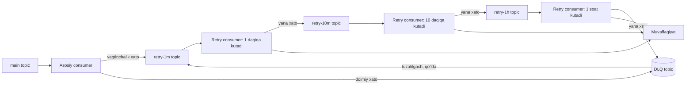

## Bu dars nima uchun kerak

Modulning oxirgi darsi - asinxron tizimlar **buzilganda** nima bo'lishi haqida. 41-darsda navbat cho'qqi yuklamani tekislaydi dedik. Bu to'g'ri, lekin faqat consumer'lar o'rtacha hisobda yetib ola olsa. Agar yetib ololmasa, navbat cheksiz o'sadi va tizim ikki holatdan biriga tushadi: xotira yoki disk tugaydi (broker yiqiladi), yoki ma'lumot shunchalik kechikadiki, foydalanuvchi uchun befoyda bo'ladi.

AWS'ning "Avoiding insurmountable queue backlogs" maqolasi buni aniq ifodalaydi: navbatlar durability'ni oshiradi, lekin to'plangan backlog tiklanishni uzilishning o'zidan ancha uzoqroq qilishi mumkin - bir soatlik uzilishdan tiklanish uchun yana bir soat davomida ikki baravar quvvat kerak bo'lishi mumkin. Navbatli tizimlarning ikki rejimi bor: backlog yo'q paytda tez, backlog paydo bo'lgach esa ancha sekin rejim.

Bu darsda uchta o'zaro bog'liq mexanizmni ko'ramiz:

- **Backpressure** - sekin iste'molchi tez ishlab chiqaruvchini sekinlashtirishi;
- **Retry strategiyalari** - vaqtinchalik xatolarni qanday qayta urinish, va qayta urinishlar tizimni yiqitmasligi;
- **Dead letter queue (DLQ)** - hech qachon muvaffaqiyatli bo'lmaydigan xabarlarni ajratish va keyin qayta ishlash.

Sinxron tizimlardagi timeout, retry va jitter 62-darsda, circuit breaker va load shedding 63-darsda chuqur ko'riladi. Bu yerda ularning **messaging** kontekstidagi shakli.

Bu darsdan keyin siz:

- backpressure'ning turli shakllarini (bloklash, kredit/prefetch, rad etish, tashlab yuborish) va ularning trade-offlarini bilasiz;
- vaqtinchalik va doimiy xatolarni ajratib, har biri uchun to'g'ri strategiya tanlay olasiz;
- exponential backoff va jitter'ni, retry amplification'ni hisoblay olasiz;
- Kafka'da partitionni to'smasdan retry qilish (retry topiclar) va SQS/RabbitMQ'da DLQ sozlashni bilasiz;
- backlog'dan tiklanish vaqtini hisoblab, uni qisqartirish texnikalarini (LIFO, sideline, TTL, shuffle sharding) qo'llay olasiz.

## Backpressure

**Backpressure** - qabul qiluvchi tomonning "sekinroq" degan signali ishlab chiqaruvchigacha yetib borishi. Reactive Streams standarti buni asinxron chegaralarda (masalan, thread'lar orasida) tez producer sekin consumer'ni bosib qo'ymasligi va oradagi navbatlar **chegaralangan** bo'lib qolishi uchun mexanizm deb ta'riflaydi. Bu standartning interfeyslari JDK 9 dan beri `java.util.concurrent.Flow` sifatida Java'ning o'zida bor.

### Backpressure bo'lmasa

Har bir oqim zanjirida eng sekin bo'g'in throughput'ni belgilaydi. Undan oldingi bo'g'inlar tezroq ishlasa, ortiqcha ma'lumot **qayerdadir** to'planishi kerak: xotiradagi buferda, navbatda yoki diskda. Chegarasiz bufer - kechiktirilgan crash.

Node.js "Backpressuring in Streams" qo'llanmasidagi o'lchov yaxshi misol: 9 GB ga yaqin video faylni `zlib` gzip bilan siqishda `.write()` qaytargan qiymat hurmat qilinganda maksimal rezident xotira (max RSS) 87 810 048 bayt (87.8 MB), backpressure o'chirilgan (`return true` qilib o'zgartirilgan) binar bilan esa 1 524 965 376 bayt (1.52 GB) bo'lgan: 1 524 965 376 ÷ 87 810 048 = 17.4 baravar ko'p. GC esa backpressure bilan minutiga 75 marta, usiz 36 marta ishlagan - kichik bufer tez-tez va arzon tozalanadi. Besh urinishning o'rtacha ishlash vaqti deyarli bir xil edi (55.3 s va 56.0 s): backpressure tezlikni pasaytirmadi, faqat xotirani nazorat qildi.

Node.js'da mexanizm: `writable.write()` bufer `highWaterMark` dan oshganda `false` qaytaradi (Node.js stream API hujjatiga ko'ra v22.0.0 dan beri default bayt oqimlari uchun 64 KiB, Windows'da 16 KiB; objectMode'da 16 ta obyekt; v22 dan oldin bayt oqimlari uchun 16 KiB edi), va `'drain'` hodisasigacha yozishni to'xtatish kerak. `pipeline()` buni avtomatik qiladi. NestJS/Fastify'da Kafka consumer'dan bazaga yozadigan worker yozganda xuddi shu tamoyil: bazaga yozish sekinlashsa, `poll()` ham sekinlashishi kerak, xotiradagi massiv o'smasligi kerak.

### Backpressure shakllari

| Shakl | Qanday | Misol | Narxi |
|---|---|---|---|
| Bloklash | Producer bufer bo'shaguncha kutadi | Kafka producer `buffer.memory` (default 32 MiB) to'lsa, `send()` `max.block.ms` (default 60 s) gacha bloklanadi; TCP oqim nazorati | Producer'ning o'zi sekinlashadi, uning yuqorisiga ham tarqaladi |
| Kredit / talab (pull) | Consumer qancha olishga tayyorligini aytadi | RabbitMQ prefetch, Reactive Streams talab signali, Kafka pull modeli | Consumer tezligiga moslashadi, lekin navbatda backlog to'planishi mumkin |
| Rad etish | Chegara oshsa, yangi ishni qabul qilmaslik | RabbitMQ `overflow=reject-publish` (42-dars), HTTP 429/503 | Producer xatoni boshqarishi kerak |
| Tashlab yuborish | Eski yoki kam muhim ma'lumotni yo'qotish | RabbitMQ `drop-head`, TTL, sampling | Ma'lumot yo'qoladi - faqat qabul qilinadigan joyda |
| Masshtablash | Consumer'larni ko'paytirish | Lag bo'yicha autoscaling (76-dars) | Sekin reaksiya, partitionlar soni bilan cheklangan, pastki tizimni (bazani) bosib qo'yishi mumkin |

Muhim nozik joy: **navbatning o'zi backpressure'ni uzadi.** Navbat bor joyda producer consumer sekinligini sezmaydi - navbat shunchaki o'sadi. Bu dizayn bo'yicha (temporal decoupling), lekin shuning uchun navbatda backpressure'ni **sun'iy** qayta tiklash kerak: navbat uzunligi yoki eng eski xabar yoshi chegaradan oshganda producer'ni sekinlashtirish yoki rad etish. AWS maqolasi shuni tavsiya qiladi: backlog katta bo'lganda shu ish yuklamasi uchun kiruvchi chegarani backlog hajmiga teskari proporsional ravishda kamaytirish. Lekin u ham ogohlantiradi: umumiy navbatda bu aybsiz ish yuklamalarini ham jazolaydi.

### Autoscaling'ning tuzog'i

"Lag oshdi - consumer'larni ko'paytiramiz" har doim ham ishlamaydi:

- Kafka consumer group'da faol consumer'lar soni partitionlar sonidan oshmaydi (43-dars).
- Consumer sekinligining sababi ko'pincha **pastki tizim** (baza, tashqi API). Consumer'larni 10 baravar ko'paytirish bazaga 10 baravar ko'p yuklama beradi va uni butunlay yiqitadi. Bu holda consumer'lar soni emas, pastki tizimga **concurrency chegarasi** kerak.
- Little qonuni (3-dars): kechikish oshganda bir vaqtdagi so'rovlar soni ham oshadi va thread pool'lar tugaydi. AWS maqolasi har bir ish yuklamasi uchun thread va concurrency chegaralarini qo'yishni tavsiya qiladi.

## Xatolarni tasniflash

Har bir xato uchun birinchi savol: **qayta urinish yordam beradimi?**

| Tur | Misol | Retry yordam beradimi | Nima qilish kerak |
|---|---|---|---|
| Vaqtinchalik (transient) | Tarmoq timeout'i, 503, deadlock, leader election paytida `NotLeaderForPartition`, rate limit 429 | Ha | Backoff + jitter bilan retry |
| Doimiy (permanent) | JSON parse xatosi, sxemaga mos kelmaslik, biznes qoidasi buzilishi (mashina mavjud emas), 400/422 | Yo'q | Darhol DLQ, alert |
| Noma'lum yoki "zahar" (poison) | Consumer'ni yiqitadigan xabar (OOM, segfault, cheksiz sikl) | Yo'q, lekin aniqlash qiyin | Delivery count chegarasi, keyin DLQ |
| Bog'liqlik uzilishi | Baza 20 daqiqa o'chiq | Ha, lekin uzoq | Retry'ni to'xtatish (circuit breaker, 63-dars), consumer'ni pauza qilish |

Doimiy xatoni 10 marta retry qilish faqat resurs isrofi va kechikish. Vaqtinchalik xatoni DLQ ga darhol yuborish esa ishlov beruvchilarga keraksiz qo'l mehnati. Shuning uchun consumer kodi xatolarni **turi bo'yicha** ajratishi kerak, faqat "exception bo'ldi" deb emas.

Oxirgi qatorga alohida e'tibor: baza o'chiq bo'lsa, har bir xabar muvaffaqiyatsiz bo'ladi va maxReceiveCount tugagach DLQ ga tushadi. 20 daqiqadan keyin DLQ da yuz minglab sog'lom xabar bo'ladi. To'g'ri yondashuv: bog'liqlik xatosini aniqlaganda xabarni DLQ ga yubormasdan **consumer'ni pauza** qilish (Kafka'da `pause()`, SQS'da polling'ni to'xtatish) va bog'liqlik qaytgach davom ettirish.

## Retry: exponential backoff va jitter

### Retry amplification

AWS Builders' Library (Marc Brooker) misoli: 5 qatlamli chaqiruv zanjirida har bir qatlam 3 marta urinsa, baza qiynalayotgan paytda uning yuklamasi **243 baravar** oshadi (3^5). Ya'ni retry'lar qiynalayotgan tizimni yordam o'rniga butunlay yiqitadi. Messaging'da ham xuddi shunday: producer retry qiladi, broker qayta yetkazadi, consumer ichida HTTP mijoz retry qiladi, va DLQ redrive yana boshidan.

Qoida: retry'ni **bitta** qatlamda qiling. Asinxron tizimda bu odatda navbat darajasi: consumer ichida ichki retry'lar minimal (1-2 ta tez urinish), asosiy retry esa xabarni navbatga kechikish bilan qaytarish orqali.

### Exponential backoff

Har bir urinishdan keyin kutish vaqti eksponensial o'sadi: `delay = min(cap, base × 2^attempt)`. Masalan, base = 1 s, cap = 5 daqiqa: 1, 2, 4, 8, 16, 32, 64, 128, 256, 300, 300 s ...

**Hisob-kitob.** 8 ta urinish (0 dan 7 gacha) bilan umumiy kutish: 1 + 2 + 4 + 8 + 16 + 32 + 64 + 128 = 255 s, ya'ni 4.25 daqiqa. Agar bog'liqlik 10 daqiqa o'chiq bo'lsa, bu yetarli emas - xabar DLQ ga tushadi. 10 ta urinish (0 dan 9 gacha), cap = 5 daqiqa bilan: 1 + 2 + ... + 256 = 511 s, 9-urinishda 2^9 = 512 > 300, demak 300 s; jami 511 + 300 = 811 s, ya'ni 13.5 daqiqa. Cap bo'lmaganda esa 2^10 - 1 = 1 023 s, 17 daqiqa. Retry jadvali **kutilayotgan uzilish davomiyligidan** kelib chiqib tanlanadi.

### Jitter

Faqat backoff yetarli emas: 1 000 ta consumer bir vaqtda xato olsa, ularning hammasi aynan 1, 2, 4 soniyadan keyin bir vaqtda qayta urinadi - "thundering herd". **Jitter** - kutish vaqtiga tasodifiylik qo'shish. Brooker'ning 2015-yilgi tahlilida uch variant solishtirilgan:

- **Full jitter**: `sleep = random(0, min(cap, base × 2^attempt))` - butun kutish vaqti tasodifiy.
- **Equal jitter**: kutishning yarmi qat'iy, yarmi tasodifiy - simulyatsiyada eng yomon natija ko'rsatgan.
- **Decorrelated jitter**: keyingi kutish oldingi tasodifiy qiymatga bog'liq.

Full va decorrelated jitter o'rtasidagi farq kichik: biri kamroq ish, ikkinchisi biroz tezroq yakunlanish beradi. Amaliy tanlov - full jitter.

Brooker'ning yana bir tavsiyasi: retry'larni token bucket bilan cheklash (tokenlar bor ekan retry qilinadi, tugagach - qat'iy past tezlikda). Bu AWS SDK'ga 2016-yilda qo'shilgan. Va eng muhimi: **faqat idempotent operatsiyalarni retry qiling** (39-dars).

## Retry va DLQ: brokerlar bo'yicha

### SQS

- Visibility timeout tugashi - avtomatik retry (42-dars). Kechikish = visibility timeout, ya'ni backoff yo'q, qat'iy interval.
- Backoff uchun: xatoda `ChangeMessageVisibility` bilan timeout'ni urinish soniga qarab oshirish (xabarning `ApproximateReceiveCount` atributi bo'yicha). Maksimum - birinchi olingan paytdan 12 soat.
- `RedrivePolicy.maxReceiveCount` dan keyin DLQ. DLQ manba bilan bir xil account va region'da; standard navbatda DLQ retention manbanikidan uzun bo'lishi kerak.
- **DLQ redrive** - tuzatishdan keyin xabarlarni manba navbatga qaytarish.
- FIFO navbatda ehtiyotkorlik: AWS hujjati xabarlar tartibi qat'iy saqlanishi kerak bo'lganda FIFO bilan DLQ ishlatmaslikni aytadi, chunki xabarni DLQ ga chiqarish guruh ichidagi tartibni buzadi.

### RabbitMQ

- Quorum queue `delivery-limit` (4.0 dan default 20), keyin DLX ga yoki tashlanadi (42-dars). DLX sozlanmagan bo'lsa - **jim yo'qotish**.
- Default dead lettering at-most-once; quorum queue'larda `dead-letter-strategy=at-least-once` mumkin.
- Kechiktirilgan retry: 4.3 dan quorum queue'larda **delayed retry** (chiziqli backoff, `min(delayed-retry-min × delivery-count, delayed-retry-max)`). Undan oldin keng tarqalgan usul - TTL va DLX bilan "kutish navbati" (xabar TTL li navbatga yuboriladi, TTL tugagach DLX orqali asosiy navbatga qaytadi). RabbitMQ hujjati retry'lar uchun dead-letter sikllari o'rniga delayed retry'ni tavsiya qiladi.

### Kafka: partitionni to'smasdan retry

Kafka'da maxsus muammo bor: consumer offset'i ketma-ket siljiydi (43-dars). Xabar 17 muvaffaqiyatsiz bo'lsa va consumer uni joyida qayta ursa, 18, 19, ... xabarlar kutib turadi. Bitta zahar xabar butun partitionni **to'xtatadi** (head-of-line blocking). Uber'ning 2018-yilgi maqolasi buni aynan shunday tasvirlaydi va yechim taklif qiladi:

Mexanika:

- Asosiy consumer xatoda xabarni **birinchi retry topic**ga yozadi va asosiy topicdagi offset'ni commit qiladi - partition oldinga yuradi.
- Har bir retry darajasi - alohida topic va alohida consumer group. Retry consumer xabarni o'qib, uning vaqt belgisidan boshlab belgilangan kechikish o'tguncha kutadi, keyin handler'ni chaqiradi. Uber buni "leaky bucket" ga o'xshatadi va bu best-effort ekanini aytadi: handler kechikishdan **kamida** keyin chaqiriladi, lekin kechroq ham bo'lishi mumkin.
- Oxirgi daraja ham muvaffaqiyatsiz bo'lsa - DLQ topic. Muhandislar uni ko'rib chiqadi, tozalaydi yoki xabarlarni birinchi retry topicga qaytaradi - ular jonli trafikdan ajratilgan holda yana zinapoyadan o'tadi.
- Retry topic xabariga metadata qo'shing (header'larda): asl topic, partition, offset, urinishlar soni, oxirgi xato matni, birinchi xato vaqti.

**Narxi - tartib.** Xabar 17 retry topicga ketdi, xabar 18 esa muvaffaqiyatli qayta ishlandi. Bitta mashina uchun "safar boshlandi" (17) va "safar tugadi" (18) bo'lsa, consumer "tugadi" ni "boshlandi" dan oldin ko'radi. Agar kalit bo'yicha tartib muhim bo'lsa, ikki variant bor: (a) shu kalitning keyingi xabarlarini ham retry topicga yuborish (kalit "bloklangan" deb belgilanadi, bu holat saqlanishi kerak), (b) consumer'ni tartibsizlikka chidamli qilish (versiya bo'yicha, 47-dars). Ko'pincha (b) sodda va ishonchli.

Kafka 4.2 dan boshlab share groups (43-dars) bu muammoning bir qismini broker darajasida yechadi: har bir yozuv alohida tasdiqlanadi (`release` vaqtinchalik xato uchun, `reject` doimiy xato uchun), delivery count chegarasi (default 5) bor - lekin tartib kafolati yo'q. Kafka Streams 4.2 da exception handler'larda DLQ qo'llab-quvvatlashi qo'shildi (KIP-1034).

### Taqqoslash

| Mexanizm | SQS | RabbitMQ (quorum) | Kafka (consumer group) |
|---|---|---|---|
| Avtomatik qayta yetkazish | Visibility timeout tugaganda | nack/requeue yoki consumer o'lganda | Yo'q, offset commit qilinmasa qayta o'qiladi |
| Urinishlar chegarasi | `maxReceiveCount` | `delivery-limit` (default 20) | Yo'q - ilova o'zi |
| Backoff | `ChangeMessageVisibility` bilan qo'lda | Delayed retry (4.3+) yoki TTL+DLX | Retry topiclar zinapoyasi |
| DLQ | Native, redrive bilan | DLX (sozlash shart) | Oddiy topic, ilova yoki framework yozadi |
| Zahar xabar boshqalarni to'sadimi | Yo'q (standard); FIFO'da guruhni | Yo'q (lekin tartib buziladi) | Ha, partitionni - retry topicsiz |

## DLQ bilan ishlash

DLQ - axlat qutisi emas, **ish navbati**. Unga tushgan har bir xabar - yo bug, yo ma'lumot muammosi, yo hal qilinmagan bog'liqlik nosozligi.

1. **Alert.** DLQ'dagi xabarlar soni > 0 yoki o'sish tezligiga alert. AWS maqolasi ogohlantiradi: DLQ hajmi foydali metrika, lekin muammoni juda kech ko'rsatadi, shuning uchun yagona signal bo'lmasligi kerak.
2. **Kontekst.** Xabar bilan birga: asl manba, xato matni va stack trace, urinishlar soni, birinchi va oxirgi xato vaqti, consumer versiyasi. Bularsiz DLQ'dagi xabarni tahlil qilib bo'lmaydi.
3. **Tahlil va guruhlash.** Odatda yuzlab xabar bitta sababga ega. Xato turi bo'yicha guruhlang.
4. **Tuzatish, keyin redrive.** Avval kodni yoki ma'lumotni tuzating, keyin xabarlarni qaytaring. Tuzatmasdan redrive - xabar yana DLQ ga qaytadi.
5. **Redrive tezligini cheklash.** 500 000 xabarni birdan qaytarish jonli trafik bilan raqobatlashadi va yangi backlog yaratadi. Uber yondashuvida qaytarilgan xabarlar birinchi retry topicga boradi, asosiy topicga emas - jonli trafikdan ajratilgan.
6. **Idempotency.** Redrive qilingan xabarlarning bir qismi aslida allaqachon qayta ishlangan bo'lishi mumkin (masalan, timeout - lekin muvaffaqiyatli). Consumer idempotent bo'lishi shart.
7. **Retention.** DLQ'da xabarlar qancha turadi? Kafka'da DLQ topic retention'i, SQS'da 14 kun maksimum. Muddat tugaguncha hal qilinmasa - yo'qoladi. Muhim ma'lumot uchun DLQ'ni uzoq muddatli omborga (S3, bazaga) arxivlash.

## Backlog'dan tiklanish

Bog'liqlik 1 soat o'chiq bo'ldi, navbatda 1 soatlik ma'lumot to'plandi. Endi nima?

**Hisob-kitob.** Kirish λ = 2 000 xabar/s, consumer quvvati μ = 3 000 xabar/s (50% zaxira). 1 soatlik uzilish: backlog = 2 000 × 3 600 = 7.2 mln xabar.

- Bo'shash tezligi: μ - λ = 1 000 xabar/s.
- Tiklanish vaqti: 7.2 mln ÷ 1 000 = 7 200 s = **2 soat**. Ya'ni 1 soatlik uzilish 3 soatlik "kechikkan ma'lumot" davriga aylanadi.
- Agar zaxira 20% bo'lsa (μ = 2 400): 7.2 mln ÷ 400 = 18 000 s = **5 soat**.
- Agar tiklanish paytida consumer'larni 2 baravar ko'paytirsak (μ = 6 000, pastki tizim ko'tarsa): 7.2 mln ÷ 4 000 = 30 daqiqa.

AWS maqolasidagi xulosa shundan: tiklanish uchun ortiqcha quvvat kerak, va zaxira qanchalik kichik bo'lsa, tiklanish shunchalik uzoq.

### Tiklanishni tezlashtirish texnikalari (AWS Builders' Library)

- **Eng eski xabar yoshini o'lchash.** Navbat uzunligi emas, yosh - foydalanuvchi ko'radigan kechikish. AWS IoT misolida retry'larni hisobga olmaydigan "birinchi urinish yoshi" metrikasi ishlatiladi, toki oflayn qurilmalarning kutilgan backlog'i tizim muammosini yashirmasin.
- **LIFO xatti-harakati.** Real vaqt tizimlarida yangi ma'lumot muhimroq. Backlog bo'lganda avval yangi xabarlarni qayta ishlash, eskilarini quvvat bo'shaganda.
- **Sideline (chetga olish).** Navbatdan olganda xabar yoshini tekshirish va eskisini alohida "backlog" navbatiga ko'chirish, u asosiy navbat yetib olgandan keyin qayta ishlanadi. Yoki limitdan oshgan mijozning xabarlarini alohida "spillover" navbatiga.
- **TTL bilan tashlab yuborish.** Yangi ma'lumot eskisini bekor qiladigan tizimlarda (masalan, oxirgi joylashuv) eski xabarlarni qayta ishlamasdan tashlash.
- **Shuffle sharding.** Har bir mijozni umumiy navbatlar pulidan kichik bir to'plamga hash qilish va eng kam yuklangan navbatga yozish. Bitta shovqinli mijoz faqat o'z navbatlarini to'ldiradi, boshqalar ta'sirlanmaydi. Har bir mijozga alohida navbat kuchli izolyatsiya beradi, lekin mijozlar ko'p bo'lsa polling narxi yomon masshtablanadi.
- **Heartbeat.** Uzoq ishda visibility timeout yoki lease'ni uzaytirib turish. Aks holda xabar boshqa consumer'ga ketadi va bir xil ish parallel bajariladi - yuklama oshgan paytda yuklamani yanada oshiradi.

## iQuariX kontekstida qo'llanish

O'quv misoli (iQuariX haqidagi real ichki ma'lumot emas): uch xil oqim va har biri uchun turli siyosat:

**1. GPS telemetriya (Kafka, `gps-points`).**

- Retry: consumer ichida 2 ta tez urinish (100 ms, 300 ms jitter bilan) - faqat vaqtinchalik xatolarga.
- Doimiy xato (buzilgan paket, noma'lum `device_id`) - darhol `gps-points-dlq` topicga, xom bayt va xato bilan. Bu ko'pincha yangi treker modeli yoki firmware bug'i - DLQ'ni model bo'yicha guruhlab tahlil qilish.
- Time-series baza o'chsa - DLQ emas, consumer'ni **pauza** qilish. Kafka retention (masalan, 3 kun) - bufer.
- Tiklanish: oxirgi joylashuv servisi backlog'da eski nuqtalarni **o'tkazib yuboradi** (TTL: 2 daqiqadan eski nuqta xaritaga kerak emas, yangisi keladi), time-series yozuvchi esa hammasini yozadi. Ikki guruh - ikki siyosat.
- Ehtiyot chorasi: qurilma 3 soat oflayn bo'lib, buferini yuborgani "lag" metrikasini buzmasligi uchun lag'ni Kafka'ga **kelgan** vaqt bo'yicha o'lchang, event time bo'yicha emas (45-dars).

**2. Ogohlantirish SMS'lari (RabbitMQ quorum queue).**

- SMS provayderi 429 yoki 503 qaytarsa - vaqtinchalik: delayed retry, min 2 s, max 60 s; `delivery-limit` 10.
- Noto'g'ri telefon raqami - doimiy: `reject` (requeue=false) - DLX - `sms-dlq`, va mijoz sozlamalarida "raqam noto'g'ri" belgisi.
- Provayder 30 daqiqa ishlamasa, 30 daqiqa oldingi "mashina geozonadan chiqdi" SMS'i endi ma'nosiz bo'lishi mumkin: xabarga `expires_at` qo'yiladi, consumer muddati o'tganini SMS yubormasdan tashlaydi (lekin hodisalar jurnalida qoladi).
- Backpressure: SMS provayder limitini (masalan, 50 SMS/s) consumer'lar soni × prefetch emas, umumiy rate limiter (56-dars) belgilaydi.

**3. Oylik hisobotlar (SQS).**

- Visibility timeout 2 daqiqa + heartbeat, `maxReceiveCount` 3, DLQ retention 14 kun (manba 4 kun).
- Oy oxirida 400 mijozning hammasi hisobot so'raydi: fair queue (`MessageGroupId = tenant_id`) yoki shuffle sharding - bitta katta mijoz kichiklarni to'smasin.

## Ko'p uchraydigan xatolar

1. **Chegarasiz xotiradagi bufer.** Consumer xabarlarni `poll()` qilib massivga yig'adi, baza esa sekin - OOM. Backpressure'ni hurmat qiling.
2. **Har bir qatlamda retry.** HTTP mijoz, consumer, broker va DLQ redrive - retry amplification qiynalayotgan tizimni yiqitadi.
3. **Jitter'siz backoff.** Minglab consumer bir vaqtda qayta uradi - thundering herd.
4. **Doimiy xatolarni retry qilish.** Parse xatosi 20 marta qayta urinib, 20 baravar resurs va kechikish.
5. **Bog'liqlik uzilishida DLQ ga yuborish.** Baza o'chiq paytda sog'lom xabarlar DLQ'ni to'ldiradi. Pauza qiling.
6. **Kafka'da joyida cheksiz retry.** Bitta zahar xabar partitionni soatlab to'xtatadi.
7. **DLQ'ni sozlab, kuzatmaslik.** DLQ'da 14 kun xabarlar to'planadi va jim o'chib ketadi. RabbitMQ'da DLX umuman sozlanmagan bo'lsa - delivery limit'dan keyin jim yo'qotish.
8. **Tuzatmasdan va cheklovsiz redrive.** Xabarlar DLQ'ga qaytadi yoki jonli trafikni bosib qo'yadi.

## Xulosa

- Navbat backpressure'ni uzadi: producer consumer sekinligini sezmaydi. Shuning uchun navbat uzunligi va eng eski xabar yoshi bo'yicha sun'iy backpressure, chegaralar va alert kerak.
- Backpressure shakllari: bloklash, kredit/prefetch, rad etish, tashlab yuborish, masshtablash. Pastki tizim cheklovchi bo'lsa, consumer'larni ko'paytirish yordam bermaydi.
- Xatolarni tasniflang: vaqtinchalik - retry, doimiy - darhol DLQ, zahar - delivery limit, bog'liqlik uzilishi - pauza.
- Retry bitta qatlamda, exponential backoff + full jitter, cheklangan urinishlar, faqat idempotent operatsiyalar uchun.
- Kafka'da retry topiclar zinapoyasi partitionni to'smaydi, lekin kalit bo'yicha tartibni buzadi.
- DLQ - ish navbati: alert, kontekst, guruhlash, tuzatish, cheklangan redrive, retention.
- Backlog'dan tiklanish vaqti = backlog ÷ (μ - λ). Zaxira kichik bo'lsa, tiklanish uzilishdan ko'p marta uzun. LIFO, sideline, TTL va shuffle sharding tiklanishni qisqartiradi.

## Amaliy topshiriq

iQuariX uchun **mijoz webhook'lari** tizimini nosozliklarga chidamli qilib loyihalang (faraziy): 600 mijoz o'z URL'iga hodisalarni oladi (geofence, ogohlantirishlar, safar yakuni). Kuniga 8 mln webhook, cho'qqida 400/s. Ba'zi mijozlarning serverlari sekin (5-30 s javob), ba'zilari soatlab o'chiq, ba'zilari doim 400 qaytaradi (noto'g'ri sozlangan).

1. **Xato tasnifi.** HTTP javob kodlari va tarmoq xatolarini vaqtinchalik va doimiy turlarga ajrating (2xx, 3xx, 400, 401, 404, 410, 413, 429, 500, 502, 503, timeout, DNS xatosi). Har biri uchun harakatni yozing.
2. **Retry jadvali.** Mijoz serveri 6 soatgacha o'chiq bo'lishi mumkin. Backoff parametrlari (base, cap, urinishlar soni, jitter turi) ni tanlang va umumiy retry oynasini hisoblang.
3. **Izolyatsiya.** Bitta o'chiq yoki sekin mijoz boshqa 599 mijozning yetkazilishini kechiktirmasligi uchun arxitekturani taklif qiling (per-tenant navbat, shuffle sharding, per-tenant concurrency limit, circuit breaker). Taqqoslab tanlang.
4. **Backpressure va backlog.** Mijoz 6 soat o'chiq bo'lsa, unga tegishli backlog qancha (o'rtacha 30 000 webhook/kun deb oling)? U qaytganda webhook'larni qanday tezlikda yetkazasiz, toki uning serverini yana yiqitmasangiz?
5. **DLQ va mijoz tajribasi.** Retry oynasi tugagach nima bo'ladi? Mijoz o'zi "qayta yuborish" ni bosishi mumkinmi? DLQ retention va arxivlash.
6. **Idempotency va tartib.** Mijoz bir webhook'ni ikki marta olsa yoki "safar tugadi" ni "safar boshlandi" dan oldin olsa, qanday himoya qilasiz (sarlavhalar, imzo, versiya)?

Yaxshi javobda bo'lishi kerak bo'lgan narsalar:

- 4xx va 5xx/timeout'lar to'g'ri ajratilgan, 429 da `Retry-After` hurmat qilingan;
- retry oynasi hisoblangan (masalan, cap bilan yig'indi 6 soatdan oshadi) va full jitter tanlangan;
- per-tenant izolyatsiya (concurrency limit yoki shuffle sharding) va mijoz bo'yicha circuit breaker;
- backlog hisobi (6 soat x 30 000 / 24 = 7 500) va qaytgan mijozga cheklangan tezlikda yetkazish;
- DLQ, mijoz uchun qo'lda redrive va uzoq muddatli arxiv;
- har bir webhook'da `event_id`, imzo va versiya/`occurred_at` - mijoz tomonida dedup va tartibni tiklash imkoni.

Javobni pastdagi maydonga yozib, chatga yuboring.

## Manbalar

- AWS Builders' Library. [Avoiding insurmountable queue backlogs](https://builder.aws.com/content/3EuRcgkTP1MI0c7zM8W6HL3WIqA/avoiding-insurmountable-queue-backlogs) - backlog'dan tiklanish, LIFO, sideline, shuffle sharding, heartbeat.
- AWS Builders' Library. [Timeouts, retries, and backoff with jitter](https://builder.aws.com/content/3EumjoZascWd1oZiEgL8ORlv3qE/timeouts-retries-and-backoff-with-jitter) - retry amplification (243x), bitta qatlamda retry, token bucket.
- Marc Brooker. [Exponential Backoff And Jitter](https://aws.amazon.com/blogs/architecture/exponential-backoff-and-jitter/), AWS Architecture Blog, 2015 - full, equal va decorrelated jitter taqqoslash.
- Uber Engineering. [Building Reliable Reprocessing and Dead Letter Queues with Apache Kafka](https://www.uber.com/blog/reliable-reprocessing/), 2018 - retry topiclar zinapoyasi va DLQ.
- Node.js. [Backpressuring in Streams](https://nodejs.org/en/learn/modules/backpressuring-in-streams) - drain, xotira va GC o'lchovi; [Stream API: stream.getDefaultHighWaterMark](https://nodejs.org/api/stream.html#streamgetdefaulthighwatermarkobjectmode) - default highWaterMark va v22.0.0 dagi o'zgarish.
- [Reactive Streams](https://www.reactive-streams.org/) - non-blocking backpressure standarti va JDK Flow.
- AWS. [Amazon SQS dead-letter queues](https://docs.aws.amazon.com/AWSSimpleQueueService/latest/SQSDeveloperGuide/sqs-dead-letter-queues.html) va RabbitMQ [Dead Letter Exchanges](https://www.rabbitmq.com/docs/dlx).
