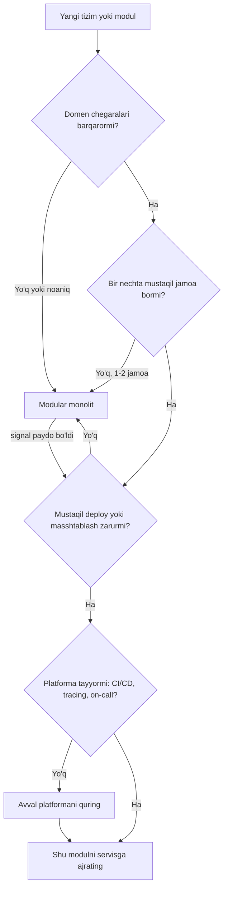
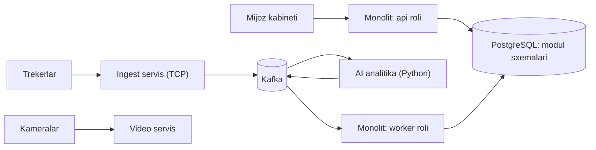

## Bu dars nima uchun kerak

Oldingi 50 darsda bitta tizim ichidagi qurilish bloklarini ko'rdik: bazalar, replication, sharding, consensus, Kafka, outbox, saga. Endi savol yuqoriroq darajada: **kodni qanday bo'laklarga ajratamiz va bu bo'laklar qanday deploy qilinadi?** Bu qaror jamoa tezligini, ishonchlilikni, infratuzilma narxini va kelajakdagi har bir o'zgarish narxini belgilaydi. Va bu - 1-darsdagi ta'rif bo'yicha - qaytarish qiyin bo'lgan "1-tur" qarorlardan biri.

Muammo shundaki, bu mavzu atrofida ko'p moda va kam raqam bor. 2014-2018 yillarda "microservices = zamonaviy" degan tasavvur hukmron edi. Keyin Segment (2018) va Amazon Prime Video jamoasi (2023) microservice'lardan monolitga qaytgani haqida yozdi va mayatnik qarama-qarshi tomonga og'di. To'g'ri javob ikkala qutbda ham emas: arxitektura uslubi - bu **deploy birligi, ma'lumot egaligi va jamoa tuzilmasi** bo'yicha aniq trade-off.

Bu darsdan keyin siz:

- monolit, modular monolit va microservices ni "deploy birligi" va "ma'lumot egaligi" o'qlari bo'yicha aniq ajrata olasiz;
- microservice'ning haqiqiy narxini (Fowler "microservice premium" deb ataydi) tarmoq, consistency, operatsiya va kognitiv yuk bo'yicha sanab bera olasiz;
- "distributed monolith" belgilarini taniysiz;
- modular monolitda modul chegaralarini kod darajasida qanday majburlashni bilasiz (NestJS misolida);
- qachon servis ajratish kerakligini aniq signallar bo'yicha aniqlaysiz va strangler fig usulida bosqichma-bosqich ajratishni rejalashtira olasiz.

## Uchta uslubning aniq ta'rifi

Bu atamalar ko'pincha noaniq ishlatiladi. Ularni ikki o'q bo'yicha ajratamiz:

1. **Deploy birligi** - nechta mustaqil ishga tushiriladigan va yangilanadigan artefakt bor.
2. **Ma'lumot egaligi** - har bir qism faqat o'z ma'lumotini o'zgartiradimi yoki hamma bitta sxemaga to'g'ridan-to'g'ri kiradimi.

### Monolit

Bitta deploy birligi, bitta process (yoki bir xil process'ning N ta nusxasi), odatda bitta baza. Ichki chaqiruv - oddiy funksiya chaqiruvi: nanosekundlar, xatoliklar exception sifatida, tranzaksiya bitta `BEGIN ... COMMIT` ichida.

E'tibor bering: monolit **horizontal masshtablanadi**. Stateless monolitning 20 ta nusxasini load balancer ortiga qo'yish mumkin (21-22-darslar). "Monolit masshtablanmaydi" degan gap noto'g'ri: masshtablanadi, faqat hamma qism birga masshtablanadi.

"Yomon" monolit bu uslubning o'zi emas, uning ichidagi tartibsizlik: har qanday modul har qanday jadvalga yozadi, har qanday klass har qanday klassni chaqiradi. Buni "big ball of mud" deyishadi.

### Modular monolit

Bitta deploy birligi, lekin ichida **qat'iy majburlangan chegaralar**. Shopify buni shunday ta'riflaydi: barcha kod bitta ilovani quvvatlaydi, lekin domenlar orasida chegaralar qat'iy majburlanadi. Har bir modul:

- tashqariga faqat ochiq interfeys (public API) beradi, ichki klasslari yashirin;
- o'z jadvallariga ega va boshqa modul jadvaliga to'g'ridan-to'g'ri yozmaydi;
- boshqa modullar bilan faqat interfeys yoki ichki event orqali gaplashadi.

Modular monolit - "keyin microservice'ga ajratish oson bo'lsin" degan tayyorgarlik emas, balki o'zi to'liq qiymatli maqsad bo'lishi mumkin.

### Microservices

James Lewis va Martin Fowler 2014 yildagi maqolasida microservice arxitekturasini to'qqizta xususiyat orqali tavsiflaydi. Ulardan eng muhimlari: servislar orqali komponentlash (mustaqil deploy), biznes imkoniyatlari atrofida tashkil qilish, "aqlli endpoint, oddiy quvur" (smart endpoints and dumb pipes), markazlashmagan ma'lumot boshqaruvi (har servis o'z bazasi), infratuzilma avtomatlashtirilishi va nosozlikka tayyor dizayn.

Asosiy farq: servislar **tarmoq orqali** gaplashadi va **har biri o'z ma'lumotiga ega**. Boshqa servis ma'lumoti kerak bo'lsa - API chaqiradi yoki event'ga obuna bo'ladi, uning bazasiga SELECT qilmaydi.

| Xususiyat | Monolit | Modular monolit | Microservices |
|---|---|---|---|
| Deploy birligi | 1 | 1 | N |
| Modul orasidagi chaqiruv | Funksiya, ns | Interfeys orqali funksiya, ns | Tarmoq (HTTP/gRPC/navbat), ms |
| Ma'lumot | Bitta sxema, hamma hammaga kiradi | Bitta baza, lekin jadvallar modulga tegishli | Har servisda alohida baza |
| Tranzaksiya | Lokal ACID | Lokal ACID (modullar orasida ham, agar ruxsat berilsa) | Saga, outbox, eventual consistency |
| Mustaqil masshtablash | Yo'q | Yo'q (yoki bir xil kodni turli rolda ishga tushirish) | Ha |
| Fault isolation | Yo'q: bitta memory leak hammani yiqitadi | Yo'q | Qisman: lekin cascading failure xavfi bor |
| Texnologiya tanlovi | Bitta stek | Bitta stek | Har servis o'zi |
| Operatsion narx | Past | Past | Yuqori: CI/CD, observability, discovery, versioning |
| Refaktor narxi | Arzon (IDE refactor) | Arzon modul ichida, o'rtacha chegarada | Qimmat: API kontrakti o'zgaradi |

## Microservice premium: haqiqiy narx nimada

Fowler 2015 yilgi "Monolith First" yozuvida microservice'larning sezilarli qo'shimcha narxini "MicroservicePremium" deb ataydi: servislar to'plamini boshqarish jamoani sekinlashtiradi va bu narx faqat murakkabroq tizimlarda o'zini oqlaydi. Bu premiumni to'rt qismga ajratamiz.

### 1. Tarmoq: funksiya chaqiruvi endi RPC

Monolit ichida `orderService.getOrder(id)` taxminan nanosekundlar oladi va faqat ikki natija bor: qiymat yoki exception. Tarmoq orqali esa (31-dars) uchinchi natija paydo bo'ladi: **noma'lum**. Timeout bo'ldi - so'rov bajarildimi yoki yo'qmi? Shu sababli har bir tarmoq chaqiruvi uchun kerak:

- timeout va retry siyosati (62-dars), retry bo'lsa idempotency (39-dars);
- circuit breaker (63-dars), aks holda bitta sekin servis zanjir bo'ylab hammani to'xtatadi;
- serialization va kontrakt versiyalash (10-dars).

Latency hisobi: bir data-markaz ichidagi round trip taxminan 0.5 ms (2-dars). Agar bitta foydalanuvchi so'rovi ketma-ket 6 ta servisdan o'tsa va har biri o'rtacha 1 ms tarmoq + 2 ms ishlov qo'shsa, faqat zanjir 18 ms qo'shadi. Muhimrog'i - **tail latency ko'payadi**. Agar har servisning p99 qiymati 50 ms bo'lsa va so'rov 6 ta servisdan parallel javob kutsa, kamida bittasi p99 dumiga tushish ehtimoli 1 - 0.99^6 ≈ 5.9%. Ya'ni foydalanuvchi so'rovlarining taxminan 6 foizi sekin dumni his qiladi, garchi har bir servis "faqat 1%" sekin bo'lsa ham (3-dars).

Mavjudlik ham ko'paytiriladi: ketma-ket bog'langan 5 ta servis har biri 99.9% bo'lsa, zanjir 0.999^5 ≈ 99.5%. Oyiga 43 daqiqa o'rniga taxminan 3.6 soat ishlamaslik.

### 2. Ma'lumot: lokal tranzaksiya yo'qoladi

Monolitda "buyurtma yaratish + omborda zaxirani kamaytirish + to'lov yozuvi" bitta tranzaksiya. Uchta servisga bo'lingach, buni 2PC bilan qilish (37-dars) amalda kam qo'llanadi, shuning uchun saga (49-dars), transactional outbox (48-dars) va eventual consistency kerak bo'ladi. Bu kod hajmini va testlash murakkabligini sezilarli oshiradi.

JOIN ham yo'qoladi. "Mijoz nomi bilan birga buyurtmalar ro'yxati" endi ikki servisga so'rov, yoki ma'lumotni nusxalab saqlash (CQRS, 47-dars).

### 3. Operatsiya

Har bir servis uchun: CI pipeline, container image, deploy konfiguratsiyasi, health check, dashboard, alert, log, secrets, on-call egasi. Taqsimlangan tracing (66-dars) shart bo'ladi, chunki xato endi bitta stack trace'da emas, 8 ta servis logida tarqalgan. Service discovery (53-dars), API gateway (54-dars), ehtimol service mesh (55-dars) kerak bo'ladi.

### 4. Kognitiv va tashkiliy yuk

Lokal muhitda butun tizimni ishga tushirish qiyinlashadi. Integratsion testlar sekin va "flaky" bo'ladi. Kontrakt o'zgarishi bir nechta jamoani muvofiqlashtirishni talab qiladi.

### Premium nimani sotib oladi

Bularning evaziga olinadigan narsa:

- **Mustaqil deploy:** 200 muhandisli tashkilotda har jamoa boshqalarni kutmasdan kuniga bir necha marta deploy qiladi. Bu eng asosiy foyda.
- **Mustaqil masshtablash:** video transcoding servisini GPU mashinalarda 50 nusxada, admin panelni 2 nusxada ishga tushirish.
- **Fault isolation:** to'g'ri qurilganda, hisobot servisidagi memory leak telemetriya qabul qilishni yiqitmaydi.
- **Texnologik erkinlik:** ML inferens Python'da, ingest Go yoki Rust'da, biznes logika NestJS'da.
- **Jamoa avtonomiyasi:** Conway qonuni (Melvin Conway, 1968): tizim tuzilmasi uni loyihalagan tashkilotning aloqa tuzilmasini takrorlaydi. Microservice'lar jamoalarni bir-biriga kamroq bog'liq qilish vositasi.

E'tibor bering: ro'yxatdagi birinchi va oxirgi band - **tashkiliy** foyda. 5 kishilik jamoada ular deyarli nolga teng, premium esa to'liq to'lanadi.

## Distributed monolith: ikkala dunyoning yomon tomoni

Eng ko'p uchraydigan muvaffaqiyatsiz natija - "microservices" deb nomlangan, lekin aslida bir-biriga qattiq bog'langan servislar. Belgilari:

1. **Birga deploy:** A servisni yangilash uchun B va C ni ham bir vaqtda yangilash kerak. Mustaqil deploy - premium to'lanishining asosiy sababi - yo'q.
2. **Umumiy baza:** bir nechta servis bitta sxemaga to'g'ridan-to'g'ri yozadi. Bitta jadvaldagi ustun nomini o'zgartirish 4 ta servisni buzadi.
3. **Chatty aloqa:** bitta foydalanuvchi so'rovi 20-30 ta sinxron servis chaqiruviga aylanadi.
4. **Umumiy "core" kutubxona** - domen modellari bilan, uni yangilash barcha servislarni qayta deploy qilishni talab qiladi.
5. **Bitta servis o'chsa, hammasi o'chadi:** fault isolation yo'q, faqat nosozlik nuqtalari ko'paygan.

Distributed monolith monolitning bog'liqligini va microservice'ning tarmoq narxini birga oladi. Agar tizimingiz shu holatda bo'lsa, ko'pincha to'g'ri yo'l - servislarni **birlashtirish** (modular monolitga qaytish), keyin chegaralarni to'g'ri qayta chizish.

## Real tizimlardan misollar

### Shopify: modular monolit

Shopify - dunyodagi eng katta Ruby on Rails kod bazalaridan biri, o'n yildan ortiq vaqt davomida mingdan ortiq dasturchi ishlagan. 2017 yil boshida ular kodni texnik qatlamlar (model, view, controller) bo'yicha emas, biznes tushunchalari (buyurtmalar, yetkazib berish, ombor, billing) bo'yicha komponentlarga ajratish loyihasini boshlashdi va microservices o'rniga modular monolitni tanlashdi. Taxminan 6 000 ta Ruby klassini komponentlarga taqsimlashdi. Chegaralar buzilishini aniqlash uchun CI'da call graph quradigan ichki "Wedge" vositasini, keyinchalik esa ochiq kodli "Packwerk" statik tahlil vositasini yaratishdi. Saboq: chegaralar **avtomatik tekshirilmasa**, ular vaqt o'tishi bilan eriydi.

### Segment: microservices'dan qaytish

Segment mijozlardan event qabul qilib, ularni ko'plab tashqi "destination"larga (analitika, CRM) yuboradi. Head-of-line blocking muammosini yechish uchun har bir destination uchun alohida navbat va servis yaratishdi. Destinationlar soni o'sgani sari (bir paytda oyiga taxminan 3 ta yangi) muammolar paydo bo'ldi: umumiy kutubxonalarning versiyalari repolar bo'yicha tarqalib ketdi, yuklamasi kuniga bir necha event'dan soniyasiga minglab event'gacha farq qiladigan servislarni autoscale qilish "san'at"ga aylandi. 2017 yil boshiga kelib jamoa tezligi tushdi, xatolar ko'paydi. Ular barcha destination'larni bitta repo va bitta servisga ("Centrifuge" tizimi ortida) birlashtirishdi. Natija: umumiy kutubxonalarga yaxshilanishlar soni oshdi, past yuklamali destination'lar uchun tungi qo'ng'iroqlar yo'qoldi. Evaziga ular ochiq tan olgan narx: fault isolation qiyinlashdi, bitta xato barcha destination'larga ta'sir qiladi.

### Amazon Prime Video: monitoring servisi

2023 yil mart oyida Prime Video muhandisi Marcin Kolny audio/video sifat monitoring servisini qayta loyihalash haqida yozdi. Dastlabki arxitektura: stream'ni kadrlarga aylantiradigan servis, kadrlarni vaqtincha saqlovchi S3, kadrlarni yuklab olib defektlarni (muzlash, blok buzilishi, audio-video sinxronlik) tekshiruvchi detektorlar, ularni boshqaruvchi AWS Step Functions va Lambda. Muammo: Step Functions har bir holat o'tishi uchun haq oladi va servis stream'ning har soniyasi uchun ko'p o'tish qilardi; S3 ga tez-tez murojaat ham qimmat edi. Ular barcha komponentlarni **bitta process**ga birlashtirishdi, kadrlar endi S3 orqali emas, xotira orqali uzatiladi, ECS va EC2 da ishlaydi. Infratuzilma narxi 90 foizdan ko'proq kamaydi.

Bu misolni to'g'ri o'qish muhim: bu "microservices yomon" degani emas. Bu - **bitta oqim ichida juda katta hajmdagi ma'lumotni komponentlar orasida tarmoq/saqlash orqali uzatish** qimmatligi haqida. Prime Video'ning qolgan arxitekturasi microservice'larda qolgan. Saboq: chegarani ma'lumot oqimi eng zich bo'lgan joydan o'tkazmang.

### Microservice'lar o'zini oqlagan joylar

Netflix, Uber, Amazon kabi minglab muhandisli tashkilotlarda mustaqil deploy va jamoa avtonomiyasi premiumdan ancha qimmatroq turadi. Ular ham buning uchun katta platforma jamoalari (deploy, observability, service mesh) bilan to'laydi.

## Qaror freymvorki: qachon qaysi

Fowler "Monolith First" da kuzatuvini shunday beradi: muvaffaqiyatli microservice tizimlarining ko'pchiligi katta bo'lib ketgan monolitdan boshlangan, noldan microservice sifatida qurilgan tizimlar esa ko'pincha jiddiy muammoga duch kelgan. Sababi - chegaralar. To'g'ri chegara (52-darsda chuqur ko'riladi: bounded context) domenni yaxshi tushunishni talab qiladi, loyiha boshida esa bu tushuncha yo'q. Monolit ichida chegarani ko'chirish - refaktor; servislar orasida - migratsiya.

Servis ajratish uchun **aniq signallar** (kamida bittasi kuchli bo'lishi kerak):

| Signal | Misol | Nega ajratish yordam beradi |
|---|---|---|
| Keskin farqli resurs profili | GPU transcoding vs CRUD API | Har birini mos mashinada, mos miqdorda masshtablash |
| Keskin farqli ishonchlilik talabi | Telemetriya ingest 99.95%, hisobot 99% | Hisobot qulashi ingest'ni yiqitmasligi |
| Deploy to'qnashuvi | 4 jamoa bitta release poezdini kutadi | Mustaqil deploy |
| Texnologik zarurat | ML model Python'da, qolgan tizim Node.js | Til/runtime ajratish |
| Xavfsizlik yoki compliance | To'lov kartasi ma'lumotlari (PCI DSS doirasi) | Audit doirasini kichraytirish |
| Juda boshqa o'zgarish tezligi | Kuniga 10 deploy vs oyiga 1 | Barqaror qismni xavfdan himoyalash |

Signal **emas**:

- "Kod katta bo'lib ketdi" - bu modullashtirish signali, servis signali emas.
- "Zamonaviy bo'lsin", "rezyumega yaxshi".
- "Kelajakda kerak bo'lishi mumkin" (YAGNI).

### Oraliq variant: bitta kod bazasi, turli rollar

Modular monolitda ham resurs profilini ajratish mumkin. Bitta NestJS kod bazasidan bir nechta entrypoint chiqarasiz: `api` (HTTP), `worker` (navbat iste'molchisi), `scheduler` (cron). Ular bitta kodni bo'lishadi, lekin alohida process sifatida, alohida miqdorda deploy qilinadi. Bu "mustaqil masshtablash" ehtiyojining 80 foizini microservice narxisiz yechadi. Ba'zan buni "modular monolith with multiple deployables" deyishadi.

## Modular monolitni NestJS'da qanday qurish

NestJS ning `@Module` tizimi modul chegarasi uchun tabiiy asos beradi, lekin o'zi chegarani **majburlamaydi**: istalgan fayl istalgan faylni `import` qila oladi. Chegarani majburlash uchun:

1. **Papka tuzilmasi biznes bo'yicha.** `src/modules/telemetry`, `src/modules/fuel`, `src/modules/billing`. Har birida `index.ts` (public API) va `internal/` papkasi.
2. **Faqat public API eksport qilinadi.** `FuelModule` faqat `FuelFacade` servisini `exports` ga qo'yadi. Repository'lar, entity'lar eksport qilinmaydi.
3. **Lint qoidasi.** `eslint-plugin-boundaries` yoki `dependency-cruiser` bilan "boshqa modulning `internal/` papkasidan import taqiqlanadi" qoidasi CI'da. Nx ishlatilsa - `@nx/enforce-module-boundaries`. Bu Shopify'dagi Packwerk'ning analogi.
4. **Ma'lumot egaligi.** Har modul o'z PostgreSQL sxemasiga ega (`telemetry.*`, `fuel.*`, `billing.*`). Boshqa modul sxemasiga cross-schema JOIN taqiqlanadi. Prisma'da `multiSchema` yoki alohida baza ulanish rollari bilan buni kuchaytirish mumkin: `fuel_role` faqat `fuel` sxemasiga yozish huquqiga ega.
5. **Modullar orasidagi asinxron aloqa** - ichki event bus (`@nestjs/event-emitter`) orqali, lekin event'lar keyinchalik tashqi brokerga (Kafka, NATS) ko'chirilishi mumkin bo'lgan shaklda: serializatsiya qilinadigan DTO, versiya maydoni bilan. Ishonchlilik kerak bo'lsa - outbox jadvali (48-dars), shunda keyin servisga ajratish oson.

Shu tayyorgarlik bilan modulni servisga ajratish mexanik ishga aylanadi: `FuelFacade` interfeysining implementatsiyasi lokal chaqiruvdan HTTP/gRPC klientga almashtiriladi, ichki event'lar Kafka topic'ga yo'naltiriladi. NestJS'ning `@nestjs/microservices` paketi TCP, Redis, MQTT, NATS, RabbitMQ, Kafka va gRPC transportlarini o'zida qo'llab-quvvatlaydi, shuning uchun handler kodi deyarli o'zgarmaydi.

## Strangler fig: monolitdan bosqichma-bosqich ajratish

Fowler bu usulni Avstraliyaning Queensland o'rmonlaridagi "strangler fig" o'simligidan olgan: u daraxt ustida o'sib, asta-sekin uni almashtiradi. G'oya: eski tizimni bir martada qayta yozish o'rniga (bu ko'pincha muvaffaqiyatsiz tugaydi), yangi funksiyani yonida qurib, xatti-harakatni bo'lakma-bo'lak ko'chirish.

Qadamlar:

1. **Seam (chok) toping** - mustaqil almashtiriladigan qism. Odatda eng kam bog'langan va eng aniq signalli modul.
2. **Proxy/routing qatlami** qo'ying (API gateway yoki reverse proxy, 54-dars). Hozircha hamma trafik monolitga ketadi.
3. **Yangi servisni quring**, ma'lumotni sinxronlang (CDC yoki dual-write emas, outbox orqali, 48-dars).
4. **Trafikni bosqichma-bosqich o'tkazing:** avval shadow (nusxa so'rov, javob solishtiriladi), keyin 1%, 10%, 100% (68-dars: canary).
5. **Monolitdagi eski kodni o'chiring.** Bu qadam ko'pincha unutiladi va ikki implementatsiya yillab yashaydi.

Ma'lumot ko'chirish eng qiyin qism: monolitning jadvalini boshqa modullar ham o'qiyotgan bo'lishi mumkin. Shuning uchun strangler'dan oldin modulni modular monolit darajasiga keltirish (ma'lumot egaligini aniqlash) xavfni keskin kamaytiradi.

## Raqamlar: jamoa hajmi va narx

Taxminiy hisob, faraziy 6 muhandisli jamoa uchun:

**Microservice'ning operatsion narxi.** Deylik 12 ta servis. Har biri uchun boshlang'ich sozlash (CI, Dockerfile, Helm chart, dashboard, alert) 2-3 kun, keyin har oy texnik xizmat (dependency yangilash, alert sozlash, versiyalar) taxminan 0.5 kun. 12 × 0.5 = **6 kishi-kun/oy**, ya'ni 6 kishilik jamoa vaqtining taxminan 5 foizi (6 × 20 = 120 kishi-kun/oy). Bunga tarqalgan tracing, discovery va lokal muhitni qo'llab-quvvatlash qo'shilmagan.

**Infratuzilma minimal narxi.** Kubernetes'da har servis uchun high availability bo'lishi uchun kamida 2 replika, har biriga, deylik, 0.25 vCPU va 256 MB rezerv. 12 × 2 × 0.25 = 6 vCPU va 12 × 2 × 256 MB = 6 GB faqat "bo'sh turish" uchun, trafik bo'lmasa ham. Modular monolit uchun: 2-3 replika × 1 vCPU. Kichik yuklamada farq bir necha baravar. Katta yuklamada esa bu farq ahamiyatsiz bo'ladi va mustaqil masshtablash foydasi ustun keladi.

**Tarmoq overhead.** Monolit ichida modullar orasidagi 1 million chaqiruv - sezilmas CPU. Microservice'da 1 million HTTP chaqiruv: har biri JSON serialize/parse, TCP/HTTP header, TLS (agar mTLS bo'lsa, 74-dars). Node.js'da oddiy JSON HTTP so'rovni qayta ishlash taxminan o'nlab-yuzlab mikrosekund CPU oladi; 10 000 chaqiruv/s da bu bir necha CPU yadro bo'lishi mumkin. Aniq raqam payload va kutubxonaga bog'liq, shuning uchun o'z tizimingizda o'lchang.

Qoida: **premium o'zgarmas (fixed) narx, foyda esa jamoa va yuklama bilan o'sadi.** Shu sababli kichik jamoada monolit, katta tashkilotda microservices ustun keladi.

## iQuariX kontekstida qo'llanish

Faraz qiling, platformada quyidagi funksional bloklar bor: telemetriya ingest (trekerlardan TCP), oxirgi joylashuv va xarita, marshrut tarixi, yoqilg'i nazorati (ДУТ) va ogohlantirishlar, video kuzatuv (RTSP ingest, yozuv), AI analitika va haydovchi skoringi, hisobotlar, billing va mijoz kabineti. Deylik, jamoa 6-10 muhandis.

Signallar bo'yicha tahlil:

- **Telemetriya ingest** - boshqa resurs profili (ko'p uzun TCP ulanish, past CPU, yuqori throughput) va eng yuqori ishonchlilik talabi (nuqta yo'qolmasin). Xato bo'lsa hisobot emas, ma'lumot yo'qoladi. **Kuchli signal** - alohida deploy birligi. Uning vazifasi minimal: protokolni parse qilish, navbatga yozish, ack qaytarish.
- **Video ingest va transcoding** - butunlay boshqa resurs profili (tarmoq o'tkazuvchanligi, ehtimol GPU), boshqa masshtablash. **Kuchli signal** (84-dars).
- **AI analitika** - Python/ML stek bo'lishi ehtimoli katta. **Texnologik signal**.
- **Yoqilg'i, marshrut, hisobot, billing, kabinet** - bitta NestJS kod bazasi, CRUD va biznes logika, bir xil jamoa. **Signal yo'q** - modular monolit, `api` va `worker` rollari bilan.

Natija: 3-4 deploy birligi, 30 ta emas. Ular orasidagi aloqa asosan Kafka orqali asinxron (ingest nuqtalarni topic'ga yozadi, monolitning worker'i va AI servis o'qiydi), shuning uchun ingest monolit deploy paytida ham ishlayveradi.

Monolit ichida `telemetry`, `fuel`, `routes`, `reports`, `billing`, `tenants` modullari: har biri o'z sxemasida, lint bilan majburlangan chegara, modullar orasida event'lar outbox orqali. Kelajakda, masalan, hisobotlar og'ir ClickHouse so'rovlari bilan API latency'ni buza boshlasa (signal: resurs profili), `reports` moduli strangler fig bilan ajratiladi.

## Ko'p uchraydigan xatolar

1. **Microservice'ni masshtablash vositasi deb o'ylash.** Stateless monolit ham horizontal masshtablanadi. Microservice birinchi navbatda tashkiliy masshtablash vositasi.
2. **Umumiy baza bilan "microservices".** Bir nechta servis bitta sxemaga yozsa, bu distributed monolith: tarmoq narxi bor, mustaqillik yo'q.
3. **Juda mayda servislar** ("nanoservices"): har bir CRUD obyekt uchun servis. Natija - chatty aloqa va tarqalgan tranzaksiyalar.
4. **Chegarani texnik qatlam bo'yicha chizish:** "auth servis, database servis, notification servis, validation servis". Biznes o'zgarishi hamma servisni bir vaqtda o'zgartirishni talab qiladi.
5. **Modular monolitda chegarani avtomatik tekshirmaslik.** Lint va CI qoidasisiz chegaralar 6 oyda eriydi.
6. **Platforma tayyor bo'lmasdan ajratish:** tracing, markazlashgan log, avtomatik deploy yo'q holda 10 ta servis - debug qilib bo'lmaydigan tizim.
7. **Big-bang rewrite:** monolitni to'xtatib, hammasini qayta yozish. Strangler fig va bosqichma-bosqich ko'chirish xavfsizroq.
8. **Eski kodni o'chirmaslik:** strangler tugamay qoladi, ikki implementatsiya parallel yashaydi va ikkalasi ham qo'llab-quvvatlanadi.

## Xulosa

- Uslublarni ikki o'q ajratadi: deploy birliklari soni va ma'lumot egaligi.
- Microservice'ning narxi (premium) - tarmoq, taqsimlangan consistency, operatsiya va kognitiv yuk. U o'zgarmas narx, foydasi esa jamoa hajmi bilan o'sadi.
- Asosiy foyda - mustaqil deploy va jamoa avtonomiyasi, keyin mustaqil masshtablash va fault isolation.
- Distributed monolith - eng yomon natija: umumiy baza, birga deploy, chatty chaqiruvlar.
- Modular monolit - aksariyat kichik va o'rta jamoalar uchun to'g'ri boshlang'ich nuqta, lekin chegaralar avtomatik majburlanishi shart.
- Servisni aniq signal bo'yicha ajrating: resurs profili, ishonchlilik, deploy to'qnashuvi, texnologiya, compliance.
- Ajratish strangler fig bilan, bosqichma-bosqich, ma'lumot egaligini avval aniqlab qilinadi.

## Amaliy topshiriq

iQuariX platformasi hozir bitta NestJS monolit deb faraz qiling: 9 ta muhandis, bitta PostgreSQL, deploy haftasiga bir marta, chunki har deploy oldidan qo'lda regression test qilinadi. Oxirgi oyda ikki muammo bo'ldi: (a) og'ir oylik yoqilg'i hisoboti generatsiyasi CPU'ni band qilib, trekerlardan nuqta qabul qilish kechikdi; (b) billing modulidagi xato butun ilovani qayta ishga tushirishga majbur qildi va 4 daqiqa telemetriya qabul qilinmadi.

1. Hozirgi modullarni (telemetriya ingest, oxirgi joylashuv, marshrut, yoqilg'i, ogohlantirish, video, hisobot, billing, foydalanuvchi va tenantlar) ro'yxatlang va har biri uchun yuqoridagi jadvaldagi signallardan qaysilari borligini yozing.
2. Maqsadli arxitekturani taklif qiling: nechta deploy birligi va nega. Har bir ajratish uchun aniq signalni ko'rsating, ajratilmaganlar uchun nega ajratilmaganini yozing.
3. (a) va (b) muammolarning har birini qaysi qaror qanday yechishini tushuntiring. Microservice'siz yechim (masalan, `worker` roli) yetarlimi?
4. Monolit ichida chegaralarni majburlash rejasi: papka tuzilmasi, lint qoidasi, PostgreSQL sxema va rollar. Kamida bitta cross-module JOIN misolini va uni qanday yo'qotishni ko'rsating.
5. Birinchi ajratiladigan modul uchun strangler fig rejasi: routing qayerda, ma'lumot qanday sinxronlanadi, trafik qanday bosqichma-bosqich o'tkaziladi, eski kod qachon o'chiriladi.
6. Taklifingizning operatsion narxini hisoblang: nechta pipeline, nechta minimal replika, qancha bo'sh resurs, qancha qo'shimcha on-call yuk.

Yaxshi javobda bo'lishi kerak bo'lgan narsalar:

- ajratishlar soni kichik (3-5), har biri aniq signal bilan asoslangan;
- telemetriya ingest monolit deploy va nosozliklaridan izolyatsiya qilingan, nuqtalar navbat orqali buferlangan;
- hisobot muammosi uchun alohida worker yoki read replica kabi arzon yechim ko'rib chiqilgan;
- ma'lumot egaligi (sxema bo'yicha) aniq, umumiy jadvalga yozish yo'q;
- strangler rejasida shadow/canary bosqichi va eski kodni o'chirish sanasi bor;
- operatsion narx raqam bilan hisoblangan.

Javobni pastdagi maydonga yozib, chatga yuboring.

## Manbalar

- James Lewis, Martin Fowler. [Microservices](https://martinfowler.com/articles/microservices.html), 2014 - to'qqizta xususiyat, "smart endpoints and dumb pipes", markazlashmagan ma'lumot.
- Martin Fowler. [Monolith First](https://martinfowler.com/bliki/MonolithFirst.html), 2015 - microservice premium, chegaralarni oldindan topish qiyinligi.
- Martin Fowler. [Strangler Fig Application](https://martinfowler.com/bliki/StranglerFigApplication.html) - bosqichma-bosqich almashtirish, seam, transitional architecture.
- Kirsten Westeinde. [Deconstructing the Monolith](https://shopify.engineering/deconstructing-monolith-designing-software-maximizes-developer-productivity), Shopify Engineering, 2019 - modular monolit ta'rifi, Componentization, Wedge.
- [Enforcing Modularity in Rails Apps with Packwerk](https://shopify.engineering/enforcing-modularity-rails-apps-packwerk), Shopify Engineering - chegaralarni statik tahlil bilan majburlash.
- [Segment microservices'dan qaytishi](https://www.infoq.com/news/2018/07/segment-microservices), InfoQ, 2018 - "Goodbye Microservices" maqolasi konspekti, Centrifuge, trade-offlar.
- [Prime Video monitoring servisi haqida](https://devclass.com/2023/05/05/reduce-costs-by-90-by-moving-from-microservices-to-monolith-amazon-internal-case-study-raises-eyebrows/), DevClass, 2023 - Marcin Kolny maqolasi tahlili, Step Functions va S3 narxi, 90% tejash.
- Sam Newman. [Building Microservices, 2-nashr](https://www.oreilly.com/library/view/building-microservices-2nd/9781492034018/), O'Reilly, 2021 - 1-bob (microservices nima), 3-bob (monolitni bo'lish).
- [NestJS Microservices](https://docs.nestjs.com/microservices/basics) - o'rnatilgan transportlar (TCP, Redis, MQTT, NATS, RabbitMQ, Kafka, gRPC).
