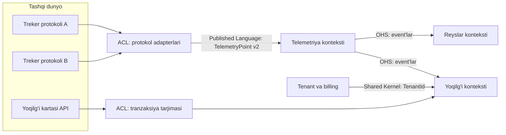

## Bu dars nima uchun kerak

51-darsda xulosa qildik: modular monolit yoki microservices - qaysi biri bo'lmasin, muvaffaqiyat **chegaralarni qayerdan o'tkazishga** bog'liq. Noto'g'ri chegara bilan microservice'lar distributed monolithga aylanadi, modular monolit esa "big ball of mud"ga. Har bir biznes o'zgarishi besh modulni bir vaqtda tegishga majbur qiladi, tranzaksiyalar servislar orasida yoyiladi, jamoalar bir-birini kutadi.

Domain-Driven Design (DDD) aynan shu savolga - "chegarani qayerdan o'tkazamiz?" - eng ko'p ishlatiladigan javob. Eric Evans 2003 yilda "Domain-Driven Design: Tackling Complexity in the Heart of Software" kitobida bu yondashuvni shakllantirgan. DDD ikki qismdan iborat: **strategic design** (tizimni qanday kontekstlarga bo'lish va ular qanday bog'lanadi) va **tactical design** (kontekst ichida kodni qanday modellash: entity, value object, aggregate, domain event). System design uchun strategik qism muhimroq, lekin aggregate tushunchasi tranzaksiya chegarasini belgilagani uchun uni ham chuqur ko'ramiz.

Bu darsdan keyin siz:

- domain, subdomain (core, supporting, generic) va bounded context farqini aniq bilasiz;
- bir xil so'z ("mashina", "reys", "mijoz") turli kontekstlarda turli model bo'lishi kerakligini tushunasiz;
- context map patternlarini (shared kernel, customer/supplier, conformist, anticorruption layer, open host service, published language) taniysiz va tanlay olasiz;
- aggregate'ni tranzaksiya va consistency chegarasi sifatida loyihalay olasiz;
- servis yoki modul chegarasini tekshirish uchun amaliy evristikalarni qo'llay olasiz;
- Conway qonuni orqali chegara va jamoa tuzilmasini bog'lay olasiz.

## Domain, subdomain va nima uchun ularni ajratish kerak

**Domain** - dastur yechadigan biznes sohasi. iQuariX uchun bu - korporativ avtoparklarni boshqarish.

Domain bitta yaxlit narsa emas. U **subdomain**larga bo'linadi - biznesning nisbatan mustaqil faoliyat sohalari. Vlad Khononov "Learning Domain-Driven Design" (O'Reilly, 2021) kitobida subdomainlarni uch turga ajratadi:

| Tur | Ta'rif | Qanday quriladi | Fleet misolida (faraziy) |
|---|---|---|---|
| **Core** | Kompaniyani raqobatchilardan ajratadigan narsa, murakkab va tez o'zgaradi | Ichkarida, eng kuchli muhandislar bilan, eng ko'p e'tibor | Yoqilg'i o'g'irligini aniqlash, haydovchi skoringi, AI analitika |
| **Supporting** | Biznes uchun kerak, lekin raqobat ustunligi bermaydi, logika oddiyroq | Ichkarida, tezroq va soddaroq usulda | Mashina va haydovchi ma'lumotnomasi, hisobot shablonlari |
| **Generic** | Hamma bir xil qiladigan, allaqachon yechilgan muammo | Sotib olish yoki tayyor yechim | Autentifikatsiya, to'lov qabul qilish, SMS yuborish, xarita tile'lari |

Bu bo'linish system design uchun nima beradi? **Investitsiyani qayerga qilishni.** Core subdomainga kuchli izolyatsiya, puxta model, ko'p test; generic'ga - Keycloak yoki tayyor SaaS. Ko'p jamoalar teskarisini qiladi: o'z auth tizimini yozishga oylar sarflaydi, core logika esa controller ichida `if` lar to'plami bo'lib qoladi.

Khononov core subdomain uchun foydali test beradi: kimdir bu subdomainni alohida mahsulot sifatida sotib olarmidi? Agar ha - ehtimol core.

Muhim farq: subdomainlar **topiladi** (ular biznesda allaqachon mavjud), bounded context'lar esa **loyihalanadi** (bu bizning arxitektura qarorimiz).

## Ubiquitous language va bounded context

### Bir so'z, ko'p ma'no

Fowler o'z bliki'sida elektr ta'minoti kompaniyasidagi misolni keltiradi: "meter" (hisoblagich) so'zi bir bo'limda tarmoq va joy orasidagi ulanishni, boshqasida tarmoq va mijoz orasidagi ulanishni, uchinchisida esa fizik qurilmani anglatgan. Hammasi bir so'z, uchta har xil tushuncha.

Fleet domenida ham shunday. "**Mashina**" so'zini oling:

- **Telemetriya** uchun: IMEI, oxirgi koordinata, tezlik, signal sifati. Asosiy identifikator - treker qurilmasi.
- **Yoqilg'i nazorati** uchun: bak hajmi, ДУТ kalibrovka jadvali (sensor qiymatidan litrga o'tish), me'yoriy sarf.
- **Texnik xizmat** uchun: VIN, probeg, keyingi TO sanasi, ehtiyot qismlar tarixi.
- **Billing** uchun: tarif bo'yicha hisoblanadigan "obyekt", faollashtirilgan sana, abonent to'lovi.

Agar bularning hammasini bitta `Vehicle` klassiga (yoki bitta `vehicles` jadvaliga 80 ta ustun bilan) yig'sangiz, nima bo'ladi? Har bir modul o'ziga kerak bo'lmagan maydonlarni ko'radi, billing jamoasi qo'shgan maydon telemetriya kodini buzadi, "mashina o'chirildi" degani billing uchun "obuna to'xtatildi", telemetriya uchun "treker boshqa mashinaga ko'chirildi" bo'lishi mumkin - va bu bitta `deleted_at` ustunida aralashib ketadi.

### Ubiquitous language

DDD'ning birinchi tamoyili: domen ekspertlari, analitiklar va dasturchilar **bitta umumiy til**da gaplashadi va bu til kodda aynan aks etadi. Agar dispetcher "reys" desa, kodda `Trip` bo'lishi kerak, `RouteSessionEntity` emas. Agar yoqilg'i bo'yicha mutaxassis "to'kib olish" (drain) va "quyish" (refuel) desa, kodda `FuelDrainEvent` va `RefuelEvent` bo'ladi, `FuelChangeType = 2` emas.

Lekin bitta til butun kompaniya uchun bitta bo'la olmaydi - yuqoridagi "mashina" misoli shuni ko'rsatadi. Shu sababli:

### Bounded context

**Bounded context** - bitta model va bitta ubiquitous language izchil va bir ma'noli bo'lgan chegara. Chegara ichida "mashina" aniq bir narsani anglatadi. Chegara tashqarisida boshqa kontekst o'z "mashina" modeliga ega, va ikkalasi orasida aniq **tarjima** (mapping) bor.

Fowler ta'kidlaydi: katta tizim uchun bitta yagona model qurishga urinish na amalga oshiriladigan, na iqtisodiy jihatdan foydali. DDD buni tan oladi va modellarni ajratib, ular orasidagi munosabatni ochiq qiladi.

Bounded context va servis/modul munosabati:

- Odatiy va eng sog'lom holat: **bitta bounded context = bitta modul yoki bitta servis**, bitta jamoa egaligida.
- Bitta bounded context bir nechta deploy birligiga bo'linishi mumkin (masalan, telemetriya kontekstining `ingest` va `query` qismlari alohida masshtablanadi), lekin ular bitta jamoa va bitta model.
- Bitta servis ichida bir nechta bounded context bo'lishi ham mumkin (modular monolit) - lekin modullar orasidagi chegara kodda majburlanishi kerak (51-dars).
- **Yomon holat:** bitta bounded context bir nechta jamoa yoki servis o'rtasida bo'lingan. Bu distributed monolithning eng keng tarqalgan sababi.

## Context map: kontekstlar qanday bog'lanadi

Kontekstlar izolyatsiyada yashamaydi. Telemetriya kontekstidagi nuqtalar yoqilg'i kontekstiga kerak, billing tenantlar kontekstidan ma'lumot oladi. Evans bu munosabatlarni bir nechta pattern bilan tavsiflaydi. Ular texnik emas, birinchi navbatda **tashkiliy** munosabatlar: kim kimga bog'liq va kim kimning modeliga moslashadi.

| Pattern | Ma'nosi | Qachon | Xavfi |
|---|---|---|---|
| **Partnership** | Ikki jamoa birga rejalashtiradi, birga muvaffaqiyat yoki birga muvaffaqiyatsizlik | Ikki kontekst juda yaqin, jamoalar yaxshi aloqada | Koordinatsiya narxi |
| **Shared Kernel** | Ikki kontekst modelning kichik qismini (kod yoki sxema) umumiy saqlaydi | Juda kichik, barqaror umumiy qism (masalan, `TenantId`, `Money`) | Umumiy qism o'sib, ikki kontekstni bog'lab qo'yadi |
| **Customer/Supplier** | Upstream (supplier) downstream (customer) ehtiyojlarini o'z rejasiga kiritadi | Upstream jamoa downstream'ga xizmat qilishga tayyor | Upstream ustuvorlikni o'zgartirsa, downstream kutadi |
| **Conformist** | Downstream upstream modelini o'zgarishsiz qabul qiladi | Upstream'ga ta'sir qilib bo'lmaydi va model yetarlicha yaxshi | Begona model o'z kontekstingizga "oqib kiradi" |
| **Anticorruption Layer (ACL)** | Downstream o'z modelini himoya qilish uchun tarjima qatlamini quradi | Upstream - legacy, tashqi API yoki yomon model | Qo'shimcha kod va kechikish |
| **Open Host Service (OHS)** | Upstream ko'p iste'molchi uchun barqaror, hujjatlangan protokol beradi | Ko'p downstream bor, har biriga alohida integratsiya qilish qimmat | Protokolni versiyalash majburiyati |
| **Published Language** | Kontekstlar o'rtasida umumiy, hujjatlangan almashuv formati | OHS bilan birga: Protobuf/Avro sxema, event formati | Sxema evolyutsiyasi (10-dars) |
| **Separate Ways** | Integratsiya qilmaslik, har kim o'zi qiladi | Integratsiya foydasi narxidan kam | Funksional dublikat |

Evans ro'yxatida yana **Big Ball of Mud** bor - bu pattern emas, real holatni tan olish: chegarasi aniq bo'lmagan qism. Uni context map'da halol belgilash va unga ACL orqali ulanish kerak, shunda "loy" boshqa kontekstlarga yoyilmaydi.

### Anticorruption Layer batafsilroq

Fleet tizimlarida ACL eng ko'p kerak bo'ladigan pattern, chunki tashqi dunyo tartibsiz: har xil treker ishlab chiqaruvchilarining protokollari (Teltonika, Wialon IPS, Galileosky va h.k.), 1C buxgalteriya, yoqilg'i kartalari provayderlari, davlat tizimlari.

ACL vazifasi: tashqi modelni o'z kontekstingiz tiliga tarjima qilish. Masalan, treker protokolida "AVL ID 66 = 12850" kelsa, ACL buni `PowerVoltage { millivolts: 12850 }` ga aylantiradi. Telemetriya kontekstining ichki kodi hech qachon "AVL ID" so'zini bilmaydi. Yangi treker modeli qo'shilganda faqat ACL o'zgaradi.

Bu diagrammada telemetriya konteksti **Open Host Service**: u bitta barqaror event formati (`TelemetryPoint v2`, Published Language) chiqaradi va har bir iste'molchi uchun alohida integratsiya qilmaydi. Yoqilg'i va reyslar konteksti uning downstream'lari.

## Aggregate: tranzaksiya chegarasi

Strategik dizayn kontekstlar orasidagi chegarani beradi. Kontekst ichida esa ikkinchi muhim chegara bor - **aggregate**.

Aggregate - bitta birlik sifatida qaraladigan domen obyektlari klasteri. Fowler misoli: buyurtma va uning qatorlari alohida obyektlar, lekin bitta aggregate sifatida ishlanadi. Aggregate'ning bitta **root**i bor; tashqi kod faqat root'ga murojaat qiladi va root butun klasterning izchilligini (invariantlarni) himoya qiladi. Tranzaksiya bitta aggregate ichida qoladi.

### Vernon qoidalari

Vaughn Vernon "Effective Aggregate Design" maqolalar seriyasida (2011) aggregate dizayni uchun qoidalar beradi:

1. **Haqiqiy invariantlarni consistency chegarasida modellang.** Invariant - har doim to'g'ri bo'lishi kerak bo'lgan biznes qoidasi. Avval haqiqiy invariantni toping, keyin nima birga bo'lishi kerakligini hal qiling. Dasturchilar o'ylab topgan "soxta invariantlar" concurrent ishda tranzaksiyalar to'qnashuviga olib keladi.
2. **Aggregate'larni kichik qiling.** Root va zarur minimal atributlar. Katta aggregate ko'p obyekt yuklaydi va tez-tez to'qnashadi. Vernon keltirgan misolda (Niclas Hedhman jamoasining moliyaviy derivativlar loyihasi, Qi4j) aggregate'larning taxminan 70 foizi faqat root entity va bir nechta value-object xususiyatdan iborat bo'lgan, qolgan 30 foizida 2-3 ta entity bo'lgan. Vernon bu nisbat har domen uchun bir xil bo'lmasligini ham qayd etadi.
3. **Boshqa aggregate'larga faqat ID orqali murojaat qiling**, obyekt havolasi orqali emas. Shunda aggregate'lar alohida yuklanadi va alohida saqlanishi (hatto boshqa bazada) mumkin.
4. **Bir nechta aggregate'ni o'zgartiradigan use case'larga shubha bilan qarang.** Ko'pincha ular orasida eventual consistency yetarli.

Amaliy qoida: **bitta tranzaksiya - bitta aggregate instance'ini o'zgartiradi.** Boshqa aggregate'lar domain event orqali keyinroq yangilanadi.

### Nega bu system design uchun muhim

Aggregate chegarasi to'g'ridan-to'g'ri quyidagilarni belgilaydi:

- **Locking va concurrency:** optimistic lock (`version` ustuni) aggregate root'da. Katta aggregate - ko'p to'qnashuv. 18-darsdagi lost update muammosi aynan shu yerda hal qilinadi.
- **Sharding kaliti:** aggregate - tabiiy sharding birligi (28-dars). Agar tranzaksiya har doim bitta aggregate ichida bo'lsa, u har doim bitta shard ichida bo'ladi va cross-shard tranzaksiya kerak bo'lmaydi.
- **Event sourcing:** event stream - aggregate bo'yicha (46-dars).
- **Servis chegarasi:** aggregate hech qachon ikki servisga bo'linmaydi.

### Misol: soxta invariant

Misol: yoqilg'i kontekstida "Bak" (`FuelTank`) aggregate'i bor. Birinchi variant: `FuelTank` ichida oxirgi 30 kunning barcha o'lchovlari ro'yxati (`readings[]`) - "chunki anomaliyani aniqlash uchun kerak". Natija: har yangi o'lchov (har 10-30 soniyada) butun aggregate'ni yuklab, saqlashni talab qiladi, va bir vaqtda kelgan ikkita o'lchov optimistic lock to'qnashuviga sabab bo'ladi.

Haqiqiy invariant qaysi? "Kalibrovka jadvali monoton o'suvchi bo'lishi kerak" va "bak hajmidan oshiq litr bo'lmaydi". O'lchovlar tarixi esa invariant emas - bu **so'rov** (query) uchun kerak. To'g'ri dizayn:

- `FuelTank` aggregate - bak hajmi, kalibrovka jadvali, holat. Kam o'zgaradi.
- `FuelReading` - alohida, append-only yozuv (time-series, 81-dars), aggregate emas.
- `FuelDrainDetected` - stream processing (45-dars) natijasida chiqadigan domain event.

## Chegarani qanday topish: amaliy evristikalar

DDD chegarani avtomatik bermaydi. Quyidagi evristikalar birgalikda ishlatiladi.

### 1. Til o'zgaradigan joy

Domen ekspertlari bilan gaplashganda bir so'zning ma'nosi o'zgaradigan joy - ehtimoliy kontekst chegarasi. "Mashina" dispetcher uchun nuqta xaritada, buxgalter uchun esa abonent to'lovi.

### 2. EventStorming

Alberto Brandolini ishlab chiqqan seminar usuli: domen ekspertlari va dasturchilar katta devorga rangli stikerlar bilan **domain event**larni (o'tgan zamonda: "Reys boshlandi", "Yoqilg'i to'kib olindi", "Hisob-faktura yuborildi") vaqt bo'yicha joylashtiradi. Keyin buyruqlar, aktorlar, tashqi tizimlar qo'shiladi. Event'lar klasterlari va tilning o'zgarish nuqtalari kontekst chegaralarini ko'rsatadi. Bir necha soatlik seminar ko'pincha oylab kod tahlilidan ko'proq beradi.

### 3. O'zgarish birga bo'ladimi (cohesion)

So'nggi 6 oydagi biznes o'zgarishlarini (tasklar, PR'lar) oling. Qaysi modullar doim birga o'zgaradi? Ular ehtimol bitta kontekst. Agar har bir yoqilg'i bo'yicha o'zgarish `fuel` va `telemetry` modullarini birga tegsa, chegara noto'g'ri chizilgan bo'lishi mumkin.

### 4. Tranzaksion izchillik talabi

Ikki narsa **bir zumda** izchil bo'lishi shartmi? Agar ha - ular bir aggregate (va albatta bir kontekst) ichida. Agar soniyalar yoki daqiqalar kechikish qabul qilinadigan bo'lsa - alohida bo'lishi mumkin, event orqali bog'lanadi. Biznesdan so'rang: "agar haydovchi skori 5 soniya kechikib yangilansa, nima bo'ladi?" Ko'pincha javob "hech narsa".

### 5. Chatty-lik testi

Taklif qilingan chegara bo'yicha bitta tipik foydalanuvchi so'rovi nechta chegarani kesib o'tadi? Agar har bir so'rov 5 ta kontekstga sinxron murojaat qilsa, chegara noto'g'ri yoki ma'lumot nusxalanishi kerak.

### 6. Jamoa va Conway qonuni

Melvin Conway 1968 yilda kuzatgan: tizim tuzilmasi uni loyihalagan tashkilotning aloqa tuzilmasini takrorlaydi. Teskari xulosasi ("inverse Conway maneuver"): xohlagan arxitekturangizga mos jamoa tuzilmasini quring. Bounded context - bitta jamoa egaligida bo'lishi kerak. Skelton va Pais "Team Topologies" kitobida "stream-aligned" jamoani bitta biznes imkoniyatining to'liq egasi sifatida ta'riflaydi va asosiy cheklov sifatida jamoaning **kognitiv yuki**ni ko'rsatadi: kontekst bitta jamoa boshida sig'adigan hajmda bo'lishi kerak.

| Evristika | Nima ko'rsatadi | Cheklovi |
|---|---|---|
| Til o'zgarishi | Model chegarasi | Ekspertlar bilan suhbat talab qiladi |
| EventStorming | Event klasterlari, jarayon oqimi | Fasilitator va vaqt kerak |
| Birga o'zgarish | Haqiqiy coupling | Faqat mavjud tizim uchun, tarix kerak |
| Tranzaksion izchillik | Aggregate va kontekst chegarasi | Biznes "hammasi darhol" deyishga moyil |
| Chatty-lik testi | Ishlash narxi | Faqat ma'lum so'rovlar uchun |
| Jamoa tuzilmasi | Egalik va deploy mustaqilligi | Tashkilot o'zgarsa chegara ham o'zgaradi |

## Chegara qanday ko'rinishda ma'lumot almashadi

Kontekstlar orasidagi aloqa uch asosiy shaklda (53-darsda chuqur ko'riladi):

1. **Sinxron so'rov (query API).** "Mashina 123 qaysi tenantga tegishli?" Oddiy, lekin temporal coupling hosil qiladi.
2. **Domain/integration event.** "`TripCompleted { tripId, vehicleId, distanceKm, startedAt, endedAt }`". Downstream o'ziga kerakli ma'lumotni o'z bazasida saqlaydi. Outbox orqali ishonchli chiqariladi (48-dars).
3. **Ma'lumot nusxasi (replicated read model).** Downstream upstream'ning kerakli qismini o'z modeliga nusxalaydi (CQRS, 47-dars).

Muhim farq: **domain event** - kontekst ichidagi, ichki modelga bog'liq event; **integration event** - kontekstlar orasidagi, Published Language sifatida barqaror va versiyalangan kontrakt. Ichki event'ni to'g'ridan-to'g'ri Kafka'ga chiqarish - ichki modelni boshqalarga "oqizish" va har bir ichki refaktorni breaking change'ga aylantirish.

Event mazmuni bo'yicha ham tanlov bor:

- **Event notification** (faqat ID: "`Vehicle 123 o'zgardi`") - kichik, lekin iste'molchi qaytib so'rov yuborishi kerak, coupling qaytadi.
- **Event-carried state transfer** (kerakli holat bilan) - kattaroq, lekin iste'molchi mustaqil. Fleet tizimlarida odatda shu afzal.

## Raqamlar: chegara narxi

Masala sharti: dispetcher "mashinalar ro'yxati" sahifasini ochadi: 200 ta mashina, har biri uchun oxirgi joylashuv, yoqilg'i darajasi, haydovchi ismi, bugungi probeg. Hisob uchun boshqa shartlar (real o'lchov emas, misol parametrlari): ulanish pooli 50, bitta data-markaz ichidagi kichik so'rov 5 ms, bitta batch so'rov 10-20 ms, lokal indeksli SQL so'rov 2-5 ms, read model'da bitta mashina yozuvi 500 bayt, sahifa daqiqada 1 000 marta ochiladi.

**Variant A - sinxron N+1.** Sahifa servisi har mashina uchun 4 ta kontekstga alohida so'rov yuboradi: 200 × 4 = 800 so'rov. Parallel bo'lsa ham, 50 lik ulanish pooli bilan 800 / 50 = 16 to'lqin, har biri 5 ms: 16 × 5 = 80 ms faqat kutish, plus 800 marta serializatsiya va 800 ta muvaffaqiyatsizlik nuqtasi.

**Variant B - batch API.** Har kontekstga bitta batch so'rov (`ids=[...200]`): 4 so'rov, parallel, shartga ko'ra 10-20 ms. Kontrakt bir oz murakkabroq, lekin 200 marta kam tarmoq round trip.

**Variant C - read model.** Dispetcher konteksti `VehicleLocationUpdated`, `FuelLevelChanged`, `DriverAssigned` event'larini iste'mol qilib, o'z bazasida tayyor ko'rinishni saqlaydi: 1 ta lokal SQL so'rov, shartga ko'ra 2-5 ms. Narxi: eventual consistency (soniyalar), event iste'molchilari va qo'shimcha saqlash. 10 000 mashina × 500 bayt = 5 MB - ahamiyatsiz.

Sahifani daqiqada 1 000 marta ochishsa: A - 800 × 1 000 = 800 000 so'rov/daqiqa, ya'ni 800 000 / 60 ≈ 13 300 so'rov/s faqat shu sahifa uchun; B - 4 × 1 000 / 60 ≈ 67 so'rov/s; C - 1 000 / 60 ≈ 17 lokal so'rov/s. Chegara noto'g'ri tanlanganda yoki ma'lumot oqimi noto'g'ri loyihalanganda narx tartiblar bilan farq qiladi.

## Real tizimlardan misollar

- **Shopify** (51-dars) kodni texnik qatlamlar emas, biznes tushunchalari (buyurtmalar, yetkazib berish, ombor, billing) bo'yicha komponentlarga ajratgan - bu amalda bounded context bo'yicha bo'lish.
- **Amazon** o'zining [two-pizza team](https://aws.amazon.com/executive-insights/content/amazon-two-pizza-team/) (ikki pitsa bilan to'ydiriladigan kichik, avtonom jamoa) modelini rasmiy materiallarida tasvirlaydi: har jamoa o'z servisining to'liq egasi. Bu Conway qonunini ongli ravishda qo'llash misoli.
- **Segment** (51-dars) - har bir "destination" alohida servis bo'lgan, lekin ular bitta kontekstning (yetkazib berish) bir xil modeli edi va bitta kichik jamoa egaligida edi. Chegara biznes kontekst bo'yicha emas, texnik birlik (destination) bo'yicha chizilgan - shuning uchun umumiy kutubxona muammosi paydo bo'lgan.

## iQuariX kontekstida qo'llanish

Misol sifatidagi context map (iQuariX'ning real tuzilmasi emas) - quyidagi bounded context'lar:

1. **Device Connectivity (ACL qatlami)** - treker protokollari, IMEI, ulanish holati. Generic/supporting. Tashqi protokollarni ichki `TelemetryPoint` ga tarjima qiladi.
2. **Telemetry** - nuqtalar oqimi, oxirgi joylashuv, marshrut tarixi. Supporting, lekin eng yuqori yuklama. OHS sifatida event chiqaradi.
3. **Trips** - reyslar, to'xtashlar, geofence kirish/chiqish (83-dars). Telemetriya event'laridan quriladi.
4. **Fuel Control** - bak, kalibrovka, quyish/to'kib olish aniqlash. **Core.**
5. **Driver Scoring** - xavfli manevrlar, skor. **Core.**
6. **Video** - kameralar, yozuvlar, hodisa kliplari. Supporting.
7. **Fleet Registry** - mashina, haydovchi, guruhlar ma'lumotnomasi. Supporting.
8. **Tenancy & Billing** - mijozlar, tariflar, hisob-fakturalar. Supporting/generic.
9. **Identity** - foydalanuvchilar, rollar. Generic (Keycloak yoki shunga o'xshash).

Bu yerda "Mashina" uchta kontekstda uch xil: Fleet Registry'da `Vehicle` (VIN, davlat raqami, model), Fuel Control'da `FuelTank` (hajm, kalibrovka), Telemetry'da `TrackedUnit` (IMEI, oxirgi nuqta). Ularni `vehicleId` bog'laydi - Shared Kernel'ning yagona elementi bilan birga (`TenantId`, `VehicleId` turlari).

Muhim savollardan biri: geofence qaysi kontekstda? Agar geofence faqat reys va hisobotlar uchun kerak bo'lsa - Trips'da. Agar u real vaqtda ogohlantirish uchun ham kerak bo'lsa, ehtimol alohida "Alerts" konteksti kerak bo'ladi. Bu - EventStorming'da aniqlanadigan savol.

## Ko'p uchraydigan xatolar

1. **Chegarani jadval yoki entity bo'yicha chizish:** "users servis, vehicles servis, orders servis". Bu CRUD servislar har bir biznes jarayonda hammasini chaqiradi - chatty va bog'langan.
2. **Bitta umumiy "canonical" model butun kompaniya uchun:** 80 maydonli `Vehicle`. Har kontekstga o'z modeli kerak.
3. **Shared kernel'ni o'stirib yuborish:** umumiy `common` kutubxona domen logikasi bilan to'lib, hamma kontekstni bog'laydi (Segment saboqi).
4. **Katta aggregate'lar:** tarixiy ma'lumotni aggregate ichida saqlash, natijada lock to'qnashuvi va sekin yuklash.
5. **Bitta tranzaksiyada bir nechta aggregate'ni o'zgartirish** va keyin ularni turli servislarga ajratib, 2PC'ga ehtiyoj sezish.
6. **Ichki domain event'larni integration event sifatida tashqariga chiqarish:** har ichki refaktor iste'molchilarni buzadi.
7. **Tashqi modelni ACL'siz qabul qilish:** treker protokolining tushunchalari biznes kodiga oqib kiradi va yangi qurilma qo'shish butun tizimni o'zgartiradi.
8. **Jamoa tuzilmasini hisobga olmaslik:** bitta kontekst ikki jamoa orasida bo'lingan yoki bitta jamoa 7 ta kontekstni boshqaradi.

## Xulosa

- DDD strategik qismi chegarani qayerdan o'tkazishga javob beradi; tactical qismi kontekst ichidagi modelni beradi.
- Subdomain'lar (core, supporting, generic) investitsiyani qayerga qilishni ko'rsatadi; generic'ni sotib oling.
- Bounded context - bitta model va bitta til izchil bo'lgan chegara; bir so'z turli kontekstda turli model bo'lishi normal.
- Context map patternlari tashkiliy munosabatni ifodalaydi; tashqi va legacy tizimlarga ACL bilan ulaning.
- Aggregate - tranzaksiya va consistency chegarasi: kichik, ID orqali havola, bitta tranzaksiyada bitta aggregate.
- Chegarani til, EventStorming, birga o'zgarish, izchillik talabi va jamoa tuzilmasi bo'yicha topasiz.
- Kontekstlar orasida barqaror, versiyalangan integration event va kerak bo'lsa lokal read model ishlating.

## Amaliy topshiriq

Masala sharti: iQuariX'ga **"yo'l varaqasi" (putevoy list) va texnik xizmat** funksiyasi qo'shilmoqda: har kuni mashina chiqishidan oldin mexanik va shifokor tekshiruvi qayd etiladi, haydovchiga yo'l varaqasi beriladi, kun oxirida probeg va yoqilg'i sarfi kiritiladi va telemetriya ma'lumoti bilan solishtiriladi; texnik xizmat probeg bo'yicha rejalashtiriladi.

1. Bu funksiyaning asosiy domain event'larini (kamida 12 ta) vaqt tartibida yozing, xuddi EventStorming qilgandek.
2. Ularni bounded context'larga guruhlang. Mavjud kontekstlardan (Telemetry, Trips, Fuel Control, Fleet Registry) qaysilariga tegishli, qaysi biri yangi kontekst talab qiladi? Har bir kontekstni core/supporting/generic deb belgilang.
3. "Mashina" va "Haydovchi" tushunchalari har bir kontekstda qanday ko'rinishini (asosiy maydonlar va identifikator) jadvalda yozing.
4. Yangi kontekst uchun 2-3 ta aggregate taklif qiling: har birining invariantlari, nima aggregate ichida, nima tashqarida va nega. Bitta "soxta invariant" misolini ko'rsating.
5. Context map chizing (mermaid yoki matn): har bir bog'lanishda qaysi pattern (OHS, ACL, Customer/Supplier, Shared Kernel) va nega.
6. "Yo'l varaqasidagi probeg telemetriyadagi probegdan 10% dan ko'p farq qilsa ogohlantirish" qoidasi qaysi kontekstda yashaydi? Kerakli ma'lumot qanday yetib keladi: sinxron so'rov, event yoki read model? Tanlovni latency va consistency bo'yicha asoslang.

Yaxshi javobda bo'lishi kerak bo'lgan narsalar:

- event'lar o'tgan zamonda va biznes tilida, texnik operatsiyalar (`row inserted`) emas;
- kontekst chegaralari til o'zgarishi va izchillik talabi bilan asoslangan;
- aggregate'lar kichik, boshqa aggregate'larga ID orqali murojaat qiladi;
- telemetriya bilan bog'lanish integration event yoki read model orqali, sinxron N+1 emas;
- kamida bitta ACL (masalan, 1C yoki davlat tizimi bilan) ko'rib chiqilgan;
- Shared Kernel minimal (faqat ID turlari kabi).

Javobni pastdagi maydonga yozib, chatga yuboring.

## Manbalar

- Eric Evans. [Domain-Driven Design Reference](https://domainlanguage.com/ddd/reference/), 2015 - bounded context, context map patternlari, aggregate qisqa ta'riflari ("Domain-Driven Design", Addison-Wesley, 2003 kitobining qisqa ma'lumotnomasi).
- Martin Fowler. [BoundedContext](https://martinfowler.com/bliki/BoundedContext.html), 2014 - "meter" misoli, yagona model mumkin emasligi, context map.
- Martin Fowler. [DDD Aggregate](https://martinfowler.com/bliki/DDD_Aggregate.html) - aggregate, root, tranzaksiya chegarasi.
- Vaughn Vernon. [Effective Aggregate Design, Part I](https://dddcommunity.org/wp-content/uploads/files/pdf_articles/Vernon_2011_1.pdf), 2011 - haqiqiy invariantlar, kichik aggregate'lar; [Part II](https://www.dddcommunity.org/wp-content/uploads/files/pdf_articles/Vernon_2011_2.pdf) - ID orqali havola, eventual consistency.
- Vlad Khononov. [Learning Domain-Driven Design](https://www.oreilly.com/library/view/learning-domain-driven-design/9781098100124/app02.html), O'Reilly, 2021 - 1-bob (subdomain turlari), 3-4-boblar (bounded context va integratsiya patternlari).
- Martin Fowler. [Team Topologies](https://martinfowler.com/bliki/TeamTopologies.html), 2023 - stream-aligned jamoa, kognitiv yuk, Conway qonuni bilan bog'liqlik.
- Alberto Brandolini. [Introducing EventStorming](https://leanpub.com/introducing_eventstorming), Leanpub - EventStorming seminari usuli.
- [Domain-driven design](https://en.wikipedia.org/wiki/Domain-driven_design), Wikipedia - context mapping patternlari ro'yxati va DDD tarixi.
