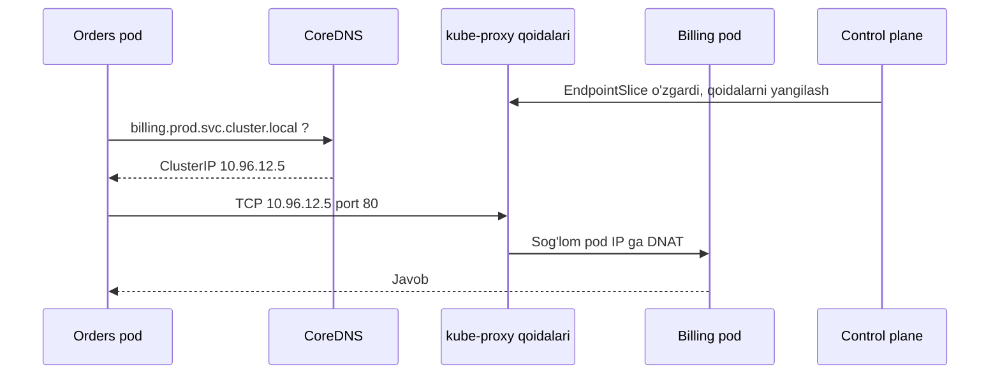

## Bu dars nima uchun kerak

51-52-darslarda tizimni modullar yoki servislarga qanday ajratishni ko'rdik. Ajratilgan zahoti yangi savol paydo bo'ladi: **ular bir-biri bilan qanday gaplashadi?** Monolit ichida bu savol yo'q edi - funksiya chaqiruvi. Servislar orasida esa har bir aloqa tanlovi latency, mavjudlik, consistency va jamoalar orasidagi bog'liqlikka bevosita ta'sir qiladi.

Ikkinchi savol undan ham oddiyroq ko'rinadi: **"orders" servisi "billing" servisini qayerdan topadi?** Konteynerlar har deploy'da yangi IP oladi, autoscaling instance qo'shadi va o'chiradi, nosoz instance'lar trafikdan chiqarilishi kerak. Statik IP ro'yxati bu dunyoda ishlamaydi. Buni **service discovery** hal qiladi.

Bu darsdan keyin siz:

- sinxron va asinxron aloqani "coupling" turlari (temporal, location, format) bo'yicha tahlil qila olasiz;
- request/response, fire-and-forget, event, command va request-reply over messaging farqini bilasiz;
- sinxron zanjirning mavjudlik va latency narxini hisoblay olasiz;
- client-side va server-side discovery, DNS, Kubernetes Service, Consul qanday ishlashini tushunasiz;
- gRPC va HTTP/2 da load balancing nega boshqacha ekanini bilasiz;
- NestJS/Fastify'da servislararo chaqiruvni to'g'ri sozlay olasiz (timeout, keep-alive, retry).

## Coupling'ning uch o'lchami

"Async loose coupling beradi" degan gap juda umumiy. Aniqroq bo'lish uchun coupling'ni uch o'lchamga ajratamiz:

1. **Temporal coupling** - ikkala tomon bir vaqtda ishlab turishi kerakmi? Sinxron HTTP chaqiruvda billing o'chiq bo'lsa, orders ham ishlamaydi. Navbat orqali esa billing 10 daqiqa o'chiq bo'lsa ham xabarlar kutib turadi.
2. **Location coupling** - chaqiruvchi qabul qiluvchining manzilini bilishi kerakmi? To'g'ridan-to'g'ri HTTP'da ha (yoki discovery orqali). Pub/sub'da producer iste'molchilar kimligini umuman bilmaydi.
3. **Format (schema) coupling** - ikkala tomon bir xil ma'lumot formatini tushunishi kerak. Bu **har doim** bor, sync yoki async bo'lishidan qat'i nazar. Kafka orqali yuborilgan event ham kontrakt (10-dars).

Async birinchi ikkitasini kamaytiradi, uchinchisini emas. Bundan tashqari async yangi coupling turini qo'shadi: **semantik** - "bu event nimani anglatadi, qaysi tartibda keladi, takrorlanishi mumkinmi".

## Aloqa uslublari

Sam Newman "Building Microservices" 2-nashrida (4-bob) aloqa uslublarini ikki o'q bo'yicha tasniflaydi: sinxron bloklovchi va asinxron bloklamaydigan; hamda request-response va event-driven. Amaliy ro'yxat:

### 1. Sinxron request/response

Chaqiruvchi so'rov yuboradi va javobni kutadi: REST/HTTP, gRPC (9-dars). Eng sodda model: xato darhol ko'rinadi, natija darhol bor, debug oson.

Qachon to'g'ri: foydalanuvchi **hozir** javob kutayotgan va javob boshqa servisdagi ma'lumotga bog'liq bo'lgan holatda (masalan, "bu foydalanuvchi bu mashinani ko'rishga haqlimi?" - avtorizatsiya).

### 2. Asinxron request/response (request-reply over messaging)

So'rov navbatga yoziladi, javob boshqa navbatga (`reply-to`) keladi, `correlation-id` bilan bog'lanadi. Chaqiruvchi bloklanmaydi, lekin baribir javobni kutadi. Uzoq davom etadigan ish uchun (video transcoding, katta hisobot): HTTP `202 Accepted` + status endpoint yoki webhook bilan bir xil g'oya.

### 3. Command (buyruq)

"Buni qil": `SendSms { to, text }`. Bitta aniq qabul qiluvchi, odatda point-to-point navbat (41-dars). Yuboruvchi nima bo'lishini xohlaydi, lekin darhol natija kutmaydi.

### 4. Event (hodisa)

"Bu bo'ldi": `TripCompleted { ... }`. O'tgan zamonda, yuboruvchi kim nima qilishini bilmaydi va qiziqmaydi. Pub/sub, ko'p iste'molchi. Fowler "What do you mean by Event-Driven?" maqolasida (2017) to'rt xil narsani ajratadi: event notification (faqat ID, iste'molchi tafsilotni so'raydi), event-carried state transfer (event'da kerakli holat bor, iste'molchi o'z nusxasini yuritadi), event sourcing (46-dars) va CQRS (47-dars). Fowler event notification haqida muhim ogohlantirish beradi: biznes jarayoni ko'p event'lar orasida yashirin bo'lib qoladi va uni faqat ishlab turgan tizimni kuzatib tushunish mumkin.

Command va event farqi semantik: command'ni rad etish mumkin ("SMS yuborilmadi, raqam noto'g'ri"), event'ni emas (bo'lgan narsa bo'lgan). Command'lar bilan "pub/sub" qilish yoki event'larni yashirin buyruq sifatida ishlatish - keng tarqalgan xato.

| Uslub | Temporal coupling | Javob | Iste'molchilar | Tipik transport | Asosiy xavf |
|---|---|---|---|---|---|
| Sync request/response | Bor | Darhol | 1 | HTTP, gRPC | Zanjirli nosozlik, tail latency |
| Async request-reply | Yo'q | Keyin | 1 | Navbat + reply queue, webhook | Correlation, timeout boshqaruvi |
| Command | Yo'q | Ixtiyoriy | 1 | Point-to-point navbat | Takroriy bajarilish (idempotency) |
| Event notification | Yo'q | Yo'q | N | Pub/sub, Kafka | Callback so'rovlar, yashirin jarayon |
| Event-carried state | Yo'q | Yo'q | N | Kafka (compacted topic) | Ma'lumot nusxasi, eventual consistency |

## Sinxron zanjirning narxi: hisob

51-darsda ko'rgan formulani kengaytiramiz.

**Mavjudlik.** API so'rovi ketma-ket A → B → C → D servislariga bog'liq, har biri 99.9%. Zanjir: 0.999^4 ≈ 99.6%. Oyiga 43 daqiqa o'rniga ~173 daqiqa ishlamaslik. Agar D o'rniga event orqali olingan lokal ma'lumot ishlatilsa, zanjir 0.999^3 ≈ 99.7%.

**Latency.** Ketma-ket chaqiruvlarda latency qo'shiladi. Parallel chaqiruvlarda esa javob eng sekiniga teng va tail latency kuchayadi: har biri p99 = 100 ms bo'lgan 10 ta parallel chaqiruv uchun kamida bittasi p99 dumiga tushish ehtimoli 1 - 0.99^10 ≈ 9.6% (3-dars). Google'ning "The Tail at Scale" maqolasi (Dean, Barroso, 2013) aynan shu fan-out effektini tahlil qiladi: odatda 10 ms da javob beradigan, lekin p99 = 1 s bo'lgan serverdan bittasiga murojaat qilinsa, 100 so'rovdan 1 tasi sekin; 100 ta shunday serverga parallel murojaat qilinsa, so'rovlarning 63 foizi 1 soniyadan oshadi (1 - 0.99^100 ≈ 0.63).

**Resurs bloklanishi.** Sinxron chaqiruv kutayotgan vaqtda resurs band: Node.js'da bu thread emas (event loop bloklanmaydi), lekin socket, xotira va eng muhimi - **concurrency limit**. Little qonuni (3-dars): L = λ × W. Agar servis 500 so'rov/s qabul qilsa va downstream sekinlashib W 50 ms dan 2 s ga oshsa, bir vaqtda ochiq so'rovlar 25 tadan 1 000 taga oshadi. Ulanish pooli (masalan 100) tugaydi, yangi so'rovlar navbatda kutadi va nosozlik yuqoriga tarqaladi (64-dars: cascading failure).

## Qachon sync, qachon async

Amaliy qoida: **so'rovning javobi uchun kerak bo'lmagan ishni sinxron yo'ldan olib tashlang.**

Misol: haydovchi reysni yakunladi. Mobil ilovaga kerak: "reys saqlandi" tasdig'i. Kerak emas (darhol): skor qayta hisoblash, hisobotni yangilash, mijozga email, billing'ga probeg yozish. Bularning hammasi `TripCompleted` event'ining iste'molchilari.

| Savol | Ha bo'lsa | Yo'q bo'lsa |
|---|---|---|
| Foydalanuvchi natijani hozir ko'rishi shartmi? | Sync (yoki sync + lokal ma'lumot) | Async |
| Qabul qiluvchi o'chiq bo'lsa, chaqiruvchi ham to'xtashi kerakmi? | Sync mos | Async |
| Natija bir nechta servisga kerakmi? | Event (pub/sub) | Command yoki sync |
| Ish uzoq davom etadimi (sekundlardan ko'p)? | Async request-reply, 202 + status | Sync |
| Tartib va aniq bir martalik bajarilish kritikmi? | Async + idempotent iste'molchi (39-dars) | Har qanday |

Async ning narxini ham unutmang: broker infratuzilmasi (Kafka, RabbitMQ), dublikat va tartib muammolari, DLQ (50-dars), tracing murakkabligi, "xabar qayerda qoldi?" degan debug savollari, eventual consistency tufayli UX ("saqlandi, lekin ro'yxatda hali yo'q").

### Dual-write tuzog'i

Eng ko'p uchraydigan xato: servis bazaga yozadi va keyin Kafka'ga event yuboradi. Agar ikkinchi qadam muvaffaqiyatsiz bo'lsa (yoki process o'rtada o'lsa), baza va event'lar mos kelmaydi. Yechim - transactional outbox yoki CDC (48-dars).

## Service discovery: muammo

Dinamik muhitda:

- instance'lar soni o'zgaradi (autoscaling, 76-dars);
- IP manzillar har deploy'da yangi;
- instance'lar nosoz bo'ladi va trafikdan chiqarilishi kerak;
- bitta servis bir nechta zonada yoki regionda.

Service discovery uch qismdan iborat:

1. **Registry** - qaysi servisning qaysi instance'lari hozir sog'lom va qayerda. Bu - kichik, lekin juda muhim distributed ma'lumotlar bazasi (ko'pincha consensus ustida: etcd Raft ishlatadi, 36-dars).
2. **Registration** - instance o'zini qanday ro'yxatdan o'tkazadi: o'zi (self-registration) yoki platforma (third-party registration, masalan Kubernetes kubelet/controller).
3. **Lookup** - chaqiruvchi manzilni qanday oladi: o'zi registry'dan so'raydi (client-side) yoki router/proxy orqali (server-side).

### Client-side discovery

Klient registry'dan servis instance'lari ro'yxatini oladi va o'zi load balancing qiladi. Klassik misol: Netflix OSS - Eureka (registry) va Ribbon (klient tomonidagi HTTP load balancer). microservices.io bo'yicha: afzalligi - kamroq harakatlanuvchi qism va tarmoq hop; kamchiligi - klient registry'ga bog'lanadi va discovery logikasi har bir til/framework uchun alohida yozilishi kerak.

### Server-side discovery

Klient doimiy manzildagi router'ga (load balancer) murojaat qiladi, router registry'dan foydalanib so'rovni instance'ga yo'naltiradi. Misollar: AWS ELB (o'zi registry vazifasini ham bajaradi, autoscaling group instance'larni avtomatik ro'yxatdan o'tkazadi), Kubernetes Service. Afzalligi - klient oddiy; kamchiligi - qo'shimcha hop va router'ning o'zi yuqori mavjudlikda bo'lishi kerak.

## DNS asosidagi discovery

DNS (6-dars) eng universal discovery mexanizmi - har bir til va kutubxona uni tushunadi. Lekin uning muammolari bor:

- **TTL va cache.** Klient yoki OS natijani TTL davomida (ba'zan undan uzoqroq) saqlaydi. Instance o'chsa, klient eski IP'ga urinishda davom etadi.
- **Faqat manzil.** DNS A yozuvi port, vazn, sog'liq haqida kam ma'lumot beradi (SRV yozuvlari port va vaznni beradi, lekin hamma klient ishlatmaydi).
- **Klient tomonidagi xatti-harakat.** Ko'p klientlar ro'yxatdagi birinchi IP'ni oladi va uzoq vaqt bitta ulanishni ushlab turadi.

**Consul** DNS interfeysi misolida: default holatda `127.0.0.1:8600` portida, `redis.service.consul` kabi so'rovlarga javob beradi; health check'dan o'tmagan instance'lar natijadan chiqariladi; barcha DNS javoblarida default TTL 0, ya'ni cache'lash o'chirilgan - aynan eski manzil muammosini kamaytirish uchun.

## Kubernetes'da service discovery

Kubernetes'da discovery platformaning o'zida (server-side, third-party registration):

1. Siz `Service` obyektini yaratasiz: `selector: app=billing`. U virtual IP oladi (**ClusterIP**).
2. Control plane (kube-controller-manager ichidagi EndpointSlice controller) selector'ga mos pod'larni **EndpointSlice** obyektlariga yozadi. Har endpoint'da `ready`, `serving` va `terminating` shartlari bor; `ready` pod'ning `Ready` holatiga (readiness probe natijasiga) mos keladi, va oddiy trafik faqat ready endpoint'larga yuboriladi.
3. Har bir node'dagi **kube-proxy** EndpointSlice'larni kuzatadi va ClusterIP:port'ni haqiqiy pod IP'lariga yo'naltiruvchi qoidalarni o'rnatadi. Linux'da uchta rejim bor: `iptables`, `ipvs` va `nftables` (Linux kernel 5.13+). Rejim aniq ko'rsatilmasa, hozirgi hujjatlarga ko'ra default - `iptables`; kelajakdagi versiyada default `nftables` ga o'zgarishi e'lon qilingan, shuning uchun hujjat rejimni konfiguratsiyada aniq yozishni tavsiya qiladi. `ipvs` rejimi Kubernetes v1.35 da deprecated deb belgilangan. `iptables` va `nftables` rejimlarida backend pod default holatda tasodifiy tanlanadi.
4. Klaster DNS (odatda CoreDNS) oddiy Service uchun `my-svc.my-namespace.svc.cluster-domain.example` ko'rinishidagi A/AAAA yozuvini beradi, u ClusterIP'ga resolve bo'ladi; klaster domeni odatda `cluster.local`, ya'ni `billing.prod.svc.cluster.local`. Pod'ning `/etc/resolv.conf` faylidagi `search <namespace>.svc.cluster.local svc.cluster.local cluster.local` qatori tufayli bir namespace ichida qisqa `billing` nomi, boshqa namespace'dan `billing.prod` yetarli. Nomlangan portlar uchun SRV yozuvlari ham yaratiladi (`_port-name._protocol.my-svc.my-namespace.svc...`).
5. **Headless Service** (`clusterIP: None`): virtual IP yo'q, kube-proxy bu Service'ni qayta ishlamaydi, DNS esa bitta nom uchun barcha ready pod IP'larini (bir nechta A/AAAA yozuv) qaytaradi. Bu client-side load balancing (masalan gRPC) yoki StatefulSet (har pod barqaror nom oladi: `pod-0.svc...`) uchun ishlatiladi.

Muhim nuance: ClusterIP **ulanish** darajasida (L4) yuklamani taqsimlaydi. Backend tanlovi yangi ulanish ochilganda (iptables/nftables rejimida default holatda tasodifiy, session affinity yoqilgan bo'lsa unga ko'ra) qilinadi, keyin bir ulanish ichidagi barcha so'rovlar o'sha pod'da qoladi.

## gRPC va HTTP/2: L4 balancing nega yetmaydi

gRPC HTTP/2 ustida ishlaydi va ko'plab so'rovlarni **bitta uzoq yashovchi TCP ulanish** ichida multiplex qiladi (7-dars). gRPC blogidagi load balancing maqolasi (2017) tushuntiradi: L4 load balancer TCP ulanishlar orasida baytlarni ko'chiradi va HTTP/2 stream'larni ko'rmaydi, shuning uchun amalda ulanish darajasida taqsimlaydi; L7 balancer esa bitta klientning stream'larini bir nechta backend'ga tarqata oladi.

Natija: orders servisining 3 pod'i billing'ning 10 pod'iga Kubernetes ClusterIP orqali gRPC bilan ulansa, har orders pod'i bitta ulanish ochadi va **faqat 3 ta billing pod'i yuklama oladi**, qolgan 7 tasi bo'sh turadi. Autoscaling yangi pod qo'shsa ham, mavjud ulanishlar ularga o'tmaydi.

Yechimlar (gRPC maqolasidagi tasnif bo'yicha):

- **Proxy (L7)** - Envoy, Linkerd yoki service mesh sidecar (55-dars) har bir RPC'ni alohida balanslaydi. Klient oddiy, lekin qo'shimcha hop.
- **Client-side (thick client)** - gRPC klient headless Service orqali barcha pod IP'larini oladi va `round_robin` siyosati bilan har RPC'ni taqsimlaydi. Hop yo'q, lekin klient murakkab va DNS yangilanishiga bog'liq.
- **Lookaside** - alohida LB servisi klientga "qaysi backend'ga borish kerak"ni aytadi (xDS protokoli shu g'oyaga asoslangan).
- **Ulanishni davriy yangilash** - server tomonida `max connection age` qo'yib, klientlarni vaqti-vaqti bilan qayta ulanishga majburlash. Oddiy, lekin to'liq yechim emas.

Xuddi shu muammo HTTP/1.1 keep-alive bilan ham yengilroq ko'rinishda bor: uzoq yashovchi ulanishlar yangi pod'larga sekin taqsimlanadi.

## Health check va discovery

Discovery faqat "qayerda" emas, "**sog'lommi**" degan savolga ham javob beradi. Kubernetes'da:

- **Liveness probe** - process tirikmi? Muvaffaqiyatsiz bo'lsa, konteyner qayta ishga tushiriladi.
- **Readiness probe** - trafik qabul qilishga tayyormi? Muvaffaqiyatsiz bo'lsa, pod EndpointSlice'dan chiqariladi, lekin o'ldirilmaydi.
- **Startup probe** - sekin ishga tushadigan ilovalar uchun, u o'tmaguncha boshqa probe'lar ishlamaydi.

gRPC'da standart health checking protokoli (`health/v1`) bor: `Check` (unary) va `Watch` (streaming) metodlari, `SERVING` va `NOT_SERVING` holatlari bilan.

Xato: readiness probe'da downstream'larni (baza, boshqa servislar) tekshirish. Baza 10 soniya sekinlashsa, **barcha** pod'lar bir vaqtda "not ready" bo'lib, servis butunlay trafikdan chiqadi - kichik muammo to'liq uzilishga aylanadi. Readiness - "men o'zim so'rov qabul qila olamanmi" (masalan, ishga tushish tugadimi, graceful shutdown boshlanmadimi), dunyoning holati emas.

**Graceful shutdown** discovery bilan birga ishlashi kerak: pod o'chirilayotganda (SIGTERM) avval EndpointSlice'dan chiqariladi, lekin bu kube-proxy'larga tarqalishi biroz vaqt oladi. Shuning uchun ilova SIGTERM olganda darhol yopilmasdan, bir necha soniya yangi so'rovlarni qabul qilishda davom etishi, keyin mavjud so'rovlarni tugatib yopilishi kerak. NestJS'da `app.enableShutdownHooks()` va `preStop` hook'da qisqa kutish shu maqsadda ishlatiladi.

## Node.js amaliyoti: servislararo HTTP klient

NestJS yoki Fastify'da boshqa servisni chaqirganda:

1. **Har doim timeout.** Default holatda ko'p klientlarda umumiy so'rov timeout'i yo'q yoki juda uzun. Har chaqiruvga aniq timeout qo'ying va u chaqiruvchining o'z SLO'sidan kichik bo'lsin (62-dars). `fetch` uchun `AbortSignal.timeout(ms)`.
2. **Keep-alive va ulanish pooli.** Har so'rovga yangi TCP (va TLS) ulanish ochish qimmat: 1 RTT TCP handshake + TLS 1.3 uchun yana 1 RTT (5, 7-darslar). Node.js'ning o'rnatilgan `fetch` (undici asosida) ulanishlarni qayta ishlatadi; `http.Agent` bilan ishlasangiz `keepAlive: true` ni aniq yoqing. Pool hajmini Little qonuni bo'yicha hisoblang: 500 so'rov/s × 20 ms = 10 parallel ulanish, zahira bilan 20-30.
3. **Retry faqat idempotent operatsiyalarga** va faqat backoff + jitter bilan (62-dars), aks holda retry storm.
4. **Deadline propagation.** Kiruvchi so'rovda 800 ms qolgan bo'lsa, downstream chaqiruvga 2 s timeout berish ma'nosiz. gRPC buni o'zida qiladi (deadline header); HTTP'da qolgan vaqtni header orqali uzatish mumkin.
5. **Correlation/trace ID** har chaqiruvda uzatiladi (W3C `traceparent`, 66-dars).
6. **Ulanish to'g'ridan-to'g'ri pod'ga bo'lsa** (headless + client-side), DNS natijasini davriy yangilang.

NestJS `@nestjs/microservices` paketi transport abstraksiyasini beradi: bir xil `@MessagePattern` (request-response) va `@EventPattern` (event) handler'lar TCP, Redis, NATS, RabbitMQ, Kafka yoki gRPC ustida ishlashi mumkin. Bu qulay, lekin abstraksiya semantik farqni yashirmasin: Kafka ustida `send()` (request-response) qilish - aslida async request-reply, Kafka'ning asl kuchli tomoni emas.

## Real tizimlardan misollar

- **Netflix** - Eureka va Ribbon bilan client-side discovery'ning klassik namunasini ochiq kod sifatida chiqargan; Spring Cloud orqali JVM dunyosida keng tarqalgan.
- **Kubernetes** - server-side discovery'ni platforma darajasida standartlashtirgan: Service, EndpointSlice, CoreDNS.
- **HashiCorp Consul** - registry, health check, DNS va HTTP interfeysi, platformadan mustaqil (VM va Kubernetes aralash muhitlar uchun).
- **AWS ELB/ALB** - managed server-side discovery: autoscaling group instance'larni avtomatik ro'yxatdan o'tkazadi va health check bilan chiqaradi.
- **Google** - "The Tail at Scale" maqolasida fan-out tufayli tail latency kuchayishi va "hedged requests" kabi usullar tasvirlangan.

## iQuariX kontekstida qo'llanish

Misol sharti - 51-darsdagi taqsimot: Ingest servis (TCP), monolit (`api` va `worker` rollari), Video servis, AI analitika (Python). Hammasi Kubernetes'da.

Aloqa xaritasi:

- **Ingest → hamma:** faqat async. Ingest nuqtani Kafka'ga yozib, trekerga ack qaytaradi. U hech qachon monolitni sinxron chaqirmaydi - aks holda monolit deploy'i paytida nuqtalar yo'qoladi yoki trekerlar ulanishni uzadi. Temporal coupling nol.
- **Ingest'ga kerak bo'lgan ma'lumot** (IMEI qaysi tenantga tegishli): sinxron so'rov o'rniga event-carried state transfer. Monolit `DeviceRegistered`, `DeviceMoved` event'larini compacted Kafka topic'ga yozadi, ingest uni xotirada (yoki lokal Redis'da) ushlab turadi. Masala sharti: 100 000 qurilma, bitta yozuv (IMEI, tenant ID, qurilma turi) 100 bayt. 100 000 × 100 B = 10 MB - xotiraga bemalol sig'adi.
- **AI analitika → monolit:** natijalar (`DrivingEventDetected`, `FuelAnomalyScored`) event sifatida.
- **Mijoz kabineti → monolit api:** sinxron HTTP (foydalanuvchi javob kutmoqda).
- **Monolit api → Video servis** ("bu klipni ko'rsat"): sinxron, lekin video servis o'chiq bo'lsa, faqat video bo'limi xato ko'rsatadi, qolgan sahifa ishlaydi (64-dars: graceful degradation).
- **Monolit → AI servis** (gRPC, agar sinxron inferens kerak bo'lsa): headless Service + gRPC klientda `round_robin`, yoki mesh. Aks holda yuqoridagi "3 pod'ga yuklama" muammosi.

Discovery: Kubernetes Service va CoreDNS yetarli; Consul yoki Eureka kerak emas, chunki hamma narsa bitta platformada. Treker'lar uchun esa tashqi L4 load balancer (NLB yoki MetalLB) va uzoq yashovchi TCP ulanishlar - bu yerda ulanishlarning notekis taqsimlanishi real muammo: ingest pod qo'shilganda mavjud trekerlar eski pod'larda qoladi. Yechim - ulanishlar sonini metrika sifatida kuzatish va kerak bo'lsa pod'larda maksimal ulanish limiti bilan sekin qayta taqsimlash.

## Ko'p uchraydigan xatolar

1. **Hamma narsani sinxron qilish**, chunki "oddiyroq". Natijada 6 servisli zanjir va 99.4% mavjudlik.
2. **Hamma narsani async qilish**, hatto foydalanuvchi darhol javob kutayotgan joyda ham - murakkab UX va debug.
3. **Timeout'siz servislararo chaqiruv.** Bitta sekin downstream barcha ulanishlarni egallaydi.
4. **Dual-write:** bazaga yozib, keyin alohida broker'ga yuborish. Outbox ishlating.
5. **Event'larni yashirin buyruq sifatida ishlatish** ("`SmsShouldBeSent` event") yoki aksincha.
6. **gRPC'ni ClusterIP orqali L4 balanslash** va yuklama faqat bir necha pod'ga tushayotganini sezmaslik.
7. **Readiness probe'da downstream'larni tekshirish** - kichik muammo to'liq uzilishga aylanadi.
8. **DNS natijasini abadiy cache'lash** (masalan, ilova ishga tushganda bir marta resolve qilish).

## Xulosa

- Coupling uch o'lchamda: temporal, location, format. Async birinchi ikkitasini kamaytiradi, formatni emas.
- Request/response, command va event - semantik jihatdan turli narsalar; ularni aralashtirmang.
- Sinxron zanjirda mavjudlik ko'paytiriladi, tail latency fan-out bilan kuchayadi; javob uchun kerak bo'lmagan ishni sinxron yo'ldan chiqaring.
- Service discovery = registry + registration + lookup; client-side (Eureka) va server-side (ELB, Kubernetes Service) ning trade-off'i - hop soni va klient murakkabligi.
- Kubernetes Service L4 da ulanish bo'yicha balanslaydi; gRPC/HTTP/2 uchun L7 proxy yoki client-side balancing kerak.
- Readiness - "men tayyormanmi", dunyoning holati emas; graceful shutdown discovery tarqalishini kutishi kerak.
- Har servislararo chaqiruv: timeout, keep-alive pool, idempotent retry, deadline va trace ID.

## Amaliy topshiriq

Masala sharti: iQuariX'da **"yoqilg'i to'kib olish ogohlantirishi"** oqimi: yoqilg'i datchigi nuqtasi ingest'ga keladi, stream processing to'kib olishni aniqlaydi, ogohlantirish dispetcherga (WebSocket), mijozga (Telegram/SMS) va hisobotga yetishi kerak; ogohlantirishga avtomatik 30 soniyalik video klip (agar mashinada kamera bo'lsa) biriktiriladi.

1. Oqimdagi barcha servis/modullarni va ular orasidagi har bir aloqani sanab chiqing. Har biri uchun: sync yoki async, command yoki event yoki query, va nega.
2. Agar Video servis 15 daqiqa o'chiq bo'lsa, nima bo'ladi? Ogohlantirish kechikmasligi uchun dizaynni qanday qilasiz? Klip keyinroq qanday biriktiriladi?
3. Dispetcher ogohlantirishni "datchik nuqtasi kelganidan 10 soniya ichida" ko'rishi kerak. Latency byudjetini har bosqich bo'yicha taqsimlang.
4. Har sinxron chaqiruv uchun timeout, retry siyosati (idempotentmi?) va ulanish pooli hajmini (Little qonuni bilan) hisoblang. Shart: cho'qqida 200 ogohlantirish/daqiqa.
5. Discovery: qaysi servislar Kubernetes Service orqali, qaysilari headless + client-side, qayerda gRPC balancing muammosi bo'lishi mumkin?
6. Bir xil ogohlantirish ikki marta yuborilmasligini qanday ta'minlaysiz (dublikat event, retry)?

Yaxshi javobda bo'lishi kerak bo'lgan narsalar:

- ingest va aniqlash qismi boshqa servislarga sinxron bog'liq emas;
- video klip ogohlantirishni bloklamaydi, keyin event bilan biriktiriladi;
- latency byudjeti raqamlar bilan, har bosqichda;
- timeout'lar chaqiruvchi byudjetidan kichik, retry faqat idempotent operatsiyalarda;
- deduplikatsiya kaliti (masalan `alertId` yoki `deviceId + eventTime`) va idempotent iste'molchi;
- gRPC uchun L7 yoki client-side balancing ko'rib chiqilgan.

Javobni pastdagi maydonga yozib, chatga yuboring.

## Manbalar

- Sam Newman. [Building Microservices, 2-nashr](https://www.oreilly.com/library/view/building-microservices-2nd/9781492034018/), O'Reilly, 2021 - 4-bob "Microservice Communication Styles", 5-bob "Implementing Microservice Communication".
- Martin Fowler. [What do you mean by "Event-Driven"?](https://martinfowler.com/articles/201701-event-driven.html), 2017 - event notification, event-carried state transfer, event sourcing, CQRS farqi.
- Chris Richardson. [Client-side service discovery](https://microservices.io/patterns/client-side-discovery.html) va [Server-side service discovery](https://microservices.io/patterns/server-side-discovery.html), microservices.io - Eureka/Ribbon, ELB, trade-offlar.
- Kubernetes. [Service](https://kubernetes.io/docs/concepts/services-networking/service/) va [DNS for Services and Pods](https://kubernetes.io/docs/concepts/services-networking/dns-pod-service/) - ClusterIP, headless Service, DNS nom formati, search path, SRV yozuvlari.
- Kubernetes. [Virtual IPs and Service Proxies](https://kubernetes.io/docs/reference/networking/virtual-ips/) - kube-proxy rejimlari (iptables, ipvs, nftables), default rejim, ipvs deprecation, tasodifiy backend tanlovi; [EndpointSlices](https://kubernetes.io/docs/concepts/services-networking/endpoint-slices/) - ready/serving/terminating shartlari, EndpointSlice controller.
- HashiCorp. [Consul DNS Interface](https://developer.hashicorp.com/consul/docs/v1.12.x/discovery/dns) - 8600 port, health check filtratsiyasi, TTL 0.
- gRPC. [gRPC Load Balancing](https://grpc.io/blog/grpc-load-balancing/), 2017 - L4 vs L7, proxy, client-side va lookaside.
- gRPC. [Health Checking](https://grpc.io/docs/guides/health-checking/) - Check va Watch, SERVING/NOT_SERVING.
- Jeffrey Dean, Luiz André Barroso. [The Tail at Scale](https://cacm.acm.org/research/the-tail-at-scale/), Communications of the ACM, 2013 - fan-out va tail latency, hedged requests.
