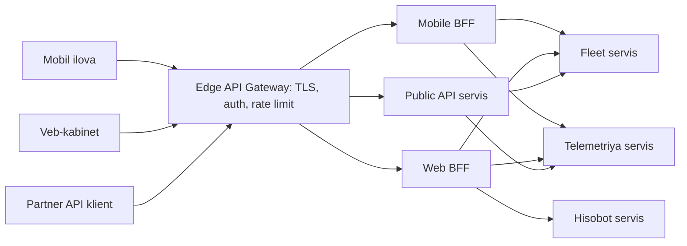

## Bu dars nima uchun kerak

53-darsda servislar bir-biri bilan qanday gaplashishini ko'rdik. Endi tashqi dunyoga qaraymiz: mobil ilova, veb-kabinet, uchinchi tomon integratsiyalari va IoT qurilmalar tizimga **qayerdan** kiradi?

Agar har bir klient har bir servisga to'g'ridan-to'g'ri murojaat qilsa:

- klient ichki tuzilmani biladi: servis bo'lingan yoki birlashtirilgan zahoti mobil ilovani yangilash kerak (va eski versiyalar yillab ishlab turadi);
- har servis TLS, autentifikatsiya, rate limiting, CORS, loglashni o'zi qiladi - takror va nomuvofiq;
- mobil ilova bitta ekran uchun 6 ta so'rov yuboradi - sekin mobil tarmoqda har biri 100-300 ms;
- ichki servislar internetga ochiq - hujum yuzasi katta.

**API Gateway** bu muammolarni bitta kirish nuqtasida yechadi. **BFF (Backend for Frontend)** esa savolni yanada aniqlashtiradi: bitta umumiy gateway hamma klientga xizmat qilsinmi yoki har klient turiga o'z backend'imi?

Bu darsdan keyin siz:

- API gateway'ning vazifalarini (routing, composition, cross-cutting concerns, protocol translation) aniq bilasiz va qaysi vazifa unga tegishli emasligini ajrata olasiz;
- reverse proxy, load balancer, API gateway, BFF va service mesh farqini tushunasiz;
- BFF qachon kerakligini va uning narxini baholay olasiz;
- gateway'ning latency, mavjudlik va SPOF muammolarini hisoblay olasiz;
- NestJS/Fastify'da gateway va BFF'ni amaliy qura olasiz.

## API Gateway nima qiladi

Chris Richardson microservices.io'da API gateway'ni barcha klientlar uchun yagona kirish nuqtasi deb ta'riflaydi. Uning vazifalarini to'rt guruhga ajratamiz.

### 1. Routing

`/api/v1/vehicles/*` → fleet servis, `/api/v1/videos/*` → video servis. Klient ichki tuzilmani bilmaydi. Servis bo'linsa yoki birlashsa, faqat gateway konfiguratsiyasi o'zgaradi. Bu strangler fig migratsiyasining asosiy vositasi (51-dars): trafik eski monolitdan yangi servisga gateway'da bosqichma-bosqich o'tkaziladi.

### 2. Composition (aggregation)

Bitta klient so'rovi uchun bir nechta servisni chaqirib, natijani birlashtirish. "Mashina kartochkasi" ekrani: fleet servisdan ma'lumot, telemetriyadan oxirgi joylashuv, yoqilg'idan daraja, video'dan kamera holati. Klient 4 ta emas, 1 ta so'rov yuboradi.

Hisob: mobil tarmoqda RTT 150 ms deylik. Klientdan 4 ta ketma-ket so'rov: 4 × 150 = 600 ms faqat tarmoqda. Parallel bo'lsa ham, HTTP/1.1'da ulanish cheklovi va mobil radio holati tufayli amalda ko'pincha 200-300 ms. Gateway orqali: 1 × 150 ms klient-gateway + data-markaz ichida 4 ta parallel chaqiruv (~1-5 ms har biri) = ~155-160 ms. Tarmoq kechikishi qimmat bo'lgan joydan arzon joyga ko'chirildi.

### 3. Cross-cutting concerns (umumiy vazifalar)

Har bir servisda takrorlanmasligi kerak bo'lgan narsalar:

- **TLS termination** - tashqi HTTPS gateway'da tugaydi (ichkarida mTLS bo'lishi mumkin, 74-dars).
- **Autentifikatsiya** - JWT imzosini va muddatini tekshirish, OAuth2 token introspection (71-dars). Gateway foydalanuvchi identifikatorini ishonchli header bilan ichkariga uzatadi.
- **Rate limiting va kvotalar** (56-dars) - har API kalit, tenant yoki IP bo'yicha.
- **Request validation** - hajm cheklovi, sxema tekshiruvi.
- **CORS**, siqish (gzip/brotli), cache (25-dars).
- **Observability** - access log, metrikalar, trace ID yaratish (66-dars).
- **WAF va bot himoyasi** (80-dars).

### 4. Protocol translation

Tashqarida REST/JSON yoki WebSocket, ichkarida gRPC yoki navbat. Masalan, gRPC-JSON transcoding: klient REST so'rov yuboradi, gateway uni gRPC'ga aylantiradi.

### Gateway'ga nima tegishli EMAS

Eng muhim qoida: **biznes logika gateway'da bo'lmaydi.** "Agar tenant premium bo'lsa va mashina 3 kundan ko'p oflayn bo'lsa, xabar qo'sh" - bu domen qoidasi, u servisda yoki BFF'da yashashi kerak. Fowler va Lewis 2014 yildagi microservices maqolasida "smart endpoints and dumb pipes" tamoyilini keltiradi: aqlli logika servislarda, quvurlar (shu jumladan gateway) oddiy. Biznes logika bilan to'lgan gateway - ESB (Enterprise Service Bus) xatosining takrorlanishi: hamma jamoa bitta komponentni o'zgartiradi, u deploy to'siqqa aylanadi.

Avtorizatsiyani ham ajratish kerak: gateway **coarse-grained** tekshiruv qila oladi ("bu token `fleet:read` scope'iga egami?"), lekin **fine-grained** ("bu foydalanuvchi aynan 123-mashinani ko'rishga haqlimi?") - resurs egasi bo'lgan servisda (72-dars).

## Reverse proxy, LB, gateway, BFF, mesh: farqi

Bu atamalar aralashtiriladi, chunki ko'pincha bitta dastur (Envoy, NGINX) bir nechta rolni bajaradi. Farq - **rol**da.

| Komponent | Asosiy vazifa | Trafik yo'nalishi | Biznes bilimi | Kim egasi |
|---|---|---|---|---|
| L4 load balancer | TCP/UDP ulanishlarni taqsimlash | Tashqi → ichki | Yo'q | Platforma |
| Reverse proxy / L7 LB | HTTP routing, TLS, balancing | Tashqi → ichki | Yo'q | Platforma |
| API Gateway | Yagona kirish, auth, rate limit, routing, oddiy composition | Tashqi → ichki (north-south) | Minimal | Platforma yoki API jamoasi |
| BFF | Bitta klient turiga moslashgan API, aggregation, formatlash | Klient → ichki | Klient/UI logikasi | UI (frontend) jamoasi |
| Service mesh | Servislararo trafik: mTLS, retry, balancing, telemetriya | Ichki ↔ ichki (east-west) | Yo'q | Platforma |

"North-south" - tashqaridan ichkariga trafik; "east-west" - servislar orasidagi ichki trafik. Gateway birinchisi uchun, mesh ikkinchisi uchun (55-dars).

## BFF: Backend for Frontend

### Muammo: umumiy API hammaga yoqmaydi

Sam Newman BFF pattern haqidagi maqolasida (bu nomni SoundCloud'dagi sobiq muhandis Phil Calçado bergan, pattern REA va SoundCloud'da qo'llangan) umumiy maqsadli gateway muammolarini sanab o'tadi:

- mobil va desktop ehtiyojlari farq qiladi: mobilga kamroq ma'lumot, kamroq chaqiruv kerak; bitta API ikkalasiga xizmat qilish uchun shishib ketadi;
- bitta deploy birligiga ko'p jamoaning o'zgarishlari tushadi - u to'siqqa aylanadi;
- ko'pincha alohida markaziy jamoa kerak bo'ladi, bu frontend jamoalarini sekinlashtiradi.

### Yechim

Har bir **foydalanuvchi tajribasi** uchun alohida server-side backend. BFF odatda o'sha UI'ni quradigan jamoa tomonidan yuritiladi: UI o'zgarsa, API ham birga o'zgaradi va birga release qilinadi, boshqa jamoani kutmasdan. Newman "one experience, one BFF" yo'riqnomasini keltiradi va Conway qonuni (52-dars) bu tanlovga ta'sir qilishi kerakligini ta'kidlaydi.

BFF nima qiladi:

- **Aggregation** - ekran uchun kerakli ma'lumotni bir nechta servisdan yig'adi.
- **Shaping** - faqat kerakli maydonlar, ekranga mos tuzilma. Mobil ro'yxat uchun 5 maydon, veb jadval uchun 25.
- **Klient-specific logika** - pagination uslubi, rasmlar o'lchami, mobil uchun offline sync formati, push token boshqaruvi.
- **Versiya boshqaruvi** - eski mobil versiyalar uchun moslik qatlami (mobil ilovalarni majburan yangilab bo'lmaydi).

### BFF narxi

- **Takrorlanish.** Mobile va Web BFF'da o'xshash aggregation kodi. Newman bunga xotirjam qaraydi: servis chegaralari orasida umumiy kod yaratish qattiq coupling'ga olib kelishi mumkin. Agar takrorlanish katta bo'lsa - umumiy kutubxona yoki logikani downstream servisga tushirish.
- **Ko'proq deploy birligi** va ko'proq hop.
- **Biznes logika oqib kirishi.** BFF'da "hisob-kitob" paydo bo'lsa, ikki BFF ikki xil natija beradi. BFF - prezentatsiya qatlami, domen emas.

| Savol | Bitta umumiy gateway | Gateway + BFF'lar |
|---|---|---|
| Klientlar soni va farqi | 1-2, o'xshash | 3+, keskin farqli (mobil, veb, TV, partner) |
| Frontend jamoalari | 1 jamoa | Har klientga alohida jamoa |
| Release tezligi | Kam o'zgaradi | UI tez-tez o'zgaradi |
| Operatsion narx | Past | Yuqoriroq |
| Takrorlanish xavfi | Yo'q | Bor |
| Shishib ketish xavfi | Yuqori | Past |

### GraphQL BFF o'rnida

GraphQL (9-dars) ko'pincha BFF muammosining muqobil yechimi sifatida ishlatiladi: klient o'zi kerakli maydonlarni tanlaydi, shuning uchun alohida "mobile" va "web" endpoint kerak emas. Federation yondashuvida har servis o'z subgraph'ini beradi, gateway (router) ularni bitta sxemaga birlashtiradi. Trade-off: so'rov murakkabligi nazorati (chuqur nested query bazani yiqitishi mumkin), cache qilish qiyinroq (hammasi `POST /graphql`), N+1 muammosi (DataLoader kerak). GraphQL "shaping" muammosini yechadi, lekin klient-specific logika (push, offline sync, versiya moslik) baribir qayerdadir yashashi kerak.

## Gateway dizayn muammolari

### SPOF va mavjudlik

Gateway - **barcha** trafik o'tadigan joy. U o'chsa, hamma narsa o'chadi. Shuning uchun:

- kamida 2-3 instance, bir nechta zonada, oldida L4 LB yoki DNS;
- stateless (holat Redis'da yoki umuman yo'q) - shunda horizontal masshtablanadi;
- konfiguratsiya o'zgarishlari - eng xavfli operatsiya: noto'g'ri route butun API'ni o'chiradi. Konfiguratsiya versiyalangan, avtomatik test qilingan va canary bilan chiqariladi (68-dars).

Mavjudlik hisobi: gateway 99.99% va orqadagi servis 99.9% bo'lsa, foydalanuvchi ko'radigan mavjudlik 0.9999 × 0.999 ≈ 99.89%. Gateway qo'shilishi mavjudlikni **kamaytiradi**, shuning uchun u backend servislardan ishonchliroq bo'lishi shart.

### Latency

Har qo'shimcha hop: data-markaz ichida 0.1-1 ms tarmoq + proxy ishlov (TLS, routing, header parse). Yaxshi sozlangan Envoy yoki NGINX uchun bu odatda millisekunddan kam. microservices.io ham qo'shimcha hop'ni ko'pincha ahamiyatsiz deb baholaydi. Lekin har bir plagin (JWT tekshirish, Lua script, tashqi auth servisga chaqiruv) qo'shiladi. Tashqi auth servisga har so'rovda sinxron chaqiruv - qo'shimcha hop va yangi SPOF; JWT'ni lokal tekshirish (JWKS kalitlarini cache'lab) afzal.

### Blocking vs non-blocking

Netflix'ning Zuul gateway tajribasi (2016): Zuul 1 Servlet asosida, har ulanishga bitta thread - backend sekinlashganda yoki retry storm bo'lganda thread'lar to'planib klasterni bosib qo'yishi mumkin edi. Zuul 2 Netty asosida, asinxron, odatda har CPU yadroga bitta thread. Asosiy foyda - ko'p sonli doimiy ulanishlarni (push, ikki tomonlama aloqa) arzon ushlab turish. Lekin Netflix CPU-intensive klasterlarda sezilarli samaradorlik o'sishi bo'lmaganini, oddiyroq ish bajaradigan klasterda esa taxminan 25% throughput o'sishi va 25% CPU kamayishini qayd etgan. Saboq: non-blocking ulanishlar soni muammosini yechadi, CPU'ni sehrli tejamaydi. Node.js gateway (Fastify) tabiatan non-blocking - bu uning gateway sifatidagi kuchli tomoni.

### Timeout va katta payload

Gateway timeout'lari backend timeout'laridan uzunroq bo'lishi kerak, aks holda gateway allaqachon tugagan so'rovni bekor qiladi. AWS API Gateway misolida: REST API integratsiya timeout'i default holatda 50 ms dan 29 soniyagacha (regional API'lar uchun ko'paytirish mumkin), payload chegarasi 10 MB va o'zgartirilmaydi. Shuning uchun katta fayllar gateway orqali emas, pre-signed URL bilan to'g'ridan-to'g'ri object storage'ga yuklanadi (60-dars).

### Rate limiting

AWS API Gateway hisob darajasida default holatda region bo'yicha soniyasiga 10 000 so'rov va 5 000 burst cheklovini qo'llaydi, token bucket algoritmi asosida. Bu mexanizm 56-darsda chuqur ko'riladi.

## Gateway variantlari

| Variant | Misollar | Afzallik | Kamchilik |
|---|---|---|---|
| Managed cloud gateway | AWS API Gateway, GCP API Gateway, Azure APIM | Operatsiyasiz, auth/throttling o'rnatilgan | Narx so'rov bo'yicha, cheklovlar (timeout, payload), vendor lock-in |
| Proxy asosidagi | Envoy, NGINX, Kong, Traefik, Kubernetes Gateway API | Tez, moslashuvchan, deklarativ konfiguratsiya | Operatsiya va sozlash sizda |
| Kod asosidagi | NestJS/Fastify (`@fastify/http-proxy`), Spring Cloud Gateway | To'liq nazorat, murakkab composition | Har narsani o'zingiz yozasiz, sekinroq bo'lishi mumkin |

Amaliy kombinatsiya: **edge'da proxy asosidagi gateway** (TLS, auth, rate limit, routing - deklarativ), uning ortida **kod asosidagi BFF'lar** (composition va shaping - NestJS'da). Envoy L3/L4 proxy yadrosi ustida HTTP L7 filtr qatlami, HTTP/1.1 va HTTP/2 o'rtasida tarjima va gRPC qo'llab-quvvatlashi bilan ikkala rolga ham mos.

## NestJS/Fastify'da BFF

NestJS'da Fastify adapteri (`@nestjs/platform-fastify`) mavjud; NestJS hujjatlari Fastify'ni benchmark'larda Express'dan taxminan ikki baravar tezroq deb ko'rsatadi. BFF uchun tipik tuzilma:

1. **Controller** - ekranga mos endpoint: `GET /mobile/v1/vehicles/:id/card`.
2. **Downstream klientlar** - har servis uchun typed klient (HTTP yoki gRPC), har birida timeout va circuit breaker (63-dars).
3. **Parallel chaqiruv** - `Promise.allSettled` bilan, `Promise.all` emas: bitta servis xato bersa, qolganlari bilan qisman javob qaytarish mumkin.
4. **Graceful degradation** - video servis javob bermasa, kartochka `camera: null, cameraStatus: "unavailable"` bilan qaytadi, 500 emas (64-dars).
5. **Javob formatlash** - DTO bilan faqat kerakli maydonlar.
6. **Cache** - ekran ma'lumotining sekin o'zgaradigan qismi (mashina modeli, haydovchi ismi) uchun qisqa TTL'li cache.

Latency byudjeti misoli: mobil kartochka uchun p99 maqsad 300 ms. Klient-gateway tarmoq ~150 ms (mobil). Qoladi 150 ms. Gateway va BFF ishlovi ~10 ms. Downstream parallel chaqiruvlar uchun timeout ~100 ms, zahira ~40 ms. Har downstream'ning p99 qiymati 100 ms dan kichik bo'lishi shart, aks holda graceful degradation tez-tez ishga tushadi.

## Real tizimlardan misollar

- **Netflix** - Zuul gateway'ni ochiq kod sifatida chiqargan; microservices.io Netflix API gateway'ni har klient turi uchun maxsus adapter kodi bilan ishlaydigan misol sifatida keltiradi - bu amalda BFF g'oyasiga yaqin.
- **SoundCloud** - BFF pattern nomi shu yerdan chiqqan: Phil Calçado nomlagan, Sam Newman tasvirlagan.
- **AWS API Gateway** - managed gateway: token bucket asosidagi throttling, 29 soniyalik default integratsiya timeout'i, 10 MB payload cheklovi.
- **Envoy** - ko'plab kompaniyalarda edge gateway va service mesh sidecar sifatida ishlatiladigan L7 proxy.

## iQuariX kontekstida qo'llanish

Faraz qiling, iQuariX klientlari:

1. **Veb-kabinet** (dispetcher, menejer) - katta jadvallar, xarita, hisobotlar, ko'p filtr.
2. **Haydovchi mobil ilovasi** - reys, yo'l varaqasi, xabarlar, sekin mobil tarmoq, offline rejim.
3. **Mijoz menejeri mobil ilovasi** - qisqa ko'rinish, push ogohlantirishlar.
4. **Partner/Public API** - mijozlarning 1C, ERP tizimlari, API kalit bilan, qat'iy versiyalangan.
5. **Trekerlar** - TCP protokollar. Ular **gateway orqali o'tmaydi**: HTTP gateway TCP binary protokol uchun emas, va ingest'ga qo'shimcha hop va SPOF kerak emas. Trekerlar uchun alohida L4 LB → Ingest servis (53-dars).

Taklif:

- **Edge gateway** (Envoy yoki Kong, yoki Kubernetes Gateway API implementatsiyasi): TLS, JWT tekshirish (JWKS cache bilan), tenant va API kalit bo'yicha rate limit, routing, access log.
- **Web BFF** (NestJS) - veb-kabinet jamoasi egaligida. Ko'p ma'lumotli ekranlar, eksport.
- **Mobile BFF** (NestJS) - mobil jamoa egaligida. Haydovchi va menejer ilovalari bitta BFF'da bo'lishi mumkin, agar bitta jamoa yuritsa; foydalanuvchi tajribasi juda farq qilsa - ikkita.
- **Public API** - BFF emas, alohida barqaror kontrakt (Open Host Service, 52-dars), qat'iy versiyalash (`/v1`, `/v2`), hujjatlangan OpenAPI, alohida va qat'iyroq rate limit.
- **WebSocket** (xaritada real vaqt harakati, 8-dars) - gateway orqali, lekin uzoq yashovchi ulanishlar uchun alohida route va timeout sozlamalari; ulanishlar soni metrika sifatida kuzatiladi.

Kichik jamoa uchun birinchi bosqich soddaroq bo'lishi mumkin: edge gateway + bitta monolit (`api` roli) ichida `web` va `mobile` modullari. BFF'larni alohida deploy birligiga ajratish - alohida frontend jamoalari paydo bo'lganda (51-darsdagi signal: deploy to'qnashuvi).

## Ko'p uchraydigan xatolar

1. **Gateway'ga biznes logika qo'yish** - u ESB'ga aylanadi va hamma jamoaning to'sig'i bo'ladi.
2. **Fine-grained avtorizatsiyani faqat gateway'da qilish** - ichki servis to'g'ridan-to'g'ri chaqirilsa, himoya yo'q (zero trust, 72-dars).
3. **Gateway'ni bitta instance'da ishga tushirish** yoki konfiguratsiyani test va canary'siz o'zgartirish.
4. **Har so'rovda tashqi auth servisga sinxron chaqiruv** - lokal JWT tekshirish o'rniga.
5. **Katta fayllarni gateway orqali o'tkazish** - pre-signed URL ishlating.
6. **BFF'da domen hisob-kitoblari** - ikki BFF ikki xil natija beradi.
7. **`Promise.all` bilan aggregation** - bitta servis xatosi butun ekranni yiqitadi.
8. **Gateway timeout'ini backend timeout'idan qisqa qilish** - backend ishni tugatadi, lekin klient xato oladi va retry qiladi (dublikat).

## Xulosa

- API gateway - tashqi trafik uchun yagona kirish: routing, composition, cross-cutting concerns, protocol translation.
- Biznes logika gateway'da emas; "smart endpoints and dumb pipes".
- Gateway north-south, mesh east-west trafik uchun; BFF - bitta klient tajribasiga moslashgan, UI jamoasi egaligidagi backend.
- BFF umumiy gateway'ning shishib ketishi va jamoalar to'sig'i muammosini yechadi, evaziga takrorlanish va ko'proq deploy birligi.
- Gateway SPOF: bir nechta zona, stateless, konfiguratsiya o'zgarishlari canary bilan; u backend'lardan ishonchliroq bo'lishi kerak.
- Aggregation'da `allSettled`, timeout va graceful degradation; latency byudjetini oldindan taqsimlang.
- Katta fayllar va binary TCP protokollar gateway'ni chetlab o'tadi.

## Amaliy topshiriq

iQuariX uchun API kirish qatlamini loyihalang. Faraziy shartlar: 2 000 mijoz-tenant, veb-kabinetda cho'qqida 3 000 faol foydalanuvchi, haydovchi ilovasi 40 000 qurilmada, 150 ta mijoz Public API ishlatadi (eng faoli soniyasiga 50 so'rov yuboradi), xaritada real vaqt uchun 3 000 WebSocket ulanish.

1. Klientlar ro'yxatini tuzing va har biri uchun: qaysi kirish nuqtasi (edge gateway, BFF, public API, to'g'ridan-to'g'ri L4), nega.
2. Edge gateway vazifalarini aniq sanang va har biri uchun "gateway'dami yoki servisdami" qarorini asoslang (ayniqsa: autentifikatsiya, avtorizatsiya, tenant izolyatsiyasi, rate limit).
3. Haydovchi ilovasining "Bugungi reys" ekrani uchun Mobile BFF endpoint'ini loyihalang: qaysi servislar chaqiriladi, parallel yoki ketma-ket, har biriga timeout, biror servis o'chiq bo'lsa nima qaytadi. p99 = 400 ms byudjetni mobil tarmoq RTT'sini hisobga olgan holda taqsimlang.
4. Gateway uchun mavjudlik va sig'im hisobini qiling: cho'qqi so'rov/s (taxminlaringizni yozing), instance soni, zonalar, gateway'ning maqsadli mavjudligi va nega u backend'dan yuqori bo'lishi kerak.
5. Public API uchun versiyalash va rate limit siyosati: tenant bo'yicha kvota, burst, 429 javob va `Retry-After`.
6. Konfiguratsiya o'zgarishini xavfsiz chiqarish jarayonini yozing (test, canary, rollback).

Yaxshi javobda bo'lishi kerak bo'lgan narsalar:

- trekerlar va katta fayllar gateway'ni chetlab o'tadi;
- gateway faqat coarse-grained tekshiruv qiladi, resurs darajasidagi avtorizatsiya servislarda;
- BFF endpoint'ida `allSettled`, timeout va qisman javob;
- latency byudjeti raqamlar bilan, mobil RTT hisobga olingan;
- gateway kamida 2 zona va bir nechta instance, stateless;
- Public API BFF'dan ajratilgan va qat'iy versiyalangan.

Javobni pastdagi maydonga yozib, chatga yuboring.

## Manbalar

- Chris Richardson. [Pattern: API Gateway / Backends for Frontends](https://microservices.io/patterns/apigateway.html), microservices.io - vazifalar, BFF varianti, Netflix misoli, afzallik va kamchiliklar.
- Sam Newman. [Backends For Frontends](https://samnewman.io/patterns/architectural/bff/) - pattern kelib chiqishi (SoundCloud, Phil Calçado), "one experience, one BFF", umumiy gateway muammolari.
- Sam Newman. [Building Microservices, 2-nashr](https://www.oreilly.com/library/view/building-microservices-2nd/9781492034018/), O'Reilly, 2021 - 14-bob "User Interfaces" (BFF, GraphQL), 5-bob (API gateway).
- James Lewis, Martin Fowler. [Microservices](https://martinfowler.com/articles/microservices.html), 2014 - "smart endpoints and dumb pipes".
- Netflix Technology Blog. [Zuul 2: The Netflix Journey to Asynchronous, Non-Blocking Systems](https://netflixtechblog.com/zuul-2-the-netflix-journey-to-asynchronous-non-blocking-systems-45947377fb5c), 2016 - blocking vs non-blocking gateway, natijalar.
- AWS. [Amazon API Gateway quotas](https://docs.aws.amazon.com/apigateway/latest/developerguide/limits.html) va [REST API quotas](https://docs.aws.amazon.com/apigateway/latest/developerguide/api-gateway-execution-service-limits-table.html) - throttling (10 000 RPS, 5 000 burst), 29 s timeout, 10 MB payload.
- Envoy. [What is Envoy](https://www.envoyproxy.io/docs/envoy/latest/intro/what_is_envoy) - L3/L4 va L7 filtrlar, HTTP/2, gRPC.
- NestJS. [Performance (Fastify)](https://docs.nestjs.com/techniques/performance) - Fastify adapteri.
