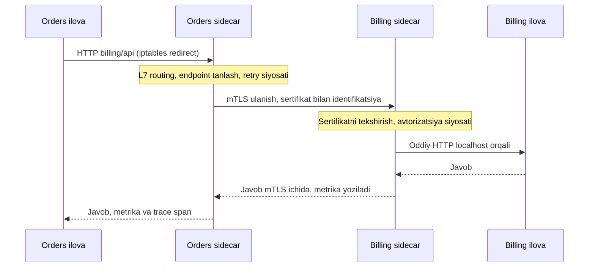

## Bu dars nima uchun kerak

53-darsda har bir servislararo chaqiruv uchun kerakli ro'yxatni tuzdik: timeout, retry (faqat idempotent), circuit breaker, L7 load balancing (ayniqsa gRPC uchun), trace ID uzatish, metrikalar. 74-darsda bunga mTLS qo'shiladi: servislar bir-birini sertifikat bilan autentifikatsiya qiladi va trafik shifrlanadi.

Bularning hammasini har bir servisda kutubxona sifatida yozish mumkin. Lekin 20 ta servis, uchta til (Node.js, Python, Go) va o'nta jamoa bo'lsa: har bir tilda bir xil sifatli kutubxona, har bir jamoada bir xil sozlama, sertifikatlarni har kuni aylantirish (rotation), retry siyosatini bitta joydan o'zgartirish - bu katta va tarqoq ish.

**Service mesh** bu vazifalarni ilova kodidan chiqarib, **platforma qatlamiga** ko'chiradi: har servis yonida (yoki har node'da) proxy turadi va barcha tarmoq trafigini u boshqaradi. Bu kuchli g'oya, lekin bepul emas: har so'rovga qo'shimcha hop, har pod'ga qo'shimcha CPU va xotira, va yangi murakkab infratuzilma qatlami.

Bu darsdan keyin siz:

- sidecar pattern'ini va uning muqobillarini (kutubxona, node-level proxy) tushunasiz;
- service mesh'ning data plane va control plane qismlari qanday ishlashini bilasiz;
- trafik pod'dan sidecar'ga qanday yo'naltirilishini (iptables redirect) tushunasiz;
- mesh beradigan imkoniyatlarni (mTLS, L7 balancing, retry, traffic splitting, telemetriya) va ularning cheklovlarini bilasiz;
- sidecar va ambient (sidecar'siz) rejimlar narxini raqam bilan solishtira olasiz;
- mesh qachon kerak va qachon ortiqcha ekanini asoslab bera olasiz.

## Sidecar pattern

Microsoft Azure Architecture Center sidecar pattern'ni shunday ta'riflaydi: ilova komponentlarini asosiy ilova yonida alohida process yoki konteynerda ishga tushirish; sidecar periferik vazifalarni (loglash, monitoring, konfiguratsiya, tarmoq) bajaradi va asosiy ilova bilan bir xil hayot tsikliga ega - birga yaratiladi, birga o'chiriladi.

Kubernetes'da pod - bir nechta konteynerdan iborat bo'lishi mumkin, ular bitta tarmoq namespace'ini (bitta IP, `localhost`) va volume'larni bo'lishadi. Sidecar shu imkoniyatdan foydalanadi.

Sidecar misollari (faqat mesh emas):

- **Log yuboruvchi** (Fluent Bit) - ilova faylga yoki stdout'ga yozadi, sidecar markazga yuboradi.
- **OpenTelemetry Collector** - telemetriyani boyitib, eksport qiladi.
- **Dapr** - holat, pub/sub, secrets uchun til-mustaqil API.
- **Ambassador** - tashqi servisga ulanish uchun proxy (retry, circuit breaking).
- **Service mesh proxy** (Envoy, linkerd2-proxy).

### Kubernetes native sidecar

Uzoq vaqt Kubernetes'da "sidecar" alohida tushuncha emas edi - oddiy ikkinchi konteyner. Bu muammolar yaratdi: ilova sidecar proxy tayyor bo'lmasdan ishga tushib, birinchi so'rovlari muvaffaqiyatsiz bo'lardi; Job tugagach sidecar ishlashda davom etib, Job hech qachon "tugamas"di; o'chirishda proxy ilovadan oldin o'lib, oxirgi so'rovlar yo'qolardi.

Kubernetes 1.28 versiyasida **native sidecar** paydo bo'ldi va 1.33 da stable bo'ldi: sidecar - `restartPolicy: Always` bilan `initContainers` ichidagi konteyner. Kafolatlar:

- sidecar'lar asosiy konteynerlardan **oldin** ishga tushadi (startup probe'dan o'tishi kutiladi);
- o'chirishda asosiy konteynerlar avval to'xtatiladi, sidecar'lar **keyin** teskari tartibda;
- Job'da asosiy konteyner tugasa, sidecar uni ushlab qolmaydi.

### Sidecar vs kutubxona

| Mezon | Kutubxona (masalan, gRPC klient sozlamalari, `opossum` circuit breaker) | Sidecar proxy |
|---|---|---|
| Til | Har til uchun alohida implementatsiya | Til-mustaqil |
| Yangilash | Har servisni qayta build va deploy | Proxy'ni alohida yangilash (lekin pod restart kerak) |
| Latency | Process ichida, qo'shimcha hop yo'q | Har yo'nalishda localhost hop |
| Resurs | Ilova ichida | Har pod'ga alohida CPU/xotira |
| Kontekst | Ilova semantikasini biladi (idempotentlik, biznes xato) | Faqat protokol darajasi (status kod, header) |
| Siyosatni markaziy boshqarish | Qiyin | Oson (control plane) |

Azure qo'llanmasi ham shu trade-off'ni ta'kidlaydi: tilga xos kutubxonalar chuqurroq integratsiya va kamroq tarmoq overhead beradi, sidecar esa til mustaqilligini beradi. Kichik ilovada sidecar'ning har instance uchun resurs narxi izolyatsiya foydasidan oshib ketishi mumkin.

## Service mesh arxitekturasi

Linkerd hujjatlari service mesh'ni cloud-native ilovalarga xavfsizlik, ishonchlilik va observability imkoniyatlarini ilova kodi o'rniga **platforma qatlamida** qo'shadigan vosita deb ta'riflaydi. Ikki qism:

### Data plane

Har servis instance'i yonidagi proxy'lar to'plami. Barcha kiruvchi va chiquvchi trafik ular orqali o'tadi. Istio'da bu Envoy, Linkerd'da Rust'da yozilgan maxsus "micro-proxy" (linkerd2-proxy; Linkerd 2018 yilda Rust proxy'larga qayta yozilgan).

### Control plane

Proxy'larning o'zi trafikni boshqarmaydi, ularni boshqaradi:

- **Service discovery** - Kubernetes API'dan (Service, EndpointSlice) endpoint ro'yxatini olib, proxy'larga tarqatadi.
- **Konfiguratsiya** - yuqori darajadagi qoidalarni ("billing'ga trafikning 5 foizi v2 ga") proxy konfiguratsiyasiga tarjima qilib, ishlab turgan proxy'larga yuboradi. Envoy uchun bu xDS protokoli.
- **Sertifikatlar (CA)** - har workload'ga identifikatsiya sertifikati beradi va uni aylantiradi.

Istio'da control plane - bitta `istiod` komponenti: discovery, konfiguratsiya va sertifikat boshqaruvi, mTLS uchun CA.

**Muhim xususiyat:** control plane o'chsa, data plane **ishlashda davom etadi** - proxy'lar oxirgi olingan konfiguratsiya bilan trafikni o'tkazaveradi. Faqat yangi o'zgarishlar (yangi pod, yangi qoida) tarqalmaydi va sertifikatlar muddati tugay boshlaydi. Bu control plane va data plane ajratilishining asosiy maqsadi.

## Trafik sidecar'ga qanday yetadi

Ilova kodi o'zgarmaydi: u `http://billing/api` ga so'rov yuboradi, xuddi mesh yo'qdek. Qanday qilib so'rov proxy orqali o'tadi?

Klassik sidecar rejimida pod ishga tushganda init konteyner (yoki CNI plagini) pod tarmoq namespace'ida **iptables qoidalarini** o'rnatadi:

- pod'dan chiqadigan barcha TCP trafik proxy'ning chiquvchi portiga yo'naltiriladi;
- pod'ga kiruvchi barcha TCP trafik proxy'ning kiruvchi portiga yo'naltiriladi;
- proxy'ning o'z trafigi (UID bo'yicha) bu qoidalardan chiqariladi, aks holda cheksiz tsikl.

Bitta so'rov yo'li:

E'tibor bering: bitta mantiqiy chaqiruv **ikki proxy** orqali o'tadi - chaqiruvchi tomonidagi va qabul qiluvchi tomonidagi. Latency va CPU narxi ikki baravar hisoblanadi.

## Mesh nima beradi

### 1. mTLS va workload identifikatsiyasi

Har bir workload kriptografik identifikatsiyaga ega bo'ladi. Linkerd'da har proxy sertifikati pod'ning Kubernetes ServiceAccount'iga bog'langan, 24 soatda muddati tugaydi va avtomatik aylantiriladi. Ko'p mesh'lar SPIFFE standartidan foydalanadi: SPIFFE ID - `spiffe://trust-domain/workload-identifier` ko'rinishidagi URI (masalan, `spiffe://acme.com/billing/payments`), SVID esa qisqa muddatli kriptografik identifikatsiya hujjati.

Natija: **"tarmoq ichida bo'lsa ishonamiz"** o'rniga **"kim ekanini isbotlasa ishonamiz"** (zero trust, 72, 74-darslar). Avtorizatsiya siyosati IP bo'yicha emas, identifikatsiya bo'yicha: "faqat `orders` servis hisobi `billing`ning `/charge` endpoint'ini chaqira oladi".

Ilova kodini o'zgartirmasdan barcha ichki trafikni shifrlash - ko'pchilik mesh'ni aynan shu uchun joriy qiladi.

### 2. L7 load balancing

Mesh proxy har bir HTTP/2 va gRPC so'rovini alohida balanslaydi - 53-darsdagi "3 pod'ga yuklama" muammosi yo'qoladi. Linkerd latency-aware balancing ishlatadi: javob vaqtiga qarab tezroq endpoint'ni afzal ko'radi (EWMA asosida).

### 3. Ishonchlilik: retry, timeout, circuit breaking

Proxy darajasida sozlanadi. Lekin bu yerda ehtiyot bo'lish kerak:

- Proxy so'rov idempotentmi yoki yo'qligini bilmaydi. `POST /charge` ni retry qilish dublikat to'lovga olib kelishi mumkin. Retry faqat aniq idempotent route'lar uchun yoqilishi kerak.
- **Retry amplification:** urinishlar har qatlamda ko'paytiriladi. A → B → C → D zanjirida A, B va C har biri jami 3 tagacha urinish qilsa va D ishlamay qolsa, D ga 3 × 3 × 3 = 27 ta urinish keladi - bitta foydalanuvchi so'rovidan. Agar ilova ham, sidecar ham mustaqil retry qilsa, har qatlamda 3 × 3 = 9 urinish va zanjir bo'yicha 9^3 = 729. Retry faqat bitta qatlamda bo'lishi kerak (62-dars). Retry budget (umumiy so'rovlarning masalan 20 foizidan oshmasin) bu muammoni cheklaydi.

### 4. Traffic management

- **Traffic splitting** - foiz bo'yicha: 95% v1, 5% v2 (canary, 68-dars).
- **Header bo'yicha routing** - `x-tenant: beta-testers` → yangi versiya.
- **Mirroring (shadow)** - trafik nusxasini yangi versiyaga yuborish, javobini e'tiborsiz qoldirish.
- **Fault injection** - test uchun sun'iy kechikish yoki xato kiritish (70-dars: chaos engineering).

### 5. Observability

Har proxy har so'rov uchun metrikalar yozadi: so'rovlar soni, xatolar, latency taqsimoti - servis juftligi bo'yicha. Bu kodga tegmasdan "kim kimni chaqiradi" xaritasi va RED metrikalari (67-dars). Tracing uchun esa mesh span yaratadi, lekin **ilova trace header'larini kiruvchi so'rovdan chiquvchi so'rovga o'zi uzatishi shart** - proxy so'rovlar orasidagi bog'liqlikni ilova ichida ko'ra olmaydi. Bu ko'p uchraydigan tushunmovchilik: "mesh qo'ydik, tracing avtomatik bo'ladi" - qisman.

## Mesh nima BERMAYDI

- **Biznes darajasidagi ishonchlilik:** idempotentlik, saga kompensatsiyasi, outbox - bular ilovada.
- **Async trafik:** Kafka iste'molchisi va producer'i uchun mesh asosan TCP darajasida mTLS beradi; navbat semantikasi (retry, DLQ, 50-dars) mesh ishi emas.
- **Fine-grained avtorizatsiya:** "foydalanuvchi X mashina Y'ni ko'ra oladimi" - ilovada.
- **Noto'g'ri arxitekturani tuzatish:** chatty distributed monolith mesh bilan ham chatty, faqat endi har chaqiruv ikki proxy orqali o'tadi.

## Narx: raqamlar

Istio rasmiy hujjatlarida (1.24 versiyasi sinovi) 1 KB payload'li 1 000 HTTP so'rov/s yuklamada, 2 ta proxy worker thread bilan quyidagi resurs sarfi keltirilgan:

| Komponent | vCPU | Xotira |
|---|---|---|
| Sidecar proxy (Envoy) | ~0.20 | ~60 MB |
| Waypoint proxy (Envoy, ambient L7) | ~0.25 | ~60 MB |
| ztunnel (ambient, node'ga bitta) | ~0.06 | ~12 MB |

Proxy xotirasi u ushlab turgan konfiguratsiya hajmi bilan (listener, cluster, route soni) o'sadi. Shuning uchun katta mesh'da har sidecar'ga butun klaster konfiguratsiyasini emas, faqat kerakli qismini yuborish (Istio'da `Sidecar` resursi bilan cheklash) muhim.

### Hisob-kitob misoli

Hisob uchun shartlar: 30 ta servis, jami 150 pod, 10 ta node, ichki trafik o'rtacha 6 000 so'rov/s. Proxy sarfi uchun yuqoridagi Istio 1.24 raqamlari ishlatiladi (ular 1 KB payload va 2 worker thread sharoitida o'lchangan; boshqa payload va funksiyalar bilan boshqacha bo'ladi).

**Sidecar rejimi.** Har so'rov 2 proxy'dan o'tadi: 6 000 × 2 = 12 000 proxy-so'rov/s. Istio raqamlari bo'yicha 1 000 so'rov/s ga 0.20 vCPU: 12 × 0.20 = **2.4 vCPU** faqat trafikni proksilash uchun. Xotira: 150 pod × 60 MB = 9 000 MB, ya'ni **~9 GB** (kam yuklangan pod'larda kamroq bo'lishi mumkin, lekin konfiguratsiya hajmi bilan o'sadi). Bundan tashqari har sidecar uchun Kubernetes `requests` rezervlari - ko'pincha haqiqiy sarfdan katta qo'yiladi, va bu klaster sig'imini band qiladi.

**Ambient rejimi (faqat L4 - mTLS).** ztunnel har node'da bitta: xotira 10 × 12 MB = 120 MB. CPU: har so'rov ikki ztunnel'dan (klient va server node'i) o'tadi, 12 000 × 0.06 / 1 000 = 0.72 vCPU. L7 kerak bo'lgan bir nechta namespace uchun waypoint'lar qo'shiladi. Resurs sarfi tartib bilan kam.

**Latency.** Istio 1.24 hujjati p90/p99 natijalarini faqat grafiklarda beradi, lekin oldingi versiyalar hujjatida aniq raqamlar bor. Sinov sharoiti: Istio benchmark vositalari, http/1.1, 1 KB payload, 1 000 so'rov/s, 2 proxy worker, mTLS yoqilgan, CNCF Community Infrastructure Lab uskunasi (hujjat boshqa uskunada boshqa natija bo'lishini ta'kidlaydi).

| Rejim (Istio versiyasi) | Ikki proxy birgalikda qo'shadigan p90 | p99 |
|---|---|---|
| Sidecar, telemetry v2 bilan (1.21) | ~0.182 ms | ~0.248 ms |
| Ambient L4, ikki ztunnel (1.22) | ~0.17 ms | ~0.20 ms |

Ya'ni bunday sharoitda bitta servislararo chaqiruvga mesh bir millisekunddan ancha kam qo'shadi. Agar so'rov 5 ta ketma-ket servisdan o'tsa, sidecar rejimida p99 bo'yicha 5 × 0.248 ≈ 1.2 ms. Lekin bu raqamlar yengil sintetik yuklamada olingan: hujjatning o'zi telemetriya filtrlari (log, tracing, metrika) latency'ga sezilarli ta'sir qilishini, proxy worker band bo'lsa keyingi so'rov navbatda kutishini va real tail latency trafik shakliga bog'liqligini aytadi. Katta payload, ko'p L7 qoidalar, CPU limit bilan siqilgan sidecar yoki tashqi avtorizatsiya chaqiruvi bu qo'shimchani ko'paytiradi - shuning uchun o'z yuklamangizda mesh bilan va mesh'siz p99 ni o'lchab solishtiring.

## Sidecar'siz mesh: ambient va boshqalar

Sidecar modelining muammolari: har pod'ga resurs, proxy'ni yangilash uchun barcha pod'larni qayta ishga tushirish, ilova va proxy hayot tsikli aralashuvi. Shu sababli sidecar'siz yondashuvlar paydo bo'ldi.

**Istio ambient mode** (Istio 1.24, 2024 yil noyabrda GA deb e'lon qilingan) data plane'ni ikki qatlamga ajratadi:

- **ztunnel** - har node'da bitta, Rust'da yozilgan proxy. L3/L4 vazifalar: mTLS, autentifikatsiya, L4 avtorizatsiya, telemetriya. HTTP'ni parse qilmaydi. Trafik HBONE (HTTP CONNECT asosidagi tunnel) orqali o'tadi.
- **Waypoint proxy** - ixtiyoriy, Envoy asosida, ilova pod'lari tashqarisida, namespace yoki servis bo'yicha. L7 imkoniyatlar (routing, L7 avtorizatsiya, retry) kerak bo'lganda yoqiladi.

Foydalar: ilova pod'larida sidecar yo'q; bosqichma-bosqich joriy etish (avval faqat mTLS, keyin kerakli joyda L7); waypoint'lar ilovadan mustaqil yangilanadi va masshtablanadi. Sidecar va ambient workload'lar bitta mesh'da birga yashashi mumkin.

Boshqa yondashuvlar: **eBPF asosidagi** mesh'lar (masalan Cilium) L4 ishlovni kernel darajasida bajaradi, L7 uchun esa node darajasidagi Envoy ishlatadi. **Proxyless gRPC** - gRPC kutubxonasi xDS orqali control plane'dan konfiguratsiyani to'g'ridan-to'g'ri oladi, proxy umuman yo'q (faqat gRPC uchun).

| Rejim | Resurs narxi | L7 imkoniyatlar | Pod restart kerakmi (proxy yangilashda) | Izolyatsiya |
|---|---|---|---|---|
| Sidecar | Yuqori (har pod) | To'liq, har pod'da | Ha | Eng yuqori: har pod o'z proxy'si |
| Ambient (ztunnel + waypoint) | Past (L4), o'rtacha (L7) | Waypoint orqali | Yo'q | Node'dagi proxy bir nechta pod'ga xizmat qiladi |
| eBPF + node proxy | Past | Node proxy orqali | Yo'q | Node darajasi |
| Proxyless gRPC | Juda past | gRPC funksiyalari | Ilova bilan birga | Ilova ichida |
| Mesh'siz (kutubxonalar) | Eng past | Kod orqali | Ilova bilan birga | Ilova ichida |

## Qachon mesh kerak

Kuchli signallar:

- **Barcha ichki trafikni mTLS bilan shifrlash talabi** (compliance, zero trust) va ko'p servis/til - kutubxona bilan qilish qimmat.
- **Ko'p tilli muhit** (Node.js, Python, Go, Java) - bir xil retry/timeout/telemetriyani har tilda takrorlash qimmat.
- **Ko'p gRPC trafik** va L7 balancing muammosi.
- **Ko'p jamoa**, markaziy platforma jamoasi bor va trafik siyosatini markazdan boshqarish kerak.
- **Progressive delivery** (canary, traffic splitting) servislararo darajada.

Mesh ortiqcha bo'lgan holatlar:

- 3-5 ta servis, bitta til, bitta jamoa;
- asosiy aloqa async (Kafka) orqali;
- mesh'ni boshqaradigan va kechasi debug qiladigan odam yo'q - mesh o'zi murakkab tizim: yangi CRD'lar, sertifikat muammolari, "nega bu so'rov 503 qaytaryapti" savollari endi proxy konfiguratsiyasida;
- latency byudjeti juda qattiq.

Oraliq yo'l: avval **faqat mTLS va telemetriya** (ambient L4 yoki Linkerd'ning minimal sozlamasi), L7 imkoniyatlarni kerak bo'lganda.

## Real tizimlardan misollar

- **Lyft** - Envoy'ni yaratgan (C++ da) va 2016 yil 14 sentabrda ochiq kod qilgan kompaniya (Lyft muhandislik blogidagi e'lon); Envoy keyinchalik Istio va boshqa ko'plab mesh va gateway'larning data plane'iga aylangan.
- **Linkerd** - birinchi service mesh loyihasi, Buoyant tomonidan yaratilgan, 2017 yil boshida CNCF'ga qabul qilingan va 2021 yilda CNCF "graduated" maqomini olgan; hujjatlarida Microsoft, HP, Nordstrom kabi foydalanuvchilar keltirilgan.
- **Istio** - Envoy sidecar va istiod control plane; 1.24 versiyasidan ambient rejim GA. Hujjatlaridagi yuklama sinovi: 1 000 servis, 2 000 pod, mesh bo'ylab 70 000 so'rov/s.
- **Kubernetes** - 1.33 versiyasida native sidecar stable bo'ldi, bu mesh sidecar'larining ishga tushish va o'chish tartibi muammolarini platforma darajasida yechdi.

## iQuariX kontekstida qo'llanish

Misol sharti - 51-53-darslardagi arxitektura: Ingest (Node.js yoki Go, TCP), monolit (NestJS: `api` va `worker`), Video servis, AI analitika (Python), Kafka, PostgreSQL, Redis, ClickHouse. Jami 5-6 deploy birligi, 30-50 pod.

Tahlil:

- **mTLS kerakmi?** Agar mijozlar (masalan, banklar, davlat korxonalari) xavfsizlik auditi talab qilsa va ichki trafik shifrlanishi kerak bo'lsa - ha. 5 ta servis uchun buni kutubxona va cert-manager bilan ham qilish mumkin, lekin sertifikat aylantirish va identifikatsiya siyosatini qo'lda boshqarish xato manbai.
- **L7 balancing:** monolit → AI servis gRPC chaqiruvlari - bitta joy. Buni headless Service + gRPC `round_robin` bilan yechish mumkin (53-dars), mesh shart emas.
- **Asosiy aloqa Kafka orqali** - mesh bu yerda kam foyda beradi.
- **Ko'p tilli:** Node.js va Python - ikki til, boshqariladigan hajm.

Shu shartlar uchun taklif qilinadigan qaror: **hozircha to'liq sidecar mesh yo'q.** Kutubxonalar: NestJS'da umumiy HTTP klient moduli (timeout, retry faqat GET/idempotent, circuit breaker, `traceparent` uzatish), Python'da xuddi shunday. OpenTelemetry (66-dars) bilan tracing. Agar compliance talabi paydo bo'lsa - **ambient rejimda faqat L4 (ztunnel)** bilan mTLS: ilova pod'lariga tegmasdan, resurs narxi minimal. L7 waypoint faqat kerak bo'lgan namespace'ga.

Ehtiyot bo'lish kerak bo'lgan joy: **Ingest servis va trekerlarning TCP ulanishlari.** Ular tashqi trafik, mesh ichki trafik uchun. Ingest pod'iga sidecar qo'yilsa, 100 000 ta uzoq yashovchi TCP ulanishning har biri proxy orqali o'tadi - qo'shimcha xotira (har ulanishga bufer), qo'shimcha CPU va proxy restart'ida barcha trekerlar uziladi. Ingest pod'larini mesh'dan chiqarish (yoki faqat chiquvchi Kafka trafigini mesh'ga qo'shish) ehtimol to'g'riroq.

## Ko'p uchraydigan xatolar

1. **Mesh'ni muammo bo'lmasdan joriy qilish** - "zamonaviy" bo'lgani uchun. Natija: operatsion murakkablik, foyda kam.
2. **Retry'ni ham ilovada, ham proxy'da yoqish** - retry amplification va retry storm.
3. **Non-idempotent route'larda proxy retry** - dublikat yozuvlar va to'lovlar.
4. **"Mesh tracing'ni avtomatik qiladi" deb o'ylash** - ilova trace header'larini uzatmasa, span'lar bog'lanmaydi.
5. **Sidecar resurs rezervlarini hisobga olmaslik** - har pod'ga 100m CPU request × 500 pod = 50 vCPU faqat rezerv uchun.
6. **Proxy konfiguratsiyasini cheklamaslik** - har sidecar butun klaster konfiguratsiyasini ushlab, xotira o'sadi va control plane yuklanadi.
7. **Pod ishga tushish/o'chish tartibini e'tiborsiz qoldirish** - eski Kubernetes versiyalarida ilova proxy'dan oldin ishga tushib, birinchi so'rovlar muvaffaqiyatsiz bo'ladi; native sidecar yoki mesh'ning tegishli sozlamasidan foydalaning.
8. **Uzoq yashovchi tashqi TCP ulanishlarni (IoT) sidecar orqali o'tkazish** - proxy restart'i barcha qurilmalarni uzadi.

## Xulosa

- Sidecar - ilova yonida, bir xil hayot tsiklidagi yordamchi process; mesh uning eng mashhur qo'llanishi.
- Mesh = data plane (proxy'lar) + control plane (discovery, konfiguratsiya, CA); control plane o'chsa, data plane oxirgi konfiguratsiya bilan ishlayveradi.
- Asosiy foyda: kodsiz mTLS va workload identifikatsiyasi, L7 balancing, markaziy trafik siyosati, bir xil telemetriya.
- Mesh biznes semantikasini bilmaydi: idempotentlik, async semantika, fine-grained avtorizatsiya ilovada qoladi.
- Narx: har chaqiruv ikki proxy, Istio sinovida har proxy 1 000 so'rov/s ga ~0.2 vCPU va ~60 MB; ambient ztunnel tartib bilan arzonroq.
- Ambient (ztunnel + waypoint) va eBPF yondashuvlari sidecar narxini kamaytiradi va bosqichma-bosqich joriy etishga imkon beradi.
- Mesh'ni aniq signal bo'yicha joriy qiling: mTLS talabi, ko'p til, ko'p gRPC, ko'p jamoa va uni boshqaradigan platforma jamoasi.

## Amaliy topshiriq

Masala sharti: iQuariX 2 yil ichida o'sdi: 18 ta servis (Node.js, Python, Go), 4 ta jamoa, 400 pod, ichki sinxron trafik o'rtacha 15 000 so'rov/s, cho'qqida 40 000. Yirik mijoz (bank lizing kompaniyasi) shartnoma talabi qo'ydi: barcha ichki trafik shifrlangan bo'lishi va servislar bir-birini kriptografik autentifikatsiya qilishi kerak; audit uchun "kim kimni chaqirgan" jurnali kerak.

1. Uch variantni solishtiring: (a) kutubxonalar + cert-manager bilan mTLS, (b) sidecar mesh, (c) ambient mesh (L4, kerakli joyda waypoint). Har biri uchun: implementatsiya hajmi, til bo'yicha takrorlanish, operatsion yuk.
2. (b) va (c) uchun resurs hisobini qiling: cho'qqi trafik, har so'rov nechta proxy'dan o'tadi, Istio raqamlari asosida vCPU va xotira. Natijani 400 pod'ga sidecar `requests` rezervi bilan solishtiring (shart: har sidecar uchun 100m CPU, 128 MB).
3. Latency ta'sirini baholang: eng uzun sinxron zanjir 4 servisdan iborat, p99 byudjeti 250 ms. Mesh qo'shimchasi qancha bo'ladi va bu qabul qilinadimi?
4. Retry siyosatini loyihalang: qaysi qatlamda (ilova yoki mesh), qaysi route'lar uchun, retry budget qancha. Retry amplification'ga yo'l qo'ymaslikni tushuntiring.
5. Ingest servis (100 000 TCP treker ulanishi) va Kafka trafigi mesh'ga qanday munosabatda bo'ladi? Nima mesh ichida, nima tashqarida va nega.
6. Mesh joriy etish rejasi: bosqichlar, birinchi qaysi namespace, rollback yo'li, control plane o'chsa nima bo'lishini tekshirish.

Yaxshi javobda bo'lishi kerak bo'lgan narsalar:

- variantlar raqamlar bilan solishtirilgan, faqat sifat tavsifi emas;
- har so'rov ikki proxy'dan o'tishi hisobga olingan;
- retry faqat bitta qatlamda va faqat idempotent route'larda;
- uzoq yashovchi tashqi IoT ulanishlari alohida ko'rib chiqilgan;
- bosqichma-bosqich joriy etish (avval mTLS permissive, keyin strict);
- control plane nosozligi va sertifikat muddati ko'rib chiqilgan.

Javobni pastdagi maydonga yozib, chatga yuboring.

## Manbalar

- Microsoft Azure Architecture Center. [Sidecar pattern](https://learn.microsoft.com/en-us/azure/architecture/patterns/sidecar) - ta'rif, qachon ishlatish va ishlatmaslik, kutubxona vs sidecar.
- Kubernetes. [Sidecar Containers](https://kubernetes.io/docs/concepts/workloads/pods/sidecar-containers/) - native sidecar (1.28 da paydo bo'lgan, 1.33 da stable), ishga tushish va o'chish tartibi.
- Istio. [Architecture](https://istio.io/latest/docs/ops/deployment/architecture/) - Envoy data plane, istiod control plane, imkoniyatlar.
- Istio. [Performance and Scalability](https://istio.io/latest/docs/ops/deployment/performance-and-scalability/) - sidecar, waypoint va ztunnel resurs sarfi (1.24 sinovi), telemetriya filtrlarining latency'ga ta'siri; aniq latency raqamlari sahifaning oldingi versiyalarida: [Istio 1.21 (sidecar)](https://github.com/istio/istio.io/blob/release-1.22/content/en/docs/ops/deployment/performance-and-scalability/index.md) va [Istio 1.22 (ambient L4)](https://github.com/istio/istio.io/blob/release-1.23/content/en/docs/ops/deployment/performance-and-scalability/index.md), "Latency for Istio" bo'limlari.
- Lyft Engineering. [Announcing Envoy: C++ L7 proxy and communication bus](https://eng.lyft.com/announcing-envoy-c-l7-proxy-and-communication-bus-92520b6c8191), 2016-09-14 - Envoy'ning ochiq kodga chiqarilishi.
- Istio. [Ambient mode overview](https://istio.io/latest/docs/ambient/overview/) va [Istio 1.24 e'loni](https://istio.io/latest/news/releases/1.24.x/announcing-1.24/) - ztunnel, waypoint, HBONE, ambient GA.
- Linkerd. [What is a service mesh?](https://linkerd.io/what-is-a-service-mesh/) - data plane/control plane, tarix, Rust micro-proxy; [Automatic mTLS](https://linkerd.io/2-edge/features/automatic-mtls/) - 24 soatlik sertifikatlar, ServiceAccount identifikatsiyasi.
- SPIFFE. [SPIFFE Concepts](https://spiffe.io/docs/latest/spiffe-about/spiffe-concepts/) - SPIFFE ID formati va SVID.
- Envoy. [What is Envoy](https://www.envoyproxy.io/docs/envoy/latest/intro/what_is_envoy) - L3/L4 va L7 proxy, sidecar sifatida ishlatilishi.
