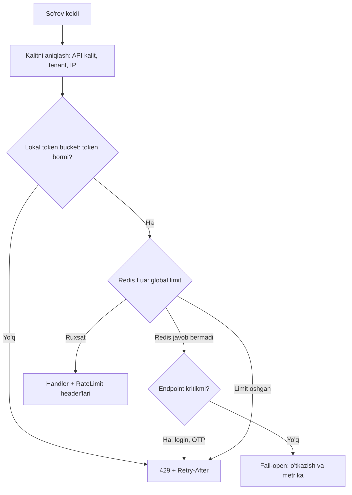

## Bu dars nima uchun kerak

Har qanday tizimning sig'imi cheklangan: CPU, baza ulanishlari, tashqi API kvotalari, pul. Agar bitta klient - xatoli skript, noto'g'ri sozlangan integratsiya, bot yoki hujumchi - bu sig'imning katta qismini egallasa, qolgan hamma foydalanuvchilar zarar ko'radi. **Rate limiting** - klient yoki operatsiya bo'yicha so'rovlar tezligini cheklash orqali tizimni va uning adolatli taqsimlanishini himoya qilish.

Bu mavzu oldingi darslar bilan bevosita bog'liq: 54-darsda API gateway'ning vazifalaridan biri sifatida ko'rdik; 50-darsda backpressure - ichki yuklama ostida o'zini himoya qilish; 63-darsda load shedding va circuit breaker. Rate limiting - ularning tashqi chegaradagi ko'rinishi: "kim, qancha, qanday tezlikda".

Bu darsdan keyin siz:

- rate limiting, quota, throttling, concurrency limiting va load shedding farqini bilasiz;
- beshta asosiy algoritmni (fixed window, sliding window log, sliding window counter, token bucket, leaky bucket/GCRA) ichki mexanikasi va trade-off'lari bilan tushunasiz;
- har bir algoritmning xotira va aniqlik narxini hisoblay olasiz;
- distributed rate limiter'ni Redis va Lua bilan atomik qilib qura olasiz va race condition'larni tushunasiz;
- local + global ikki bosqichli dizaynni va Redis o'chganda nima qilishni bilasiz;
- klientga to'g'ri javob berishni (429, `Retry-After`, RateLimit header'lari) bilasiz.

## Atamalar va maqsadlar

| Tushuncha | Nimani cheklaydi | Misol |
|---|---|---|
| **Rate limit** | Vaqt birligidagi so'rovlar soni | 100 so'rov/daqiqa API kalit bo'yicha |
| **Quota** | Uzoq davrdagi umumiy hajm, ko'pincha tarif bilan bog'liq | Oyiga 1 million API chaqiruv |
| **Concurrency limit** | Bir vaqtda bajarilayotgan so'rovlar soni | Bir vaqtda 20 tadan ortiq ochiq so'rov emas |
| **Throttling** | Rad etish o'rniga sekinlashtirish (kutish, navbat) | Ortiqcha so'rovlar navbatda kutadi |
| **Load shedding** | Tizim holatiga qarab past ustuvorlikdagi trafikni tashlash | CPU 90% dan oshsa, fon so'rovlarni 503 bilan rad etish |

Rate limiting maqsadlari:

1. **Himoya** - bitta klient tizimni yiqitmasligi (xato yoki ataylab).
2. **Adolat (fairness)** - multi-tenant tizimda bitta tenant boshqalarning resursini yemasligi (73-dars).
3. **Narx nazorati** - har so'rov pul turadigan tashqi API'lar (SMS, xarita, LLM).
4. **Biznes model** - tarif bo'yicha kvotalar.
5. **Xavfsizlik** - parolni bruteforce qilish, OTP so'rash, ro'yxatdan o'tish spam'i.

Stripe 2017 yilgi maqolasida to'rt turdagi cheklovchini tasvirlaydi: har foydalanuvchi uchun **request rate limiter** (soniyasiga N so'rov), **concurrent requests limiter** (bir vaqtda, masalan, 20 tadan ortiq ochiq so'rov emas), **fleet usage load shedder** (infratuzilmaning bir qismini, masalan 20 foizini, kritik so'rovlar uchun zahirada saqlash) va **worker utilization load shedder** (katta nosozlikda past ustuvorlikdagi trafikni tashlash, test rejimidan boshlab). Ularning hisobotiga ko'ra bir oyda request rate limiter millionlab so'rovni rad etgan, oxirgi himoya qatlami esa atigi 100 ta so'rovni. Saboq: rate limiting bitta mexanizm emas, qatlamli himoya.

## Algoritmlar

Barcha misollarda limit: **daqiqasiga 100 so'rov** bitta klient uchun.

### 1. Fixed window counter

Vaqt qat'iy oynalarga bo'linadi (12:00:00-12:00:59, 12:01:00-12:01:59). Har oyna uchun hisoblagich. So'rov kelganda: `count[klient, oyna]++`; agar > 100 - rad.

Redis'da: kalit `rl:{klient}:{daqiqa_raqami}`, `INCR` va birinchi so'rovda `EXPIRE 60`.

- **Xotira:** har klientga bitta hisoblagich. Juda arzon.
- **Muammo - chegara burst'i:** klient 12:00:59 da 100 ta va 12:01:00 da yana 100 ta so'rov yuboradi. Ikkala oynada limit buzilmagan, lekin 2 soniya ichida 200 so'rov - limitning ikki baravari. Redis qo'llanmasi xuddi shu misolni keltiradi: "10 soniyada 10" limitida 9- va 11-soniyalarda 10 tadan, 2 soniyada 20 so'rov.
- **Yana bir muammo:** oyna boshlanishida barcha klientlarning hisoblagichi bir vaqtda nolga tushadi va "12:00:00 to'lqini" hosil bo'ladi.

### 2. Sliding window log

Har so'rovning vaqt belgisini saqlash. Yangi so'rov kelganda: oxirgi 60 soniyadan eski belgilarni o'chirish, qolganlarini sanash, < 100 bo'lsa - qabul va yozish.

Redis'da: sorted set, score = vaqt (ms). `ZREMRANGEBYSCORE` (eskilarni o'chirish) → `ZCARD` (sanash) → `ZADD` (qo'shish). Member noyob bo'lishi kerak (`timestamp:random`), aks holda bir millisekunddagi ikki so'rov bitta yozuvga aylanadi.

- **Aniqlik:** to'liq aniq, chegara burst'i yo'q.
- **Xotira:** O(limit) har klientga. Limit 100/daqiqa bo'lsa, 100 tagacha yozuv. Bir element narxini taxmin qilmasdan o'lchash mumkin: `MEMORY USAGE kalit SAMPLES 0` kalitning to'liq hajmini baytda qaytaradi. Redis 7.0.15 da, member `1760000000000:100000` ko'rinishidagi 20 belgili satr, score - millisekund vaqt belgisi bo'lgan sorted set uchun o'lchov natijasi:

| Elementlar soni | Encoding | `MEMORY USAGE` | Bir elementga |
|---|---|---|---|
| 100 | listpack | 3 632 B | ~36 B |
| 128 | listpack | 5 168 B | ~40 B |
| 129 | skiplist | 17 872 B | ~139 B |
| 10 000 | skiplist | 1 289 368 B | ~129 B |

Sakrash sababi: `redis.conf` dagi default `zset-max-listpack-entries 128` va `zset-max-listpack-value 64` - sorted set 128 elementdan oshsa yoki member 64 baytdan uzun bo'lsa, ixcham listpack'dan skiplist + hash table tuzilmasiga o'tadi. Hisob: 1 million faol klient × 3 632 B ≈ **3.6 GB** (limit 100, listpack). Limit 129 dan katta bo'lsa, xotira bir elementga 3-4 baravar oshadi; limit 10 000/soat bo'lsa, 1 million × 1.29 MB ≈ **1.3 TB** - ko'p klientda amalda imkonsiz. Aniq raqam member uzunligi va Redis versiyasiga bog'liq, shuning uchun o'z formatingiz bilan `MEMORY USAGE` orqali o'lchang.
- **Ishlov:** har so'rovda O(log n) operatsiyalar.

### 3. Sliding window counter (taxminiy)

Fixed window arzonligi va sliding log aniqligi orasidagi murosa. Ikki qo'shni oyna hisoblagichini saqlaymiz va oldingi oynani **chiziqli interpolatsiya** qilamiz:

```
taxminiy_son = oldingi_oyna_soni × (oyna_uzunligi - joriy_oynada_o'tgan_vaqt) / oyna_uzunligi + joriy_oyna_soni
```

Cloudflare 2017 yilgi maqolasidagi misol: limit daqiqasiga 50, joriy daqiqa 15 soniya oldin boshlangan, joriy daqiqada 18 so'rov, oldingi daqiqada 42. Hisob: 42 × (60 - 15)/60 + 18 = 42 × 0.75 + 18 = **49.5** - limitdan sal past, so'rov qabul qilinadi; keyingi so'rov limitni oshiradi.

Taxmin qanchalik aniq? Cloudflare 270 000 ta manbadan kelgan 400 million so'rovni tahlil qilgan: so'rovlarning faqat **0.003 foizi** noto'g'ri qabul qilingan yoki noto'g'ri cheklangan; taxminiy tezlik haqiqiysidan o'rtacha 6 foiz farq qilgan; noto'g'ri cheklangan (false positive) manba bo'lmagan. Taxmin oldingi oynadagi so'rovlar bir tekis taqsimlangan deb faraz qiladi - shuning uchun ba'zan burst'ni biroz o'tkazib yuboradi, lekin amalda yetarli.

- **Xotira:** har klientga 2 ta hisoblagich.
- **Aniqlik:** yuqori, ko'p amaliy holatlar uchun yetarli.

### 4. Token bucket

Har klientning "chelagi" bor: sig'imi **B** token, tezlik **r** token/soniya bilan to'ldiriladi (B dan oshmaydi). Har so'rov 1 token (yoki operatsiya narxiga qarab ko'proq) oladi. Token yo'q - rad.

Muhim tushuncha: token bucket **ikki parametr** bilan ishlaydi:

- **r** - uzoq muddatli o'rtacha tezlik;
- **B** - ruxsat etilgan burst hajmi.

"Daqiqasiga 100, lekin bir zumda 20 tadan ko'p emas" → r = 100/60 ≈ 1.67 token/s, B = 20.

Implementatsiyada "to'ldiruvchi" fon jarayoni kerak emas - **lazy refill**: har klient uchun `(tokens, last_refill_time)` saqlanadi. So'rov kelganda:

```
elapsed = now - last_refill_time
tokens = min(B, tokens + elapsed × r)
last_refill_time = now
if tokens >= cost: tokens -= cost; qabul
else: rad, retry_after = (cost - tokens) / r
```

Hisob misoli: B = 20, r = 1.67/s. Klient 20 so'rovni bir zumda yuboradi - hammasi o'tadi, chelak bo'sh. 3 soniyadan keyin: 3 × 1.67 = 5 token - 5 so'rov o'tadi. Uzoq muddatda o'rtacha 1.67 so'rov/s dan oshmaydi. Eng yomon holatda bitta daqiqada: B + 60 × r = 20 + 100 = 120 so'rov (boshida to'la chelak + daqiqa davomidagi to'ldirish).

- **Xotira:** har klientga 2 ta son.
- **Afzallik:** burst va o'rtacha tezlik alohida boshqariladi; operatsiya narxi (cost) qo'llab-quvvatlanadi.
- **Qo'llanish:** Stripe o'z rate limiter'larini token bucket asosida Redis'da quradi; AWS API Gateway throttling ham token bucket asosida (hisob darajasida default region bo'yicha 10 000 so'rov/s, chelak sig'imi 5 000); Envoy local rate limit - token bucket.

### 5. Leaky bucket va GCRA

**Leaky bucket** ikki ma'noda ishlatiladi:

- **Navbat sifatida (shaper):** so'rovlar chelakka (navbatga) tushadi va doimiy tezlikda chiqadi. Chelak to'lsa - rad. Natija: chiqish oqimi silliq, burst yo'q. Bu throttling - kechikish qo'shadi. NGINX `limit_req` shunday ishlaydi (burst parametri navbat hajmi).
- **Hisoblagich sifatida (meter):** matematik jihatdan token bucket'ga ekvivalent.

**GCRA (Generic Cell Rate Algorithm)** - leaky bucket'ning fon "tomizish" jarayonisiz varianti, ATM tarmoqlaridan kelgan. Har klient uchun bitta qiymat saqlanadi: **TAT (theoretical arrival time)** - keyingi so'rov "nazariy jihatdan" kelishi kerak bo'lgan vaqt. Parametrlar: **T** - emission interval (1/r) va **τ** - burst tolerance. So'rov kelganda: agar `TAT - τ <= now` bo'lsa - qabul va `TAT = max(TAT, now) + T`; aks holda rad. Bitta timestamp saqlanadi, natija token bucket bilan bir xil. Brandur Leach maqolasida ta'kidlanganidek, vaqtga bog'liq bo'lgani uchun barcha instance'lar bir xil soatdan foydalanishi kerak - masalan, Redis'ning `TIME` buyrug'i.

### Taqqoslash

| Algoritm | Xotira (klientga) | Aniqlik | Burst nazorati | Murakkablik | Qachon |
|---|---|---|---|---|---|
| Fixed window | 1 son | Past: chegarada 2x | Yo'q | Juda oddiy | Uzoq oynali kvotalar (kun, oy) |
| Sliding window log | O(limit) yozuv | Aniq | To'liq | O'rta | Kichik limitlar, audit kerak (login urinishlari) |
| Sliding window counter | 2 son | Yuqori (taxminiy) | Yaxshi | Oddiy | Umumiy API limitlari, katta masshtab |
| Token bucket | 2 son | Aniq | B parametri bilan | Oddiy | Burst ruxsat etilgan API'lar, narxli operatsiyalar |
| Leaky bucket (queue) | Navbat | Aniq | Burst'ni silliqlaydi | O'rta | Downstream'ga doimiy tezlik kerak (tashqi API) |
| GCRA | 1 timestamp | Aniq | τ bilan | Oddiy, lekin tushunish qiyinroq | Token bucket bilan bir xil, kamroq holat |

## Kalit: nima bo'yicha cheklaymiz

Algoritmdan oldin muhimroq savol - **kalit** (identifikator):

- **Foydalanuvchi ID / API kalit** - autentifikatsiyadan keyin, eng aniq.
- **Tenant ID** - multi-tenant adolat uchun (bitta tenant ichidagi barcha foydalanuvchilar umumiy limitda).
- **IP manzil** - autentifikatsiyadan oldingi endpoint'lar (login, ro'yxatdan o'tish). Muammolar: NAT ortida yuzlab foydalanuvchi bitta IP'da (korporativ ofis, mobil operator CGNAT), IPv6'da bitta foydalanuvchi ko'p manzilga ega (ko'pincha /64 prefiks bo'yicha cheklanadi), proxy ortida haqiqiy IP `X-Forwarded-For`dan olinadi - va bu header soxtalashtirilishi mumkin, shuning uchun faqat ishonchli proxy qo'shgan qiymat olinadi.
- **Endpoint + kalit** - `POST /login` uchun alohida qattiq limit, `GET /vehicles` uchun yumshoq.
- **Operatsiya narxi** - GitHub REST API'da ikkilamchi limitlar "point"lar bilan: ko'p `GET` so'rovlar 1 point, `POST`/`PATCH`/`PUT`/`DELETE` 5 point, daqiqasiga 900 point; bir vaqtda 100 tagacha so'rov. Asosiy limit: autentifikatsiyalangan foydalanuvchiga soatiga 5 000, autentifikatsiyasiz IP bo'yicha 60.

Odatda bir nechta limit birga ishlaydi (ierarxik): IP bo'yicha qo'pol limit (DDoS'ga qarshi, 80-dars) + API kalit bo'yicha + tenant bo'yicha + og'ir endpoint uchun alohida. Har biri o'z hisoblagichi.

## Distributed rate limiter

Bitta serverda hammasi oddiy: xotiradagi `Map`. Lekin 10 ta API instance bo'lsa va har biri o'z hisoblagichini yuritsa, klient load balancer orqali 10 instance'ga taqsimlanib, **10 baravar** ko'p so'rov o'tkaza oladi. Uchta asosiy yondashuv.

### A. Markaziy store (Redis)

Barcha instance'lar bitta Redis'dagi hisoblagichni ishlatadi.

**Race condition.** Naiv implementatsiya: `GET count` → tekshirish → `SET count+1`. Ikki instance bir vaqtda `GET` qiladi (99), ikkalasi tekshiradi (< 100), ikkalasi yozadi (100). Natija: 101 so'rov o'tdi. Bu klassik read-modify-write race (18-dars: lost update).

Yechimlar:

- **Atomik buyruqlar:** fixed window uchun `INCR` o'zi atomik - avval oshirib, keyin natijani tekshirish. Lekin `INCR` va `EXPIRE` alohida bo'lsa va process o'rtada o'lsa, kalit TTL'siz qolib, klient abadiy bloklanishi mumkin.
- **Lua script (`EVAL`)** - Redis Lua script'ni atomik bajaradi: o'qish, qaror va yozish bitta qadamda, bitta round trip'da. Token bucket, sliding window - hammasi Lua bilan. Redis qo'llanmasi `MULTI/EXEC` ni bu yerda yaroqsiz deb tushuntiradi (tranzaksiya ichida qiymatni o'qib, unga qarab shoxlanib bo'lmaydi), `WATCH` esa raqobatda ko'p qayta urinishga olib keladi.

Token bucket Lua script'i (soddalashtirilgan):

```lua
-- KEYS[1] = bucket kaliti
-- ARGV[1] = sig'im B, ARGV[2] = tezlik r (token/ms), ARGV[3] = narx
local t = redis.call('TIME')
local now = tonumber(t[1]) * 1000 + math.floor(tonumber(t[2]) / 1000)
local b = redis.call('HMGET', KEYS[1], 'tokens', 'ts')
local cap = tonumber(ARGV[1])
local rate = tonumber(ARGV[2])
local cost = tonumber(ARGV[3])
local tokens = tonumber(b[1]) or cap
local ts = tonumber(b[2]) or now
tokens = math.min(cap, tokens + (now - ts) * rate)
local allowed = 0
local retry_ms = 0
if tokens >= cost then
  tokens = tokens - cost
  allowed = 1
else
  retry_ms = math.ceil((cost - tokens) / rate)
end
redis.call('HSET', KEYS[1], 'tokens', tokens, 'ts', now)
redis.call('PEXPIRE', KEYS[1], math.ceil(cap / rate))
return {allowed, math.floor(tokens), retry_ms}
```

E'tibor bering: vaqt **Redis'ning `TIME`** buyrug'idan olinadi, ilova serverlaridan emas - aks holda serverlar orasidagi soat farqi (32-dars) natijani buzadi. `PEXPIRE` - chelak to'liq to'lishi uchun kerak bo'lgan vaqt; undan keyin kalitni saqlash ma'nosiz (to'la chelak = kalit yo'q).

**Redis Cluster'da** script tegadigan barcha kalitlar bitta slot'da bo'lishi kerak; sliding window counter'ning ikki oyna kaliti uchun hash tag ishlatiladi: `rl:{client42}:w1`, `rl:{client42}:w2`.

**Narx hisobi.** Har API so'rov - Redis'ga bitta `EVALSHA` round trip: data-markaz ichida bitta round trip (2-darsdagi jadvalda 0.5 ms) va script bajarilish vaqti. 50 000 so'rov/s - Redis'ga 50 000 ops/s. Redis hujjatidagi `redis-benchmark` misolida (`-t set,lpush -n 100000 -q`, pipelining'siz) SET 180 180 so'rov/s, p50 = 0.143 ms bergan; hujjat bu raqam uskunaga bog'liq va maksimal sig'im emasligini ta'kidlaydi. Lua script bitta `SET`dan qimmatroq va Redis uni bitta thread'da atomik bajaradi - script qisqa bo'lishi kerak va real sig'imni o'z script'ingiz bilan `redis-benchmark` yoki yuklama testi orqali o'lchash kerak. Ko'proq yuklamada - Redis Cluster, kalitlar klient bo'yicha shard qilinadi.

**Hot key.** Bitta juda faol klient (yoki global limit "butun API uchun 1 million/s") bitta Redis shard'iga tushadi (24, 30-darslar). Yechim: lokal oldindan cheklash yoki hisoblagichni bo'laklash.

### B. Local + global (ikki bosqich)

Envoy hujjatlari aynan shuni tavsiya qiladi: avval har instance'da **local token bucket** - qo'pol cheklov, juda katta burst'larni global servisga yetib bormasdan yutadi; keyin **global rate limit servis** (gRPC, Redis asosidagi Go reference implementatsiyasi `envoyproxy/ratelimit`) - aniq cheklov. Bu global servisga yuklamani kamaytiradi.

### C. Taxminiy, sinxronlashtirilgan hisoblagichlar

Har instance lokal hisoblaydi va har N millisekundda markazga (Redis yoki boshqa instance'larga) delta yuboradi, global holatni oladi. Har so'rovda tarmoq round trip yo'q, lekin sinxronlash oralig'ida limit biroz oshib ketishi mumkin. Oddiy variant: global limit L, instance soni N bo'lsa, har instance'ga L/N lokal limit. Muammo: load balancer klientni notekis taqsimlasa (sticky sessions, uzoq ulanishlar) - klient o'z limitidan kamini oladi. Dinamik variant: instance'lar o'z ulushini real yuklamaga qarab qayta taqsimlaydi.

| Yondashuv | Aniqlik | Latency qo'shimchasi | Store o'chsa | Masshtab |
|---|---|---|---|---|
| Faqat lokal (xotirada) | Past: N instance = N baravar | 0 | Ta'sir yo'q | Cheksiz |
| Markaziy Redis + Lua | Yuqori | +1 round trip har so'rovda | Fail-open yoki fail-closed qarori | Redis Cluster bilan yuqori |
| Local + global | Yuqori | Global tekshiruv kerak bo'lganda | Lokal limit himoya qiladi | Yuqori |
| Taxminiy sinxron | O'rta (sinxron oralig'ida oshish) | ~0 | Lokal qiymat bilan davom | Juda yuqori |

### Redis o'chsa: fail-open yoki fail-closed

Rate limiter o'zi bog'liqlik va nosozlik nuqtasi. Redis javob bermasa:

- **Fail-open** - so'rovni o'tkazish. Mavjudlik saqlanadi, himoya vaqtincha yo'q. Umumiy API limitlari uchun odatiy tanlov: rate limiter sababli butun API o'chishi - himoya qilmoqchi bo'lgan narsadan yomonroq.
- **Fail-closed** - rad etish. Xavfsizlik-kritik endpoint'lar uchun: login bruteforce, OTP yuborish (har SMS pul), to'lov.

Har holda: Redis chaqiruviga qisqa timeout (masalan 5-20 ms) va circuit breaker (63-dars), aks holda sekin Redis butun API'ni sekinlashtiradi. Fail-open holatida lokal xotiradagi zaxira limiter qo'pol himoyani saqlab qoladi.

## Klientga javob

RFC 6585 (2012) **429 Too Many Requests** status kodini belgilaydi: foydalanuvchi berilgan vaqtda juda ko'p so'rov yuborgan. Javob holatni tushuntirishi kerak (SHOULD) va `Retry-After` header'ini o'z ichiga olishi mumkin; 429 javoblari cache'da saqlanmasligi kerak.

Header'lar:

- `Retry-After: 30` - qancha soniyadan keyin qayta urinish.
- De-facto standart: `X-RateLimit-Limit`, `X-RateLimit-Remaining`, `X-RateLimit-Reset` (GitHub qo'shimcha `x-ratelimit-used` va `x-ratelimit-resource` beradi).
- IETF HTTPAPI ishchi guruhining `RateLimit-Policy` va `RateLimit` header'lari loyihasi - hozircha Internet-Draft (2026 yil may holatiga ko'ra 11-versiya), RFC emas.

Klient tomonida (sizning servisingiz tashqi API'ni chaqirganda ham): 429 olinganda `Retry-After`ni hurmat qilish, yo'q bo'lsa - exponential backoff va jitter (62-dars). GitHub hujjatlari ogohlantiradi: limitda turib so'rov yuborishda davom etish integratsiyaning bloklanishiga olib kelishi mumkin.

Muhim nuance: 429 - "siz ko'p yuboryapsiz" (klient aybi), 503 - "men hozir xizmat qila olmayman" (server holati, load shedding). Ularni aralashtirmang, chunki klientlarning retry xatti-harakati farq qiladi.



## Node.js amaliyoti

- **`@fastify/rate-limit`**: default holatda klientga 1 000 so'rov, 60 000 ms oyna; `x-ratelimit-limit`, `x-ratelimit-remaining`, `x-ratelimit-reset` va limit oshganda `retry-after` header'larini qo'yadi; `redis` opsiyasi (ioredis instance) bo'lmasa xotirada saqlaydi va bir nechta server orasida limit bo'linmaydi. `enableDraftSpec: true` IETF loyihasi header nomlarini yoqadi.
- **`@nestjs/throttler`**: `ttl` (millisekundda) va `limit`; bir nechta nomlangan throttler (short, medium, long) bir vaqtda; default storage xotirada, distributed uchun `ThrottlerStorage` interfeysi orqali Redis storage. Proxy ortida haqiqiy klient IP uchun trust proxy sozlamasi va `getTracker()` ni override qilish.
- Murakkab holatlar (token bucket narx bilan, tenant ierarxiyasi) uchun - o'zingizning Lua script'ingiz va `ioredis` `defineCommand` bilan.

Qayerda cheklash: edge gateway'da (qo'pol, IP va API kalit bo'yicha), ilovada (biznes kontekstli: tenant tarifi, operatsiya narxi). Ikkalasi birga.

## Real tizimlardan misollar

- **Stripe** - to'rt qatlamli himoya: request rate, concurrent requests, fleet usage load shedder, worker utilization load shedder; token bucket Redis'da.
- **Cloudflare** - sliding window counter, 400 million so'rovda 0.003% xato; har edge server'da hisoblash va taxminiy yondashuv.
- **GitHub** - soatiga 5 000 (autentifikatsiyalangan), 60 (IP bo'yicha); ikkilamchi limitlar point'lar va concurrency bilan.
- **AWS API Gateway** - token bucket asosida hisob darajasida throttling, region bo'yicha default 10 000 RPS va 5 000 chelak sig'imi.
- **Envoy** - local token bucket + global gRPC rate limit servis, Redis asosidagi reference implementatsiya.

## iQuariX kontekstida qo'llanish

Misol sharti - quyidagi cheklash nuqtalari:

1. **Public API** (mijozlarning 1C/ERP integratsiyalari) - API kalit bo'yicha token bucket, tarifga bog'liq: "Standart" r = 10 so'rov/s, B = 50; "Enterprise" r = 50/s, B = 200. Og'ir endpoint'lar (`GET /tracks` - bir kunlik marshrut, minglab nuqta) uchun narx (cost) = 10 token. Qo'shimcha oylik kvota fixed window bilan (kun yoki oy bo'yicha hisoblagich).
2. **Tenant adolati** - bitta tenant'ning barcha foydalanuvchilari va kalitlari bo'yicha umumiy limit: bitta mijozning noto'g'ri skripti boshqa 1 999 mijozga ta'sir qilmasligi uchun.
3. **Hisobot generatsiyasi** - bu so'rov tezligi emas, **concurrency** muammosi: bitta tenant bir vaqtda 2 tadan ortiq og'ir hisobot ishga tushira olmaydi (Redis'da semafor, TTL bilan).
4. **Login va OTP** - IP va telefon raqami bo'yicha sliding window log (kichik limit, aniq, audit uchun): 5 urinish / 15 daqiqa; fail-closed.
5. **Tashqi API'larga chiquvchi trafik** - SMS provayder, xarita geocoding, LLM: bu yerda rate limiter **o'zingizni** cheklaydi - provayder limitidan oshmaslik va byudjetni nazorat qilish uchun. Leaky bucket (navbat) bilan doimiy tezlikda yuborish.
6. **Trekerlar** - ular HTTP API'dan foydalanmaydi, lekin noto'g'ri sozlangan treker soniyasiga 50 nuqta yuborishi mumkin (normal 0.1/s). Ingest'da IMEI bo'yicha lokal (xotirada) token bucket: qurilma bitta TCP ulanishda bitta pod'ga bog'langani uchun distributed limiter shart emas. Oshgan nuqtalar rad etilmaydi (ack beriladi, aks holda treker qayta yuboradi), balki tashlanadi yoki siyraklashtiriladi va metrikada belgilanadi.

Hisob uchun shartlar: Public API'da 150 mijoz, eng faoli 50 so'rov/s, jami cho'qqi 1 500 so'rov/s; login uchun 10 000 faol IP. Token bucket holati: ikki maydonli kichik hash, yuqoridagi o'lchovda `MEMORY USAGE` = 96 B; 150 kalit × 96 B ≈ 14 KB. Redis yuklamasi: 1 500 `EVALSHA`/s - yuqoridagi benchmark tartibidan ancha past. Login sliding log: 5 elementli sorted set o'lchovda 240 B; 10 000 IP × 240 B = 2.4 MB. Xotira muammo emas; asosiy savollar - kalit tanlash, fail-open/closed va to'g'ri javob.

## Ko'p uchraydigan xatolar

1. **Faqat lokal xotirada hisoblash** bir nechta instance bilan - haqiqiy limit N baravar katta.
2. **Read-modify-write race** - `GET` va `SET` alohida, Lua yoki atomik buyruq o'rniga.
3. **`INCR` va `EXPIRE` alohida buyruq** - process o'lsa kalit TTL'siz qoladi va klient abadiy bloklanadi.
4. **Ilova server soatidan foydalanish** - soat farqi tufayli noto'g'ri qarorlar; store vaqtini (Redis `TIME`) ishlating.
5. **`X-Forwarded-For`ga ko'r-ko'rona ishonish** - hujumchi har so'rovda boshqa IP yozib limitni chetlab o'tadi.
6. **NAT/CGNAT'ni hisobga olmaslik** - butun korporativ ofis yoki mobil operator foydalanuvchilari bitta IP limitiga tushadi.
7. **Rate limiter'ni timeout'siz chaqirish** - sekin Redis butun API'ni sekinlashtiradi; fail-open/closed qarori oldindan qabul qilinmagan.
8. **429 va 503 ni aralashtirish**, `Retry-After` bermaslik - klientlar darhol retry qilib yuklamani oshiradi.

## Xulosa

- Rate limiting - qatlamli himoya: rate, quota, concurrency va load shedding birga ishlaydi.
- Fixed window arzon, lekin chegarada 2x burst; sliding log aniq, lekin O(limit) xotira; sliding window counter arzon va amalda aniq (Cloudflare: 0.003% xato).
- Token bucket ikki parametr bilan: r - o'rtacha tezlik, B - burst; lazy refill, fon jarayoni yo'q; GCRA bitta timestamp bilan bir xil natija beradi.
- Kalit tanlash algoritmdan muhimroq: API kalit, tenant, IP (NAT va soxta header ehtiyotkorligi bilan), endpoint narxi.
- Distributed limiter: markaziy Redis + atomik Lua + store vaqti; yuqori yuklamada local + global ikki bosqich.
- Store o'chishi uchun oldindan qaror: umumiy API fail-open, xavfsizlik-kritik endpoint fail-closed; har doim qisqa timeout.
- Klientga 429 + `Retry-After` + limit header'lari; o'zingiz tashqi API chaqirganda ham ularni hurmat qiling.

## Amaliy topshiriq

iQuariX Public API uchun rate limiting tizimini loyihalang. Masala shartlari: 3 ta tarif (Start, Business, Enterprise), 400 ta API kalit, 6 ta API pod, cho'qqi jami 4 000 so'rov/s. Endpoint'lar: `GET /vehicles` (yengil), `GET /vehicles/{id}/position` (yengil, tez-tez), `GET /tracks?from&to` (og'ir, bazadan minglab nuqta), `POST /webhooks` (kam), `POST /reports` (juda og'ir, asinxron).

1. Har tarif uchun limitlarni belgilang: algoritm, r va B (yoki oyna va limit), og'ir endpoint'lar narxi, oylik kvota. Raqamlarni asoslang (masalan, Business mijoz 500 mashinani har 10 soniyada so'rasa necha so'rov/s).
2. Kalitlar ierarxiyasini loyihalang: API kalit, tenant, IP, endpoint. So'rov qaysi tartibda qaysi limitlardan o'tadi?
3. Distributed implementatsiya: Redis struktura (kalit nomlari, hash tag'lar), Lua script mantig'i (psevdokod), TTL. Redis'ga yuklama (ops/s) va xotirani hisoblang.
4. `POST /reports` uchun concurrency limiter'ni loyihalang: semafor qanday ishlaydi, worker o'lsa semafor qanday bo'shatiladi.
5. Redis 2 daqiqa o'chdi. Har bir limit uchun fail-open yoki fail-closed qaroringiz va lokal zaxira himoya qanday ishlaydi?
6. Klientga javob formati: header'lar, 429 body, `Retry-After` qiymati qanday hisoblanadi. Mijozlarga tavsiya qilinadigan retry siyosatini yozing.

Yaxshi javobda bo'lishi kerak bo'lgan narsalar:

- limitlar real foydalanish stsenariysidan hisoblangan, tasodifiy raqamlar emas;
- og'ir endpoint'lar uchun narx (cost) yoki alohida limit;
- atomiklik Lua bilan, vaqt Redis'dan;
- Redis yuklamasi va xotira raqam bilan;
- concurrency limiter'da TTL yoki lease (worker o'lsa bo'shatish, 38-dars);
- fail-open/closed qarori har limit uchun asoslangan;
- 429 va 503 farqi, `Retry-After` hisoblanishi.

Javobni pastdagi maydonga yozib, chatga yuboring.

## Manbalar

- Paul Tarjan. [Scaling your API with rate limiters](https://stripe.com/blog/rate-limiters), Stripe, 2017 - to'rt turdagi cheklovchi, token bucket Redis'da.
- Cloudflare. [How we built rate limiting capable of scaling to millions of domains](https://blog.cloudflare.com/counting-things-a-lot-of-different-things/), 2017 - sliding window counter formulasi, 400 million so'rovdagi aniqlik tahlili.
- Redis. [Rate limiting with Redis](https://redis.io/learn/howtos/ratelimiting) - fixed window, sliding window log, Lua atomikligi, Cluster hash tag'lar.
- Redis. [MEMORY USAGE](https://redis.io/docs/latest/commands/memory-usage/) buyrug'i, [redis.conf](https://github.com/redis/redis/blob/unstable/redis.conf) (`zset-max-listpack-entries 128`, `zset-max-listpack-value 64`) va [Redis benchmark](https://redis.io/docs/latest/operate/oss_and_stack/management/optimization/benchmarks/) - xotirani o'lchash, sorted set encoding chegaralari, `redis-benchmark` misol natijalari.
- Brandur Leach. [Rate Limiting, Cells, and GCRA](https://brandur.org/rate-limiting) - GCRA, TAT, emission interval, soat izchilligi.
- Envoy. [Global rate limiting](https://www.envoyproxy.io/docs/envoy/latest/intro/arch_overview/other_features/global_rate_limiting) - local + global ikki bosqichli dizayn.
- IETF. [RFC 6585, 4-bo'lim: 429 Too Many Requests](https://www.rfc-editor.org/rfc/rfc6585#section-4); [RateLimit header fields for HTTP](https://datatracker.ietf.org/doc/draft-ietf-httpapi-ratelimit-headers/) (Internet-Draft).
- GitHub. [Rate limits for the REST API](https://docs.github.com/en/rest/using-the-rest-api/rate-limits-for-the-rest-api) - asosiy va ikkilamchi limitlar, point'lar, header'lar.
- Alex Xu. System Design Interview, 1-jild, 4-bob "Design a Rate Limiter" - algoritmlar taqqoslashi va distributed muammolar. Kutubxonalar: [@fastify/rate-limit](https://github.com/fastify/fastify-rate-limit), [NestJS Rate Limiting](https://docs.nestjs.com/security/rate-limiting).
