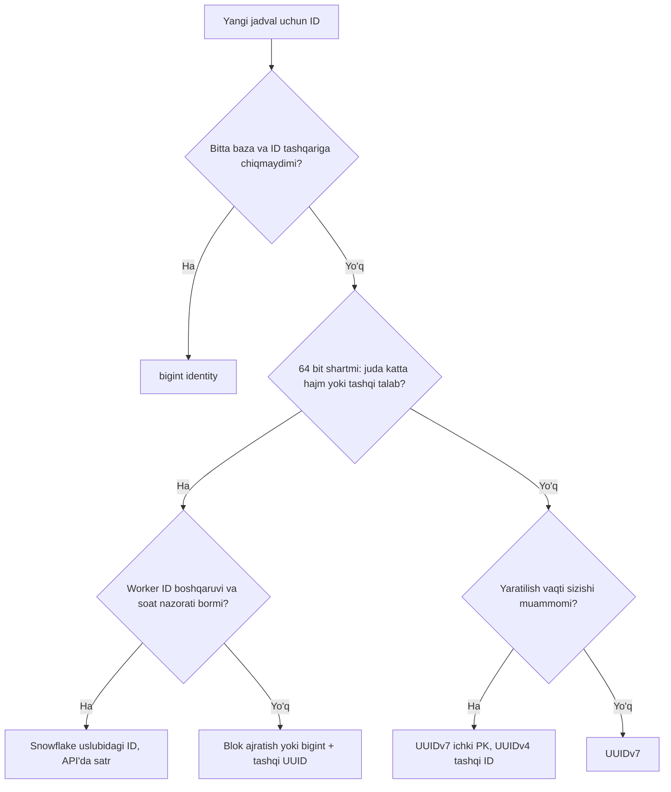

## Bu dars nima uchun kerak

Bitta PostgreSQL'da ID muammosi yo'q: `bigserial` yoki `GENERATED ALWAYS AS IDENTITY` - bazaning o'zi navbatdagi raqamni beradi. Muammo tizim taqsimlanganda boshlanadi:

- jadval bir nechta shard'ga bo'lingan (28-dars) - har shard'ning o'z sequence'i bir xil raqamlarni beradi;
- yozish bir nechta region yoki leader'da (27-dars) - markaziy hisoblagich yo'q;
- ID bazaga yozilishidan **oldin** kerak: idempotency key (39-dars), outbox event'i (48-dars), klient tomonida yaratilgan obyekt (oflayn mobil ilova), Kafka xabar kaliti;
- ID tashqariga ko'rinadi: `GET /orders/1042` raqobatchiga kuniga nechta buyurtma kelishini aytadi va keyingi ID'ni bashorat qilishga imkon beradi.

ID formati - 1-darsda aytganimizdek, **qaytarish qiyin qarorlardan biri**: u har jadvalda, har tashqi API'da, har log'da, mijozlarning tizimlarida tarqaladi. Uni keyin almashtirish - katta migratsiya.

Bu darsdan keyin siz:

- ID uchun talablarni (noyoblik, tartiblanish, hajm, koordinatsiya, bashorat qilib bo'lmaslik) aniq qo'ya olasiz;
- UUIDv4 va UUIDv7 ning bit tuzilishini va RFC 9562 nimani o'zgartirganini bilasiz;
- random ID'lar B-tree indeksga nega zarar qilishini raqamlar bilan tushuntira olasiz;
- Snowflake bit tuzilishini, uning cheklovlarini (soat, worker ID, sig'im) va variantlarini (Instagram, Discord) bilasiz;
- to'qnashuv ehtimolini hisoblay olasiz;
- Node.js/PostgreSQL stekida to'g'ri tanlov qila olasiz.

## ID uchun talablar

| Talab | Savol | Nega muhim |
|---|---|---|
| Noyoblik | Ikki tugun bir xil ID bera oladimi? | Asosiy talab; kafolat deterministik yoki ehtimoliy |
| Koordinatsiyasizlik | ID yaratish uchun tarmoq chaqiruvi kerakmi? | Latency, mavjudlik, oflayn yaratish |
| Vaqt bo'yicha tartiblanish | Keyin yaratilgan ID kattaroqmi? | B-tree locality, `ORDER BY id`, cursor pagination (9-dars) |
| Hajm | 64 bit yoki 128 bit? | Indeks hajmi, xotira, JavaScript `Number` cheklovi |
| Bashorat qilib bo'lmaslik | Keyingi ID'ni topish mumkinmi? | IDOR hujumlari, biznes ma'lumot sizishi |
| Ma'lumot sizmasligi | ID ichidan nimani o'qish mumkin? | Yaratilgan vaqt, server, hajm |

Bu talablar bir-biriga zid: to'liq tartiblanish va koordinatsiyasizlik, kichik hajm va ehtimoliy noyoblik. Har format ularni boshqacha muvozanatlaydi.

## Markazlashgan yondashuvlar

### Auto-increment (bitta baza)

Oddiy, 64 bit, `nextval` monoton o'sadi (lekin parallel tranzaksiyalar commit tartibi ID tartibiga mos kelmasligi mumkin, rollback esa teshik qoldiradi). Muammolar: bitta yozish nuqtasi; ID bazaga yozilishidan oldin ma'lum emas (yoki alohida `nextval` round trip); tashqariga sizadi (hajm, bashorat qilish); shard'lar orasida birlashtirib bo'lmaydi.

Ko'p shard uchun eski usul: **offset va step** - N shard'dan i-chisi `i, i+N, i+2N, ...` beradi (MySQL `auto_increment_increment` va `auto_increment_offset`). Shard soni o'zgarganda bu sxema buziladi.

### Ticket server va blok ajratish

Markaziy servis (yoki alohida bazadagi sequence) ID **bloklarini** beradi: servis "menga 1 000 ta ID ber" deydi va 1 000 001-1 001 000 oralig'ini oladi, keyin lokal ravishda ulardan foydalanadi. Har 1 000 ID'ga bitta tarmoq chaqiruvi. Shu oilaga Flickr'ning "ticket server" yondashuvi ham kiradi (code.flickr.net, 2010 yil 8 fevral). Har ticket server - alohida MySQL baza, unda bitta qatorli `Tickets64` jadvali: `id bigint unsigned auto_increment` va `stub char(1)` ustunida UNIQUE kalit. Yangi ID olish uchun `REPLACE INTO Tickets64 (stub) VALUES ('a')` bajariladi - REPLACE eski qatorni o'chirib yangisini qo'shadi va auto_increment oshadi - keyin `SELECT LAST_INSERT_ID()`. Ikki server ID maydonini toq va juftga bo'ladi: ikkalasida `auto-increment-increment = 2`, birida `auto-increment-offset = 1` (toq), ikkinchisida `= 2` (juft); klientlar ular orasida round-robin qiladi, biri o'chsa ikkinchisidan oladi. Flickr qayd etganidek, ikki tomon biroz farq qilib boradi (o'sha paytda toq ID'li obyektlar bir necha yuz mingga ko'p bo'lgan), lekin bu zarar qilmaydi. Bu ID'ni har obyekt uchun alohida so'raydi, blok ajratmaydi. Kamchiligi: markaziy komponent (bloklar zahirasi bilan yumshatiladi), ID'lar global vaqt tartibida emas (har servisning bloki o'zicha), process qayta ishga tushsa blokning qolgani yo'qoladi (teshiklar).

## UUID: RFC 9562

UUID - 128 bitlik identifikator, markaziy ro'yxatdan o'tishni talab qilmaydi. 2005 yildan buyon standart RFC 4122 edi. **2024 yil may oyida RFC 9562** chiqdi va RFC 4122 ni bekor qildi (obsoletes). U 1 dan 8 gacha versiyalarni belgilaydi (2-versiya DCE Security uchun ajratilgan va standart doirasidan tashqarida), yangi 6, 7 va 8 versiyalarni qo'shadi, hamda Nil (barcha bitlar 0) va Max (barcha bitlar 1) UUID'larni belgilaydi.

Eng muhim tavsiya: RFC 9562 implementatsiyalar **imkon bo'lsa UUIDv1 va UUIDv6 o'rniga UUIDv7 ishlatishi kerak (SHOULD)** deydi.

### UUIDv4: to'liq tasodifiy

128 bitdan 6 bit versiya va variant uchun, **122 bit tasodifiy**. Noyoblik ehtimoliy: tug'ilgan kun paradoksi bo'yicha n ta ID'da to'qnashuv ehtimoli taxminan n² / (2 × 2^122).

Hisob: soniyasiga 1 milliard UUIDv4, butun yil davomida: n ≈ 10^9 × 3.15 × 10^7 ≈ 3.15 × 10^16. Ehtimol ≈ (3.15 × 10^16)² / 2^123 ≈ 10^33 / 1.06 × 10^37 ≈ **10^-4**. Ya'ni amalda ahamiyatsiz - lekin faqat tasodif manbai sifatli bo'lsa (CSPRNG). Real to'qnashuvlar matematikadan emas, xatolardan keladi: VM klonlanganda bir xil seed, `Math.random()` ishlatish, fork'dan keyin PRNG holati takrorlanishi.

UUIDv4 ning asosiy muammosi - noyoblik emas, **tartibsizlik** (pastda).

### UUIDv7: vaqt + tasodif

RFC 9562 bo'yicha UUIDv7 tuzilishi (eng katta bitdan):

| Maydon | Bit | Mazmuni |
|---|---|---|
| `unix_ts_ms` | 48 | Unix epoch'dan beri millisekundlar |
| `ver` | 4 | Versiya = 7 (`0111`) |
| `rand_a` | 12 | Tasodif yoki aniqroq vaqt / hisoblagich |
| `var` | 2 | Variant (`10`) |
| `rand_b` | 62 | Tasodif yoki hisoblagich |

Jami: 48 + 4 + 12 + 2 + 62 = 128. Tasodif uchun 74 bit.

Xususiyatlari:

- **Vaqt bo'yicha tartiblanadi** - eng katta bitlarda vaqt, shuning uchun bayt yoki satr sifatida solishtirish yaratilish tartibini beradi (millisekund aniqligida).
- **Koordinatsiyasiz** - har process o'zi yaratadi.
- **48 bit millisekund** - taxminan 8 900 yil diapazon.
- **Ichidan vaqt o'qiladi** - bu ham qulaylik (debug, partition), ham ma'lumot sizishi.

Bir millisekund ichida bir nechta ID kerak bo'lsa, tartib qanday saqlanadi? RFC 9562 ning 6.2-bo'limi uchta usulni tasvirlaydi:

1. **Belgilangan uzunlikdagi hisoblagich** - `rand_a` (va kerak bo'lsa `rand_b` boshi) ichida hisoblagich, har yangi millisekundda tasodifiy qiymatdan boshlanadi.
2. **Monoton tasodif** - oldingi ID'ning tasodifiy qismiga tasodifiy musbat son qo'shish.
3. **Aniqroq vaqt** - `rand_a` ning 12 bitiga millisekunddan kichik vaqt qismini yozish.

Muhim: monotonlik faqat **bitta generator ichida** kafolatlanadi. Ikki turli server bir millisekundda ID yaratsa, ularning nisbiy tartibi tasodifiy; va serverlar soati farq qilsa (32-dars), "keyin" yaratilgan ID kichikroq bo'lishi mumkin. UUIDv7 - **taxminan** vaqt tartibi, qat'iy global tartib emas.

To'qnashuv: bir millisekundda 74 bit tasodif. Bitta millisekundda 1 million ID (ko'p generator birgalikda) yaratilsa: (10^6)² / 2^75 ≈ 2.6 × 10^-11. Amalda ahamiyatsiz.

### Boshqa versiyalar qisqacha

- **v1** - 60 bitlik vaqt (100 ns, 1582 yildan) + MAC manzil. MAC sizadi, vaqt baytlari tartiblanmaydigan joylashuvda.
- **v6** - v1 ning vaqt baytlari tartiblanadigan qilib qayta joylashtirilgani; asosan v1 bilan moslik uchun.
- **v3/v5** - nom asosidagi (MD5/SHA-1 hash): bir xil namespace va nom → bir xil UUID. Deterministik ID kerak bo'lganda foydali (masalan, tashqi tizim kaliti bo'yicha). RFC 9562 ularni primary key sifatida ishlatmaslikni maslahat beradi.
- **v8** - formati foydalanuvchi belgilaydigan "eksperimental/vendor" versiya.

### ULID

UUIDv7 dan oldin mashhur bo'lgan muqobil: 48 bit millisekund vaqt + 80 bit tasodif, Crockford Base32'da 26 belgi (masalan `01ARZ3NDEKTSV4RRFFQ69G5FAV`), leksikografik tartiblanadi, bir millisekund ichida tasodifiy qism birga oshiriladi (monoton rejim). Binar ko'rinishda 128 bit - UUID ustuniga sig'adi. Endi standart UUIDv7 mavjud bo'lgani uchun yangi tizimlarda odatda UUIDv7 afzal: bazalar, kutubxonalar va validatorlar uni taniydi.

## Nega random ID indeksga zarar qiladi

B-tree indeks (14-dars) kalitlarni tartibda saqlaydi. Yangi kalit qayerga tushishi kalit qiymatiga bog'liq:

- **Monoton ID** (bigint sequence, UUIDv7): har yangi kalit indeksning **o'ng chetiga** tushadi. Faqat oxirgi bir nechta sahifa "issiq" - ular doim xotirada. Sahifa to'lganda yangisi qo'shiladi, eskisi to'liq qoladi.
- **Random ID** (UUIDv4): har yangi kalit indeksning **tasodifiy joyiga** tushadi. Indeksning barcha sahifalari issiq bo'ladi. Indeks RAM hajmidan katta bo'lsa - har insert diskdan sahifa o'qishga olib keladi. Sahifalar o'rtadan bo'linadi (page split) va yarim to'la qoladi - indeks kattaroq.

PostgreSQL'da qo'shimcha narx: checkpoint'dan keyin har sahifaning birinchi o'zgarishi WAL'ga **to'liq sahifa nusxasi**ni (full-page write, 8 KB) yozadi. Monoton insert'da checkpoint'dan keyin bir nechta sahifa tegiladi; random insert'da - minglab turli sahifa, har biri 8 KB WAL. WAL hajmi, replikatsiya trafigi (26-dars) va backup hajmi oshadi.

**Raqamlar.**

- Buildkite (2023): asosiy bazada UUIDv4'ga mos, lekin birinchi 48 biti vaqt bo'lgan ID'larga o'tish tajribasida (shu bilan birga boshqa o'zgarishlar ham kiritilgan) olti haftalik davrda **WAL tezligi 50 foizga kamaygan**, yozish IO ham shunga yaqin kamaygan. Qiziq detal: ular versiya maydonini 7 ga o'zgartirganda, UUID'ni validatsiya qiladigan ba'zi mijoz tizimlari buzilgan - shuning uchun o'sha bosqichda v4 mosligini saqlashgan. ID formati haqiqatan tashqi kontrakt.
- Cybertec sinovi (10 million qator): indeks hajmi bigint uchun 214 MB, UUIDv4 va UUIDv7 uchun 301 MB (bir xil, 16 bayt); index-only scan bilan `COUNT` - bigint 526 ms, UUIDv7 541 ms, UUIDv4 **1 214 ms**; buffer hits - bigint ~27 ming, UUIDv7 ~39 ming, UUIDv4 **~8.5 million**. Ya'ni muammo UUID'ning 16 bayt ekanida emas, uning **tasodifiyligida**: UUIDv7 deyarli bigint tezligida ishlaydi.

**Hajm hisobi.** 1 milliard qator: bigint PK = 8 bayt, UUID = 16 bayt. Faqat kalit qiymatlari: 8 GB va 16 GB. Har secondary indeks (15-dars) ham PostgreSQL'da TID'ga ishora qiladi, lekin foreign key ustunlari va ularning indekslari ham ikki baravar. MySQL InnoDB'da esa secondary indekslar primary key qiymatini saqlaydi - PK hajmi har secondary indeksga ko'paytiriladi.

## Snowflake

2010 yil iyunida Twitter Snowflake'ni e'lon qildi. Sabab: ular MySQL'dan Cassandra'ga va gorizontal shard qilingan MySQL'ga o'tayotgan edi, Cassandra'da esa noyob ID yaratish mexanizmi yo'q. Talablar: soniyasiga o'n minglab ID, yuqori mavjudlik, koordinatsiyasiz; ID'lar **"taxminan tartiblanadigan"** (yaqin vaqtda yozilgan tvitlar yaqin ID'ga ega) va **64 bitga sig'adigan**. Worker raqamlari ishga tushishda ZooKeeper orqali tanlangan (konfiguratsiya fayli bilan almashtirish mumkin edi); ID yaratish uchun ZooKeeper sequential node'larini ham ko'rib chiqishgan, lekin unumdorlik va mavjudlik sababli rad etishgan.

### Bit tuzilishi

| Maydon | Bit | Mazmuni |
|---|---|---|
| Ishora biti | 1 | Doim 0 - signed 64-bit butun son musbat bo'lishi uchun |
| Vaqt | 41 | Maxsus epoch'dan beri millisekundlar |
| Mashina ID | 10 | Worker (ba'zan datacenter + worker ga bo'linadi) |
| Ketma-ketlik | 12 | Bir millisekund ichidagi hisoblagich |

Twitter epoch'i: 1288834974657 (2010-11-04).

### Hisob-kitob

- **Vaqt diapazoni:** 2^41 ms ≈ 2.2 × 10^12 ms ≈ **69.7 yil**. Twitter epoch'idan boshlab bu taxminan 2080 yilgacha. Maxsus epoch'ning ma'nosi aynan shu: Unix epoch'idan (1970) boshlansa, 41 bit 2039 yilda tugaydi.
- **Bitta worker sig'imi:** 2^12 = 4 096 ID millisekundda = **~4.1 million ID/s** bitta worker'da.
- **Worker'lar soni:** 2^10 = 1 024.
- **Butun tizim sig'imi:** 1 024 × 4 096 000 ≈ 4.2 milliard ID/s nazariy maksimum.

Agar bir millisekundda 4 096 dan ko'p so'rov kelsa - generator keyingi millisekundni kutadi.

### ID yaratish algoritmi

```
now = current_ms()
if now < last_ms: soat orqaga ketdi -> xato yoki kutish
if now == last_ms:
    seq = (seq + 1) & 4095
    if seq == 0: now = keyingi millisekundni kutish
else:
    seq = 0
last_ms = now
id = ((now - EPOCH) << 22) | (worker_id << 12) | seq
```

### Snowflake'ning zaif joylari

1. **Soat orqaga ketishi.** NTP tuzatishi (32-dars) soatni orqaga surishi mumkin. Agar generator shunchaki davom etsa, oldin berilgan ID takrorlanishi mumkin (bir xil millisekund, bir xil worker, bir xil ketma-ketlik). Asl implementatsiya bunday holatda ID berishni rad etadi va xato qaytaradi; muqobillari - farq kichik bo'lsa kutish, yoki mantiqiy soat (oxirgi millisekunddan davom etish). NTP'ni `slew` rejimida (soatni sekin moslashtirish, sakratmaslik) sozlash ham yordam beradi.
2. **Worker ID boshqaruvi.** 10 bit - 1 024 ta noyob raqam. Kubernetes'da pod'lar doimiy yaratiladi va o'chiriladi; ikki pod bir xil worker ID olsa - to'qnashuv. Yechimlar: StatefulSet ordinal (pod-0, pod-1...), markaziy registry'dan lease bilan olish (ZooKeeper, etcd, Redis `SET NX` + TTL - 38-dars), IP manzilning oxirgi bitlari (xavfli, takrorlanishi mumkin). Lease muddati tugagan, lekin process tirik qolgan holat - klassik "zombie" muammosi.
3. **Process qayta ishga tushishi.** Restart'dan keyin xuddi shu millisekundda shu worker ID bilan ketma-ketlik 0 dan boshlanadi - takror. Ishga tushishda kamida 1 ms kutish yoki oxirgi vaqtni saqlash kerak.
4. **Ma'lumot sizishi.** ID'dan yaratilish vaqti va worker o'qiladi. ID'lar ketma-ket bo'lgani uchun taxminan hajmni ham baholash mumkin.
5. **JavaScript cheklovi.** JS `Number` faqat 2^53 - 1 = 9 007 199 254 740 991 gacha butun sonlarni aniq ifodalaydi. Snowflake 63 bit ishlatadi - `JSON.parse` uni jimgina buzadi (oxirgi raqamlar yaxlitlanadi). Discord API shu sababli snowflake'larni JSON'da **satr** sifatida qaytaradi. Node.js'da `BigInt` ishlating, API'da satr sifatida bering. Prisma'da `BigInt` maydon, Kysely'da `bigint` → satr yoki `BigInt` mapping.

### Variantlar

- **Instagram** ("Sharding & IDs at Instagram" maqolasi): 41 bit maxsus epoch'dan beri millisekund + 13 bit **logical shard ID** + 10 bit ketma-ketlik. Mashina ID o'rniga shard ID: ID ichidan qaysi shard'da saqlanganini bilish mumkin, routing uchun lookup kerak emas (30-dars). Bir necha ming logical shard kamroq fizik serverlarga taqsimlangan, har logical shard - alohida PostgreSQL sxemasi. ID shu sxemadagi PL/pgSQL funksiya bilan yaratiladi va ustunning default qiymati sifatida o'rnatiladi: joriy vaqt, shard ID va har jadvalning o'z sequence'idan olingan qiymatning 1024 ga bo'linishdagi qoldig'i (`nextval % 1024`) birlashtiriladi. Natija: har shard'da har jadval uchun millisekundiga 1 024 ID, alohida servis yo'q.
- **Discord**: 42 bit vaqt (Discord epoch'i 1420070400000, ya'ni 2015 yil boshi) + 5 bit internal worker + 5 bit internal process + 12 bit increment. Vaqt: `(id >> 22) + 1420070400000`.
- **Sonyflake** (Sony) va boshqalar: vaqt birligini 10 ms qilib diapazonni uzaytirish, mashina ID'ni kattalashtirish evaziga millisekunddagi sig'imni kamaytirish. Bit taqsimoti - sizning yuklamangizga moslashtiriladigan parametr.

## Taqqoslash

| Format | Hajm | Tartib | Koordinatsiya | Bashorat qilish | B-tree insert | Vaqt sizadimi | JS'da xavfsizmi |
|---|---|---|---|---|---|---|---|
| bigint sequence | 64 bit | Qat'iy (bitta baza) | Markaziy | Oson | A'lo | Hajm sizadi | 2^53 gacha |
| Blok ajratish | 64 bit | Bloklar bo'yicha | Kam (blok uchun) | Oson | Yaxshi | Hajm sizadi | 2^53 gacha |
| UUIDv4 | 128 bit | Yo'q | Yo'q | Imkonsiz (CSPRNG bilan) | Yomon | Yo'q | Ha (satr) |
| UUIDv7 | 128 bit | Taxminan (ms) | Yo'q | Vaqt qismi ma'lum, tasodif 74 bit | Yaxshi | Ha (ms) | Ha (satr) |
| ULID | 128 bit | Taxminan (ms) | Yo'q | UUIDv7 ga o'xshash | Yaxshi | Ha | Ha (satr) |
| Snowflake | 64 bit | Taxminan (ms) | Worker ID uchun | Oson (ketma-ket) | A'lo | Ha + worker | Yo'q, BigInt/satr kerak |



## Xavfsizlik: ID maxfiylik emas

- Har qanday ID - **identifikator, ruxsat emas.** Bashorat qilib bo'lmaydigan ID IDOR (boshqa foydalanuvchi resursiga ID orqali kirish) hujumini qiyinlashtiradi, lekin avtorizatsiya tekshiruvi (72-dars) baribir har so'rovda shart. RFC 9562 (6.9-bo'lim) bashorat qilib bo'lmaslik kerak bo'lganda kriptografik xavfsiz PRNG ishlatishni tavsiya qiladi, lekin bashorat qilib bo'lmaydigan ID ham ruxsatni almashtirmaydi.
- Bir martalik token, parolni tiklash havolasi, API kalit uchun - UUID emas, kamida 128 bit **to'liq** tasodifiy qiymat (`crypto.randomBytes(32)`) va saqlashda hash.
- UUIDv7 va Snowflake yaratilish vaqtini oshkor qiladi. Ko'p holatda bu zararsiz; lekin, masalan, "foydalanuvchi qachon ro'yxatdan o'tgan" maxfiy bo'lsa - tashqi ID uchun UUIDv4.

## Node.js va PostgreSQL amaliyoti

- **PostgreSQL 18** (2025 yil 25 sentabrda chiqqan) o'rnatilgan `uuidv7()` funksiyasini qo'shdi (vaqt bo'yicha tartiblanadi, ixtiyoriy `shift` interval parametri bilan), hamda `uuidv4()` taxallusini (`gen_random_uuid()` bilan bir xil). Hujjatlarga ko'ra vaqt millisekund + millisekunddan kichik qism + tasodifdan hisoblanadi. UUID'dan vaqt va versiyani o'qiydigan `uuid_extract_timestamp()` va `uuid_extract_version()` bundan oldin, PostgreSQL 17 da qo'shilgan. 18 dan oldingi versiyalarda v7 yaratish uchun - kengaytma yoki ilovada yaratish.
- **Ilovada yaratish** afzalligi: ID bazaga borishdan oldin ma'lum - outbox event'i, idempotency, bir nechta jadvalga bog'langan yozuvlarni bitta round trip'da yuborish. `uuid` npm paketi `v7()` funksiyasini beradi; Node.js `crypto.randomUUID()` v4 yaratadi.
- **Ustun turi:** `uuid` (16 bayt), `text` emas (36+ bayt, sekinroq solishtirish). RFC 9562 (6.13-bo'lim) ham UUID'ni imkon bo'lsa 128 bitlik binar qiymat sifatida saqlashni tavsiya qiladi.
- **Prisma:** ustun `@db.Uuid`; Prisma ORM 5.18.0 dan boshlab `uuid()` funksiyasi ixtiyoriy butun son argument oladi: faqat `4` va `7` qiymatlari ruxsat etilgan, default `4`. Ya'ni `@default(uuid(7))` UUIDv7 beradi. Bu qiymat Prisma Client tomonida (ilovada) yaratiladi, bazada emas, shuning uchun raw SQL insert'lar uchun bazada ham default kerak bo'lsa - PostgreSQL 18 `uuidv7()`. **Kysely:** ilovada yaratib, insert'ga uzatish.
- **Snowflake** tanlansa: ustun `bigint`, TypeScript'da `bigint` yoki satr, JSON'da har doim satr, `pg` drayverida `int8` ni satr sifatida qaytarish (default xatti-harakat) - `Number`ga parse qilmang.

## Real tizimlardan misollar

- **Twitter/X** - Snowflake (2010): 41 + 10 + 12 bit, maxsus epoch, ZooKeeper orqali worker raqami.
- **Instagram** - 41 bit vaqt + 13 bit logical shard + 10 bit ketma-ketlik, har logical shard sxemasida PL/pgSQL funksiya va sequence bilan.
- **Flickr** - ikki MySQL ticket server, `REPLACE INTO` + `LAST_INSERT_ID()`, toq/juft bo'linish (2010).
- **Discord** - 42 bit vaqt, 2015 epoch'i, JSON'da satr sifatida.
- **Buildkite** - vaqt bo'yicha tartiblangan UUID'lar bilan WAL tezligi 50% kamaygan; versiya maydonini o'zgartirish mijoz validatsiyalarini buzgan.
- **PostgreSQL 18** - `uuidv7()` o'rnatilgan.

## iQuariX kontekstida qo'llanish

Misol sharti - quyidagi obyektlar:

1. **Tenant, foydalanuvchi, mashina, haydovchi, geofence** - kam yoziladi (minglab-yuz minglab), tashqi API'da ko'rinadi, mijozlarning 1C tizimlariga eksport qilinadi. **UUIDv7** - koordinatsiyasiz, B-tree'ga do'st, keyinchalik shard yoki region qo'shilganda muammo yo'q. API'da satr.
2. **Telemetriya nuqtalari** - masala shartida 100 000 qurilma, har biri 10 soniyada bitta nuqta: 100 000 × 86 400 / 10 = 864 million/kun. Ularga **alohida ID umuman kerakmi?** Ko'pincha yo'q: tabiiy kalit `(device_id, recorded_at)` (time-series, 81-dars). Dublikat nuqtalar (treker qayta yuborgan) shu kalit bo'yicha deduplikatsiya qilinadi - bu tasodifiy UUID'dan ko'ra foydaliroq, chunki UUID dublikatni aniqlay olmaydi. 864 million × 16 bayt = 13 824 MB, ya'ni ~13.8 GB/kun faqat ID ustuni uchun - tejash sezilarli.
3. **Hodisalar (yoqilg'i to'kib olish, xavfli manevr, ogohlantirish)** - kuniga millionlab, tashqi API va bildirishnomalarda ko'rinadi, idempotentlik kerak. **UUIDv7**, ilovada (stream processor ichida) yaratiladi; yoki deterministik ID: UUIDv5 (`namespace`, `device_id + event_type + start_time`) - shunda stream processor qayta ishlaganda (at-least-once, 39-dars) **bir xil** ID chiqadi va dublikat ogohlantirish bo'lmaydi.
4. **Video kliplar** - object storage kaliti (60-dars) ichida UUIDv7: vaqt bo'yicha prefiks tabiiy tartib beradi.
5. **Hisob-faktura raqamlari** - buxgalteriya talabi bo'yicha **ketma-ket, teshiksiz** raqam (`2026-000123`) kerak bo'lishi mumkin. Bu texnik ID emas, biznes atributi: tenant bo'yicha alohida hisoblagich, tranzaksiya ichida. Teshiksiz ketma-ketlik - koordinatsiya va locking talab qiladi, shuning uchun uni PK qilmang.

## Ko'p uchraydigan xatolar

1. **UUIDv4 ni katta, yozuvi ko'p jadvalda PK qilish** - indeks locality yo'qoladi, WAL va IO oshadi. UUIDv7 ishlating.
2. **UUID'ni `text`/`varchar` sifatida saqlash** - 2 baravardan ko'p joy va sekin solishtirish.
3. **Snowflake ID'ni JSON'da son sifatida berish** - JavaScript klientlar 2^53 dan katta sonlarni jimgina buzadi.
4. **Worker ID'ni ishonchsiz manbadan olish** (tasodifiy, IP'ning oxirgi bayti) - ikki instance bir xil worker ID bilan to'qnashuv beradi.
5. **Soat orqaga ketishini e'tiborsiz qoldirish** - Snowflake generatorida takroriy ID.
6. **ID'ni ruxsat sifatida ishlatish** - "UUID'ni hech kim bashorat qila olmaydi" deb avtorizatsiyani tashlab ketish.
7. **Global qat'iy tartibni UUIDv7/Snowflake'dan kutish** - ular taxminan tartiblangan; turli serverlar orasida soat farqi bor. Qat'iy tartib kerak bo'lsa - bitta sequence yoki log offset (43-dars).
8. **ID formatini keyin o'zgartirish rejasisiz tanlash** - tashqi tizimlar formatni validatsiya qiladi (Buildkite saboqi).

## Xulosa

- ID talablari: noyoblik, koordinatsiyasizlik, tartib, hajm, bashorat qilib bo'lmaslik va ma'lumot sizmasligi - ular bir-biriga zid.
- RFC 9562 (2024) RFC 4122 ni almashtirdi va UUIDv7 ni tavsiya qiladi: 48 bit ms vaqt + 74 bit tasodif, koordinatsiyasiz va taxminan tartiblanadi.
- Random ID B-tree indeksga zarar qiladi: tasodifiy sahifalar, page split, full-page WAL yozuvlari; UUIDv7 deyarli bigint tezligida ishlaydi.
- Snowflake: 1 + 41 + 10 + 12 bit, ~69.7 yil, worker'ga ~4.1 million ID/s; zaif joylari - soat, worker ID boshqaruvi, JS 2^53 cheklovi.
- Instagram va Discord variantlari bit taqsimoti yuklamaga moslashtiriladigan parametr ekanini ko'rsatadi.
- ID - identifikator, ruxsat emas; maxfiy token'lar uchun to'liq tasodifiy qiymat.
- Ko'p hajmli time-series uchun alohida ID o'rniga tabiiy kalit; idempotentlik uchun deterministik ID.

## Amaliy topshiriq

Masala sharti: iQuariX ma'lumotlar bazasi kelajakda 3 regionga (Toshkent, Olmaota, Moskva) va har regionda 8 ta shard'ga bo'linadi. Hozir hamma jadvallar `bigserial` PK bilan bitta PostgreSQL'da.

1. Asosiy jadvallarni ro'yxatlang (tenants, users, vehicles, devices, telemetry_points, trips, fuel_events, alerts, video_clips, invoices) va har biri uchun ID strategiyasini tanlang: bigint, UUIDv7, UUIDv5 (deterministik), Snowflake uslubi, tabiiy kalit yoki biznes raqam. Har tanlovni asoslang.
2. Agar biror jadval uchun Snowflake uslubini tanlasangiz, o'z bit taqsimotingizni loyihalang: epoch, vaqt bitlari va diapazon (yillarda), region/shard/worker bitlari, ketma-ketlik bitlari va bitta generator sig'imi. Hisoblarni ko'rsating.
3. Worker ID'larni Kubernetes'da qanday tayinlaysiz va ikki pod bir xil ID olmasligini qanday kafolatlaysiz? Soat orqaga ketsa nima qilasiz?
4. 2 milliard qatorli `trips` jadvali uchun bigint va UUIDv7 PK'ni solishtiring: PK indeks hajmi, foreign key'lar (fuel_events, alerts) qo'shimchasi, insert locality.
5. `bigserial` dan yangi ID formatiga **ishlab turgan tizimda** migratsiya rejasini yozing: yangi ustun, backfill, foreign key'larni yangilash, tashqi API mosligi (eski raqamli ID'lar ham ishlashi kerak), mijoz integratsiyalari.
6. Qaysi ID'lar tashqi API'da ko'rinadi va ulardan qanday ma'lumot sizishi mumkin? Har biri uchun bu qabul qilinadimi?

Yaxshi javobda bo'lishi kerak bo'lgan narsalar:

- telemetriya nuqtalari uchun alohida ID o'rniga tabiiy kalit ko'rib chiqilgan;
- idempotent hodisalar uchun deterministik ID g'oyasi;
- Snowflake bit taqsimoti hisoblari (diapazon, sig'im) to'g'ri;
- worker ID uchun lease yoki StatefulSet ordinal, soat orqaga ketishi siyosati;
- JS 2^53 muammosi va API'da satr;
- migratsiya bosqichma-bosqich, eski ID'lar bilan moslik saqlanadi;
- hisob-faktura raqami texnik ID'dan ajratilgan.

Javobni pastdagi maydonga yozib, chatga yuboring.

## Manbalar

- IETF. [RFC 9562: Universally Unique IDentifiers (UUIDs)](https://www.rfc-editor.org/rfc/rfc9562.html), 2024 - 5.7-bo'lim (UUIDv7 tuzilishi), 6.2-bo'lim (monotonlik usullari), 6.9 (CSPRNG), 6.13 (bazada saqlash: 128-bit binar, nom asosidagi UUID'ni PK qilmaslik).
- Twitter Engineering. [Announcing Snowflake](https://blog.x.com/engineering/en_us/a/2010/announcing-snowflake), 2010 yil 1 iyun - talablar, ZooKeeper, Cassandra sababi; [Snowflake README va IdWorker.scala](https://github.com/twitter-archive/snowflake/tree/snowflake-2010) - 41/10/12 bit, epoch 1288834974657, soat orqaga ketganda ID berishni rad etish.
- Kay Kremerskothen. [Ticket Servers: Distributed Unique Primary Keys on the Cheap](https://code.flickr.net/2010/02/08/ticket-servers-distributed-unique-primary-keys-on-the-cheap/), Flickr, 2010 - `Tickets64`, `REPLACE INTO`, toq/juft bo'linish.
- Instagram Engineering. [Sharding & IDs at Instagram](https://medium.com/instagram-engineering/sharding-ids-at-instagram-1cf5a71e5a5c) - 41 + 13 + 10 bit, logical shard sxemalari, PL/pgSQL funksiya.
- Prisma. [Changelog: Prisma ORM 5.18.0](https://www.prisma.io/changelog/2024-08-08) - `uuid()` ga versiya argumenti (4 yoki 7, default 4).
- [Snowflake ID](https://en.wikipedia.org/wiki/Snowflake_ID), Wikipedia - bit tuzilishi, Twitter epoch'i, Instagram va Discord variantlari.
- Discord. [API Reference: Snowflakes](https://docs.discord.com/developers/reference) - bit tuzilishi, epoch, JSON'da satr.
- Gordon Chan. [Goodbye integers. Hello UUIDv7!](https://buildkite.engineering/goodbye-integers-hello-uuids), Buildkite, 2023 - WAL tezligining 50% kamayishi, validatsiya muammosi.
- Cybertec. [Unexpected downsides of UUID keys in PostgreSQL](https://www.cybertec-postgresql.com/en/unexpected-downsides-of-uuid-keys-in-postgresql/) - bigint, UUIDv4, UUIDv7 benchmark'i.
- PostgreSQL. [UUID Functions (18)](https://www.postgresql.org/docs/18/functions-uuid.html) va [PostgreSQL 18 release notes](https://www.postgresql.org/docs/release/18.0/) - `uuidv7()`, `uuidv4()`; [PostgreSQL 17 release notes](https://www.postgresql.org/docs/release/17.0/) - `uuid_extract_timestamp()`, `uuid_extract_version()`.
- [ULID specification](https://github.com/ulid/spec) - 48 + 80 bit, Crockford Base32, monotonlik.
- Alex Xu. System Design Interview, 1-jild, 7-bob "Design a Unique ID Generator in Distributed Systems" - multi-master, UUID, ticket server, Snowflake taqqoslashi.
