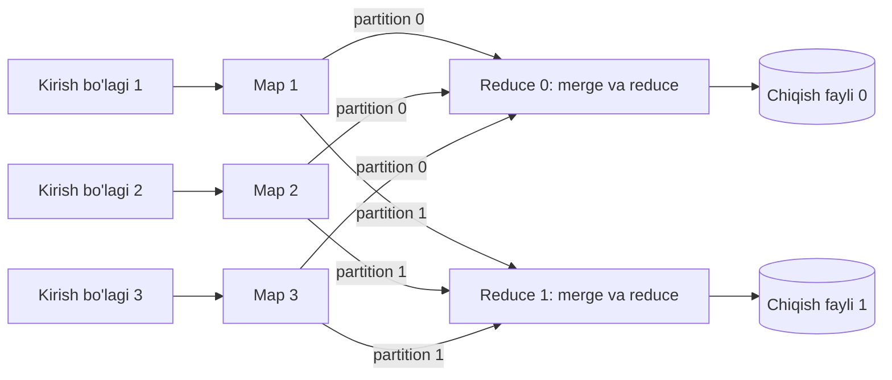

## Bu dars nima uchun kerak

Kursning katta qismi **online** tizimlar haqida: so'rov keladi, millisekundlarda javob qaytadi (OLTP, API, cache). 45-darsda **stream processing**ni ko'rdik: cheksiz oqim, natija soniyalarda. Uchinchi tur - **batch processing**: chegaralangan (bounded), katta hajmdagi kirish ma'lumotini olib, uni to'liq qayta ishlab, natija chiqarish. Javob vaqti daqiqalar va soatlar, o'lchov - throughput (soatiga necha terabayt).

Batch qayerda kerak:

- tungi hisobotlar, oylik billing, agregatlar (16-dars: OLAP);
- ML modelini o'qitish va xususiyatlarni (features) hisoblash (89-dars);
- qidiruv indeksini qurish (59-dars);
- ma'lumotni bir formatdan boshqasiga ko'chirish, tozalash, data lake'ga yuklash (ETL/ELT);
- stream processing natijalarini tekshirish va tuzatish (qayta hisoblash).

MapReduce (Google, 2004) bu sohani shakllantirgan g'oya; Spark (UC Berkeley, 2012) uni xotirada ishlash va boyroq operatorlar bilan rivojlantirgan. Bugun hech kim MapReduce ishlarini qo'lda yozmaydi, lekin uning g'oyalari - **partitioning, shuffle, determinism orqali fault tolerance, data locality** - Spark, Flink, ClickHouse, BigQuery va hatto Kafka Streams ichida yashaydi. Shu sababli ularni ichki mexanika darajasida bilish kerak.

Bu darsdan keyin siz:

- batch, stream va online tizimlarni farqlay olasiz va Unix pipeline falsafasi bilan bog'lay olasiz;
- MapReduce ning map, shuffle/sort, reduce bosqichlarini va combiner, partitioner rolini bilasiz;
- MapReduce va Spark nosozlikka qanday chidashini (qayta bajarish, lineage, backup tasks) tushunasiz;
- batch join'larni (sort-merge, broadcast hash, partitioned hash) va data skew muammosini bilasiz;
- shuffle hajmi va ish vaqtini taxminiy hisoblay olasiz;
- Node.js/PostgreSQL stekidagi kompaniya uchun batch tizim tanlay olasiz.

## Batch falsafasi: Unix'dan MapReduce'gacha

Kleppmann DDIA'da batch processing bobini Unix vositalari bilan boshlaydi. Veb-server logidan eng ko'p ochilgan 5 ta sahifani topish:

```bash
cat access.log | awk '{print $7}' | sort | uniq -c | sort -rn | head -n 5
```

Bu pipeline'da batch'ning asosiy g'oyalari bor:

1. **O'zgarmas kirish** - `access.log` o'zgarmaydi; natija yangi oqim. Xato bo'lsa, qayta ishga tushirish xavfsiz.
2. **Bir xil interfeys** - har vosita satrlar oqimini oladi va beradi, shuning uchun ular erkin ulanadi.
3. **Mantiq va ulanish ajratilgan** - `sort` qayerdan o'qishini bilmaydi.
4. **Sort - asosiy operatsiya.** `sort` xotiraga sig'maydigan ma'lumotni ham saralaydi: bo'laklarni saralab diskka yozadi va keyin birlashtiradi (external merge sort). Shu g'oya MapReduce'ning shuffle bosqichida va LSM-tree'da (13-dars) qaytadi.

Cheklov: hammasi **bitta mashinada**. 10 TB log bitta diskka sig'masa yoki uni bitta mashinada o'qish soatlab davom etsa? MapReduce - shu pipeline'ni minglab mashinaga taqsimlashning bir usuli.

## MapReduce: model

Jeffrey Dean va Sanjay Ghemawat "MapReduce: Simplified Data Processing on Large Clusters" maqolasini 2004 yilda OSDI konferensiyasida e'lon qilgan. Maqolaga ko'ra o'sha paytda Google'da yuzlab MapReduce dasturlari yozilgan va kuniga mingdan ortiq MapReduce ish bajarilgan.

Dasturchi ikki funksiya yozadi:

- **map(k1, v1) → list(k2, v2)** - har bir kirish yozuvidan oraliq kalit-qiymat juftlarini chiqaradi.
- **reduce(k2, list(v2)) → list(v3)** - bir xil kalitga tegishli barcha qiymatlarni birlashtiradi.

Qolgan hamma narsani - bo'lish, rejalashtirish, nosozliklar, mashinalar orasida ma'lumot ko'chirish - framework qiladi.

Misol: har bir mashina bo'yicha kunlik probeg (iQuariX uslubida).

```
map(offset, gps_nuqta):
    emit((device_id, sana), masofa_oldingi_nuqtadan)

reduce((device_id, sana), masofalar):
    emit((device_id, sana), sum(masofalar))
```

### Bajarilish bosqichlari

1. **Split.** Kirish fayllari M ta bo'lakka bo'linadi (GFS'da odatda 64 MB blok). Har bo'lak - bitta map task.
2. **Map.** Worker o'z bo'lagini o'qiydi, `map` ni chaqiradi, chiqishni xotira buferida yig'adi.
3. **Partition.** Har oraliq juft R ta reduce task'dan biriga tegishli: default `hash(key) mod R`. Buni o'zgartirish mumkin - maqolada misol: `hash(Hostname(url)) mod R`, shunda bitta hostning barcha URL'lari bitta chiqish fayliga tushadi.
4. **Sort va spill.** Bufer to'lganda, har partition ichida kalit bo'yicha saralanib, **map worker'ning lokal diskiga** yoziladi.
5. **Shuffle.** Har reduce worker barcha map worker'lardan **o'z partition**iga tegishli fayllarni tarmoq orqali tortib oladi. M × R ta fayl bo'lagi ko'chadi.
6. **Merge.** Reduce worker olingan saralangan bo'laklarni merge sort bilan birlashtiradi - bir xil kalitlar yonma-yon bo'ladi.
7. **Reduce.** Har kalit va uning qiymatlari ro'yxati uchun `reduce` chaqiriladi; natija taqsimlangan fayl tizimiga (GFS/HDFS) yoziladi, odatda replikatsiya bilan.



### Combiner

Ko'p reduce funksiyalari (yig'indi, son, max) **assotsiativ va kommutativ**. Bunday holatda map tomonida oldindan qisman birlashtirish mumkin: map worker `(device_42, 2026-10-20)` uchun 8 640 ta masofa chiqarish o'rniga bitta yig'indini chiqaradi. Maqolaga ko'ra combiner odatda reduce bilan bir xil kod, faqat natijasi oraliq faylga yoziladi. Bu shuffle hajmini keskin kamaytiradi. O'rtacha qiymat uchun esa combiner to'g'ridan-to'g'ri ishlamaydi (o'rtachalarning o'rtachasi o'rtacha emas) - `(yig'indi, son)` juftini chiqarish kerak.

### Tipik masshtab va maqoladagi raqamlar

Maqola tipik ish uchun **M = 200 000** map task va **R = 5 000** reduce task, **2 000** ta worker mashinada deb yozadi. Ko'p task bo'lishining sababi: dinamik yuklama taqsimoti va nosozlikdan tez tiklanish - o'lgan mashinaning kichik task'larini ko'p boshqa mashinalarga tarqatish mumkin.

Maqoladagi sinov klasteri: taxminan 1 800 mashina, har birida ikkita 2 GHz Xeon, 4 GB xotira, ikkita 160 GB IDE disk, gigabit Ethernet.

- **Grep**: taxminan 1 TB (10^10 ta 100 baytlik yozuv), M = 15 000 (har biri ~64 MB), R = 1. 1 764 worker bilan skanerlash tezligi 30 GB/s dan oshgan; jami ~150 soniya, shundan ~1 daqiqa ishga tushish overhead'i.
- **Sort**: ~1 TB, M = 15 000, R = 4 000. Normal holatda 891 soniya. **Backup tasks o'chirilganda 1 283 soniya** (44% sekinroq) - bir nechta sekin task ("straggler") ishni 300 soniyaga cho'zgan. **1 746 worker'dan 200 tasi ataylab o'ldirilganda** - 933 soniya, normaldan atigi ~5% sekin.

## Nosozlikka chidamlilik: qayta bajarish

Minglab mashinada soatlab ishlaydigan ish uchun mashina o'lishi - istisno emas, odatiy hodisa. MapReduce'ning yondashuvi: **task'ni qayta bajarish**.

- **Master** har worker'ni ping qiladi. Javob bo'lmasa - worker o'lgan deb hisoblanadi.
- O'lgan worker'ning **tugallangan map task'lari ham** qayta bajariladi, chunki ularning chiqishi o'sha mashinaning **lokal diski**da edi va endi mavjud emas.
- Tugallangan **reduce task'lari qayta bajarilmaydi** - ularning chiqishi replikatsiyalangan global fayl tizimida.
- **Master** nosozligi: maqoladagi implementatsiyada avtomatik tiklanmaydi - ish to'xtatiladi va klient qayta ishga tushirishi mumkin (master bitta, ehtimoli past).

Bu ishlashi uchun muhim shart: **map va reduce deterministik va yon ta'sirsiz** bo'lishi kerak. Agar `map` tashqi API'ga so'rov yuborsa yoki `Math.random()` ishlatsa, qayta bajarish boshqa natija beradi yoki yon ta'sirni takrorlaydi. Natija fayllari atomik yoziladi (vaqtinchalik fayl, keyin rename), shuning uchun task ikki marta bajarilsa ham chiqishda bitta nusxa qoladi. Bu 39-darsdagi "effectively-once" g'oyasining batch ko'rinishi.

### Straggler'lar va backup tasks

Ish eng sekin task'ni kutadi. Sekinlik sabablari: buzilayotgan disk, boshqa ishlar bilan raqobat, noto'g'ri konfiguratsiya. MapReduce yechimi: ish oxiriga yaqinlashganda master hali bajarilayotgan task'larning **zaxira nusxalarini** boshqa mashinalarda ishga tushiradi; qaysi biri birinchi tugasa, o'sha olinadi. Maqolaga ko'ra bu umumiy resurs sarfini bir necha foizgagina oshiradi, lekin sort sinovida vaqtni 44% qisqartirgan. Bu 53-darsdagi "hedged requests" g'oyasining batch versiyasi.

### Data locality

Kirish GFS'da, 64 MB bloklarda, odatda 3 nusxada. Master map task'ni iloji bo'lsa o'sha blok nusxasi turgan mashinada, bo'lmasa yaqinidagi (bitta tarmoq switch ostidagi) mashinada rejalashtiradi. "Hisoblashni ma'lumotga olib bor, ma'lumotni hisoblashga emas" - 2004 yilda tarmoq o'tkazuvchanligi asosiy cheklov bo'lgani uchun. Bugun bulutda storage va compute ko'pincha ajratilgan (S3 + EC2, 60-dars) va tarmoq tezroq, shuning uchun locality kamroq, lekin hali ham shuffle'da muhim.

## MapReduce cheklovlari

1. **Har bosqich diskka yoziladi.** Murakkab hisob bir nechta MapReduce ishidan iborat zanjir bo'lsa, har ish natijasi replikatsiyalangan fayl tizimiga to'liq yoziladi va keyingisi uni qayta o'qiydi. Iterativ algoritmlar (PageRank, ML o'qitish - bir xil ma'lumot ustida 10-100 iteratsiya) uchun bu juda qimmat.
2. **Faqat ikki operator.** Join, filter, group by - hammasini map va reduce'ga moslashtirish kerak. Shuning uchun ustiga Hive (SQL), Pig kabi qatlamlar qurildi.
3. **Barcha map'lar tugamaguncha reduce boshlanmaydi** (sort barcha kirishni talab qiladi) - pipeline yo'q.
4. **Kechikish katta** - ishga tushish overhead'i daqiqalar, interaktiv tahlil uchun yaroqsiz.

## Spark: RDD, lineage va DAG

Matei Zaharia va hammualliflarning "Resilient Distributed Datasets" maqolasi (NSDI 2012, "Best Paper" mukofoti) iterativ algoritmlar va interaktiv tahlil mavjud freymvorklarda samarasiz ekanidan boshlanadi. Asosiy g'oya: ma'lumotni klaster **xotirasida** saqlash, lekin nosozlikka chidamlilikni replikatsiya bilan emas, **lineage** bilan ta'minlash.

### RDD

**RDD (Resilient Distributed Dataset)** - partition'larga bo'lingan, o'zgarmas (immutable) yozuvlar to'plami. U faqat **coarse-grained transformatsiyalar** (`map`, `filter`, `join` - butun to'plamga bir xil amal) orqali yaratiladi. Har RDD o'zining qanday yaratilganini eslab qoladi - bu **lineage**. Partition yo'qolsa (executor o'ldi), uni replikadan emas, lineage bo'yicha ota-ona partition'lardan **qayta hisoblash** mumkin.

Maqoladagi natijalar: iterativ ilovalarda Hadoop'dan 20 baravargacha tez (100 mashinada logistic regression uchun 25.3x); 1 TB ma'lumot ustida 5-7 soniyalik interaktiv so'rovlar; PageRank'da xotirada saqlash 30 node'da 2.4x, partitioning'ni iteratsiyalar orasida boshqarish bilan 7.4x tezlashtirish.

### Lazy evaluation

Spark hujjatlariga ko'ra barcha transformatsiyalar **lazy**: ular natijani darhol hisoblamaydi, faqat bajariladigan amallarni eslab qoladi. Hisoblash faqat **action** (`count`, `collect`, `reduce`, faylga yozish) natija talab qilganda boshlanadi. Bu Spark'ga butun hisob grafini (DAG) ko'rib, uni optimallashtirishga imkon beradi.

### Narrow va wide dependency

Bu Spark ishlashini tushunishning kaliti:

- **Narrow dependency** - ota-ona RDD'ning har partition'i bola RDD'ning **ko'pi bilan bitta** partition'iga kerak (`map`, `filter`, `union`). Bunday amallar bitta mashinada ketma-ket **pipeline** qilinadi: `filter` → `map` → `map` - diskka yozmasdan, bitta o'tishda. Partition yo'qolsa, faqat uning ota-onasini qayta hisoblash kerak.
- **Wide dependency** - bitta ota-ona partition'i bir nechta bola partition'iga kerak (`groupByKey`, `reduceByKey`, `join`, `repartition`). Bu **shuffle** talab qiladi - mashinalar orasida ma'lumot ko'chirish. Nosozlikda ko'p ota-ona partition'larni qayta hisoblash kerak bo'lishi mumkin.

Spark DAG'ni shuffle chegaralarida **stage**larga bo'ladi. Stage ichida - narrow amallar pipeline; stage'lar orasida - shuffle. Bu MapReduce'ning "map → shuffle → reduce" ning umumlashtirilgani, lekin istalgan uzunlikdagi zanjir uchun va oraliq natijalarni replikatsiyalangan fayl tizimiga yozmasdan.

### Shuffle hali ham qimmat

Spark hujjatlari shuffle'ni disk IO, serializatsiya va tarmoq IO'ni o'z ichiga olgan qimmat operatsiya deb ta'riflaydi: map tomoni natijalari xotiraga sig'magach, maqsad partition bo'yicha saralanib **faylga yoziladi**, reduce tomoni kerakli bloklarni o'qiydi. Ya'ni Spark ham shuffle'da diskka yozadi - farq shundaki, bu lokal disk va oraliq natija har bosqichda HDFS'ga 3 nusxada yozilmaydi.

Shuning uchun Spark optimallashtirishining yarmi - **shuffle'ni kamaytirish**:

- `groupByKey` o'rniga `reduceByKey`/`aggregateByKey` - hujjatlar aniq tavsiya qiladi: agregatsiya uchun ular ancha yaxshi ishlaydi, chunki map tomonida oldindan birlashtiradi (MapReduce combiner'i bilan bir xil g'oya).
- Erta `filter` va keraksiz ustunlarni tashlash (projection).
- Bir xil kalit bo'yicha takroriy join'lar uchun ma'lumotni oldindan partition qilish (PageRank misolidagi 2.4x dan 7.4x ga sakrash aynan shu).

### Persist va checkpoint

Bir RDD bir necha marta ishlatilsa (iteratsiya), `persist()`/`cache()` bilan xotirada saqlash: `MEMORY_ONLY` (default; sig'maganlari kerak bo'lganda qayta hisoblanadi), `MEMORY_AND_DISK`, `DISK_ONLY`, `_2` (ikki node'da nusxa) va boshqalar. Lineage juda uzun va wide dependency'lar ko'p bo'lsa (PageRank'ning ko'p iteratsiyasi), qayta hisoblash qimmat - RDD maqolasi bunday holatda **checkpoint** (barqaror storage'ga yozish) foydali deb tavsiya qiladi; narrow dependency'li RDD'lar uchun esa checkpoint kerak bo'lmasligi mumkin.

### DataFrame, SQL va optimizer

Zamonaviy Spark'da RDD API kam ishlatiladi; asosiy interfeys - **DataFrame va Spark SQL**. Ular deklarativ: siz "nima" kerakligini yozasiz, optimizer "qanday" ni tanlaydi (predicate pushdown, ustunli formatlardan faqat kerakli ustunni o'qish, join strategiyasi). Spark 3.2.0 dan boshlab **Adaptive Query Execution (AQE)** default holatda yoqilgan: ish vaqtidagi statistikaga qarab shuffle'dan keyingi partition'larni birlashtiradi, sort-merge join'ni broadcast join'ga almashtiradi va skew join'larni bo'laklaydi.

| Xususiyat | MapReduce (Hadoop) | Spark |
|---|---|---|
| Model | Map + Reduce, ikki bosqich | DAG: ko'p operator, ko'p stage |
| Oraliq natijalar | Har ish orasida replikatsiyalangan DFS'ga | Xotirada yoki lokal diskda; DFS'ga faqat checkpoint |
| Fault tolerance | Task qayta bajarish, natija DFS'da | Lineage bo'yicha qayta hisoblash, ixtiyoriy checkpoint |
| Iterativ algoritmlar | Juda sekin (har iteratsiya diskka) | Tez (cache) |
| Shuffle | Diskka, sort asosida | Diskka (lokal), sort asosida |
| API | Java map/reduce, ustida Hive/Pig | RDD, DataFrame, SQL, Python/Scala/Java |
| Interaktivlik | Yo'q | Ha (sekundlar) |

Raqamli misol: 2014 yilda Databricks Spark bilan 100 TB (1 trillion yozuv) ma'lumotni 206 ta EC2 node'da 23 daqiqada saraladi va Daytona GraySort tanlovida g'olib bo'ldi; oldingi rekord Yahoo'ning 2 100 node'li Hadoop MapReduce klasterida 72 daqiqa edi - taxminan 3 baravar tez, 10 baravar kam mashina bilan.

## Batch join'lar

Batch'da join - eng qimmat va eng muhim operatsiya. Kleppmann DDIA'da "reduce-side" va "map-side" join'larni ajratadi; Spark terminlarida:

### 1. Sort-merge join (reduce-side)

Ikkala jadval join kaliti bo'yicha partition qilinadi (shuffle) va har partition ichida saralanadi; keyin ikki saralangan oqim birlashtiriladi. Universal - har qanday hajmda ishlaydi, lekin **ikkala jadval ham shuffle** bo'ladi.

### 2. Broadcast hash join (map-side)

Bir jadval kichik bo'lsa (masalan mashinalar ma'lumotnomasi - 100 000 qator, 20 MB), u **barcha** worker'larga to'liq yuboriladi va har biri xotirada hash table quradi. Katta jadval (milliardlab GPS nuqta) shuffle'siz, joyida join qilinadi. Spark'da `spark.sql.autoBroadcastJoinThreshold` default 10 MB - shundan kichik jadval avtomatik broadcast qilinadi.

### 3. Partitioned (bucketed) hash join

Ikkala jadval **oldindan** bir xil kalit va bir xil partition soni bilan saqlangan bo'lsa (bucketing), shuffle kerak emas - mos partition'lar to'g'ridan-to'g'ri join qilinadi.

### Data skew

Hash partitioning kalitlarni teng taqsimlaydi deb hisoblaydi. Lekin bitta kalit juda ko'p yozuvga ega bo'lsa (hot key, 30-dars): masalan, bitta yirik mijoz parkida 20 000 mashina, boshqalarda 50 ta; yoki `device_id = NULL` bo'lgan millionlab yozuv. O'sha kalitning partition'i bitta reduce task'ga tushadi va u boshqalardan 100 baravar uzoq ishlaydi - butun ish shuni kutadi. Backup task yordam bermaydi (sekinlik mashinada emas, ma'lumotda).

Yechimlar: **salting** (hot kalitga tasodifiy suffiks qo'shib bir nechta partition'ga bo'lish, keyin ikkinchi bosqichda birlashtirish), hot kalitlarni alohida broadcast join bilan qayta ishlash, Spark AQE'ning skew join optimallashtirishi, NULL kalitlarni oldindan filtrlash.

## Raqamlar: batch ishini baholash

Bu bo'limdagi barcha kirish qiymatlari masala shartlari: ular real o'lchov emas, hisob usulini ko'rsatish uchun tanlangan. Siqish koeffitsiyenti va yadro o'qish tezligi ma'lumot tarkibi, kodek va uskunaga kuchli bog'liq, shuning uchun real ishda ularni o'z ma'lumotingizning namunasida o'lchab, shu formulalarga qo'yasiz.

Hisob uchun shartlar:

| Parametr | Qiymat |
|---|---|
| Qurilmalar | 100 000, har biri 10 soniyada bitta nuqta |
| Bitta nuqta (xom) | 100 bayt (1-darsdagi shart) |
| Ustunli formatda (Parquet) siqish koeffitsiyenti | 5-10 baravar |
| Bitta executor yadrosining siqilgan Parquet'ni o'qish tezligi (dekompressiya bilan) | 150 MB/s |
| Klaster | 64 yadro, storage o'tkazuvchanligi cheklov emas |
| Shuffle'dagi bitta `(kalit, qiymat)` yozuvi | 24 bayt |

Kuniga: 100 000 × 86 400 / 10 = 864 million nuqta, × 100 B = 86.4 GB xom. Oylik hisobot uchun 30 kun: 86.4 × 30 ≈ 2.6 TB xom; 5-10 baravar siqilganda 2 592 / 10 ≈ 260 GB dan 2 592 / 5 ≈ 520 GB gacha. Hisobda o'rtacha **400 GB** olamiz.

**Skanerlash vaqti.** 400 GB / 150 MB/s = 400 000 / 150 ≈ 2 670 yadro-soniya. 64 yadroli klasterda: 2 670 / 64 ≈ **42 soniya** faqat o'qish.

**Shuffle hajmi.** Kunlik probeg uchun `(device_id, sana)` bo'yicha guruhlash. Combiner'siz har nuqta shuffle'dan o'tadi: 864 million × 30 ≈ 26 milliard yozuv × 24 bayt (kalit + qiymat, shart bo'yicha) ≈ 620 GB tarmoq orqali - juda qimmat. Map tomonida oldindan agregatsiya bilan (`reduceByKey`): har map task har qurilma-kun uchun bitta yozuv. Agar 2 000 map task bo'lsa va har biri ko'p qurilmani ko'rsa, eng yomon holatda 100 000 qurilma × 30 kun × 2 000 task bo'lishi mumkin, lekin ma'lumot qurilma va vaqt bo'yicha tartiblangan fayllarda bo'lsa, har task faqat bir nechta qurilma-kunni ko'radi va natijada har qurilma-kun uchun taxminan bitta yozuv qoladi: 100 000 × 30 = 3 million yozuv × 24 B = 72 MB - shuffle **megabaytlar**gacha tushadi. Saboq: shuffle hajmi ma'lumot qanday joylashganiga va combiner'ga bog'liq, tartiblar bilan.

**Narx.** Formula: narx = yadrolar × soatlar × bitta yadro-soatning narxi. 64 yadro 10 daqiqa = 64 × 10 / 60 ≈ 10.7 yadro-soat; buni o'z bulut provayderingizning joriy narxiga ko'paytirasiz. Taqqoslash uchun: xuddi shu hisobni har so'rovda OLTP bazada qilish - API'ni sekinlashtirish va bazani yuklash, va bu narx har so'rovda qaytariladi. Batch'ning asosiy iqtisodiy g'oyasi: og'ir hisobni **bir marta**, arzon vaqtda va arzon resursda qilib, natijani online tizimga tayyor holda berish.

## Batch natijasini online tizimga berish

Kleppmann batch ishining chiqishi qayerga borishini alohida muhokama qiladi. Asosiy qoida: **batch ishi ishlab turgan OLTP bazaga qator-qator yozmasin.** Sabablari: har yozuv tarmoq round trip'i; minglab task bazani bir vaqtda bosadi (online foydalanuvchilarga ta'sir); task qayta bajarilsa - dublikat yoki qisman yozuv (yon ta'sir determinism'ni buzadi).

To'g'ri usullar:

- Natijani **yangi fayllar** (Parquet) yoki yangi jadval sifatida yaratish va atomik almashtirish (jadval nomini almashtirish, symlink, view'ni yangi versiyaga yo'naltirish). Xato bo'lsa - eski versiyaga qaytish oson (o'zgarmas kirish + yangi chiqish).
- OLAP bazaga (ClickHouse, 81-dars) bulk insert - u katta bloklarga mo'ljallangan.
- PostgreSQL'ga - `COPY` bilan alohida jadvalga, keyin bitta tranzaksiyada almashtirish.

## Batch va stream: chegara

Batch va stream bir-biriga yaqinlashmoqda:

- **Lambda arxitekturasi** - bir xil hisobni ikki marta: stream (tez, taxminiy) va batch (sekin, aniq), natijalarni birlashtirish. Muammosi - bir logikani ikki tizimda yozish va sinxron ushlab turish.
- **Kappa arxitekturasi** - faqat stream; qayta hisoblash kerak bo'lsa, log'ni (Kafka retention, 44-dars) boshidan qayta o'qish.
- **Bitta engine** - Spark Structured Streaming, Flink: bir xil API batch (chegaralangan oqim) va stream uchun. Flink nuqtai nazaridan batch - stream'ning xususiy holati (45-dars).

Amaliy qoida: agar natija soniyalarda kerak bo'lsa - stream; daqiqa va soatlar yetarli bo'lsa va hisob butun tarixni talab qilsa (qayta kalibrovka, model o'qitish, yillik hisobot) - batch. Ko'p tizimlar ikkalasini ishlatadi: stream real vaqtda ogohlantirish beradi, tungi batch kechikib kelgan ma'lumot (oflayn treker) bilan agregatlarni qayta hisoblaydi va tuzatadi.

## Real tizimlardan misollar

- **Google** - MapReduce (2004): yuzlab dastur, kuniga 1 000 dan ortiq ish; GFS ustida, data locality bilan; tipik ish M = 200 000 va R = 5 000 task, 2 000 mashina.
- **Hadoop** - MapReduce va GFS g'oyalarining ochiq implementatsiyasi (HDFS); Yahoo 2 100 node'li klasterda sort rekordini o'rnatgan.
- **Spark** - UC Berkeley AMPLab, RDD maqolasi (NSDI 2012); 2014 yilda 100 TB sort - 206 node, 23 daqiqa.
- **ClickHouse** - batch emas, OLAP baza, lekin uning materialized view'lari insert trigger kabi ishlaydi (har insert blokiga so'rov qo'llanadi), refreshable materialized view'lar esa jadval bo'yicha qayta hisoblanadi - kichik masshtabdagi "batch" vazifalarini alohida engine'siz yechish usuli.

## iQuariX kontekstida qo'llanish

Misol sharti - batch vazifalari:

1. **Oylik yoqilg'i va probeg hisoboti** barcha mijozlar uchun - 30 kunlik telemetriya, yoqilg'i hodisalari, reyslar.
2. **Haydovchi skoringi modelini qayta o'qitish** - 6-12 oylik ma'lumot, haftada bir.
3. **ДУТ kalibrovkasini qayta hisoblash** - kalibrovka jadvali o'zgarganda, o'tgan davr yoqilg'i ko'rsatkichlarini qayta hisoblash (tarixni "qayta o'ynash").
4. **Kechikkan ma'lumot bilan tuzatish** - treker 3 kun oflayn bo'lib, keyin to'plangan nuqtalarni yubordi; o'sha kunlarning agregatlari qayta hisoblanishi kerak.

Masshtab bo'yicha qaror (shart: 10 000-100 000 qurilma, yuqoridagi nuqta hajmi va siqish koeffitsiyenti bilan):

- **Spark klaster birinchi kundan kerak emas.** 10 000 qurilmada oylik ma'lumot: 8.64 GB/kun × 30 ≈ 260 GB xom, 5-10 baravar siqilganda ~26-52 GB - bitta kuchli mashinadagi SQL engine (DuckDB yoki ClickHouse) uchun hajm. Yuqoridagi 150 MB/s yadro tezligi sharti bilan 16 yadroda o'qish: 52 000 / 150 / 16 ≈ 22 soniya. Agregatlar ClickHouse'ning materialized view'lari bilan insert vaqtida tayyorlanadi; oylik hisobot - tayyor kunlik agregatlar ustida yengil so'rov.
- **Batch ishi Node.js'da qayerda?** Og'ir hisob - SQL engine'da (ClickHouse, DuckDB), Node.js worker esa orkestrator: ishni boshlaydi, holatini kuzatadi, natijani S3'ga yoki hisobot jadvaliga yozadi, mijozga xabar beradi. Node.js'da milliardlab qatorni `for` siklda aylantirish - noto'g'ri vosita.
- **Spark yoki boshqa taqsimlangan engine** - ma'lumot 100 000 qurilma va yillik tarix darajasiga yetganda (86.4 GB × 365 ≈ 31.5 TB xom, siqilgan holda 3-6 TB) va ML pipeline'lar ko'paygandagina.
- **Idempotent va deterministik:** har batch ishi `(tenant_id, davr)` uchun natijani to'liq qayta yaratadi va atomik almashtiradi - ish qayta ishga tushirilsa, natija bir xil. Kalibrovka va kechikkan ma'lumot holatlarida aynan shu xususiyat qayta hisoblashni xavfsiz qiladi.
- **Skew:** bitta yirik mijozning 20 000 mashinasi - tenant bo'yicha partition qilish o'rniga `(tenant_id, device_id)` yoki `device_id` bo'yicha.

## Ko'p uchraydigan xatolar

1. **Batch ishini OLTP bazaga qarshi ishga tushirish** - online foydalanuvchilar sekinlashadi; read replica yoki OLAP nusxa ishlating.
2. **Batch'dan OLTP'ga qator-qator yozish** - sekin, bazani bosadi, qayta bajarishda dublikat.
3. **Determinism'ni buzish** - map/reduce ichida tashqi API, joriy vaqt, tasodif; qayta bajarishda natija boshqacha.
4. **`groupByKey` bilan agregatsiya** - barcha qiymatlar shuffle'dan o'tadi; `reduceByKey` yoki DataFrame agregatsiyasi.
5. **Data skew'ni e'tiborsiz qoldirish** - bitta task soatlab ishlaydi, qolganlar kutadi.
6. **Kichik ma'lumotga taqsimlangan engine** - 20 GB uchun Spark klaster: ishga tushish va operatsiya narxi hisobdan ko'p.
7. **Kichik fayllar muammosi** - minglab mayda fayl (har biri bir necha KB) ochish overhead'i; fayllarni 100 MB - 1 GB atrofida birlashtiring.
8. **Natijani joyida o'zgartirish** - eski versiyaga qaytib bo'lmaydi; o'zgarmas kirish va yangi chiqish.

## Xulosa

- Batch - chegaralangan kirishni to'liq qayta ishlash; o'lchov - throughput; o'zgarmas kirish va yangi chiqish qayta bajarishni xavfsiz qiladi.
- MapReduce: split → map → partition/sort → shuffle → merge → reduce; combiner shuffle'ni kamaytiradi; default partitioner `hash(key) mod R`.
- Fault tolerance - deterministik task'larni qayta bajarish; straggler'larga qarshi backup tasks (sort'da 44% farq); data locality.
- Spark: RDD va lineage, lazy evaluation, narrow/wide dependency va stage'lar; oraliq natijalar xotirada, shuffle hali ham diskka.
- Batch join: sort-merge (universal), broadcast hash (kichik jadval), bucketed (oldindan partition); skew - eng ko'p uchraydigan sekinlik sababi.
- Natijani online tizimga atomik almashtirish bilan bering, qator-qator yozib emas.
- Masshtabga mos vosita: o'nlab GB - bitta mashinada SQL engine; o'nlab TB - taqsimlangan engine.

## Amaliy topshiriq

iQuariX uchun **"yoqilg'i tarixini qayta hisoblash"** batch tizimini loyihalang. Masala shartlari: 40 000 qurilma, ulardan 15 000 tasida ДУТ datchigi; datchik har 30 soniyada xom qiymat yuboradi; mijoz kalibrovka jadvalini o'zgartirsa yoki texnik xato aniqlansa, o'tgan 90 kunlik yoqilg'i sathi, quyish va to'kib olish hodisalari va kunlik sarf qayta hisoblanishi kerak. Har kuni o'rtacha 50 ta qurilma uchun qayta hisoblash so'raladi, oy oxirida esa barcha mijozlar uchun to'liq oylik hisobot.

1. Ma'lumot hajmini hisoblang: 90 kunlik xom ДУТ nuqtalari (bitta qurilma va hammasi uchun), xom va siqilgan ustunli formatda.
2. Qayta hisoblash algoritmini map/shuffle/reduce yoki stage'lar ko'rinishida yozing: qaysi kalit bo'yicha partition, qaysi amallar narrow, qayerda shuffle, combiner mumkinmi. Hodisalarni aniqlash (vaqt bo'yicha ketma-ket nuqtalar kerak) qanday partition va tartibni talab qiladi?
3. Vosita tanlang (ClickHouse so'rovi, DuckDB, Node.js worker, Spark) va hisob bilan asoslang: bitta qurilma uchun va oylik to'liq ish uchun vaqt (siqish koeffitsiyenti va o'qish tezligi bo'yicha qabul qilgan shartlaringizni aniq yozing).
4. Kalibrovka jadvali (kichik) va nuqtalar (katta) join'i qanday bajariladi? Qaysi join strategiyasi va nega?
5. Natijani online tizimga qanday yetkazasiz: eski hodisalar va agregatlar qanday almashtiriladi, mijoz o'tish paytida nima ko'radi, ish o'rtada yiqilsa nima bo'ladi?
6. Skew va kechikkan ma'lumot: bitta mijozning 5 000 qurilmasi bir vaqtda qayta hisoblashga tushsa yoki qayta hisoblash paytida yangi kechikkan nuqtalar kelsa nima qilasiz?

Yaxshi javobda bo'lishi kerak bo'lgan narsalar:

- hajm hisobi xom va siqilgan ko'rinishda, o'rtacha va eng yomon holat bilan;
- partition kaliti `device_id`, qurilma ichida vaqt bo'yicha tartib;
- kalibrovka jadvali uchun broadcast join;
- ish deterministik va idempotent, natija atomik almashtiriladi;
- vosita masshtabga mos (taqsimlangan engine faqat hisob talab qilsa);
- online OLTP bazaga qator-qator yozish yo'q;
- skew va kechikkan ma'lumot siyosati aniq.

Javobni pastdagi maydonga yozib, chatga yuboring.

## Manbalar

- Jeffrey Dean, Sanjay Ghemawat. [MapReduce: Simplified Data Processing on Large Clusters](https://research.google/pubs/mapreduce-simplified-data-processing-on-large-clusters/), OSDI 2004 - model, bajarilish, combiner, backup tasks, locality, grep va sort natijalari ([PDF](https://static.googleusercontent.com/media/research.google.com/en//archive/mapreduce-osdi04.pdf)).
- Matei Zaharia va boshq. [Resilient Distributed Datasets](https://www.usenix.org/conference/nsdi12/technical-sessions/presentation/zaharia), NSDI 2012 - RDD, lineage, narrow/wide dependency, checkpoint, natijalar.
- Apache Spark. [RDD Programming Guide](https://spark.apache.org/docs/latest/rdd-programming-guide.html) - lazy evaluation, shuffle, `reduceByKey` vs `groupByKey`, persist darajalari.
- Apache Spark. [Performance Tuning](https://spark.apache.org/docs/latest/sql-performance-tuning.html) - AQE, broadcast join chegarasi, skew join.
- Databricks. [Spark Breaks Previous Large-Scale Sort Record](https://www.databricks.com/blog/2014/10/10/spark-petabyte-sort.html), 2014 - 100 TB sort natijasi.
- Martin Kleppmann, Chris Riccomini. [Designing Data-Intensive Applications, 2-nashr](https://www.oreilly.com/library/view/designing-data-intensive/9781098119058/), O'Reilly, 2026 - 11-bob "Batch Processing" (Unix falsafasi, MapReduce, join'lar, batch chiqishi); 1-nashrda 10-bob.
- ClickHouse. [Materialized views](https://clickhouse.com/docs/sql-reference/statements/create/view#materialized-view) - insert trigger va refreshable materialized view'lar.
