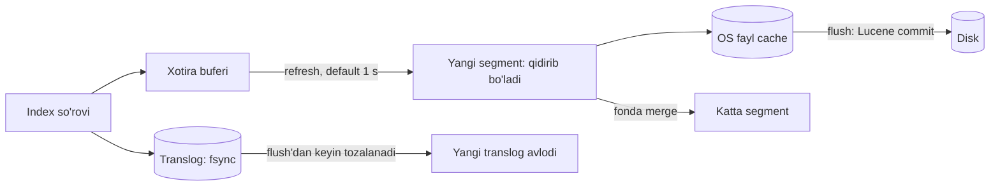

## Bu dars nima uchun kerak

B-tree indeks (14-15-darslar) "aniq qiymat yoki diapazon" so'rovlari uchun ajoyib: `WHERE plate = '01A123BC'`, `WHERE created_at > ...`. Lekin foydalanuvchi qidiruvi boshqacha:

- "kamaz toshkent" - so'zlar istalgan tartibda, istalgan maydonda;
- "Ахмедов" deb yozilgan, lekin bazada "Akhmedov" yoki "Ahmedov";
- "yoqilg'i quyish" qidirganda "yoqilg'i quyildi" ham topilishi kerak;
- natijalar **relevantlik** bo'yicha tartiblanishi kerak, ID bo'yicha emas;
- yon panelda filtrlar va sonlar (facets): "Toshkent: 120, Samarqand: 45".

`WHERE description LIKE '%kamaz%'` B-tree indeksdan foydalana olmaydi (boshida `%`), har qatorni skanerlaydi va relevantlik bermaydi. Qidiruv tizimlari bu muammoni boshqa ma'lumot tuzilmasi - **inverted index** bilan yechadi.

Bu darsdan keyin siz:

- inverted index qanday tuzilishini va so'rov qanday bajarilishini bilasiz;
- matn tahlili (analysis) pipeline'ini - tokenizatsiya, normalizatsiya, stemming - tushunasiz;
- BM25 relevantlik formulasini raqamli misol bilan hisoblay olasiz;
- Lucene segment'lari, refresh, merge va translog orqali "near real-time" qanday ishlashini bilasiz;
- Elasticsearch'ning shard, replica, scatter-gather so'rov modelini va shard o'lchamini hisoblay olasiz;
- qidiruvni asosiy baza bilan qanday sinxronlash (CDC, outbox) va qachon PostgreSQL full-text yetarli ekanini aniqlay olasiz.

## Inverted index

"Oddiy" (forward) indeks: hujjat → uning so'zlari. **Inverted index** - teskarisi: so'z (term) → shu so'z uchraydigan hujjatlar ro'yxati.

Uchta hujjat:

- d1: "Kamaz yoqilg'i quydi Toshkent"
- d2: "Isuzu Toshkent reys"
- d3: "Kamaz reys Samarqand"

Tahlildan keyin (kichik harf, ajratish):

| Term | Posting list |
|---|---|
| isuzu | d2 |
| kamaz | d1, d3 |
| quydi | d1 |
| reys | d2, d3 |
| samarqand | d3 |
| toshkent | d1, d2 |
| yoqilg'i | d1 |

So'rov "kamaz toshkent":

- **OR** (har qanday so'z): posting list'lar birlashmasi → d1, d2, d3, keyin relevantlik bo'yicha tartiblash.
- **AND** (hamma so'z): posting list'lar kesishmasi → {d1, d3} ∩ {d1, d2} = **d1**.

Posting list'lar hujjat ID bo'yicha **saralangan** saqlanadi, shuning uchun kesishma ikki saralangan ro'yxatni birlashtirish (merge) kabi chiziqli vaqtda; uzun ro'yxatlarda "skip list" ko'rsatkichlari bilan katta qismlar o'tkazib yuboriladi.

### Posting list'da nima saqlanadi

Har bir term uchun:

- **Term dictionary** - barcha noyob termlar, saralangan; Lucene'da prefiks bo'yicha siqilgan tuzilma (FST - finite state transducer) xotirada, termni topish tez.
- **Hujjat ID'lari** - delta kodlash bilan siqilgan (3, 7, 12, 15 o'rniga 3, 4, 5, 3) - kichik sonlar kam bit oladi.
- **Term frequency (tf)** - termin hujjatda necha marta uchragani (relevantlik uchun).
- **Pozitsiyalar** - so'zlar hujjatda qayerda (fraza qidiruvi uchun: "yoqilg'i quydi" aynan yonma-yon).
- **Offset'lar** - highlight uchun belgilar pozitsiyasi (ixtiyoriy).

Bu PostgreSQL'ning **GIN** (Generalized Inverted Index) indeksi bilan bir xil g'oya: PostgreSQL hujjatlariga ko'ra GIN har bir lexeme uchun mos joylashuvlarning siqilgan ro'yxatini saqlaydi va full-text qidiruv uchun afzal indeks turi hisoblanadi (15-dars).

### Doc values: ustunli qism

Inverted index "term → hujjatlar" savoliga javob beradi. Lekin saralash va agregatsiya uchun teskari savol kerak: "hujjat → maydon qiymati" (masalan, har topilgan hujjatning `created_at`'i). Elasticsearch buning uchun **doc values** - indekslash vaqtida quriladigan diskdagi **ustunli** tuzilmadan foydalanadi (16-dars: column-oriented storage). Ular ko'p maydon turlarida default holatda yoqilgan, `text` maydonlarida esa default o'chiq. Ya'ni Elasticsearch ichida ikki xil indeks bor: qidiruv uchun inverted, agregatsiya va saralash uchun columnar.

## Matn tahlili (analysis)

Inverted index sifati termlar qanday hosil qilinishiga bog'liq. **Analyzer** uch bosqichdan iborat:

1. **Character filters** - xom matnni tozalash: HTML teglarini olib tashlash, belgilarni almashtirish (masalan, o'zbek apostrof variantlari `ʻ`, `'`, `’` ni bittaga keltirish).
2. **Tokenizer** - matnni tokenlarga bo'lish: bo'sh joy, tinish belgilari, Unicode so'z chegaralari bo'yicha.
3. **Token filters** - tokenlarni o'zgartirish:
   - **lowercase** - "Kamaz" = "kamaz";
   - **stop words** - juda ko'p uchraydigan so'zlarni tashlash ("va", "bilan") - zamonaviy BM25 ularni o'zi past baholaydi, shuning uchun tashlash ko'pincha shart emas;
   - **stemming** - so'zni o'zagiga keltirish: "quydi", "quyildi", "quyish" → "quy". Algoritmik (Snowball) yoki lug'at asosida (Hunspell). O'zbek tili agglutinativ (ko'p qo'shimchalar) - tayyor stemmer'lar sifati past bo'lishi mumkin, bu real muammo;
   - **synonyms** - "yoqilg'i" = "benzin" = "dizel" (kontekstga qarab);
   - **transliteration** - kirill va lotin: "Ахмедов" → "ahmedov". O'zbekiston uchun bu juda muhim: bitta ism bazada ikki alifboda bo'lishi mumkin. ICU transliteration filtri yoki o'z qoidangiz;
   - **n-gram / edge n-gram** - "autocomplete" va qisman moslik uchun: "kamaz" → "ka", "kam", "kama", "kamaz".

**Muhim qoida:** indekslashda va so'rovda **bir xil** (yoki mos) analyzer ishlatilishi kerak. Agar indeksda stemming bo'lsa, so'rovda bo'lmasa - "quydi" so'rovi "quy" termini topmaydi.

Har bir maydon uchun alohida tanlov: `plate_number` (davlat raqami) tahlil qilinmasligi kerak (`keyword` turi - aniq qiymat, filtrlash va agregatsiya uchun), `description` esa to'liq tahlil qilinadi (`text` turi). Ko'pincha bitta maydon ikki ko'rinishda indekslanadi (multi-field): `name` (text, qidiruv uchun) va `name.keyword` (aniq, saralash uchun).

## Relevantlik: TF-IDF dan BM25 gacha

OR so'rov 10 000 hujjat topdi. Qaysi biri birinchi? Intuitiv tamoyillar:

1. **Term frequency (TF):** so'z hujjatda ko'p uchrasa, hujjat shu mavzuga ko'proq tegishli. Lekin chiziqli emas: 10 marta uchrash 1 martadan 10 baravar yaxshi emas - **to'yinish** (saturation) kerak.
2. **Inverse document frequency (IDF):** kam hujjatda uchraydigan so'z ko'proq ma'lumot beradi. "Toshkent" hamma joyda bor - kam qiymat; "Hyundai" kamdan-kam - yuqori qiymat.
3. **Hujjat uzunligi:** qisqa sarlavhadagi moslik uzun hisobotdagi moslikdan kuchliroq.

**BM25** (Okapi BM25) - Elasticsearch va Lucene'da default o'xshashlik modeli. Bitta term uchun ball:

```
score(t, d) = IDF(t) × tf × (k1 + 1) / (tf + k1 × (1 - b + b × dl / avgdl))
```

- `tf` - term hujjatda necha marta;
- `dl` - hujjat uzunligi (termlar soni), `avgdl` - o'rtacha uzunlik;
- `k1` - TF to'yinishi, Elasticsearch'da default **1.2**;
- `b` - uzunlik normalizatsiyasi kuchi, default **0.75** (0 - uzunlik e'tiborga olinmaydi, 1 - to'liq).

Lucene'dagi IDF varianti: `IDF = ln(1 + (N - n + 0.5) / (n + 0.5))`, bu yerda N - jami hujjatlar, n - termli hujjatlar soni.

So'rov ko'p termli bo'lsa, termlar ballari qo'shiladi.

### Raqamli misol

N = 10 000 hujjat, avgdl = 20 term. So'rov: "hyundai toshkent".

- "hyundai" 100 ta hujjatda: IDF = ln(1 + 9 900.5 / 100.5) = ln(99.5) ≈ **4.60**.
- "toshkent" 5 000 ta hujjatda: IDF = ln(1 + 5 000.5 / 5 000.5) = ln(2) ≈ **0.69**.

Hujjat A: uzunligi 20 (o'rtacha), "hyundai" 1 marta, "toshkent" 1 marta. Uzunlik omili: 1 - 0.75 + 0.75 × 20/20 = 1.

- hyundai: 4.60 × 1 × 2.2 / (1 + 1.2 × 1) = 4.60 × 2.2 / 2.2 = **4.60**
- toshkent: 0.69 × 1 = **0.69**
- jami ≈ **5.29**

Hujjat B: uzunligi 20, "toshkent" 5 marta, "hyundai" yo'q.

- toshkent: 0.69 × 5 × 2.2 / (5 + 1.2) = 0.69 × 11 / 6.2 ≈ **1.23**
- jami ≈ **1.23**

Hujjat C: uzunligi 80 (o'rtachadan 4 baravar uzun), "hyundai" 1 marta. Uzunlik omili: 0.25 + 0.75 × 4 = 3.25.

- hyundai: 4.60 × 2.2 / (1 + 1.2 × 3.25) = 10.12 / 4.9 ≈ **2.07**

Xulosalar: noyob so'z (hyundai) bitta uchrashi bilan tez-tez uchraydigan so'zning 5 marta uchrashidan ancha kuchli (IDF); "toshkent"ning 5 marta uchrashi 1 martadan atigi ~1.8 baravar ko'p ball berdi (to'yinish); uzun hujjatdagi bir xil moslik ikki baravardan ko'proq kuchsizroq (uzunlik normalizatsiyasi).

**Distributed nuance:** IDF har **shard** bo'yicha alohida hisoblanadi (har shard o'z N va n'iga ega). Kichik indekslarda shard'lar orasida statistika farq qilsa, bir xil hujjat turli shard'da turli ball oladi. Katta indekslarda bu farq kichrayadi; aniq natija kerak bo'lsa `dfs_query_then_fetch` rejimi global statistikani oldindan yig'adi (qo'shimcha round trip evaziga).

Relevantlikni biznes signallari bilan boyitish odatiy: `function_score` bilan yangilik, mashhurlik, masofa (geo) qo'shish; yoki hujjatlarni vector embedding bilan semantik qidiruv (kNN) va BM25'ni birlashtirish (hybrid search, 90-dars: RAG).

## Lucene ichida: segment'lar va near real-time

Elasticsearch (va OpenSearch, Solr) har bir shard uchun **Lucene** kutubxonasidan foydalanadi. Lucene indeksi - **segment**lar to'plami. Bu 13-darsdagi LSM-tree g'oyasiga juda o'xshash:

1. Yangi hujjatlar avval **xotira buferi**ga tushadi (hali qidirib bo'lmaydi).
2. **Refresh** - bufer yangi, **o'zgarmas** segment sifatida yoziladi va qidiruv uchun ochiladi. Elasticsearch hujjatlariga ko'ra refresh to'liq disk commit'siz ishlaydi: segment avval OS fayl tizimi cache'iga yoziladi (arzon), keyinroq diskka. Default holatda **har 1 soniyada**, lekin faqat oxirgi 30 soniyada qidiruv so'rovi kelgan indekslar uchun. Shuning uchun Elasticsearch "**near** real-time": yozilgan hujjat taxminan 1 soniyadan keyin topiladi.
3. **Translog** - har shard nusxasida yozish operatsiyalari jurnali (WAL, 14-dars). Lucene commit qimmat, shuning uchun har yozuvdan keyin qilinmaydi; crash'dan keyin oxirgi commit'dan keyingi tasdiqlangan operatsiyalar translog'dan tiklanadi. Default `index.translog.durability: request` - yozuv primary va barcha replika'larda translog fsync qilingandan keyingina tasdiqlanadi. `async` rejimida (`sync_interval` default 5 s) tezroq, lekin oxirgi soniyalar yo'qolishi mumkin.
4. **Flush** - Lucene commit (segment'lar diskka fsync) va yangi translog avlodi. Fonda avtomatik.
5. **Merge** - kichik segment'lar fonda kattaroqlariga birlashtiriladi (LSM compaction kabi). Har so'rov barcha segment'lardan o'tadi, shuning uchun segment'lar kam bo'lishi kerak.

**O'chirish va yangilash:** segment o'zgarmas, shuning uchun o'chirish - hujjatni "o'chirilgan" deb belgilash (bitmap); yangilash - eski versiyani o'chirilgan deb belgilash + yangi hujjat qo'shish. Haqiqiy joy merge paytida bo'shaydi. Natija: tez-tez yangilanadigan hujjatlar (masalan, "mashinaning oxirgi joylashuvi" har 10 soniyada) Elasticsearch uchun **qimmat** - har yangilash to'liq qayta indekslash va keyin merge.



## Elasticsearch klasteri: shard, replica, so'rov

### Shard va replica

Indeks **primary shard**larga bo'linadi (har biri alohida Lucene indeksi). Hujjat qaysi shard'ga tushishi: default holatda `hash(_routing) mod number_of_primary_shards`, `_routing` - odatda hujjat ID. Formula shard soniga bog'liq bo'lgani uchun **primary shard sonini indeks yaratilgandan keyin oddiygina o'zgartirib bo'lmaydi** - Split/Shrink API yoki boshqa indeksga reindex kerak (28-dars: hash mod N muammosi).

Har primary'ning **replica**lari bor. Elasticsearch replikatsiya modeli Microsoft Research'ning PacificA maqolasiga asoslangan primary-backup: primary operatsiyani tekshirib bajaradi, **in-sync** replikalarga parallel yuboradi va hammasi javob bergandan keyin klientga tasdiq beradi. Replika operatsiyani o'tkazib yuborsa, primary master'dan uni in-sync to'plamidan chiqarishni so'raydi. Master node'lar klaster holatini boshqaradi (consensus asosida, 35-36-darslar).

Replikalar ikki narsa beradi: nosozlikka chidamlilik va **o'qish throughput**i (qidiruv istalgan nusxaga yuborilishi mumkin).

### Qidiruv: scatter-gather

Qidiruv so'rovi (masalan "kamaz toshkent", top 10):

1. Klient istalgan node'ga yuboradi - u **coordinating node** bo'ladi.
2. **Query fazasi:** coordinator har shard'ning bitta nusxasiga (primary yoki replica; default holatda adaptive replica selection - javob vaqti va navbat bo'yicha tanlash) so'rov yuboradi. Har shard lokal qidirib, o'zining **top 10** hujjat ID'si va balini qaytaradi.
3. Coordinator S × 10 natijani birlashtirib, global top 10 ni tanlaydi.
4. **Fetch fazasi:** faqat shu 10 hujjatning to'liq mazmuni tegishli shard'lardan olinadi.

Bu "query then fetch". Natijalar: so'rov latency'si **eng sekin shard**ga bog'liq (53-dars: tail latency va fan-out); shard'lar soni ko'p bo'lsa - har so'rov ko'p ish. Shard javob bermasa, Elasticsearch qisman natijani 200 status bilan qaytarishi mumkin (`_shards.failed` maydonida) - ilova buni tekshirishi kerak.

### Chuqur pagination

`from: 9990, size: 10` so'rovi uchun har shard **10 000** ta natija qaytarishi va coordinator S × 10 000 tasini saralashi kerak. Shuning uchun `from + size` default holatda `index.max_result_window` = **10 000** bilan cheklangan. Chuqurroq o'tish uchun Elasticsearch **`search_after`** va **point in time (PIT)** ni tavsiya qiladi (scroll API endi chuqur pagination uchun tavsiya etilmaydi) - bu 9-darsdagi cursor pagination g'oyasi.

### Shard o'lchami

Elasticsearch hujjatlari tavsiyasi: shard hajmi **10 GB dan 50 GB gacha**, har shardda **200 milliondan kam** hujjat. Klaster cheklovi: har node'da 1 000 ta (non-frozen) shard.

Juda kichik shard'lar - har biri overhead (xotira, fayl deskriptorlari, so'rovda alohida task), juda katta - tiklanish va ko'chirish sekin.

Hisob: 300 GB ma'lumot, replika 1. Shard ~30 GB bo'lsin → 10 primary + 10 replica = 20 shard. Agar o'sish yiliga 2x bo'lsa, ehtimol 12-15 primary bilan boshlash yoki vaqt bo'yicha indekslar (pastda).

### Vaqt bo'yicha indekslar

Log, hodisalar, telemetriya kabi vaqtga bog'liq ma'lumot uchun bitta katta indeks o'rniga **har kun/hafta/oy uchun alohida indeks** (`events-2026.10`, data streams va ILM - index lifecycle management bilan). Afzalliklar: eski ma'lumotni o'chirish = indeksni o'chirish (hujjat-hujjat delete va merge emas); eski indekslar arzon "warm/cold" node'larga ko'chiriladi; har davr uchun shard soni alohida tanlanadi; so'rov faqat kerakli davr indekslariga boradi.

## Qidiruvni asosiy baza bilan sinxronlash

Elasticsearch odatda **source of truth emas** - u asosiy bazadagi (PostgreSQL) ma'lumotning qidiruv uchun derived view'i (47-dars: CQRS). Asosiy savol - uni qanday yangilab turish.

| Usul | Qanday | Muammo |
|---|---|---|
| Dual-write | Ilova PostgreSQL'ga va ES'ga yozadi | Biri muvaffaqiyatsiz bo'lsa - nomuvofiqlik; tartib buzilishi (48-dars) |
| Davriy batch reindex | Har N daqiqada `updated_at > last` bo'yicha | Kechikish; o'chirilganlarni aniqlash qiyin; `updated_at` aniqligi |
| Transactional outbox | Tranzaksiyada outbox yozuvi, worker ES'ga yuboradi | Ishonchli; qo'shimcha jadval va worker |
| CDC (Debezium) | WAL'dan o'zgarishlar Kafka orqali ES'ga | Ishonchli, ilova kodiga tegmaydi; infratuzilma murakkab |

Har qanday usulda:

- **Idempotent indekslash** - hujjat ID'si asosiy bazadagi ID bilan bir xil, takroriy xabar shunchaki qayta yozadi.
- **Tartib** - eski versiya yangisini bosib ketmasligi uchun **external versioning**: hujjatga bazadagi versiya (yoki LSN) bilan yoziladi va ES kichikroq versiyani rad etadi.
- **To'liq qayta qurish yo'li** - mapping o'zgardi, analyzer yangilandi - yangi indeks yaratiladi, to'liq reindex qilinadi va **alias** atomik ravishda yangi indeksga o'tkaziladi. Ilova doim alias nomi bilan ishlaydi. Shuning uchun asosiy bazadan butun indeksni qayta qura olish shart.
- **Eventual consistency** - foydalanuvchi mashinani qo'shdi va darhol qidiruvda ko'rmaydi (refresh + pipeline kechikishi). UX buni hisobga olishi kerak (yaratgandan keyin ro'yxatni bazadan ko'rsatish yoki "read your writes" uchun `refresh=wait_for`).

## PostgreSQL full-text qachon yetarli

Har qidiruv uchun alohida klaster kerak emas. PostgreSQL'da:

- **`tsvector` / `tsquery`** va **GIN** indeks - inverted index, tillarga mos konfiguratsiyalar, `ts_rank` relevantlik.
- **`pg_trgm`** - trigram (3 belgili bo'laklar) o'xshashligi: GIN yoki GiST indeks bilan `LIKE '%foo%'`, `ILIKE` va regex so'rovlarini tezlashtiradi; `similarity()` va `%` operatori (default chegara 0.3) bilan imlo xatolariga chidamli qidiruv. "Akhmedov" va "Ahmedov" o'xshash deb topiladi.

| Mezon | PostgreSQL FTS + pg_trgm | Elasticsearch / OpenSearch |
|---|---|---|
| Ma'lumot hajmi | O'nlab million qatorgacha qulay | Milliardlab hujjat |
| Tranzaksion izchillik | Ha, bir tranzaksiyada | Yo'q, near real-time (~1 s) va sinxronlash kechikishi |
| Relevantlik va tahlil | Asosiy, kam moslashuvchan | BM25, ko'p analyzer, sinonim, n-gram, function_score |
| Facets / agregatsiya | SQL GROUP BY | Tez, doc values asosida |
| Operatsion narx | Yo'q (mavjud baza) | Alohida klaster, JVM heap, shard boshqaruvi, sinxronlash pipeline |
| Asosiy bazaga yuklama | Qidiruv OLTP bilan raqobatlashadi | Ajratilgan |

Qoida: kichik va o'rta hajmda, oddiy qidiruv bilan - PostgreSQL (read replica'da bo'lsa ham). Elasticsearch'ga signal: murakkab relevantlik va tahlil talablari, katta hajm, ko'p facet, log/observability qidiruvi, qidiruv yuklamasi OLTP'ga xalaqit bera boshlashi.

## Indekslash throughput'i

Elasticsearch hujjatlaridagi tavsiyalar: `_bulk` API bilan yozish (100 hujjatdan boshlab, tezlik o'smay qolguncha ikki baravar oshirib, lekin so'rov bir necha o'n MB dan oshmasin); bir nechta parallel yuboruvchi; 429 javobida tasodifiy exponential backoff bilan qayta urinish (56, 62-darslar); katta boshlang'ich yuklashda `refresh_interval: -1` va `number_of_replicas: 0`, keyin qaytarish; OS fayl cache'iga xotiraning kamida yarmi; avtomatik generatsiya qilingan ID'lar (mavjudlikni tekshirish kerak bo'lmaydi).

Hisob: 50 million hujjatni qayta indekslash, har biri ~1 KB. Bulk so'rov 5 000 hujjat (~5 MB). 10 000 so'rov. Agar klaster soniyasiga 20 000 hujjat qabul qilsa: 50 000 000 / 20 000 = 2 500 s ≈ **42 daqiqa**. Replika'lar o'chirilib, refresh to'xtatilsa tezroq, keyin replikatsiya fonda.

## Real tizimlardan misollar

- **Lucene** - Elasticsearch, OpenSearch va Solr'ning qidiruv yadrosi; segment, merge, FST asosidagi term dictionary.
- **Elasticsearch** - default BM25 (k1 = 1.2, b = 0.75), 1 soniyalik refresh, PacificA asosidagi primary-backup replikatsiya, 10-50 GB shard tavsiyasi. Litsenziya tarixi: Elastic taxminan 2021 yilda litsenziyani o'zgartirgan va bu Amazon yuritadigan fork'ga (OpenSearch) olib kelgan; 2024 yil avgustda Elastic AGPL'ni qo'shimcha variant sifatida qo'shgan.
- **PostgreSQL** - GIN inverted index va `pg_trgm`.
- **PostgreSQL 18 va pg_trgm** - trigram indekslar `LIKE`/`ILIKE` ni PostgreSQL 9.1 dan, regex'ni 9.3 dan qo'llab-quvvatlaydi; kichik qidiruv vazifalari uchun alohida klastersiz yechim.

## iQuariX kontekstida qo'llanish

Faraz qiling, qidiruv ehtiyojlari:

1. **Global qidiruv** kabinetda: mashina (davlat raqami, model, VIN), haydovchi (ism, telefon), geofence nomi, manzil. Davlat raqami turli yozilishda ("01 A 123 BC", "01A123BC"); ismlar kirill va lotinda. Hajm: 2 000 tenant × o'rtacha 50 mashina va 60 haydovchi ≈ 220 000 hujjat. **PostgreSQL yetarli**: normalizatsiyalangan ustun (`plate_normalized` - bo'sh joysiz, katta harf), `pg_trgm` GIN indeks ism va manzil uchun, transliteratsiya qilingan qo'shimcha ustun (`name_latin`). Har so'rovda `tenant_id` filtri birinchi (73-dars: multi-tenancy) - indeks `(tenant_id, ...)` yoki partial.
2. **Hodisalar va ogohlantirishlar jurnali** - kuniga millionlab yozuv, dispetcher "oxirgi 30 kunda shu haydovchi bilan bog'liq to'kib olish yoki tezlik oshirish, izohda 'AYOQSH' so'zi bor" kabi so'rov qiladi, facet'lar bilan (tur, mashina, guruh). Bu Elasticsearch/OpenSearch uchun yaxshi nomzod: oylik indekslar, ILM bilan 12 oy, keyin o'chirish; sinxronlash - outbox yoki CDC orqali Kafka'dan.
3. **Platformaning o'z loglari** - observability (66-dars) - alohida klaster yoki boshqariladigan servis.
4. **Mashinaning oxirgi joylashuvi Elasticsearch'da emas** - har 10 soniyada yangilanadigan hujjat segment'lar va merge uchun qimmat; bu Redis yoki maxsus geo tuzilma (82-dars) vazifasi.

Hisob (2-band): kuniga 2 million hodisa × ~1.5 KB (indeks bilan) ≈ 3 GB/kun, oyiga ~90 GB. Oylik indeks uchun 3 primary shard (~30 GB har biri) + 1 replika. 12 oy: 36 primary, 72 shard jami, ~1.1 TB disk replikalar bilan. Ikki-uch data node'ga bemalol sig'adi. Qidiruv odatda oxirgi 1-3 oyga - faqat 3-9 shard'ga scatter.

## Ko'p uchraydigan xatolar

1. **Elasticsearch'ni source of truth qilish** - u qayta quriladigan derived ma'lumot bo'lishi kerak; to'liq reindex yo'li bo'lmasa, mapping o'zgarishi falokatga aylanadi.
2. **Dual-write** - ES'ga yozish muvaffaqiyatsiz bo'lsa, qidiruv jimgina eskiradi; outbox yoki CDC ishlating.
3. **Juda ko'p kichik shard** - "har tenant uchun alohida indeks" 2 000 tenant bilan minglab shard; klaster holati va xotira shishadi.
4. **Tez-tez yangilanadigan maydonlarni ES'da saqlash** - har yangilash qayta indekslash va merge.
5. **Indekslash va so'rovda turli analyzer** - topilishi kerak bo'lgan hujjatlar topilmaydi.
6. **`keyword` va `text`ni aralashtirish** - davlat raqami tahlil qilinib bo'laklanadi, aniq moslik va saralash buziladi.
7. **Chuqur `from/size` pagination** - 10 000 cheklovi va har shardda katta saralash; `search_after` + PIT ishlating.
8. **Multi-tenant filtrni unutish** - qidiruv boshqa tenant hujjatlarini qaytaradi; filtrni ilova darajasida majburiy qo'shing (yoki filtered alias).

## Xulosa

- Inverted index: term → saralangan, siqilgan posting list (hujjat ID, tf, pozitsiyalar); AND - kesishma, OR - birlashma.
- Sifat analyzer'ga bog'liq: tokenizer, lowercase, stemming, sinonim, transliteratsiya; indekslash va so'rovda mos bo'lishi shart.
- BM25: IDF noyob so'zni kuchaytiradi, k1 TF'ni to'yintiradi, b uzunlikni normallashtiradi; IDF shard bo'yicha hisoblanadi.
- Lucene segment'lari LSM'ga o'xshaydi: bufer → refresh (≈1 s, near real-time) → merge; translog chidamlilikni beradi; yangilash = o'chirish + qo'shish.
- Elasticsearch: hash routing bilan primary shard'lar (soni qat'iy), PacificA asosidagi replikatsiya, query-then-fetch scatter-gather; shard 10-50 GB.
- Qidiruv indeksi - derived view: outbox/CDC bilan sinxronlash, external versioning, alias orqali to'liq qayta qurish.
- Kichik va o'rta hajmda PostgreSQL GIN + pg_trgm ko'pincha yetarli; alohida klaster aniq signal bilan.

## Amaliy topshiriq

iQuariX'ga **"universal qidiruv"** qo'shilmoqda deb faraz qiling: kabinetning yuqori qismidagi bitta qidiruv maydoni mashinalar, haydovchilar, geofence'lar, hodisalar (ogohlantirishlar, dispetcher izohlari) va video klip yorliqlari bo'yicha qidiradi. Talablar: yozish paytida natija ko'rinishi (autocomplete), kirill va lotin yozuvlarini teng topish, imlo xatolariga chidamlilik, tenant izolyatsiyasi, natijalar tur bo'yicha guruhlangan. Hajm: 3 000 tenant, 150 000 mashina, 180 000 haydovchi, kuniga 3 million hodisa, 18 oy saqlash.

1. Qaysi obyektlar PostgreSQL'da qidiriladi va qaysilari Elasticsearch/OpenSearch'ga chiqadi? Har tanlovni hajm, yangilanish chastotasi va izchillik talabi bilan asoslang.
2. Elasticsearch'dagi indekslar uchun mapping va analyzer'larni loyihalang: qaysi maydon `text`, qaysi `keyword`, autocomplete uchun edge n-gram, kirill-lotin transliteratsiyasi, davlat raqami normalizatsiyasi.
3. Shard va indeks strategiyasini hisoblang: hodisalar uchun indeks davri, primary shard soni, replika, 18 oylik jami hajm va shard soni. Tenant bo'yicha alohida indeks nega yomon g'oya ekanini raqam bilan ko'rsating.
4. Sinxronlash pipeline'ini loyihalang: outbox yoki CDC, idempotentlik, external versioning, o'chirishlar, to'liq reindex va alias almashtirish jarayoni.
5. "Ahmedov" so'rovi uchun BM25 ballarini taxminan solishtiring: ism maydonida bir marta uchragan haydovchi va uzun dispetcher izohida bir marta uchragan hodisa. Natijalar tur bo'yicha qanday aralashtiriladi yoki guruhlanadi?
6. Tenant izolyatsiyasi: filtr qayerda va qanday majburlanadi, xato bilan boshqa tenant ma'lumoti ko'rinib qolmasligi uchun qanday himoya qatlamlari.

Yaxshi javobda bo'lishi kerak bo'lgan narsalar:

- kichik va kam o'zgaradigan obyektlar uchun PostgreSQL varianti jiddiy ko'rib chiqilgan;
- mashinaning tez-tez o'zgaradigan holati (joylashuv) qidiruv indeksida emas;
- `keyword` va `text` farqi va multi-field ishlatilgan;
- shard hisobi 10-50 GB oralig'ida, vaqt bo'yicha indekslar va ILM;
- sinxronlash dual-write emas, versiyalash va alias bilan qayta qurish bor;
- tenant filtri ilova yoki alias darajasida majburiy.

Javobni pastdagi maydonga yozib, chatga yuboring.

## Manbalar

- Elasticsearch. [Near real-time search](https://www.elastic.co/guide/en/elasticsearch/reference/current/near-real-time.html) - refresh, segment'lar, 1 soniya va 30 soniyalik search idle qoidasi.
- Elasticsearch. [Translog](https://www.elastic.co/guide/en/elasticsearch/reference/current/index-modules-translog.html) - chidamlilik, `request`/`async`, flush.
- Elasticsearch. [Reading and writing documents](https://www.elastic.co/guide/en/elasticsearch/reference/current/docs-replication.html) - PacificA asosidagi replikatsiya, in-sync nusxalar, adaptive replica selection.
- Elasticsearch. [Similarity module](https://www.elastic.co/guide/en/elasticsearch/reference/current/index-modules-similarity.html) - BM25 default, k1 = 1.2, b = 0.75.
- Elasticsearch. [Size your shards](https://www.elastic.co/guide/en/elasticsearch/reference/current/size-your-shards.html), [Paginate search results](https://www.elastic.co/guide/en/elasticsearch/reference/current/paginate-search-results.html), [Tune for indexing speed](https://www.elastic.co/guide/en/elasticsearch/reference/current/tune-for-indexing-speed.html), [doc_values](https://www.elastic.co/guide/en/elasticsearch/reference/current/doc-values.html).
- PostgreSQL. [Preferred Index Types for Text Search](https://www.postgresql.org/docs/current/textsearch-indexes.html) - GIN vs GiST; [pg_trgm](https://www.postgresql.org/docs/current/pgtrgm.html) - trigram o'xshashligi va LIKE indekslari.
- Martin Kleppmann, Chris Riccomini. [Designing Data-Intensive Applications, 2-nashr](https://www.oreilly.com/library/view/designing-data-intensive/9781098119058/), O'Reilly, 2026 - storage va indekslash bobi (full-text indekslar, Lucene va LSM o'xshashligi); 1-nashrda 3-bob.
- Elastic. [Elasticsearch is Open Source. Again!](https://www.elastic.co/blog/elasticsearch-is-open-source-again), 2024 - litsenziya tarixi.
