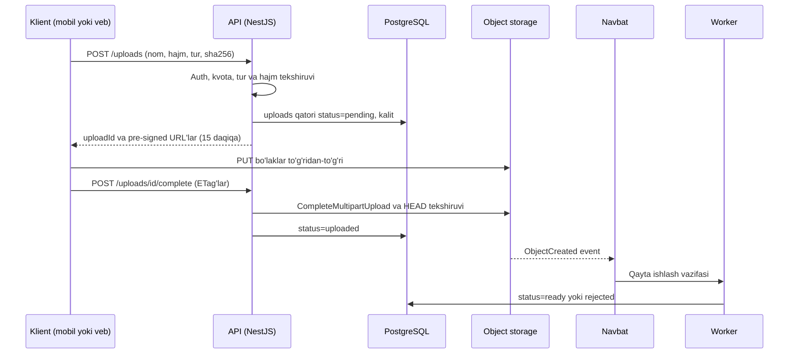

## Bu dars nima uchun kerak

Har qanday real tizimda "katta, tuzilmasiz bayt" bor: rasmlar, PDF hisobotlar, video, eksport fayllari, backup'lar, loglar, ML datasetlari, data lake'dagi Parquet fayllar. Ularni PostgreSQL'da `bytea` sifatida saqlash mumkin, lekin tez orada muammo boshlanadi: baza hajmi va backup vaqti o'sadi, replikatsiya trafigi shishadi, ulanish pooli katta fayllarni uzatish bilan band bo'ladi, fayl tizimidagi papka esa bitta serverga bog'liq bo'lib, horizontal masshtablash (21-dars) buziladi.

**Object storage** (Amazon S3, Google Cloud Storage, Azure Blob, Cloudflare R2, MinIO, Ceph RGW) bu muammoning standart yechimi: deyarli cheksiz hajm, yuqori chidamlilik, arzon narx va HTTP API. Lekin u fayl tizimi emas va undan to'g'ri foydalanish uchun uning modelini, kafolatlarini va narx tuzilmasini bilish kerak.

Darsning ikkinchi yarmi - **fayl yuklash dizayni**: 2 GB videoni mobil ilovadan sekin tarmoq orqali qanday ishonchli yuklash, uni API serverdan o'tkazmaslik, xavfsiz qilish, keyin qayta ishlash (thumbnail, transcoding, virus tekshiruvi) va metadata bilan izchil saqlash.

Bu darsdan keyin siz:

- object storage modelini (bucket, key, object, metadata) va uning fayl tizimidan farqini bilasiz;
- S3'ning consistency, durability va availability kafolatlarini va ular qanday ta'minlanishini (replikatsiya, erasure coding) tushunasiz;
- multipart upload va byte-range read'ni, ularning cheklovlarini va raqamlarini bilasiz;
- pre-signed URL va POST policy bilan to'g'ridan-to'g'ri yuklashni loyihalay olasiz;
- resumable upload, upload'dan keyingi qayta ishlash pipeline'i va metadata izchilligini loyihalay olasiz;
- storage class, lifecycle va narxni hisoblay olasiz.

## Object storage modeli

### Asosiy tushunchalar

- **Bucket** - nomlangan konteyner (region'ga bog'langan), unga siyosatlar, versiyalash, lifecycle qoidalari biriktiriladi.
- **Object** - baytlar + metadata (Content-Type, foydalanuvchi metadata, teglar) + kalit.
- **Key** - bucket ichidagi to'liq nom: `tenants/42/videos/2026/10/20/0192a1b2-....mp4`. Slash `/` - papka emas, kalitning oddiy belgisi. "Papkalar" faqat `LIST` so'rovida `prefix` va `delimiter` orqali illyuziya.

### Fayl tizimidan farqi

| Xususiyat | POSIX fayl tizimi | Object storage |
|---|---|---|
| Interfeys | `open`, `seek`, `write`, `rename` | HTTP: `PUT`, `GET`, `DELETE`, `LIST`, `HEAD` |
| O'zgartirish | Faylning istalgan joyini qayta yozish | Obyekt butunligicha almashtiriladi (immutable yozuv) |
| Qo'shish (append) | Ha | Odatda yo'q (umumiy holatda) |
| Rename | Atomik, arzon | Yo'q: copy + delete, katta obyektda qimmat |
| Papka | Haqiqiy, ierarxik | Prefiks illyuziyasi |
| Hajm | Disk/klaster bilan cheklangan | Amalda cheksiz |
| Latency | Mikrosekund-millisekund | O'nlab-yuzlab millisekund |
| Chidamlilik | Disk/RAID darajasi | Ko'p zona bo'yicha, juda yuqori |
| Narx modeli | Ajratilgan hajm | Ishlatilgan GB-oy + so'rovlar + chiquvchi trafik |

Shuning uchun object storage'ni "tarmoq diski" sifatida ishlatish (masalan, FUSE bilan mount qilib, ilovadan fayl sifatida yozish) ko'pincha sekin va kutilmagan xatolarga olib keladi: kichik `write`'lar butun obyektni qayta yuklashga aylanadi.

### Kafolatlar

**Consistency.** Amazon S3 2020 yil dekabridan buyon barcha ilovalar uchun avtomatik ravishda **kuchli read-after-write consistency** beradi: muvaffaqiyatli `PUT`, qayta yozish yoki `DELETE` dan keyin keyingi o'qishlar eng yangi versiyani qaytaradi, `LIST` natijalari ham o'zgarishlarni darhol aks ettiradi; bu metadata, teglar va ACL o'zgarishlariga ham tegishli, qo'shimcha narxsiz va unumdorlikka ta'sirsiz. Bungacha qayta yozish va o'chirish uchun eventual consistency bor edi va ko'p kutubxonalar (masalan Hadoop S3 konnektorlari) buni chetlab o'tish uchun murakkab mexanizmlar qurgan edi. Boshqa provayderlar va self-hosted yechimlar kafolatlarini alohida tekshiring.

Muhim: kuchli consistency **bitta obyekt** uchun. Ikki obyektni atomik o'zgartirish yoki "obyekt + PostgreSQL'dagi yozuv"ni birga yozish tranzaksiyasi yo'q - bu pastda alohida muammo.

**Durability.** S3 Standard yiliga obyektlarning **99.999999999%** (11 ta to'qqiz) chidamliligi uchun loyihalangan. Ko'p zonali storage class'lar obyektlarni region ichida **kamida uchta Availability Zone**dagi bir nechta qurilmada saqlaydi va butun bitta zona yo'qolsa ham ma'lumotni saqlab qolishga mo'ljallangan; One Zone-IA esa faqat bitta zonada. Ma'lumot yaxlitligi doimiy ravishda checksum'lar bilan tekshiriladi.

11 ta to'qqiz nimani anglatadi? 10 million obyekt saqlasangiz, o'rtacha 10 000 yilda bitta obyekt yo'qolishi kutiladi (10^7 × 10^-11 = 10^-4 obyekt/yil). Lekin bu **apparat nosozliklaridan** himoya. Sizning o'zingiz `DELETE` qilishingiz, noto'g'ri lifecycle qoidasi yoki o'g'irlangan kalit bilan o'chirish - bundan himoya qilmaydi. Buning uchun **versioning**, **Object Lock** (WORM) va boshqa hisob yoki regionga **replikatsiya** kerak (69-dars).

**Availability.** S3 Standard yiliga **99.99%** mavjudlik uchun loyihalangan - chidamlilikdan ancha past. "Ma'lumot yo'qolmaydi" va "ma'lumot har doim darhol o'qiladi" - turli narsalar (61-dars).

### Ichki tuzilish qisqacha: replikatsiya va erasure coding

Ma'lumotni chidamli saqlashning ikki asosiy usuli:

- **Replikatsiya** - 3 ta to'liq nusxa: 200% qo'shimcha joy, 2 ta nusxa yo'qolishiga chidaydi.
- **Erasure coding** - obyekt k ta ma'lumot bo'lagiga bo'linadi va m ta parity bo'lagi (masalan, Reed-Solomon bilan) qo'shiladi; istalgan k ta bo'lak mavjud bo'lsa, obyekt tiklanadi. Masalan k = 6, m = 3: joy 9/6 = 1.5x (50% qo'shimcha), istalgan 3 ta bo'lak yo'qolishiga chidaydi.

Werner Vogels 2023 yilgi maqolasida S3 shunday ishlashini tasvirlaydi: obyekt k ta shard va m ta parity shard'ga bo'linadi va istalgan k ta shard mavjud bo'lsa o'qiladi - bu to'liq replikatsiyaga nisbatan bir xil nosozlik chidamliligida joyni tejaydi. U yana bir muhim muammoni - **issiqlik (heat)**ni tushuntiradi: S3 millionlab qattiq diskdan foydalanadi, bitta HDD esa taxminan 120 IOPS beradi (2006 yildagidek), diskka ko'p so'rov tushsa navbat va tail latency paydo bo'ladi. Shuning uchun har obyekt bo'laklari ko'p diskka tarqatiladi va ko'p mijozlarning yuklamasi birlashib silliqlanadi. Disk hajmi IO'dan tezroq o'sgani sari terabayt uchun IO kamayib boradi.

Trade-off: erasure coding joyni tejaydi, lekin o'qish va tiklash uchun ko'p tugunga murojaat va CPU talab qiladi; kichik obyektlar uchun overhead katta. Shuning uchun ko'p tizimlar kichik obyektlarni replikatsiya, kattalarini erasure coding bilan saqlaydi.

## Unumdorlik: so'rovlar va throughput

AWS hujjatlariga ko'ra S3 har bir **partitsiyalangan prefiks** uchun soniyasiga kamida **3 500** ta `PUT/COPY/POST/DELETE` va **5 500** ta `GET/HEAD` so'rovni qo'llab-quvvatlaydi; prefikslar soni cheklanmagan, shuning uchun parallel prefikslar bilan throughput chiziqli oshadi (10 ta prefiks - taxminan 55 000 o'qish/s). Masshtablash asta-sekin bo'ladi; o'sish paytida vaqtinchalik **503 Slow Down** xatolari mumkin - ularni exponential backoff bilan retry qilish kerak (62-dars). Kichik obyektlar uchun latency taxminan **100-200 ms**. Bitta EC2 instance'dan 100 Gb/s gacha throughput olish mumkin, ko'p instance bilan - terabitlar.

Xulosalar:

- Object storage **throughput** uchun ajoyib, **latency** uchun emas. Har so'rovda kichik obyekt o'qish kerak bo'lsa (masalan, avatar har sahifada) - oldiga CDN (25-dars) yoki cache.
- Juda ko'p mayda obyekt - yomon: har biri alohida so'rov (narx va latency), `LIST` sekin. Telemetriya nuqtalarini har birini alohida obyekt qilmang - ularni minutlik/soatlik Parquet fayllarga yig'ing.
- Kalit nomlashda yuqori yuklamali yozuvlar bitta "issiq" prefiksga tushmasligi kerak. Avvalgi tavsiyalar kalit boshiga tasodifiy hash qo'shishni maslahat bergan; hozirgi S3 prefikslar bo'yicha avtomatik partitsiyalaydi, lekin juda yuqori va keskin yuklamada prefiks taqsimoti hali ham ahamiyatli.

### Multipart upload

Katta obyektni bo'laklarga bo'lib, parallel va mustaqil yuklash. AWS limitlari:

| Parametr | Qiymat |
|---|---|
| Bitta `PUT` bilan maksimal obyekt | 5 GB |
| Multipart bilan maksimal obyekt | Taxminan 48.8 TiB (10 000 × 5 GiB; AWS hujjatlarining yangi sahifalari 50 TB deb yozadi) |
| Bo'laklar soni | 1 dan 10 000 gacha |
| Bo'lak hajmi | 5 MiB dan 5 GiB gacha, oxirgisi uchun minimum yo'q |
| Tavsiya | Taxminan 100 MB dan katta obyektlar uchun multipart |

Jarayon: `CreateMultipartUpload` → `uploadId`; har bo'lak `UploadPart` (bo'lak raqami bilan, javobda ETag); oxirida `CompleteMultipartUpload` (bo'laklar ro'yxati va ETag'lari bilan) - shu paytda obyekt atomik paydo bo'ladi. Yoki `AbortMultipartUpload`.

Foydalari: bo'laklar **parallel** (throughput), xato bo'lsa faqat o'sha bo'lak qayta yuklanadi (resumable), yuklash davomida fayl hajmini bilish shart emas.

Bo'lak hajmini hisoblash: 1 TiB fayl 100 MiB bo'laklarda = 10 486 bo'lak - 10 000 cheklovidan oshadi; kamida ~105 MiB bo'lak kerak. 2 GB video 16 MiB bo'laklarda = 120 bo'lak.

**Tuzoq:** tugallanmagan multipart upload'lar bo'laklari **saqlanadi va pul turadi**, lekin `LIST` da obyekt sifatida ko'rinmaydi. Mobil klientlar yuklashni yarmida tashlab ketsa, oylar davomida "ko'rinmas" terabaytlar to'planishi mumkin. Yechim: `AbortIncompleteMultipartUpload` lifecycle qoidasi (masalan, `DaysAfterInitiation: 7`) - majburiy sozlama.

**Byte-range GET** - o'qish tomonidagi analog: `Range: bytes=0-8388607` bilan obyektning bir qismini olish. Parallel yuklab olish, video seek (HLS segmentlar, 84-dars), Parquet faylidan faqat kerakli ustun bloklarini o'qish (58-dars).

## Fayl yuklash dizayni

### Anti-pattern: API server orqali

Klient → API server (NestJS) → S3. Muammolar:

- API server fayl baytlarini o'tkazadi: tarmoq, xotira, ulanish band. 200 ta parallel 2 GB yuklash - 400 GB trafik API pod'lari orqali.
- Uzoq so'rovlar: sekin mobil tarmoqda 2 GB yuklash soatlab; gateway timeout'lari (AWS API Gateway'da 29 s, payload 10 MB - 54-dars), load balancer idle timeout'lari, deploy paytida uzilish.
- Node.js'da faylni xotiraga to'liq o'qish (`multer` memory storage) - OOM.

Kichik fayllar uchun (bir necha MB, masalan avatar) bu qabul qilinishi mumkin - stream qilinsa (`@fastify/multipart` stream rejimida to'g'ridan-to'g'ri S3 multipart'ga). Lekin umumiy yechim - **to'g'ridan-to'g'ri yuklash**.

### To'g'ri pattern: pre-signed URL bilan to'g'ridan-to'g'ri yuklash

API server faqat **ruxsat** beradi, baytlar klientdan to'g'ridan-to'g'ri object storage'ga ketadi.

**Pre-signed URL** - API server o'z ruxsatlari bilan imzolagan, muddati cheklangan URL. AWS hujjatlariga ko'ra uni olgan har kim (AWS ruxsatlarisiz) yuklay oladi, lekin faqat URL'ni yaratgan foydalanuvchi ruxsatlari doirasida; muddati CLI/SDK bilan **7 kungacha** qo'yilishi mumkin; shu kalitdagi mavjud obyekt **almashtiriladi**; yuklashda URL yaratilgandagi `Content-Type` ishlatilishi kerak.

Xavfsizlik qoidalari:

1. **Kalitni server tanlaydi**, klient emas: `tenants/{tenantId}/uploads/{uuidv7}`. Klient nomi faqat metadata. Aks holda klient boshqa tenant prefiksiga yoki mavjud faylni bosib yozishi mumkin (path traversal analogi).
2. **Qisqa muddat** - daqiqalar, kunlar emas. URL log'ga yoki brauzer tarixiga tushishi mumkin.
3. **Hajm cheklovi.** Oddiy pre-signed `PUT` hajm **diapazoni**ni majburlay olmaydi (aniq `Content-Length`ni imzoga kiritish mumkin). Brauzerdan yuklash uchun **POST policy** bilan `content-length-range` sharti (masalan `["content-length-range", 1048576, 10485760]` - 1 MiB dan 10 MiB gacha) va `starts-with $key` sharti bilan kalit prefiksini cheklash. Multipart'da esa bo'laklar sonini va har biriga URL'ni server beradi - umumiy hajm nazorat ostida; `complete` paytida `HEAD` bilan haqiqiy hajmni tekshirish.
4. **Content-Type'ga ishonmang** - klient `image/png` deb `.exe` yuklashi mumkin. Haqiqiy turni worker fayl baytlaridan (magic bytes) aniqlaydi.
5. **Yuklash bucket'i ochiq emas** - o'qish ham pre-signed GET yoki CDN imzolangan URL orqali; yuklash prefiksi va "tasdiqlangan" prefiks ajratilgan.

### Resumable upload

Mobil tarmoqda 2 GB yuklash uziladi - bu odatiy holat, istisno emas. Ikki yondashuv:

- **S3 multipart ustida:** klient har bo'lakni alohida yuklaydi; uzilsa, server `ListParts` bilan qaysi bo'laklar yetib kelganini aytadi, klient qolganlarini yuklaydi. `uploadId` va kalit klientda va bazada saqlanadi.
- **tus protokoli** (1.0.0) - resumable yuklash uchun ochiq HTTP protokol: `POST` (creation kengaytmasi, `Upload-Length` bilan) yangi yuklash resursini yaratadi va `Location` qaytaradi; uzilishdan keyin `HEAD` so'rovi `Upload-Offset`ni (qancha bayt qabul qilingan) qaytaradi; klient qolgan baytlarni `PATCH` bilan shu offset'dan yuboradi; offset mos kelmasa - `409 Conflict`. Server (masalan tusd yoki Node.js `@tus/server`) baytlarni S3 multipart'ga o'giradi. Afzalligi - tayyor klient kutubxonalari (veb, iOS, Android); kamchiligi - baytlar yana sizning serveringiz orqali o'tadi.

Bo'lak hajmi trade-off'i: kichik bo'lak (5-8 MiB) - uzilishda kam qayta yuklash, lekin ko'p so'rov; katta (64-100 MiB) - kam so'rov, lekin har uzilishda ko'p yo'qotish. Mobil uchun odatda 5-16 MiB.

### Metadata va obyekt izchilligi

Klassik muammo: fayl S3'da, uning yozuvi PostgreSQL'da. Bitta tranzaksiya yo'q (53-dars: dual-write). Mumkin bo'lgan nomuvofiqliklar:

- **Bazada yozuv bor, obyekt yo'q** - yuklash tugamagan yoki xato. Yechim: holat mashinasi (`pending → uploaded → processing → ready / rejected`), faqat `ready` foydalanuvchiga ko'rsatiladi; `pending` holatda N soatdan ortiq turgan yozuvlarni tozalovchi job.
- **Obyekt bor, bazada yozuv yo'q** ("yetim" obyekt) - klient yukladi, lekin `complete` chaqirilmadi yoki tranzaksiya rollback bo'ldi. Yechim: yuklash prefiksiga lifecycle qoidasi (masalan, 2 kundan keyin o'chirish) va faqat tasdiqlangan obyektlarni doimiy prefiksga ko'chirish yoki tegini o'zgartirish; yoki davriy solishtirish (S3 Inventory va baza).
- **O'chirish** - avval bazada `deleted` deb belgilash (foydalanuvchi ko'rmaydi), keyin asinxron ravishda obyektni o'chirish; aksincha emas.

Qoida: **baza - holatning manbai, object storage - baytlar ombori.** Obyekt kaliti o'zgarmas (yangi versiya - yangi kalit), shunda CDN cache invalidatsiyasi muammosi yo'qoladi (25-dars).

### Yuklashdan keyingi qayta ishlash

S3 event notification'lari obyekt yaratilganda SNS, SQS, Lambda yoki EventBridge'ga xabar yuboradi. AWS hujjatlariga ko'ra ular **kamida bir marta** (at-least-once) yetkazishga mo'ljallangan - dublikatlar bo'lishi mumkin, iste'molchi idempotent bo'lishi kerak; yetkazish odatda soniyalarda, ba'zan bir daqiqa yoki ko'proq. Tartibga tayanmang. Agar handler xuddi shu bucket'ga yozsa - cheksiz tsikl xavfi: alohida bucket yoki prefiks filtri ishlating.

Alternativa: `complete` endpoint'i o'zi navbatga vazifa qo'yadi (outbox orqali, 48-dars) - bu ilova nazoratida va provayderdan mustaqil.

Tipik pipeline (har qadam idempotent, natija yangi kalitga):

1. Haqiqiy turni aniqlash (magic bytes), hajm va checksum tekshiruvi.
2. Virus/zararli kod skanerlash (ClamAV yoki boshqariladigan servis).
3. Rasm: EXIF'dan GPS va shaxsiy ma'lumotni olib tashlash, thumbnail'lar.
4. Video: transcoding, HLS segmentlar, preview kadr (84-dars).
5. Holatni `ready` qilish va foydalanuvchiga xabar.

Xato bo'lsa - retry va DLQ (50-dars), holat `rejected` sababi bilan.

## Storage class, lifecycle va narx

AWS S3 storage class'lari (asosiylari):

| Class | Minimal saqlash muddati | Minimal hisoblanadigan obyekt | O'qish |
|---|---|---|---|
| Standard | Yo'q | Yo'q | Millisekundlar |
| Standard-IA | 30 kun | 128 KB | Millisekundlar, GB uchun o'qish to'lovi |
| One Zone-IA | 30 kun | 128 KB | Millisekundlar, bitta zona |
| Intelligent-Tiering | Yo'q | 128 KB dan kichiklari tierlanmaydi | Millisekundlar (tez tierlarda) |
| Glacier Instant Retrieval | 90 kun | 128 KB | Millisekundlar |
| Glacier Flexible Retrieval | 90 kun | Har obyektga +40 KB metadata | Daqiqalar-soatlar, avval restore |
| Glacier Deep Archive | 180 kun | Har obyektga +40 KB metadata | Soatlar, avval restore |

Muhim nuance'lar: IA va Glacier IR'da 128 KB dan kichik obyektlar 128 KB deb hisoblanadi; minimal muddatdan oldin o'chirilgan yoki ko'chirilgan obyektlar uchun qolgan muddat haqi olinadi. Ya'ni **mayda va qisqa yashovchi** obyektlarni arzon class'larga ko'chirish **qimmatroq** bo'lishi mumkin.

**Lifecycle qoidalari** - kalit prefiksi yoki teg bo'yicha: N kundan keyin boshqa class'ga ko'chirish, M kundan keyin o'chirish, eski versiyalarni o'chirish, tugallanmagan multipart'larni abort qilish (78-dars: data lifecycle).

### Narx hisobi

Narxlar provayder, region va vaqtga qarab o'zgaradi - har doim provayderning joriy narx sahifasi yoki kalkulyatoridan tekshiring. Misol uchun Cloudflare R2 (Standard): saqlash **$0.015/GB-oy**, Class A operatsiyalar (asosan yozish) **$4.50/million**, Class B (asosan o'qish) **$0.36/million**, internetga chiquvchi trafik (egress) **bepul**. AWS S3'da esa saqlash va so'rovlardan tashqari **egress** alohida va ko'pincha umumiy hisobning katta qismi bo'ladi.

Faraziy hisob (R2 narxlari bilan): oyiga 20 TB yangi video, 12 oy saqlanadi → barqaror holatda ~240 TB.

- Saqlash: 240 000 GB × $0.015 = **$3 600/oy**.
- Yozish: har video 16 MiB bo'laklarda; 20 TB / 16 MiB ≈ 1.25 million bo'lak (+ create/complete) ≈ 1.3 million Class A = ~**$6**.
- O'qish: oyiga 5 million GET (segmentlar, thumbnail) = ~**$1.8**.

Ko'rinib turibdiki, katta obyektlarda **saqlash hajmi** narxning asosiy qismi; mayda obyektlarda esa so'rovlar soni dominant bo'lishi mumkin. Agar videolarning 90 foizi 30 kundan keyin hech qachon ko'rilmasa, lifecycle bilan IA class'ga ko'chirish yoki 90 kundan keyin o'chirish - asosiy tejash dastagi (79-dars: cost-aware dizayn).

## Real tizimlardan misollar

- **Amazon S3** - 2020 yil dekabridan kuchli read-after-write consistency; 11 ta to'qqiz chidamlilik, kamida 3 AZ; prefiks bo'yicha 3 500 yozish va 5 500 o'qish/s; erasure coding va millionlab disklar bo'yicha "heat" boshqaruvi (Werner Vogels, 2023); ShardStore - disk darajasidagi saqlash qatlami Rust'da qayta yozilgan va yengil formal verifikatsiya bilan tekshirilgan.
- **Cloudflare R2** - S3-mos API, bepul egress; bu narx modeli CDN ortidagi media uchun arxitektura tanloviga ta'sir qiladi.
- **tus** - resumable upload uchun ochiq protokol (1.0.0), ko'p platformali klientlar.
- **MinIO, Ceph** - o'z data-markazida S3-mos object storage (masalan, ma'lumotni mamlakat ichida saqlash talabi bo'lganda, 78-dars).

## iQuariX kontekstida qo'llanish

Faraz qiling, object storage'ga tushadigan ma'lumotlar:

1. **Video kliplar** - hodisa (to'kib olish, avariya, xavfli manevr) atrofidagi 30-60 soniyalik kliplar mashina videoregistratoridan. Mashina mobil tarmoqda (3G/4G, uzilishlar), klip 20-80 MB. Yuklovchi - mashinadagi qurilma, foydalanuvchi emas.
2. **Hisobot eksportlari** - PDF/XLSX, bir necha MB, generatsiya qilingach saqlanadi va 30 kundan keyin o'chiriladi.
3. **Hujjatlar** - yo'l varaqalari skanlari, haydovchi guvohnomalari (shaxsiy ma'lumot - shifrlash va qat'iy kirish nazorati, 74-dars).
4. **Telemetriya arxivi** - 90 kundan eski xom nuqtalar Parquet fayllarda (kun × tenant bo'yicha), batch va ML uchun (58-dars).

Video uchun dizayn (faraziy):

- Qurilma hodisa bo'lganda serverga kichik so'rov yuboradi (ingest kanali orqali yoki HTTPS): "klip tayyor, hajmi X". Server `uploads` yozuvini yaratadi va **multipart pre-signed URL'lar** (8 MiB bo'laklar) qaytaradi. Kalit: `tenants/{tenantId}/devices/{deviceId}/clips/{uuidv7}.mp4` - UUIDv7 vaqt bo'yicha tartib beradi (57-dars).
- Qurilma bo'laklarni yuklaydi; uzilsa, keyingi ulanishda `ListParts` orqali davom etadi. URL muddati tugasa - yangi URL so'raydi.
- `complete` dan keyin worker: hajm va format tekshiruvi, preview kadr, HLS'ga o'girish (84-dars), holat `ready`, hodisa kartochkasiga biriktirish (53-darsdagi "klip keyinroq biriktiriladi" stsenariysi).
- Lifecycle: `uploads/` prefiksida tugallanmagan multipart'lar 3 kunda abort; xom kliplar 30 kundan keyin IA, tarif bo'yicha 90 yoki 365 kunda o'chirish; mijoz "saqlab qo'yish" belgilagan kliplar teg bilan istisno.

Hisob: 20 000 mashinada kamera, kuniga o'rtacha 3 klip × 40 MB = 2.4 TB/kun, ~72 TB/oy. 90 kun saqlash → ~216 TB barqaror holat. Yuklash so'rovlari: 60 000 klip/kun × 5 bo'lak = 300 000 `UploadPart`/kun ≈ 3.5/s o'rtacha - so'rov limitlaridan juda uzoq. Asosiy narx va xavf - **hajm** va **mobil trafik** (mijozning SIM kartasi trafigi pul turadi): shuning uchun klip qurilmada siqiladi va faqat hodisa kliplari yuklanadi, uzluksiz yozuv emas.

API server orqali o'tkazish varianti bilan solishtirish: 2.4 TB/kun API pod'lari orqali ≈ 28 MB/s o'rtacha, cho'qqida bir necha baravar ko'p, va minglab uzoq yashovchi sekin so'rovlar. To'g'ridan-to'g'ri yuklash bu yuklamani butunlay API'dan olib tashlaydi.

## Ko'p uchraydigan xatolar

1. **Katta fayllarni API server orqali o'tkazish** yoki xotiraga to'liq o'qish - OOM, timeout, deploy'da uzilish.
2. **Kalitni klientga tanlatish** - boshqa tenant prefiksiga yoki mavjud obyektni bosib yozish.
3. **Uzoq muddatli pre-signed URL'lar** - log'larga tushgan URL kunlab ishlaydi.
4. **`AbortIncompleteMultipartUpload` qoidasining yo'qligi** - ko'rinmas tugallanmagan bo'laklar oylab pul turadi.
5. **Obyekt va baza yozuvini "birga" yozilgan deb hisoblash** - holat mashinasi va tozalovchi jarayonsiz yetim obyektlar va buzilgan havolalar.
6. **Content-Type'ga ishonish** va yuklangan faylni tekshirmasdan foydalanuvchilarga tarqatish.
7. **Mayda obyektlarni ko'p yaratish** (har telemetriya nuqtasi - obyekt) - so'rov narxi va `LIST` sekinligi; IA class'larda 128 KB minimal hisob.
8. **11 ta to'qqizni backup deb hisoblash** - o'zingizning xato `DELETE`ingizdan versioning, Object Lock va boshqa hisobga replikatsiya himoya qiladi.

## Xulosa

- Object storage - bucket/key/object modeli, HTTP API, butun obyektni almashtirish; fayl tizimi emas.
- S3: kuchli read-after-write consistency (bitta obyekt uchun), 11 ta to'qqiz chidamlilik (kamida 3 AZ), 99.99% mavjudlik; chidamlilik inson xatosidan himoya qilmaydi.
- Throughput uchun ajoyib, latency uchun o'rtacha (~100-200 ms); prefiks bo'yicha 3 500 yozish va 5 500 o'qish/s, ko'p prefiks bilan chiziqli o'sish.
- Multipart: 5 MiB - 5 GiB bo'laklar, 10 000 tagacha, bitta PUT 5 GB gacha; tugallanmaganlarni lifecycle bilan abort qiling.
- Yuklash: API ruxsat beradi (pre-signed URL yoki POST policy, server tanlagan kalit, qisqa muddat, hajm cheklovi), baytlar to'g'ridan-to'g'ri storage'ga.
- Baza - holat manbai: `pending → uploaded → processing → ready`, yetim obyektlar va eskirgan yozuvlar uchun tozalash; event'lar at-least-once, iste'molchi idempotent.
- Narx: katta obyektlarda hajm, mayda obyektlarda so'rovlar, ba'zi provayderlarda egress dominant; lifecycle va storage class asosiy dastak.

## Amaliy topshiriq

iQuariX'ga **"haydovchi hujjatlari va yo'l varaqasi fotosuratlari"** funksiyasi qo'shilmoqda deb faraz qiling: haydovchi mobil ilovadan har kuni ertalab yo'l varaqasi va spidometr fotosini (har biri 2-6 MB), vaqti-vaqti bilan guvohnoma va tibbiy ma'lumotnoma skanlarini (PDF, 20 MB gacha) yuklaydi. Shu bilan birga dispetcherlar 500 MB gacha bo'lgan video dalillarni (boshqa kameralardan) qo'lda yuklashi mumkin. 40 000 haydovchi, ilova ko'pincha sekin va uzilib turadigan mobil tarmoqda.

1. Har fayl turi uchun yuklash usulini tanlang: API orqali stream, oddiy pre-signed PUT, POST policy, multipart pre-signed, tus. Har birini hajm, tarmoq sifati va xavfsizlik bilan asoslang.
2. Kalit nomlash sxemasini va bucket/prefiks tuzilmasini loyihalang: tenant izolyatsiyasi, yuklash va tasdiqlangan prefikslar, shaxsiy ma'lumotli hujjatlar alohidaligi.
3. `uploads` jadvali va holat mashinasini loyihalang: ustunlar, holatlar va o'tishlar, idempotentlik (klient `complete`ni ikki marta chaqirsa), yetim obyektlar va eskirgan `pending` yozuvlar uchun tozalash.
4. Yuklashdan keyingi pipeline: qadamlar, qaysi biri sinxron va qaysi asinxron, EXIF/GPS bilan nima qilasiz, zararli fayllar, retry va DLQ.
5. Hajm va narxni hisoblang: kunlik va yillik hajm, saqlash muddati siyosati (masalan, yo'l varaqalari qonun bo'yicha N yil), storage class va lifecycle qoidalari, mayda fayllar uchun minimal hisob nuance'i.
6. Xavfsizlik va o'qish: dispetcher hujjatni qanday ko'radi (pre-signed GET muddati, CDN ishlatiladimi), shaxsiy ma'lumot uchun shifrlash va audit, tasodifiy o'chirishdan himoya.

Yaxshi javobda bo'lishi kerak bo'lgan narsalar:

- baytlar API serverdan o'tmaydi (kichik fayllar uchun asoslangan istisno bo'lishi mumkin);
- kalitni server tanlaydi, URL muddati qisqa, hajm cheklovi majburlangan;
- multipart yoki resumable mexanizm sekin tarmoq uchun;
- holat mashinasi, idempotent `complete`, yetim obyektlar uchun lifecycle;
- `AbortIncompleteMultipartUpload` qoidasi;
- haqiqiy fayl turi baytlardan tekshiriladi, EXIF tozalanadi;
- narx hisobi raqamlar bilan, storage class tanlovi minimal muddat va hajmni hisobga oladi;
- versioning yoki Object Lock tasodifiy o'chirishga qarshi.

Javobni pastdagi maydonga yozib, chatga yuboring.

## Manbalar

- AWS. [Amazon S3 Strong Consistency](https://aws.amazon.com/s3/consistency/) - read-after-write consistency, LIST va metadata.
- AWS. [Data protection / durability in Amazon S3](https://docs.aws.amazon.com/AmazonS3/latest/userguide/DataDurability.html) - 11 ta to'qqiz, kamida 3 AZ, 99.99% mavjudlik, versioning.
- AWS. [Best practices design patterns: optimizing Amazon S3 performance](https://docs.aws.amazon.com/AmazonS3/latest/userguide/optimizing-performance.html) - prefiks bo'yicha so'rov tezligi, 503 Slow Down, latency.
- AWS. [Multipart upload limits](https://docs.aws.amazon.com/AmazonS3/latest/userguide/qfacts.html), [Uploading objects](https://docs.aws.amazon.com/AmazonS3/latest/userguide/upload-objects.html), [Aborting incomplete multipart uploads with lifecycle](https://docs.aws.amazon.com/AmazonS3/latest/userguide/mpu-abort-incomplete-mpu-lifecycle-config.html).
- AWS. [Uploading objects with presigned URLs](https://docs.aws.amazon.com/AmazonS3/latest/userguide/PresignedUrlUploadObject.html) va [POST policy (content-length-range)](https://docs.aws.amazon.com/AmazonS3/latest/API/sigv4-HTTPPOSTConstructPolicy.html).
- AWS. [Storage classes](https://docs.aws.amazon.com/AmazonS3/latest/userguide/storage-class-intro.html) va [Event notifications](https://docs.aws.amazon.com/AmazonS3/latest/userguide/EventNotifications.html) - minimal muddat va hajm; at-least-once yetkazish.
- Werner Vogels. [Building and operating a pretty big storage system called S3](https://www.allthingsdistributed.com/2023/07/building-and-operating-a-pretty-big-storage-system.html), 2023 - erasure coding, heat, ShardStore.
- [tus resumable upload protocol 1.0.0](https://tus.io/protocols/resumable-upload); Cloudflare. [R2 pricing](https://developers.cloudflare.com/r2/pricing/).
