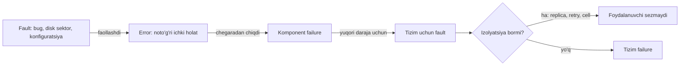

## Bu dars nima uchun kerak

Oldingi modullarda biz tizimni qanday qurishni ko'rdik: replication (26-dars), sharding (28-dars), consensus (36-dars), navbatlar (41-dars), microservice'lar (51-dars). Bu modul boshqa savolga javob beradi: **qurilgan tizim buzilganda nima bo'ladi va buni qanday boshqaramiz?**

1-darsda fault va failure farqini qisqa ko'rgan edik. Endi uni muhandislik darajasida ochamiz: nosozlik qanday tarqaladi, mavjudlik (availability) qanday hisoblanadi, redundancy qachon haqiqatan yordam beradi va qachon faqat yolg'on xotirjamlik beradi, yashirin single point of failure (SPOF) qayerlarda bo'ladi.

Bu darsdan keyin siz:

- fault, error va failure zanjirini va nosozlik turlarini (crash, omission, timing, byzantine, gray failure) ajrata olasiz;
- MTBF/MTTR orqali availability ni hisoblay olasiz va "nines" ni vaqtga aylantira olasiz;
- ketma-ket (serial) va parallel (redundant) bog'liqliklar uchun availability formulasini qo'llay olasiz va uning cheklovini (correlated failure) tushunasiz;
- N+1, N+2, active-active, active-passive va static stability ni taqqoslay olasiz;
- arxitektura diagrammasidan SPOF va yashirin umumiy bog'liqliklarni topa olasiz;
- blast radius ni cell va shuffle sharding bilan qanday kichraytirishni bilasiz.

## Fault, error, failure: nosozlik zanjiri

Avizienis, Laprie, Randell va Landwehr ning 2004 yilgi "Basic Concepts and Taxonomy of Dependable and Secure Computing" maqolasi bu sohadagi terminlarni standartlashtirgan. Undagi zanjir:

- **Fault** - nosozlikning sababi. Diskdagi buzilgan sektor, koddagi bug, noto'g'ri konfiguratsiya qiymati. Fault uxlab yotishi mumkin (dormant): bug bor, lekin hali o'sha kod yo'li ishlamagan.
- **Error** - fault faollashgandan keyin tizim ichki holatining noto'g'ri bo'lib qolishi. Masalan, xotirada noto'g'ri qiymat, noto'g'ri yozilgan yozuv.
- **Failure** - error tizim chegarasidan chiqib, foydalanuvchiga ko'rinadigan xizmat og'ishiga aylanishi.

Muhim kuzatuv: bitta komponentning failure i yuqori darajadagi tizim uchun fault hisoblanadi. Disk failure - bu baza serveri uchun fault. Baza serveri failure - bu butun servis uchun fault. Reliability muhandisligining butun mohiyati shu zanjirni har bir darajada **uzish**: fault error ga aylanmasin (masalan, ECC xotira), error failure ga aylanmasin (checksum, retry, replica), komponent failure i tizim failure iga aylanmasin (redundancy, izolyatsiya).



### Nosozlik turlari (failure modes)

Distributed tizimlar adabiyotida (31-dars) nosozliklar odatda shunday tasniflanadi, eng "yumshoq"idan eng og'iriga:

| Tur | Nima bo'ladi | Aniqlash qiyinligi | Misol |
|---|---|---|---|
| Crash (fail-stop) | Tugun to'xtaydi va boshqa javob bermaydi | Oson (timeout) | Server elektrdan uzildi, OOM killer jarayonni o'ldirdi |
| Omission | Ba'zi xabarlar yo'qoladi | O'rtacha | Tarmoq paketlarni tashlab yuboradi, navbat to'lib xabar tashlanadi |
| Timing (performance) | Javob to'g'ri, lekin juda kech | Qiyin | GC pauza, to'lgan disk, "shovqinli qo'shni" |
| Byzantine | Tugun noto'g'ri yoki qarama-qarshi javob beradi | Juda qiyin | Xotiradagi bit buzilishi, buzilgan firmware, hujum |
| Gray failure | Tizimning bir qismi uni sog'lom deb biladi, foydalanuvchilar esa muammoni ko'radi | Juda qiyin | Health check o'tadi, lekin real so'rovlarning 30 foizi timeout |

Oxirgi tur alohida e'tiborga loyiq. Ryan Huang, Chuanxiong Guo, Lidong Zhou, Jay Lorch, Yingnong Dang, Murali Chintalapati va Randolph Yao ning HotOS 2017 dagi "Gray Failure: The Achilles' Heel of Cloud-Scale Systems" maqolasi bu hodisani **differential observability** orqali ta'riflaydi: tizimning failure detector'lari muammoni sezmasligi mumkin, holbuki ilovalar undan zarar ko'rayotgan bo'ladi. Ya'ni turli kuzatuvchilar "nosozlik bormi?" savoliga turlicha javob beradi. Illyustratsiya: load balancer har 5 soniyada `/health` ni tekshiradi va 200 oladi, chunki health endpoint bazaga murojaat qilmaydi. Shu vaqtda haqiqiy so'rovlar sekin disk tufayli 10 soniya kutadi. Crash dan ko'ra gray failure ko'proq zarar beradi, chunki avtomatik tiklash mexanizmlari ishga tushmaydi.

Amaliy xulosa: dizaynda "tugun yo ishlaydi, yo o'ladi" degan model **xato**. Eng ko'p uchraydigan va eng og'ir holat - tugun sekinlashgan yoki qisman ishlayapti. 62-64 darslardagi timeout, circuit breaker va load shedding aynan shu holat uchun.

### Nosozlik manbalari va ularning bog'liqligi

- **Apparat.** Backblaze Drive Stats 2025 hisobotiga ko'ra, kompaniya 349 462 ta diskni kuzatgan, shulardan 344 196 ta ma'lumot diski yillik tahlilga kirgan va 2025 yil uchun yillik nosozlik darajasi (AFR) 1.36% bo'lgan (2024 da 1.55%). Shu AFR bilan 10 000 diskli parkda: 10 000 × 0.0136 = 136 disk yiliga, ya'ni har 365 / 136 ≈ 2.7 kunda bitta disk. Schroeder va Gibson ning FAST 2007 dagi tadqiqoti esa muhimroq narsani ko'rsatgan: datasheet dagi 1 000 000 - 1 500 000 soatlik MTTF ko'pi bilan 0.88% yillik nosozlikni anglatadi, real yillik almashtirish darajasi esa odatda 1% dan yuqori, 2-4% keng tarqalgan, ba'zi tizimlarda 13% gacha. Bundan tashqari, almashtirishlar orasidagi vaqtda sezilarli korrelyatsiya (autocorrelation, long-range dependence) bor, ya'ni almashtirishlar vaqt bo'yicha **mustaqil emas**.
- **Dasturiy.** Bitta bug barcha replikada bir vaqtda ishga tushadi, chunki ular bir xil kodni ishlatadi. Redundancy bunga qarshi deyarli yordam bermaydi.
- **O'zgarish (inson va avtomatika).** Google SRE kitobining kirish bobida aytilishicha ("roughly 70%"), ularning tajribasida uzilishlarning taxminan 70 foizi ishlab turgan tizimdagi o'zgarishlardan kelib chiqadi. Shuning uchun deploy strategiyalari (68-dars) reliability ning markaziy qismi.

Google SRE kitobining "Production Environment" bobida yana bir raqam bor: bitta klasterda odatiy yil davomida minglab mashina va minglab disk ishdan chiqadi. Bunday masshtabda apparat nosozligi "favqulodda hodisa" emas, doimiy fon.

## Availability matematikasi

### MTBF, MTTR va nines

Eng oddiy model: komponent o'rtacha MTBF (mean time between failures) vaqt ishlaydi, keyin o'rtacha MTTR (mean time to repair) vaqt ichida tiklanadi.

```
Availability = MTBF / (MTBF + MTTR)
```

Misol: servis o'rtacha 30 kunda bir marta yiqiladi (MTBF = 43 200 daqiqa) va tiklash 30 daqiqa oladi.
A = 43 200 / 43 230 ≈ 0.99931, ya'ni taxminan 99.93%.

Endi ikki yo'l bor: yiqilishlarni ikki baravar kamaytirish (MTBF = 86 400) yoki tiklashni 3 daqiqaga tushirish.

- MTBF ikki baravar: 86 400 / 86 430 ≈ 99.965%.
- MTTR 10 baravar kam: 43 200 / 43 203 ≈ 99.993%.

Bu formula muhim saboq beradi: **MTTR ni kamaytirish ko'pincha MTBF ni oshirishdan arzon va samaraliroq.** Google SRE kitobi ham reliability ni MTTF va MTTR funksiyasi deb ta'riflaydi va MTTR ni favqulodda javobning asosiy o'lchovi deb ataydi. Tez aniqlash (67-dars), tez rollback (68-dars) va avtomatik failover aynan MTTR ga ishlaydi.

"Nines" jadvali (yil = 365 kun, oy = 30 kun):

| Availability | Yiliga ruxsat etilgan uzilish | Oyiga (30 kun) |
|---|---|---|
| 99% | 3.65 kun | 7.2 soat |
| 99.9% | 8.76 soat | 43.2 daqiqa |
| 99.95% | 4.38 soat | 21.6 daqiqa |
| 99.99% | 52.56 daqiqa | 4.32 daqiqa |
| 99.999% | 5.26 daqiqa | 25.9 soniya |

Hisob: 99.99% uchun 525 600 daqiqa × 0.0001 = 52.56 daqiqa. Bu raqam Google SRE kitobining "Embracing Risk" bobidagi qiymat bilan bir xil. 99.999% da oyiga 26 soniya - bu odam pager ni ko'rib, laptopni ochguncha o'tadigan vaqt. Ya'ni "beshta to'qqiz" ni faqat to'liq avtomatik tiklanish bilan olish mumkin.

### Vaqtga asoslangan va so'rovga asoslangan availability

Google SRE kitobi ikki xil o'lchovni ajratadi:

- **Time-based**: tizim ishlagan vaqt ulushi. Bir joyda joylashgan oddiy tizim uchun mos.
- **Aggregate (request success rate)**: muvaffaqiyatli so'rovlar ulushi. Global taqsimlangan tizim deyarli hech qachon "to'liq o'chmaydi" - qaysidir qismi doim ishlaydi, shuning uchun Google so'rovga asoslangan o'lchovni afzal ko'radi. Kitobdagi misol: kuniga 2.5 million so'rov va 99.99% maqsad bo'lsa, kuniga 250 tagacha xato so'rov ruxsat etiladi.

Bu SLI/SLO ning asosi va 65-darsda chuqur ko'riladi.

### Ketma-ket bog'liqliklar (serial)

Agar so'rov A, B va C komponentlarining **barchasi** ishlashini talab qilsa (hard dependency) va nosozliklar o'zaro mustaqil bo'lsa:

```
A_tizim = A1 × A2 × ... × An
```

AWS ning "Availability and Beyond" whitepaper i shu formulani beradi va undan xulosa chiqaradi: workload o'zining hech bir hard dependency sidan mavjudroq bo'la olmaydi.

Misol: API gateway (99.95%), auth servis (99.9%), asosiy servis (99.95%), PostgreSQL (99.95%), Redis (99.9%):

0.9995 × 0.999 × 0.9995 × 0.9995 × 0.999 ≈ 0.99650, ya'ni ≈ **99.65%**. Bu oyiga (1 - 0.9965) × 720 soat ≈ 2.52 soat, ya'ni taxminan 2.5 soat uzilish. Har bir komponent "uchta to'qqiz"dan yaxshi, tizim esa uchta to'qqizga ham yetmaydi.

Shundan qoida: **har bir yangi sinxron hard dependency availability ni kamaytiradi.** Microservice zanjiri qancha uzun bo'lsa, shuncha yomon. Bog'liqlikni kamaytirish, uni asinxron qilish (41-dars) yoki soft dependency ga aylantirish (64-dars, graceful degradation) to'g'ridan-to'g'ri availability ni oshiradi.

### Parallel bog'liqliklar (redundancy)

Agar ikki nusxadan **bittasi** ishlashi yetarli bo'lsa, tizim faqat ikkalasi bir vaqtda o'chganda ishlamaydi:

```
A = 1 - (1 - A1) × (1 - A2)
```

AWS whitepaper idagi misol: bitta 99% komponent; ikkitasi parallel bo'lsa 1 - 0.01 × 0.01 = 99.99%. Ikki "yomon" nusxa bitta "a'lo" tizim beradi.

Lekin bu formula uchta qattiq farazga tayanadi, va whitepaper ularning har birini ogohlantiradi:

1. **Nosozliklar mustaqil.** Ikkala nusxa bir xil AZ da, bir xil kod versiyasida, bir xil konfiguratsiyada bo'lsa, ular birga o'chadi. Shu sabab redundancy birligi alohida instance emas, **fault isolation boundary** (AZ, region, cell) bo'lishi kerak.
2. **Failover mukammal.** Formula nosoz nusxani aniqlash va trafikni o'tkazish bir zumda va xatosiz bo'ladi deb hisoblaydi. Amalda failover mexanizmining o'zi ham komponent va u ham buziladi. Real availability failover yo'lining ishonchliligidan oshmaydi.
3. **Qolgan nusxa butun yuklamani ko'tara oladi.** Ikki server 70 foizdan yuklangan bo'lsa, bittasi o'chganda ikkinchisi 140% ga chiqadi va u ham yiqiladi. Bu cascading failure ning klassik boshlanishi (64-dars).

Whitepaper yana bir narsani ko'rsatadi: zaxira (spare) qo'shishdan foyda tez kamayadi. Uning taqribiy formulasi bo'yicha 99.5% li komponent va ikki spare taxminan 99.9999875% availability beradi, ya'ni yiliga taxminan 3.9 soniya uzilish. Whitepaper xulosasi: komponentning o'zi kamida 99% bo'lsa, deyarli barcha workload'lar uchun uchtadan ortiq spare sezilarli foyda bermaydi, har bir qo'shimcha spare esa narxni kamida chiziqli oshiradi.

## Redundancy shakllari

### N+1, N+2

N - cho'qqi yuklamani ko'tarish uchun kerakli minimal nusxalar soni. Google SRE kitobining "Production Environment" bobidagi Shakespeare servisi misoli: kitobga ko'ra yuklama testida bitta task "about 100 QPS" ko'taradi, kutilayotgan cho'qqi esa "about 3,470 QPS". Demak N = 35. Lekin ular **37 task (N+2)** qo'yishadi: yangilash vaqtida bitta task doim o'chirilgan bo'ladi (36 qoladi), aynan shu paytda bitta mashina buzilsa 35 qoladi, bu esa hali ham cho'qqi uchun yetarli.

Bu misolning saboqi: **rejalashtirilgan ishlar (deploy, yangilash) ham capacity ni oladi.** N+1 faqat "hech qanday deploy bo'lmayotgan paytda bitta nosozlik"dan himoya qiladi.

### Active-active va active-passive

| Model | Qanday | Afzallik | Kamchilik | Qachon |
|---|---|---|---|---|
| Active-active | Barcha nusxalar trafikni qabul qiladi | Failover "bepul", zaxira doim sinovdan o'tadi | Har bir nusxada zaxira capacity kerak; stateful bo'lsa yozuv konflikti | Stateless servislar, leaderless/multi-leader saqlash |
| Active-passive (hot standby) | Standby doim sinxronlanadi, trafik olmaydi | Holat konflikti yo'q | Standby resursi bekor turadi; failover vaqti va split-brain xavfi | Single-leader bazalar (26-dars) |
| Warm standby | Standby kichik hajmda ishlaydi, kerak bo'lsa kattalashadi | Arzonroq | Kattalashish vaqt oladi, control plane ga bog'liq | Disaster recovery (69-dars) |
| Cold standby | Faqat backup va infratuzilma kodi | Eng arzon | Tiklash soatlab davom etadi | Kam muhim tizimlar |

Active-passive ning yashirin xavfi: standby hech qachon real trafik olmagani uchun u ishlamay qolganini hech kim bilmaydi, toki unga muhtoj bo'lmaguncha. Shu sabab failover muntazam mashq qilinishi kerak (70-dars, chaos engineering va game day).

### Static stability

AWS Builders' Library dagi "Static stability using Availability Zones" maqolasi muhim tamoyilni beradi: tizim bog'liqligi buzilganda ham **hech qanday yangi harakat qilmasdan** ishlashda davom etishi kerak. Capacity va holat nosozlikdan **oldin** tayyorlab qo'yiladi.

- EC2 misoli: **control plane** (yangi instance ishga tushirish, security group o'zgartirish) murakkab va ko'p bog'liqlikka ega. **Data plane** (ishlab turgan instance trafigini yo'naltirish, EBS ga o'qish-yozish) soddaroq va yuqori availability maqsadiga ega. Control plane buzilganda mavjud instance'lar ishlashda davom etadi, chunki har bir server kerakli ma'lumotni lokal saqlaydi.
- AZ misoli: stateless flot uchta AZ da ishlaydi va **50% ortiqcha** capacity bilan, ya'ni har bir AZ yuklama testida tasdiqlangan capacity sining uchdan ikki qismida ishlaydi. Bitta AZ o'chganda qolgan ikkitasi butun yuklamani autoscaling siz ko'taradi.

Hisob: 3 AZ, kerakli umumiy capacity = C. Bitta AZ o'chganda 2 AZ C ni ko'tarishi kerak, demak har bir AZ C/2 ga mo'ljallangan. Umumiy o'rnatilgan capacity = 3 × C/2 = 1.5C, ya'ni 50% ortiqcha. Normal holatda har bir AZ C/3 ishlaydi, bu C/2 ning 66.7 foizi.

2 AZ bo'lsa: har biri C ga mo'ljallanadi, umumiy 2C, ya'ni 100% ortiqcha. AWS whitepaper idagi misol ham shuni ko'rsatadi: 10 instance kerak bo'lsa, 2 AZ × 10 = 20 instance, 3 AZ × 5 = 15 instance. Ko'proq izolyatsiya domenlari ortiqcha narxni kamaytiradi.

Static stability ning teskarisi - "nosozlikda autoscaling yangi server ochadi" degan reja. Muammo: autoscaling ham control plane, va katta nosozlik paytida control plane ham ko'pincha zararlangan yoki hamma bir vaqtda undan foydalanmoqchi.

### Fallback emas, failover

AWS Builders' Library dagi Jacob Gabrielson ning "Avoiding fallback in distributed systems" maqolasi ko'pchilikning intuitsiyasiga qarshi chiqadi. Fallback - asosiy yo'l ishlamasa, **boshqa mexanizm** bilan bir xil natijaga erishish. Maqolaning dalillari:

- fallback yo'li kamdan-kam ishlaydi, shuning uchun uni real sharoitda sinash qiyin va unda oylar davomida yashirin bug yotadi;
- fallback aynan eng yomon paytda qo'shimcha yuklama yaratadi.

Maqoladagi tarixiy misol (maqola uni 2001 yil atrofida sodir bo'lgan deb yozadi): Amazon saytida yetkazib berish tezligini ko'rsatish uchun har bir web serverda cache bo'lgan, cache ishlamasa to'g'ridan-to'g'ri bazaga murojaat qilish fallback i bo'lgan. Bir kuni cache'lar birga ishdan chiqqan, barcha web serverlar bazaga yopirilgan, baza qotib qolgan va sayt to'xtagan; o'sha baza fulfillment ni ham qo'llab-quvvatlagani uchun butun dunyodagi fulfillment markazlarida ish ham to'xtagan.

Amazon tavsiyasi: fallback o'rniga asosiy yo'lni ishonchliroq qilish, ma'lumotni oldindan push qilish (masalan, IAM credential'lar EC2 ga oldindan yuboriladi va soatlab amal qiladi) va ikkala yo'lni ham doim ishlatish (fallback ni failover ga aylantirish). Qoida: **production da doim ishlaydigan kod yo'li ishonchli, kamdan-kam ishlaydigani ishonchsiz.**

## SPOF: single point of failure

SPOF - o'chganda butun tizim (yoki muhim funksiya) ishlamay qoladigan komponent. Aniq SPOF'larni (bitta baza serveri, bitta load balancer) topish oson. Xavflisi - **yashirin umumiy bog'liqliklar**.

### SPOF ni qanday topish

Arxitektura diagrammasidagi har bir blok va har bir strelka uchun uchta savol:

1. Bu o'chsa yoki sekinlashsa, foydalanuvchi nimani ko'radi?
2. Uning nusxalari umumiy narsaga bog'liqmi (bir xil AZ, rack, elektr, konfiguratsiya, sertifikat, DNS zonasi, deploy pipeline)?
3. Uni tiklash uchun nima kerak va o'sha narsa ham shu nosozlikdan zararlanadimi?

Uchinchi savol eng ko'p e'tibordan chetda qoladi. Tipik yashirin SPOF'lar:

- **DNS va TLS sertifikat.** Sertifikat muddati tugashi barcha replikani bir vaqtda o'chiradi.
- **Konfiguratsiya tizimi va feature flag servisi.** Hamma servis startup da undan o'qisa, u o'chganda hech kim restart qila olmaydi.
- **Identity/auth.** Barcha so'rov tekshiradigan token servisi.
- **Control plane.** Kubernetes API server, autoscaling, service discovery.
- **Monitoring va status sahifasi o'sha infratuzilmada.** Nosozlikni ko'rish va xabar berish vositasi nosozlik bilan birga o'chadi.
- **Bitta odam.** Faqat bitta muhandis biladigan tizim (bus factor).

### Real misol: Amazon S3, 2017 yil 28 fevral

AWS ning rasmiy post-mortem iga ko'ra, 9:37 PST da S3 jamoasi a'zosi tasdiqlangan playbook bo'yicha billing tizimi ishlatadigan subsystem dan bir necha serverni olib tashlash buyrug'ini bajargan. Buyruq parametrlaridan biri noto'g'ri kiritilgan va ancha ko'p server olib tashlangan. Ular us-east-1 dagi barcha obyektlar metama'lumotini boshqaradigan **index subsystem** va yangi obyektlar uchun joy ajratadigan **placement subsystem** ni qo'llab-quvvatlagan.

- To'liq tiklanish 13:54 PST da, ya'ni taxminan 4 soat 17 daqiqadan keyin. Restart kutilganidan uzoq davom etgan, chunki yillar davomida o'sgan tizimda metama'lumot yaxlitligini tekshirish vaqt olgan.
- Zararlanganlar: S3 API, yangi EC2 instance ishga tushirish, S3 snapshot dan o'qiydigan EBS volume'lar, Lambda.
- Yashirin SPOF: AWS Service Health Dashboard ning boshqaruv konsoli S3 ga bog'liq bo'lgan, shuning uchun 11:37 gacha servislar holatini yangilay olishmagan va Twitter orqali xabar berishgan.

Tuzatishlar har biri dars: olib tashlash vositasi sekinroq ishlaydigan va subsystem ni minimal capacity dan pastga tushirmaydigan qilingan; index subsystem ni kichikroq **cell**'larga bo'lish ustuvor qilingan (tiklash vaqtini kamaytirish uchun); status dashboard bir nechta regionga ko'chirilgan.

## Blast radius: nosozlik ko'lamini cheklash

Barcha nosozliklarni oldini olib bo'lmaydi. Ikkinchi himoya chizig'i - nosozlik **qancha foydalanuvchiga** ta'sir qilishini cheklash.

### Cell-based architecture

AWS Well-Architected ning "Reducing the Scope of Impact with Cell-Based Architecture" hujjatiga ko'ra, **cell** - workload ning to'liq, mustaqil nusxasi bo'lib, so'rovlarning bir qismiga xizmat qiladi. Cell'lar umumiy holatga ega emas. Ularning oldida **cell router** turadi - partition key (masalan, mijoz ID) bo'yicha so'rovni kerakli cell ga yuboradigan iloji boricha yupqa qatlam. Hujjatdagi misol: 10 ta cell bo'lsa, bitta cell dagi nosozlik (yomon deploy yoki "poison pill" so'rov) so'rovlarning 90 foiziga ta'sir qilmaydi.

Cell ning narxi: cell router o'zi kritik komponent bo'ladi (shuning uchun u imkon qadar sodda), cell'lar o'rtasida ma'lumot ko'chirish murakkab, umumiy capacity da biroz ortiqchalik bor.

### Shuffle sharding

AWS Builders' Library dagi Colm MacCárthaigh ning maqolasidagi misol: 8 ta worker bor.

- Sharding siz: bitta "zaharli" mijoz barcha worker'ni yiqitishi mumkin, ta'sir 100%.
- Oddiy sharding (4 shard × 2 worker): ta'sir 1/4 = 25%.
- Shuffle sharding: har bir mijozga 8 tadan tasodifiy 2 ta worker beriladi. Kombinatsiyalar soni C(8,2) = 8 × 7 / 2 = **28**. Bitta mijoz o'z ikki worker ini yiqitsa, aynan shu juftlikka ega boshqa mijozlar ulushi 1/28 ≈ 3.6%. Qolgan 27 juftlikdan 12 tasi (2 × 6) yiqilgan worker'lardan bittasini o'z ichiga oladi, lekin ikkinchi worker i ishlaydi (agar client boshqa worker ga retry qilsa), 15 tasi esa umuman zararlanmaydi.

Route 53 da 2 048 ta virtual name server bor, har bir domenga 4 tasi beriladi; maqolaga ko'ra bu 730 milliard mumkin bo'lgan shuffle shard va hech bir domen boshqasi bilan 2 tadan ortiq name server bo'lishmaydi.

### AZ-local yo'llar

Static stability maqolasidagi yana bir hisob: agar har bir servis boshqa AZ dagi nusxalarni ham chaqirsa (regional chaqiruv), bitta AZ zararlanganda zanjirdagi N ta servisning har biri 2/3 ehtimollik bilan sog'lom AZ ga tushadi va umumiy omad (2/3)^N. Ikki servisda bu 4/9, ya'ni yarimdan kam. Agar har bir servis faqat o'z AZ idagi bog'liqlikni chaqirsa (zonal), zanjir uzunligidan qat'i nazar omad 2/3 da qoladi. Ya'ni **AZ izolyatsiyasini zanjir bo'ylab saqlash** blast radius ni sezilarli kamaytiradi.

## iQuariX kontekstida: telemetriya qabul qilish yo'li

Misol sharti: telemetriya oqimi quyidagicha: trekerlar TCP orqali ingest gateway ga ulanadi, gateway nuqtani navbatga yozadi, worker uni time-series bazaga va "oxirgi joylashuv" cache iga yozadi, dispetcher UI API orqali o'qiydi.

**1. Serial zanjirni hisoblang.** Treker nuqtasining "qabul qilindi" javobini olishi uchun faqat gateway va navbat kerak bo'lsin. Gateway 99.95%, navbat 99.95% bo'lsa: 0.9995² ≈ 99.9%. Agar gateway har bir nuqtada qurilmani PostgreSQL dagi qurilmalar jadvalidan tekshirsa (99.95%) va auth servisga murojaat qilsa (99.9%), zanjir 0.9995³ × 0.999 ≈ 99.75% ga tushadi. Yechim: qurilmalar ro'yxatini gateway xotirasida saqlash va fonda yangilash (push, static stability), ya'ni baza va auth ni hard dependency dan chiqarish.

**2. Redundancy birligi.** Ikki gateway bitta VM host da yoki bitta data-markazda bo'lsa, ular bir nosozlik domenida. Kamida ikki AZ (yoki ikki mustaqil data-markaz) va ularning har biri butun cho'qqi yuklamani ko'tara oladigan qilib loyihalanadi.

**3. Treker tomonidagi buffer.** Bu masalada treker aloqa bo'lmaganda nuqtalarni ichki xotirasida buferlaydi va ulanish tiklangach yuboradi (sizning treker modelingizda bu xususiyat bor-yo'qligi va bufer hajmi uning hujjatidan olinadi). Bu - eng chetdagi redundancy: server qisqa vaqt o'chsa ham ma'lumot yo'qolmaydi, faqat kechikadi. Lekin bu yangi xavf yaratadi: server qaytganda barcha qurilma bir vaqtda to'plangan ma'lumotni yuboradi (thundering herd, 62 va 64-darslar).

**4. Yashirin SPOF'lar.** Trekerlar serverga **IP manzil** orqali ulanadimi yoki DNS nom orqali? Agar ming qurilmaning firmware ida bitta IP yozilgan bo'lsa, o'sha IP orqasidagi load balancer yoki data-markaz SPOF bo'ladi va uni almashtirish qurilmalarni qayta sozlashni talab qiladi. Bu 1-tur (qaytarilmaydigan) qaror.

**5. Cell'lar.** Mijozlar (avtoparklar) bo'yicha cell'larga bo'lish: har bir cell o'z gateway, navbat va baza nusxasiga ega. Yirik mijozning noto'g'ri sozlangan 5 000 trekeri gateway ni bosib qolsa, faqat uning cell i zararlanadi.

## Ko'p uchraydigan xatolar

1. **Redundancy ni instance soni bilan o'lchash.** Bir AZ dagi 10 ta replika AZ nosozligidan himoya qilmaydi. Redundancy birligi - nosozlik domeni.
2. **Failover ni sinamaslik.** Standby yoki fallback yo'li yillar davomida ishlatilmasa, kerak bo'lganda ishlamaydi.
3. **N+1 da deploy ni unutish.** Rolling deploy vaqtida bitta nusxa allaqachon o'chiq, ya'ni N+1 aslida N ga aylanadi.
4. **Qolgan nusxa yuklamani ko'tara olishini tekshirmaslik.** Ikki server 70 foizda bo'lsa, redundancy yo'q - bu ikki bosqichli uzilish.
5. **Faqat crash ni modellash.** Sekinlashgan, qisman ishlaydigan tugun (gray failure) crash dan xavfliroq, chunki health check uni sog'lom deb ko'radi.
6. **Formuladagi mustaqillik faraziga ko'r-ko'rona ishonish.** Bir xil kod, konfiguratsiya va deploy pipeline barcha nusxani bir vaqtda o'ldiradi.
7. **Tiklash vositasi nosozlikka bog'liq.** Monitoring, status sahifa, runbook va deploy vositasi tiklanayotgan tizim ichida joylashgan.
8. **Har bir yangi sinxron bog'liqlik "bepul" deb o'ylash.** Har biri availability ni ko'paytma sifatida kamaytiradi.

## Xulosa

- Fault - sabab, error - noto'g'ri ichki holat, failure - foydalanuvchiga ko'rinadigan og'ish. Reliability - bu zanjirni har darajada uzish.
- Availability = MTBF / (MTBF + MTTR). MTTR ni kamaytirish ko'pincha eng arzon yaxshilanish.
- Serial bog'liqliklar ko'paytiriladi va availability ni pasaytiradi; parallel nusxalar faqat mustaqil nosozlik, ishonchli failover va yetarli capacity sharti bilan uni oshiradi.
- N+2 deploy va nosozlik bir vaqtga to'g'ri kelishini hisobga oladi. Static stability capacity ni oldindan tayyorlaydi (3 AZ da 50% ortiqcha).
- Fallback emas, doim ishlaydigan yo'llar: kamdan-kam ishlaydigan kod ishonchsiz.
- Eng xavfli SPOF'lar yashirin: DNS, sertifikat, konfiguratsiya, control plane, monitoring.
- Blast radius ni cell va shuffle sharding bilan cheklang.

## Amaliy topshiriq

Masala sharti: iQuariX da **video arxiv** moduli bor. Mashinadagi kameralar (DVR) video fragmentlarni serverga yuklaydi, ular object storage ga (60-dars) saqlanadi, metama'lumot PostgreSQL da, dispetcher UI orqali videoni ko'radi. Hozir hammasi bitta data-markazda: 2 ta upload server bitta load balancer orqasida, 1 ta PostgreSQL (replika yo'q), 1 ta MinIO klaster (3 tugun, bitta rack da), auth servis (1 nusxa).

1. Arxitekturani mermaid yoki matn shaklida chizing va barcha SPOF'larni, shu jumladan yashirinlarini, sanab chiqing.
2. "Video yuklash" va "video ko'rish" yo'llari uchun alohida serial availability ni hisoblang. Har bir komponent uchun qaysi availability qiymatini boshlang'ich shart sifatida olganingizni ochiq yozing.
3. Maqsad: yuklash yo'li oyiga 99.9%. Qaysi 3 ta o'zgarish eng ko'p foyda beradi? Har biri uchun yangi availability va qo'shimcha narx (server soni yoki foiz) ni ko'rsating.
4. Upload server'lar uchun N ni hisoblang: 3 000 kamera, har biri soatiga o'rtacha 20 MB yuklaydi, cho'qqi o'rtachadan 3 baravar, bitta server 200 Mbit/s ni barqaror ko'taradi. N+1 yoki N+2 ni tanlang va asoslang.
5. Shart: DVR'lar serverga ulana olmaganda video ichki xotirada saqlanadi. Server 2 soat o'chiq bo'lgandan keyin qaytganda nima bo'ladi va buni qanday cheklaysiz?
6. Fallback yoki failover: metama'lumot bazasi o'chganda yuklash davom etishi kerakmi? Javobingizni asoslang.

Yaxshi javobda bo'lishi kerak bo'lgan narsalar:

- bitta rack, bitta data-markaz, auth va DNS/sertifikat kabi yashirin umumiy bog'liqliklar SPOF sifatida ko'rsatilgan;
- availability hisoblari ochiq, mustaqillik farazi va uning cheklovi tilga olingan;
- capacity hisobi Mbit/s da to'g'ri bajarilgan va deploy vaqtidagi capacity yo'qotilishi hisobga olingan;
- server qaytgandagi to'plangan yuklama (thundering herd) va uni cheklash yo'li bor;
- failover mexanizmining o'zi ham buzilishi mumkinligi va uni sinash rejasi aytilgan.

Javobni pastdagi maydonga yozib, chatga yuboring.

## Manbalar

- A. Avizienis, J.-C. Laprie, B. Randell, C. Landwehr. [Basic Concepts and Taxonomy of Dependable and Secure Computing](https://drum.lib.umd.edu/handle/1903/6459), IEEE TDSC, 2004 - fault, error, failure zanjiri.
- Google. [Site Reliability Engineering, "Embracing Risk" bobi](https://sre.google/sre-book/embracing-risk/) - time-based va aggregate availability, 99.99% = 52.56 daqiqa; [kirish bobi](https://sre.google/sre-book/introduction/) - MTTF/MTTR, uzilishlarning taxminan 70% o'zgarishlardan; ["Production Environment" bobi](https://sre.google/sre-book/production-environment/) - N+2 Shakespeare misoli.
- AWS. [Availability and Beyond: availability with dependencies](https://docs.aws.amazon.com/whitepapers/latest/availability-and-beyond-improving-resilience/availability-with-dependencies.html) va [availability with redundancy](https://docs.aws.amazon.com/whitepapers/latest/availability-and-beyond-improving-resilience/availability-with-redundancy) - serial va parallel formulalar, spare'lar va failover cheklovlari.
- AWS Builders' Library. [Static stability using Availability Zones](https://aws.amazon.com/builders-library/static-stability-using-availability-zones/) - control plane vs data plane, 3 AZ da 50% ortiqcha capacity, (2/3)^N.
- Jacob Gabrielson. [Avoiding fallback in distributed systems](https://builder.aws.com/content/3EuS9Sakq7L3VLQIF3qzfMfke1Y/avoiding-fallback-in-distributed-systems), AWS Builders' Library.
- [Colm MacCárthaigh](https://aws.amazon.com/builders-library/authors/colm-maccarthaigh/). [Workload isolation using shuffle sharding](https://builder.aws.com/content/3F06NpJ8YeoIGP8VHTw4n81pFn8/workload-isolation-using-shuffle-sharding), AWS Builders' Library; AWS Well-Architected, [What is a cell-based architecture?](https://docs.aws.amazon.com/wellarchitected/latest/reducing-scope-of-impact-with-cell-based-architecture/what-is-a-cell-based-architecture.html).
- AWS. [Summary of the Amazon S3 Service Disruption in the Northern Virginia (US-EAST-1) Region](https://aws.amazon.com/message/41926/), 2017.
- R. Huang, C. Guo, L. Zhou, J. Lorch, Y. Dang, M. Chintalapati, R. Yao. [Gray Failure: The Achilles' Heel of Cloud-Scale Systems](https://www.microsoft.com/en-us/research/publication/gray-failure-achilles-heel-cloud-scale-systems/), HotOS 2017 - differential observability; B. Schroeder, G. Gibson. [Disk failures in the real world](https://www.usenix.org/legacy/events/fast07/tech/schroeder.html), FAST 2007 - 0.88% va 2-4%, korrelyatsiya; [Backblaze Drive Stats for 2025](https://www.backblaze.com/blog/backblaze-drive-stats-for-2025/) - 2025 AFR 1.36%.
