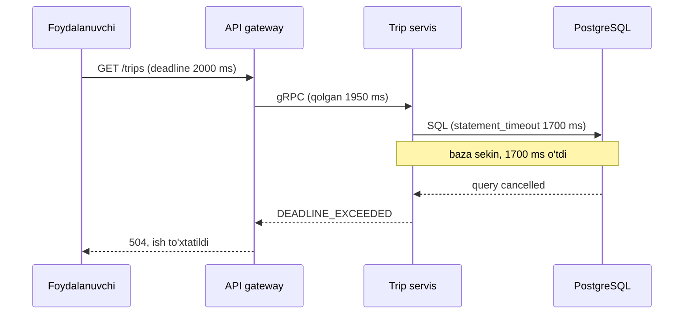
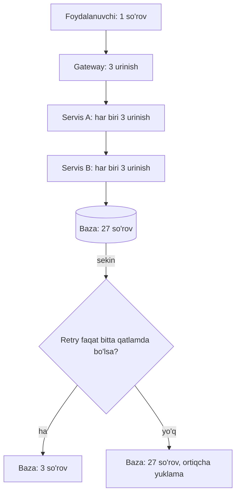

## Bu dars nima uchun kerak

31-darsda distributed tizimning asosiy muammosini ko'rgan edik: javob kelmasa, so'rov yetib bormadimi, server ishlayaptimi, javob yo'lda yo'qoldimi yoki server shunchaki sekinmi, buni bilib bo'lmaydi. Timeout - bu noaniqlikka qo'yiladigan chegara. Retry - vaqtinchalik nosozlikni yashirish usuli. Ikkalasi ham ko'rinishda oddiy, lekin noto'g'ri sozlanganda ular kichik nosozlikni butun tizim uzilishiga aylantiradi. Ko'plab yirik uzilishlarning boshlanishi aynan "retry storm".

61-darsda gray failure ni ko'rdik: tugun o'lmagan, faqat sekin. Bunday holatda timeout bo'lmasa, chaqiruvchi ham sekin bo'ladi, keyin uni chaqiruvchi ham, va hokazo. Bu dars shu tarqalishning birinchi himoya chizig'i.

Bu darsdan keyin siz:

- connect, request, idle va end-to-end timeout'larni ajrata olasiz va timeout qiymatini latency taqsimotidan hisoblay olasiz;
- deadline propagation va cancellation nima uchun kerakligini bilasiz;
- qaysi xatoni retry qilish mumkin va qaysini mumkin emasligini, idempotency bilan bog'liqligini tushunasiz;
- retry amplification ni hisoblay olasiz va uni retry budget, token bucket bilan cheklay olasiz;
- exponential backoff va jitter variantlarini (full, equal, decorrelated) farqlay olasiz;
- hedged request qachon foydali va qachon xavfli ekanini bilasiz.

## Timeout: nima uchun va qaysi turlari

Timeout siz masofaviy chaqiruv - bu resurs oqishi. Har bir kutayotgan so'rov thread, connection, xotira, fayl deskriptor, bazada lock ushlab turadi. Downstream sekinlashganda timeout siz client shu resurslarni cheksiz to'playdi va oxir-oqibat o'zi ham ishlamay qoladi.

Muhim fakt: ko'p kutubxonalarda default timeout **yo'q yoki juda katta**.

- gRPC rasmiy hujjatiga ko'ra, default holatda deadline o'rnatilmaydi, ya'ni client cheksiz kutishi mumkin.
- Node.js dagi `fetch` ni ta'minlaydigan undici kutubxonasida `headersTimeout` va `bodyTimeout` default 300 soniya, `connectTimeout` 10 soniya.
- PostgreSQL da `statement_timeout`, `lock_timeout`, `idle_in_transaction_session_timeout` va `transaction_timeout` (17-versiyada qo'shilgan) default 0, ya'ni o'chiq.

5 daqiqalik default timeout bilan, sekinlashgan downstream ga sekundiga 200 so'rov yuborayotgan servis bir zumda 200 × 300 = 60 000 tagacha ochiq so'rov to'plashi mumkin. Hech bir connection pool bunga chidamaydi.

### Timeout turlari

| Tur | Nimani cheklaydi | Tipik qiymat tartibi | Izoh |
|---|---|---|---|
| Connect timeout | TCP (va TLS) ulanish o'rnatish | Data-markaz ichida 100 ms - 1 s | Uzoq bo'lsa, o'lik host ga yopishib qolasiz |
| Request (read) timeout | Javobni kutish | Downstream p99.9 + zaxira | Eng muhim parametr |
| Idle timeout | Faol bo'lmagan connection | Soniyalar - daqiqalar | Load balancer va client mos bo'lishi kerak |
| End-to-end deadline | Butun foydalanuvchi so'rovi | Foydalanuvchi qancha kutishga tayyor | Har bir hop ga qolgan vaqt uzatiladi |
| Baza: statement/lock timeout | So'rov va lock kutish | Yuzlab ms - soniyalar | Uzun lock butun jadvalni to'xtatadi |

AWS Builders' Library dagi Marc Brooker ning "Timeouts, retries, and backoff with jitter" maqolasi bir tajribani keltiradi: 20 ms timeout har deploy dan keyin timeout'larga olib kelgan, chunki yangi connection ochish, TLS bilan birga, 20 ms dan oshgan. Yechim - jarayon ishga tushganda, trafik qabul qilishdan **oldin** connection'larni ochib qo'yish. Saboq: timeout butun yo'lni qamraydi (DNS, TCP, TLS), va "sovuq" holatdagi latency "issiq" holatdan farq qiladi.

### Timeout qiymatini qanday tanlash

Amazon yondashuvi (Brooker maqolasi): avval **qabul qilinadigan noto'g'ri timeout ulushini** tanlang, masalan 0.1%. Keyin downstream latency sining mos percentile ini oling, ya'ni p99.9. Timeout = shu qiymat (plyus zaxira).

Hisob misoli: downstream latency si p50 = 20 ms, p99 = 120 ms, p99.9 = 300 ms.

- Timeout 150 ms bo'lsa: so'rovlarning taxminan 0.1-1 foizi "noto'g'ri" kesiladi. Ular retry qilinsa, bu downstream ga qo'shimcha yuklama.
- Timeout 350 ms bo'lsa: noto'g'ri timeout 0.1 foizdan kam.
- Timeout 30 s bo'lsa: downstream o'lganda har bir so'rov 30 s resurs ushlab turadi.

Brooker maqolasidagi ogohlantirishlar: internet orqali uzoqdagi client'lar uchun tarmoq latency sining eng yomon holatini qo'shing; agar p99.9 p50 ga juda yaqin bo'lsa, zaxira qo'shing (aks holda kichik sekinlashish ommaviy timeout beradi).

### Bimodal latency va Little qonuni

Google SRE kitobining "Addressing Cascading Failures" bobida kuchli misol bor (3-darsdagi Little qonuni bilan bog'liq):

- 10 ta frontend, har birida 100 thread, jami 1 000 thread. Trafik 1 000 QPS, o'rtacha latency 100 ms (normal holatda 100 thread band).
- So'rovlarning 5 foizi osilib qoladi va 100 soniyalik deadline gacha kutadi. 50 QPS × 100 s = **5 000 thread** kerak bo'ladi, bizda esa jami 1 000.
- Natija: so'rovlarning faqat 19.6 foiziga xizmat ko'rsatish mumkin, xato darajasi taxminan 80.4%. Vaholanki haqiqatda faqat 5% so'rov muammoli edi.

Saboq: **timeout o'rtacha latency ning kichik karralisi bo'lishi kerak**, katta "xavfsizlik uchun" qiymat emas. Kitob bundan tashqari bitta keyspace yoki client uchun thread'larni cheklashni (masalan 25%) tavsiya qiladi; bu 63-darsdagi bulkhead.

## Deadline propagation va cancellation

Har bir hop o'z mustaqil timeout iga ega bo'lsa, quyidagi holat yuz beradi: foydalanuvchi 2 soniyadan keyin voz kechgan, lekin ichki servislar hali 10 soniyalik timeout bilan ishlayapti. Bu "yetim ish" (orphaned work) - natijasi hech kimga kerak bo'lmagan hisoblash, aynan tizim ortiqcha yuklangan paytda.

Google SRE kitobining tavsiyasi: deadline ni stack ning yuqorisida bir marta o'rnating va pastdagi barcha RPC lar shu **mutlaq deadline** ni bo'lishsin. Misol: 30 soniyalik deadline, RPC dan oldin 7 soniya sarflangan bo'lsa, downstream chaqiruv 23 soniya oladi. Chiqayotgan deadline ni tarmoq va keyingi qayta ishlash uchun bir necha yuz millisekund qisqartiring.

gRPC buni protokol darajasida qiladi: rasmiy hujjatga ko'ra mutlaq deadline tarmoq orqali **qolgan vaqt** (timeout) sifatida yuboriladi, shu sabab serverlar orasidagi soat farqi (32-dars) muammo bo'lmaydi. Java va Go implementatsiyalarida server-dan-server ga deadline propagation default yoqilgan, C++ da esa alohida yoqish kerak. Deadline o'tganda client `DEADLINE_EXCEEDED` oladi, server tomonda chaqiruv `CANCELLED` bo'ladi va ilova ishni to'xtatishi kerak.



HTTP dunyosida standart deadline header yo'q, shuning uchun jamoalar odatda o'z header'ini (masalan, qolgan millisekundlar) kiritadi yoki service mesh (55-dars) timeout'larini ishlatadi. Node.js da bu `AbortController` va `AbortSignal.timeout()` orqali butun chaqiruv zanjiriga signal uzatish bilan amalga oshiriladi.

**Cancellation** ham shuncha muhim: client voz kechganda (yoki hedged request da birinchi javob kelganda) downstream'dagi ish to'xtatilishi kerak. Aks holda timeout faqat client resursini bo'shatadi, server esa bekorga ishlashda davom etadi.

## Retry: qachon va nimani

Retry - **xudbin** (Brooker ning so'zi bilan "selfish") harakat: client o'z muvaffaqiyat ehtimolini oshirish uchun serverning ko'proq capacity sini sarflaydi. Kamdan-kam, tasodifiy xatolarda bu juda foydali. Server ortiqcha yuklangan bo'lsa, retry yuklamani oshiradi va tiklanishni kechiktiradi.

### Qaysi xatolar retry qilinadi

| Xato | Retry? | Sabab |
|---|---|---|
| Connection refused, connect timeout | Ha (boshqa host ga) | So'rov serverga yetmagan, takrorlash xavfsiz |
| 503 Service Unavailable, 429 Too Many Requests | Ha, backoff bilan, `Retry-After` ni hurmat qilib | Server vaqtinchalik rad etgan |
| 500 Internal Server Error | Ehtiyotkorlik bilan | Vaqtinchalik ham, doimiy bug ham bo'lishi mumkin |
| Read timeout (javob kelmadi) | Faqat idempotent bo'lsa | Server so'rovni bajargan bo'lishi mumkin |
| 400, 401, 403, 404, 422 | Yo'q | Takrorlash natijani o'zgartirmaydi |
| Biznes xato (mablag' yetarli emas) | Yo'q | Doimiy holat |

Eng nozik qator - read timeout. Javob kelmadi, lekin server to'lovni yechgan, buyurtma yaratgan yoki SMS yuborgan bo'lishi mumkin. Shu sabab Brooker maqolasi aytadi: yon ta'sirli API idempotent bo'lmasa, retry qilinmaydi. Idempotency key (9 va 39-darslar) aynan shu muammoni yechadi: server bir xil key bilan kelgan takroriy so'rovga birinchi natijani qaytaradi. Maqolada EC2 `RunInstances` API si client token orqali idempotentligi misol qilingan.

### Retry amplification

Eng xavfli hodisa - **har bir qatlamda retry**. Brooker maqolasidagi hisob: 5 qatlamli stack, har qatlam 3 marta urinadi. Eng pastdagi baza normal yuklamaning 3^5 = **243 baravari**ni oladi.

Google SRE kitobidagi o'xshash hisob: 3 qatlam, har birida 3 ta retry (ya'ni 4 ta urinish). Bitta foydalanuvchi amali bazada 4³ = **64** ta urinishga aylanadi.

Bu hisobni o'zingiz qiling. Agar har qatlam `k` marta urinsa (retry emas, jami urinish) va `n` qatlam bo'lsa, eng pastki qatlam `k^n` baravar yuklama ko'radi. Bu aynan downstream eng zaif bo'lgan paytda sodir bo'ladi.



Tavsiyalar (Brooker va Google SRE):

1. **Retry ni stack da faqat bitta joyda qiling.** Odatda eng tashqi client'da yoki bevosita xato beradigan bog'liqlik oldida. Ichki qatlamlar xatoni tez yuqoriga qaytaradi.
2. **Ortiqcha yuklama uchun alohida xato kodi** qaytaring (masalan, 503 yoki maxsus "overloaded" status), va yuqori qatlamlar uni ko'rganda retry qilmasin.
3. **So'rov bo'yicha urinishlarni cheklang** (Google: maksimal 3 urinish).
4. **Client bo'yicha retry budget** qo'ying.

### Retry budget va token bucket

Google SRE kitobining "Handling Overload" bobi: client faqat retry'lar so'rovlarning **10 foizidan** kam bo'lgan paytda retry qiladi. Bu umumiy holatda yuklama o'sishini taxminan **1.1x** ga cheklaydi. Budget siz, har so'rovga 3 urinish chegarasi bilan, eng yomon holatda yuklama 3x ga yaqinlashadi. "Addressing Cascading Failures" bobida server bo'yicha budget misoli ham bor: jarayon bo'yicha daqiqasiga 60 retry, budget tugasa so'rov darhol xato qaytaradi.

AWS SDK lar 2016 yildan buni token bucket bilan qiladi (Brooker maqolasi). AWS SDK rasmiy hujjatining hozirgi "standard" retry rejimida (2026 yangi xulq-atvori, `AWS_NEW_RETRIES_2026=true` bilan yoqiladi):

- jami 3 urinish (1 + 2 retry);
- 500 tokenli bucket; vaqtinchalik xato uchun retry 14 token, throttling uchun 5 token sarflaydi; birinchi urinishda muvaffaqiyat 1 token qaytaradi;
- bucket bo'shaganda SDK retry qilmay xatoni darhol qaytaradi; birinchi so'rovni esa hech qachon kechiktirmaydi.

Brooker ning 2022 yilgi "Fixing retries with token buckets and circuit breakers" bloq yozuvi simulyatsiya bilan ko'rsatadi: past xato darajasida token bucket oddiy N retry kabi ishlaydi (yaxshi), yuqori xato darajasida esa retry'lar soni keskin kamayadi va ortiqcha yuklama cheklangan bo'ladi. Muhim ogohlantirish: client'lar juda ko'p va har biri kichik bo'lsa (serverless, ko'p konteyner), har bir client ning lokal statistikasi noaniq bo'ladi va bu mexanizmlar yomonroq ishlaydi.

## Exponential backoff va jitter

### Backoff

Darhol retry qilish xatoni bir zumda takrorlaydi. **Exponential backoff** har urinishdan keyin kutish vaqtini oshiradi:

```
wait(n) = min(cap, base × 2^n)
```

base = 100 ms, cap = 10 s bo'lsa: 100, 200, 400, 800, 1600, 3200, 6400, 10000, 10000 ms. Cap ni unutmang: usiz 20-urinishda kutish soatlab bo'ladi.

Lekin faqat backoff yetarli emas. Brooker maqolasi aytadi: faqat cap qo'yilsa, barcha client'lar cap ga yetib, bir xil tezlikda retry qiladi. Shu sabab urinishlar soni ham cheklanadi.

### Jitter nima uchun shart

Faraz qiling, 10 000 ta client bir vaqtda xato oldi (masalan, server restart bo'ldi). Ularning hammasi bir xil backoff formulasi bilan 100 ms, keyin 200 ms, keyin 400 ms dan keyin **bir vaqtda** qaytib keladi. Server har safar 10 000 so'rovlik to'lqin oladi. Backoff to'lqinlar orasidagi masofani oshiradi, lekin to'lqinning o'zini yo'qotmaydi.

**Jitter** - kutish vaqtiga tasodifiylik qo'shish. Marc Brooker ning AWS Architecture Blog dagi 2015 yilgi "Exponential Backoff And Jitter" maqolasi uchta variantni taqqoslaydi (n - urinish raqami):

```
window       = min(cap, base * 2^n)
Full Jitter  : sleep = random(0, window)
Equal Jitter : sleep = window/2 + random(0, window/2)
Decorrelated : sleep = min(cap, random(base, prev_sleep * 3))
```

Maqoladagi simulyatsiya (bir qatorni yangilash uchun raqobatlashayotgan client'lar, optimistic concurrency) natijalari:

| Variant | Jami chaqiruvlar | Tugash vaqti | Izoh |
|---|---|---|---|
| Jitter siz exponential | Eng ko'p | Uzoq | Client'lar sinxron to'lqinlar hosil qiladi |
| Full Jitter | Eng kam | Yaxshi | Oddiy, tavsiya qilinadigan default |
| Equal Jitter | Full ga yaqin | Ancha uzoq | Jitter li variantlarning eng zaifi |
| Decorrelated Jitter | Full dan biroz ko'p | Biroz tezroq | Holatli (oldingi qiymatga bog'liq) |

AWS SDK ning hozirgi standard rejimi aynan full jitter ishlatadi: `delay = random(0,1) × min(20 s, base × 2^retry)`, bu yerda base vaqtinchalik xatolar uchun 50 ms, throttling uchun 1 000 ms.

### Jitter faqat retry uchun emas

Brooker maqolasi muhim kuzatuvni qo'shadi: Amazon jitter ni taymerlar, davriy vazifalar va kechiktirilgan ishlarga ham qo'shadi. Misol: har daqiqada so'rov yuboradigan client'lar yoki yarim tunda ishga tushadigan kunlik job'lar bir vaqtga to'g'ri kelib, cho'qqi hosil qilgan; jitter qo'shilgach, xuddi shu ishni kamroq server bilan bajarish mumkin bo'lgan. Bunday cho'qqilar ko'pincha qisqa bo'ladi va daqiqalik agregatsiyalangan metrikalarda ko'rinmaydi.

Qiziq detal: rejalashtirilgan ish uchun jitter har host da tasodifiy emas, **deterministik** tanlanadi (masalan, host ID dan hash). Shunda muammo takrorlansa, u bir xil host da bir xil vaqtda takrorlanadi va diagnostika osonlashadi.

## Hedged requests

Retry xato **bo'lgandan keyin** ishlaydi. Hedged request esa sekinlik uchun: agar javob ma'lum vaqtda kelmasa, timeout ni kutmasdan **ikkinchi replika ga parallel** so'rov yuborib, birinchi kelgan javobni olish.

Dean va Barroso ning "The Tail at Scale" (Communications of the ACM, 2013) maqolasiga ko'ra, ikkinchi so'rovni birinchisi p95 latency dan oshgandan keyin yuborish tavsiya qilinadi. Maqoladagi BigTable benchmark ida 100 ta serverga tarqatilgan o'qishda 10 ms kechikish bilan hedging p99.9 latency ni 1 800 ms dan 74 ms gacha tushirgan va faqat taxminan 2% qo'shimcha so'rov qo'shgan. Fan-out matematikasi (3-dars): bitta server 1% hollarda sekin bo'lsa, 100 ta serverga tarqatilgan so'rovlarning 1 - 0.99^100 ≈ 63 foizi sekin bo'ladi.

Hedging shartlari:

- faqat idempotent (odatda o'qish) operatsiyalar;
- ikkinchi so'rov faqat p95 kabi kech nuqtadan keyin, aks holda yuklama ikki baravar oshadi;
- birinchi javob kelganda qolganini **cancel** qilish;
- server ortiqcha yuklanganda hedging ni o'chirish (yoki budget bilan cheklash), aks holda u retry storm ning bir turiga aylanadi.

## Retry qayerda bo'lishi kerak: real tizimlardan

- **AWS SDK** - client da token bucket, full jitter va cheklangan urinishlar; adaptive rejimda client tomonda rate limiting ham bor (birinchi so'rovni ham kechiktirishi mumkin).
- **Google** - so'rov bo'yicha 3 urinish, client bo'yicha 10% retry budget, ortiqcha yuklama uchun alohida xato va client tomonda adaptive throttling (63-darsda).
- **gRPC** - deadline ni protokolda uzatadi, retry siyosatini service config orqali beradi.
- **Service mesh (Envoy, Istio)** - retry va timeout'ni infratuzilma darajasida beradi (55-dars). Xavf: ilova kodida ham retry bo'lsa, ikki qatlam ko'paytiriladi.

## iQuariX kontekstida

### 1. Treker qayta ulanishi

Faraz qiling, 50 000 treker TCP orqali ingest gateway ga ulangan. Gateway deploy uchun restart bo'ldi. Trekerlar firmware ida "uzilganda 5 soniyadan keyin qayta ulan" deb yozilgan.

- Jitter siz: 5 soniyadan keyin 50 000 ta TCP+TLS handshake bir vaqtda. Har bir TLS handshake bir necha millisekund CPU oladi, demak gateway bir necha soniya CPU bo'yicha to'yingan, ko'p handshake timeout bo'ladi, trekerlar yana 5 soniyadan keyin qaytadi. Tizim "tebranib" qoladi.
- Full jitter bilan [0, 30] soniya oralig'ida: 50 000 / 30 ≈ 1 670 ulanish/s. Bu boshqariladigan yuklama.

Agar firmware ni o'zgartirish imkoni bo'lmasa, server tomonda himoya kerak: yangi ulanishlarni qabul qilish tezligini cheklash (63-dars, load shedding) va deploy ni bosqichma-bosqich qilish, shunda bir vaqtda faqat ulanishlarning bir qismi uziladi.

### 2. Tarixiy ma'lumotni qayta yuborish

Treker oflayn bo'lgan vaqtda to'plagan nuqtalarni ulanganda yuboradi. Server har bir paketni tasdiqlaydi (ACK). ACK yo'lda yo'qolsa, treker paketni qayta yuboradi. Demak qabul qilish **idempotent** bo'lishi shart: (device_id, timestamp) bo'yicha dedup. Bu idempotency key ning protokol darajasidagi shakli.

### 3. Dispetcher hisoboti

Dispetcher "oylik yoqilg'i hisoboti" ni ochadi: API gateway, report servis, ClickHouse. Timeout'lar:

- foydalanuvchi deadline i: 10 s (undan keyin UI "hisobot tayyorlanmoqda, tayyor bo'lganda xabar beramiz" ga o'tadi, ya'ni asinxron rejim);
- gateway report servisga qolgan vaqtni uzatadi;
- report servis ClickHouse so'roviga `max_execution_time` ni qolgan vaqtdan biroz kam qo'yadi;
- retry faqat gateway da, faqat 503/connect xatolarida, bitta marta.

### 4. Tashqi SMS provayder

Yoqilg'i o'g'irlik ogohlantirishi SMS orqali yuboriladi. Read timeout bo'lsa, SMS yuborilgan bo'lishi mumkin. Agar provayder idempotency key qabul qilmasa, retry dublikat SMS beradi. Trade-off: dublikat SMS (bezovtalik) va yo'qolgan SMS (o'g'irlik haqida xabar yo'q). Ogohlantirish uchun odatda "kamida bir marta" tanlanadi, lekin outbox (48-dars) va provayder tomonidagi deduplikatsiya bilan.

## Ko'p uchraydigan xatolar

1. **Default timeout ga ishonish.** Ko'p kutubxonalarda u yo'q yoki daqiqalab. Har bir tarmoq chaqiruviga timeout ni ochiq qo'ying.
2. **"Xavfsizlik uchun" katta timeout.** 30 s timeout downstream sekinlashganda thread va connection'larni tugatadi (bimodal latency misoli).
3. **Har qatlamda retry.** k^n amplification. Retry faqat bitta joyda.
4. **Jitter siz backoff.** Client'lar sinxron to'lqinlar hosil qiladi.
5. **Idempotent bo'lmagan operatsiyani retry qilish.** Dublikat to'lov, dublikat buyurtma.
6. **4xx ni retry qilish.** 400 yoki 403 ni qayta yuborish natijani o'zgartirmaydi, faqat yuklama qo'shadi.
7. **Deadline ni uzatmaslik.** Foydalanuvchi ketgan, ichki servislar esa yetim ish bajaryapti.
8. **Retry ni monitoring qilmaslik.** Retry darajasi o'sishi - eng erta ogohlantirish signallaridan biri; Amazon retry ko'rsatkichlariga alarm qo'yishni tavsiya qiladi.

## Xulosa

- Har bir masofaviy chaqiruvga timeout qo'ying. Uning qiymati downstream latency sining percentile idan (masalan p99.9) kelib chiqadi, "katta raqam"dan emas.
- Deadline ni yuqorida bir marta o'rnating va pastga qolgan vaqt sifatida uzating; voz kechilgan ishni cancel qiling.
- Retry faqat vaqtinchalik xatolar va idempotent operatsiyalar uchun. Read timeout - "noma'lum natija".
- n qatlam, har birida k urinish = k^n amplification. Retry bitta qatlamda, budget yoki token bucket bilan.
- Exponential backoff + cap + full jitter - oqilona default. Jitter ni davriy job va taymerlarga ham qo'shing.
- Hedged request tail latency ni keskin kamaytiradi, lekin faqat idempotent o'qishlar uchun, kech nuqtada va cancel bilan.

## Amaliy topshiriq

Faraz qiling, iQuariX da **"mashina hozir qayerda va qancha yoqilg'i bor"** degan API bor, uni mobil ilova ishlatadi. Zanjir: mobil ilova, API gateway (Node.js), vehicle servis, ikkita bog'liqlik: Redis (oxirgi joylashuv) va fuel servis (u PostgreSQL dan o'qiydi). Latency o'lchovlari: Redis p50 = 1 ms, p99.9 = 15 ms; fuel servis p50 = 40 ms, p99 = 180 ms, p99.9 = 600 ms. Mobil foydalanuvchi 3 soniyadan ko'p kutmaydi.

1. Har bir hop uchun connect timeout, request timeout va deadline ni belgilang. Hisobingizni ko'rsating: qolgan vaqt qanday taqsimlanadi?
2. Retry siyosatini yozing: qaysi qatlamda, qaysi xatolarda, nechta urinish, qanday backoff formulasi va jitter bilan. Nima uchun boshqa qatlamlarda retry yo'q?
3. Hozirgi kodda gateway 3 marta, vehicle servis 3 marta, fuel servis PostgreSQL ga 3 marta urinadi deb faraz qiling. PostgreSQL sekinlashganda u qancha baravar yuklama oladi? Sizning dizayningizda-chi?
4. Retry budget yoki token bucket parametrlarini taklif qiling va 20% xato darajasida qo'shimcha yuklama qancha bo'lishini taxminan hisoblang.
5. Fuel servis uchun hedged request ni qo'llash kerakmi? Qaysi nuqtada ikkinchi so'rov yuboriladi va qanday holatda hedging o'chiriladi?
6. Fuel ma'lumoti kelmasa, javobda nima qaytadi (graceful degradation, 64-dars)?

Yaxshi javobda bo'lishi kerak bo'lgan narsalar:

- timeout'lar percentile lardan asoslangan va pastki hop timeout i yuqoridagidan kichik;
- retry faqat bitta qatlamda, faqat idempotent o'qish va vaqtinchalik xatolar uchun;
- 3^3 = 27 amplification hisobi va tuzatilgan dizayndagi yangi raqam;
- full jitter formulasi aniq parametrlar bilan (base, cap, urinishlar soni);
- hedging uchun p95 atrofidagi chegara, cancel va ortiqcha yuklamada o'chirish sharti;
- fuel ma'lumoti bo'lmasa joylashuv baribir qaytariladi.

Javobni pastdagi maydonga yozib, chatga yuboring.

## Manbalar

- Marc Brooker. [Timeouts, retries, and backoff with jitter](https://builder.aws.com/content/3EumjoZascWd1oZiEgL8ORlv3qE/timeouts-retries-and-backoff-with-jitter), AWS Builders' Library, 2019 - timeout ni percentile dan tanlash, 243x amplification, token bucket, deterministik jitter.
- Marc Brooker. [Exponential Backoff And Jitter](https://aws.amazon.com/blogs/architecture/exponential-backoff-and-jitter/), AWS Architecture Blog, 2015 (2023 yangilangan) - Full, Equal, Decorrelated jitter simulyatsiyasi.
- Marc Brooker. [Fixing retries with token buckets and circuit breakers](https://brooker.co.za/blog/2022/02/28/retries.html), 2022 - retry strategiyalari simulyatsiyasi.
- Google. [Site Reliability Engineering, "Addressing Cascading Failures"](https://sre.google/sre-book/addressing-cascading-failures/) - deadline propagation, bimodal latency, 64x misol, retry tavsiyalari; ["Handling Overload"](https://sre.google/sre-book/handling-overload/) - 3 urinish va 10% retry budget.
- AWS. [Retry behavior - AWS SDKs and Tools Reference Guide](https://docs.aws.amazon.com/sdkref/latest/guide/feature-retry-behavior.html) - standard va adaptive rejimlar, token bucket parametrlari.
- gRPC. [Deadlines guide](https://grpc.io/docs/guides/deadlines/) - default deadline yo'qligi, propagation, DEADLINE_EXCEEDED.
- J. Dean, L. A. Barroso. "The Tail at Scale", Communications of the ACM, 2013 - hedged requests. [ClickHouse tushuntirishi](https://clickhouse.com/resources/engineering/tail-latency).
- [undici Client options](https://app.unpkg.com/undici@8.5.0/files/types/client.d.ts) - Node.js fetch default timeout'lari; [PostgreSQL: Client Connection Defaults](https://www.postgresql.org/docs/current/runtime-config-client.html) - statement_timeout va boshqalar.
