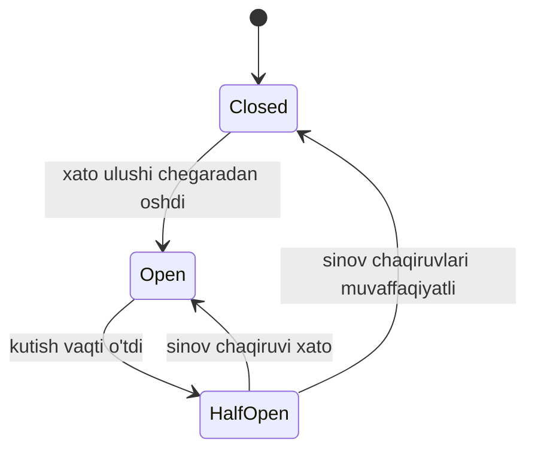
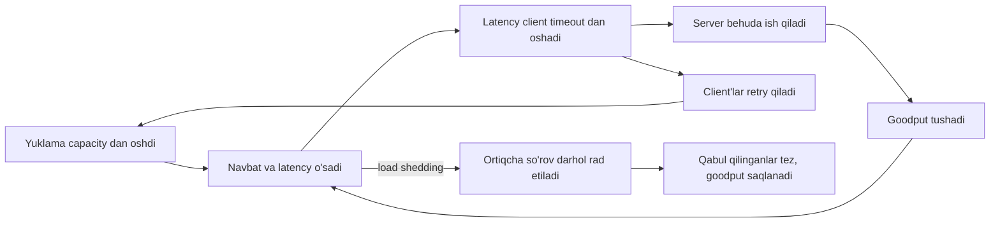

## Bu dars nima uchun kerak

62-darsda timeout va retry ni ko'rdik: ular **bitta chaqiruvni** himoya qiladi. Lekin real nosozlikda muammo bitta chaqiruv emas, minglab bir xil chaqiruvlar bir vaqtda bir xil sekin bog'liqlikka urilishi. Uch savol qoladi:

1. Bog'liqlik aniq ishlamayotgan bo'lsa, nega har bir so'rov timeout ni kutib, resurs sarflashi kerak? (**circuit breaker**)
2. Bitta sekin bog'liqlik nega butun servisning thread va connection'larini egallab olishi kerak? (**bulkhead**)
3. Servisning o'ziga capacity dan ko'p so'rov kelsa, qanday qilib hamma uchun sekin bo'lish o'rniga ba'zilarga tez xizmat qilish mumkin? (**load shedding**, admission control)

Bu uch pattern 61-darsdagi "blast radius" g'oyasining servis ichidagi shakli va 64-darsdagi cascading failure ga qarshi asosiy vositalar.

Bu darsdan keyin siz:

- circuit breaker holat mashinasini, uning parametrlarini va qachon zararli ekanini bilasiz;
- bulkhead ni thread pool, connection pool, navbat, instance va cell darajasida qo'llay olasiz;
- goodput va throughput farqini, ortiqcha yuklamada nima uchun goodput nolga tushishini tushunasiz;
- load shedding signallarini (concurrency, navbat yoshi, CPU, deadline) va prioritizatsiyani loyihalay olasiz;
- client tomonidagi adaptive throttling formulasini hisoblay olasiz;
- adaptive concurrency limit g'oyasini (Little qonuni, TCP Vegas) tushunasiz.

## Circuit breaker

Pattern ni Michael Nygard "Release It!" kitobida ommalashtirgan, Martin Fowler 2014 yil 6 martda uni qisqa maqolada tasvirlagan. G'oya elektr avtomatidan olingan: zanjirda qisqa tutashuv bo'lsa, avtomat tokni uzadi va uy yonmaydi.

### Holat mashinasi



- **Closed** - chaqiruvlar o'tadi, natijalar hisoblanadi.
- **Open** - xato ulushi chegaradan oshdi. Chaqiruvlar downstream ga **umuman yuborilmaydi**, darhol xato (yoki fallback qiymat) qaytadi. Bu ikki narsani beradi: client resurslari timeout kutib band bo'lmaydi va qiynalayotgan downstream tiklanishi uchun yuklamadan ozod bo'ladi.
- **Half-open** - kutish vaqti o'tgach, cheklangan miqdordagi sinov chaqiruvlari o'tkaziladi. Muvaffaqiyatli bo'lsa Closed ga, aks holda yana Open ga.

### Asosiy parametrlar

Zamonaviy kutubxonalar (masalan, Resilience4j) breaker ni **sliding window** asosida boshqaradi: oxirgi N ta chaqiruv (count-based) yoki oxirgi N soniya (time-based) bo'yicha xato ulushi hisoblanadi. Sozlanadigan narsalar:

| Parametr | Ma'nosi | Noto'g'ri qiymat oqibati |
|---|---|---|
| Xato ulushi chegarasi | Necha foiz xatoda ochiladi | Past: tasodifiy xatolarda ochilib, sog'lom servisni bloklaydi |
| Sekin chaqiruv chegarasi | Qaysi latency "sekin" deb sanaladi | Yo'q bo'lsa: gray failure da breaker ochilmaydi |
| Minimal chaqiruvlar soni | Statistikadan oldin kerakli hajm | Past: 2 ta chaqiruvdan 1 xato = 50%, noto'g'ri ochilish |
| Open holatda kutish vaqti | Qachon qayta sinash | Uzun: tiklanishdan keyin ham ko'p vaqt bloklangan |
| Half-open dagi sinovlar soni | Qancha so'rov bilan tekshirish | Ko'p: tiklanayotgan servisga yana yuklama |

Resilience4j ning default qiymatlari (`CircuitBreakerConfig.java` manba kodidagi `DEFAULT_*` konstantalar, GitHub `master` tarmog'i, 2026 oktyabr holatiga):

| Parametr (Resilience4j nomi) | Default |
|---|---|
| `failureRateThreshold` | 50% |
| `slowCallRateThreshold` | 100% |
| `slowCallDurationThreshold` | 60 s |
| `slidingWindowType` | `COUNT_BASED` |
| `slidingWindowSize` | 100 |
| `minimumNumberOfCalls` | 100 |
| `waitDurationInOpenState` | 60 s |
| `permittedNumberOfCallsInHalfOpenState` | 10 |

E'tibor bering: default `slowCallRateThreshold` 100% va `slowCallDurationThreshold` 60 s, ya'ni defaultda sekin chaqiruvlar amalda breaker ni ochmaydi. Gray failure (61-dars) dan himoya kerak bo'lsa, bu ikki parametrni downstream latency siga moslab ochiq sozlash shart.

Muhim nuqta: breaker ga faqat **downstream sog'lig'ini ko'rsatadigan** xatolarni hisoblang (timeout, 5xx, connection xatosi). 400 yoki 404 downstream muammosi emas, ular breaker ni ochmasligi kerak.

### Circuit breaker qachon zarar qiladi

Marc Brooker o'zining 2022 yilgi "Will circuit breakers solve my problems?" bloq yozuvida muhim tanqidni keltiradi: zamonaviy tizimlar **sharded** va **cell-based** (61-dars), ular qisman ishdan chiqadi. Uning misolida bazaning faqat bitta shard i (A-H kalitlari) ortiqcha yuklangan: unga ketgan chaqiruvlar xato beradi, qolgan shard'larga ketganlari ishlaydi. Client tomonidagi bitta breaker "baza ishlamayapti" degan qarorga keladi va ochiladi, natijada sog'lom shard'larga tegishli mijozlar ham xato oladi. Brooker buni shunday ifodalaydi: circuit breaker'lar qisman nosozliklarni to'liq nosozlikka aylantirish uchun yaratilgan.

Uning taklif qilgan yo'llari va ularning narxi:

- breaker'ni ichki tuzilishga moslash (har shard yoki har upstream mijoz uchun alohida breaker) - ishlaydi, lekin client servis ichki tuzilishini bilishi kerak;
- server qaysi qismi ortiqcha yuklanganini signal qiladi, client mos breaker ni ochadi - ishlaydi, lekin murakkab;
- statistik usullar - nazariy jihatdan mumkin, amalda qiyin.

Brooker ning boshqa maqolasi (AWS Builders' Library, 62-dars) ham circuit breaker'lar sinash qiyin bo'lgan **modal** (rejimli) xatti-harakat qo'shishini va tiklanish vaqtini sezilarli uzaytirishi mumkinligini ta'kidlaydi. 2022 yilgi simulyatsiya yozuvida esa ko'p client bo'lganda har bir client ning breaker i mustaqil ochilishi tufayli breaker kutilganidan erta, Brooker so'zi bilan "around half the expected rate" da ochilishi ko'rsatilgan.

Xulosa: circuit breaker foydali, lekin "har chaqiruvga qo'yamiz" degan default emas. U eng yaxshi ishlaydigan joy - bir butun bo'lib ishdan chiqadigan bog'liqlik (masalan, tashqi to'lov provayderi, SMS gateway) va natija o'rniga mazmunli fallback bo'lgan holat.

### Netflix Hystrix dan keyin

Netflix ning Hystrix kutubxonasi bu pattern'ni ommaviy qilgan. Uning GitHub README siga ko'ra, Hystrix hozir faol rivojlantirilmaydi, maintenance rejimida, oxirgi versiyasi 1.5.18. Netflix yangi loyihalar uchun Resilience4j kabi faol loyihalarni tavsiya qiladi va o'z e'tiborini oldindan sozlangan parametrlardan real vaqtdagi ko'rsatkichlarga moslashadigan **adaptive** yondashuvlarga, masalan adaptive concurrency limit'larga o'tkazganini aytadi. Bu muhim signal: statik chegaralarni to'g'ri sozlash juda qiyin.

## Bulkhead

Nomi kema korpusidagi germetik bo'linmalardan: bitta bo'linma teshilsa, faqat o'sha suv bilan to'ladi va kema suzishda davom etadi. Microsoft Azure Architecture Center ta'rifi: ilova elementlarini pool'larga ajratish, shunda bittasi ishdan chiqsa qolganlari ishlashda davom etadi.

### Muammo: umumiy resurs pool i

Node.js servisini tasavvur qiling: bitta umumiy HTTP agent, 100 ta connection. Servis uchta downstream ni chaqiradi: auth (tez), report (sekin bo'lishi mumkin), notification. Report servisi sekinlashadi, uning so'rovlari 30 soniya osiladi. Bir necha soniyada 100 connection ning hammasi report ga ketgan so'rovlar bilan band. Endi auth chaqiruvlari ham connection kutadi va butun servis ishlamay qoladi, garchi auth sog'lom bo'lsa ham.

Yechim: har bir downstream uchun **alohida** cheklangan pool. Report pool i 20 connection bo'lsa, u to'lganda faqat report so'rovlari darhol xato oladi, auth va notification ishlashda davom etadi.

### Bulkhead darajalari

| Daraja | Qanday | Izolyatsiya | Narx |
|---|---|---|---|
| Semaphore / concurrency limit | Har downstream ga maksimal parallel chaqiruvlar | Past-o'rta | Deyarli bepul |
| Connection / thread pool | Har downstream ga alohida pool | O'rta | Biroz xotira, pool o'lchamini sozlash |
| Navbat va worker guruhi | Har ish turi yoki mijoz uchun alohida navbat | O'rta-yuqori | Ko'proq infratuzilma |
| Alohida instance / deployment | Muhim va muhim bo'lmagan trafik turli pod'larda | Yuqori | Kamroq resurs samaradorligi |
| Cell | Mijozlar guruhi uchun to'liq stack nusxasi | Eng yuqori | Eng qimmat, router kerak |

Google SRE kitobining "Addressing Cascading Failures" bobi ham shu g'oyani beradi: bitta keyspace yoki client uchun thread'larni cheklash (masalan, 25%), shunda bitta yomon so'rov turi barcha thread'ni egallay olmaydi.

Node.js ga xos nuqta: Node da thread pool kam (event loop + libuv pool), shuning uchun bulkhead odatda **semaphore** shaklida bo'ladi: har downstream uchun "bir vaqtda maksimal N ta in-flight chaqiruv", ortig'i darhol rad etiladi yoki qisqa navbatda kutadi. `undici` da har origin uchun alohida `Pool` va `connections` cheklovi aynan connection darajasidagi bulkhead.

### Pool o'lchamini hisoblash

Little qonuni (3-dars): kerakli parallel chaqiruvlar = so'rov tezligi × latency.

Misol: report servisiga 50 so'rov/s, normal p99 latency 200 ms. 50 × 0.2 = 10 ta parallel chaqiruv. Ikki baravar zaxira bilan pool = 20. Agar report servisi sekinlashib latency 5 s ga chiqsa, kerakli parallellik 50 × 5 = 250 bo'ladi, lekin pool 20 da qoladi va 230 ta so'rov darhol rad etiladi. Bu **xohlangan** natija: muammo report bilan cheklanadi.

## Overload: goodput va throughput

AWS Builders' Library dagi "Using load shedding to avoid overload" maqolasi ikki tushunchani ajratadi:

- **Throughput** - serverga yuborilayotgan so'rovlar tezligi.
- **Goodput** - shulardan xatosiz va client foydalana oladigan darajada tez (ya'ni timeout dan oldin) qayta ishlanganlari.

Yuklama capacity ga yaqinlashganda contention, context switch va GC tufayli latency keskin o'sadi. Maqolaning asosiy kuzatuvi: **median latency client timeout iga yetganda so'rovlarning yarmi timeout bo'ladi**, ya'ni availability 50%. Va eng yomoni: server o'sha timeout bo'lgan so'rovlarni baribir oxirigacha qayta ishlaydi. Uning ishi behuda, chunki client allaqachon voz kechgan. Keyin client retry qiladi (62-dars) va yuklama yana oshadi. Maqola bu holatni o'z-o'zini ushlab turadigan barqaror ortiqcha yuklama holati deb ataydi.



Ideal xatti-harakat: yuklama capacity dan oshganda goodput **plato** ga chiqadi va yuklama yana oshsa ham tushmaydi. Buning yagona yo'li - ortiqcha ishni **erta va arzon** rad etish.

## Load shedding

Load shedding - server o'z capacity siga yetganini sezganda, ortiqcha so'rovlarni ishga olmasdan rad etishi (HTTP da odatda 503 yoki 429). Rad etilgan client boshqa replika ga yoki keyinroq urinadi, qabul qilinganlar esa tez xizmat oladi.

### Qachon rad etish: signallar

| Signal | Afzallik | Kamchilik |
|---|---|---|
| Max connections | Oddiy, proxy darajasida | AWS maqolasi xulosasi: noaniq, chunki so'rovlar narxi har xil |
| In-flight (concurrency) limit | Little qonuniga mos, arzon | Statik qiymatni to'g'ri sozlash qiyin |
| Navbat uzunligi va yoshi | Kutish vaqtini to'g'ridan-to'g'ri o'lchaydi | Navbat bo'lishi kerak |
| CPU utilization | Resurs bo'yicha haqiqiy capacity | Inertsiyali, I/O bog'liq servisda yaxshi emas |
| Deadline | Muddati o'tgan ishni bajarmaydi | Client deadline uzatishi kerak |
| Adaptive limit (latency gradient) | Avtomatik moslashadi | Murakkabroq, tebranishi mumkin |

Google SRE kitobi ("Handling Overload") QPS ni capacity o'lchovi sifatida yomon deb hisoblaydi: so'rovlar narxi client, kun vaqti va kod versiyasiga qarab o'zgaradi. Ular capacity ni resursda (CPU) o'lchaydi va task darajasida **executor load average** dan foydalanadi: bajarilayotgan va protsessor kutayotgan faol thread'lar soni, eksponensial silliqlangan holda. Faol thread'lar mavjud protsessorlardan ko'p bo'lsa, rad etish boshlanadi.

### Navbat: FIFO, LIFO, chegaralangan

Navbat - yashirin latency. Google SRE ning hisobi ("Addressing Cascading Failures"): navbat thread soni × 10 bo'lsa va har so'rov 100 ms olsa, navbat to'la bo'lganda bitta so'rov 1.1 soniya oladi (10 × 100 ms kutish + 100 ms ishlov). Tavsiyalar:

- barqaror trafik uchun navbatni thread pool o'lchamiga nisbatan kichik qiling (kitob misoli: 50% yoki undan kam), shunda server erta rad etadi;
- navbatda **maksimal yosh** bo'lsin: deadline i o'tgan so'rovni olishdan ma'no yo'q;
- FIFO o'rniga **LIFO** yoki **CoDel** (Controlled Delay) - ortiqcha yuklamada eng yangi so'rovlar xizmat oladi, eski so'rovlar (ehtimol client allaqachon ketgan) tashlanadi.

AWS maqolasi load balancer darajasidagi misolni beradi: Classic Load Balancer da "surge queue" bo'lgan, Application Load Balancer esa ortiqcha trafikni navbatga qo'ymasdan rad etadi. G'oya: server o'z vaqtida xizmat qila olmaydigan so'rovlarni navbatda saqlash o'rniga tez rad etish (fast-fail).

### Prioritizatsiya va criticality

Hamma so'rov teng emas. AWS maqolasidagi tartib:

1. **Load balancer health check** eng yuqori prioritetda. Agar u rad etilsa, load balancer serverni flotdan chiqaradi, qolganlarga yuklama ko'payadi va ular ham yiqiladi.
2. Inson trafigi crawler trafigidan yuqori.
3. Kvota ichidagi trafik kvotadan oshgan burst dan yuqori.

Google bu yerda **criticality** ni RPC protokoliga kiritgan. To'rt daraja: `CRITICAL_PLUS` (xato jiddiy foydalanuvchi ta'siriga olib keladi), `CRITICAL` (production default, capacity shunga rejalashtiriladi), `SHEDDABLE_PLUS` (qisman ishlamaslik qabul qilinadi, batch job'lar default), `SHEDDABLE` (tez-tez qisman va ba'zan to'liq ishlamaslik qabul qilinadi). Downstream so'rovlar criticality ni kiruvchi so'rovdan **meros oladi**, shuning uchun batch job dan kelgan so'rov zanjir bo'ylab past prioritetda qoladi. Ortiqcha yuklamada avval past criticality rad etiladi.

AWS maqolasidan yana ikki nozik tavsiya: ortiqcha yuklamada foydali ish behuda ketmasin, ya'ni boshlangan ishni tugatishga ustunlik bering; va pagination da keyingi sahifa so'rovlarini birinchi sahifa so'rovlaridan ustun qo'ying, aks holda client'ning oldingi chaqiruvlari behuda ketadi.

### Rad etish narxi

Load shedding faqat rad etish qayta ishlashdan **ancha arzon** bo'lsa ishlaydi. AWS maqolasi ogohlantiradi: tasodifiy log yozuvi yoki socket sozlamasi rad etishni qimmat qilib qo'yishi mumkin. Google SRE "Handling Overload" bobi ham ta'kidlaydi: so'rovni rad etish ham resurs talab qiladi, va ortiqcha rad etishlarning o'zi backend ni yuklashi mumkin (pastdagi adaptive throttling aynan shu uchun). Shu sabab rad etish iloji boricha **erta** bo'lishi kerak: avval API gateway yoki WAF, keyin load balancer, keyin servis kirishida, biznes logikadan oldin.

Yana bir metrika tuzog'i: servis trafikning 60 foizini tez rad etsa, uning median latency si ajoyib ko'rinadi, muvaffaqiyatli so'rovlar esa sekin bo'lishi mumkin. Rad etilgan so'rovlar latency sini alohida o'lchang. Va CPU bo'yicha autoscaling bilan CPU bo'yicha shedding bir xil chegarada bo'lsa, shedding CPU ni chegara ostida ushlab turadi va autoscaling hech qachon ishga tushmaydi (76-dars).

## Client tomonidagi adaptive throttling

Server rad etsa ham, rad etish arzon bo'lmasa, juda ko'p rad etish o'zi ortiqcha yuklama. Google yechimi: client o'zi ortiqcha yuklamani sezib, so'rovlarning bir qismini **lokal** rad etadi.

Google SRE kitobining "Handling Overload" bobiga ko'ra har client oxirgi 2 daqiqa uchun ikki sonni yuritadi: `requests` (ilova qatlami yuborishga uringan so'rovlar) va `accepts` (backend qabul qilgan so'rovlar). Normal holatda ular teng. `requests` K × `accepts` dan oshgach, client yangi so'rovlarni ma'lum ehtimollik bilan lokal rad eta boshlaydi. Kitobdagi "Client request rejection probability" formulasi:

```
p_reject = max(0, (requests - K × accepts) / (requests + 1))
```

Kitob sahifasida formula rasm sifatida berilgan. Uning matn shakli kitobga to'g'ridan-to'g'ri havola qiladigan ikki ochiq implementatsiyada bir xil: Apache Beam `AdaptiveThrottler` (`max(0, (all_requests - overload_ratio × successful_requests) / (all_requests + MIN_REQUESTS))`) va Envoy admission control filtri (`(n_total - s) / (n_total + 1)`, `s = n_success / threshold`). Kitob K = 2 ni afzal ko'radi ("We generally prefer the 2x multiplier"); K kichikroq bo'lsa (masalan 1.1) throttling agressivroq, kattaroq bo'lsa yumshoqroq.

Hisob: backend so'rovlarning faqat 40 foizini qabul qilyapti. Client 1 000 so'rov yubordi, 400 tasi qabul qilindi. K = 2: (1 000 - 800) / 1 001 ≈ 0.1998, ya'ni taxminan 0.2. Client yangi so'rovlarning 20 foizini backend ga yubormasdan o'zi rad etadi. Backend tiklanib, `accepts` oshgani sari ehtimol avtomatik nolga tushadi. Kitobga ko'ra K = 2 da backend har qabul qilgan so'rovga taxminan bitta rad etilgan so'rov ko'radi, ya'ni backend tiklanganini sezish uchun yetarli trafik baribir keladi.

## Adaptive concurrency limit

Statik limitlarni (pool o'lchami, max in-flight) to'g'ri sozlash qiyin va ular yuklama, kod va infratuzilma o'zgarishi bilan eskiradi. Netflix ning ochiq `concurrency-limits` kutubxonasi TCP congestion control g'oyasini (5-dars) servislarga ko'chiradi (quyidagilar kutubxona README sidan):

- Little qonuni: limit = o'rtacha RPS × o'rtacha latency. So'rovlar soni emas, **parallel so'rovlar** cheklanadi.
- Navbat hosil bo'lganda latency o'sadi, demak latency - ortiqcha yuklamaning erta signali.
- **Vegas** algoritmi (delay-based): bottleneck navbati = L × (1 - minRTT / sampleRTT), L - joriy limit. Har sampling oynasi oxirida navbat alpha dan kichik bo'lsa limit 1 ga oshadi, beta dan katta bo'lsa 1 ga kamayadi; README ga ko'ra alpha odatda 2-3, beta odatda 4-6 so'rov.
- **Gradient2**: qisqa va uzoq oynali eksponensial o'rtacha latency lar orasidagi farqni kuzatadi, bu minRTT ga tayanishdan kelib chiqadigan bias va drift ni kamaytiradi. Farq uzoq davom etsa, bu navbat o'sish trendi deb qabul qilinadi va limit agressiv kamaytiriladi.

Misol: minRTT = 20 ms, joriy sampleRTT = 30 ms, limit L = 60. Navbat bahosi = 60 × (1 - 20/30) = 20. Bu beta dan ancha katta, demak limit kamaytiriladi. Limit kamayishi bilan navbat qisqaradi va sampleRTT minRTT ga yaqinlashadi.

## Uch patternni taqqoslash

| Pattern | Nimani himoya qiladi | Qayerda ishlaydi | Asosiy xavf |
|---|---|---|---|
| Timeout + retry (62-dars) | Bitta chaqiruvni | Client | Amplification |
| Circuit breaker | Client resurslari va qiynalayotgan downstream ni | Client | Qisman nosozlikni to'liqqa aylantirish, modal xatti-harakat |
| Bulkhead | Bir bog'liqlik boshqalarni bosib qolishidan | Client yoki server | Resurs samaradorligi pasayadi, pool o'lchami sozlash |
| Load shedding | Serverning o'zini ortiqcha yuklamadan | Server, proxy, gateway | Rad etish qimmat bo'lsa ishlamaydi, autoscaling ni bloklashi |
| Adaptive throttling | Backend ni rad etishlar oqimidan | Client | Ko'p kichik client'da noaniq statistika |
| Rate limiting (56-dars) | Adolatli taqsimot, kvota | Gateway | Statik, capacity ni bilmaydi |

Envoy ham "circuit breaking" atamasini ishlatadi, lekin uning mexanizmi Nygard breaker idan farq qiladi: Envoy rasmiy hujjatiga ko'ra bu har upstream klaster uchun hisoblagich chegaralari - maksimal connection'lar (hujjatdagi default misoli: klasterga 1024 connection), maksimal pending so'rovlar, maksimal so'rovlar, maksimal faol retry'lar va maksimal bir vaqtdagi connection pool'lar. Mazmunan bu **bulkhead** va concurrency limit; to'lib ketganda so'rov darhol rad etiladi va `x-envoy-overloaded` header qo'yiladi. Hujjat statik retry limiti o'rniga retry budget'ni tavsiya qiladi.

## iQuariX kontekstida

Misol sharti: iQuariX API servisi (NestJS) quyidagilarni chaqiradi:

- PostgreSQL (asosiy ma'lumot);
- ClickHouse (hisobotlar, og'ir so'rovlar);
- video servis (DVR dan arxiv olish, sekin va beqaror, chunki mashina mobil tarmoqda);
- tashqi SMS provayder.

**Bulkhead.** Hammasi bitta Node jarayonida. Bu misolda video arxiv so'rovlari 30-60 soniya kutadi, chunki DVR 3G/4G orqali ulangan. Agar ular umumiy connection va event loop resurslarini cheklovsiz ishlatsa, dispetcher xaritasi ham sekinlashadi. Yechim:

- har downstream ga alohida semaphore: video uchun maksimal 50 parallel so'rov, ClickHouse uchun 20, PostgreSQL pool o'z cheklovi bilan;
- yanada yaxshisi: video so'rovlarini alohida deployment ga ajratish (instance darajasidagi bulkhead), chunki ular uzun connection va katta xotira bufer ishlatadi.

**Circuit breaker.** SMS provayder uchun mos: u butunlay ishlamay qoladi yoki ishlaydi, va fallback bor (push notification yoki keyinroq yuborish uchun navbatga qo'yish). Video servis uchun esa **bitta** breaker noto'g'ri: muammo odatda bitta mashinaning yomon aloqasida, butun video servisda emas. Bitta mashina DVR i javob bermasa breaker ochilsa, barcha mashinalar videosi bloklanadi (Brooker tanqidining aniq misoli). To'g'ri yechim - qurilma bo'yicha holat: "oxirgi 5 daqiqada bu DVR 3 marta javob bermadi, 2 daqiqa urinmaymiz".

**Load shedding.** Misol sharti: ertalab soat 9 da 300 ta dispetcher bir vaqtda kirib, oylik hisobot so'raydi. Criticality:

- `CRITICAL_PLUS`: trekerlardan telemetriya qabul qilish, SOS tugmasi;
- `CRITICAL`: dispetcher xaritasi, oxirgi joylashuv;
- `SHEDDABLE_PLUS`: hisobot generatsiyasi (keyinroq tayyorlab yuborish mumkin);
- `SHEDDABLE`: tarixiy ma'lumot eksporti, analitika batch job'lari.

Hisobot servisi ClickHouse so'rovlari uchun in-flight limit 20 ga yetganda yangi so'rovlarga 503 va `Retry-After` qaytaradi, UI esa "hisobot navbatga qo'yildi" ni ko'rsatadi.

**Telemetriya gateway.** Bu yerda load shedding ehtiyotkorlik talab qiladi: telemetriyani rad etish ma'lumot yo'qolishi emas, chunki treker uni o'z xotirasida saqlab, keyin yuboradi (61-dars). Demak gateway ortiqcha yuklamada yangi TCP ulanishlarni cheklashi (accept rate limit) mumkin. Lekin health check endpoint hech qachon rad etilmasligi kerak, aks holda load balancer gateway'larni birin-ketin flotdan chiqaradi.

## Ko'p uchraydigan xatolar

1. **Har chaqiruvga circuit breaker.** Sharded bog'liqlikda qisman nosozlikni to'liqqa aylantiradi.
2. **4xx ni breaker statistikasiga qo'shish.** Mijoz xatolari downstream ni "o'lik" qilib ko'rsatadi.
3. **Umumiy connection pool.** Bitta sekin bog'liqlik hamma narsani bosib qoladi.
4. **Cheklanmagan navbat.** U latency ni yashiradi va client allaqachon voz kechgan ishni bajarishga majbur qiladi.
5. **Health check ni rad etish.** Load balancer serverlarni chiqaradi va qolganlar yanada ortiqcha yuklanadi.
6. **Qimmat rad etish.** Rad etish yo'lida log, auth, bazaga murojaat.
7. **Rad etilgan so'rovlarni latency metrikasiga aralashtirish.** Median yaxshi ko'rinadi, muvaffaqiyatli so'rovlar esa sekin.
8. **Load test ni sinish nuqtasigacha qilmaslik.** AWS maqolasi aytadi: sinish nuqtasidan oshib test qilmasangiz, tizim eng yoqimsiz usulda sinadi deb hisoblang.

## Xulosa

- Circuit breaker client resurslarini va qiynalayotgan downstream ni himoya qiladi, lekin modal va qisman nosozlikda xavfli. Uni bir butun ishdan chiqadigan bog'liqliklar uchun qo'llang.
- Bulkhead - resurslarni bo'lish: har downstream ga alohida pool yoki semaphore, muhim trafik uchun alohida instance yoki cell. O'lchamni Little qonuni bilan hisoblang.
- Goodput - throughput emas. Ortiqcha yuklamada goodput nolga tushadi, chunki server behuda ish qiladi va client'lar retry qiladi.
- Load shedding: erta, arzon, prioritet bilan rad etish. Health check eng yuqori prioritet.
- Navbat chegaralangan, yoshi cheklangan, ortiqcha yuklamada LIFO yoki CoDel.
- Client tomonda adaptive throttling (K = 2) va adaptive concurrency limit statik chegaralardan barqarorroq.

## Amaliy topshiriq

Masala sharti: iQuariX ning **dispetcher API** si bitta Node.js servisida ishlaydi: 8 ta pod, har biri 2 vCPU. Bog'liqliklar: PostgreSQL (p99 = 30 ms, 400 so'rov/s), ClickHouse hisobotlar (p99 = 4 s, 15 so'rov/s), video arxiv servisi (p99 = 25 s, 5 so'rov/s, ba'zan 60 s gacha osiladi), SMS provayder (p99 = 800 ms, 2 so'rov/s).

1. Har bir bog'liqlik uchun bulkhead parametrlarini (concurrency limit yoki pool o'lchami) Little qonuni bilan hisoblang va zaxira koeffitsiyentini asoslang. Hisobni pod soniga bo'lishni unutmang.
2. Qaysi bog'liqlik(lar)ga circuit breaker qo'yasiz va qaysilariga yo'q? Har biri uchun sabab va, agar qo'ysangiz, breaker granulyatsiyasi (butun servis, har qurilma, har mijoz).
3. So'rov turlarini 4 ta criticality darajasiga ajrating va ortiqcha yuklamada qaysi signal bo'yicha (in-flight, CPU, navbat yoshi) rad etishni tanlang.
4. Ertalabki cho'qqida hisobot so'rovlari 15 dan 60 so'rov/s ga chiqdi. ClickHouse uchun limit bo'lmasa nima bo'lishini (Little qonuni bilan) va sizning dizayningizda nima bo'lishini tasvirlang.
5. Mobil ilova uchun client tomonidagi adaptive throttling ni qo'llang: backend 30% so'rovni qabul qilayotganda K = 2 da client qancha so'rovni lokal rad etadi?
6. Load shedding va CPU bo'yicha autoscaling o'zaro qanday ishlaydi va ular bir-birini bloklamasligi uchun nima qilasiz?

Yaxshi javobda bo'lishi kerak bo'lgan narsalar:

- Little qonuni bo'yicha aniq hisoblar va pod bo'yicha taqsimot;
- video uchun butun servis darajasidagi breaker emas, qurilma darajasidagi holat;
- health check va telemetriya eng yuqori prioritetda;
- cheklanmagan holatda ClickHouse uchun 60 × 4 = 240 parallel so'rov va uning oqibati;
- adaptive throttling hisobi: (1 - 2 × 0.3) / 1 = 0.4 (katta `requests` da +1 ni e'tiborsiz qoldirib), ya'ni 40%;
- shedding chegarasi autoscaling chegarasidan yuqori bo'lishi kerakligi.

Javobni pastdagi maydonga yozib, chatga yuboring.

## Manbalar

- Martin Fowler. [CircuitBreaker](https://martinfowler.com/bliki/CircuitBreaker.html), 2014 yil 6 mart - holatlar, Nygard "Release It!" ga havola.
- Marc Brooker. [Will circuit breakers solve my problems?](https://brooker.co.za/blog/2022/02/16/circuit-breakers.html) va [Fixing retries with token buckets and circuit breakers](https://brooker.co.za/blog/2022/02/28/retries.html), 2022.
- AWS Builders' Library. [Using load shedding to avoid overload](https://builder.aws.com/content/3Eun1EEyX6p2e3VYNyRLSJzLuMV/using-load-shedding-to-avoid-overload) - goodput, prioritizatsiya, navbatlar, rad etish narxi.
- Google. [Site Reliability Engineering, "Handling Overload"](https://sre.google/sre-book/handling-overload/) - criticality, client-side throttling (2 daqiqalik oyna, "Client request rejection probability" formulasi, K = 2), executor load average; ["Addressing Cascading Failures"](https://sre.google/sre-book/addressing-cascading-failures/) - navbat o'lchami, LIFO/CoDel.
- Microsoft. [Bulkhead pattern](https://learn.microsoft.com/en-us/azure/architecture/patterns/bulkhead), Azure Architecture Center.
- Netflix. [concurrency-limits README](https://github.com/Netflix/concurrency-limits) - Little qonuni, Vegas (alpha 2-3, beta 4-6) va Gradient2 algoritmlari; [Hystrix README](https://github.com/Netflix/Hystrix) - maintenance holati, 1.5.18.
- Envoy. [Circuit breaking](https://www.envoyproxy.io/docs/envoy/latest/intro/arch_overview/upstream/circuit_breaking) - klaster darajasidagi chegaralar.
- Resilience4j. [CircuitBreakerConfig.java](https://github.com/resilience4j/resilience4j/blob/master/resilience4j-circuitbreaker/src/main/java/io/github/resilience4j/circuitbreaker/CircuitBreakerConfig.java) - circuit breaker default qiymatlari; [Apache Beam AdaptiveThrottler](https://beam.apache.org/releases/pydoc/2.60.0/_modules/apache_beam/io/components/adaptive_throttler.html) va [Envoy admission control](https://www.envoyproxy.io/docs/envoy/latest/configuration/http/http_filters/admission_control_filter) - SRE kitobiga havola qilingan adaptive throttling formulasining kod shakli.
