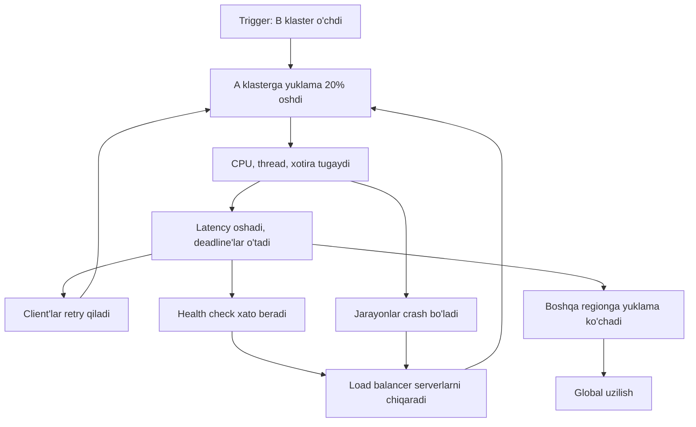
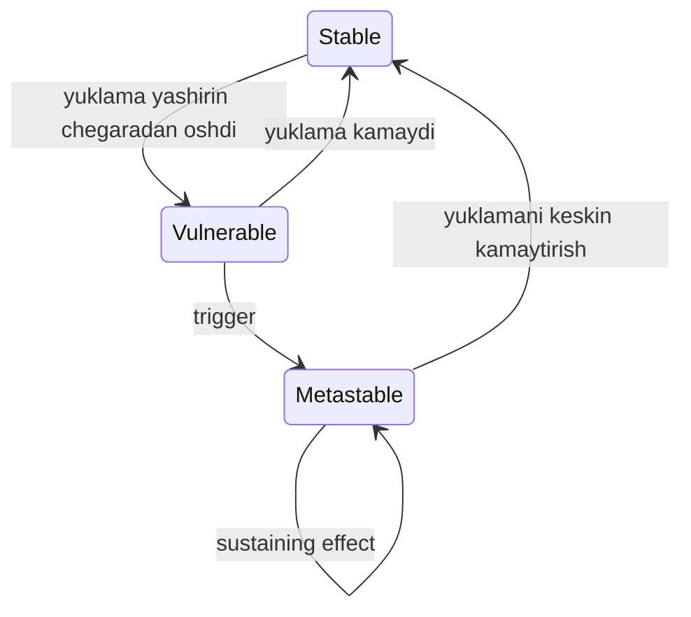

## Bu dars nima uchun kerak

61-63 darslarda alohida g'ishtlarni ko'rdik: redundancy, timeout, retry, circuit breaker, bulkhead, load shedding. Bu darsda ularni bitta hodisa atrofida birlashtiramiz: **cascading failure** - kichik, mahalliy nosozlik musbat teskari aloqa (positive feedback) orqali butun tizimni yiqitishi. Yirik internet uzilishlarining ko'pchiligi aynan shunday tuzilgan: trigger kichik, oqibat ulkan.

Ikkinchi yarmi - **graceful degradation**: tizim to'liq ishlay olmaganda, "hammasi yoki hech narsa" o'rniga eng muhim funksiyalarni saqlab qolish. Bu oldindan loyihalanadigan xususiyat, nosozlik paytida improvizatsiya emas.

Bu darsdan keyin siz:

- cascading failure ning mexanizmlarini (overload ko'chishi, resurs tugashi, crash loop, retry, cold cache) bilasiz;
- metastable failure tushunchasini va "trigger emas, sustaining effect asosiy sabab" g'oyasini tushunasiz;
- cascade ni boshlaydigan tipik trigger'larni va ularning oldini olishni bilasiz;
- hard va soft dependency larni ajrata olasiz va degradation darajalarini loyihalay olasiz;
- cascade paytida bajariladigan favqulodda qadamlarni tartib bilan bilasiz.

## Cascading failure nima

Google SRE kitobining "Addressing Cascading Failures" bobi ta'rifi: musbat teskari aloqa natijasida vaqt o'tishi bilan o'sib boradigan nosozlik. Bir qismning ishdan chiqishi boshqa qismlar ishdan chiqish ehtimolini oshiradi. Eng ko'p uchraydigan sabab - server ortiqcha yuklanishi.

### Mexanizm 1: yuklama ko'chishi

Kitobdagi misol: A va B klasterlari bor, A 1 000 QPS ga xizmat qiladi. B ishdan chiqadi va uning trafigining bir qismi A ga o'tadi: A endi 1 200 QPS oladi. A ning frontend'lari resurs tanqisligiga uchraydi, va muvaffaqiyatli throughput 1 000 QPS dan ancha **pastga** tushadi. Kitobga ko'ra bunday hodisalar bir-ikki daqiqa tartibida tarqalib, mahalliy ortiqcha yuklamani global uzilishga aylantirishi mumkin.

E'tibor bering: 1 200 QPS - 20% ortiqcha. Lekin natija "20% so'rov rad etiladi" emas, "goodput keskin tushadi" (63-dars). Ortiqcha yuklangan server o'z capacity sini ham saqlay olmaydi.

Diagrammadagi har bir halqa - teskari aloqa: retry yuklamani oshiradi, health check serverlarni chiqaradi va qolganlarga yuklamani oshiradi, crash ham shunday.

### Mexanizm 2: resurs tugashi

Kitob har bir resurs tugaganda nima bo'lishini sanab chiqadi:

| Resurs | Belgilar | Ikkinchi darajali ta'sir |
|---|---|---|
| CPU | So'rovlar sekinlashadi, in-flight so'rovlar va navbatlar o'sadi | Thread starvation, deadline'lar o'tib ketadi, cache samaradorligi tushadi |
| Xotira | Jarayonlar o'ladi, Java da GC "o'lim spirali" | Cache hit rate tushadi, backend'larga yuklama oshadi |
| Thread | Xatolar, health check'lar o'tmaydi | Ekstremal holatda process ID'lar tugaydi |
| File descriptor | Yangi connection ochib bo'lmaydi | Health check o'tmaydi |
| Bog'liq resurslar | Bir resurs tanqisligi boshqasini keltirib chiqaradi | Asl sabab ikkinchi darajali belgilar ortida yashirinadi |

Oxirgi qator debugging uchun muhim: siz "xotira tugadi" ni ko'rasiz, lekin asl sabab sekin downstream tufayli in-flight so'rovlar to'planishi bo'lishi mumkin.

### Mexanizm 3: crash loop va gisterezis

Kitobdagi raqamli misol juda muhim: 10 000 QPS da sog'lom bo'lgan servis 11 000 QPS da xato bera boshlaydi. Lekin u 9 000 QPS ga qaytganda **tiklanmasligi mumkin**. Sabab: serverlar crash bo'lib, qayta ishga tushganda qolgan kam sonli sog'lom serverlar butun yuklamani oladi va ular ham darhol yiqiladi. Kitobga ko'ra, agar faqat 10% server sog'lom bo'lsa, tizim barqarorlashishi uchun yuklama taxminan 1 000 QPS gacha tushishi kerak (10 000 × 0.1).

Bu **gisterezis**: tizimni yiqitgan yuklama darajasi va uni tiklash uchun kerak bo'lgan yuklama darajasi bir xil emas.

### Mexanizm 4: cold cache va sekin startup

Yangi task'lar initializatsiya, JIT kompilyatsiya va cache isishi tugaguncha sekinroq ishlaydi. Cold cache trigger'lari: yangi klaster, maintenance dan qaytgan klaster, task restart. Kitob tavsiyasi: **latency cache** (tezlik uchun) va **capacity cache** (usiz tizim yuklamani ko'tara olmaydi) ni farqlang va ikkinchisidan qoching yoki capacity ni ortiqcha rejalashtiring.

AWS Builders' Library dagi "Caching challenges and strategies" maqolasi xuddi shu narsani boshqacha aytadi: servis o'z cache iga "qaram" bo'lib qolishi mumkin. Cache sovuq bo'lsa yoki ishlamasa, trafik to'satdan downstream ga oqadi. Maqola cache o'chirilgan holatda test qilishni tavsiya qiladi.

Hisob: cache hit rate 90%, frontend 10 000 so'rov/s, baza 1 000 so'rov/s ni ko'taradi (va normal holatda 1 000 ta miss oladi). Cache o'chsa baza 10 000 so'rov/s oladi, ya'ni 10 baravar. Cache o'chishi trigger, baza o'limi oqibat.

## Metastable failure

2021 yilgi HotOS da Bronson, Aghayev, Charapko va Zhu "Metastable Failures in Distributed Systems" maqolasini taqdim etgan. Ular cascading failure ning eng xavfli turini formallashtiradi: tizim yomon holatga tushadi va **trigger yo'qolgandan keyin ham** o'sha holatda qoladi.

Uch holat:

- **Stable** - yuklama yashirin chegaradan past, tizim har qanday qisqa trigger dan tiklanadi.
- **Vulnerable** - yuklama shu chegaradan yuqori, lekin tizim hali sog'lom. Maqolaga ko'ra ko'p production tizimlar samaradorlik uchun ataylab shu holatda ishlaydi.
- **Metastable** - trigger tizimni yiqitdi, va **sustaining effect** (odatda ish amplifikatsiyasi) uni yomon holatda ushlab turadi. Faqat kuchli tuzatish (reboot, yuklamani keskin kamaytirish) chiqaradi.

Maqoladagi misollar (mualliflar ularni production incident'larining soddalashtirilgan versiyalari deb ataydi, ya'ni raqamlar illyustrativ):

- **Retry**: 280 QPS li web ilova 10 soniyalik tarmoq uzilishidan keyin retry'lar tufayli 560 QPS da qoladi (ikki baravar) va baza tiklanmaydi. Tiklanish uchun ilova yuklamasini 150 QPS dan pastga tushirish yoki retry'larni 20 QPS dan kam qilib cheklash kerak.
- **Look-aside cache**: 90% hit rate da cache yo'qolishi 10x so'rov amplifikatsiyasi beradi; miss'lar bazani bosadi, baza sekinlashgani uchun cache qayta to'lmaydi.
- **Sekin xato ishlash**: xato yo'li ko'pincha tanqis resurslarni ishlatadi (stack trace uchun CPU, bloklovchi DNS, diskka yozish, log). Resurs tugaganda xatolarni qayta ishlash tanqislikni yanada kuchaytiradi.

Maqolaning asosiy g'oyasi: **asl sabab - trigger emas, sustaining effect**. Uzilishlar dastlab odatda trigger'ga ("deploy", "tarmoq uzildi") yoziladi, lekin bir xil teskari aloqaga ko'p xil trigger olib kelishi mumkin. Teskari aloqani buzish kelajakdagi barcha trigger'lardan himoya qiladi.

## Real misollar

### AWS us-east-1, 2021 yil 7 dekabr

AWS rasmiy xulosasiga ko'ra, 7:30 PST da asosiy tarmoqdagi bir AWS servisi capacity sini kengaytirish uchun avtomatik harakat ichki tarmoqdagi ko'p sonli client'larda kutilmagan xatti-harakatga sabab bo'lgan. Ulanishlar to'lqini ichki va asosiy tarmoqni bog'laydigan qurilmalarni bosib qolgan. Kechikish va xatolar client'larni retry qilishga undagan, retry esa tirbandlikni ushlab turgan. Real vaqtdagi monitoring ham ishlamagan, operatorlar loglarga tayangan. Tarmoq qurilmalari 14:22 PST da to'liq tiklangan, ba'zi servislarga ta'sir 18:40 gacha davom etgan.

Tuzatishlar orasida: trigger bo'lgan avtomatik kengaytirish o'chirilgan, va tarmoq client'larining to'g'ri **backoff** qilishiga to'sqinlik qilgan "yashirin muammo" tuzatilishi e'lon qilingan. Bu metastable failure ning darslik misoli: trigger - avtomatik kengaytirish, sustaining effect - backoff siz retry.

### Facebook, 2021 yil 4 oktyabr

Facebook muhandislik blogiga ko'ra, rejalashtirilgan maintenance paytida global backbone capacity sini tekshirish uchun berilgan buyruq backbone tarmog'ini uzib qo'ygan; buni to'xtatishi kerak bo'lgan audit vositasidagi bug uni o'tkazib yuborgan. DNS serverlar data-markazlarga ulana olmaganda o'zlarini nosog'lom deb hisoblab, BGP e'lonlarini qaytarib olishga mo'ljallangan edi. Ular ishlab turgan bo'lsa ham, internet ularga yeta olmay qolgan. Ichki diagnostika vositalari ham DNS ga bog'liq bo'lgani uchun ishlamagan, muhandislar data-markazlarga jismonan borishi kerak bo'lgan.

Ikki saboq: (1) **mahalliy health check logikasi global ta'sirga ega bo'lishi mumkin** - har bir DNS server "to'g'ri" ish qilgan, lekin hammasi bir vaqtda; (2) tiklash bosqichma-bosqich bo'lgan, chunki hammasini birdan yoqish elektr va trafik to'lqinini keltirib chiqarishi mumkin edi. Ya'ni tiklanishning o'zi ham cascade xavfini tug'diradi.

## Trigger'lar va ularning oldini olish

Google SRE kitobi tipik trigger'larni sanaydi: jarayon o'limi (masalan, "query of death"), bir vaqtda ko'p task'ga ta'sir qiladigan yangilanishlar, yangi rollout (binary, konfiguratsiya, infratuzilma), organik o'sish capacity siz, rejalashtirilgan o'zgarishlar va drain'lar, so'rov profilining o'zgarishi (qimmatroq so'rovlar), va boshqa job'lar o'sganda yo'qolishi mumkin bo'lgan "bo'sh" CPU ga tayanish.

| Trigger | Himoya |
|---|---|
| Query of death | Jarayon ichida so'rov bo'yicha resurs chegarasi, crash qilgan so'rovni bloklash |
| Deploy | Canary va bosqichma-bosqich rollout (68-dars), tez rollback |
| AZ yoki klaster o'chishi | Static stability: qolganlar yuklamani oldindan ko'tara oladi (61-dars) |
| Cache flush yoki restart | Request coalescing, bosqichma-bosqich isitish, capacity cache ga tayanmaslik |
| Retry storm | Bitta qatlamda retry, budget, jitter (62-dars) |
| Organik o'sish | Capacity planning, sinish nuqtasigacha load test (76-dars) |
| Health check logikasi | Process sog'lig'i va servis sog'lig'ini ajratish, fail-open |

### Health check: liveness va readiness

Cascade da health check ko'pincha "yong'inga benzin" bo'ladi. Ortiqcha yuklangan server health check'ga sekin javob beradi, load balancer uni chiqaradi yoki orchestrator uni restart qiladi, qolganlar ko'proq yuklama oladi. Google tavsiyasi: process sog'lig'i va servis sog'lig'ini ajrating.

Kubernetes atamalari bilan:

- **liveness** - jarayon tirik va javob bera oladimi? Muvaffaqiyatsiz bo'lsa - restart. Bu yerda downstream (baza, Redis) ni tekshirmang: baza o'chsa barcha pod'lar restart bo'ladi va bu yordam bermaydi, faqat cold start qo'shadi.
- **readiness** - pod trafik olishga tayyormi? Muvaffaqiyatsiz bo'lsa - trafik olinmaydi, lekin restart yo'q.

Yana bir muhim himoya - **fail-open**: agar barcha (yoki juda ko'p) backend bir vaqtda nosog'lom deb topilsa, load balancer hech kimga trafik yubormaslik o'rniga hammaga yuborishda davom etadi. Mantiq: barcha backend birdan o'lganidan ko'ra health check ning o'zi noto'g'ri ishlayotgani ehtimoli yuqori. Masalan, AWS Elastic Load Balancing hujjatiga ko'ra target group dagi barcha target'lar health check dan o'tmasa, load balancer fail open qiladi va trafikni barcha target'larga yuboradi.

## Graceful degradation

Graceful degradation - tizim to'liq capacity yoki barcha bog'liqliklarsiz qolganda kamroq, lekin foydali xizmat ko'rsatishi. Asosiy savol har bir funksiya uchun: **bu bog'liqlik o'chsa foydalanuvchi nima ko'radi?**

### Hard va soft dependency

- **Hard dependency** - usiz so'rov umuman bajarilmaydi. Masalan, "buyurtma yaratish" uchun buyurtmalar bazasi.
- **Soft dependency** - usiz javob yomonroq, lekin baribir foydali. Masalan, mahsulot sahifasida tavsiyalar bloki.

61-darsdagi serial availability formulasini eslang: har bir hard dependency ko'paytiruvchi. Soft dependency esa (to'g'ri timeout va fallback bilan) formulaga kirmaydi. Shuning uchun dizaynning eng samarali reliability harakatlaridan biri - **hard dependency'larni soft ga aylantirish**.

### Degradation usullari

| Usul | Qanday | Narxi | Misol |
|---|---|---|---|
| Eskirgan ma'lumot (stale) | Soft TTL o'tgach ham, yangilab bo'lmasa, hard TTL gacha eski qiymatni berish | Ma'lumot yangiligi | Konfiguratsiya, narxlar, profil |
| Funksiyani o'chirish | Muhim bo'lmagan blok yashiriladi | To'liqlik | Tavsiyalar, statistikalar |
| Arzonroq natija | Aniqlik kamroq, hisob kamroq | Sifat | Qidiruvda kamroq indeks qismi, taxminiy son |
| Asinxron rejimga o'tish | "Qabul qilindi, keyin tayyor bo'ladi" | Darhol natija yo'q | Hisobot, eksport |
| Faqat o'qish rejimi | Yozish vaqtincha o'chiriladi | Funksionallik | Baza failover paytida |
| Statik zaxira javob | Oldindan tayyorlangan default | Shaxsiylashtirish | Default bosh sahifa |

AWS ning caching maqolasidagi **soft/hard TTL** g'oyasi juda amaliy: soft TTL o'tganda client yangilashga urinadi; downstream ishlamasa yoki javob bermasa, client hard TTL gacha cache dagi qiymatni ishlatadi. Maqolaga ko'ra, sekinlashayotgan servis backpressure signali berganda chaqiruvchilar cache ga uzoqroq tayanishi servisga tiklanish imkonini beradi. **Negative caching** (xato javoblarni alohida TTL bilan cache lash) esa ishdan chiqqan resursga takroriy murojaatlarni to'xtatadi.

### 61-dars bilan qarama-qarshilik: fallback xavfli emasmi?

61-darsda AWS ning "fallback dan qoching" tavsiyasini ko'rdik. Graceful degradation bunga zid emasmi? Farq bor:

- **Xavfli fallback** - bir xil natijani **boshqa, kamdan-kam ishlaydigan mexanizm** bilan olish (cache o'chsa bazaga to'g'ridan-to'g'ri). U qo'shimcha yuklama yaratadi va sinovdan o'tmagan.
- **Degradation** - **kamroq ish qilish**: funksiyani o'chirish, eskirgan qiymatni berish. U yuklamani kamaytiradi.

Qoida: degradation yo'li yuklamani **oshirmasligi**, aksincha kamaytirishi kerak, va u muntazam sinovdan o'tishi kerak. Google SRE ham degradation kamdan-kam ishga tushishini, shuning uchun uni muntazam sinash (masalan, kichik serverlar guruhini ataylab ortiqcha yuklama chegarasiga yaqin ishlatish) va qancha server degraded rejimda ekanini monitoring qilishni tavsiya qiladi.

### Kill switch va load shedding bilan bog'liqlik

Degradation qo'lda ham yoqilishi kerak: har bir muhim bo'lmagan funksiya uchun **kill switch** (feature flag, 68-dars) - incident paytida bir tugma bilan og'ir funksiyani o'chirish. Muhim: kill switch o'zi ishlamay qolgan tizimga (masalan, o'sha bazaga) bog'liq bo'lmasligi kerak, va uning default holati (flag servisi javob bermasa) xavfsiz bo'lishi kerak.

## Cascade paytida nima qilish

Google SRE kitobi favqulodda qadamlarni beradi. Tartib muhim:

1. **Resurs qo'shish** - bo'sh capacity bo'lsa task qo'shing. O'lim spiralida bu yetarli bo'lmasligi mumkin.
2. **Health check sababli o'limlarni to'xtatish** - sog'lom, lekin ortiqcha yuklangan task'larni restart qiladigan health check'larni vaqtincha o'chirish.
3. **Serverlarni restart qilish** - faqat ular qotib qolgan bo'lsa (GC spirali, deadlock), va avval sababni aniqlab, sekin.
4. **Trafikni tashlash** - oxirgi chora: yuklamani keskin kamaytirish (masalan, 1% gacha), serverlar sog'lomlashsin, keyin bosqichma-bosqich oshirish. Asl sababni tuzatmasdan qilinsa, cascade qaytadi.
5. **Degraded rejimga o'tish** - oldindan loyihalangan bo'lsa.
6. **Batch yuklamani to'xtatish** - indeks yangilash, ma'lumot ko'chirish, statistika job'lari.
7. **Yomon trafikni bloklash** - crash keltirayotgan so'rovlarni.

4-qadam gisterezis bilan bevosita bog'liq: metastable holatdan chiqish uchun yuklamani trigger dan oldingi darajadan ham ancha pastga tushirish kerak. Bosqichma-bosqich qaytarish esa Facebook misolidagi kabi tiklanishning o'zi yangi to'lqin yaratmasligi uchun.

## iQuariX kontekstida

Misol sharti: quyidagi zanjir bor: 30 000 treker, ingest gateway, Kafka, worker'lar, PostgreSQL (qurilma metama'lumoti) va TimescaleDB (nuqtalar), Redis (oxirgi joylashuv), dispetcher API.

**Cascade stsenariysi.** TimescaleDB da uzoq davom etadigan compaction yoki vacuum yozish latency sini 10 ms dan 500 ms ga oshirdi.

1. Worker'lar sekinlashadi, Kafka da consumer lag o'sadi. Bu hali muammo emas - navbat aynan shu uchun (41-dars).
2. Lekin worker'lar har bir nuqta uchun PostgreSQL dan qurilma metama'lumotini o'qiydi va ular ham connection pool ni ushlab turadi. PostgreSQL connection'lari tugaydi.
3. Dispetcher API ham o'sha PostgreSQL dan foydalanadi. Endi dispetcher login qila olmaydi - telemetriyaga hech qanday aloqasi bo'lmagan funksiya ishlamay qoldi.
4. Dispetcherlar sahifani qayta-qayta yangilaydi (inson retry i), mobil ilova avtomatik retry qiladi.
5. Lag tufayli "oxirgi joylashuv" eskiradi, alert servisi "mashina 10 daqiqadan beri signal bermayapti" degan minglab soxta ogohlantirish yuboradi, SMS provayder rate limit beradi.

Teskari aloqalarni buzish:

- worker'lar uchun alohida PostgreSQL connection pool (bulkhead), yoki qurilma metama'lumotini worker xotirasida cache lash (static stability);
- dispetcher login uchun PostgreSQL faqat o'qish replikasi;
- "signal yo'q" ogohlantirishi consumer lag ga bog'liq: lag 2 daqiqadan oshsa, bunday ogohlantirishlar to'xtatiladi (aks holda tizim o'z kechikishini mashinalar nosozligi deb talqin qiladi);
- mobil ilovada retry budget va jitter.

**Degradation darajalari** (oldindan loyihalangan):

| Daraja | Holat | Nima ishlaydi | Nima o'chadi |
|---|---|---|---|
| 0 | Normal | Hammasi | - |
| 1 | Yozish sekin, lag 1-5 daqiqa | Xarita (oxirgi ma'lum joylashuv + "N daqiqa oldin" belgisi), SOS | "Signal yo'q" ogohlantirishlari, real vaqt hisobotlari |
| 2 | Lag 5 daqiqadan ko'p | Xarita, SOS, video jonli efir | Barcha hisobotlar, eksport, analitika job'lari |
| 3 | Asosiy baza ishlamaydi | Faqat o'qish: oxirgi joylashuv Redis dan | Sozlamalarni o'zgartirish, yangi foydalanuvchi |

Muhim tamoyil: telemetriya **qabul qilish** (gateway va Kafka ga yozish) eng oxirgi o'chadigan funksiya bo'lishi kerak, chunki boshqa hamma narsani keyinroq qayta hisoblash mumkin, qabul qilinmagan va treker buferidan o'chib ketgan nuqtani esa yo'q.

## Ko'p uchraydigan xatolar

1. **Trigger ni asosiy sabab deb hisoblash.** Postmortem "deploy sabab bo'ldi" bilan tugaydi, sustaining effect (retry, cache, health check) tuzatilmaydi.
2. **Liveness probe da downstream tekshirish.** Baza o'chsa barcha pod restart bo'ladi va cold start qo'shiladi.
3. **Capacity cache ga tayanish.** Cache flush yoki restart bazani 10 baravar yuklamaga duchor qiladi.
4. **Tiklashda hamma trafikni birdan qaytarish.** Gisterezis tufayli tizim yana yiqiladi.
5. **Degradation yo'lini sinamaslik.** Kerak bo'lganda u ishlamaydi yoki yuklamani oshiradi.
6. **Kill switch ning o'zi ishlamay qolgan tizimga bog'liqligi.**
7. **Sekin xato yo'llari.** Har xatoda to'liq stack trace, sinxron log va DNS - resurs tanqisligini kuchaytiradi.
8. **Muhim va muhim bo'lmagan trafikning umumiy resurslari.** Hisobot so'rovlari telemetriya yozishni to'xtatadi.

## Xulosa

- Cascading failure - musbat teskari aloqa: yuklama ko'chishi, resurs tugashi, crash loop, retry, cold cache.
- Ortiqcha yuklangan server o'z capacity sini ham saqlay olmaydi; tiklash uchun yuklamani yiqilish darajasidan ancha pastga tushirish kerak (gisterezis).
- Metastable failure: trigger o'tib ketsa ham sustaining effect tizimni ushlab turadi. Asosiy sabab - teskari aloqa.
- Health check'lar: liveness da downstream ni tekshirmang, readiness va fail-open dan foydalaning.
- Graceful degradation - kamroq ish qilish (stale, funksiyani o'chirish, asinxron). Fallback esa boshqa yo'l bilan bir xil ish - xavfli.
- Hard dependency'larni soft ga aylantirish availability ni to'g'ridan-to'g'ri oshiradi.
- Degradation darajalari va kill switch'lar oldindan loyihalanadi va muntazam sinaladi.

## Amaliy topshiriq

Masala sharti: iQuariX da **yoqilg'i nazorati moduli** quyidagicha ishlaydi: ДУТ datchiklari ma'lumoti telemetriya bilan keladi, fuel-worker har bir nuqtada oxirgi 10 daqiqa oynasini Redis dan o'qiydi, anomaliya aniqlansa PostgreSQL ga hodisa yozadi va notification servisiga (SMS va push) HTTP chaqiruv qiladi. Dispetcher UI yoqilg'i grafigini TimescaleDB dan oladi. Redis bitta instance, hit rate 95%, miss bo'lsa oyna TimescaleDB dan qayta yig'iladi.

1. Kamida 3 ta cascade stsenariysini yozing (trigger, teskari aloqa halqasi, oxirgi oqibat). Kamida bittasi Redis restart dan boshlansin va unda TimescaleDB yuklamasi necha baravar oshishini hisoblang.
2. Har bir stsenariy uchun sustaining effect ni aniqlang va uni qanday buzishni taklif qiling.
3. Modulning barcha bog'liqliklarini hard va soft ga ajrating. Qaysi hard bog'liqlikni soft ga aylantira olasiz va qanday?
4. 3-4 darajali degradation jadvalini tuzing: har daraja uchun trigger sharti (o'lchanadigan), nima ishlaydi, nima o'chadi.
5. Liveness va readiness probe'larni fuel-worker uchun loyihalang.
6. Cascade dan keyin tizimni qanday bosqichma-bosqich tiklash rejasini yozing (qaysi tartibda, qanday tezlikda).

Yaxshi javobda bo'lishi kerak bo'lgan narsalar:

- Redis restart da 95% hit rate dan 0% ga: TimescaleDB yuklamasi 20 baravar oshishi hisobi va request coalescing yoki bosqichma-bosqich isitish;
- notification servisi sekinlashganda fuel-worker bloklanmasligi (asinxron navbat yoki bulkhead);
- lag paytida soxta "yoqilg'i to'kildi" yoki "signal yo'q" ogohlantirishlarining oldini olish;
- liveness probe downstream'ga bog'liq emas;
- tiklash bosqichma-bosqich va avval sustaining effect tuzatilgan.

Javobni pastdagi maydonga yozib, chatga yuboring.

## Manbalar

- Google. [Site Reliability Engineering, "Addressing Cascading Failures"](https://sre.google/sre-book/addressing-cascading-failures/) - mexanizmlar, resurs tugashi, trigger'lar, favqulodda qadamlar, degradation.
- N. Bronson, A. Aghayev, A. Charapko, T. Zhu. [Metastable Failures in Distributed Systems](https://sigops.org/s/conferences/hotos/2021/papers/hotos21-s11-bronson.pdf), HotOS 2021.
- AWS. [Summary of the AWS Service Event in the Northern Virginia (US-EAST-1) Region](https://aws.amazon.com/message/12721/), 2021 yil dekabr.
- AWS. [Health checks for Application Load Balancer target groups](https://docs.aws.amazon.com/elasticloadbalancing/latest/application/target-group-health-checks.html) - barcha target nosog'lom bo'lganda fail open.
- Meta Engineering. [More details about the October 4 outage](https://engineering.fb.com/2021/10/05/networking-traffic/outage-details/), 2021.
- M. Brinkley, J. Chhabra. [Caching challenges and strategies](https://aws.amazon.com/builders-library/caching-challenges-and-strategies/), AWS Builders' Library - soft/hard TTL, request coalescing, negative caching, cache ga qaramlik.
- Google. [Site Reliability Engineering, "Handling Overload"](https://sre.google/sre-book/handling-overload/) - criticality va degraded javoblar.
- J. Gabrielson. [Avoiding fallback in distributed systems](https://builder.aws.com/content/3EuS9Sakq7L3VLQIF3qzfMfke1Y/avoiding-fallback-in-distributed-systems), AWS Builders' Library.
