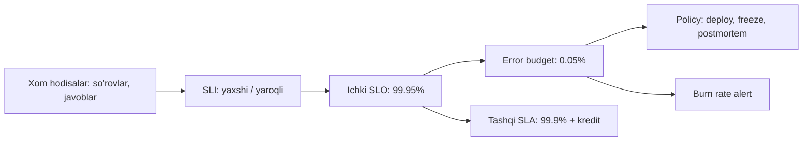

## Bu dars nima uchun kerak

1-darsda "ishonchli bo'lsin" degan NFR ni raqamga aylantirish kerakligini aytgan edik. 61-darsda availability ni qanday hisoblashni ko'rdik. Lekin uchta savol ochiq qoldi: **nimani** o'lchaymiz, **qancha** yetarli va maqsadga erishilmasa **nima qilamiz**? Bu darsdagi to'rt tushuncha - SLI, SLO, SLA va error budget - aynan shu savollarga javob beradi va reliability ni his-tuyg'u masalasidan muhandislik va biznes qaroriga aylantiradi.

Bu ramka keyingi darslarning asosi: 66-67 darslarda SLI ni qanday o'lchash va unga qanday alert qilishni, 68-darsda error budget ga qarab deploy tezligini boshqarishni, 70-darsda postmortem ni qachon yozishni ko'ramiz.

Bu darsdan keyin siz:

- SLI, SLO va SLA ni aniq ajrata olasiz va SLI ni "yaxshi hodisalar / yaroqli hodisalar" shaklida yozasiz;
- tizim turiga qarab SLI tanlay olasiz va o'lchash nuqtasining trade-off larini bilasiz;
- SLO maqsadini va oynasini asoslab tanlay olasiz;
- error budget ni hisoblab, error budget policy yoza olasiz;
- burn rate va multiwindow, multi-burn-rate alert parametrlarini hisoblay olasiz;
- ichki SLO va tashqi SLA o'rtasida nima uchun zaxira bo'lishi kerakligini tushunasiz.

## Uchta tushuncha

Google SRE kitobining "Service Level Objectives" bobi ta'riflari:

- **SLI (Service Level Indicator)** - xizmat darajasining biror jihatini aniq belgilangan miqdoriy o'lchovi: latency, xato darajasi, throughput va h.k.
- **SLO (Service Level Objective)** - SLI uchun maqsad qiymat yoki oraliq. Odatiy shakl: "SLI ≤ maqsad" yoki "SLI ≥ maqsad".
- **SLA (Service Level Agreement)** - foydalanuvchilar bilan **shartnoma**, unda SLO bajarilmasa oqibatlar yozilgan. Kitobdagi oddiy test: agar aniq oqibat (pul, kredit) bo'lmasa, bu SLA emas, SLO.

Bog'liqlik: SLI - o'lchov, SLO - ichki maqsad, SLA - tashqi va'da. Ular qatlam-qatlam joylashadi va har bir keyingisi oldingisidan **yumshoqroq** bo'lishi kerak.



## SLI: nimani o'lchash

### Format: yaxshi hodisalar / yaroqli hodisalar

Google SRE Workbook ning "Implementing SLOs" bobi har bir SLI ni bir xil shaklda yozishni tavsiya qiladi:

```
SLI = yaxshi hodisalar / yaroqli hodisalar × 100%
```

Bu SLI ni 0 dan 100 foizgacha bo'lgan songa aylantiradi va barcha SLI lar uchun bir xil alert va hisobot vositalarini ishlatish imkonini beradi. "Yaroqli" so'zi muhim: masalan, 4xx javoblar odatda maxrajdan chiqariladi, chunki ular mijoz xatosi; load test va health check trafigi ham.

Workbook yana bir foydali ajratishni beradi:

- **SLI specification** - foydalanuvchi uchun nima muhim, o'lchash usulidan mustaqil: "bosh sahifa so'rovlarining 100 ms dan tez yuklanganlari ulushi".
- **SLI implementation** - specification + o'lchash usuli: "load balancer logidagi `/` so'rovlari, backend javob vaqti bo'yicha".

### SLI menyusi

Workbook tavsiya qilgan SLI turlari:

| SLI turi | Ta'rif (yaxshi / yaroqli) | Qaysi tizim uchun |
|---|---|---|
| Availability | Muvaffaqiyatli javob olgan so'rovlar ulushi | Request/response servislar |
| Latency | Chegara vaqtdan tez bo'lgan so'rovlar ulushi | Request/response servislar |
| Quality | Degradatsiyasiz berilgan javoblar ulushi | Graceful degradation bor servislar (64-dars) |
| Freshness | Belgilangan vaqtdan yangiroq ma'lumot ulushi | Pipeline, cache, replika |
| Correctness | To'g'ri natija bergan kirishlar ulushi | Data pipeline |
| Coverage | Maqsadgacha qayta ishlangan job yoki yozuvlar ulushi | Batch va stream |
| Durability | Yozilgan va qayta o'qib bo'ladigan yozuvlar ulushi | Saqlash tizimlari |

SRE kitobi tizim turlari bo'yicha ham bo'ladi: foydalanuvchiga xizmat ko'rsatuvchi tizimlar uchun availability, latency, throughput; saqlash uchun latency, availability, durability; big data pipeline uchun throughput va end-to-end latency.

Workbook tavsiyasi: **beshtadan ko'p bo'lmagan** SLI turi. Ko'p SLI e'tiborni tarqatadi, kam SLI esa muhim xatti-harakatni ko'rmay qoldiradi.

### Latency SLI: o'rtacha emas, chegara bo'yicha ulush

"O'rtacha latency 100 ms" - yomon SLI (3-dars). SRE kitobi misolini keltiradi: median 50 ms bo'lishi mumkin, so'rovlarning 5 foizi esa 20 baravar sekin. To'g'ri shakl - ulush: "so'rovlarning 99 foizi 400 ms dan tez". Workbook dumni ushlash uchun bir nechta chegara qo'yishni tavsiya qiladi, masalan: 90% so'rov 100 ms dan tez **va** 99% so'rov 400 ms dan tez.

Bu shakl percentile bilan ekvivalent ("p99 < 400 ms"), lekin hisoblash va budget uchun qulayroq: har bir so'rov "yaxshi" yoki "yomon", ularni oddiy sanash mumkin.

### Qayerda o'lchash

| O'lchash nuqtasi | Afzallik | Kamchilik |
|---|---|---|
| Server loglari / metrikalar | Oson, batafsil | Backend ga yetmagan so'rovlarni ko'rmaydi |
| Load balancer metrikalari | Foydalanuvchiga yaqinroq, barcha backend'ni qamraydi | Tarmoq va client muammolarini ko'rmaydi |
| Sintetik prober (black-box) | Tarmoq darajasidagi nosozlikni ushlaydi | Faqat ba'zi foydalanuvchilarga ta'sir qiladigan muammolarni o'tkazib yuboradi |
| Client tomonda instrumentatsiya | Foydalanuvchi tajribasini eng aniq aks ettiradi | Kod o'zgarishi kerak, shovqinli (foydalanuvchi tarmog'i) |

Workbook maslahati: eng arzon o'lchanadigan joydan boshlang, keyin takomillashtiring. Workbook dagi ishlangan misolda load balancer metrikalari ishlatilgan.

## SLO: qancha yetarli

### Maqsadni tanlash

**100% noto'g'ri maqsad.** SRE kitobining "Embracing Risk" bobi (61-dars) bir necha sabab keltiradi: har bir qo'shimcha "to'qqiz" narxi chiziqli emas (bir qadam oldingisidan 100 baravar qimmat bo'lishi mumkin); foydalanuvchi o'zi 99% ishonchli smartfon va internet orqali kiradi va 99.99% bilan 99.999% farqini sezmaydi; ISP larning fon xato darajasi 0.01% dan 1% gacha. Kitobdagi hisob: 99.9% dan 99.99% ga o'tish 0.09% qo'shimcha availability beradi; 1 million dollar daromadli servis uchun bu 900 dollar qiymatga ega, demak bu o'tish 900 dollardan arzon bo'lsagina o'zini oqlaydi.

**Hozirgi holatdan boshlang.** Workbook dagi misolda API ning 4 haftalik real ma'lumoti: 3 663 253 so'rov, 3 557 865 muvaffaqiyatli, ya'ni 97.123%. SLO 97% qilib qo'yilgan. Latency: o'lchangan p90 = 432 ms, p99 = 891 ms, SLO lar "90% so'rov 450 ms dan tez" va "99% so'rov 900 ms dan tez". Ya'ni boshlang'ich SLO - hozirgi holatni qayd etish, keyin uni yaxshilash.

**Bog'liqliklarni hisobga oling.** Workbook: kritik bog'liqlikning maqsadi undan foydalanadigan user journey maqsadidan past bo'lmasligi kerak. Agar bog'liqlik bunga erisha olmasa, uning atrofida loyihalang: cache, store-and-forward, graceful degradation. 61-darsdagi serial formulani eslang: 99.95% li servis 99.9% li sinxron bog'liqlik bilan 99.95% SLO ga erisha olmaydi.

### Oyna: rolling yoki kalendar

- **Rolling oyna** (masalan, oxirgi 28 kun) - har kuni yangilanadi, "oy boshida budget tiklandi" degan sun'iy effekt yo'q. Workbook umumiy default sifatida **4 haftalik rolling** oynani tavsiya qiladi va oynani butun haftalarda olishni maslahat beradi, shunda har oynada dam olish kunlari soni bir xil bo'ladi.
- **Kalendar oyna** (oy, chorak) - biznes va SLA hisobotlari bilan mos, lekin oy oxirida budget tugagan servis keyingi kuni "toza" boshlaydi.

### Ortiqcha bajarmang

SRE kitobi Chubby misolini keltiradi: Google ning global lock servisi Chubby shunchalik ishonchli bo'lganki, boshqa servislar unga fallback siz bog'lanib qolgan. SRE Chubby ni SLO ga yaqin ushlab turadi va agar chorak davomida real uzilish bo'lmasa, **rejalashtirilgan uzilish** qiladi - noto'g'ri bog'liqliklar ertaroq ochilishi uchun. Sabab: foydalanuvchilar e'lon qilingan emas, **haqiqiy** ishonchlilikka moslashadi.

### Zaxira: ichki SLO va tashqi SLA

Kitob tavsiyasi: ichki SLO ni e'lon qilinganidan qattiqroq qo'ying. Shunda muammolarni foydalanuvchilar sezishidan oldin tuzatishga vaqt bo'ladi.

| Daraja | Qiymat | Kimga | Bajarilmasa |
|---|---|---|---|
| Ichki SLO | 99.95% | Jamoa | Error budget policy (deploy sekinlashadi) |
| Tashqi SLO | 99.9% | Mijozlar (hujjatda) | Obro' |
| SLA | 99.5% | Shartnoma | Pul krediti |

### Real SLA misollari

AWS SLA lari bu farqni yaxshi ko'rsatadi:

- **EC2**: region darajasida 99.99% (instance'lar region ichida ikki yoki undan ko'p AZ da bo'lsa) va instance darajasida 99.5%. Kreditlar: 99.99% dan past va 99.0% gacha - 10%, 99.0% dan past va 95.0% gacha - 30%, 95.0% dan past - 100%. Region darajasida "ishlamaslik" - bu ikki yoki undan ko'p AZ dagi **barcha** ishlab turgan instance'larning bir vaqtda tashqi aloqasi yo'qligi.
- **S3 Standard**: kreditlar 99.9% dan boshlanadi (10%), 99.0% dan past 25%, 95.0% dan past 100%. Uptime har 5 daqiqalik interval uchun xato darajasi (InternalError yoki ServiceUnavailable / jami so'rovlar) asosida hisoblanadi: 100% minus barcha intervallar xato darajalarining o'rtachasi.

Ikki saboq. Birinchi: SLA dagi "ishlamaslik" ta'rifi juda tor, va kredit faqat oylik to'lovning bir qismi - ya'ni SLA mijozning biznes zararini qoplamaydi. Ikkinchi: S3 SLA si so'rovga asoslangan (aggregate) availability ni 5 daqiqalik intervallar bilan o'lchaydi, bu 61-darsdagi ikki o'lchov turining real qo'llanishi.

## Error budget

### Ta'rif va hisob

```
Error budget = 1 - SLO
```

Workbook misoli: 3 million so'rov va 99.9% SLO bo'lsa, budget 3 000 xato. 1 500 xato bergan uzilish budgetning 50 foizini sarflaydi.

Vaqt shaklida: 99.9% SLO, 30 kunlik oyna = 43.2 daqiqa to'liq uzilish. Lekin to'liq uzilish kam bo'ladi; ko'pincha qisman: 2 soat davomida 10% so'rov xato berishi 12 daqiqa to'liq uzilishga teng budget sarflaydi (120 × 0.1 = 12).

### Error budget nima uchun kerak

Error budget mahsulot jamoasi va operatsion jamoa o'rtasidagi abadiy ziddiyatni hal qiladi: biri tez yangi funksiya chiqarishni, ikkinchisi barqarorlikni xohlaydi. SRE kitobi kirish bobida aytilishicha, uzilishlarning taxminan 70 foizi o'zgarishlardan. Error budget bu ziddiyatni ma'lumotga aylantiradi:

- budget bor - deploy qiling, eksperiment qiling, risk oling;
- budget tugadi - barqarorlikka e'tibor.

Muhim: budget **sarflash uchun**. Har chorakda budgetning 5 foizini ishlatgan jamoa ehtimol juda ehtiyotkor va funksiyalarni sekin chiqaryapti.

### Error budget policy

Google SRE Workbook dagi namuna siyosatning asosiy qoidalari:

- **Maqsad**: mijozlarni takroriy SLO buzilishlaridan himoya qilish va reliability bilan yangi funksiyalar o'rtasida muvozanat uchun rag'bat berish. Siyosat jazo emas.
- **SLO buzilganda**: oxirgi 4 hafta bo'yicha budget tugagan bo'lsa, P0 muammolar va xavfsizlik tuzatishlaridan tashqari barcha o'zgarish va release'lar to'xtatiladi, servis SLO ga qaytguncha.
- **Istisnolar**: sabab kompaniya miqyosidagi tarmoq muammosi, boshqa jamoa servisi (u o'z release'larini to'xtatgan), yoki doiradan tashqari trafik (load test, pentest) bo'lsa, funksiya ishi davom etishi mumkin.
- **Uzilish siyosati**: bitta incident 4 haftalik budgetning **20 foizidan** ko'pini sarflasa, kamida bitta P0 action item bilan postmortem majburiy (70-dars).
- **Eskalatsiya**: budget hisobi yoki talab qilingan harakatlar bo'yicha kelishmovchilik CTO ga ko'tariladi.

Policy oldindan yozilgan va rahbariyat tomonidan imzolangan bo'lishi kerak. Incident paytida "deploy ni to'xtatamizmi?" deb bahslashish - kech.

## Burn rate va SLO asosidagi alerting

### Burn rate

SRE Workbook ning "Alerting on SLOs" bobi ta'rifi: burn rate - servis SLO ga nisbatan error budget ni qanchalik tez sarflayotgani. Burn rate = 1 - budget aynan oyna oxirida tugaydi. 99.9% SLO va 30 kunlik oyna uchun bu doimiy 0.1% xato darajasi.

```
burn rate = joriy xato darajasi / (1 - SLO)
```

Misol: SLO 99.9%, joriy xato darajasi 1.44%. Burn rate = 0.0144 / 0.001 = 14.4. Bu tezlikda 30 kunlik budget 30 / 14.4 ≈ 2.1 kunda tugaydi.

### Nima uchun oddiy chegara yomon

Workbook bir nechta sodda variantni ko'rib chiqadi va har birining muammosini ko'rsatadi. Masalan, juda qisqa oynada "xato darajasi > 0.1%" alerti juda tez ishlaydi (to'liq uzilishda taxminan 0.6 soniya), lekin budgetning arzimas qismini sarflaydigan qisqa sakrashlarda ham pager jiringlaydi. Juda uzun oyna esa sekin aniqlaydi va muammo tugagandan keyin ham uzoq vaqt "yonib" turadi.

### Multiwindow, multi-burn-rate

Workbook 99.9% SLO uchun tavsiya qilgan parametrlar (30 kunlik oyna):

| Jiddiylik | Uzun oyna | Qisqa oyna | Burn rate | Sarflangan budget |
|---|---|---|---|---|
| Page | 1 soat | 5 daqiqa | 14.4 | 2% |
| Page | 6 soat | 30 daqiqa | 6 | 5% |
| Ticket | 3 kun | 6 soat | 1 | 10% |

"Sarflangan budget" ustunini o'zingiz tekshiring: burn rate × oyna / SLO davri.

- 14.4 × 1 soat / 720 soat = 0.02 = 2%.
- 6 × 6 / 720 = 0.05 = 5%.
- 1 × 72 / 720 = 0.1 = 10%.

Alert faqat **ikkala** oynada ham burn rate chegaradan oshganda ishlaydi. Uzun oyna budgetning sezilarli qismi sarflanganini kafolatlaydi (shovqin emas). Qisqa oyna (uzun oynaning 1/12 qismi) esa alert muammo tugagach tez o'chishini ta'minlaydi. Workbook misoli: 10 daqiqa davom etgan 15% xatoda qisqa oyna o'rtachasi xatolar tugagandan 5 daqiqa keyin chegaradan tushadi, uzun oyna esa 60 daqiqa.

Bu alert dizayni 67-darsda (RED, USE, simptom asosidagi alerting) chuqurroq ko'riladi.

## SLO larni qayerga qo'yish: user journey

SLO ni har bir microservice ga emas, foydalanuvchi **sayohati**ga (user journey) qo'yish yaxshiroq: "dispetcher xaritani ochadi va mashinalarni ko'radi". Ichki servislar uchun SLO lar shu sayohat SLO sidan kelib chiqadi.

Workbook da tier misoli ham bor: Premium foydalanuvchilar uchun availability 99.99%, Free uchun 99.9%. Ya'ni bir servisda turli mijoz segmentlari uchun turli SLO bo'lishi mumkin, va bu 63-darsdagi criticality va 73-darsdagi multi-tenancy bilan bog'lanadi.

## iQuariX kontekstida

Faraz qiling, iQuariX uchun SLO larni birinchi marta yozyapmiz. Asosiy user journey'lar:

**1. Telemetriya qabul qilish** (treker nuqta yuboradi va ACK oladi).

- SLI (availability): gateway ACK bergan paketlar / gateway ga yetib kelgan yaroqli paketlar. O'lchash: gateway metrikasi.
- Muammo: gateway ga yetmagan paketlar (tarmoq, DNS) ko'rinmaydi. Qo'shimcha SLI: "kutilgan va kelgan nuqtalar nisbati" - har bir faol treker har 10 s nuqta yuborishi kerak, kelganlarini sanash. Bu client tomonidagi o'lchovga yaqin.
- SLO: 99.9% / 28 kun.

**2. Freshness** (dispetcher xaritasidagi joylashuv qanchalik yangi).

- SLI: xaritada ko'rsatilgan joylashuvlardan, trekerdagi vaqt bilan solishtirganda 30 soniyadan yangi bo'lganlari ulushi (faqat onlayn trekerlar uchun).
- SLO: 99%.
- Bu SLI navbat lag ini (41-dars) foydalanuvchi tilida ifodalaydi.

**3. Dispetcher API latency.**

- SLI: `/vehicles/live` so'rovlaridan 300 ms dan tez javob olganlari ulushi (load balancer da o'lchanadi).
- SLO: 99% < 300 ms va 99.9% < 1 500 ms.

**4. Yoqilg'i o'g'irlik ogohlantirishi** (correctness va latency).

- SLI (latency): hodisa aniqlangandan 2 daqiqa ichida yuborilgan ogohlantirishlar ulushi.
- SLI (correctness): dispetcher "noto'g'ri" deb belgilagan ogohlantirishlar ulushi. Bu SLO dan ko'ra mahsulot sifati metrikasi, lekin kuzatish foydali.

**Error budget hisobi.** Telemetriya: 30 000 treker, har 10 s bir nuqta = 3 000 nuqta/s. 28 kun = 2 419 200 s. Jami 3 000 × 2 419 200 ≈ 7.26 milliard nuqta. 99.9% SLO: budget ≈ 7.26 million nuqta. 20 daqiqalik to'liq gateway uzilishi: 3 000 × 1 200 = 3.6 million nuqta, budgetning taxminan 50 foizi. Workbook siyosati bo'yicha bu (20 foizdan ko'p) majburiy postmortem.

Lekin bu yerda nozik nuqta bor: treker o'z xotirasida nuqtalarni saqlaydi va keyin yuboradi. Agar SLI "ACK berilgan / yuborishga urinilgan" bo'lsa, 20 daqiqalik uzilish budgetni sarflaydi, garchi bironta nuqta yo'qolmagan bo'lsa ham. Ehtimol, ikki xil SLI kerak: **availability** (ACK darhol berildimi) va **durability/completeness** (nuqta oxir-oqibat saqlandimi). Ularning SLO lari har xil bo'ladi: availability 99.9%, completeness 99.99%.

**SLA.** Mijoz shartnomasida, masalan, "dispetcher portali oyiga 99.5% mavjud, buzilganda oylik to'lovning 10 foizi kredit" deb yoziladi. Ichki SLO 99.9%. Bu 0.4 foizlik zaxira - oyiga taxminan 2.9 soat.

## Ko'p uchraydigan xatolar

1. **100% SLO.** Erishib bo'lmaydi, har qanday o'zgarishni to'xtatadi va hech qanday budget qoldirmaydi.
2. **Har bir metrikani SLI qilish.** CPU, xotira, disk - bular sabab metrikalari, foydalanuvchi tajribasi emas. SLI foydalanuvchi ko'radigan narsani o'lchaydi.
3. **O'rtacha latency SLI.** Dumni yashiradi. Chegara bo'yicha ulush ishlating.
4. **SLA = ichki SLO.** Zaxira yo'q, har qanday kichik muammo shartnoma buzilishi.
5. **Policy siz error budget.** Budget tugadi, lekin hech narsa o'zgarmaydi - unda bu shunchaki chiroyli grafik.
6. **Oddiy chegara alerti** ("xato > 0.1% 5 daqiqa davomida"). Juda shovqinli yoki juda sekin. Burn rate ishlating.
7. **Faqat server tomonda o'lchash.** Backend ga yetmagan so'rovlar (DNS, TLS, load balancer) ko'rinmaydi.
8. **SLO ni ortiqcha bajarish.** Foydalanuvchilar haqiqiy darajaga moslashadi va keyingi har qanday pasayish incident ga aylanadi.

## Xulosa

- SLI - o'lchov (yaxshi / yaroqli), SLO - ichki maqsad, SLA - oqibati bor shartnoma. Har bir keyingisi yumshoqroq.
- SLI foydalanuvchi ko'radigan narsani o'lchaydi: availability, latency (chegara bo'yicha ulush), freshness, correctness, durability. Beshtadan ko'p emas.
- SLO hozirgi holatdan, bog'liqliklardan va biznes qiymatidan kelib chiqadi; 100% emas; 4 haftalik rolling oyna yaxshi default.
- Error budget = 1 - SLO. U mahsulot va reliability o'rtasidagi muvozanat vositasi, va oldindan yozilgan policy bilan ishlaydi.
- Bitta incident budgetning 20 foizidan ko'pini sarflasa - postmortem.
- Burn rate alerti: 14.4x/1 soat, 6x/6 soat (page), 1x/3 kun (ticket), har biri qisqa oyna bilan.

## Amaliy topshiriq

iQuariX ning **video modul** i uchun SLO hujjatini yozing. Faraz qiling: 5 000 mashinada DVR, dispetcher jonli efir ochadi (kuniga taxminan 20 000 sessiya) va arxivdan video so'raydi (kuniga 3 000 so'rov). DVR'lar mobil tarmoqda, ularning 3-5 foizi istalgan paytda oflayn.

1. 2-3 ta user journey ni aniqlang va har biri uchun 1-2 ta SLI ni "yaxshi / yaroqli" shaklida aniq yozing. Oflayn DVR maxrajga kiradimi? Asoslang.
2. Har bir SLI qayerda o'lchanishini tanlang va bu tanlovning nimani ko'rmasligini yozing.
3. SLO maqsadlari va oynasini taklif qiling. Mobil tarmoq va DVR ishonchliligini hisobga oling.
4. Har bir SLO uchun 28 kunlik error budget ni sessiya va daqiqa birligida hisoblang.
5. Jonli efir SLO si uchun multiwindow burn-rate alert parametrlarini yozing va har biri budgetning necha foizini sarflaganda ishlashini tekshiring.
6. Error budget policy ning 4-5 bandini yozing: budget tugasa nima bo'ladi, qachon postmortem, qanday istisnolar (masalan, mobil operator uzilishi).

Yaxshi javobda bo'lishi kerak bo'lgan narsalar:

- SLI lar foydalanuvchi tajribasini o'lchaydi (masalan, "jonli efir 5 soniyada boshlandi"), CPU yoki server holatini emas;
- oflayn DVR ni maxrajdan chiqarish yoki alohida SLI qilish bo'yicha asoslangan qaror;
- budget hisoblari ochiq;
- burn rate parametrlari va budget foizi tekshiruvi (burn rate × oyna / davr);
- policy da tashqi sabablar (mobil operator) uchun istisno va 20% qoidasi.

Javobni pastdagi maydonga yozib, chatga yuboring.

## Manbalar

- Google. [Site Reliability Engineering, "Service Level Objectives"](https://sre.google/sre-book/service-level-objectives/) - SLI, SLO, SLA ta'riflari, Chubby rejalashtirilgan uzilishlari, zaxira.
- Google. [Site Reliability Engineering, "Embracing Risk"](https://sre.google/sre-book/embracing-risk/) - to'qqizlar narxi, error budget g'oyasi.
- Google. [The Site Reliability Workbook, "Implementing SLOs"](https://sre.google/workbook/implementing-slos/) - SLI menyusi, good/valid format, o'lchash nuqtalari, ishlangan misol, 4 haftalik oyna.
- Google. [The Site Reliability Workbook, "Alerting on SLOs"](https://sre.google/workbook/alerting-on-slos/) - burn rate, multiwindow multi-burn-rate jadvali.
- Google. [The Site Reliability Workbook, "Example Error Budget Policy"](https://sre.google/workbook/error-budget-policy/) - SLO buzilishi va 20% uzilish qoidasi.
- AWS. [Amazon Compute Service Level Agreement](https://aws.amazon.com/compute/sla/) va [Amazon S3 Service Level Agreement](https://aws.amazon.com/s3/sla/) - real SLA misollari va kredit darajalari.
