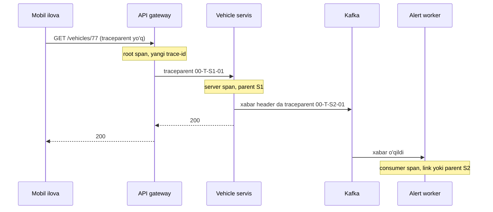
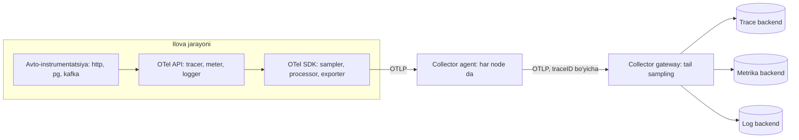

## Bu dars nima uchun kerak

65-darsda SLO larni yozdik. Lekin SLI ni hisoblash uchun ma'lumot kerak, va SLO buzilganda "nima bo'ldi?" degan savolga javob ham ma'lumotdan keladi. Monolitda bu oddiy edi: bitta log fayl, bitta jarayon. Microservice'lar, navbatlar va asinxron worker'lar bo'lgan tizimda (51-53 darslar) bitta foydalanuvchi so'rovi o'nlab jarayondan o'tadi, va 61-64 darslardagi nosozliklarning ko'pchiligi (gray failure, cascade, retry storm) faqat jarayonlar **orasida** ko'rinadi.

Observability - tizimning ichki holatini uning tashqi chiqishlaridan (telemetriya) tushuna olish qobiliyati, shu jumladan oldindan kutilmagan savollar bo'yicha. Monitoring "ma'lum muammo bormi?" degan savolga javob beradi; observability "nima uchun bu sodir bo'lyapti?" ga.

Bu darsdan keyin siz:

- metrics, logs va traces ning har biri qaysi savolga javob berishini, narxini va cheklovini bilasiz;
- cardinality muammosini va uning saqlash narxiga ta'sirini hisoblay olasiz;
- histogram va summary farqini, percentile larni to'g'ri agregatsiya qilishni bilasiz;
- distributed tracing ichki mexanikasini (span, context propagation, W3C traceparent) tushunasiz;
- OpenTelemetry arxitekturasini (API, SDK, OTLP, Collector) va signallarning barqarorlik holatini bilasiz;
- head va tail sampling ni taqqoslay olasiz va telemetriya pipeline ni loyihalay olasiz.

## Uch asosiy signal

| Signal | Nima | Qaysi savolga | Narx | Cheklov |
|---|---|---|---|---|
| Metrics | Vaqt bo'yicha agregatsiyalangan sonlar | Nima bo'lyapti va qanchalik? Trend, alert | Arzon, hajm trafikka bog'liq emas (cardinality ga bog'liq) | Kontekst yo'q, oldindan tanlangan o'lchovlar |
| Logs | Alohida hodisalar haqida yozuvlar | Aynan nima bo'ldi, qaysi xato? | Hajm trafikka proporsional, qimmat | Jarayonlar orasidagi bog'liqlik yo'q (trace ID siz) |
| Traces | So'rovning servislar bo'ylab yo'li, span daraxti | Vaqt qayerga ketdi, qaysi hop sekin yoki xato? | Juda qimmat, odatda sampling | Sampling tufayli kam uchraydigan hodisalar yo'qolishi mumkin |

OpenTelemetry bularga yana ikkita signal qo'shadi: **baggage** (so'rov bilan birga uzatiladigan kalit-qiymat kontekst) va **profiles** (kod darajasida CPU va xotira profillari).

Muhim fikr: bu uchta signal alohida "ustunlar" emas, **bog'langan** bo'lishi kerak. Metrika sakrashini ko'rasiz, o'sha vaqtdagi sekin trace'ga o'tasiz, trace dagi span dan o'sha so'rov loglariga o'tasiz. Buning kaliti - umumiy identifikatorlar (trace ID, span ID) va umumiy atributlar (servis nomi, versiya, region).

## Metrics

### Metrika turlari

- **Counter** - faqat o'sadigan son: so'rovlar soni, xatolar soni, yuborilgan baytlar. Undan tezlik (rate) hisoblanadi.
- **Gauge** - istalgan tomonga o'zgaradigan joriy qiymat: navbat uzunligi, xotira, ulanishlar soni.
- **Histogram** - qiymatlar taqsimoti bucket'lar bo'yicha: latency, javob hajmi.
- **Summary** - client tomonda hisoblangan tayyor quantile'lar.

Prometheus nomlash qoidalari: counter `_total` bilan tugaydi (`http_requests_total`), asosiy birliklar ishlatiladi (millisekund emas soniya, megabayt emas bayt), birlik qo'shimchasi nomga qo'shiladi (`http_request_duration_seconds`).

### Histogram va summary: nega bu muhim

Prometheus rasmiy hujjati asosiy farqni ko'rsatadi: **histogram'larni instance'lar bo'yicha agregatsiya qilish mumkin, summary'larni esa yo'q.** 10 ta pod ning har biri o'z p99 ini hisoblasa, ularning o'rtachasi butun servisning p99 i **emas** - bu statistik jihatdan ma'nosiz. To'g'ri yo'l: bucket hisoblagichlarini avval yig'ish, keyin quantile hisoblash:

```
histogram_quantile(0.95, sum by (le) (rate(http_request_duration_seconds_bucket[5m])))
```

Narxi: histogram quantile ni **taxminiy** beradi va aniqlik bucket chegaralariga bog'liq. Hujjatdagi misolda deyarli barcha kuzatuvlar klassik histogram ning 300-450 ms bucket iga tushgan, to'g'ri p95 qiymati 320 ms atrofida bo'lgan, hisoblangan qiymat esa 443 ms chiqqan. Nozik rezolyutsiyali native histogram 323 ms bergan. Saboq: bucket chegaralarini SLO chegaralariga moslang (masalan, SLO "99% < 300 ms" bo'lsa, 0.3 da aniq bucket bo'lsin).

### Cardinality: metrikaning asosiy narx omili

Har bir unikal label kombinatsiyasi alohida **time series**. Prometheus hujjati aniq ogohlantiradi: foydalanuvchi ID, email kabi yuqori cardinality qiymatlarni label sifatida saqlamang.

Hisob uchun shartlar: `http_request_duration_seconds` histogram, 12 ta bucket (+ `_sum` va `_count` = 14 series). Labellar: 5 ta method, 40 ta route, 8 ta status code, 20 ta pod.

14 × 5 × 40 × 8 × 20 = **896 000** time series. Amalda barcha kombinatsiyalar uchramaydi, lekin tartib shunday. Endi kimdir `vehicle_id` label qo'shdi, 30 000 ta mashina: 896 000 × 30 000 = 26.88 milliard, ya'ni taxminan 27 milliard series. Hech qanday Prometheus buni ko'tarmaydi. Shuning uchun:

- metrika label'lari past cardinality: route **shabloni** (`/vehicles/:id`), haqiqiy URL emas;
- yuqori cardinality o'lchovlar (mashina, mijoz, so'rov ID) trace va log atributlarida;
- mijoz (tenant) bo'yicha metrika kerak bo'lsa, faqat eng muhim bir nechtasi uchun, yoki alohida agregatsiyalangan pipeline orqali.

### Pull va push

Prometheus **pull** modelida ishlaydi: server har bir target ning `/metrics` endpoint idan davriy o'qiydi (scrape). Afzalligi: target o'lsa darhol ko'rinadi (scrape muvaffaqiyatsiz). OpenTelemetry SDK esa odatda **push** qiladi: OTLP orqali Collector ga yuboradi. Qisqa umrli job'lar va serverless uchun push qulayroq. Ikkalasi ham Collector orqali birlashtirilishi mumkin.

## Logs

### Strukturalangan log

Matnli log (`"User 42 failed to login from 10.0.0.1"`) ni odam o'qiydi, mashina qiynaladi. Strukturalangan log JSON yoki boshqa formatda maydonlarga ega:

```json
{"ts":"2026-10-20T09:12:03.120Z","level":"warn","service":"auth","event":"login_failed",
 "user_id":"42","ip":"10.0.0.1","reason":"bad_password","trace_id":"4bf92f3577b34da6a3ce929d0e0e4736"}
```

Endi "oxirgi soatda qaysi IP dan eng ko'p login_failed" degan so'rov oddiy filter va group by. `trace_id` maydoni log ni trace bilan bog'laydi.

### Wide events

Charity Majors (Honeycomb) 2019 yilgi "Logs vs Structured Events" maqolasida yanada uzoqqa boradi: har bir servisda har bir so'rov uchun bitta **keng** strukturalangan hodisa yozing, unda so'rov haqida hamma kontekst bo'lsin (foydalanuvchi, mijoz, endpoint, davomiylik, bazaga murojaatlar soni, cache hit, feature flag lar, versiya). Uning dalili: oldindan agregatsiyalangan metrikalar kontekstni yo'qotadi va keyinchalik "faqat X mijozi uchun, faqat Y versiyada" deb ajratib bo'lmaydi; xom keng hodisalarda yuqori cardinality maydonlar bo'yicha istalgan savolni keyin berish mumkin. Hodisa so'rov tugaganda yoki xato bilan chiqqanda bir marta yoziladi.

Bu yondashuv span atributlari bilan juda yaqin: OpenTelemetry da server span ga boy atributlar qo'shish deyarli bir xil natija beradi.

### Log narxi va boshqaruvi

Loglar hajmi trafik bilan chiziqli o'sadi. Hisob uchun shartlar: 5 000 so'rov/s, har so'rovga o'rtacha 3 ta log yozuvi, har biri 500 bayt. 5 000 × 3 × 500 = 7.5 MB/s, kuniga 7.5 × 86 400 = 648 000 MB ≈ 648 GB. Bu xom hajm; indekslar va replikalar (masalan, replication factor 2) uni yana ko'paytiradi. Shuning uchun:

- log darajalari va production da `debug` ni o'chirish (lekin dinamik yoqish imkoniyati bilan);
- muvaffaqiyatli so'rovlar loglarini sampling, xatolarni to'liq saqlash;
- saqlash muddati darajalari: issiq (7 kun, tez qidiruv), sovuq (90 kun, object storage, 78-dars);
- shaxsiy ma'lumotlarni (telefon, aniq koordinata, token) logga yozmaslik yoki maskalash - bu ham xavfsizlik, ham qonunchilik masalasi.

## Distributed tracing

### Kelib chiqishi

Google ning 2010 yilgi "Dapper, a Large-Scale Distributed Systems Tracing Infrastructure" maqolasi (Sigelman, Barroso, Burrows va boshq.) zamonaviy tracing ning asosini qo'ygan. Abstract dagi dizayn maqsadlari: past overhead, ilova darajasida shaffoflik (ya'ni har bir dasturchi instrumentatsiya yozishi shart emas, umumiy kutubxonalarda qilinadi) va juda katta tizimda hamma joyda joylashtirish. Abstract ga ko'ra muvaffaqiyatning kalit dizayn qarorlari - sampling va instrumentatsiyani kam sonli umumiy kutubxonalar bilan cheklash. Keyingi ochiq tracing tizimlari (Zipkin, Jaeger) va OpenTelemetry ham shu modelni (trace, span, kontekst uzatish, sampling) ishlatadi.

### Span

OpenTelemetry ta'rifi bo'yicha span - trace ichidagi bitta ish birligi. Unda:

- nom va ota span ID (root span da bo'sh);
- boshlanish va tugash vaqti;
- **span context**: trace ID, span ID, trace flags, trace state;
- atributlar (kalit-qiymat);
- span events (span ichidagi vaqt belgilari, masalan xato);
- span links (sababiy bog'liq boshqa span'lar, masalan batch ichidagi ko'p xabarlar);
- status: `Unset`, `Error` yoki `Ok`;
- kind: `Client`, `Server`, `Internal`, `Producer`, `Consumer`.

`Producer`/`Consumer` va links asinxron tizimlar uchun muhim: Kafka ga yozilgan xabar va uni keyinroq o'qigan worker bitta trace da bog'lanadi (43-dars).

### Context propagation va W3C Trace Context

Trace ishlashi uchun har bir servis kiruvchi so'rovdan trace kontekstini o'qib, chiquvchi so'rovlarga uzatishi kerak. Standart format - W3C Trace Context (W3C Recommendation 2020 yil 6 fevral; joriy versiya 2021 yil 23 noyabrdagi, tahririy yangilanishlar bilan). `traceparent` header:

```
traceparent: 00-4bf92f3577b34da6a3ce929d0e0e4736-00f067aa0ba902b7-01
             |  |                                |                |
          version  trace-id (16 bayt, 32 hex)  parent-id (8 bayt)  flags
```

- `trace-id` - butun trace uchun yagona;
- `parent-id` - chaqiruvchi span ID si;
- `flags` ning eng kichik biti - **sampled**: chaqiruvchi bu trace ni yozib olgan bo'lishi mumkin.

`tracestate` header vendor'ga xos ma'lumotni uzatadi (32 tagacha a'zo).



Kontekst uzatilmagan har bir joy (o'zingiz yozgan HTTP client, navbat xabari headersiz, cron job) trace ni ikkiga bo'ladi. Shuning uchun tracing ni joriy qilishdagi asosiy ish - **propagation hamma joyda ishlashi**.

### Trace nimani beradi

- **Kritik yo'l**: 1.2 soniyalik so'rovning 900 ms i qaysi span da?
- **Fan-out muammolari**: N+1 so'rov - bitta API chaqiruvi bazaga 200 ta so'rov yuborgan.
- **Retry va timeout ko'rinishi**: bitta mantiqiy chaqiruv uchta span bo'lib ko'rinadi (62-dars).
- **Bog'liqlik xaritasi**: span'lardan servislar grafi avtomatik quriladi.

## Sampling

Har bir so'rovni trace qilish qimmat. Hisob uchun shartlar: 5 000 so'rov/s, har trace da o'rtacha 15 span, har span 1 KB. 5 000 × 15 × 1 KB = 75 MB/s, kuniga 75 × 86 400 = 6 480 000 MB ≈ 6.5 TB. 1% sampling bilan 6.48 TB × 0.01 ≈ 65 GB/kun.

OpenTelemetry hujjati ikki yondashuvni ajratadi:

| | Head sampling | Tail sampling |
|---|---|---|
| Qaror qachon | So'rov boshida, trace to'liq ma'lum bo'lmasdan | Trace (deyarli) tugagandan keyin |
| Qanday | Trace ID va foiz bo'yicha deterministik | Xato, latency, atribut, servis hajmi bo'yicha qoida |
| Afzallik | Arzon, oddiy, pipeline ning istalgan joyida | Barcha xato va sekin trace'larni saqlash mumkin |
| Kamchilik | Xatoli trace'lar saqlanishini kafolatlay olmaydi | Stateful, ko'p xotira, murakkab ekspluatatsiya |
| Qayerda | SDK da | Collector (tail sampling processor) yoki vendor |

**Deterministik (consistent) sampling**: qaror trace ID va maqsad foizidan hisoblanadi. Har bir servis bir xil trace ID uchun bir xil qaror qiladi, shuning uchun trace butunlay saqlanadi yoki butunlay tashlanadi, "teshik" bo'lmaydi. `traceparent` dagi sampled flag ham shu qarorni pastga uzatadi.

**Tail sampling sharti**: bitta trace ning barcha span'lari **bitta** Collector instance'ga kelishi kerak, chunki qaror butun trace bo'yicha qilinadi. OpenTelemetry gateway hujjati buni ikki qatlamli sxema bilan yechadi: birinchi qatlam Collector'lar load-balancing exporter bilan (`routing_key` = `traceID` bo'lsa, eksport traceID bo'yicha bo'linadi) span'larni ikkinchi qatlamga yo'naltiradi, shunda bitta trace ning barcha span'lari tail sampling processor ishlaydigan bitta Collector instance'ga tushadi.

Amaliy kombinatsiya (bu darsning tavsiyasi, parametrlar misol): SDK da yengil head sampling (masalan, 20%) pipeline ni ortiqcha yuklamadan himoya qiladi, Collector da tail sampling: barcha xato trace'lar, barcha 1 soniyadan sekin trace'lar va qolganlarning 1 foizi saqlanadi. Muhim: SLI va metrikalar sampling dan **oldin**, barcha so'rovlardan hisoblanishi kerak, aks holda ular buziladi.

## OpenTelemetry

### Nima va nima uchun

OpenTelemetry (OTel) - CNCF loyihasi, telemetriya yaratish, yig'ish va eksport qilish uchun vendor-neytral standart: API, SDK lar, OTLP protokoli, Collector va semantic conventions. Uning asosiy qiymati - **vendor lock-in yo'q**: kodni bir marta instrumentatsiya qilasiz, backend ni (Prometheus, Jaeger, Grafana Tempo/Loki, ClickHouse, tijorat vendorlar) Collector konfiguratsiyasida almashtirasiz.

### Arxitektura



- **API** - kodda chaqiriladigan interfeys. SDK o'rnatilmasa no-op, ya'ni kutubxonalar OTel API ga bog'lansa ham ilova uchun xavfsiz.
- **SDK** - API ning implementatsiyasi: sampling, batching, eksport.
- **OTLP** - OpenTelemetry Protocol, gRPC yoki HTTP ustida.
- **Collector** - alohida binary: **receivers** (ma'lumot qabul qilish), **processors** (filtr, batch, sampling, atribut o'zgartirish), **exporters** (backend'larga yuborish), shuningdek connectors va extensions. OTel hujjati ilova yonida Collector ishlatishni tavsiya qiladi: servis ma'lumotni tez topshiradi, Collector esa retry, batching, shifrlash va maxfiy ma'lumotlarni filtrlashni o'z zimmasiga oladi.
- **Semantic conventions** - umumiy atribut nomlari. Masalan, HTTP server span (Stable) uchun majburiy atributlar `http.request.method`, `url.path`, `url.scheme`; status kodi yuborilgan yoki olingan bo'lsa `http.response.status_code`, route mavjud bo'lsa `http.route`. Span nomi `{method} {target}` shaklida, server span da target - `http.route`, masalan `GET /vehicles/:id`; instrumentatsiya URI yo'lini target sifatida ishlatmasligi shart (MUST NOT). Qiziq detal: server span da 4xx javob span status ini o'rnatmaydi (Unset qoladi, bu mijoz xatosi), client span da esa `Error` qiladi.

### Collector deployment

| Sxema | Qanday | Afzallik | Kamchilik |
|---|---|---|---|
| Collector siz | SDK to'g'ridan-to'g'ri backend ga | Oddiy | Ilova retry, auth, backend almashishiga mas'ul |
| Agent | Har node da (DaemonSet) yoki sidecar | Lokal, tez topshirish, host metrikalari | Har node da resurs |
| Gateway | Markaziy Collector klasteri | Credential va siyosatlar bir joyda, tail sampling | Qo'shimcha komponent, latency, narx; u ham buzilishi mumkin |
| Agent + gateway | Ikkalasi | Eng moslashuvchan | Eng murakkab |

Gateway ning o'zi ham reliability komponenti: u o'chsa telemetriya yo'qoladi va aynan incident paytida ko'r bo'lib qolasiz. Collector'ni ham 61-darsdagi qoidalar bo'yicha (redundancy, bulkhead, cheklangan navbat) loyihalang va **telemetriya pipeline ilovani hech qachon bloklamasligi** kerak: eksport navbati to'lsa, ma'lumot tashlanadi, so'rov kutmaydi.

### Barqarorlik holati (Oktyabr 2026 holatiga)

Oktyabr 2026 holatiga OpenTelemetry "Specification Status Summary" sahifasiga ko'ra: tracing API, SDK va protokol - stable; metrics API va protokol - stable, SDK - mixed; logs Bridge API, SDK va protokol - stable; baggage API va SDK - stable; profiles - faqat protokol darajasida, holati development. Til SDK lari holati spec dan farq qiladi: Oktyabr 2026 holatiga opentelemetry.io/status sahifasida JavaScript uchun traces va metrics - Stable, logs - Development (taqqoslash uchun: Java va .NET da logs Stable, Go da Release candidate, Python da Development). Node.js loyihasida bu shuni anglatadi: traces va metrics ni OTel bilan ishonch bilan qiling, loglar uchun esa mavjud logger (masalan pino) ni ishlatib, unga trace ID ni qo'shing va loglarni Collector orqali yig'ing.

## Real tizimlardan

- **Google Dapper** - kam sonli umumiy kutubxonalarda instrumentatsiya va sampling bilan juda katta tizimda hamma joyda tracing; maqolada past overhead asosiy dizayn maqsadi sifatida ta'kidlangan.
- **Prometheus** - pull, cardinality bo'yicha qat'iy tavsiyalar, histogram'larni agregatsiya qilish qoidalari.
- **Honeycomb (Charity Majors)** - keng strukturalangan hodisalar va yuqori cardinality bo'yicha ixtiyoriy so'rovlar.
- **OpenTelemetry** - rasmiy hujjatiga ko'ra OpenTracing va OpenCensus loyihalarining birlashuvidan paydo bo'lgan CNCF loyihasi; vendor-neytral standart.

## iQuariX kontekstida

Misol sharti: iQuariX ning NestJS servislari, Kafka va Go/Node worker'lari uchun observability loyihalanmoqda.

**1. Telemetriya pipeline.** Har bir Kubernetes node da Collector agent (DaemonSet), ikkita gateway Collector (tail sampling, maxfiy maydonlarni filtrlash). Backend'lar: metrikalar Prometheus (yoki uning uzoq muddatli saqlash varianti), trace va loglar ClickHouse da (81-dars; OpenTelemetry Collector Contrib dagi ClickHouse exporter README siga ko'ra traces va logs uchun beta, metrics uchun alpha), Grafana vizualizatsiya uchun.

**2. Trace'ni treker paketidan boshlash.** Trekerlar W3C header yubora olmaydi (ular binary TCP protokolda). Shuning uchun ingest gateway har bir paket uchun root span ochadi va `device_id`, `protocol`, `packet_type`, `points_count` atributlarini qo'shadi, Kafka xabar header iga `traceparent` yozadi. Worker uni o'qib, consumer span ni bog'laydi. Endi "nuqta trekerdan dispetcher xaritasiga yetguncha qancha vaqt ketdi" savoliga trace javob beradi. Har bir paketni trace qilish qimmat (bu misolda 3 000 paket/s), shuning uchun head sampling 1%, lekin `points_count > 100` (oflayn buferdan kelgan katta paketlar) va xato bo'lganlar tail sampling da 100%.

**3. Metrika cardinality.** `vehicle_id` va `tenant_id` metrika label'larida **yo'q**. Mijoz bo'yicha SLI kerak bo'lsa, faqat top-50 mijoz uchun alohida, qolganlar `other` ga. Mashina darajasidagi savollar ("77-mashina nega 10 daqiqa jim?") trace va log orqali.

**4. Biznes metrikalari.** Texnik metrikalardan tashqari: `telemetry_points_ingested_total` (protokol bo'yicha), `telemetry_end_to_end_lag_seconds` histogram (treker vaqtidan xaritada paydo bo'lguncha, 65-darsdagi freshness SLI uchun), `fuel_alerts_emitted_total` (turi bo'yicha). Lag histogram bucket'lari SLO chegarasiga (30 s) mos tanlanadi.

**5. Shaxsiy ma'lumot.** Aniq koordinatalar va haydovchi ma'lumoti - shaxsiy ma'lumot. Span atributlari va loglarda koordinatalar yozilmaydi yoki yaxlitlanadi; gateway Collector da qo'shimcha filtr qoidasi.

## Ko'p uchraydigan xatolar

1. **Yuqori cardinality label'lar.** `user_id`, `vehicle_id`, to'liq URL metrikada - Prometheus xotirasi va narxi portlaydi.
2. **Summary larni agregatsiya qilish.** Pod'lar p99 larining o'rtachasi servis p99 i emas. Histogram ishlating.
3. **Context propagation teshiklari.** Navbat xabarlari, cron, o'z HTTP client'ingiz - trace bo'linadi.
4. **SLI ni sampling qilingan trace'lardan hisoblash.** Metrikalar barcha so'rovlardan bo'lishi kerak.
5. **Telemetriya ilovani bloklaydi.** Sinxron log yozish yoki cheklanmagan eksport navbati - observability incident sababchisiga aylanadi.
6. **Loglarda shaxsiy ma'lumot va secret'lar.** Token, parol, aniq joylashuv.
7. **Uch signal bog'lanmagan.** Log da trace ID yo'q, metrikadan trace ga o'tib bo'lmaydi.
8. **Collector ni reliability komponenti deb hisoblamaslik.** U SPOF bo'lsa, incident paytida ko'r bo'lasiz.

## Xulosa

- Metrics - arzon trend va alert, logs - alohida hodisa tafsiloti, traces - so'rov yo'li va vaqt taqsimoti. Ular trace ID va umumiy atributlar orqali bog'langan bo'lishi kerak.
- Metrika narxi cardinality bilan aniqlanadi: label'lar ko'paytiriladi. Yuqori cardinality o'lchovlar trace va log ga.
- Latency uchun histogram, bucket'lar SLO chegaralariga mos; quantile ni bucket'larni yig'gandan keyin hisoblang.
- Distributed tracing W3C `traceparent` orqali kontekst uzatishga tayanadi; propagation hamma joyda ishlashi shart.
- Head sampling arzon, tail sampling xato va sekin trace'larni saqlaydi; tail sampling uchun trace bitta Collector ga kelishi kerak.
- OpenTelemetry: API, SDK, OTLP, Collector, semantic conventions - vendor-neytral standart. Traces va metrics barqaror; JavaScript da logs hali development.

## Amaliy topshiriq

iQuariX ning **yoqilg'i nazorati oqimi** uchun observability dizaynini yozing. Oqim: treker paketi, ingest gateway (Node.js), Kafka `telemetry` topic, fuel-worker (Node.js) Redis va TimescaleDB dan foydalanadi, anomaliya bo'lsa `alerts` topic ga yozadi, notification servisi SMS va push yuboradi. Yuklama: 3 000 paket/s, 20 ta mijoz, 30 000 treker.

1. 6-8 ta asosiy metrikani yozing (nomi Prometheus qoidalari bo'yicha, turi, label'lari). Har biri uchun cardinality ni hisoblang va eng katta metrikani aniqlang.
2. Trace dizayni: qaysi span'lar bo'ladi (kind bilan), kontekst Kafka orqali qanday uzatiladi, qaysi atributlar qo'shiladi va qaysilari aniq qo'shilmaydi.
3. Sampling strategiyasi: head va tail qoidalari. Kuniga saqlanadigan trace hajmini hisoblang; span soni va span hajmi uchun qaysi qiymatlarni shart sifatida olganingizni ochiq yozing.
4. Log siyosati: qaysi hodisalar loglanadi, qanday darajada, qancha saqlanadi, kuniga hajm qancha.
5. Collector topologiyasi: agent, gateway yoki ikkalasi. Collector o'chganda ilova va telemetriya bilan nima bo'ladi?
6. Debugging stsenariysi: "Mijoz X ning dispetcheri yoqilg'i to'kilishi haqidagi SMS 15 daqiqa kechikib kelganini aytdi." Qaysi signaldan boshlaysiz va qanday qadamlar bilan sababga yetasiz?

Yaxshi javobda bo'lishi kerak bo'lgan narsalar:

- metrikalarda `vehicle_id` yo'q, cardinality hisobi ochiq;
- Kafka header orqali `traceparent` uzatish va consumer span;
- tail sampling da xato va sekin trace'lar 100%, trace bitta Collector ga yo'naltirilgan;
- SLI metrikalari sampling ga bog'liq emas;
- telemetriya pipeline ilovani bloklamaydi;
- debugging stsenariysida metrika, trace va log orasidagi o'tish aniq ko'rsatilgan (masalan, end-to-end lag histogram, keyin trace, keyin notification servisi loglari).

Javobni pastdagi maydonga yozib, chatga yuboring.

## Manbalar

- OpenTelemetry. [What is OpenTelemetry?](https://opentelemetry.io/docs/what-is-opentelemetry/) - tarix (OpenTracing + OpenCensus); [Signals](https://opentelemetry.io/docs/concepts/signals/), [Traces](https://opentelemetry.io/docs/concepts/signals/traces/), [Sampling](https://opentelemetry.io/docs/concepts/sampling/) - span tuzilishi, head va tail sampling.
- OpenTelemetry. [Specification Status Summary](https://opentelemetry.io/docs/specs/status/) va [Status](https://opentelemetry.io/status/) - signallar va til SDK lari barqarorligi (Oktyabr 2026 holatiga tekshirilgan).
- OpenTelemetry. [ClickHouse exporter README](https://github.com/open-telemetry/opentelemetry-collector-contrib/tree/main/exporter/clickhouseexporter); [Collector](https://opentelemetry.io/docs/collector/) va [Gateway deployment](https://opentelemetry.io/docs/collector/deploy/gateway/) - load-balancing exporter, tail sampling uchun traceID bo'yicha marshrutlash.
- OpenTelemetry. [Semantic conventions for HTTP spans](https://opentelemetry.io/docs/specs/semconv/http/http-spans/).
- W3C. [Trace Context](https://www.w3.org/TR/trace-context/), Recommendation (2021 yil 23 noyabr) - traceparent, tracestate (32 a'zogacha), sampled flag.
- Prometheus. [Metric and label naming](https://prometheus.io/docs/practices/naming/) va [Histograms and summaries](https://prometheus.io/docs/practices/histograms/).
- B. H. Sigelman, L. A. Barroso, M. Burrows, P. Stephenson, M. Plakal, D. Beaver, S. Jaspan, C. Shanbhag. [Dapper, a Large-Scale Distributed Systems Tracing Infrastructure](https://research.google/pubs/dapper-a-large-scale-distributed-systems-tracing-infrastructure/), Google, 2010.
- Charity Majors. [Logs vs Structured Events](https://charity.wtf/2019/02/05/logs-vs-structured-events/), 2019.
