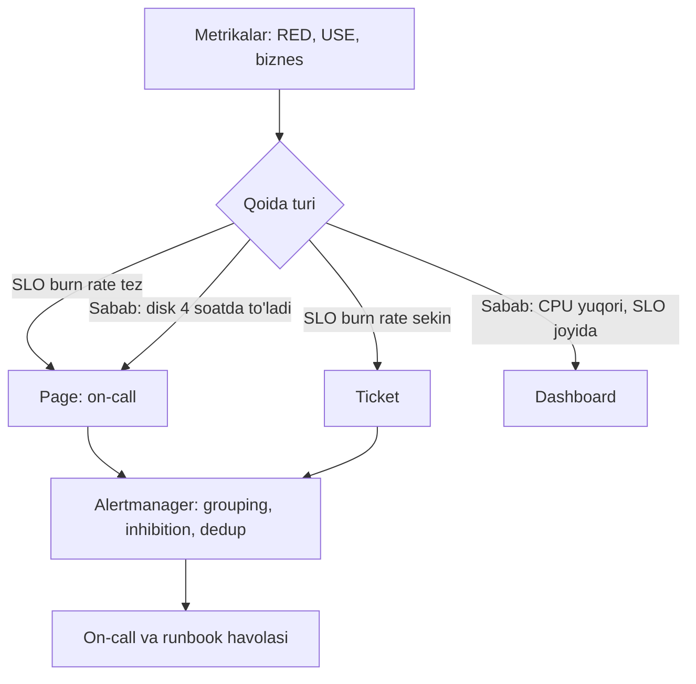

## Bu dars nima uchun kerak

66-darsda telemetriyani qanday yig'ishni ko'rdik. Endi ikkinchi savol: undan **nimani** kuzatamiz va **qachon odamni uyg'otamiz**? Ko'p jamoalar ikki chekkadan biriga tushadi: yo alert'lar juda kam va foydalanuvchilar muammoni jamoadan oldin topadi, yo alert'lar juda ko'p va on-call muhandis shovqindan charchab, haqiqiy muammoni o'tkazib yuboradi. Ikkalasi ham dizayn xatosi.

Bu dars uchta metodologiyani - Google ning to'rt oltin signali, RED va USE - va alerting ning muhandislik qoidalarini beradi: simptom va sabab, page va ticket, burn rate (65-dars), alert gigiyenasi va on-call yuklamasi.

Bu darsdan keyin siz:

- har bir servis uchun RED, har bir resurs uchun USE metrikalarini tanlay olasiz;
- simptom va sabab asosidagi alertlarni ajratib, qaysi biri page bo'lishini hal qila olasiz;
- black-box va white-box monitoringni birlashtirasiz;
- alert qoidasini (oyna, `for`, chegara) va routing ni (grouping, inhibition, silence) loyihalay olasiz;
- dashboard ierarxiyasini qura olasiz;
- on-call yuklamasini o'lchab, sog'lom chegaralarni bilasiz.

## Uch metodologiya

### To'rt oltin signal (Google)

Google SRE kitobining "Monitoring Distributed Systems" bobi foydalanuvchiga xizmat ko'rsatadigan tizim uchun minimal to'rt signalni belgilaydi:

- **Latency** - so'rovga xizmat ko'rsatish vaqti. Muvaffaqiyatli va xato so'rovlarni **alohida** kuzating: tez 500 xato o'rtachani yaxshilab ko'rsatadi, sekin xato esa eng yomoni.
- **Traffic** - tizimga talab: HTTP so'rov/s, bir vaqtdagi sessiyalar.
- **Errors** - muvaffaqiyatsiz so'rovlar tezligi. Uch turi: ochiq (HTTP 500), yashirin (200 lekin noto'g'ri kontent) va siyosat bo'yicha (va'da qilingan vaqtdan sekin javob ham xato).
- **Saturation** - servis qanchalik "to'la", eng cheklangan resursga e'tibor bilan. Tizimlar ko'pincha 100 foizdan oldin sekinlashadi, shuning uchun utilization maqsadi kerak. Latency o'sishi - saturation ning erta belgisi.

### RED (servislar uchun)

Tom Wilkie (Grafana Labs ning 2018 yilgi maqolasiga ko'ra) 2015 yilda microservice'lar uchun **RED** ni taklif qilgan: har bir servis uchun

- **Rate** - so'rov/s;
- **Errors** - ulardan qanchasi xato;
- **Duration** - qancha vaqt oladi (taqsimot, ya'ni histogram).

Wilkie ning fikricha RED - bu oltin signallardan saturation ni olib tashlangani, va uning asosiy afzalligi **bir xillik**: barcha servislar bir xil uchta metrika va bir xil dashboard ga ega bo'lsa, o'zi yozmagan kod uchun ham on-call bo'lish mumkin. Xato darajasi va latency foydalanuvchi tajribasiga yaqin bo'lgani uchun ular alert va SLA uchun yaxshi asos.

### USE (resurslar uchun)

Brendan Gregg ning USE metodi: **har bir resurs uchun** utilization, saturation va errors ni tekshiring.

- **Utilization** - resurs band bo'lgan vaqt ulushi (yoki capacity ulushi).
- **Saturation** - resurs hali xizmat ko'rsata olmayotgan qo'shimcha ish, odatda navbat uzunligi.
- **Errors** - xato hodisalari soni. Nol bo'lmagan har qanday son tekshirishga arziydi, hatto xato tiklangan bo'lsa ham.

| Resurs | Utilization | Saturation | Errors |
|---|---|---|---|
| CPU | CPU band foizi (har core va umumiy) | Run queue uzunligi, scheduler latency | - |
| Xotira | Ishlatilgan / mavjud | Swap, paging, OOM kill | Allocation xatolari |
| Tarmoq | RX/TX / maksimal o'tkazuvchanlik | Tashlangan paketlar, TCP retransmit | Interfeys xatolari |
| Disk | Device busy foizi | Wait queue uzunligi | Disk xatolari |
| Connection pool | Band connection'lar / max | Connection kutayotganlar | Timeout'lar |
| Node.js event loop | Event loop utilization | Event loop lag | - |
| Kafka consumer | - | Consumer lag | Deserializatsiya xatolari |

Gregg ning utilization ni talqin qilish bo'yicha ogohlantirishlari: 100% odatda bottleneck (saturation bilan tasdiqlang); taxminan 70 foizdan yuqori ham muammo bo'lishi mumkin; uzun o'rtacha qisqa portlashlarni yashiradi (5 daqiqalik o'rtacha soniyalab 100% ni ko'rsatmaydi). Disklar operatsiya o'rtasida to'xtatib bo'lmagani uchun 70 foizdan yuqori utilization da navbat kechikishlari tez-tez paydo bo'ladi, CPU esa preemption tufayli yuqori utilization ni yaxshiroq ko'taradi.

Oxirgi uch qator (pool, event loop, consumer lag) - USE ni **dasturiy resurslarga** qo'llash. Bu ko'pincha eng foydali qism: 63-darsdagi bulkhead pool'lari va 62-darsdagi connection'lar aynan shunday resurslar.

### Ular qanday birlashadi

| Metodologiya | Ob'ekt | Savol | Asosiy foydalanuvchi |
|---|---|---|---|
| RED | Servis, endpoint | Foydalanuvchi nimani his qilyapti? | Alert, SLO, on-call |
| USE | Resurs (apparat va dasturiy) | Nima to'lib qolgan yoki buzilgan? | Debugging, capacity planning |
| Oltin signallar | Foydalanuvchiga xizmat ko'rsatuvchi tizim | Ikkalasi: RED + saturation | Umumiy minimum |

Amaliy qoida: **RED bilan alert qiling, USE bilan debug qiling.** RED "foydalanuvchilar muammoga duch kelyapti" deydi, USE "chunki X pool to'lgan" deydi.

## Simptom va sabab

SRE kitobining asosiy g'oyasi: monitoring ikki savolga javob beradi - **nima buzilgan** (simptom) va **nima uchun** (sabab). Bir jamoaning simptomi boshqasining sababi bo'lishi mumkin: sekin baza o'qishlari baza SRE si uchun simptom, frontend SRE si uchun sabab.

| | Simptom asosidagi alert | Sabab asosidagi alert |
|---|---|---|
| Misol | "Xato darajasi SLO budget ini 14x tezlikda yemoqda" | "CPU 90% dan yuqori" |
| Foydalanuvchi ta'siri | Bevosita bog'liq | Bilvosita, ko'pincha yo'q |
| Shovqin | Kam | Ko'p: CPU 90% bo'lishi mumkin, hamma narsa yaxshi ishlab |
| Qamrov | Har qanday sabab (ma'lum va noma'lum) | Faqat oldindan o'ylangan sabablar |
| Qachon page | Ha | Faqat aniq va yaqinlashib kelayotgan bo'lsa (masalan, disk 4 soatda to'ladi) |

Kitob tavsiyasi: page'lar asosan simptomlarga, sabablarga faqat ular aniq va yaqin bo'lganda. Sabab metrikalari dashboard va ticket'larda, debugging uchun.

### Black-box va white-box

- **Black-box** - tashqaridan, foydalanuvchi ko'rgandek tekshirish (sintetik so'rovlar, prober). Simptomga yo'naltirilgan, "hozir sodir bo'layotgan" muammolarni ko'radi va page uchun yaxshi. Lekin yaqinlashayotgan muammoni ko'rmaydi.
- **White-box** - ichki ma'lumotlar (metrikalar, loglar). Yaqinlashayotgan muammolarni va retry ortida yashiringan nosozliklarni ko'radi, debugging uchun zarur.

Kitob white-box ni keng va kritik black-box tekshiruvlarni birga ishlatishni tavsiya qiladi. Black-box ning muhim roli: monitoring tizimining o'zi ishlamay qolganini (yoki white-box metrikalar "hammasi joyida" deb yolg'on gapirganini) ushlash. Masalan, servis o'z metrikalarini yubormay qo'ysa, white-box alert'lar jim turadi - "ma'lumot yo'q" holatining o'zi alert bo'lishi kerak.

## Alert qanday bo'lishi kerak

### Page mezonlari

SRE kitobining page uchun savollari (mazmunan):

1. Bu alert foydalanuvchiga ta'sir qiladigan, boshqa yo'l bilan aniqlanmaydigan holatni ko'rsatadimi?
2. Unga **harakat** qilish mumkinmi? Shoshilinchmi yoki ertalabgacha kutsa bo'ladimi?
3. Javob **aqlni** talab qiladimi? Agar javob robotik (har safar bir xil skript) bo'lsa, u avtomatlashtirilishi kerak, page emas.
4. Bu **yangi** muammomi yoki har hafta takrorlanadigan shovqinmi?

Kitob ta'kidlaydi: odam kuniga bir necha marta haqiqiy shoshilinchlik bilan javob bera oladi, keyin charchoq boshlanadi. Shuning uchun page kam bo'lishi kerak.

### Uch daraja

| Daraja | Qachon | Kanal | Javob vaqti |
|---|---|---|---|
| Page | SLO ga tez tahdid, foydalanuvchi ta'siri hozir | Telefon, push, qo'ng'iroq | Daqiqalar |
| Ticket | Sekin budget sarfi, yaqin kunlarda muammo | Issue tracker | Ish soatlari, kunlar |
| Ma'lumot | Kontekst, trend | Dashboard, log | Yo'q |

Kitobning "Practical Alerting" bobi xuddi shu bo'linishni Borgmon/Alertmanager misolida beradi: page'ga loyiq alertlar on-call ga, kamroq kritiklari ticket navbatiga, qolganlari dashboard dagi ma'lumot sifatida.

### Qoidaning tuzilishi

Alert qoidasi uch qismdan iborat: **ifoda**, **chegara**, **davomiylik** (`for`).

Kitobdagi misol mazmuni: xato ulushi 1 foizdan yuqori **va** xatolar soniyasiga 1 tadan ko'p, **2 daqiqa** davomida. Ikkinchi shart (mutlaq son) kam trafikda shovqinni oldini oladi: 10 ta so'rovdan 1 tasi xato = 10%, lekin bu soniyasiga 1 xato emas. `for` davomiyligi tebranishni (flapping) kamaytiradi; kitob uni kamida ikki baholash sikliga teng qo'yishni tavsiya qiladi, shunda bitta o'tkazib yuborilgan scrape soxta alert bermaydi. Shuningdek, kitob alohida mashina nosozliklari bo'yicha alert qilish juda shovqinli ekanini aytadi: alert'lar agregatsiyalangan servis darajasida bo'lishi kerak.

PromQL da RED asosidagi oddiy qoida:

```
sum(rate(http_requests_total{job="dispatch-api",code=~"5.."}[5m]))
/
sum(rate(http_requests_total{job="dispatch-api"}[5m]))
> 0.01
and
sum(rate(http_requests_total{job="dispatch-api",code=~"5.."}[5m])) > 1
```

Lekin 65-darsda ko'rdikki, eng yaxshi simptom alert'i - **SLO burn rate**. Yuqoridagi "1% xato" qoidasi SLO 99.9% bo'lsa 10x burn rate ga teng, lekin u qisqa sakrashlarda ham ishlaydi. Multiwindow burn rate (14.4x/1 soat va 5 daqiqa, 6x/6 soat va 30 daqiqa) bir vaqtda tez aniqlash, kam shovqin va tez o'chishni beradi.



### Routing: grouping, inhibition, silence

Prometheus Alertmanager (va shunga o'xshash tizimlar) uchta asosiy mexanizmni beradi:

- **Grouping** - o'xshash alert'larni bitta xabarga yig'ish. Katta uzilishda yuzta alert o'rniga bitta ixcham xabar.
- **Inhibition** - boshqa bog'liq alert faol bo'lganda ba'zi alert'larni bostirish. Masalan, butun klaster yetib bo'lmaydigan bo'lsa, undagi servislar haqidagi alert'larni.
- **Silence** - rejalashtirilgan ish yoki ma'lum incident paytida mos alert'larni vaqtincha o'chirish.

Alertmanager ning o'zi ham yuqori availability bilan klaster sifatida ishlashi mumkin; Prometheus hujjati Prometheus ni load balancer orqali emas, barcha Alertmanager'lar ro'yxatiga yo'naltirishni tavsiya qiladi. Alerting tizimi - reliability komponenti: u monitoring qilinayotgan tizimdan **mustaqil** infratuzilmada bo'lishi kerak (61-dars, yashirin SPOF), va "alerting ishlayapti" ni tekshiradigan **dead man's switch** (doim yonib turadigan alert, u to'xtasa tashqi servis xabar beradi) kerak.

### Har bir page runbook bilan

Har bir page alert ida: nima bo'ldi (simptom), qanday ta'sir, dashboard havolasi, **runbook** havolasi (birinchi tekshiruvlar va xavfsiz harakatlar: rollback, trafikni o'tkazish, kill switch). Runbook yo'q alert - har kecha qayta ixtiro qilinadigan javob.

## Tail, rezolyutsiya va soddalik

SRE kitobidan uchta texnik tavsiya:

- **Dumni kuzating.** O'rtacha 100 ms, 1 000 so'rov/s bo'lishi mumkin, lekin so'rovlarning 1 foizi taxminan 5 soniya olishi ham mumkin. Latency ni taxminan eksponensial bucket'li histogram bilan yig'ing (masalan, 0-10, 10-30, 30-100, 100-300 ms - har biri taxminan 3 baravar).
- **Rezolyutsiyani maqsadga moslang.** 1 daqiqalik CPU o'rtachasi tail latency ga sabab bo'ladigan qisqa sakrashlarni ko'rmaydi. Boshqa tomondan, 99.9% availability maqsadi (yiliga taxminan 9 soat) uchun daqiqasiga bir-ikki martadan ko'p prober ehtimol kerak emas.
- **Imkon qadar sodda.** Kamdan-kam ishlaydigan alert'lar va hech qaysi dashboard yoki alert ishlatmaydigan signallarni olib tashlang. Murakkab, mo'rt monitoring o'zi incident manbai.

### Bigtable misoli

SRE kitobi ibratli hikoyani keltiradi: Bigtable ning SLO si o'rtacha latency ga asoslangan bo'lgan, eng sekin 5% so'rovlar esa o'rtachani boshqargan. Natijada email va page alert'lari doim yonib turgan, muhandislar vaqtini shovqinni saralashga sarflagan va haqiqiy foydalanuvchi muammolarini o'tkazib yuborgan. Jamoa vaqtincha SLO maqsadini 75-percentile latency ga tushirgan va email alert'larini o'chirgan, bu esa asosiy muammolarni tuzatishga vaqt bergan. Saboq: shovqinli alert - texnik qarz, va uni "chidab" emas, **qayta loyihalab** yechish kerak.

## Dashboard dizayni

Yaxshi dashboard'lar ierarxik:

1. **Xizmat darajasi (SLO dashboard)** - har bir user journey uchun SLI, SLO, qolgan error budget, burn rate. "Hammasi joyidami?" savoliga 5 soniyada javob.
2. **Servis dashboard (RED)** - har bir servis uchun bir xil shablon: rate, errors, duration (p50, p90, p99), endpoint bo'yicha; deploy belgilari (versiya o'zgarishi vertikal chiziq).
3. **Resurs dashboard (USE)** - pod, node, baza, pool, navbat, event loop.
4. **Bog'liqliklar** - har bir downstream uchun client tomonidagi RED (ular sizning metrikangiz, ularning emas), circuit breaker holati, retry darajasi (62-dars).

Deploy belgilari ayniqsa muhim: SRE tajribasida uzilishlarning taxminan 70 foizi o'zgarishlardan (61-dars), va "grafik qachon buzildi" bilan "nima deploy qilindi" ni yonma-yon ko'rish MTTR ni sezilarli kamaytiradi.

## On-call yuklamasi

Monitoring dizaynining yakuniy o'lchovi - odamlar. SRE kitobining "Being On-Call" bobidagi raqamlar:

- SRE vaqtining 25 foizidan ko'pi on-call ga ketmasligi kerak;
- 12 soatlik smenada **ko'pi bilan 2 ta incident** - chunki bitta incident o'rtacha 6 soat oladi (tahlil, tuzatish, postmortem);
- javob vaqti: foydalanuvchiga ta'sir qiladigan servislar uchun 5 daqiqa, kamroq kritiklar uchun 30 daqiqa;
- jamoa hajmi: bitta joyda kamida 8 muhandis (oyiga taxminan bir hafta on-call), ikki joyda har birida kamida 6;
- page'lar taqsimoti: kuniga page'lar medianasi 0 bo'lishi kerak, kuniga 1 dan ko'p incident medianasi barqaror emas;
- alert va incident nisbati 1:1 ga yaqin bo'lishi kerak (bitta muammo - bitta alert, grouping orqali).

Ortiqcha yuklamada kitob tavsiyalari: page'larni SLO ga tahdid soladigan simptomlarga moslash, soatiga bir yoki undan tez-tez ishlaydigan past prioritetli alert'larni to'xtatish, bog'liq alert'larni guruhlash, va o'lchanadigan maqsadlar qo'yish.

Kichik jamoa uchun hisob: 4 muhandis, 24/7 on-call, haftalik rotatsiya - har biri oyda bir hafta, yiliga taxminan 13 hafta. Agar haftasiga 10 ta page bo'lsa va har biri o'rtacha 1 soat (shu jumladan tunda uyqudan uyg'onish va qayta uxlay olmaslik), bu 13 × 10 = yiliga 130 soat uzilgan ish va uyqu har bir kishi uchun. Bu raqamni rahbariyatga ko'rsatish shovqinli alert'larni tuzatishga resurs olishning eng yaxshi yo'li.

## iQuariX kontekstida

Faraz qiling, iQuariX ning monitoring tizimi quyidagicha loyihalanmoqda.

**SLO page'lari (65-darsdan):**

- telemetriya qabul qilish availability: burn rate 14.4x (1 soat / 5 daqiqa) va 6x (6 soat / 30 daqiqa) - page;
- xarita freshness (joylashuv 30 s dan yangi): burn rate - page;
- dispetcher API latency: burn rate - page ish soatlarida, tunda ticket (chunki dispetcherlar tunda kam);
- barcha SLO lar uchun 1x/3 kun - ticket.

**Sabab asosidagi page'lar (faqat aniq va yaqin):**

- Kafka disk 6 soatdan kam vaqtda to'ladi (bu prognoz, `predict_linear` kabi);
- TLS sertifikat muddati 7 kundan kam (61-dars, yashirin SPOF);
- "ma'lumot yo'q": ingest gateway 5 daqiqa davomida bironta metrika yubormagan.

**Ticket va dashboard (USE):**

- PostgreSQL connection pool utilization va kutayotganlar;
- Node.js event loop lag (p99);
- Kafka consumer lag har bir consumer group uchun;
- TimescaleDB disk va compaction navbati.

**Biznes sog'liq signali.** Faol trekerlar soni - eng kuchli black-box signallardan biri. Odatda ish kunining shu soatida 22 000 treker onlayn bo'lsa va to'satdan 15 000 ga tushsa, bu bizning ingest muammomiz yoki mobil operator nosozligi. Qoida: o'tgan haftaning shu vaqtiga nisbatan 20 foizdan ko'p tushish 10 daqiqa davomida - page. Muhim: operator bo'yicha (SIM karta operatori label bilan) ajratilsa, "bizning muammo" va "operator muammosi" darhol farqlanadi.

**Inhibition.** Agar ingest gateway "ma'lumot yo'q" alerti faol bo'lsa, freshness va "trekerlar soni tushdi" alert'lari bostiriladi - bitta sabab, bitta page.

**Soxta yoqilg'i ogohlantirishlari.** Bu mijozga ko'rinadigan biznes alert (85-dars, notification). Ular ham monitoring qilinadi: soatiga yuborilgan "to'kish" ogohlantirishlari normal darajadan 5 baravar oshsa, bu ehtimol datchik yoki algoritm muammosi, va dispetcherlarni soxta xabarlar bilan to'ldirishdan oldin jamoa bilishi kerak.

## Ko'p uchraydigan xatolar

1. **Sabab metrikalari bo'yicha page.** "CPU 85%" tunda uyg'otadi, foydalanuvchilar esa hech narsa sezmaydi.
2. **Faqat white-box.** Servis metrika yubormay qo'ysa yoki DNS buzilsa, hammasi "yashil".
3. **Kam trafikda foizli alert.** 3 ta so'rovdan 1 tasi xato = 33%. Mutlaq son sharti qo'shing.
4. **`for` siz qoidalar.** Bitta scrape sakrashi page beradi.
5. **Runbook siz page.** Har bir alert kechasi qayta o'rganiladi.
6. **Alerting monitoring qilinayotgan infratuzilmada.** Klaster o'chsa, xabar berish ham o'chadi. Dead man's switch kerak.
7. **Har bir servis o'z dashboard uslubida.** RED shabloni yo'q, on-call har safar boshqa grafikni o'rganadi.
8. **Shovqinga ko'nikish.** Har hafta e'tiborsiz qoldiriladigan alert - o'chirilishi yoki tuzatilishi kerak bo'lgan texnik qarz.

## Xulosa

- RED (rate, errors, duration) - servislar uchun, foydalanuvchi tajribasi; USE (utilization, saturation, errors) - resurslar uchun, shu jumladan pool, navbat va event loop. RED bilan alert, USE bilan debug.
- Page simptomlarga (eng yaxshisi SLO burn rate), sabablarga faqat ular aniq va yaqin bo'lganda.
- Black-box va white-box birga: "ma'lumot yo'q" ham alert.
- Har page: harakat qilsa bo'ladigan, aql talab qiladigan, yangi va runbook bilan.
- Qoida: ifoda + mutlaq son sharti + `for`; routing: grouping, inhibition, silence; alerting mustaqil infratuzilmada.
- On-call yuklamasi o'lchanadi: smenada 2 incident dan ko'p emas, page medianasi kuniga 0.

## Amaliy topshiriq

iQuariX ning **video modul** i uchun monitoring va alerting dizaynini yozing (65-darsdagi topshiriqda SLO larni yozgan bo'lsangiz, ulardan foydalaning). Komponentlar: DVR'lar (5 000, mobil tarmoq), video ingest serverlari (RTSP/RTMP qabul qiladi, 84-dars), transcoding worker'lar, object storage, video API (dispetcher uchun jonli efir va arxiv).

1. Har bir servis uchun RED metrikalarini aniq nomlari va label'lari bilan yozing.
2. Har bir resurs uchun USE jadvalini tuzing (kamida 6 ta resurs, shu jumladan dasturiy resurslar: transcoding navbati, ingest ulanishlari).
3. Page bo'ladigan alert'lar ro'yxati (5 tadan ko'p bo'lmasin): har biri uchun ifoda (PromQL yoki so'z bilan), chegara, `for`, va nima uchun bu page.
4. Ticket bo'ladigan alert'lar va dashboard'da qoladigan signallar ro'yxati.
5. Inhibition qoidalari: qaysi alert qaysilarini bostiradi? Mobil operator uzilishini o'z nosozligingizdan qanday ajratasiz?
6. On-call yuklamasini baholang: jamoada 3 muhandis. Haftasiga qancha page bo'lsa barqaror? Hozir haftasiga 25 ta bo'lsa, qanday qadamlar bilan kamaytirasiz?

Yaxshi javobda bo'lishi kerak bo'lgan narsalar:

- page'lar simptom asosida (burn rate yoki foydalanuvchi ko'radigan xato), sabab page'lari faqat aniq va yaqin holatlar uchun;
- USE da navbat va ulanishlar kabi dasturiy resurslar;
- kam trafik uchun mutlaq son sharti va `for`;
- black-box tekshiruv (sintetik jonli efir ochish) va "ma'lumot yo'q" alerti;
- operator bo'yicha ajratish va inhibition;
- on-call yuklamasi raqamlar bilan va shovqinni kamaytirish rejasi.

Javobni pastdagi maydonga yozib, chatga yuboring.

## Manbalar

- Google. [Site Reliability Engineering, "Monitoring Distributed Systems"](https://sre.google/sre-book/monitoring-distributed-systems/) - to'rt oltin signal, simptom va sabab, black-box/white-box, Bigtable misoli.
- Google. [Site Reliability Engineering, "Practical Alerting from Time-Series Data"](https://sre.google/sre-book/practical-alerting/) - qoida tuzilishi, `for`, Alertmanager, page/ticket/dashboard.
- Google. [Site Reliability Engineering, "Being On-Call"](https://sre.google/sre-book/being-on-call/) - on-call yuklamasi raqamlari.
- Google. [The Site Reliability Workbook, "Alerting on SLOs"](https://sre.google/workbook/alerting-on-slos/) - burn rate alert'lari.
- Brendan Gregg. [The USE Method](https://www.brendangregg.com/usemethod.html).
- Grafana Labs. [The RED Method: How to instrument your services](https://grafana.com/blog/2018/08/02/the-red-method-how-to-instrument-your-services/), 2018 - Tom Wilkie.
- Prometheus. [Alertmanager](https://prometheus.io/docs/alerting/latest/alertmanager/) - grouping, inhibition, silences, HA.
