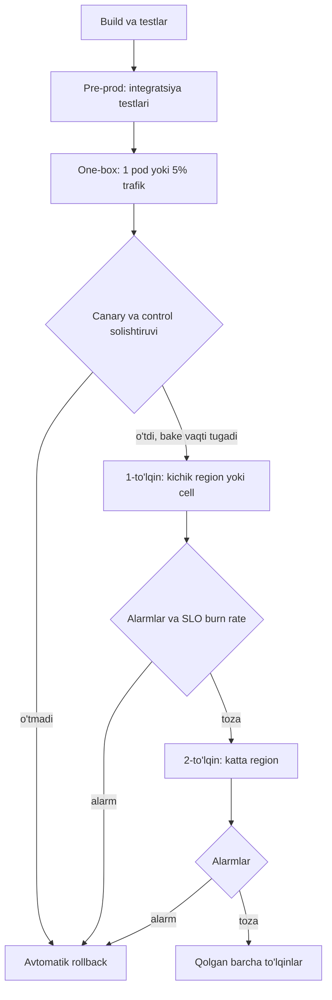

## Bu dars nima uchun kerak

61-darsda Google SRE tajribasidagi raqamni ko'rdik: uzilishlarning taxminan 70 foizi ishlab turgan tizimdagi **o'zgarishlardan** kelib chiqadi. 65-darsda error budget ni o'zgarish tezligini boshqarish vositasi sifatida ko'rdik. Demak reliability ning eng katta dastagi - o'zgarishlarni qanday yetkazishimiz.

Deploy strategiyasi ikki savolga javob beradi:

1. Yangi versiya xato bo'lsa, **qancha foydalanuvchi** zarar ko'radi (blast radius)?
2. Xato topilganda **qanchalik tez** qaytaramiz (MTTR)?

Bu darsdan keyin siz:

- deploy va release ni ajrata olasiz;
- recreate, rolling, blue-green, canary va shadow strategiyalarini narx, blast radius va rollback tezligi bo'yicha taqqoslay olasiz;
- Kubernetes rolling update parametrlarini hisoblay olasiz;
- canary ni o'lchash, solishtirish va avtomatik rollback mezonlarini loyihalay olasiz;
- feature flag turlari, ularning qarzi va xavflarini bilasiz;
- baza sxemasi va ma'lumot formatini rollback-xavfsiz o'zgartirish (expand/contract) ni qo'llay olasiz;
- konfiguratsiya o'zgarishlari ham kod kabi bosqichma-bosqich yetkazilishi kerakligini real misollar bilan asoslay olasiz.

## Deploy va release

- **Deploy** - yangi kodni production infratuzilmaga o'rnatish.
- **Release** - yangi xatti-harakatni foydalanuvchilarga ochish.

Ular bir xil narsa bo'lishi shart emas. Pete Hodgson ning martinfowler.com dagi "Feature Toggles" maqolasi (2017) release toggle'larning asosiy maqsadini aynan shunday ta'riflaydi: tugallanmagan kodni yashirin holda trunk ga va production ga yetkazish, ya'ni release ni deploy dan ajratish. Bu ajratish ikki narsani beradi: deploy kichik va tez-tez bo'ladi (kam risk), release esa biznes qarori bo'lib, kod o'zgarishisiz yoqiladi va o'chiriladi.

## Strategiyalar

### Recreate

Eski versiyani to'xtatib, yangisini ishga tushirish. Uzilish bor, lekin hech qachon ikki versiya bir vaqtda ishlamaydi. Faqat ichki tool'lar yoki ikki versiya birga ishlay olmaydigan (masalan, eksklyuziv resursga ega) holatlar uchun.

### Rolling update

Instance'larni partiyalab almashtirish. Kubernetes Deployment ning default strategiyasi. Rasmiy hujjatga ko'ra:

- `maxUnavailable` - default 25%, foizdan son **pastga** yaxlitlanadi;
- `maxSurge` - default 25%, foizdan son **yuqoriga** yaxlitlanadi;
- `progressDeadlineSeconds` - default 600; shu vaqt ichida progress bo'lmasa Deployment `ProgressDeadlineExceeded` holatini oladi, lekin o'zi avtomatik rollback qilmaydi.

Hisob: 10 replika, default sozlamalar. maxUnavailable = floor(2.5) = 2, maxSurge = ceil(2.5) = 3. Deploy paytida kamida 8 ta pod tayyor, ko'pi bilan 13 ta pod mavjud. Agar servis cho'qqida 9 pod capacity talab qilsa, 8 ta bilan cho'qqida deploy qilish ortiqcha yuklama beradi. 61-darsdagi N+2 mantiqi shu yerda: deploy capacity ni oladi.

Rolling ning muammolari: rollback ham rolling (sekin), deploy davomida **ikki versiya bir vaqtda** trafik oladi (API, ma'lumot formati, cache kalitlari mos bo'lishi kerak), va yangi versiyaga ulush kodda boshqarilmaydi (pod'lar soni bilan).

### Blue-green

Martin Fowler ning 2010 yilgi tavsifi: ikkita iloji boricha bir xil muhit. Biri (aytaylik, blue) jonli, ikkinchisida (green) yangi release o'rnatiladi va tekshiriladi. Keyin router trafikni green ga o'tkazadi. Muammo bo'lsa, xuddi shunday tez blue ga qaytariladi.

- Afzallik: rollback - router o'zgarishi, soniyalar; yangi versiya trafik olishdan oldin to'liq tayyor.
- Kamchilik: taxminan ikki baravar resurs (deploy paytida). Google SRE Workbook ning "Canarying Releases" bobi muhim nuqtani qo'shadi: o'zi alohida ishlatilganda blue-green aslida "oldin va keyin" taqqoslash, va bu xavfli, chunki vaqtga bog'liq o'zgarishlar (masalan, hafta kuni va dam olish trafigi) natijani chalkashtiradi. Trafikni bosqichma-bosqich bo'lsa, blue-green canary ga aylanadi.
- Baza: ikkala versiya bir xil bazadan foydalanadi. Fowler yozganidek, sxema o'zgarishi avval ikkala versiyani qo'llab-quvvatlaydigan qilib qo'yiladi, keyin yangi ilova chiqariladi, eski versiyani qo'llab-quvvatlash keyinroq olib tashlanadi (pastda expand/contract).

### Canary

SRE Workbook ta'rifi: o'zgarishning qisman va vaqt bilan cheklangan deploy i, uning **baholanishi** bilan, va baholash natijasiga ko'ra rollout davom etadi yoki to'xtaydi. **Canary** - o'zgarishni olgan qism, **control** - qolgan servis. Bu mohiyatan A/B test.

Canary ning kuchi blast radius ni cheklashda. Workbook dagi hisob: defekt so'rovlarning 20 foizini buzsa, to'liq deploy da global xato 20% bo'ladi; 5% canary da esa umumiy xato taxminan 1% (0.05 × 0.2 = 0.01).

### Shadow (dark launch)

Production trafigining nusxasi yangi versiyaga yuboriladi, lekin uning javobi foydalanuvchiga **qaytarilmaydi**, faqat solishtiriladi. Foydalanuvchi ta'siri nol. Lekin yon ta'sirli operatsiyalar (to'lov, SMS, bazaga yozish) uchun shadow xavfli: ular ikki marta bajariladi, shuning uchun yon ta'sirlar o'chirilishi yoki mock qilinishi kerak.

### Taqqoslash

| Strategiya | Blast radius | Rollback tezligi | Qo'shimcha resurs | Ikki versiya birga | Qachon |
|---|---|---|---|---|---|
| Recreate | 100% | Sekin (qayta deploy) | Yo'q | Yo'q | Ichki tool, eksklyuziv resurs |
| Rolling | O'sib boradi, 100% gacha | Sekin (rolling) | maxSurge ga teng | Ha | Stateless servislar, default |
| Blue-green | 100% bir zumda | Soniyalar | Taxminan 2x | Qisqa vaqt | Tez rollback muhim, resurs bor |
| Canary | Canary ulushi (1-10%) | Tez (canary ni olib tashlash) | Kichik | Ha, uzoq vaqt | Ko'p trafikli servislar |
| Shadow | 0% (javob qaytmaydi) | Kerak emas | Taxminan 2x hisoblash | Ha | Katta qayta yozishlar, o'qish yo'llari |
| Feature flag | Flag segmentiga teng | Soniyalar (flag o'chirish) | Yo'q | Kod ichida | Funksiyani release qilish, kill switch |

## Canary ni to'g'ri qilish

### Nimani o'lchash

Workbook tavsiyalari:

- canary metrikalari foydalanuvchi sezadigan muammolarni ko'rsatishi kerak; SLI lar (65-dars) - eng yaxshi boshlanish nuqtasi;
- kuchli metrikalar: HTTP javob kodlari va latency; zaif: butun tizim CPU si (shovqinli). CPU kerak bo'lsa, so'rov boshiga CPU vaqti yaxshiroq;
- metrikalarni muhimlik bo'yicha tartiblab, eng yuqoridagi bir nechtasini (ehtimol o'n ikkitadan ko'p emas) ishlating;
- 4xx kodlarni (masalan 404) baholashdan chiqaring;
- metrika agregatsiya oralig'i canary davomiyligidan uzun bo'lmasin: 30 daqiqalik canary uchun soatlik xato metrikasi signalni loyqalaydi.

### Agregatsiyalangan metrika canary ni yashiradi

Workbook dagi misol: 5% canary dagi 20% xato umumiy grafikda faqat taxminan 1% bo'lib ko'rinadi. Agar umumiy alert chegarasi 2% bo'lsa, u hech qachon ishlamaydi. Shuning uchun canary va control alohida label (masalan, `version` yoki `track="canary"`) bilan o'lchanadi va **bir-biri bilan** solishtiriladi:

```
canary_error_ratio / control_error_ratio > 2  va  canary_errors > 10 (oynada)
```

Mutlaq son sharti 67-darsdagi kabi kam trafik shovqinidan himoya qiladi.

### Davomiylik va vaqt

- Workbook: davomiylik reprezentativ namuna olish uchun yetarli bo'lishi kerak, lekin release tezligi bilan cheklangan (kuniga 20 marta deploy qiladigan servis haftalik canary ga ega bo'lolmaydi).
- Bir vaqtda faqat bitta canary - aks holda signallar aralashadi.
- Yuklama yuqori bo'lgan paytda canary qiling, chunki performance defektlari ko'pincha faqat yuklamada chiqadi.
- Interaktiv bo'lmagan tizimlarda (batch, worker) canary kamida bitta ish birligi davomida ishlashi kerak.

### Error budget bilan bog'liqlik

Canary riski uning hajmi va davomiyligi bilan chegaralanadi, va budget ga ta'siri defektga duch kelgan trafik ulushiga proporsional. Eng yomon holatda (canary dagi so'rovlarning 100 foizi xato): 5% canary 30 daqiqa = 0.05 × 30 = 1.5 daqiqa to'liq uzilish ekvivalenti. 99.9% SLO, 30 kun = 43.2 daqiqa budget. Bitta muvaffaqiyatsiz canary budgetning taxminan 3.5 foizi. Bu hisob canary hajmini tanlashga yordam beradi: budget kam qolganda canary kichikroq va qisqaroq bo'lishi kerak.

### Avtomatik canary tahlili

Qo'lda "grafiklarga qarash" kechasi va shoshilinchda ishonchsiz. Avtomatik tahlil (masalan, Spinnaker ekotizimidagi ochiq "Automated Canary Service" - [Kayenta](https://github.com/spinnaker/kayenta)) canary va control metrikalarini statistik solishtiradi va "o'tdi / o'tmadi" qarorini qaytaradi. Pipeline bu qarorga ko'ra keyingi bosqichga o'tadi yoki rollback qiladi.



## Real misol: Amazon ning qo'lsiz deploy lari

AWS Builders' Library dagi Clare Liguori ning "Automating safe, hands-off deployments" (2020) maqolasi Amazon pipeline larini batafsil tasvirlaydi:

- **Bosqichlar**: source, build, test, production. Source faqat ilova kodi emas: infratuzilma, konfiguratsiya va OS patch'lari ham o'z pipeline lari orqali o'tadi.
- **Pre-production**: alpha va beta da funksional va end-to-end testlar; gamma - production ga o'xshash va bir nechta regionda.
- **One-box**: yangi kod bitta box ga (bitta VM, bitta konteyner yoki Lambda chaqiruvlarining kichik qismi); u odatda region yoki AZ so'rovlarining ko'pi bilan 10 foiziga xizmat qiladi.
- **To'lqinlar (waves)**: production o'sib boradigan to'lqinlarga bo'linadi. 1-to'lqin so'rov hajmi kichik regionda, bir vaqtda bitta AZ yoki cell; 2-to'lqin katta hajmli regionda; keyingi to'lqinlar ko'proq regionni parallel qamraydi.
- **Rolling**: har partiya ko'pi bilan 33% box ni almashtiradi, kamida 66% capacity sog'lom qoladi.
- **Bake vaqti**: odatiy minimumlar - har one-box bosqichidan keyin 1 soat, birinchi regional to'lqindan keyin 12 soat, keyingi to'lqinlardan keyin 2-4 soat. To'liq global rollout taxminan 4-5 ish kuni.
- **Avtomatik rollback**: deploy paytida yuqori jiddiylikdagi alarm ishlasa, o'zgarish avtomatik qaytariladi; one-box uchun faqat o'sha box ga tegishli alarmlar ham bor; so'rovlar sonining keskin tushishi kabi anomaliya ham rollback ni qo'zg'atishi mumkin.
- **Bloklovchilar**: alarm faol bo'lganda deploy bloklanadi; vaqt oynalari tunlar, dam olish kunlari, bayramlar va ko'pincha juma kunlarini chiqarib tashlaydi.
- **Rollback xavfsizligi**: orqaga moslik, masalan yangi kod joriy kod o'qiy oladigan formatda yozishi.

E'tibor bering: bu jarayon sekin ko'rinadi (global rollout bir hafta), lekin u **qo'lsiz**. Muhandis vaqtini emas, kalendar vaqtini sarflaydi, va bir vaqtda ko'p o'zgarish pipeline da harakatlanadi.

## Konfiguratsiya - bu ham kod

Ko'p yirik uzilishlar kod deploy idan emas, **konfiguratsiya yoki ma'lumot** o'zgarishidan bo'lgan, va ular bosqichma-bosqich emas, darhol global tarqalgan.

**CrowdStrike, 2024 yil 19 iyul.** CrowdStrike ning dastlabki post-incident hisobotiga ko'ra, muammo sensor kodida emas, "Rapid Response Content" deb ataladigan konfiguratsiya ma'lumotida (Channel File 291) bo'lgan. Content Validator dagi bug muammoli Template Instance ni o'tkazib yuborgan; sensor uni yuklaganda xotiradan chegaradan tashqari o'qish sodir bo'lgan va Windows qulab tushgan. Ta'sirlangan oyna 04:09 dan 05:27 UTC gacha. Microsoft taxminiga ko'ra 8.5 million Windows qurilma ta'sirlangan (barcha Windows mashinalarining 1 foizidan kam). CrowdStrike e'lon qilgan tuzatishlar orasida: Rapid Response Content uchun **canary** dan boshlanadigan bosqichma-bosqich deploy va mijozlarga yangilanish qachon va qayerga o'rnatilishini boshqarish imkoniyati.

**Cloudflare, 2025 yil 18 noyabr.** Cloudflare blogiga ko'ra, 11:05 UTC dagi baza ruxsatlari o'zgarishi Bot Management "feature file" ni hosil qiladigan ClickHouse so'rovining takroriy qatorlar qaytarishiga va fayl hajmi taxminan ikki baravar oshishiga olib kelgan. Fayl har 5 daqiqada qayta yaratilib, butun tarmoqqa yuborilgan; proxy dasturida 200 ta feature chegarasi bo'lgan (ishlatilgani taxminan 60), katta fayl chegaradan oshgan va dastur panic bilan 5xx qaytargan. Asosiy ta'sir 14:30 da hal qilingan, barcha servislar 17:06 da tiklangan. Tuzatishlar orasida: o'zlari yaratgan konfiguratsiya fayllarini foydalanuvchi kiritgan ma'lumot kabi qat'iy tekshirish va ko'proq global kill switch'lar.

Umumiy saboq: **har qanday global o'zgarish** - kod, konfiguratsiya, feature flag, ML model, qoida fayli, sxema - bir xil xavf kategoriyasida. Ularning hammasi uchun bosqichma-bosqich yetkazish, validatsiya, va iste'molchi tomonda xato fayllarga chidamlilik (eski yaxshi versiyada qolish) kerak.

## Feature flag

### Turlari

Hodgson maqolasi to'rt kategoriyani ajratadi:

| Tur | Maqsad | Umri | Dinamikligi |
|---|---|---|---|
| Release | Tugallanmagan kodni yashirin yetkazish | Qisqa, odatda 1-2 hafta | Past, release bo'yicha |
| Experiment | A/B test, foydalanuvchini barqaror kogortaga biriktirish | Statistik natija uchun kerakli vaqt | So'rov bo'yicha yuqori |
| Ops | Incident yoki yuklamada funksiyani tez o'chirish (kill switch) | Ko'pincha qisqa, ba'zi kill switch'lar uzoq | Redeploy siz, tez o'zgartirish |
| Permissioning | Funksiyani ma'lum foydalanuvchilarga ochish (premium, beta) | Yillar | Juda yuqori, foydalanuvchi bo'yicha |

Ops flag'lar - 64-darsdagi graceful degradation ning boshqaruv paneli.

### Flag qarzi

Hodgson flag'larni **inventar** deb ataydi: ular shartli logika va test yukini oshiradi, shuning uchun iloji boricha kam bo'lishi kerak. Taktikalar: har release flag uchun darhol "olib tashlash" vazifasi, muddat, muddati o'tgan flag testni yiqitadigan "time bomb", va umumiy flag soniga cheklov.

### Flag tizimining reliability si

- **Flag servisi SPOF bo'lmasligi kerak.** SDK flag qiymatlarini lokal cache lab, servis ishlamasa oxirgi ma'lum qiymat yoki xavfsiz default bilan ishlashi kerak (61-dars, static stability).
- **Flag o'zgarishi - deploy.** Flag ni 0% dan 100% ga birdan o'tkazish - deploy siz to'liq release. U ham bosqichma-bosqich (1%, 10%, 50%, 100%) va monitoring bilan.
- **Test**: Hodgson ta'kidlaydi - har artefakt flag yoqilgan va o'chirilgan holatda tekshirilishi kerak; kamida kutilgan production konfiguratsiyasi va fallback konfiguratsiyasi.

## Rollback-xavfsiz o'zgarishlar: expand/contract

Rolling, canary va blue-green ning barchasida ikki versiya bir vaqtda ishlaydi va rollback eski versiyani yangi versiya yozgan ma'lumot bilan uchrashtiradi. Shuning uchun har bir o'zgarish **ikki tomonga moslashuvchan** bo'lishi kerak.

Danilo Sato ning martinfowler.com dagi "Parallel Change" (2014) pattern i uch bosqichni beradi: **expand** (yangisini eskisi bilan yonma-yon qo'shish), **migrate** (iste'molchilarni bosqichma-bosqich ko'chirish), **contract** (eskisini olib tashlash). Maqola uning baza refaktoringi va canary/blue-green dagi qo'llanishini ham qayd etadi.

PostgreSQL da ustun nomini o'zgartirish misoli (`fuel_level` dan `fuel_level_pct` ga):

1. **Expand**: yangi ustun qo'shish (nullable). Hech qanday kod uni ishlatmaydi. Rollback xavfsiz.
2. **Ikki tomonga yozish**: kod har ikkala ustunga yozadi, eskisidan o'qiydi. Deploy, bake.
3. **Backfill**: eski qatorlarni partiyalab yangi ustunga ko'chirish (katta jadvalda bitta UPDATE emas, lock va replication lag ni hisobga olib).
4. **O'qishni almashtirish**: kod yangi ustundan o'qiydi, hali ham ikkalasiga yozadi. Deploy, bake. Rollback hali ham xavfsiz.
5. **Eskisiga yozishni to'xtatish**: deploy, bake.
6. **Contract**: eski ustunni o'chirish. Bu qadam qaytarilmaydi, shuning uchun eng oxirida va alohida.

Xuddi shu mantiq **ma'lumot formatlariga** (Kafka xabarlari, cache qiymatlari, JSON maydonlari, 10-dars schema evolution) taalluqli: yangi o'quvchi avval chiqariladi (eski va yangi formatni o'qiy oladi), keyin yangi yozuvchi. Aks holda rollback paytida eski kod yangi formatdagi xabarni o'qiy olmaydi va consumer to'xtaydi.

## Rollback va roll-forward

- **Rollback** - eski versiyaga qaytish. Tez va oldindan sinalgan bo'lishi kerak; incident paytidagi default harakat. Sabab aniq bo'lmasa ham, oxirgi o'zgarish yaqinda bo'lgan bo'lsa, avval rollback, keyin tahlil.
- **Roll-forward** - tuzatishni tez chiqarish. Rollback imkonsiz bo'lganda (masalan, qaytarilmaydigan migratsiya bajarilgan) yoki tuzatish juda kichik va aniq bo'lganda.

Qoida: agar sizning o'zgarishingiz rollback ni imkonsiz qilsa (contract bosqichi, ma'lumot formatini o'zgartirish), bu **alohida, ehtiyotkor** deploy bo'lishi kerak va boshqa o'zgarishlar bilan aralashmasligi kerak.

## iQuariX kontekstida

Faraz qiling, iQuariX ning bir nechta deploy turi bor.

**1. Stateless API (dispetcher, NestJS).** Kubernetes, 12 replika. Strategiya: canary 1 pod (taxminan 8%), 30 daqiqa bake ish soatida, canary va control RED metrikalari `version` label bilan solishtiriladi; keyin rolling `maxUnavailable: 0`, `maxSurge: 25%` (capacity hech qachon kamaymaydi). Muvaffaqiyatsiz bo'lsa avtomatik `rollout undo`.

**2. Ingest gateway (uzoq TCP ulanishlar).** Bu yerda oddiy rolling ning muammosi bor: pod o'chganda unga ulangan minglab treker uziladi va qayta ulanadi (62-dars, thundering herd). Yechimlar:

- graceful shutdown: pod yangi ulanish qabul qilishni to'xtatadi, mavjud ulanishlarga bir necha daqiqa beradi, keyin ularni **bosqichma-bosqich** yopadi (bir vaqtda hammasini emas);
- partiya kichik (bir vaqtda bitta pod), partiyalar orasida trekerlar qayta ulanib, yuklama barqarorlashguncha kutish;
- canary mezoni: yangi pod dagi ulanishlar uchun paket parse xatolari, ACK latency.

**3. Treker protokoli parser.** Yangi treker modeli uchun parser qo'shildi. Xato parser butun gateway ni yiqitishi mumkin (CrowdStrike kabi). Yechim: parser ni feature flag ortida, avval bitta test mijozning trekerlari uchun (permissioning flag), keyin model bo'yicha; noma'lum yoki noto'g'ri paket butun jarayonni emas, faqat shu paketni rad etadi.

**4. Yoqilg'i anomaliya algoritmi.** Yangi algoritm - bu "konfiguratsiya" kabi xavfli, chunki xato soxta "o'g'irlik" SMS larini yuboradi. Strategiya: **shadow** - yangi algoritm parallel ishlaydi, natijalari faqat loglanadi va eski bilan solishtiriladi (ikki hafta). Keyin experiment flag bilan 10% mijozga, dispetcher fikr-mulohazasi bilan.

**5. Sxema o'zgarishi.** TimescaleDB dagi `points` jadvaliga yangi ustun: expand/contract, backfill faqat yangi chunk'larga yoki fon jarayonida.

**Deploy oynalari.** Mijozlar ertalab 8-10 da eng faol. Deploy oynasi: ish kunlari 11:00-16:00, juma va bayram oldidan yo'q; error budget tugagan bo'lsa (65-dars) faqat tuzatishlar.

## Ko'p uchraydigan xatolar

1. **Deploy = release.** Har deploy yangi funksiyani hamma uchun ochadi, rollback esa funksiyani ham, boshqa tuzatishlarni ham qaytaradi.
2. **Canary ni umumiy metrikada kuzatish.** 5% canary dagi 20% xato umumiy grafikda 1% bo'lib ko'rinadi.
3. **Konfiguratsiyani darhol global yuborish.** Kod uchun canary bor, konfiguratsiya va qoida fayllari uchun yo'q.
4. **Rollback siz migratsiya.** Ustunni o'chirish yoki formatni o'zgartirish yangi kod bilan bitta deploy da.
5. **Yangi yozuvchini yangi o'quvchidan oldin chiqarish.** Rollback da eski kod yangi formatni o'qiy olmaydi.
6. **Flag'larni olib tashlamaslik.** Yillar o'tib hech kim bilmaydigan yuzlab flag kombinatsiyasi.
7. **Flag servisi SPOF.** U o'chsa, ilova ishga tushmaydi yoki noto'g'ri default bilan ishlaydi.
8. **Rolling da capacity ni hisobga olmaslik.** Cho'qqida `maxUnavailable: 25%` bilan deploy ortiqcha yuklama beradi.

## Xulosa

- O'zgarishlar uzilishlarning asosiy manbai; deploy strategiyasi blast radius va MTTR ni boshqaradi.
- Deploy va release ni ajrating: kod tez-tez yetkaziladi, funksiya flag bilan ochiladi.
- Rolling - arzon default; blue-green - tez rollback, 2x resurs; canary - kichik blast radius, solishtirma baholash bilan; shadow - foydalanuvchi ta'sirisiz sinov.
- Canary ni control bilan alohida, SLI metrikalari bilan solishtiring va qarorni avtomatlashtiring.
- Konfiguratsiya, qoida fayllari va flag o'zgarishlari ham kod kabi bosqichma-bosqich yetkaziladi.
- Expand/contract: har bir o'zgarish ikki versiya bilan ishlay olsin; qaytarilmaydigan qadam oxirida va alohida.

## Amaliy topshiriq

iQuariX da **yangi telemetriya formati** joriy qilinmoqda deb faraz qiling: Kafka `telemetry` topic idagi xabarlar JSON dan Protobuf ga o'tadi (10-dars), va ayni paytda yangi maydon `hdop` (GPS aniqligi) qo'shiladi. Producer - ingest gateway (8 pod), consumer'lar - 4 ta servis (fuel-worker, location-worker, alert-worker, analytics loader), har biri o'z jamoasida.

1. O'zgarishni expand/contract bosqichlariga bo'ling: har bosqichda nima deploy qilinadi, qaysi tartibda (producer yoki consumer avval), va har bosqichda rollback nima bo'ladi.
2. Ingest gateway uchun deploy strategiyasini tanlang (TCP ulanishlarni hisobga olib) va parametrlarini yozing.
3. Canary mezonlarini aniqlang: qaysi metrikalar, canary va control qanday ajratiladi, qanday chegara va qancha vaqt.
4. Qaysi feature flag'lar kerak (turi bo'yicha), ularning default qiymati va flag servisi ishlamasa nima bo'ladi?
5. Consumer'lardan biri eski formatni o'qiy olmay qoldi va lag o'smoqda. Rollback rejasini yozing: nima qaytariladi, Kafka da allaqachon yozilgan yangi formatdagi xabarlar bilan nima bo'ladi?
6. Butun rollout uchun vaqt jadvalini va error budget ga taxminiy ta'sirini (eng yomon holatda) hisoblang.

Yaxshi javobda bo'lishi kerak bo'lgan narsalar:

- consumer'lar avval ikkala formatni o'qiydigan qilib chiqariladi, producer keyin;
- Kafka da yozilgan xabarlar qayta yozilmasligi va consumer ikkala formatni o'qiy olishi rollback ning asosi ekanligi;
- gateway uchun kichik partiyalar va graceful ulanish yopish;
- canary uchun parse xatolari va end-to-end lag, `version` label bilan solishtirma;
- flag servisi ishlamasa xavfsiz default (eski format);
- budget ta'siri hisobi (canary ulushi x davomiylik).

Javobni pastdagi maydonga yozib, chatga yuboring.

## Manbalar

- Google. [The Site Reliability Workbook, "Canarying Releases"](https://sre.google/workbook/canarying-releases/) - canary va control, metrikalar tanlash, error budget, blue-green bilan taqqoslash.
- Clare Liguori. [Automating safe, hands-off deployments](https://builder.aws.com/content/3ErTKQOTKc5NIw031UePBPxTQ6I/automating-safe-hands-off-deployments), AWS Builders' Library, 2020.
- Martin Fowler. [BlueGreenDeployment](https://martinfowler.com/bliki/BlueGreenDeployment.html), 2010.
- Pete Hodgson. [Feature Toggles (aka Feature Flags)](https://martinfowler.com/articles/feature-toggles.html), martinfowler.com, 2017.
- Danilo Sato. [ParallelChange](https://martinfowler.com/bliki/ParallelChange.html), martinfowler.com, 2014 - expand, migrate, contract.
- Kubernetes. [Deployments](https://kubernetes.io/docs/concepts/workloads/controllers/deployment/) - maxUnavailable, maxSurge, progressDeadlineSeconds.
- CrowdStrike. [Falcon Content Update Preliminary Post Incident Report](https://www.crowdstrike.com/en-us/blog/falcon-content-update-preliminary-post-incident-report/), 2024; [TechTarget: Microsoft taxmini 8.5 million qurilma](https://www.techtarget.com/cybersecurity/news/366596532/Microsoft-Faulty-CrowdStrike-update-affected-85M-devices).
- Cloudflare. [Cloudflare outage on November 18, 2025](https://blog.cloudflare.com/18-november-2025-outage/).
