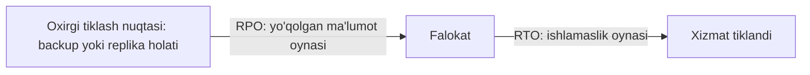
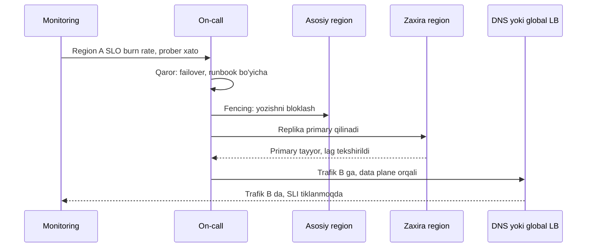

## Bu dars nima uchun kerak

61-64 darslarda alohida komponentlar, AZ lar va servislar nosozligini ko'rdik: redundancy, static stability va degradation ular bilan kurashadi. Disaster recovery (DR) boshqa sinfdagi hodisalar uchun:

- butun region yoki data-markaz yo'qolishi (yong'in, elektr, tarmoq izolyatsiyasi);
- **ma'lumot buzilishi yoki o'chirilishi** - noto'g'ri migratsiya, bug, xato buyruq, ransomware. Bu holatda replikatsiya yordam bermaydi, aksincha buzilishni barcha nusxaga darhol yetkazadi;
- tashqi provayderdan mahrum bo'lish (akkaunt bloklanishi, provayder bankrotligi).

DR - bu "backup bor" degani emas. Google SRE kitobining "Data Integrity" bobi buni bitta g'oya bilan ifodalaydi: odamlar aslida backup emas, **restore** ni xohlaydi. Restore sinalmagan bo'lsa, u yo'q deb hisoblanadi.

Bu darsdan keyin siz:

- RPO va RTO ni aniq ta'riflab, ularni biznes talabidan chiqara olasiz;
- to'rt DR strategiyasini (backup/restore, pilot light, warm standby, active-active) narx, RPO va RTO bo'yicha taqqoslay olasiz;
- backup turlari, PITR, 3-2-1 qoidasi va immutable backup'larni loyihalay olasiz;
- multi-region failover ning qiyin qismlarini (ma'lumot, DNS, split-brain, control plane) bilasiz;
- DR ni qanday sinash va o'lchashni bilasiz.

## RPO va RTO

AWS ning "Disaster Recovery of Workloads on AWS" whitepaper i ta'riflari:

- **RTO (Recovery Time Objective)** - xizmat uzilishidan uning tiklanishigacha ruxsat etilgan maksimal kechikish. Ya'ni qancha vaqt ishlamasligi mumkin.
- **RPO (Recovery Point Objective)** - oxirgi tiklash nuqtasidan beri o'tgan ruxsat etilgan maksimal vaqt. Ya'ni qancha ma'lumot yo'qolishi mumkin (vaqt birligida).

Muhim nozikliklar:

- RPO va RTO **har bir ma'lumot turi va funksiya uchun alohida**. To'lov yozuvlari uchun RPO 0, analitika uchun 24 soat bo'lishi mumkin.
- RTO ga faqat texnik tiklash emas, **aniqlash va qaror qabul qilish vaqti** ham kiradi: kimdir muammoni ko'rishi, "failover qilamizmi?" deb qaror qilishi, keyin bajarishi. Ko'pincha qaror texnik ishdan uzoq davom etadi.
- RPO = 0 faqat **sinxron** replikatsiya bilan (26-dars) mumkin, va u yozish latency siga to'g'ridan-to'g'ri qo'shiladi.
- Ma'lumot buzilishi uchun RPO boshqacha: replika buzilishni darhol ko'chiradi, shuning uchun bu stsenariy uchun RPO backup chastotasi yoki PITR imkoniyati bilan belgilanadi.

### RPO/RTO ni qayerdan olish

Biznes savollari: bir soat ishlamaslik qancha turadi (yo'qotilgan daromad, SLA kreditlari, obro')? Bir soatlik ma'lumot yo'qolsa nima bo'ladi (qayta kiritish mumkinmi, qonuniy oqibat bormi)? Javoblar DR ga sarflash chegarasini beradi. 65-darsdagi kabi: har bir "to'qqiz" va har bir daqiqa RTO qisqarishi narxi chiziqli emas.

## To'rt DR strategiyasi

AWS whitepaper i to'rt strategiyani narx va murakkablik o'sishi tartibida beradi:

| Strategiya | Nima doim ishlaydi | RPO | RTO | Narx | Asosiy xavf |
|---|---|---|---|---|---|
| Backup and restore | Faqat backup'lar (boshqa regionda) | Backup chastotasi | Soatlar (infratuzilmani qayta yaratish + restore) | Eng past | Restore sinalmagan; IaC siz RTO dan oshib ketadi |
| Pilot light | Ma'lumot replikatsiyasi va asosiy infratuzilma (baza, storage); ilova serverlari o'chiq | Past (uzluksiz replikatsiya) | O'nlab daqiqalar (serverlarni yoqish, kengaytirish) | Past-o'rta | Kengaytirish control plane ga bog'liq |
| Warm standby | Kichraytirilgan, lekin to'liq ishlaydigan nusxa | Past | Daqiqalar (faqat kengaytirish) | O'rta-yuqori | Kengaytirish control plane ga bog'liq |
| Multi-site active/active | Bir nechta regionda to'liq ishlaydi va trafik oladi | Asinxronda deyarli 0, buzilishda backup ga bog'liq | Deyarli 0 | Eng yuqori | Murakkablik, ma'lumot konfliktlari |

Whitepaper dan muhim detallar:

- **Backup and restore** uchun: infrastructure as code siz tiklash vaqti oshadi va RTO dan oshib ketishi mumkin. Backup'dan tiklash - control plane operatsiyasi.
- **Pilot light** da Aurora global database bilan ikkinchi regionni to'liq regional uzilishda ham bir daqiqadan kam vaqtda primary qilish mumkinligi aytilgan; lekin ilova serverlarini yoqish va kengaytirish kerak.
- **Warm standby** "kichraytirilgan, lekin to'liq funksional" nusxa va u darhol (kamaytirilgan capacity bilan) trafik qabul qila oladi. Yana bir afzalligi: uni doimiy sinash osonroq.
- **Active/active** da failover yo'q - trafik shunchaki ishlamayotgan regiondan chetlashtiriladi. Lekin ma'lumot buzilishi uchun baribir backup kerak.

### Control plane va data plane, yana

61-darsdagi static stability bu yerda markaziy. Whitepaper tavsiyasi: maksimal chidamlilik uchun failover da faqat **data plane** operatsiyalaridan foydalaning, chunki ular odatda yuqoriroq availability maqsadiga ega. Misollar:

- Route 53 health check asosidagi avtomatik DNS failover va Application Recovery Controller routing control'lari - data plane;
- Route 53 weighted yozuvlarini o'zgartirish, EC2 Auto Scaling, AWS Backup restore - control plane.

Whitepaper ochiq aytadi: pilot light va warm standby Auto Scaling ga (control plane) tayanadi va bu tiklash strategiyasining chidamliligini kamaytiradi. Muqobil - to'liq production yuklamasi uchun capacity ni oldindan tayyorlab qo'yish (statically stable "hot standby"), lekin yuqori narx bilan.

Amaliy ma'nosi: haqiqiy regional falokatda hamma bir vaqtda boshqa regionda instance ochishga harakat qiladi. Control plane API'lari sekinlashadi, capacity tugashi mumkin. "Falokatda kengaytiramiz" degan reja aynan eng kerakli paytda ishlamasligi mumkin.

## Backup: restore uchun loyihalash

### Replikatsiya backup emas

SRE kitobi: replikatsiya va redundancy - tiklanuvchanlik emas. Replika buzilgan qatorni yoki tasodifiy o'chirishni barcha nusxaga ko'chiradi. `DELETE FROM vehicles` WHERE siz bajarilsa, millisekundlarda barcha replikada bo'sh jadval.

### Chuqur himoya qatlamlari (SRE kitobi)

1. **Soft delete** - o'chirilgan ma'lumot yashiriladi, lekin ma'lum muddat saqlanadi (masalan, Gmail ning 30 kunlik savati). Foydalanuvchi, dasturchi xatosi va akkaunt o'g'irlanishidan himoya.
2. **Darajali backup'lar** - yaqin bug'lar uchun tez lokal snapshot'lar; sayt darajasidagi nosozliklar uchun taqsimlangan storage va oflayn muhitda uzoqroq saqlanadigan nusxalar.
3. **Erta aniqlash** - ma'lumotni muntazam tekshiradigan mustaqil validatorlar, buzilish tarqalishidan oldin. Gmail validatorlari har kuni ishlaydi, shuning uchun bug'lar 24 soat ichida aniqlanadi.

Kitob nosozlik turlarini uch omil bo'yicha tasniflaydi - **sabab**, **ko'lam** va **tezlik** - va ularning kombinatsiyasidan 24 xil nosozlik turi chiqadi. Sekin, sezilmasdan buzayotgan bug ga qarshi himoya to'satdan sayt yo'qolishiga qarshi himoya bilan bir xil emas. Masalan, 3 hafta davomida sezilmasdan ma'lumotni buzgan bug: oxirgi 7 kunlik backup'lar ham buzilgan bo'ladi. Shuning uchun **saqlash muddati** buzilishni aniqlash vaqtidan uzun bo'lishi kerak.

### Backup turlari

| Tur | Nima | RPO | Restore tezligi | Izoh |
|---|---|---|---|---|
| Logical (pg_dump) | SQL yoki maxsus format | Dump chastotasi | Sekin (indekslarni qayta qurish) | Versiyalararo ko'chirish uchun qulay, katta bazada sekin |
| Physical (pg_basebackup, disk snapshot) | Ma'lumot fayllari | Snapshot chastotasi | Tezroq | Bir xil major versiya |
| Physical + WAL arxiv (PITR) | Base backup + uzluksiz WAL | Daqiqalar yoki kamroq | Base restore + WAL replay | Istalgan vaqt nuqtasiga qaytish |
| Object storage versioning | Obyekt versiyalari | Deyarli 0 (o'chirish va ustiga yozishdan) | Tez | Faqat o'sha bucket ichida himoya |

**PostgreSQL PITR** (rasmiy hujjat): fayl tizimi darajasidagi base backup va WAL fayllarining uzluksiz arxivi birlashtiriladi. Tiklashda base backup tiklanadi va arxivlangan WAL kerakli nuqtagacha qayta o'ynaladi (`recovery_target_time`). WAL segmentlari default 16 MB va faqat to'lgan segmentlar arxivlanadi; `archive_timeout` segmentni majburan almashtirib, arxivlanmagan ma'lumot hajmini cheklaydi, odatiy qiymat taxminan bir daqiqa. Ya'ni PITR bilan RPO taxminan `archive_timeout` ga teng (kam yozuvli bazada ham). Har tiklash yangi **timeline** yaratadi, shuning uchun bir necha marta urinish mumkin.

PITR ning qiymati ma'lumot buzilishida: "bugun 14:32 da noto'g'ri migratsiya bajarildi" - bazani 14:31 holatiga tiklash mumkin. Snapshot bilan esa faqat oxirgi tungi holatga.

### 3-2-1 va immutable backup

Klassik **3-2-1** qoidasi: ma'lumotning uchta nusxasi, ikki xil muhitda (yoki zamonaviy talqinda ikki alohida qurilma yoki tizimda), bittasi boshqa joyda (off-site).

Zamonaviy tahdid - **ransomware va akkaunt kompromentatsiyasi**: hujumchi production ga kirsa, backup'larni ham o'chiradi. Shuning uchun kamida bitta nusxa **o'zgarmas** (immutable) bo'lishi kerak. AWS S3 Object Lock buni WORM (write once read many) modeli bilan beradi: versioning yoqilgan bucket da obyekt versiyasi belgilangan muddatgacha o'chirilmaydi va ustiga yozilmaydi. **Compliance** rejimida hech kim, hatto root foydalanuvchi ham, muddatdan oldin o'chira olmaydi yoki muddatni qisqartira olmaydi; **governance** rejimida maxsus ruxsatli foydalanuvchilar chetlab o'tishi mumkin. Qo'shimcha: backup'lar alohida akkaunt yoki loyihada, alohida credential'lar bilan.

### Real misol: GitLab.com, 2017 yil 31 yanvar

GitLab ning ochiq postmortem iga ko'ra, replikatsiya muammosini tuzatish paytida muhandis secondary o'rniga **primary** bazaning ma'lumot katalogini o'chirib yuborgan. U buyruqni bir necha soniyada to'xtatgan, lekin taxminan 300 GB allaqachon yo'qolgan. Keyin ma'lum bo'lgan narsalar:

- kunlik `pg_dump` backup'lari PostgreSQL 9.6 ga qarshi 9.2 versiyadagi `pg_dump` bilan ishlagan va **jim** muvaffaqiyatsiz bo'lgan; xato haqidagi email'lar DMARC sozlamasi tufayli qabul qiluvchi server tomonidan rad etilgan;
- S3 bucket bo'sh bo'lgan;
- baza serverlari uchun disk snapshot'lari yoqilmagan;
- yagona foydalanish mumkin bo'lgan nusxa staging ga ko'chirish uchun qo'lda olingan, taxminan 6 soat oldingi LVM snapshot bo'lgan.

Natija: taxminan 6 soatlik ma'lumot yo'qolgan (postmortem bahosiga ko'ra kamida 5 000 loyiha, 5 000 izoh va taxminan 700 foydalanuvchi akkaunti), GitLab.com taxminan 18 soat ishlamagan. Restore ning asosiy cheklovi - staging ning sekin, arzon disklaridan ma'lumot ko'chirish. Git repozitoriylari alohida saqlangani uchun zararlanmagan.

Postmortem saboqlari bu darsning xulosasi: sinalmagan backup - backup emas; backup egasi bo'lishi kerak; monitoring xabarlari haqiqatan yetib borishini tekshiring; host'larni chalkashtirib bo'lmaydigan qilib nomlang; xatolarni qaytariladigan qilib loyihalang.

### Google: restore ni mashq qilish

SRE kitobidagi ikkita misol aksincha natijani ko'rsatadi. **Gmail, 2011**: bir nechta nosozlik sezilarli ma'lumot yo'qotishiga olib kelgan, Google uni oflayn lenta backup tizimidan (GTape) mashq qilingan protseduralar bilan tiklagan va ma'lumotlarning 99 foizdan ko'pini taxmin qilingan vaqtdan oldin qaytargan. **Google Music, 2012**: xato o'chirish pipeline i 21 000 foydalanuvchining taxminan 600 000 audio havolasini o'chirgan; taxminan 436 000 trek lentada bo'lgan va 1.5 PB ni tiklash taxminan besh kunlik faol ish olgan; taxminan 161 000 trek hech qachon backup qilinmagan bo'lgan. Ikkinchi misol saboq: backup **qamrovi** ham tekshirilishi kerak.

Kitob restore testlari uchun tekshiriladigan narsalarni sanaydi: backup bo'sh emasmi, restore uchun hisoblash resursi yetarlimi, restore qabul qilinadigan vaqtda tugaydimi, restore yetib bo'lmaydigan resurslarga bog'liq emasmi.

### Restore vaqtini hisoblash

RTO ni backup hajmi va o'tkazuvchanlik cheklaydi. Misol: 2 TB PostgreSQL bazasi, base backup boshqa regiondagi object storage da.

- Yuklab olish: 2 TB / 500 MB/s = 4 000 s ≈ 67 daqiqa (tarmoq va storage o'tkazuvchanligi taxmini).
- Diskka yozish va ochish: parallel bo'lsa ham shu tartibda.
- WAL replay: oxirgi base backup dan beri 24 soatlik WAL, kuniga 200 GB. Replay tezligi taxminan 100 MB/s bo'lsa: 200 000 / 100 = 2 000 s ≈ 33 daqiqa.
- Jami: taxminan 2 soat, aniqlash, qaror va ilovani ulash vaqtini hisobga olmasdan.

Agar RTO 1 soat bo'lsa, bu reja yaramaydi. Variantlar: base backup ni tez-tez olish (WAL replay kamayadi), boshqa regionda doim ishlaydigan replika (pilot light), yoki bazani kichikroq bo'laklarga bo'lish (shard yoki cell, 61-dars). 2017 yilgi S3 hodisasidagi tuzatish ham aynan shu edi: index subsystem ni kichikroq cell'larga bo'lib, tiklash vaqtini kamaytirish.

## Multi-region failover

### Ma'lumot - eng qiyin qism

Stateless servislarni boshqa regionda ishga tushirish oson. Qiyin qismi - ma'lumot:

- **Asinxron replikatsiya** (odatiy) - RPO = replikatsiya lag i. Aurora Global Database hujjatiga ko'ra cross-region lag odatda bir soniyadan kam va bitta primary regionga 10 tagacha secondary region qo'shish mumkin. Lekin lag cho'qqi yozuvlarda yoki tarmoq muammosida oshadi, va aynan falokat paytida u eng katta bo'lishi mumkin.
- **Sinxron replikatsiya** - RPO = 0, lekin har yozuv regionlararo round-trip ga (o'nlab millisekund, 2-dars) kutadi va ikkinchi region ishlamasa yozish to'xtaydi (34-dars, PACELC).
- **Rejalashtirilgan switchover** va **rejalashtirilmagan failover** farq qiladi: Aurora hujjatiga ko'ra sog'lom global baza uchun switchover ma'lumot yo'qotmasdan primary ni ko'chiradi; failover esa regional uzilishda va unda lag dagi ma'lumot yo'qolishi mumkin.

### Split-brain va fencing

Eng xavfli stsenariy: asosiy region **o'lmagan**, faqat tarmoq bo'yicha ajralgan. Siz ikkinchi regionni primary qildingiz, asosiy region esa yozishni davom ettirmoqda. Endi ikki primary va ikki xil tarix (38-dars). Himoyalar:

- failover qarori kvorum yoki uchinchi joydagi hakam asosida, va eski primary ni **fencing** (yozishni bloklash, credential'larni bekor qilish, trafikni uzish);
- failover dan keyin eski primary avtomatik qaytmaydi, uni qayta sinxronlash qo'lda;
- avtomatik failover chegarasini ehtiyotkor qo'yish: tez-tez yolg'on failover (flapping) haqiqiy uzilishdan ko'ra ko'proq zarar keltirishi mumkin.

### Trafikni o'tkazish

- **DNS failover** - oddiy, lekin TTL va client cache lari (6-dars) tufayli sekin; ba'zi client'lar TTL ni hurmat qilmaydi.
- **Anycast va global load balancer** - tez, lekin provayderga bog'liq.
- **Client tomonda** bir nechta endpoint ro'yxati - client o'zi boshqasiga o'tadi.

Qaysi biri bo'lmasin: u data plane operatsiyasi bo'lishi va oldindan sinalgan bo'lishi kerak.

### Bog'liqliklar inventari

Failover dan oldin savol: ikkinchi regionda **hamma narsa** bormi? Secret'lar va KMS kalitlari, konteyner image registry, DNS zonasi va sertifikatlar, tashqi integratsiyalar uchun IP whitelist'lar (to'lov provayderi, SMS gateway yangi regiondagi IP'ni bilmaydi), monitoring va alerting, CI/CD, on-call vositalari. Ko'p DR rejalari aynan shu kichik detallarda sinadi.

## DR ni sinash

DR rejasi faqat sinalgan qismida ishlaydi. Darajalar:

| Daraja | Nima | Chastota |
|---|---|---|
| Restore testi | Backup ni alohida muhitda avtomatik tiklash va tekshirish (qatorlar soni, checksum, ilova so'rovlari) | Har kuni yoki har hafta, avtomatik |
| Tabletop | Jamoa stsenariyni qog'ozda o'tadi: kim nima qiladi, qaysi runbook | Chorakda |
| Komponent failover | Baza failover, bitta servisni boshqa regionga o'tkazish | Oyda yoki chorakda |
| To'liq region evakuatsiyasi (game day) | Production trafigini rejali ravishda boshqa regionga o'tkazish | Yarim yilda yoki yilda (70-dars) |

O'lchanadigan natija: har testda **haqiqiy** RPO va RTO ni yozib boring va maqsad bilan solishtiring. Restore vaqti ma'lumot o'sishi bilan sekin-asta oshadi va bir kun RTO dan o'tib ketadi; buni faqat muntazam o'lchov ko'rsatadi.

## iQuariX kontekstida

Faraz qiling, iQuariX Toshkentdagi bitta data-markazda (yoki bitta bulut regionida) ishlaydi va DR rejasi yozilmoqda. Ma'lumot sinflari bo'yicha:

| Ma'lumot | Hajm (taxmin) | RPO | RTO | Strategiya |
|---|---|---|---|---|
| Mijozlar, mashinalar, foydalanuvchilar, sozlamalar (PostgreSQL) | 50 GB | 5 daqiqa | 1 soat | PITR (WAL arxiv boshqa joyga) + boshqa joyda asinxron replika |
| Telemetriya nuqtalari (TimescaleDB) | 3-30 TB | 1 soat | Oxirgi 7 kun uchun 4 soat, qolgani 3 kun | Kunlik physical backup + WAL; eski chunk'lar object storage ga |
| Video arxiv (object storage) | 100+ TB | 24 soat yoki "qabul qilinadi" | Kunlar | Muhim (incident belgilangan) videolar boshqa joyga replikatsiya, qolgani yo'q |
| Yoqilg'i hodisalari, hisob-faktura | Kichik | 0-5 daqiqa | 1 soat | PostgreSQL bilan birga, qo'shimcha immutable eksport |

Fikrlar:

- **Treker - eng chetdagi zaxira.** Trekerlar ulanish bo'lmaganda nuqtalarni buferlaydi (61-dars). Agar zaxira saytga trekerlar ulanishi mumkin bo'lsa (DNS nom, IP emas), telemetriya RPO amalda treker buferi hajmi bilan belgilanadi, server tomonidagi backup bilan emas. Bu - qaytarilmaydigan qaror ning (1-dars) DR ga ta'siri: firmware dagi qattiq IP manzil DR ni deyarli imkonsiz qiladi.
- **Video uchun to'liq DR qimmat.** 100 TB ni boshqa regionga replikatsiya qilish oyiga sezilarli narx (79-dars). Biznes bilan kelishiladi: faqat dispetcher "saqlash" deb belgilagan yoki incident bilan bog'liq fragmentlar.
- **Ransomware.** PostgreSQL backup'lari va WAL arxivi alohida akkauntdagi bucket da, Object Lock bilan (masalan, 30 kun compliance). Production credential'lari bu bucket ga faqat yozish huquqiga ega, o'chirish huquqi yo'q.
- **Ma'lumot rezidentligi.** Agar mijoz shartnomasi yoki qonun ma'lumotni O'zbekiston hududida saqlashni talab qilsa (78-dars), zaxira sayt ham shu talabga mos bo'lishi kerak. Buni yuridik jihatdan tekshirish kerak; bu darsda aniq talablar haqida da'vo qilinmaydi.
- **Strategiya tanlovi.** Kichik jamoa uchun realistik: PostgreSQL uchun pilot light (boshqa joyda doim ishlaydigan replika + PITR arxivi), stateless servislar uchun IaC (Terraform, Helm) bilan tez qayta yaratish, telemetriya uchun backup and restore. Active-active - hozircha ortiqcha murakkablik.

## Ko'p uchraydigan xatolar

1. **Replikani backup deb hisoblash.** `DELETE` va bug darhol barcha replikaga yetadi.
2. **Restore ni hech qachon sinamaslik.** GitLab 2017: jim muvaffaqiyatsiz backup'lar, bo'sh bucket.
3. **Backup xatolari haqida xabar hech kimga yetmaydi.** Monitoring ni ham monitoring qiling.
4. **Backup'lar production credential'lari bilan o'chiriladigan joyda.** Ransomware ularni birinchi bo'lib yo'q qiladi.
5. **RTO ga aniqlash va qaror vaqtini qo'shmaslik.**
6. **Failover control plane ga bog'liq.** Falokatda instance ochib, kengaytirib bo'lmasligi mumkin.
7. **Zaxira regionda bog'liqliklar yo'q.** Secret, image registry, IP whitelist, sertifikat.
8. **Saqlash muddati buzilishni aniqlash vaqtidan qisqa.** Sezilmagan bug barcha backup'larni buzadi.

## Xulosa

- RPO - qancha ma'lumot yo'qotish mumkin, RTO - qancha ishlamaslik mumkin; har ma'lumot va funksiya uchun alohida, biznes narxidan kelib chiqadi.
- To'rt strategiya: backup/restore, pilot light, warm standby, active/active - narx va RTO/RPO o'rtasidagi trade-off.
- Failover uchun data plane operatsiyalari; control plane ga tayanadigan reja eng kerakli paytda ishlamasligi mumkin.
- Replikatsiya backup emas. Chuqur himoya: soft delete, darajali backup (PITR), erta aniqlash, immutable nusxa boshqa akkauntda.
- Restore vaqti hajm va o'tkazuvchanlik bilan cheklangan - uni hisoblang va o'lchang.
- Multi-region ning qiyin qismlari: ma'lumot lag i, split-brain va fencing, bog'liqliklar inventari.
- DR faqat sinalgan qismida ishlaydi: avtomatik restore testlari va muntazam failover mashqlari.

## Amaliy topshiriq

iQuariX uchun **DR rejasi**ning qisqa versiyasini yozing. Faraz qiling: hozir hammasi bitta data-markazda; PostgreSQL 200 GB (kuniga 20 GB WAL), TimescaleDB 15 TB (kuniga 300 GB yangi ma'lumot), object storage dagi video 150 TB, 30 000 treker (har biri 48 soatlik nuqtalarni buferlay oladi va DNS nom orqali ulanadi). Biznes: dispetcher portali 4 soatdan ko'p ishlamasa yirik mijozlar ketishi mumkin; hisob-faktura ma'lumotlari yo'qolishi qonuniy muammo.

1. Ma'lumot sinflari bo'yicha RPO va RTO jadvalini tuzing va har birini biznes sababi bilan asoslang.
2. Har sinf uchun DR strategiyasini tanlang (to'rttadan biri) va nima uchun qimmatroq yoki arzonroq variant emasligini yozing.
3. PostgreSQL uchun restore vaqtini hisoblang (o'z o'tkazuvchanlik taxminlaringiz bilan): base backup qanchalik tez-tez olinishi kerakki RTO bajarilsin?
4. Ransomware stsenariysi: hujumchi production admin credential'larini qo'lga kiritdi. Sizning dizayningizda qaysi backup'lar omon qoladi va nima uchun?
5. Data-markaz to'liq yo'qolganda failover runbook ining asosiy 8-10 qadamini yozing, fencing va trekerlarni yangi saytga yo'naltirishni o'z ichiga olgan holda.
6. DR test rejasi: nima, qanchalik tez-tez, va qaysi raqamlarni o'lchaysiz.

Yaxshi javobda bo'lishi kerak bo'lgan narsalar:

- telemetriya RPO sining treker buferi bilan bog'liqligi;
- restore vaqti hisobi ochiq (hajm / o'tkazuvchanlik + WAL replay);
- PITR ma'lumot buzilishi uchun, replika esa sayt yo'qolishi uchun ekanligi;
- immutable backup alohida akkauntda va o'chirish huquqisiz credential;
- failover da data plane, fencing va bog'liqliklar inventari (secret, DNS, IP whitelist);
- muntazam avtomatik restore testi va haqiqiy RTO/RPO ni o'lchash.

Javobni pastdagi maydonga yozib, chatga yuboring.

## Manbalar

- AWS. [Disaster Recovery of Workloads on AWS: Disaster recovery options in the cloud](https://docs.aws.amazon.com/whitepapers/latest/disaster-recovery-workloads-on-aws/disaster-recovery-options-in-the-cloud.html) - to'rt strategiya, control plane va data plane; [Business continuity plan](https://docs.aws.amazon.com/whitepapers/latest/disaster-recovery-workloads-on-aws/business-continuity-plan-bcp.html) - RTO va RPO ta'riflari.
- Google. [Site Reliability Engineering, "Data Integrity: What You Read Is What You Wrote"](https://sre.google/sre-book/data-integrity/) - restore va backup, chuqur himoya, Gmail 2011 va Google Music 2012.
- GitLab. [Postmortem of database outage of January 31](https://about.gitlab.com/blog/postmortem-of-database-outage-of-january-31/), 2017.
- PostgreSQL. [Continuous Archiving and Point-in-Time Recovery (PITR)](https://www.postgresql.org/docs/current/continuous-archiving.html).
- AWS. [Amazon Aurora Global Database](https://docs.aws.amazon.com/AmazonRDS/latest/AuroraUserGuide/aurora-global-database.html) - cross-region lag, switchover va failover.
- AWS. [Locking objects with Object Lock](https://docs.aws.amazon.com/AmazonS3/latest/userguide/object-lock.html) - WORM, governance va compliance rejimlari.
- Backblaze. [The 3-2-1 Backup Strategy](https://www.backblaze.com/blog/the-3-2-1-backup-strategy/).
