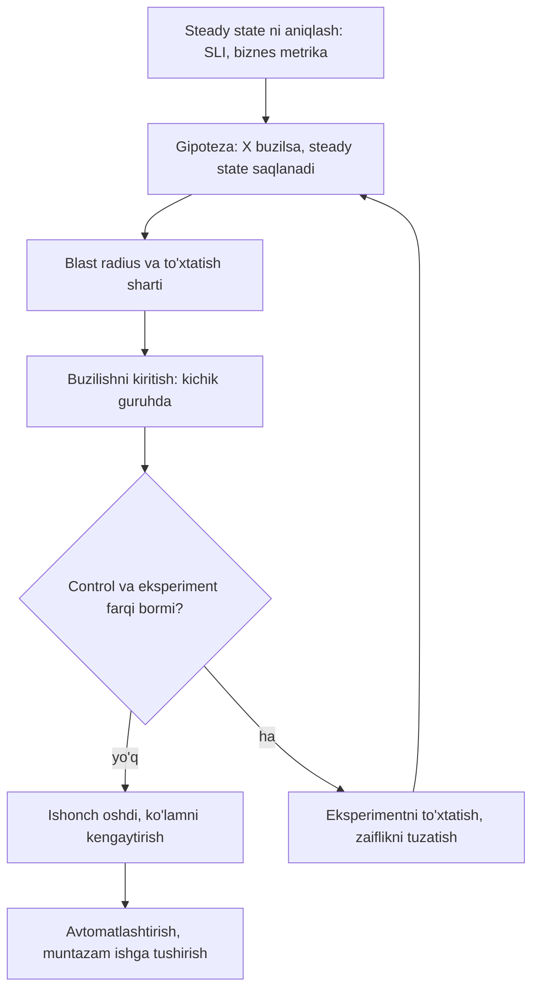
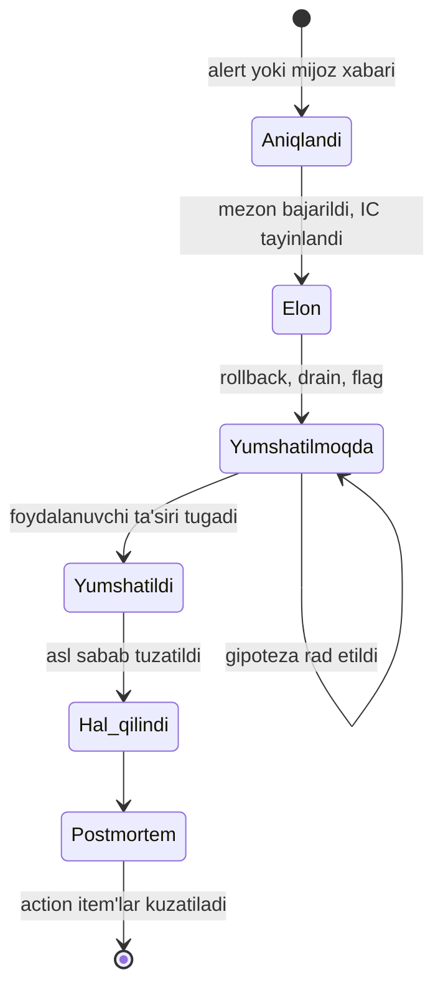

## Bu dars nima uchun kerak

Bu modulning oxirgi darsi. 61-69 darslarda reliability ni **loyihalashni** ko'rdik: redundancy, timeout, circuit breaker, degradation, SLO, observability, alerting, deploy, DR. Lekin uchta savol qoladi:

1. Biz loyihalagan himoyalar **haqiqatan ishlaydimi**? Failover, retry budget, load shedding, degradation - kamdan-kam ishga tushadigan yo'llar, va 61-darsda ko'rganimizdek, kamdan-kam ishlaydigan kod ishonchsiz. (**Chaos engineering**)
2. Nosozlik baribir sodir bo'lganda odamlar qanday **tartibli** ishlaydi, shunda yaxshi niyatli harakatlar vaziyatni yomonlashtirmaydi? (**Incident management**)
3. Har incident dan keyin tizim qanday qilib **yaxshilanadi**, bir xil xato takrorlanmaydi? (**Postmortem**)

Bular texnik emas, ijtimoiy-texnik amaliyotlar, lekin ularsiz oldingi to'qqiz darsdagi dizayn qog'ozda qoladi. 61-darsdagi formula bo'yicha MTTR availability ning yarmi, va MTTR ning katta qismi odamlar qanchalik tayyor ekaniga bog'liq.

Bu darsdan keyin siz:

- chaos eksperimentini ilmiy usul bilan loyihalay olasiz: steady state, gipoteza, o'zgaruvchi, blast radius, to'xtatish sharti;
- Netflix, Google va AWS amaliyotlaridan (Chaos Monkey, Chaos Kong, DiRT, game day) nimani olish mumkinligini bilasiz;
- incident command rollarini va incident paytidagi ustuvorliklarni bilasiz;
- incident ni qachon e'lon qilish, qanday hujjatlashtirish va qanday topshirishni bilasiz;
- blameless postmortem yozib, sifatli action item'larni shakllantira olasiz;
- "root cause" va "contributing factors" yondashuvlarining farqini tushunasiz.

## Chaos engineering

### Ta'rif va usul

"Principles of Chaos Engineering" manifesti (oxirgi yangilanish 2019 yil mart) ta'rifi: chaos engineering - tizim production dagi og'ir, real sharoitlarga bardosh bera olishiga ishonch hosil qilish uchun tizim ustida **eksperiment** qilish intizomi.

Kalit so'z - eksperiment. Bu "serverlarni tasodifan o'chirish" emas, ilmiy usul:

1. **Steady state** - tizimning normal xatti-harakatini ko'rsatadigan o'lchanadigan chiqish. Ichki mexanika emas, chiqish: throughput, xato darajasi, latency, biznes metrikasi.
2. **Gipoteza** - bu steady state ham control guruhida, ham eksperiment guruhida saqlanadi.
3. **O'zgaruvchi kiritish** - real hodisalarni aks ettiradigan buzilish: server qulashi, disk xatosi, tarmoq uzilishi, latency, trafik sakrashi.
4. **Gipotezani rad etishga urinish** - control va eksperiment guruhlari o'rtasida steady state farqini qidirish. Steady state ni buzish qanchalik qiyin bo'lsa, tizimga ishonch shunchalik yuqori.

Manifestdagi ilg'or tamoyillar:

- gipotezani ichki mexanika emas, **steady state** atrofida qurish;
- **real hodisalarni** turlicha kiritish, ta'siri yoki ehtimoli bo'yicha prioritetlab (shu jumladan nosozlik bo'lmagan hodisalar, masalan trafik sakrashi);
- **production da** eksperiment qilish, chunki tizim xatti-harakati muhit va yuklamaga bog'liq;
- eksperimentlarni doimiy ishlashi uchun **avtomatlashtirish**;
- **blast radius ni minimallashtirish** - mijozga ta'sir kichik va cheklangan bo'lishi kerak.

### Real amaliyotlar

**Netflix Simian Army.** Netflix TechBlog ning 2011 yil iyuldagi postida **Chaos Monkey** tasvirlangan: u production instance'larini tasodifan o'chiradi, servis instance nosozligiga mijozga ta'sirsiz bardosh berishini tekshirish uchun. Muhim detal: u **ish soatlarida**, muhandislar kuzatib turgan paytda ishlaydi, shunda jamoa nosozlikdan o'rganib, avtomatik tiklanishni quradi. Xuddi shu "armiya"da **Latency Monkey** (client-server aloqasiga kechikish qo'shadi, 62-dars), **Conformity Monkey** (eng yaxshi amaliyotlarga mos kelmaydigan instance'larni topadi) va **Chaos Gorilla** (butun AWS availability zone uzilishini simulyatsiya qiladi) bo'lgan.

**Netflix Chaos Kong.** Netflix TechBlog ning 2015 yil sentyabrdagi postiga ko'ra, Chaos Kong butun AWS **region**ining yo'qolishini simulyatsiya qiladi va muntazam o'tkaziladi. Natija: 2015 yil 20 sentyabrda us-east-1 da DynamoDB muammosi bo'lganda Netflix faqat qisqa availability tebranishini ko'rgan, chunki muntazam Chaos Kong mashqlari tizimli zaifliklarni oldinroq ochib bergan va ular tuzatilgan edi. Xuddi shu postda yana bir eksperiment tasvirlangan: trafikning 50 foiziga 30 ms latency qo'shish engagement ning o'lchanadigan pasayishiga olib kelgan, jamoa upstream servis thread pool sonini kamaytirgan va keyingi eksperimentlar yaxshilanishni tasdiqlagan.

**Google DiRT (Disaster Recovery Testing).** Google Cloud blogidagi maqolaga ko'ra, DiRT - kompaniya miqyosidagi muvofiqlashtirilgan mashqlar, unda real va o'ylab topilgan uzilishlar rejalashtirilib o'tkaziladi. Qoidalar: real favqulodda holat ustun, aloqa protokollari, kutilgan ta'sir oldindan yoziladi, va **har bir testda qaytarish rejasi** bo'lishi shart. Testlarni koordinatorlardan alohida texnik guruh ko'rib chiqadi, production ga katta ta'sir xavfi bo'lgan testlar VP darajasida tasdiqlanadi. Misollar: data-markazlarni uzish, trafikni boshqa joyga burish, jonli konfiguratsiyani o'zgartirish, ma'lum bug'li servislarni ishga tushirish, hatto odamlarni "o'chirish" (kalit muhandis mavjud emas) yoki hujjatlarni olib tashlash. Tavsiya: kichik, aniq belgilangan testlardan boshlash (masalan, "Shimoliy Amerikadagi barcha asosiy DNS serverlarni o'chirish, lekin forwarding serverlarni emas") va ko'lamni asta oshirish.

### Eksperiment dizayni

| Element | Savol | Misol |
|---|---|---|
| Steady state | Normal holatni qaysi raqam ko'rsatadi? | Telemetriya ACK success rate 99.95%, end-to-end lag p99 < 15 s |
| Gipoteza | Nima kutamiz? | "Bitta Kafka broker o'chsa, lag p99 30 s dan oshmaydi va nuqtalar yo'qolmaydi" |
| O'zgaruvchi | Qaysi real hodisa? | Broker jarayonini o'ldirish, tarmoq bo'linishi, disk to'lishi |
| Ko'lam | Qancha trafik yoki komponent? | Bitta broker, staging da avval, keyin production da ish soatlarida |
| To'xtatish sharti | Qachon darhol to'xtatamiz? | SLO burn rate 6x dan oshsa yoki lag 60 s dan oshsa |
| Qaytarish | Qanday tez tiklaymiz? | Broker ni qayta ishga tushirish, eksperiment vositasining "abort" tugmasi |
| Kuzatuv | Natijani qayerda ko'ramiz? | SLO dashboard, consumer lag, xato loglari |

Eksperiment tayyorligi bosqichlari (tajriba asosida tavsiya):

1. **Tabletop** - "agar X bo'lsa nima bo'ladi?" ni qog'ozda o'tish. Arzon va ko'pincha runbook'lardagi teshiklarni ochadi.
2. **Staging da eksperiment** - mexanizmni tekshirish.
3. **Production da kichik blast radius** - bitta pod, bitta broker, kichik trafik ulushi, ish soatlarida, jamoa tayyor.
4. **Avtomatik va muntazam** - eksperiment pipeline ning bir qismi, natija o'zgarsa alert.

Chaos engineering **qachon qilmaslik kerak**: monitoring yetarli bo'lmasa (natijani ko'rmaysiz), tizim allaqachon ma'lum zaif nuqtalarga ega bo'lsa (avval ularni tuzating), error budget tugagan bo'lsa (65-dars), yoki qaytarish rejasi bo'lmasa.

### Nimani buzish kerak: modul bo'yicha xarita

Bu modul darslari chaos eksperimentlari uchun tayyor ro'yxat beradi:

| Dars | Himoya | Eksperiment |
|---|---|---|
| 61 | Redundancy, static stability | AZ yoki node ni o'chirish; qolganlar yuklamani ko'taradimi? |
| 62 | Timeout, retry, jitter | Downstream ga 2 s latency qo'shish; retry amplification bormi? |
| 63 | Bulkhead, load shedding | Bitta bog'liqlikni sekinlashtirish; boshqa endpoint'lar ishlaydimi? |
| 64 | Degradation, cache | Redis ni o'chirish; baza 10x yuklamani ko'taradimi yoki degradation ishlaydimi? |
| 66-67 | Observability, alerting | Alert ishladimi? Qancha vaqtda? To'g'ri odamga? |
| 68 | Rollback | Ataylab yomon versiyani canary ga chiqarish; avtomatik rollback ishladimi? |
| 69 | DR | Backup dan restore, baza failover, region evakuatsiyasi |

Oxirgi ikki qatordagi tekshiruvlar ayniqsa qimmatli: ular **odamlar va jarayonlarni** ham sinaydi.

## Incident management

### Boshqarilmagan incident

Google SRE kitobining "Managing Incidents" bobi "boshqarilmagan incident" misolini keltiradi: on-call muhandis (kitobda Mary) data-markazdagi cascading failure bilan kurashadi. Uning diqqati texnik muammoda, shuning uchun aloqa buziladi va rahbarlar javob talab qiladi. Boshqa muhandis (Malcolm) muvofiqlashtirilmagan production o'zgarishini qiladi va vaziyat ancha yomonlashadi. Belgilangan rollar va umumiy yozuv bo'lmasa, har bir yaxshi niyatli harakat tartibsizlikka qo'shiladi.

### Incident Command System

SRE Workbook ning "Incident Response" bobiga ko'ra, Incident Command System (ICS) 1968 yilda o't o'chiruvchilar tomonidan o'rmon yong'inlarini boshqarish uchun yaratilgan, keyin kompaniyalar uni IT nosozliklari uchun moslashtirgan. Maqsad - **3C**: muvofiqlashtirish (coordinate), aloqa (communicate) va nazoratni saqlash (control).

Rollar (SRE kitobi va Workbook):

| Rol | Vazifa | Nima qilmaydi |
|---|---|---|
| Incident Commander (IC) | Umumiy holatni ushlab turadi, jamoani tashkil qiladi, rollarni tayinlaydi; tayinlanmagan har qanday rol unda | O'zi debugging ga sho'ng'imaydi |
| Operations Lead | Muammoni yumshatish uchun tizimga ta'sir qiladi; incident paytida tizimni **faqat** ops guruhi o'zgartiradi | Tashqi aloqa |
| Communications Lead | Jamoa va stakeholder'larga davriy yangilanishlar, savollarga javob, ko'pincha incident hujjatini yuritadi | Tizimga tegmaydi |
| Planning Lead | Uzoqroq ishlar: bug ochish, topshirish, tizim normaldan qanday chetga chiqqanini kuzatish (keyin qaytarish uchun) | Tezkor yumshatish |

Kichik incident da bir odam bir nechta rolda bo'lishi mumkin, lekin IC va ops lead ni ajratish deyarli har doim foydali: kimdir "katta rasm"ni ko'rishi kerak.

### Qachon incident e'lon qilish

SRE kitobi mezonlari - quyidagilardan biri bo'lsa, bu incident:

- muammoni tuzatish uchun **ikkinchi jamoa** kerak;
- uzilish **mijozlarga ko'rinadi**;
- muammo **bir soatlik** jamlangan tahlildan keyin ham hal bo'lmagan.

Va asosiy tavsiya: **erta va tez-tez e'lon qiling.** Freymvorkni muammo soatlab o'sgandan keyin boshlashdan ko'ra erta boshlab, keyin "bu kichik ekan" deb yopish yaxshiroq. Workbook dagi Google Home (2017) misoli aksini ko'rsatadi: jamoa incident e'lon qilishni kechiktirgan, dam olish kunlari "qahramonlik" ga va asl sabab topilmasdan takroriy kvota oshirishlarga tayangan.

### Ustuvorliklar: avval yumshatish

SRE kitobi tartibi: **zararni to'xtatish, xizmatni tiklash, asl sabab tahlili uchun dalillarni saqlash.** Workbook bundan aniqroq: ta'sirni baholash, yumshatish, sabab tahlili, keyin sababni tuzatish va postmortem.

Bu muhim psixologik nuqta: muhandislar tabiatan "nima uchun?" ni bilishni xohlaydi. Lekin foydalanuvchilar azob chekayotganda birinchi savol "qanday to'xtatamiz?". Workbook **umumiy yumshatishlar** (generic mitigations) ni tavsiya qiladi - sabab tushunilmasdan ham tez qo'llanadigan harakatlar:

- oxirgi deploy ni rollback qilish (68-dars);
- trafikni muammoli region yoki cell dan olib chiqish (drain);
- feature flag yoki kill switch ni o'chirish (64-dars);
- capacity qo'shish;
- muammoli trafik manbasini bloklash.

Bu vositalar **incident dan oldin** qurilgan va sinalgan bo'lishi kerak. Workbook dagi GKE CreateCluster misolida buzilgan tashqi image Yevropada taxminan 6.5 soatlik xatolarga olib kelgan, va javob beruvchilarda erta umumiy yumshatish vositalari bo'lmagan.

Google Cloud blogi **TTM (time to mitigate)** ni ta'riflaydi: birinchi javob beruvchi page ni tasdiqlagandan foydalanuvchilar og'riq sezishni to'xtatguncha o'tgan vaqt. MTTR o'rniga MTTM ni o'lchash "nosozlik tuzatildi" emas, "foydalanuvchi uchun tugadi" ga e'tibor qaratadi.

### Incident hujjati va topshirish

SRE kitobiga ko'ra IC ning eng muhim vazifasi - **jonli incident holati hujjatini** yuritish: umumiy, bir vaqtda tahrirlanadigan, eng muhim ma'lumot yuqorida. U tartibsiz bo'lishi mumkin, lekin foydalanishga yaroqli. Keyin u postmortem uchun asos bo'ladi.

Hujjat tuzilishi (tavsiya):

- **Holat**: hozirgi ta'sir, kim IC, kim ops, keyingi yangilanish vaqti;
- **Xronologiya**: UTC vaqtlar bilan, kim nima qildi va nima ko'rdi;
- **Gipotezalar** va ularning holati (tekshirildi, rad etildi);
- **Qilingan o'zgarishlar** (keyin qaytarish uchun).

**Topshirish**: IC almashganda chiqayotgan IC yangisiga holatni tushuntiradi va o'tkazishni **aniq tasdiqlaydi**, yangi IC tasdiqlamaguncha qo'ng'iroqda qoladi; topshirish hammaga e'lon qilinadi. Workbook dagi PagerDuty (2017) misolida 10 soatdan uzoq davom etgan incident da IC har to'rt soatda almashtirilgan, javob beruvchilar dam olishi va yangi g'oyalar kirishi uchun.

### Incident lifecycle

### Severity darajalari

Ko'p tashkilotlar incident'larni jiddiylik darajalariga bo'ladi (SEV1 dan SEV3 yoki SEV4 gacha). SRE Workbook aniq shkala bermaydi, shuning uchun quyidagi - faqat namuna, uni o'z SLO laringizga moslang:

| Daraja | Mezon (namuna) | Javob |
|---|---|---|
| SEV1 | Asosiy funksiya ko'pchilik mijoz uchun ishlamaydi, ma'lumot yo'qolishi xavfi | Darhol IC, barcha kerakli jamoalar, har 30 daqiqada tashqi yangilanish |
| SEV2 | Muhim funksiya qisman ishlamaydi yoki bir nechta mijozga ta'sir | IC, ish soatidan tashqari ham |
| SEV3 | Kichik ta'sir, aylanma yo'l bor | Ish soatlarida, ticket |

## Postmortem

### Qachon yozish

SRE kitobining "Postmortem Culture" bobi trigger'lari (incident dan **oldin** kelishilgan bo'lishi kerak):

- foydalanuvchiga ko'rinadigan, belgilangan chegaradan oshgan uzilish yoki degradatsiya;
- **har qanday** ma'lumot yo'qolishi;
- on-call ning aralashuvi talab qilingan holat (rollback, trafikni yo'naltirish);
- belgilangan chegaradan uzoq hal qilish vaqti;
- monitoring muvaffaqiyatsizligi (incident qo'lda topilgan).

Har qanday stakeholder ham postmortem so'rashi mumkin. 65-darsdagi error budget policy yana bir trigger qo'shadi: bitta incident 4 haftalik budgetning 20 foizidan ko'pini sarflasa.

### Blameless

Kitob ta'rifi: postmortem incident ning hissa qo'shgan sabablariga e'tibor qaratadi, shaxs yoki jamoani ayblamaydi. U har kim o'zida bor ma'lumot bilan yaxshi niyatda harakat qilgan deb faraz qiladi. Odamlarni "tuzatib" bo'lmaydi, shuning uchun maqsad - ularning qarorlarini shakllantiradigan **tizim va jarayonlarni** yaxshilash.

Bu yumshoqlik emas, muhandislik zaruriyati: odamlar jazodan qo'rqsa, ular muammolarni yashiradi va siz eng qimmatli ma'lumotni - aslida nima bo'lganini - yo'qotasiz. 61-darsdagi 2017 yilgi S3 hodisasini eslang: muhandis tasdiqlangan playbook bo'yicha ishlagan, xato parametr kiritilgan. AWS ning tuzatishi muhandisni emas, **vositani** o'zgartirdi: olib tashlash sekinroq va minimal capacity dan pastga tushirib bo'lmaydigan qilindi. GitLab 2017 postmortemi ham xuddi shunday: "host'larni chalkashtirib bo'lmaydigan qiling", "xatolarni qaytariladigan qilib loyihalang".

Amaliy til farqi:

| Ayblovchi | Blameless |
|---|---|
| "Muhandis noto'g'ri serverda buyruqni bajardi" | "Primary va replika host nomlari va prompt'lari bir xil ko'rinardi, buyruq tasdiq so'ramadi" |
| "Kimdir testni o'tkazib yubordi" | "Pipeline konfiguratsiya o'zgarishlari uchun test bosqichini talab qilmadi" |
| "Ehtiyotkor bo'lish kerak edi" | "Vosita xavfli operatsiya uchun ko'lam chegarasini qo'llamadi" |

### Root cause yoki contributing factors

"Asl sabab" (root cause) atamasi keng ishlatiladi va SRE kitobi postmortem tarkibiga root cause(s) ni kiritadi - ko'plikda. Murakkab tizimlarda incident odatda **bir nechta** omil birikmasidan kelib chiqadi: trigger, yashirin zaiflik, aniqlanmagan monitoring teshigi, kechikkan javob. 64-darsdagi metastable failure maqolasi ham shuni aytadi: trigger ni asosiy sabab deb atash teskari aloqani tuzatmasdan qoldiradi.

Shuning uchun "5 nima uchun" (5 whys) usuli foydali boshlanish, lekin u bitta chiziqli zanjirga olib boradi va ko'pincha "inson xatosi" da to'xtaydi. Yaxshiroq savollar: **qanday qilib** bu mumkin bo'ldi? Nima uchun himoyalar ishlamadi? Nima uchun aniqlash shuncha vaqt oldi? Nima uchun yumshatish shuncha vaqt oldi? Nima yaxshi ishladi (va uni qanday saqlaymiz)?

### Postmortem shabloni

SRE kitobiga ko'ra postmortem tarkibi: incident va uning ta'sirining yozma qaydi, yumshatish va hal qilish uchun qilingan harakatlar, asl sabab(lar), va takrorlanmasligi uchun keyingi harakatlar. Amaliy shablon:

1. **Xulosa** - 3-4 gap: nima bo'ldi, ta'sir, qancha davom etdi, asosiy sabab.
2. **Ta'sir** - raqamlar: qancha foydalanuvchi, qaysi funksiya, qancha vaqt, error budget dan qancha (65-dars), ma'lumot yo'qolishi, moliyaviy ta'sir.
3. **Aniqlash** - qanday aniqlandi (alert, mijoz, tasodif), qancha vaqtda (time to detect).
4. **Xronologiya** - UTC vaqtlar bilan, incident hujjatidan.
5. **Hissa qo'shgan omillar** - trigger, zaifliklar, nima uchun himoyalar ishlamadi.
6. **Nima yaxshi ishladi, nima yomon, qayerda omadimiz keldi.** Oxirgisi juda muhim: "omad" - keyingi safar bo'lmasligi mumkin bo'lgan himoya.
7. **Action item'lar** - har birida egasi, prioriteti, muddati va tracker havolasi.

### Action item sifati

Yomon action item: "Ehtiyotkorroq bo'lish", "Monitoringni yaxshilash", "Testlarni ko'paytirish". Ular o'lchanmaydi va hech qachon yopilmaydi.

Yaxshi action item'lar aniq, tekshiriladigan va **ierarxik**: avval aniqlash (shu holat qayta bo'lsa, 2 daqiqada alert keladi), keyin yumshatish (bir tugma bilan rollback), keyin oldini olish (vosita xavfli operatsiyani bloklaydi). Bu 61-darsdagi zanjirni har darajada uzish g'oyasi.

| Turi | Misol |
|---|---|
| Aniqlash | "Ingest gateway ACK success rate uchun 14.4x burn rate alerti qo'shish" |
| Yumshatish | "Treker parser ni feature flag ortiga o'tkazish va runbook ga kill switch qo'shish" |
| Oldini olish | "Konfiguratsiya fayllari uchun schema validatsiyasi va canary bosqichini pipeline ga qo'shish" |
| Jarayon | "Juma kunlari 14:00 dan keyin production deploy ni pipeline da bloklash" |

Google Workbook dagi namuna error budget policy da: budgetning 20 foizidan ko'pini sarflagan incident uchun kamida bitta **P0** action item. Action item'lar yopilishini kuzatish - postmortem jarayonining eng zaif joyi; ularni oddiy backlog dagi boshqa vazifalar bilan raqobatga tashlab qo'ymang.

### Madaniyatni qurish

SRE kitobi tavsiyalari: postmortem'larni hech qachon ko'rib chiqilmasdan qoldirmaslik (review sessiyasi, keyin qidirib topiladigan umumiy repozitoriy); har oy ajoyib postmortem bilan bo'lishish; o'qish klublari; o'tgan incident'lar asosida **"Wheel of Misfortune"** rol o'yinlari; rahbariyat ishtiroki; yaxshi incident boshqaruvi va yaxshi yozilgan postmortem'larni ochiq taqdirlash.

Google Cloud blogi Wheel of Misfortune ni batafsil tasvirlaydi: production ga ta'sirsiz simulyatsiya qilingan rol o'yini, uni muammoni biladigan tajribali muhandis ("Dungeon Master") olib boradi, ishtirokchilar stsenariy bo'yicha ishlaydi. DM to'liq ma'lumot beradi, iloji bo'lsa grafik va buyruq chiqishlari skrinshotlarini ko'rsatadi, real detallar (masalan, eskalatsiya vaqtlari) ni qo'llaydi va oxirida tahlil o'tkazadi. Maqolaga ko'ra, muhim alert uchun playbook bilan oddiy Wheel of Misfortune o'tkazish ko'pincha "o'z-o'zidan ravshan", lekin hujjatlashtirilmagan qadamlarni ochib beradi.

## Hammasi bitta tsiklda

Modul darslari bitta yopiq tsikl hosil qiladi:

| Bosqich | Dars | Natija |
|---|---|---|
| Maqsad | 65 | SLO va error budget |
| Ko'rish | 66-67 | Telemetriya, simptom alertlari |
| Himoya | 61-64 | Redundancy, timeout, bulkhead, degradation |
| O'zgarish | 68 | Bosqichma-bosqich deploy, tez rollback |
| Tiklash | 69 | Backup, DR |
| Sinash | 70 | Chaos eksperimentlar, game day |
| Javob | 70 | Incident command, yumshatish |
| O'rganish | 70 | Postmortem, action item'lar, tsiklning boshiga |

Postmortem action item'lari yangi alert'lar (67), yangi himoyalar (61-64), pipeline o'zgarishlari (68) va yangi chaos eksperimentlari (70) bo'lib qaytadi.

## iQuariX kontekstida

### Kichik jamoa uchun incident jarayoni

Faraz qiling, iQuariX ning muhandislik jamoasi 5-8 kishi. Google darajasidagi to'liq ICS ortiqcha, lekin minimal versiya kerak:

- **E'lon qilish**: mijozga ko'rinadigan har qanday uzilish, yoki 30 daqiqada hal bo'lmagan muammo; alohida chat kanali `#inc-YYYYMMDD-qisqa-nom`.
- **Rollar**: IC (birinchi javob beruvchi, keyin tajribaliroq odamga topshirishi mumkin) va ops; mijozlar bilan aloqa - account menejer yoki direktor (IC dan alohida, chunki B2B mijozlar har 30 daqiqada yangilanish kutadi).
- **Umumiy yumshatishlar**: deploy rollback, ingest trafikni zaxira gateway ga o'tkazish, og'ir hisobotlarni o'chiradigan kill switch, alert yuborishni vaqtincha to'xtatish (soxta ogohlantirishlar toshqinida).
- **Mijoz kommunikatsiyasi**: B2B da shaffoflik ishonchni oshiradi. Incident dan keyin yirik mijozlarga qisqa, texnik bo'lmagan xulosa: nima bo'ldi, ularga qanday ta'sir, nima qilinmoqda.

### Birinchi chaos eksperimentlar

1. **Bitta ingest gateway pod ini o'ldirish** (ish soatida). Gipoteza: trekerlar 60 soniya ichida boshqa pod ga qayta ulanadi, ACK success rate SLO dan pastga tushmaydi, nuqtalar yo'qolmaydi. Kuzatish: ulanishlar soni, qayta ulanish to'lqini (62-dars jitter), lag.
2. **Redis ni 5 daqiqaga o'chirish** (avval staging). Gipoteza: xarita oxirgi ma'lum joylashuvni "eskirgan" belgisi bilan ko'rsatadi (64-dars degradation), PostgreSQL CPU 70 foizdan oshmaydi.
3. **SMS provayderiga 10 s latency** (provayder mock orqali). Gipoteza: fuel-worker bloklanmaydi, ogohlantirishlar navbatda kutadi, circuit breaker ochiladi va push ga o'tiladi (63-dars).
4. **Restore testi** (69-dars): har hafta avtomatik ravishda PostgreSQL backup ni alohida muhitda tiklash, qatorlar sonini va bir nechta biznes so'rovini tekshirish, haqiqiy restore vaqtini yozish.
5. **Wheel of Misfortune**: har oyda bir marta, o'tgan incident yoki o'ylab topilgan stsenariy ("Kafka disk to'ldi", "yangi treker firmware i noto'g'ri vaqt yuboryapti") bo'yicha.

### Namuna postmortem qisqa xulosasi (faraziy)

"2026-xx-xx kuni 09:12 dan 09:58 gacha (46 daqiqa) dispetcherlarning taxminan 40 foizi xaritada mashinalarni 5 daqiqadan ortiq kechikish bilan ko'rdi. Sabab: yangi versiyadagi location-worker har nuqta uchun PostgreSQL dan qurilma metama'lumotini cache siz o'qigan; ertalabki cho'qqida connection pool to'lgan va consumer lag o'sgan. Canary bosqichi 06:00 da (past yuklamada) o'tgani uchun muammo aniqlanmagan. Rollback 09:51 da boshlandi. Freshness SLO 4 haftalik budgetining 35 foizi sarflandi. Action item'lar: canary ni faqat cho'qqi yuklamada o'tkazish (P0), location-worker uchun pool utilization alerti (P1), freshness burn rate page ini 14.4x ga sozlash (P1, chunki alert 25 daqiqa kechikdi)."

E'tibor bering: unda hech kim ayblanmagan, raqamlar bor, va har action item jarayon yoki tizimni o'zgartiradi.

## Ko'p uchraydigan xatolar

1. **Chaos ni monitoring siz o'tkazish.** Natijani ko'rmaysiz, faqat zarar yetkazasiz.
2. **To'xtatish sharti va qaytarish rejasi yo'q eksperiment.** DiRT qoidasi: har testda qaytarish rejasi.
3. **Incident ni kech e'lon qilish.** "Ozgina kutib turaylik" - Google Home misoli.
4. **IC o'zi debugging qiladi.** Katta rasmni hech kim ko'rmaydi, aloqa to'xtaydi.
5. **Bir vaqtda bir nechta odam production ni o'zgartiradi.** Malcolm misoli: muvofiqlashtirilmagan o'zgarish vaziyatni yomonlashtiradi.
6. **Avval sabab, keyin yumshatish.** Foydalanuvchilar azob chekayotganda rollback yoki drain darhol.
7. **"Inson xatosi" ni sabab deb yozish.** Bu tergovning boshlanishi, oxiri emas.
8. **Action item'lar yopilmaydi.** Postmortem yozildi, bir oydan keyin xuddi shu incident takrorlandi.

## Xulosa

- Chaos engineering - ilmiy eksperiment: steady state, gipoteza, real buzilish, kichik blast radius, to'xtatish sharti, avtomatlashtirish. Kamdan-kam ishlaydigan himoya yo'llarini muntazam ishlatish usuli.
- Netflix (Chaos Monkey, Chaos Kong), Google (DiRT, Wheel of Misfortune) amaliyotlari: kichikdan boshlang, ko'lamni asta oshiring, odamlar va jarayonlarni ham sinang.
- Incident: erta e'lon qiling, rollarni ajrating (IC, ops, aloqa, planning), jonli hujjat yuriting, aniq topshiring.
- Ustuvorlik: avval yumshatish (rollback, drain, flag), keyin sabab. Umumiy yumshatish vositalari oldindan qurilgan bo'lishi kerak.
- Postmortem blameless, raqamli, bir nechta hissa qo'shgan omil bilan; action item'lar aniq, egali, muddatli va kuzatiladi.
- Modulning barcha darslari bitta tsikl: maqsad, ko'rish, himoya, o'zgarish, tiklash, sinash, javob, o'rganish.

## Amaliy topshiriq

Faraz qiling, iQuariX da quyidagi incident bo'ldi: dushanba ertalab 08:40 da yangi treker modeli uchun parser qo'shilgan ingest gateway versiyasi rolling deploy qilindi (canary yo'q). 08:55 dan boshlab gateway pod'lari OOM bilan qayta-qayta restart bo'la boshladi: yangi modeldagi trekerlar noodatiy uzun paket yuborgan, parser uni cheksiz buferlagan. Har restart da minglab treker qayta ulangan va boshqa pod'larga yuklama tushgan. 09:20 da dispetcherlar qo'ng'iroq qila boshladi. On-call 09:25 da alert'ni ko'rdi (alert 09:05 da kelgan, lekin u boshqa ishda edi). 09:40 da bir muhandis gateway pod'lari sonini ikki baravar oshirdi, bu yordam bermadi. 10:05 da rollback qilindi, 10:20 da qayta ulanish to'lqini tinchidi. Trekerlar buferlagani uchun nuqtalar yo'qolmadi, lekin xarita 85 daqiqa davomida qisman eskirgan edi.

1. Bu incident ni boshqarish qanday bo'lishi kerak edi? Kim IC bo'lishi, qachon e'lon qilinishi, birinchi 15 daqiqada qanday umumiy yumshatish qo'llanishi kerak edi?
2. Blameless postmortem yozing: xulosa, ta'sir (raqamlar bilan, 65-darsdagi freshness SLO budgetiga nisbatan), aniqlash vaqti, xronologiya.
3. Kamida 5 ta hissa qo'shgan omilni aniqlang (trigger, himoyalar nima uchun ishlamadi, aniqlash va yumshatish nima uchun kechikdi). "Muhandis xato qildi" ga to'xtamang.
4. 6-8 ta action item yozing: aniqlash, yumshatish, oldini olish va jarayon turlari bo'yicha, har biri egasi (rol), prioriteti va tekshirish usuli bilan.
5. Shu incident sinfini oldindan topish uchun chaos eksperimentini loyihalang: steady state, gipoteza, o'zgaruvchi, blast radius, to'xtatish sharti.
6. Mijozlarga yuboriladigan qisqa (5-7 gap) texnik bo'lmagan xabar yozing.

Yaxshi javobda bo'lishi kerak bo'lgan narsalar:

- yumshatish sifatida birinchi navbatda rollback (sabab tushunilmasdan ham), capacity qo'shish nima uchun yordam bermagani (crash loop, 64-dars);
- canary yo'qligi, parser da paket o'lchami chegarasi yo'qligi, qayta ulanish jitter i yo'qligi, alert ning on-call ga yetib bormagani kabi bir nechta omil;
- ta'sir raqamlari va error budget foizi;
- action item'lar aniq va tekshiriladigan (masalan, "parser maksimal paket o'lchamini cheklaydi va undan oshganini rad etadi, test bilan");
- chaos eksperimenti noto'g'ri paket yoki pod o'ldirish bilan, kichik ko'lamda va to'xtatish sharti bilan;
- postmortem va mijoz xabari ayblovsiz.

Javobni pastdagi maydonga yozib, chatga yuboring.

## Manbalar

- [Principles of Chaos Engineering](https://principlesofchaos.org/), 2019 yil mart yangilanishi - ta'rif, eksperiment bosqichlari, ilg'or tamoyillar.
- Netflix Technology Blog. [The Netflix Simian Army](https://netflixtechblog.com/the-netflix-simian-army-16e57fbab116), 2011 va [Chaos Engineering Upgraded](https://netflixtechblog.com/chaos-engineering-upgraded-878d341f15fa), 2015 - Chaos Monkey, Chaos Gorilla, Chaos Kong.
- Google Cloud Blog. [Shrinking the time to mitigate production incidents](https://cloud.google.com/blog/products/management-tools/shrinking-the-time-to-mitigate-production-incidents) - DiRT, TTM, Wheel of Misfortune.
- Google. [Site Reliability Engineering, "Managing Incidents"](https://sre.google/sre-book/managing-incidents/) - rollar, incident hujjati, topshirish, e'lon qilish mezonlari.
- Google. [The Site Reliability Workbook, "Incident Response"](https://sre.google/workbook/incident-response/) - ICS, 3C, avval yumshatish, case study'lar.
- Google. [Site Reliability Engineering, "Postmortem Culture: Learning from Failure"](https://sre.google/sre-book/postmortem-culture/) - trigger'lar, blameless, eng yaxshi amaliyotlar.
- Google. [The Site Reliability Workbook, "Example Error Budget Policy"](https://sre.google/workbook/error-budget-policy/) - 20% qoidasi va P0 action item.
- GitLab. [Postmortem of database outage of January 31](https://about.gitlab.com/blog/postmortem-of-database-outage-of-january-31/), 2017 - ochiq blameless postmortem namunasi.
