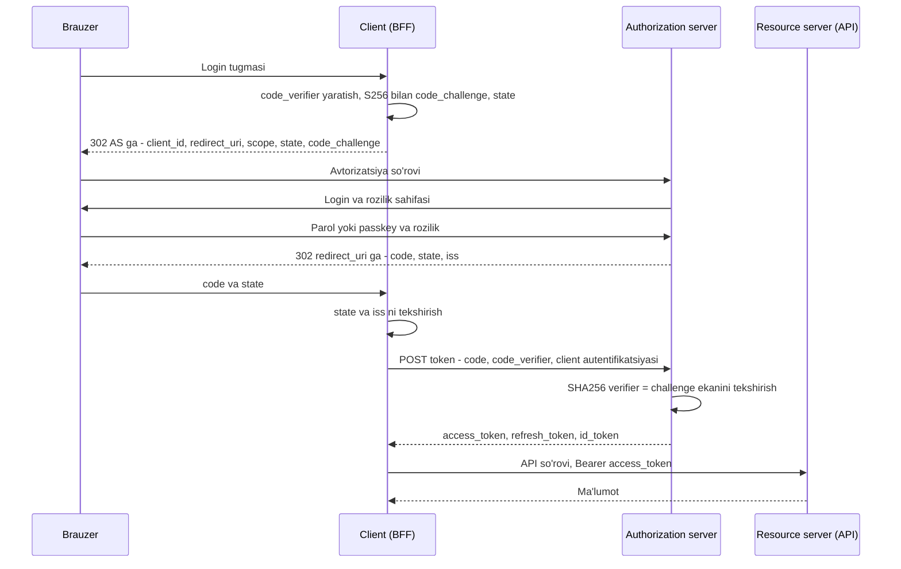
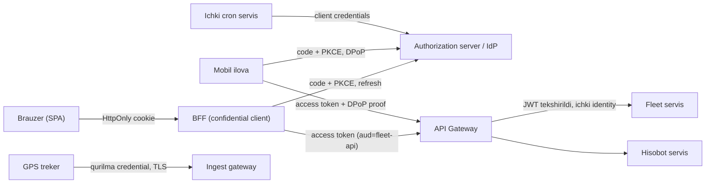

## Bu dars nima uchun kerak

Har bir so'rovda tizim ikki savolga javob beradi: **kim bu?** (autentifikatsiya, authN) va **unga nima mumkin?** (avtorizatsiya, authZ). Bu dars birinchisi haqida, ikkinchisi 72-darsda. Ikkalasini aralashtirish eng ko'p uchraydigan arxitektura xatolaridan biri: "JWT da `role: admin` bor, demak ruxsat bor" degan mantiq aslida avtorizatsiya qarorini token ichiga muzlatib qo'yadi.

System design nuqtai nazaridan autentifikatsiya - bu faqat "login formasi" emas. U har bir so'rovda ishlaydigan **issiq yo'l** (hot path): 10 ming so'rov/s bo'lsa, har birida session lookup yoki imzo tekshiruvi bo'ladi. Shu sabab savollar arxitekturaviy: holatni (state) qayerda saqlaymiz, tokenni qanday bekor qilamiz (revocation), bir nechta servis bir xil foydalanuvchini qanday taniydi, mobil ilova, brauzer va qurilma (GPS treker) uchun qaysi oqim to'g'ri.

Oldingi darslar bilan bog'liqlik: stateless servislar (21-dars) session ni qayerga qo'yishni majbur qiladi; Redis (24-dars) session store sifatida ishlatiladi; API Gateway (54-dars) token tekshiruvini markazlashtiradi; HTTPS va TLS 1.3 (7-dars) barcha tokenlarning tashuvchi himoyasi.

Bu darsdan keyin siz:

- server-side session va self-contained token (JWT) ning ichki ishlashini va trade-offlarini aniq ayta olasiz;
- JWT ni to'g'ri tekshirish qadamlarini va klassik zaifliklarni (`alg` almashtirish, `aud` tekshirmaslik) bilasiz;
- OAuth 2.0 authorization code + PKCE oqimini qadam-baqadam chiza olasiz va nega implicit va password grant bekor qilinganini tushuntira olasiz;
- OAuth (delegatsiya) va OIDC (identifikatsiya) farqini va ID token vs access token farqini bilasiz;
- revocation, refresh token rotation, DPoP kabi mexanizmlarni loyihaga qo'sha olasiz;
- brauzer, mobil, servis-servis va IoT qurilma uchun to'g'ri oqimni tanlaysiz.

## Asosiy tushunchalar: credential, session, token

Autentifikatsiya ikki bosqichli:

1. **Dastlabki tasdiqlash** - foydalanuvchi kimligini isbotlaydi: parol, OTP, passkey (WebAuthn), SSO. Bu kamdan-kam bo'ladi (kuniga bir marta, haftada bir marta).
2. **Keyingi so'rovlarda tanish** - har bir so'rovda parolni qayta so'ramaslik uchun tizim foydalanuvchiga **ishonch belgisi** beradi va keyingi so'rovlarda shu belgini tekshiradi.

Ikkinchi bosqich uchun ikki fundamental model bor:

- **Reference token (session ID)** - tasodifiy, ma'nosiz satr. Uning ma'nosi serverdagi yozuvda (session store). Tekshirish = store dan qidirish.
- **Self-contained token (JWT)** - ichida claimlar (kim, qachongacha, kimga mo'ljallangan) bor va imzolangan. Tekshirish = imzoni va claimlarni hisoblash, tarmoqqa chiqish shart emas.

Bu ikki model orasidagi tanlov - klassik **state vs hisoblash** trade-offi: birinchisida har bir so'rov store ga boradi, lekin bekor qilish bir zumda; ikkinchisida store yo'q, lekin bekor qilish qiyin.

## Server-side session

### Ichki mexanika

1. Login muvaffaqiyatli bo'lgach, server kriptografik xavfsiz tasodifiy generator (CSPRNG) bilan session ID yaratadi.
2. Store ga yozadi: `session:<id> -> {userId, tenantId, createdAt, lastSeenAt, mfa: true, ip, userAgent}` va TTL qo'yadi.
3. Brauzerga cookie sifatida qaytaradi: `Set-Cookie: __Host-sid=<id>; Secure; HttpOnly; SameSite=Lax; Path=/`.
4. Har bir so'rovda: cookie dan ID ni olish, store dan o'qish, `lastSeenAt` ni yangilash (idle timeout uchun).

OWASP Session Management Cheat Sheet tavsiyalari (raqamlar shu manbadan):

- session ID kamida **64 bit entropiya**ga ega bo'lsin, CSPRNG bilan yaratilsin; o'zingiz generatsiya qilsangiz 128 bit va undan ko'p tavsiya etiladi;
- cookie: `Secure` (faqat HTTPS), `HttpOnly` (JavaScript o'qiy olmaydi - XSS orqali o'g'irlashni qiyinlashtiradi), `SameSite=Strict` yoki `Lax` aniq qo'yilsin; `__Host-` prefiksi tavsiya etiladi (cookie faqat shu host uchun, `Domain` siz, `Path=/`);
- **idle timeout** serverda majburiy: yuqori qiymatli ilovalarda 2-5 daqiqa, past xavflilarda 15-30 daqiqa;
- **absolute timeout** ham bo'lsin, faollikdan qat'i nazar (masalan ofis xodimi uchun 4-8 soat);
- login (va har qanday imtiyoz o'zgarishi) dan keyin session ID **yangilansin**, eskisi o'chirilsin. Aks holda **session fixation**: hujumchi oldindan bilgan ID ni qurbonga "o'tqazadi", qurbon login qiladi, ID endi autentifikatsiyalangan.

### Masshtablash

Stateless servislar (21-dars) bilan session ziddek ko'rinadi, lekin aslida holat shunchaki tashqariga chiqariladi: servis instancelari stateless, session esa umumiy store da (Redis, Memcached yoki baza). Variantlar:

| Variant | Afzallik | Kamchilik |
|---|---|---|
| Instance xotirasida + sticky session (LB) | Eng tez, store yo'q | Instance o'lsa sessionlar yo'qoladi, LB balansi buziladi, deploy og'riqli |
| Markaziy Redis | Bir zumda revocation, oddiy | Har so'rovda tarmoq hop (~0.2-1 ms bitta DC ichida), Redis SPOF bo'lmasligi kerak |
| Relational baza | Allaqachon bor, audit oson | Har so'rovda yozish (`lastSeenAt`) bazani yuklaydi |
| Imzolangan cookie (holat cookie ichida) | Store yo'q | Aslida self-contained token, revocation muammosi bilan |

Hisob-kitob: 20 000 so'rov/s, har birida bitta Redis `GET` + har 60 soniyada bir marta `lastSeenAt` yangilash (har so'rovda yozmaslik uchun). 24-darsda ko'rilgan Redis benchmark misolida bitta tugun pipelining siz soniyasiga 100 mingdan ortiq oddiy buyruq bajaradi, demak 20 000 `GET`/s bitta primary + replica uchun muammo emas. Xotira hisobi uchun shart: bitta session yozuvi (kalit, JSON qiymat va Redis ning kalit bo'yicha overheadi bilan) 300 bayt. Unda 500 000 faol session × 300 B = 150 MB. Ya'ni session store hajm yoki throughput jihatidan deyarli hech qachon "bottleneck" emas; asl xavf - uning **mavjudligi**: Redis o'chsa, hamma logout bo'ladi yoki hamma 500 oladi.

## JWT: self-contained token

### Tuzilishi

JWT (RFC 7519) - uchta base64url qism, nuqta bilan ajratilgan: `header.payload.signature`. Bu JWS (imzolangan) shakli; shifrlangan JWE ham bor, lekin amaliyotda kam.

- **Header:** `{"alg":"ES256","typ":"at+jwt","kid":"2026-10-k1"}`. `kid` - qaysi kalit bilan imzolanganini bildiradi (key rotation uchun).
- **Payload (claimlar):** `iss` (kim chiqardi), `sub` (kim haqida), `aud` (kimga mo'ljallangan), `exp` (qachon tugaydi), `iat` (qachon chiqarilgan), `jti` (unikal ID), plus ilova claimlari (`tenant_id`, `scope`).
- **Signature:** `sign(base64url(header) + "." + base64url(payload), key)`.

Muhim: payload **shifrlanmagan**, faqat base64url. Uni istalgan kishi o'qiydi. Tokenga shaxsiy ma'lumot (telefon, pasport) qo'ymang.

### Simmetrik va asimmetrik imzo

| Algoritm | Kalit | Imzo hajmi | Kim tekshira oladi | Qachon |
|---|---|---|---|---|
| HS256 (HMAC-SHA256) | Bitta umumiy secret | 32 bayt | Secret egasi - u imzolay ham oladi | Faqat bitta servis o'zi chiqarib, o'zi tekshirsa |
| RS256 (RSA 2048) | Private/public | 256 bayt | Public key bor har kim | Keng moslik, lekin token katta |
| ES256 (ECDSA P-256) | Private/public | 64 bayt | Public key bor har kim | Ixcham, zamonaviy standart |
| EdDSA (Ed25519) | Private/public | 64 bayt | Public key bor har kim | Tez, deterministik, kutubxona qo'llashini tekshiring |

Microservices da HS256 xavfli: har bir tekshiruvchi servis secret ni biladi, demak har biri token **soxtalashtira oladi**. Bitta servis buzilsa - butun tizim buzildi. Asimmetrik algoritmda faqat auth server private key ga ega; boshqalar public key ni JWKS endpoint dan (`/.well-known/jwks.json`) oladi va cache qiladi.

Hajm hisobi: ES256 imzo 64 bayt, base64url da `ceil(64 × 4 / 3) = 86` belgi. RS256 imzo 256 bayt, base64url da 342 belgi. Yuqoridagi header (`{"alg":"ES256","typ":"at+jwt","kid":"2026-10-k1"}`) 49 bayt JSON, base64url da 66 belgi. Hisob uchun shart: 10-15 claimli payload JSON da 250-370 bayt, base64url da 330-500 belgi. Demak ES256 tokeni `66 + 1 + (330...500) + 1 + 86` ≈ 480-650 bayt, RS256 tokeni ≈ 740-910 bayt. Har bir so'rovda `Authorization` headerida yuboriladi. 20 000 so'rov/s × 800 B = 16 MB/s faqat token uchun - HTTP/2 HPACK buni qisman siqadi (7-dars), lekin mobil tarmoqda va telemetriyada bu sezilarli. Shu sabab claimlarni minimal saqlang.

### JWT ni to'g'ri tekshirish

RFC 8725 (JWT Best Current Practices, 2020) bo'yicha va amaliyotdan:

1. **Algoritmni oldindan belgilang.** Kutubxonaga "faqat ES256 qabul qil" deb ayting. Header dagi `alg` ga ishonmang. Klassik hujum: token `RS256` bilan imzolangan; hujumchi headerni `HS256` ga o'zgartiradi va **public key** ni HMAC secret sifatida ishlatib imzolaydi. Zaif kutubxona `alg` ga qarab HMAC tekshiradi va public key bilan "muvaffaqiyatli" tasdiqlaydi. RFC 8725 bir kalit faqat bitta algoritm bilan ishlatilishini talab qiladi.
2. **`none` ni rad eting.** `alg: none` - imzosiz token. RFC 8725 kutubxonalar uni chaqiruvchi aniq so'ramaguncha qabul qilmasligi kerakligini aytadi.
3. **`kid` ni allowlist dan oling.** `kid` dan fayl yo'li yoki SQL so'rov qurmang. `jku`/`x5u` header lardagi URL dan kalit yuklamang.
4. **`iss` ni aniq tekshiring.**
5. **`aud` ni tekshiring.** Bitta issuer bir nechta servis uchun token chiqarsa, `aud` majburiy va qabul qiluvchi o'zini `aud` da ko'rmasa rad etishi shart. Aks holda "billing" uchun chiqarilgan token "admin-api" ga ham o'tadi.
6. **`exp`, `nbf`, `iat`** - kichik clock skew (masalan 30-60 s) bilan (32-dars: soatlar hech qachon aniq sinxron emas).
7. **`typ` ni tekshiring.** RFC 8725 explicit typing tavsiya qiladi; access token uchun RFC 9068 `at+jwt` ni belgilaydi. Bu ID token ni access token o'rnida ishlatish kabi "token confusion" hujumlarini to'sadi.

### Revocation muammosi

JWT ning eng katta kamchiligi: imzo to'g'ri va `exp` o'tmagan bo'lsa, token **amal qiladi**, hatto foydalanuvchi bloklangan, parol almashgan yoki noutbuk o'g'irlangan bo'lsa ham. Yechimlar:

- **Qisqa umr.** Access token 5-15 daqiqa. Eng ko'p ishlatiladigan yondashuv. Revocation kechikishi = token umri.
- **Denylist.** Bekor qilingan `jti` larni Redis da `exp` gacha saqlash. Lekin bu yana har so'rovda store lookup - session ga qaytdik, faqat "kichikroq" store bilan.
- **Versiya/epoch.** Foydalanuvchida `tokenVersion` hisoblagich; token ichida ham. "Barcha qurilmalardan chiqish" = hisoblagichni oshirish. Tekshirishda versiyani cache dan solishtirish.
- **Token introspection (RFC 7662).** Resource server tokenni auth serverga yuborib "faolmi?" deb so'raydi. Bu amalda reference token modeli.

Xulosa: "JWT stateless, shuning uchun scalable" - yarim haqiqat. Haqiqiy farq: JWT **o'qish yo'lidagi** lookupni yo'qotadi, evaziga **revocation** ni qiyinlashtiradi. Ko'p tizimlarda optimal kombinatsiya: qisqa umrli JWT access token + serverda saqlanadigan, bekor qilinadigan refresh token.

## Session vs JWT: trade-off jadvali

| Mezon | Server-side session | JWT access token |
|---|---|---|
| Tekshirish narxi | Store lookup (tarmoq hop) | CPU: imzo tekshiruvi (ES256 verify ~75 mikrosekund, pastdagi o'lchov) |
| Revocation | Bir zumda (yozuvni o'chirish) | Faqat `exp` gacha kutish yoki denylist |
| Servislar o'rtasida | Har servis store ga murojaat qiladi yoki gateway almashtiradi | Har servis public key bilan mustaqil tekshiradi |
| Hajm har so'rovda | ~30-50 bayt cookie | ~500-900 bayt header |
| Holat o'zgarishi (rol, tenant) | Keyingi so'rovda ko'rinadi | Token yangilanguncha eski |
| Brauzerda saqlash | HttpOnly cookie - JS ga ko'rinmaydi | Ko'pincha JS xotirasi yoki localStorage (XSS xavfi) |
| CSRF | Cookie avtomatik yuboriladi - SameSite/CSRF token kerak | `Authorization` header da bo'lsa CSRF yo'q |
| Eng yaxshi joy | Brauzer + bitta backend (yoki BFF) | Servis-servis, API, mobil, ko'p resource server |

Amaliy qoida: **brauzerda token emas, session ishlating**; tokenlarni backend ushlasin. Bu quyidagi BFF pattern ga olib keladi.

## OAuth 2.0: delegatsiya protokoli

### Muammo

OAuth 2.0 (RFC 6749, 2012) "foydalanuvchi qanday login qiladi" degan savolga javob **emas**. U **delegatsiya** muammosini yechadi: foydalanuvchi uchinchi tomon ilovasiga o'z resurslariga cheklangan kirishni, **parolini bermasdan**, qanday beradi? Masalan, sug'urta kompaniyasining ilovasi iQuariX dagi mashinalar yurgan masofasini o'qishi kerak, lekin dispetcher parolini olmasligi kerak.

Rollar:

- **Resource owner** - foydalanuvchi (yoki tashkilot).
- **Client** - kirish so'rayotgan ilova. **Confidential** (secret saqlay oladi: backend) yoki **public** (saqlay olmaydi: SPA, mobil ilova).
- **Authorization server (AS)** - login qiladi, rozilik so'raydi, token chiqaradi.
- **Resource server (RS)** - API, tokenni qabul qiladi.

Natija - **access token** (RS ga kirish uchun, `scope` bilan cheklangan) va ixtiyoriy **refresh token** (yangi access token olish uchun, faqat AS ga yuboriladi).

### Authorization code + PKCE oqimi

Bugungi kunda foydalanuvchi ishtirok etadigan deyarli barcha holatlar uchun yagona tavsiya etilgan oqim. PKCE (RFC 7636, 2015) dastlab mobil ilovalar uchun qo'shilgan, endi hamma klientlar uchun tavsiya.

Har bir element nima uchun bor:

- **`code` brauzer orqali o'tadi, token esa yo'q.** Code qisqa umrli (odatda 1 daqiqagacha) va bir martalik. Tokenning o'zi faqat backend-AS kanali (TLS) orqali keladi. Shuning uchun brauzer tarixi, `Referer`, proxy logi tokenni ko'rmaydi.
- **PKCE.** Client tasodifiy `code_verifier` yaratadi va AS ga faqat uning SHA-256 xeshini (`code_challenge`, metod `S256`) yuboradi. Token almashishda asl verifier ni ko'rsatadi. Agar hujumchi `code` ni ushlab qolsa (masalan mobil qurilmada boshqa ilova o'sha custom URL scheme ni ro'yxatdan o'tkazgan bo'lsa), verifier siz uni tokenga almashtira olmaydi.
- **`state`** - CSRF himoyasi: javob aynan shu brauzer sessiyasidan boshlangan so'rovga tegishli ekanini tasdiqlaydi.
- **`iss` javob parametri** (RFC 9207) - **mix-up** hujumiga qarshi: client bir nechta AS bilan ishlasa, javob qaysi AS dan kelganini aniq biladi.
- **Redirect URI aniq moslik.** AS ro'yxatdan o'tgan URI ni satr bo'yicha aynan solishtiradi. Wildcard moslik real hujumlarda ishlatilgan.

### Nima eskirdi: RFC 9700

RFC 9700 (OAuth 2.0 Security Best Current Practice, 2025-yil yanvar) 2012 yildan beri to'plangan hujumlar tajribasini jamlaydi. Asosiy qoidalar:

- **Implicit grant** (`response_type=token`, token to'g'ridan-to'g'ri URL fragmentida) - ishlatmaslik kerak (SHOULD NOT); o'rniga authorization code.
- **Resource Owner Password Credentials grant** (client foydalanuvchi parolini olib, AS ga yuboradi) - **MUST NOT**: parol klientga ochiladi va MFA, passkey bilan ishlamaydi.
- **PKCE** - public klientlar uchun majburiy (MUST), confidential klientlar uchun tavsiya etiladi.
- Public klientlarning **refresh tokenlari** sender-constrained bo'lishi yoki **rotation** qilinishi shart.
- Access token **audience-restricted** bo'lishi kerak; RS o'ziga mo'ljallanmagan tokenni rad etishi shart.
- Redirect URI - aniq satr mosligi; open redirector bo'lmasin.

### OAuth 2.1 holati

OAuth 2.1 (`draft-ietf-oauth-v2-1`) RFC 6749 va RFC 6750 ni almashtirishga mo'ljallangan, RFC 9700 va boshqa hujjatlardagi eng yaxshi amaliyotlarni bitta matnga jamlaydi: PKCE majburiy, implicit va password grant spetsifikatsiyada yo'q, redirect URI aniq moslik. Muhim: bu hali **RFC emas**. IETF datatracker (2026-yil 20-oktabrda ko'rilgan) bo'yicha oxirgi versiya `draft-ietf-oauth-v2-1-16` (hujjat sarlavhasida 2026-yil 3-sentabr), ishchi guruh holati "WG Document", IESG holati "I-D Exists", OAuth WG milestone: "Dec 2026 - Submit OAuth 2.1 Authorization Framework to IESG". Amalda farq kichik: RFC 9700 ga amal qilsangiz, OAuth 2.1 ga deyarli mos bo'lasiz.

### Boshqa grant turlari

| Grant | Kim uchun | Izoh |
|---|---|---|
| Authorization code + PKCE | Brauzer, mobil, desktop - foydalanuvchi bor | Asosiy oqim |
| Client credentials | Servis-servis, foydalanuvchi yo'q | Client o'z nomidan; token `sub` = client |
| Refresh token | Access tokenni yangilash | Rotation: har ishlatilganda yangisi, eskisi bekor; eski qayta kelsa - butun oila bekor (o'g'irlik belgisi) |
| Device authorization (RFC 8628) | Klaviaturasiz qurilmalar: TV, konsol, CLI | Qurilma kod ko'rsatadi, foydalanuvchi telefonda tasdiqlaydi |
| Implicit, Password | Hech kim | Eskirgan (RFC 9700) |

### Sender-constrained tokenlar: DPoP va mTLS

Oddiy access token - **bearer**: kimda bo'lsa, o'sha ishlatadi (pul kabi). O'g'irlangan bearer token `exp` gacha to'liq kuchga ega. Sender-constraining tokenni kalitga bog'laydi:

- **DPoP (RFC 9449, 2023):** client o'z kalit juftligini yaratadi va har so'rovda `DPoP` headerida kichik imzolangan JWT (proof) yuboradi: `typ: dpop+jwt`, public key (`jwk`), `htm` (HTTP metod), `htu` (URL), `iat`, `jti` (replay ni aniqlash uchun), RS ga yuborilganda `ath` (access token xeshi). AS tokenga `cnf.jkt` (public key thumbprint) yozadi. RS proof imzosini, `ath` ni va kalit thumbprint mosligini tekshiradi. Natija: tokenni o'g'irlagan hujumchi private key siz uni ishlata olmaydi.
- **mTLS (RFC 8705):** token client TLS sertifikatiga bog'lanadi. Servis-servis va B2B integratsiyada qulay (74-darsda mTLS chuqur ko'riladi).

Narxi: DPoP har so'rovda qo'shimcha imzo (client) va tekshiruv (server), `jti` replay keshini saqlash, client tomonda kalitni xavfsiz saqlash.

## OpenID Connect: OAuth ustidagi identifikatsiya

OAuth access token **RS uchun**, client uchun emas: client uni ochib "foydalanuvchi kim" deb o'qishi kerak emas (token formati client uchun shaffof emas, ixtiyoriy o'zgarishi mumkin). Shu sababli "Login with X" uchun OAuth ni o'zini ishlatish xato edi va har provayder o'z variantini ixtiro qilgan. **OpenID Connect (OIDC) Core 1.0** buni standartlashtirdi: hozirgi versiya errata set 2 bilan 2023-yil 15-dekabrda chiqarilgan va 2024-yil oktabrda ISO/IEC 26131:2024 sifatida xalqaro standart ham bo'lgan.

OIDC qo'shadigan narsalar:

- **`scope=openid`** - bu OIDC so'rovi ekanini bildiradi.
- **ID token** - har doim JWT, **client uchun**: kim, qachon, qanday autentifikatsiya qilingan. Majburiy claimlar: `iss`, `sub`, `aud` (client_id), `exp`, `iat`. So'rovda `nonce` bo'lsa, javobda ham bo'lishi shart (replay himoyasi). `auth_time`, `acr`, `amr` - qachon va qanday (masalan MFA bilan) kirganini bildiradi.
- **UserInfo endpoint** - access token bilan qo'shimcha profil claimlarini olish.
- **Discovery** (`/.well-known/openid-configuration`) va **JWKS** - client AS ning endpointlari va kalitlarini avtomatik topadi.

ID token vs access token:

| | ID token | Access token |
|---|---|---|
| Kimga | Client | Resource server |
| Format | Har doim JWT | Ixtiyoriy (JWT yoki reference) |
| `aud` | client_id | API identifikatori |
| Nima uchun | Login: "kim kirdi" | API ga kirish: "nima qilish mumkin" |
| API ga yuborish | Yo'q - xato | Ha |

**Foydalanuvchini qanday aniqlash:** faqat `iss` + `sub` juftligi barqaror va unikal. `email` emas: email o'zgaradi, ba'zi provayderlarda `email_verified: false` bo'lishi mumkin, va bir xil email ikki provayderda ikki xil odamga tegishli bo'lishi mumkin. Email bo'yicha akkauntlarni avtomatik birlashtirish - account takeover ning klassik yo'li.

## Arxitektura: kim tokenni ushlab turadi

RFC 10017 (OAuth 2.0 for Browser-Based Applications, Best Current Practice, BCP 212 tarkibida, 2026-yil avgust; mualliflar A. Parecki, P. De Ryck, D. Waite) 6-bo'limda brauzer ilovalari uchun uchta arxitekturani xavfsizlik kamayishi tartibida beradi:

1. **BFF (Backend for Frontend, 6.1)** - confidential client serverda, tokenlar serverda, brauzerda faqat HttpOnly session cookie. RFC uni biznes ilovalari va sezgir ilovalar uchun qat'iy tavsiya qiladi (6.1.4.3). (BFF pattern 54-darsda.)
2. **Token-mediating backend (6.2)** - backend oqimni bajaradi, lekin access tokenni brauzerga beradi. RFC avval to'liq BFF ni ko'rib chiqishni, bunisini faqat proxy qiluvchi BFF imkonsiz bo'lsa tanlashni maslahat beradi.
3. **Brauzerdagi public client (6.3)** - eng ochiq variant: XSS bo'lsa, hujumchi tokenni olishi yoki brauzer nomidan yangi token so'rashi mumkin. Ishlatilsa PKCE majburiy.

Servislar ichida ikki yondashuv:

- **Har servis o'zi tekshiradi.** Har biri JWKS ni cache qiladi va JWT ni tekshiradi. Zero-trust ga yaqin, lekin har servisda bir xil kod va bir xil xato ehtimoli.
- **Gateway tekshiradi, ichkariga ichki identity uzatadi.** Gateway tashqi tokenni tekshirib, ichki servislarga qisqa umrli ichki token yoki imzolangan header beradi. Ichki tarmoqda mTLS (74-dars) bo'lmasa, oddiy `X-User-Id` header ga ishonish xavfli - ichki tarmoqqa kirgan har kim uni soxtalashtiradi.

**Key rotation:** AS yangi kalitni JWKS ga **oldindan** qo'shadi (`kid` bilan), RS lar uni cache ga oladi, keyin AS yangi kalit bilan imzolashni boshlaydi, eski kalit eng uzoq token umri o'tgach olib tashlanadi. RS noma'lum `kid` ko'rsa, JWKS ni qayta yuklaydi - lekin rate limit bilan, aks holda hujumchi tasodifiy `kid` lar bilan AS ga DoS qiladi.

## Real tizimlardan misollar

- **Google, Microsoft Entra ID, Keycloak, Auth0, Okta** - OIDC provayderlari; discovery hujjati va JWKS orqali kalitlarini e'lon qiladi, klientlar ularni avtomatik oladi.
- **RFC 9700 va RFC 10017** - IETF OAuth ishchi guruhining real hujumlardan chiqarilgan xulosalari: wildcard redirect URI, implicit grantda token sizishi, mix-up hujumlari - bularning hammasi amaliyotda kuzatilgan.
- **JWT `alg` almashtirish** - RFC 8725 (2.1-bo'lim) Tim McLean ning 2015-yildagi RSA/HMAC confusion tadqiqotiga va CVE-2015-9235 ga havola qiladi; bu CVE npm dagi `jsonwebtoken` paketining 4.2.1 va undan oldingi versiyalaridagi zaiflik (4.2.2 da tuzatilgan).
- **Device grant (RFC 8628)** - smart TV va CLI larda "telefoningizda shu kodni kiriting" oqimi.

## iQuariX kontekstida: kim kim bilan qanday autentifikatsiya qiladi

Bu misolda iQuariX quyidagi aktorlarga ega deb olinadi:

1. **Dispetcher veb-paneli (Next.js).** BFF pattern: Next.js server qismi confidential client, tokenlar serverda, brauzerda `__Host-sid` cookie. Session Redis da, idle timeout 30 daqiqa, absolute 12 soat (smenaga mos). Korporativ mijozlar o'z IdP si (Entra ID, Google Workspace) bilan SSO xohlasa - iQuariX o'z AS ini (masalan Keycloak) markaz qilib, mijoz IdP lari bilan federatsiya qiladi; ichki servislar faqat bitta issuer ni biladi.
2. **Haydovchi mobil ilovasi.** Public client: authorization code + PKCE, refresh token rotation, imkon bo'lsa DPoP. Access token 10 daqiqa. Telefon yo'qolsa - refresh token oilasini bekor qilish.
3. **GPS trekerlar.** Ular OAuth ishlatmaydi: brauzer ham, foydalanuvchi ham yo'q, protokol ko'pincha ishlab chiqaruvchining binar TCP protokoli. Autentifikatsiya - IMEI + qurilma secret yoki mTLS sertifikat (qurilma qo'llasa), va ingest gateway da IMEI ni tenant ga bog'lovchi registr. IMEI ning o'zi secret emas: u qurilma korpusida yozilgan, shuning uchun faqat IMEI ga tayanish - har kim boshqa birovning mashinasi nomidan soxta koordinata yuborishi mumkin degani.
4. **Mijozning ERP tizimi (integratsiya API).** Client credentials grant, `aud=fleet-api`, `scope=trips:read fuel:read`, token 15 daqiqa. Yirik mijozlar uchun mTLS-bound token.
5. **Ichki servislar.** Kubernetes ichida (75-dars) servis identiteti workload sertifikatlari bilan (74-dars), foydalanuvchi kontekstini esa gateway imzolagan ichki token bilan uzatish.

Hisob: 5 000 dispetcher, har biri o'rtacha har 5 soniyada xarita yangilash so'rovi yuboradi = 1 000 so'rov/s session lookup. Redis da bu ahamiyatsiz yuklama. 20 000 haydovchi ilovasi har 30 soniyada sinxronlash = `20 000 / 30 ≈ 667` so'rov/s JWT tekshiruvi. O'lchov: OpenSSL 3.0.13 `openssl speed ecdsap256` buyrug'i Intel Xeon 2.1 GHz vCPU ning bitta yadrosida soniyasiga ~13 300 ta P-256 verify bajardi (bitta verify ~75 mikrosekund); demak 667 verify/s bitta yadroning 5% idan kam, CPU ahamiyatsiz. Xulosa: autentifikatsiyada qaror throughput ga emas, **xavfsizlik, revocation tezligi va operatsion soddalik**ka asoslanadi.

## Ko'p uchraydigan xatolar

1. **Header dagi `alg` ga ishonish.** Kutubxonaga ruxsat etilgan algoritmlar ro'yxatini aniq bering; `none` va HS/RS aralashishini yopib qo'ying.
2. **`aud` va `iss` ni tekshirmaslik.** Bitta IdP dan chiqqan har qanday token har qanday API ga o'tib ketadi.
3. **Uzoq umrli JWT access token** (24 soat, 30 kun) va revocation mexanizmi yo'q. Bloklangan xodim bir kun davomida tizimda.
4. **Microservices da HS256.** Har bir tekshiruvchi servis token soxtalashtira oladi.
5. **Tokenni localStorage da saqlash.** Har qanday XSS = token o'g'irligi. BFF va HttpOnly cookie afzal.
6. **ID tokenni API ga yuborish yoki access tokenni login isboti sifatida ishlatish.** Ular boshqa auditoriya uchun.
7. **Foydalanuvchini `email` bo'yicha aniqlash va akkauntlarni avtomatik birlashtirish.** To'g'ri kalit - `iss` + `sub`.
8. **Login dan keyin session ID ni yangilamaslik** - session fixation.

## Xulosa

- Autentifikatsiya "kim?" savoli, avtorizatsiya "nima mumkin?" - ularni arxitekturada ajrating.
- Session (reference) va JWT (self-contained) o'rtasidagi asosiy trade-off: lookup narxi vs revocation qiyinligi. Ko'pincha optimal: qisqa umrli JWT + serverda boshqariladigan refresh token yoki session.
- JWT ni tekshirish: oldindan belgilangan `alg`, `iss`, `aud`, `exp`, `typ`; asimmetrik kalit va JWKS + `kid` rotation.
- OAuth 2.0 - delegatsiya protokoli. Yagona tavsiya etilgan foydalanuvchi oqimi - authorization code + PKCE. Implicit va password grant eskirgan (RFC 9700). OAuth 2.1 hali draft.
- OIDC OAuth ustiga identifikatsiya qo'shadi: ID token client uchun, access token API uchun; foydalanuvchi kaliti `iss` + `sub`.
- Brauzer ilovalari uchun BFF eng xavfsiz arxitektura (RFC 10017). Bearer tokenni DPoP yoki mTLS bilan kalitga bog'lash mumkin.
- Qurilmalar (IoT) uchun OAuth emas, qurilma credential yoki mTLS - va IMEI secret emas.

## Amaliy topshiriq

iQuariX uchun yagona autentifikatsiya arxitekturasini loyihalang. Aktorlar: dispetcher veb-paneli, haydovchi mobil ilovasi, 50 000 GPS treker, 30 ta korporativ mijozning ERP integratsiyasi, 12 ta ichki microservice. 5 ta mijoz o'z Entra ID si orqali SSO talab qilmoqda.

1. Har bir aktor uchun: qaysi oqim (session, authorization code + PKCE, client credentials, qurilma credential), token turi va umri, qayerda saqlanadi. Jadval ko'rinishida.
2. Mobil ilova va veb uchun sequence diagramma chizing (mermaid yoki matn).
3. Revocation stsenariysi: xodim ishdan bo'shatildi, mijoz admin uni bloklaydi. Har bir kanal bo'yicha u qancha vaqtdan keyin to'liq chiqib ketadi? Talab "60 soniyadan kam" bo'lsa, nimani o'zgartirasiz va bu qancha qo'shimcha yuklama beradi (hisoblang)?
4. Key rotation rejasi: kalit qancha muddatda almashadi, JWKS cache TTL qancha, noma'lum `kid` kelganda nima bo'ladi.
5. Trekerlar uchun: soxta IMEI bilan ma'lumot yuborishning oldini olish chorasi, va qurilma credential ni yangilash (rotation) jarayoni.
6. Mijoz SSO federatsiyasi: ichki servislar nechta issuer ni biladi va nima uchun.

Yaxshi javobda bo'lishi kerak bo'lgan narsalar:

- brauzerda token yo'qligi (BFF) yoki uning nega tanlanmaganining asoslanishi;
- har bir token uchun `aud` va umr aniq ko'rsatilgani;
- revocation kechikishi har kanal uchun raqam bilan va qo'shimcha yuklama hisob-kitobi;
- refresh token rotation va qayta ishlatishni aniqlash;
- IMEI ning secret emasligi tan olingani;
- foydalanuvchi identifikatori `iss` + `sub` ekani, email emas.

Javobni pastdagi maydonga yozib, chatga yuboring.

## Manbalar

- [RFC 9700: Best Current Practice for OAuth 2.0 Security](https://datatracker.ietf.org/doc/html/rfc9700), IETF, BCP 240, 2025-yil yanvar. 2-bo'lim (tavsiyalar: implicit, password grant, PKCE, refresh token, audience) va 4-bo'lim (hujumlar: mix-up, redirect URI).
- [OAuth 2.1 draft (draft-ietf-oauth-v2-1-16)](https://datatracker.ietf.org/doc/draft-ietf-oauth-v2-1/), IETF datatracker, 2026-yil 3-sentabr - hujjat holati (WG Document, I-D Exists), milestone va OAuth 2.0 dan farqlar.
- [RFC 8725: JSON Web Token Best Current Practices](https://www.rfc-editor.org/rfc/rfc8725.html), BCP 225, 2020-yil fevral. 2.1 (algoritm almashtirish), 3.1, 3.2, 3.9, 3.11 bo'limlar.
- [OpenID Connect Core 1.0 (errata set 2)](https://openid.net/specs/openid-connect-core-1_0.html), OpenID Foundation, 2023. 2-bo'lim (ID token), 3.1.3.7 (ID token tekshiruvi), 5.3 (UserInfo).
- [RFC 9449: OAuth 2.0 Demonstrating Proof of Possession (DPoP)](https://datatracker.ietf.org/doc/rfc9449/), 2023. 4-bo'lim (proof tuzilishi), 6-bo'lim (`cnf.jkt`).
- [RFC 10017: OAuth 2.0 for Browser-Based Applications](https://www.rfc-editor.org/info/rfc10017), BCP 212, 2026-yil avgust. 6.1 (BFF), 6.2 (token-mediating backend), 6.3 (browser-based client).
- [OWASP Session Management Cheat Sheet](https://cheatsheetseries.owasp.org/cheatsheets/Session_Management_Cheat_Sheet.html) - session ID entropiyasi, cookie atributlari, timeoutlar, session fixation.
- [RFC 9068: JWT Profile for OAuth 2.0 Access Tokens](https://rfc-editor.org/rfc/rfc9068.html), 2021 - `at+jwt` va access token claimlari.
