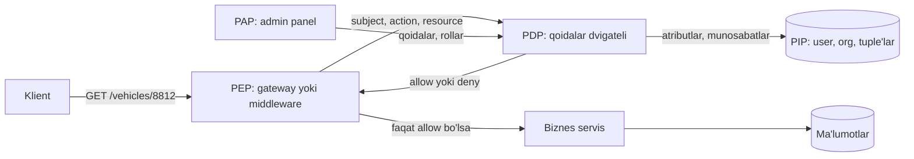
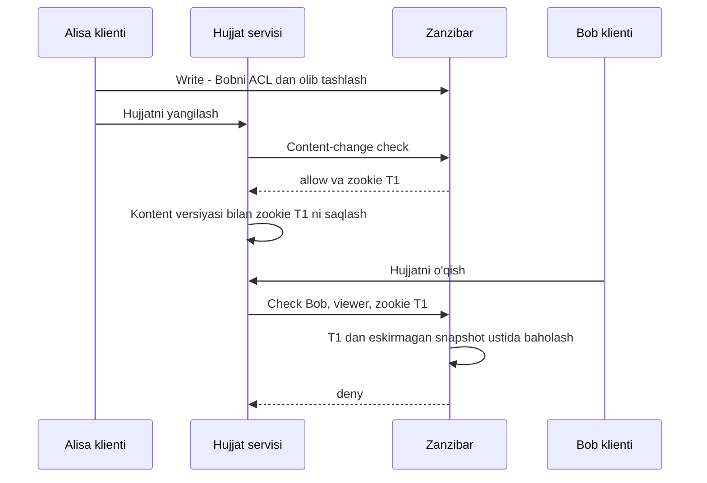

## Bu dars nima uchun kerak

71-darsda "kim bu?" savoliga javob berdik. Endi ikkinchi savol: **bu foydalanuvchi shu obyekt ustida shu amalni bajara oladimi?** Bu savol autentifikatsiyadan ancha murakkab, chunki u biznes mantiqqa chuqur bog'langan: "dispetcher faqat o'z filialining mashinalarini ko'radi", "haydovchi faqat o'z reyslarini", "mijozning auditori faqat o'qiy oladi va faqat ish vaqtida", "hujjat papkadagi ruxsatlarni meros oladi".

Xavf darajasi ham yuqori. OWASP Top 10:2025 ro'yxatida **Broken Access Control** yana 1-o'rinda: tekshirilgan ilovalarning 100 foizida qandaydir ko'rinishdagi access control xatosi topilgan, kategoriyaga 40 ta CWE bog'langan. Eng tipik xato - IDOR (insecure direct object reference): `GET /api/vehicles/8812` endpointi foydalanuvchi autentifikatsiyadan o'tganini tekshiradi, lekin 8812-mashina uning tashkilotiga tegishlimi - yo'q.

System design nuqtai nazaridan savollar: ruxsat qoidalari qayerda yashaydi (kodda, bazada, alohida servisda)? Har bir so'rovdagi tekshiruv qancha turadi? Ro'yxat so'rovlarida ("men ko'ra oladigan barcha mashinalar") filtrlash qanday ishlaydi? Ruxsat o'zgarganda u qancha tez kuchga kiradi?

Bu darsdan keyin siz:

- RBAC, ABAC va ReBAC modellarini, ularning ifoda kuchi va narxini taqqoslay olasiz;
- PEP/PDP/PIP arxitekturasini va avtorizatsiyani markazlashtirish yoki markazlashtirmaslik trade-offini bilasiz;
- Google Zanzibar ning ma'lumot modeli (relation tuple), rewrite qoidalari, "new enemy" muammosi va zookie mexanizmini tushuntira olasiz;
- "check" va "list/filter" so'rovlarining farqli murakkabligini va ularni qanday yechishni bilasiz;
- multi-tenant SaaS uchun real avtorizatsiya modelini loyihalay olasiz.

## Asosiy tushunchalar va arxitektura

Har qanday avtorizatsiya qarori uchlik bo'yicha: **subject** (kim: foydalanuvchi, servis, qurilma), **action** (nima: `read`, `update`, `export`), **resource** (nimani: `vehicle:8812`). Ba'zan to'rtinchi element - **context** (qachon, qayerdan, qanday qurilmadan).

XACML davridan qolgan va NIST ABAC qo'llanmasida ham ishlatiladigan terminlar:

- **PEP (Policy Enforcement Point)** - so'rovni to'xtatib, qaror so'raydigan va uni bajaradigan joy: API gateway, middleware, servis ichidagi guard.
- **PDP (Policy Decision Point)** - qoidalarni baholab "ruxsat / rad" qaytaradigan komponent.
- **PIP (Policy Information Point)** - PDP ga kerakli atributlar va munosabatlarni beradigan manba: foydalanuvchi profili, obyekt egasi, guruh a'zoligi.
- **PAP (Policy Administration Point)** - qoidalarni boshqarish interfeysi.



Ikki asosiy tamoyil (OWASP A01:2025 tavsiyalari):

1. **Deny by default.** Hech qanday qoida mos kelmasa - rad. Ochiq resurslar bundan mustasno va ular aniq belgilanadi.
2. **Server tomonda tekshirish.** UI da tugmani yashirish avtorizatsiya emas. Qaror faqat hujumchi o'zgartira olmaydigan joyda - serverda.

## RBAC: rolga asoslangan

**Role-Based Access Control** - ruxsatlar rollarga, rollar foydalanuvchilarga beriladi: `user -> role -> permission`. NIST/ANSI INCITS 359-2004 standarti uni darajalarga ajratadi: **core RBAC** (foydalanuvchi, rol, ruxsat, session), **hierarchical RBAC** (rol boshqa roldan meros oladi: `admin` > `dispatcher` > `viewer`), **constrained RBAC** (vazifalar bo'linishi - separation of duty: bir kishi ham to'lovni yaratib, ham tasdiqlay olmaydi).

Afzalliklari: tushunish, audit va admin UI qilish oson ("bu rolda nima ruxsatlar bor?" savoliga darhol javob). Tekshirish arzon: rollar ko'pincha tokenda yoki session da, ruxsatlar xaritasi xotirada.

Asosiy muammo - **role explosion**. RBAC "kim" va "nima" ni yaxshi ifodalaydi, lekin "**qaysi**" ni yomon. "Dispetcher" roli bor, lekin "Toshkent filiali dispetcheri", "Samarqand filiali dispetcheri", "faqat yoqilg'i hisobotini ko'radigan Toshkent dispetcheri" kerak bo'lganda rollar soni `rollar × filiallar × cheklovlar` bo'lib ko'payadi. 20 ta mijoz, har birida 15 filial va 6 ta asosiy rol bo'lsa, `20 × 15 × 6 = 1 800` ta rol - boshqarib bo'lmaydi.

Yechim - rolni **scope** bilan bog'lash: `(user, role, scope)`, masalan `(ali, dispatcher, org:acme/branch:tashkent)`. Bu allaqachon sof RBAC emas, munosabatga yaqinlashish - ReBAC sari birinchi qadam.

## ABAC: atributlarga asoslangan

**Attribute-Based Access Control** (NIST SP 800-162, 2014): qaror subject, obyekt, amal va muhit atributlarini qoidalar bilan baholash orqali qabul qilinadi. Misol qoida:

```
permit read on trip
  when principal.org_id == resource.org_id
   and principal.branch_id in resource.allowed_branches
   and context.time between 06:00 and 22:00
   and principal.mfa == true
```

Afzalliklari: juda ifodali, kontekstni (vaqt, IP, qurilma, ma'lumot sinfi) hisobga oladi, rollar sonini portlatmaydi.

Kamchiliklari:

- **Audit qiyin.** "Ali qaysi obyektlarni ko'ra oladi?" savoliga javob berish uchun barcha obyektlar ustida qoidani baholash kerak.
- **Atributlar yangiligi.** Qaror atributlar qanchalik yangi bo'lsa, shunchalik to'g'ri. Atribut tokenda bo'lsa - token umriga qadar eskirgan bo'lishi mumkin.
- **Debug qiyin.** "Nega rad etildi?" - qoidalar va atributlar kombinatsiyasini tiklash kerak.

Policy-as-code dvigatellari:

- **OPA (Open Policy Agent)** - CNCF graduated loyiha, qoidalar **Rego** deklarativ tilida. Asosiy g'oya: qaror qabul qilishni (decision) bajarishdan (enforcement) ajratish. Servis OPA ga JSON input yuboradi, OPA qaror qaytaradi. Kubernetes admission control, API gateway, CI qoidalarida keng ishlatiladi.
- **Cedar** - AWS ishlab chiqqan ochiq kodli policy tili, Amazon Verified Permissions asosida. Muhim xossalari Lean da formal isbotlangan: **default deny**, **forbid permit ustidan g'olib** (bitta `forbid` mos kelsa - rad), validator o'tkazgan qoidalar ishlash vaqtida tip xatosi bermaydi. Mualliflar maqolasida (5.2.2-bo'lim) uchta namunaviy model (gdrive, github, TinyTodo) bo'yicha `is_authorized()` chaqiruvining mediana vaqti solishtirilgan, policy va entity ma'lumotlari oldindan xotirada: Cedar OpenFGA dan 28.7, 34.4 va 35.2 baravar, Rego dan 60.4, 80.8 va 42.8 baravar tezroq. Bu mualliflarning o'z benchmarki va faqat qaror hisoblash vaqtini o'lchaydi (tarmoq va ma'lumot yuklash kirmaydi).

## ReBAC: munosabatlarga asoslangan

**Relationship-Based Access Control** - ruxsat subject va obyekt orasidagi **munosabatlar grafi**dan chiqadi: "Ali `acme` tashkilotining a'zosi; `acme` tashkiloti `vehicle:8812` ning egasi; tashkilot a'zolari tashkilot mashinalarini ko'radi - demak Ali 8812 ni ko'radi". Bu Google Drive dagi "papka ruxsatlari ichidagi hujjatlarga o'tadi", GitHub dagi "tashkilot - jamoa - repozitoriy" modellarining tabiiy ifodasi.

### Zanzibar: ma'lumot modeli

Google Zanzibar (USENIX ATC 2019) - Google ning global avtorizatsiya tizimi; Calendar, Cloud, Drive, Maps, Photos, YouTube kabi yuzlab servislar ishlatadi. Maqoladagi raqamlar (4-bo'lim, 2018-yil dekabridagi 7 kunlik o'lchov): yuzlab klient ilovalar belgilagan 1 500 dan ortiq namespace, **2 trilliondan ortiq** relation tuple (100 TB ga yaqin), dunyo bo'ylab 30 dan ortiq joyda to'liq replikatsiya, **soniyasiga 10 milliondan ortiq** klient so'rovi, bir necha o'nlab klasterda 10 000 dan ortiq server, 3 yil davomida 99.999% dan yuqori mavjudlik; checklarning 95% dan ko'pi 10 ms ichida javob oladi.

Asosiy birlik - **relation tuple**:

```
object#relation@user
doc:readme#owner@user:10
group:eng#member@user:11
doc:readme#viewer@group:eng#member     -- userset: eng guruhi a'zolari
doc:readme#parent@folder:A
```

`user` o'rnida oddiy foydalanuvchi yoki **userset** (`group:eng#member` - "eng guruhining barcha a'zolari") turishi mumkin. Shu tufayli guruhlar ichma-ich joylashadi va graf hosil bo'ladi.

**Namespace konfiguratsiyasi** har bir obyekt turi uchun munosabatlar va **userset rewrite** qoidalarini belgilaydi:

- **`_this`** - to'g'ridan-to'g'ri yozilgan tuple'lar.
- **`computed_userset`** - shu obyektning boshqa munosabatidan hosil qilish: "har bir `owner` - `editor` ham", "har bir `editor` - `viewer` ham".
- **`tuple_to_userset`** - boshqa obyektga o'tib, u yerdagi munosabatni olish: "hujjatning `parent` papkasi `viewer`lari hujjatning ham `viewer`lari".

Natijada `viewer = _this ∪ editor ∪ parent.viewer`. Bu qoidalar ham "kim" ni, ham "qaysi" ni ifodalaydi va rol portlashi bo'lmaydi: yangi filial = bitta yangi obyekt va bir nechta tuple.

### API

Zanzibar beshta asosiy amalni taqdim etadi:

- **Write** - tuple qo'shish yoki o'chirish (optimistic concurrency bilan).
- **Read** - saqlangan tuple'larni o'qish (rewrite qoidalarisiz).
- **Check** - "U foydalanuvchi O obyektga R munosabatga egami?"
- **Expand** - samarali userset ni daraxt ko'rinishida qaytarish (debug va indekslash uchun).
- **Watch** - tuple o'zgarishlari oqimi (tashqi indekslarni yangilash uchun).

Cho'qqidagi yuklama maqolada (4-bo'lim): Check 4.2 mln/s, Read 8.2 mln/s, Expand 760 ming/s, Write atigi 25 ming/s. Ya'ni avtorizatsiya - **o'qish bilan juda og'ir** (read-heavy) yuklama: yozishdan yuzlab marta ko'p o'qish. Bu cache va replikatsiya qarorlarini belgilaydi.

### "New enemy" muammosi va zookie

Taqsimlangan avtorizatsiyaning eng nozik qismi - **izchillik** (33-dars). Zanzibar maqolasi buni "new enemy" muammosi deb ataydi: ACL o'zgarishlari tartibi yoki ACL va kontent o'zgarishlari tartibi hurmat qilinmasa, yangi "dushman" ruxsat olib qoladi. Ikki klassik stsenariy:

1. Alisa Bobni guruhdan chiqaradi, **keyin** guruhga yangi hujjatga ruxsat beradi. Eskirgan replica guruh a'zoligini eski holatda, hujjat ACL ini yangi holatda ko'rsa - Bob yangi hujjatni ko'radi.
2. Alisa Bobni hujjat ACL idan olib tashlaydi, **keyin** hujjatga maxfiy matn qo'shadi. Check eskirgan ACL bo'yicha baholansa - Bob yangi matnni ko'radi.

Har bir checkni linearizable qilish (eng so'nggi holatdan o'qish) global tizimda juda qimmat: har so'rovda regionlararo round-trip. Zanzibar yechimi - **zookie**:



Zookie - **shaffof bo'lmagan token** ichida global ma'noli vaqt belgisi (timestamp). Kontent saqlanganda olinadi va kontent bilan birga yoziladi. Keyingi check "kamida shu vaqtdagi yoki yangiroq snapshot" talabi bilan bajariladi. Bu linearizability emas, lekin **kerakli tartibni** kafolatlaydi: kontent versiyasidan oldingi ACL o'zgarishlari albatta hisobga olinadi. Shu bilan birga, server istalgan yetarlicha yangi snapshotni tanlay oladi va ko'pincha lokal replicadan, cache dan javob beradi.

Bu Spanner ning TrueTime ga asoslangan tashqi izchilligi (external consistency) va o'tmishdagi timestamp bo'yicha snapshot o'qish imkoniyati tufayli ishlaydi (32-dars soatlar, 33-dars consistency). Maqoladagi raqamlar (4.1-bo'lim va 2-jadval) farqni yaxshi ko'rsatadi: "Safe" checklar (zookie 10 soniyadan eski, odatda lokal javob) p50 3.0 ms, p95 9.46 ms, p99 15.0 ms; "Recent" checklar (zookie 10 soniyadan yangi, ko'pincha regionlararo murojaat) p50 2.86 ms, p95 60.0 ms, p99 76.3 ms. Medianlar deyarli bir xil, farq dumda (tail): yangi snapshot kerak bo'lgan so'rovlarning bir qismi uzoq replicaga boradi.

Qaysi nomuvofiqliklar **qabul qilinadi**? Bobni guruhdan chiqarganda u qisqa vaqt eski hujjatni ko'rishda davom etishi, yoki yangi qo'shilgan foydalanuvchi bir necha soniya ruxsat olmasligi - jiddiy xavfsizlik teshigi emas. Asosiy narsa - **yangi** kontentga eski ruxsat bilan kirish bo'lmasligi.

### Ishlash tezligi: cache, hot spot, Leopard

Bitta check ichma-ich guruhlar bo'ylab ko'p ichki lookupga tarqaladi. Maqolada keltirilgan raqamlar (4.4-bo'lim): cho'qqida soniyasiga 22 million ichki "delegated" RPC va xotiradagi cache bo'yicha 200 million ga yaqin lookup (150 million check, 50 million read uchun); Spanner ga esa soniyasiga 20 million ga yaqin o'qish RPC si (mediana 0.5 ms, p95 2 ms). Zanzibar qo'llagan usullar:

- **Obyekt bo'yicha sharding** server ichidagi cache ni samarali qiladi (bir obyekt bo'yicha so'rovlar bir serverga tushadi, 29-dars consistent hashing).
- **Lock table** - bir xil kalit bo'yicha bir vaqtdagi cache miss'larni birlashtirish (cache stampede ning oldini olish, 24-dars).
- Cache hit darajasi kamtarona (delegate tomonda check uchun 10%, lock table yana 12% so'rovni tejaydi; read uchun 24% va 9%), lekin u asosan **hot spot**larni - bir mashhur guruh yoki obyekt bo'yicha birdaniga ko'p so'rovlarni - tekislashda muhim.
- **Leopard** - juda katta, chuqur ichma-ich guruhlar uchun alohida indeks: guruh a'zoligini denormalizatsiya qilib, to'plam operatsiyalarini (intersection) tez bajaradi. Snapshotlar va Watch orqali kelgan o'zgarishlar bilan yangilanadi. Maqolada: mediana 1.56 mln so'rov/s, javob vaqti mediana 150 mikrosekunddan, p99 1 ms dan kam.
- **Request hedging** - Spanner yoki Leopard ga so'rov sekinlashsa, dinamik percentile chegarasidan keyin ikkinchi nusxa yuboriladi (tail latency ni kesish, 3-dars).

### Ochiq kodli Zanzibar ilhomidagi tizimlar

- **SpiceDB (AuthZed)** - zookie analogi **ZedToken**; har bir so'rov uchun izchillik darajasini tanlash mumkin: `minimize_latency` (tez, lekin new enemy oynasi qoladi), `at_least_as_fresh` (ZedToken dan eskirmagan), `at_exact_snapshot`, `fully_consistent` (cache ni chetlab o'tadi, sekin).
- **OpenFGA** - Auth0/Okta yaratgan, 2022 yilda ochiq kod qilingan, CNCF da 2025-yil oktabrdan **incubating** loyiha; Zanzibar maqolasidan ilhomlangan.

## "Check" va "List" muammosi

Avtorizatsiyada ikki turdagi savol bor va ular murakkabligi bo'yicha keskin farq qiladi:

- **Check:** "Ali 8812-mashinani ko'ra oladimi?" - bitta obyekt, graf bo'ylab chegaralangan qidiruv.
- **List / filter:** "Ali ko'ra oladigan barcha mashinalar, 50 tadan sahifalab, oxirgi faollik bo'yicha saralangan." Bu teskari savol va u ancha qiyin.

List uchun uchta strategiya:

| Strategiya | Qanday | Qachon yaxshi | Muammo |
|---|---|---|---|
| Post-filter | Bazadan N ta olib, har biriga check | Ruxsat berilgan ulush yuqori | Ulush past bo'lsa, sahifa to'lishi uchun minglab check kerak |
| Pre-filter (query rewriting) | Qoidani SQL `WHERE` ga aylantirish: `org_id = ? AND branch_id IN (...)` | Qoidalar oddiy, atributlar obyekt jadvalida | Murakkab graf qoidalarini SQL ga o'tkazib bo'lmaydi |
| Avtorizatsiya tizimidan ID ro'yxati (LookupResources) | PDP "Ali ko'ra oladigan barcha ID" ni qaytaradi, keyin `WHERE id IN (...)` | O'rtacha hajm | Ro'yxat 100 ming ID bo'lsa - katta so'rov, sahifalash qiyin |
| Denormalizatsiya (materialized ACL) | `vehicle_access(user_id, vehicle_id)` jadvali yoki qidiruv indeksida `allowed_principals` maydoni, Watch orqali yangilanadi | Katta hajm, tez list kerak | Yangilanish kechikishi, yozish kuchayishi (guruhga 1 kishi qo'shilsa - minglab qator) |

Hisob: dispetcher 40 000 mashinali tashkilotda faqat bitta filialning 600 ta mashinasini ko'radi (1.5%). Post-filter bilan 50 talik sahifani to'ldirish uchun o'rtacha `50 / 0.015 ≈ 3 300` ta check kerak. Har biri 2 ms bo'lsa va 50 tadan parallel yuborilsa ham, `3 300 / 50 × 2 ms ≈ 130 ms` faqat avtorizatsiya - va bu bitta sahifa. Pre-filter (`WHERE org_id = ? AND branch_id = ?`) esa indeks bilan bir necha millisekundda. Xulosa: **list so'rovlarida avtorizatsiya ma'lumot so'roviga kirishi kerak**, keyin tekshirilmaydi.

## Taqqoslash jadvali

| Mezon | RBAC | ABAC | ReBAC (Zanzibar) |
|---|---|---|---|
| Asosiy savol | Foydalanuvchi qaysi rolda? | Atributlar qoidaga mosmi? | Grafda yo'l bormi? |
| "Qaysi obyekt" ifodasi | Zaif (scope kerak) | Kuchli | Kuchli, ierarxiya tabiiy |
| Kontekst (vaqt, IP) | Yo'q | Kuchli | Zaif (caveat/condition qo'shimchalari bilan) |
| Audit: "rolda nima bor?" | Juda oson | Qiyin | O'rtacha (Expand) |
| Audit: "kim X ga kira oladi?" | O'rtacha | Qiyin | Yaxshi (Expand) |
| List so'rovlari | Oson (rol + scope filtri) | Pre-filter orqali | Maxsus indeks kerak |
| Check narxi | Xotirada, mikrosekund | Xotirada, atributlar mavjud bo'lsa | Graf qidiruvi, ms, cache kerak |
| Operatsion narx | Past | O'rtacha | Yuqori: alohida servis, izchillik, sinxronizatsiya |
| Tipik misol | Admin panel rollari | Davlat va moliya qoidalari | Drive, GitHub, ko'p darajali SaaS |

Amaliyotda deyarli har doim **gibrid**: tenant chegarasi (har doim, eng arzon filtr) + rollar (qo'pol ruxsatlar) + munosabatlar yoki atributlar (nozik qoidalar).

## Arxitektura qarorlari

### Qoidalar qayerda yashaydi

1. **Kodda (`if user.role == 'admin'`)** - boshlash uchun eng tez, lekin qoidalar yuzlab joyga tarqaladi, audit imkonsiz, o'zgartirish deploy talab qiladi.
2. **Markaziy kutubxona** (servis ichida, bir xil policy fayllar) - har bir servis ichida PDP, tarmoq hop yo'q. Ma'lumot (PIP) esa har servisda bo'lishi kerak.
3. **Alohida avtorizatsiya servisi** (Zanzibar, SpiceDB, OpenFGA) - yagona haqiqat manbai, audit va izchillik markazlashgan. Evaziga: har checkda tarmoq hop, yangi kritik bog'liqlik (u o'chsa - hamma narsa rad etiladi), ma'lumotni ikki joyda (biznes baza va tuple'lar) sinxron saqlash muammosi - transactional outbox yoki CDC (48-dars) bilan.

### Fail-closed

Avtorizatsiya servisi javob bermasa - **rad etish** (fail-closed). Aks holda (fail-open) uzilish xavfsizlik hodisasiga aylanadi. Shu sabab bu servisning mavjudligi (61-dars) va latency si (timeout, hedging, 62-dars) juda muhim: uning SLO si unga bog'liq barcha servislarnikidan yuqori bo'lishi kerak.

### Tokendagi ruxsatlar

JWT ga `roles` yoki `permissions` qo'yish (71-dars) tekshiruvni arzon qiladi, lekin ruxsat o'zgarishi token umriga qadar kechikadi va token kattalashadi. Qoida: tokenga faqat **barqaror, qo'pol** ma'lumot (`tenant_id`, asosiy rol), nozik ruxsatlar (qaysi mashinalar) - so'rov vaqtida tekshiriladi.

## iQuariX kontekstida: fleet uchun avtorizatsiya modeli

Bu misolda iQuariX ierarxiyasi quyidagicha deb olinadi: **tashkilot (tenant) -> filial -> mashina guruhi -> mashina**, plus haydovchilar, reyslar, yoqilg'i hisobotlari, video yozuvlar. Talablar:

- tashkilot admini hamma narsani boshqaradi;
- filial dispetcheri faqat o'z filialidagi mashinalarni va ularning reyslarini ko'radi;
- haydovchi faqat o'zi haydagan reyslarni ko'radi;
- yoqilg'i bo'yicha auditor yoqilg'i ma'lumotini ko'radi, lekin video kuzatuvni ko'rmaydi;
- video yozuvni ko'rish faqat MFA bilan kirgan va ish vaqtida (ABAC sharti);
- pudratchi (subpodratchi) kompaniyaga bitta mashina guruhini vaqtincha ko'rsatish.

Gibrid dizayn:

1. **Tenant chegarasi** - har bir so'rovda va har bir SQL da `org_id` filtri, PostgreSQL Row-Level Security bilan ikkinchi himoya qatlami (73-darsda chuqur). RLS yoqilgan, lekin hech qanday policy bo'lmasa, PostgreSQL default-deny qiladi; jadval egasi esa `FORCE ROW LEVEL SECURITY` bo'lmasa RLS ni chetlab o'tadi - ilova shu egasi nomidan ulanmasligi kerak.
2. **ReBAC graf** (masalan OpenFGA yoki SpiceDB) ierarxiya uchun:

```
type organization
  relations: admin, member
type branch
  relations: org (organization), dispatcher
  viewer = dispatcher or org.admin
type vehicle_group
  relations: branch (branch), guest_viewer
  viewer = branch.viewer or guest_viewer
type vehicle
  relations: group (vehicle_group)
  viewer = group.viewer
  fuel_viewer = viewer or org_fuel_auditor
```

Pudratchiga ruxsat = bitta tuple: `vehicle_group:g7#guest_viewer@organization:podryad#member`. Bekor qilish = shu tuple ni o'chirish.

3. **ABAC sharti** video uchun: PDP check dan keyin qo'shimcha qoida - `context.mfa == true and context.hour in [6, 22]`. SpiceDB da bu "caveat", Cedar da `when` bloki.
4. **List so'rovlari** (xaritadagi mashinalar): dispetcher kirganda unga ko'rinadigan mashina ID lari to'plami hisoblanadi va Redis da qisqa TTL bilan cache qilinadi yoki `vehicle_visibility(user_id, vehicle_id)` jadvali Watch oqimi bilan yangilanadi. Xarita so'rovi `WHERE vehicle_id = ANY(...)` bilan.

Hisob: 2 000 ta faol dispetcher, har biri o'rtacha 300 ta mashinani ko'radi. Materialized jadval `2 000 × 300 = 600 000` qator. PostgreSQL da ikki `bigint` ustunli qator: 24 bayt tuple header + 4 bayt item pointer + 16 bayt ma'lumot = 44 bayt, indeks yozuvi yana ~24-32 bayt, ya'ni qator va indeks birga ~80 bayt: `600 000 × 80 B ≈ 48 MB`, ahamiyatsiz. Lekin tashkilot adminiga 40 000 mashina ko'rinadi: adminlar uchun ro'yxatni materializatsiya qilmasdan `org_id` filtri bilan pre-filter qilish mantiqiyroq. Bu - "bitta strategiya hammaga" emas, foydalanuvchi turiga qarab tanlash namunasi.

Izchillik: dispetcher filialdan chiqarilganda uning eski cache dagi ko'rinish to'plami TTL gacha qolishi mumkin. Agar TTL 60 s bo'lsa - u bir daqiqa davomida eski mashinalarni ko'radi. Bu qabul qilinadimi? Joylashuv ma'lumoti uchun ehtimol ha (ACL o'zgarganda cache ni aniq invalidatsiya qilish bilan birga), video arxiv uchun - yo'q: u har safar zookie/ZedToken bilan yoki `fully_consistent` check bilan.

## Ko'p uchraydigan xatolar

1. **Faqat autentifikatsiyani tekshirish (IDOR).** `GET /trips/:id` da `id` foydalanuvchining tenantiga tegishliligini tekshirmaslik. Eng ko'p uchraydigan zaiflik.
2. **Avtorizatsiyani faqat UI da qilish.** Tugma yashirilgan, lekin API ochiq.
3. **Rol portlashi.** Har bir filial va cheklov uchun yangi rol. Rolni scope bilan bog'lang yoki ReBAC ga o'ting.
4. **List so'rovlarida post-filter.** Sahifalar bo'sh yoki yarim chiqadi, latency portlaydi, ba'zan esa filtr unutilib, ma'lumot sizadi.
5. **Fail-open.** Avtorizatsiya servisi timeout bersa "ruxsat" qaytarish.
6. **Nozik ruxsatlarni uzoq umrli tokenga muzlatish.** Ruxsat olib tashlangani soatlab kuchga kirmaydi.
7. **Biznes baza va avtorizatsiya tuple'lari orasida sinxronizatsiyani unutish.** Mashina boshqa filialga o'tdi, tuple yangilanmadi - ikki joyda ikki xil haqiqat. Outbox yoki CDC ishlating.
8. **Avtorizatsiya qarorlarini log qilmaslik.** Hodisadan keyin "kim nimani ko'rgan" degan savolga javob yo'q.

## Xulosa

- Avtorizatsiya - subject, action, resource (va context) ustidagi qaror; PEP so'raydi, PDP qaror qiladi, PIP ma'lumot beradi.
- RBAC oddiy va audit qilinadigan, lekin "qaysi obyekt" ni ifodalashda zaif va rol portlashiga olib keladi.
- ABAC ifodali va kontekstni hisobga oladi, lekin audit va debug qiyin. OPA (Rego) va Cedar - policy-as-code dvigatellari.
- ReBAC (Zanzibar) ruxsatni munosabatlar grafidan chiqaradi; relation tuple, rewrite qoidalari va ierarxiya tabiiy ifodalanadi.
- Zookie "new enemy" muammosini global linearizability narxisiz yechadi: check kontent versiyasidan eskirmagan snapshot ustida bajariladi.
- Check va List - turli murakkablikdagi masalalar; list uchun pre-filter yoki denormalizatsiya kerak.
- Avtorizatsiya servisi fail-closed bo'lishi va yuqori SLO ga ega bo'lishi kerak.

## Amaliy topshiriq

iQuariX uchun avtorizatsiya modelini loyihalang. Ma'lumotlar: 150 tashkilot, jami 60 000 mashina, eng katta tashkilotda 12 000 mashina va 40 filial; 3 000 dispetcher; 25 000 haydovchi; yangi talab - mijoz o'z mijoziga (masalan yuk jo'natuvchiga) bitta reysni real vaqtda kuzatish uchun 24 soatlik havola berishi.

1. Model tanlang (RBAC, ABAC, ReBAC yoki gibrid) va asoslang. Obyekt turlari, munosabatlar va rewrite qoidalarini yozing (OpenFGA yoki SpiceDB uslubidagi DSL yoki oddiy jadval).
2. Quyidagi so'rovlarning har biri qanday tekshirilishini yozing: bitta mashina tafsiloti, xaritadagi barcha mashinalar, haydovchining reyslar ro'yxati, video yozuvni ochish, 24 soatlik ommaviy havola.
3. Xarita so'rovi uchun list strategiyasini tanlang va eng katta tashkilot admini hamda oddiy dispetcher uchun hisob-kitob qiling (qator soni, xotira, latency).
4. Izchillik: dispetcher filialdan chiqarildi. Joylashuv, reyslar va video uchun ruxsat qancha vaqtda yo'qolishi kerak va buni qanday ta'minlaysiz (TTL, invalidatsiya, zookie)?
5. Avtorizatsiya servisi o'chdi. Har bir funksiya qanday ishlaydi (fail-closed, cache dan javob, degradatsiya)?
6. Biznes baza va avtorizatsiya tuple'larini qanday sinxron saqlaysiz?

Yaxshi javobda bo'lishi kerak bo'lgan narsalar:

- tenant filtri eng pastki qatlamda (SQL va RLS) mustaqil himoya sifatida;
- check va list uchun alohida strategiyalar va raqamlar bilan asoslash;
- har xil ma'lumot turi uchun har xil izchillik talabi;
- fail-closed va avtorizatsiya servisining SLO si;
- 24 soatlik havola uchun qisqa umrli, cheklangan scope'li token va uni bekor qilish yo'li;
- outbox yoki CDC orqali sinxronizatsiya.

Javobni pastdagi maydonga yozib, chatga yuboring.

## Manbalar

- Ruoming Pang va boshq. [Zanzibar: Google's Consistent, Global Authorization System](https://www.usenix.org/conference/atc19/presentation/pang), USENIX ATC 2019. 2-bo'lim (ma'lumot modeli, rewrite qoidalari, zookie), 3-bo'lim (arxitektura, Leopard, cache, hedging), 4-bo'lim (raqamlar: 4.1 Safe/Recent, 4.2 latency, 4.3 mavjudlik, 4.4 cache, lock table, Leopard). [PDF](https://www.usenix.org/system/files/atc19-pang.pdf)
- MIT 6.5840 (6.824). [Zanzibar bo'yicha ma'ruza konspekti](https://pdos.csail.mit.edu/6.824/notes/l-zanzibar.txt) - new enemy misollari, Spanner va hot spot tahlili.
- NIST. [SP 800-162: Guide to Attribute Based Access Control (ABAC) Definition and Considerations](https://csrc.nist.gov/pubs/sp/800/162/upd2/final), 2014 (2019 yangilanish). ABAC ta'rifi va arxitekturasi.
- ANSI INCITS 359-2004. [Role Based Access Control standarti](https://www.cs.purdue.edu/homes/ninghui/readings/AccessControl/ANSI+INCITS+359-2004.pdf) - core, hierarchical va constrained RBAC.
- OWASP. [A01:2025 Broken Access Control](https://top10.owasp.org/2025/A01_2025-Broken_Access_Control/) - statistika va oldini olish tavsiyalari.
- Joseph W. Cutler va boshq. [Cedar: A New Language for Expressive, Fast, Safe, and Analyzable Authorization](https://arxiv.org/abs/2403.04651), arXiv, 2024 - formal isbotlangan xossalar, 5.2.2-bo'lim (OpenFGA va Rego bilan benchmark).
- AuthZed. [SpiceDB Consistency](https://authzed.com/docs/spicedb/concepts/consistency) - ZedToken va izchillik darajalari.
- [OpenFGA loyihasi](https://openfga.dev/project) va [Open Policy Agent hujjatlari](https://www.openpolicyagent.org/docs/latest/).
