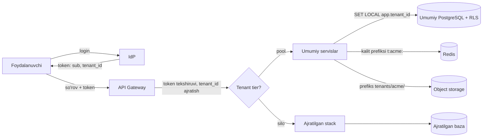
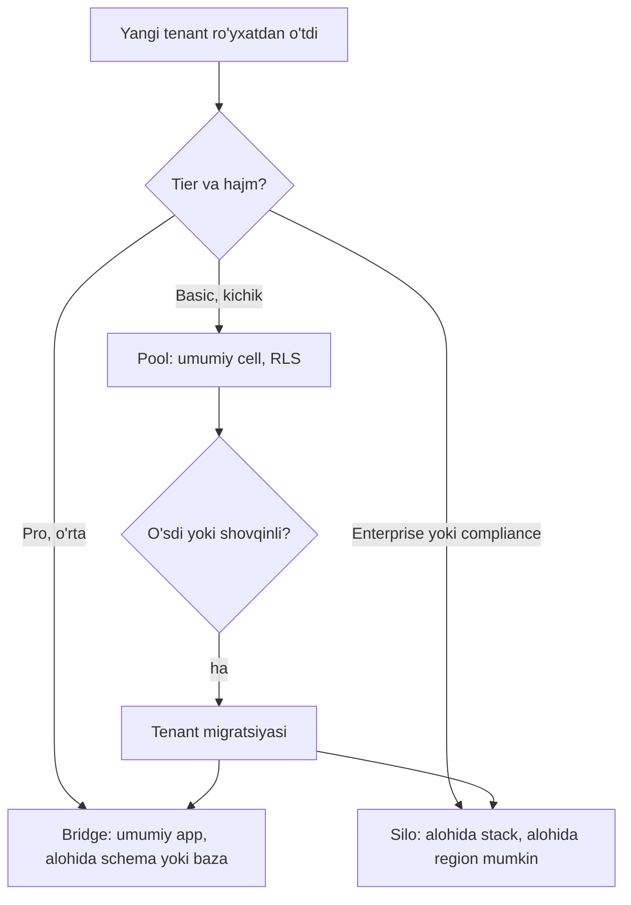

## Bu dars nima uchun kerak

B2B SaaS ning asosiy iqtisodiy g'oyasi - **bitta tizim ko'p mijozga** (tenant) xizmat qiladi. Agar har bir mijoz uchun alohida server, baza va deploy bo'lsa, bu SaaS emas, "hosting xizmati" - va 200 ta mijozda u operatsion jihatdan cho'kadi. Boshqa tomondan, hamma narsa umumiy bo'lsa, ikkita yangi xavf paydo bo'ladi: **bir mijoz boshqasining ma'lumotini ko'rishi** (cross-tenant leak) va **bir mijozning yuklamasi boshqalarni sekinlashtirishi** (noisy neighbor).

AWS SaaS Lens buni aniq aytadi: pool modelida izolyatsiya qilish qiyinroq, lekin bu izolyatsiya talablarini bo'shashtirish uchun bahona bo'la olmaydi. AWS ning tenant isolation whitepaperi esa tenantlararo kirish hodisasini SaaS biznesi uchun jiddiy va ehtimol tiklanib bo'lmaydigan muvaffaqiyatsizlik deb ataydi.

Muhim nozik nuqta (AWS Prescriptive Guidance ham shuni ta'kidlaydi): **tenant izolyatsiyasi avtorizatsiya bilan bir xil emas**. Foydalanuvchi autentifikatsiyadan va avtorizatsiyadan o'tgan bo'lishi mumkin va baribir boshqa tenantning resursiga kirishi mumkin, agar izolyatsiya mexanizmi alohida qurilmagan bo'lsa. 72-darsda avtorizatsiyani ko'rdik; bu dars - uning ostidagi qatlam.

Bu darsdan keyin siz:

- silo, pool va bridge modellarini va ularning narx, izolyatsiya, operatsiya bo'yicha trade-offlarini bilasiz;
- tenant kontekstini so'rovdan bazagacha xavfsiz uzatishni loyihalay olasiz;
- PostgreSQL da uchta ma'lumot izolyatsiyasi variantini (alohida baza, alohida schema, umumiy jadval + RLS) va har birining cheklovlarini ayta olasiz;
- noisy neighbor ni o'lchash va cheklash usullarini (per-tenant rate limit, kvotalar, shuffle sharding, cell) bilasiz;
- tenant tiering va tenantni boshqa joyga ko'chirishni (migration) rejalashtira olasiz.

## Tenant nima va u qayerda ko'rinadi

Tenant - xizmat ko'rsatiladigan **izolyatsiya birligi**: odatda mijoz tashkiloti (iQuariX uchun - avtoparkga ega kompaniya). Tenant ichida foydalanuvchilar, rollar, filiallar bor (72-dars). Tenant chegarasi tizimning har bir qatlamidan o'tadi:

| Qatlam | Multi-tenancy savoli |
|---|---|
| Identity | Foydalanuvchi qaysi tenantga tegishli? Bir foydalanuvchi bir nechta tenantda bo'la oladimi (masalan, pudratchi)? |
| Routing | So'rov qaysi deployment, cell yoki regionga borishi kerak? |
| Compute | Tenantlar bir xil process/pod ni bo'lishadimi? |
| Data | Ma'lumot alohida bazadami, schemadami yoki umumiy jadvalda `tenant_id` bilanmi? |
| Cache, navbat, fayl | Redis kalitlari, Kafka topiclari, S3 prefikslari tenant bilan ajratilganmi? |
| Observability | Metrika, log, trace da `tenant_id` bormi? Kim qancha resurs ishlatayotganini ko'ra olamizmi? |
| Billing | Tenantning iste'molini o'lchay olamizmi? |

## Uchta deployment modeli: silo, pool, bridge

AWS SaaS Lens terminologiyasi:

- **Silo** - har tenant uchun ajratilgan resurslar (baza, compute, ba'zan butun stack).
- **Pool** - barcha tenantlar umumiy infratuzilmani bo'lishadi, izolyatsiya ilova va policy darajasida (`tenant_id`).
- **Bridge** - aralash: ba'zi qatlamlar umumiy, ba'zilari ajratilgan. Masalan, umumiy web va API qatlami, lekin har tenant uchun alohida baza.

| Mezon | Silo | Pool | Bridge |
|---|---|---|---|
| Izolyatsiya | Eng kuchli (infratuzilma chegarasi) | Mantiqiy (kod, RLS, policy) | Qatlamga qarab |
| Noisy neighbor | Yo'q | Asosiy xavf | Ajratilgan qatlamda yo'q |
| Tenant uchun narx | Yuqori, bo'sh tenant ham pul turadi | Past, yuklamaga proporsional | O'rtacha |
| Deploy va migratsiya | N marta (N tenant) | Bir marta | Qisman N marta |
| Blast radius | Bitta tenant | Barcha tenantlar | Qatlamga qarab |
| Tenant bo'yicha sozlash | Oson (alohida instance turi, versiya) | Qiyin | Qisman |
| Narxni tenantga bog'lash | Oson | Instrumentatsiya talab qiladi | O'rtacha |
| Compliance (data residency, auditor talabi) | Oson isbotlanadi | Qiyinroq | Ko'pincha yetarli |

AWS ning PostgreSQL bo'yicha qo'llanmasi xuddi shu trade-offni qisqa beradi: silo - compliance va tenant darajasida sozlash, evaziga markazlashgan boshqaruv yo'q va narx yuqori; pool - agility va narx optimallashtirish, evaziga tenantlararo ta'sir va "hammasi yoki hech narsa" mavjudligi.

Hisob uchun masala sharti (narxlar real provayder prays-listi emas, shartli birlik):

- 200 ta tenant; silo da har biriga eng kichik ishlab chiqarish darajasidagi baza (primary + replica) va 2 ta app instance, bitta silo stacki oyiga 250 dollar;
- 200 tenantdan 150 tasi kichik (50 tadan kam mashina) va ularning haqiqiy yuklamasi bitta silo resursining 5 foizidan kam;
- pool da shu umumiy yuklama 6 ta katta app instance va 1 ta katta baza klasteriga sig'adi, ularning oylik narxi 4 000-6 000 dollar.

Silo: `200 × 250 = 50 000` dollar/oy. Pool: 4 000-6 000 dollar/oy. Farq `50 000 / 6 000 ≈ 8.3` dan `50 000 / 4 000 = 12.5` baravargacha. Farqning manbai - silo da bo'sh turgan minimal resurslar: 150 ta kichik tenant uchun to'lanadigan `150 × 250 = 37 500` dollar ning 95 foizdan ko'pi ishlatilmaydi. Shuning uchun deyarli barcha SaaS **pool bilan boshlaydi** va silo ni faqat haq to'laydigan yoki talab qiladigan tenantlarga beradi (tiering).

Real misol: Notion 2021 yilda Postgres ni **workspace ID** bo'yicha shard qilgan: 480 ta logical shard (har biri Postgres schema), 32 ta fizik bazada (har birida 15 tadan). Workspace ID tanlanishining sababi - foydalanuvchilar odatda bir vaqtda bitta workspace ichida ishlaydi, shuning uchun shardlararo JOIN deyarli kerak bo'lmaydi. Notion blogi (2021-yil 6-oktabr) har logical shard Postgres schema sifatida ifodalanganini va partition kaliti workspace ID ekanini aytadi. Bu pool modelining masshtablangan ko'rinishi: har bir shard ichida ko'p tenant, lekin tenant hech qachon ikki shardga bo'linmaydi.

## Tenant konteksti: so'rovdan bazagacha

Izolyatsiyaning birinchi qoidasi: **tenant ID ni klient aytmaydi, tizim aniqlaydi**. URL dagi `?tenant=acme` yoki `X-Tenant-Id` headeriga ishonish - IDOR ning multi-tenant ko'rinishi.

To'g'ri oqim:



1. Login paytida IdP tokenga `tenant_id` claimini qo'yadi (71-dars). Bir foydalanuvchi bir nechta tenantda bo'lsa, tenant tanlash login oqimining bir qismi bo'ladi va token **bitta** tenantga tegishli bo'ladi.
2. Gateway tokenni tekshiradi va tenant kontekstini ajratib oladi. Tenant tier ga qarab so'rovni pool yoki silo ga yo'naltiradi.
3. Servis ichida tenant konteksti **so'rov doirasidagi kontekstda** (Node.js da `AsyncLocalStorage`, NestJS da request-scoped provider) saqlanadi va har bir pastki chaqiruvga avtomatik uzatiladi. Har bir funksiyaga `tenantId` parametrini qo'lda uzatish - qachondir unutiladi.
4. Asinxron ishlarda (navbat xabari, cron, Kafka event) tenant ID xabarning **o'zida** bo'lishi kerak, chunki u yerda HTTP so'rovi yo'q.
5. Har bir resurs turi o'z izolyatsiya mexanizmiga ega: baza - RLS, cache - kalit prefiksi, object storage - prefiks va tenant-scoped credential, Kafka - xabardagi tenant maydoni va consumer da tekshiruv.

AWS buning uchun **token vending machine** patternini tavsiflaydi: tasdiqlangan tenant identiteti qisqa umrli, faqat shu tenant resurslariga (masalan `s3://bucket/tenants/acme/*`) ruxsat beruvchi credential ga almashtiriladi. Natijada ilova kodidagi xato boshqa tenant prefiksiga yozishga urinsa ham, IAM uni rad etadi.

## Ma'lumot izolyatsiyasi: PostgreSQL da uchta variant

### 1. Tenant uchun alohida baza (database-per-tenant)

Eng kuchli izolyatsiya, tenantni boshqa serverga ko'chirish oson (`pg_dump` yoki logical replication), tenantni o'chirish = bazani o'chirish (78-darsdagi "o'chirish huquqi" uchun qulay).

Muammolar: har bir baza o'z ulanishlari, catalog keshi, autovacuum ishchilari bilan resurs talab qiladi; ulanish pool i (PgBouncer) baza bo'yicha alohida pool ochadi; 500 ta bazada migratsiya 500 marta va qisman muvaffaqiyatsizlik ehtimoli bilan. Citus blogi aynan shuni ta'kidlaydi: 10 ming tenantdan 5 mingida migratsiya o'tib, keyin to'xtasa nima qilasiz?

### 2. Tenant uchun alohida schema (schema-per-tenant)

Bitta bazada `tenant_acme.trips`, `tenant_beta.trips`. Ulanish bitta bazaga, `search_path` orqali tenant tanlanadi. O'rtacha izolyatsiya.

Muammolar: jadvallar soni `tenantlar × jadvallar` bo'lib ko'payadi. Hisob sharti: 2 000 tenant, har schemada 80 jadval, har jadval o'rtacha 4 ta relation beradi (jadvalning o'zi, 2 ta indeks, TOAST jadvali). Unda `2 000 × 80 × 4 = 640 000` relation (TOAST indeksi va sequence lar bu sonni yana oshiradi). PostgreSQL catalog jadvallari, har bir backend process ning catalog keshi, `pg_dump` vaqti, autovacuum aylanishi shuncha obyekt bilan sezilarli og'irlashadi. Aniq "sinish chegarasi" yo'q, lekin minglab schema - ehtiyotkorlik bilan o'lchash talab qiladigan hudud. Yana bir tuzoq: `search_path` ni session darajasida o'rnatish PgBouncer ning transaction pooling rejimida ishlamaydi (pastda).

### 3. Umumiy jadval + `tenant_id` + Row-Level Security

Har bir jadvalda `tenant_id` ustuni, har bir indeks `tenant_id` bilan boshlanadi (`(tenant_id, vehicle_id, ts)`), va ikki himoya qatlami:

1. ilova har bir so'rovga `WHERE tenant_id = $1` qo'shadi (ORM ning global scope/middleware i orqali);
2. PostgreSQL RLS ikkinchi, mustaqil qatlam - ilova xato qilsa ham baza boshqa tenant qatorlarini qaytarmaydi.

AWS Prescriptive Guidance pool modelida PostgreSQL uchun RLS ni **zarur** deb ataydi va har tenant uchun alohida DB foydalanuvchi emas, ilova o'rnatadigan runtime o'zgaruvchi (`app.current_tenant`) bilan ishlashni tavsiya qiladi:

```sql
ALTER TABLE trips ENABLE ROW LEVEL SECURITY;
ALTER TABLE trips FORCE ROW LEVEL SECURITY;

CREATE POLICY tenant_isolation ON trips
  USING (tenant_id = current_setting('app.tenant_id')::uuid);

-- har bir tranzaksiya boshida:
BEGIN;
SELECT set_config('app.tenant_id', '3f6c...', true);  -- true = faqat shu tranzaksiya
SELECT * FROM trips WHERE started_at > now() - interval '1 day';
COMMIT;
```

Muhim detallar (PostgreSQL hujjati bo'yicha):

- RLS yoqilgan, lekin policy yo'q bo'lsa - **default deny**, hech qanday qator ko'rinmaydi.
- **Jadval egasi** RLS ni chetlab o'tadi, agar `FORCE ROW LEVEL SECURITY` bo'lmasa; superuser va `BYPASSRLS` rollar har doim chetlab o'tadi. Shuning uchun ilova migratsiya qiladigan egasi rolida emas, alohida cheklangan rolda ulanishi kerak.
- `USING` mavjud qatorlarni filtrlaydi, `WITH CHECK` yangi yoki o'zgargan qatorlarni tekshiradi; `WITH CHECK` berilmasa, `USING` ifodasi ikkalasiga qo'llanadi - ya'ni tenant boshqa tenant `tenant_id` si bilan qator yoza olmaydi.
- `current_setting('app.tenant_id')` o'rnatilmagan bo'lsa xato beradi - bu yaxshi (fail-closed). `current_setting(..., true)` (missing_ok) esa NULL qaytaradi va `tenant_id = NULL` hech narsaga teng emas - ham xavfsiz, lekin xatoni yashiradi.
- Policy ichidagi subquery'lar (masalan boshqa jadvaldan a'zolikni tekshirish) `READ COMMITTED` rejimida race condition ga olib kelishi mumkin; eng tez va xavfsiz policy - faqat joriy qator ustunlariga tayanadigan policy.

### PgBouncer tuzog'i

PgBouncer ning **transaction pooling** rejimida server ulanishi har tranzaksiyadan keyin boshqa klientga beriladi. Shuning uchun session darajasidagi holat ishlamaydi: PgBouncer hujjatida `SET/RESET`, `LISTEN`, SQL darajasidagi `PREPARE`, session advisory lock va boshqalar bu rejimda qo'llab-quvvatlanmasligi ko'rsatilgan. Agar ilova `SET app.tenant_id = 'acme'` (session darajasida) qilsa, keyingi tranzaksiya **boshqa klientning ulanishida** ishlab ketishi va eski tenant qiymatini ko'rishi mumkin - bu to'g'ridan-to'g'ri tenantlararo sizish. Yechim: har doim tranzaksiya ichida `set_config(..., true)` yoki `SET LOCAL` - qiymat `COMMIT`/`ROLLBACK` da avtomatik tozalanadi.

### Uchta variant taqqoslamasi

| Mezon | DB per tenant | Schema per tenant | Umumiy jadval + RLS |
|---|---|---|---|
| Izolyatsiya | Kuchli | O'rtacha | Mantiqiy, ikki qatlam bilan yetarli |
| Tenantlar soni | O'nlab-yuzlab | Yuzlab-minglab (ehtiyotkorlik bilan) | O'n minglab va undan ko'p |
| Migratsiya | N marta | N marta (bitta bazada) | Bir marta |
| Tenantni ko'chirish yoki o'chirish | Oson | O'rtacha | `WHERE tenant_id` bilan eksport, sekinroq |
| Tenantlararo hisobot | Qiyin | Qiyin | Oson |
| Ulanish pooling | Har baza uchun pool | `search_path` muammosi | Oddiy, `SET LOCAL` bilan |

## Noisy neighbor: ishlash izolyatsiyasi

Ma'lumot izolyatsiyasi "ko'rmaslik" haqida, ishlash izolyatsiyasi - "**sekinlashtirmaslik**" haqida. Pool modelida bitta tenantning og'ir hisobot so'rovi bazaning I/O sini yeb qo'yadi, yoki uning 5 000 ta yangi qurilmasi ingest navbatini to'ldiradi.

Choralar, arzonidan qimmatiga:

1. **O'lchash.** Har metrikada `tenant_id` yorlig'i (66-67 darslar) - lekin ehtiyot bo'ling: 10 000 tenant × 50 metrika = yuqori cardinality. Ko'pincha "top-N tenant" bo'yicha alohida hisob va qolganini "boshqa" deb agregatsiya qilish.
2. **Per-tenant rate limit va kvota** (56-dars): so'rov/s, bir vaqtdagi eksport soni, saqlash hajmi. Tier ga qarab.
3. **Og'ir ishni ajratish:** hisobotlar va eksportlar alohida navbat va worker hovuzida (bulkhead, 63-dars), OLTP bazasidan emas, replikadan yoki OLAP dan (16-dars).
4. **Adolatli navbat (fair queuing):** bitta umumiy FIFO navbat o'rniga tenant bo'yicha round-robin - bitta tenantning 1 million xabari boshqalarning 10 xabarini to'sib qo'ymasligi uchun.
5. **Shuffle sharding.** AWS Builders' Library (Colm MacCárthaigh) misoli: 8 ta worker. Oddiy sharding da 4 ta shard (har birida 2 worker), bitta "zaharli" mijoz shardni yiqitsa, 25% mijozlar zarar ko'radi. Shuffle sharding da har mijozga 8 tadan 2 ta workerning **noyob kombinatsiyasi** beriladi: C(8,2) = 28 kombinatsiya, va bitta zaharli mijoz o'z ikkala workerini yiqitsa, aynan shu juftlikka ega mijozlar, ya'ni shardlarning 1/28 qismi to'liq zarar ko'radi (25% o'rniga). Route 53 da 2 048 ta virtual name server va har domen uchun 4 tadan: `C(2048,4) = 2048 × 2047 × 2046 × 2045 / 24 ≈ 7.3 × 10^11`, maqolada "730 milliard" shuffle shard.
6. **Cell-based arxitektura.** Butun stack (compute + baza + navbat) bir nechta mustaqil "cell" ga bo'linadi, har tenant bitta cell ga biriktiriladi, ingichka **cell router** so'rovni to'g'ri cell ga yo'naltiradi. AWS ning cell-based arxitektura qo'llanmasi routerni iloji boricha sodda, biznes mantiqsiz qilishni va bitta cell yetib bo'lmasa ham boshqalari ishlashda davom etishini talab qiladi. Bu blast radius ni `1 / cell_soni` ga tushiradi (77-darsda multi-region bilan bog'lanadi).
7. **Silo ga ko'chirish.** Eng katta yoki eng "shovqinli" tenant - alohida stack.



## Tenant tiering va migratsiya

**Tiering** - tenantlarni narx rejasi bo'yicha guruhlash: Basic (pool, past kvota), Pro (pool, yuqori kvota, ustuvor navbat), Enterprise (silo yoki bridge, SLA, ajratilgan region). Bu ham biznes, ham arxitektura qarori: tier tenant kontekstining bir qismi bo'lib, routing va limitlarni belgilaydi.

**Tenant migratsiyasi** (pool dan silo ga, bir cell dan boshqasiga) - bu qaytarish qiyin, lekin muqarrar operatsiya. Shuning uchun uni boshidan loyihalash kerak:

1. Har bir jadvalda `tenant_id` bo'lishi - "shu tenantning barcha ma'lumoti" degan so'rovni mumkin qiladi. Bitta jadvalda ham `tenant_id` bo'lmasa (masalan, "global" lookup jadvali tenantga xos qatorlar bilan aralashgan), migratsiya qo'lda JOIN zanjiri bilan qilinadi.
2. ID lar global unikal (UUIDv7, 57-dars) - boshqa bazaga ko'chirganda to'qnashuv bo'lmaydi. `SERIAL` ID lar bilan tenantni boshqa bazaga qo'shish og'riqli.
3. Migratsiya jarayoni: yangi joyga snapshot nusxa, CDC (48-dars) bilan o'zgarishlarni yetkazish, qisqa yozish to'xtatish (write freeze), routing jadvalida tenant manzilini almashtirish, eski joydan o'chirish.
4. Routing jadvali (`tenant_id -> cell/database`) - yuqori mavjudlikli, keshlanadigan, lekin o'zgarishi tez tarqaladigan komponent.

## Real tizimlardan misollar

- **AWS SaaS Lens va SaaS Factory** - silo/pool/bridge terminologiyasi, token vending machine, PostgreSQL RLS bilan pool izolyatsiyasi bo'yicha rasmiy qo'llanmalar.
- **Notion** - workspace ID bo'yicha 480 logical shard / 32 fizik baza (2021): tenant (workspace) hech qachon bo'linmaydi.
- **Citus** - "tenant_id bo'yicha distribution" modeli: bir tenantning ma'lumotlari bitta shardda, shuning uchun JOIN va tranzaksiyalar shard ichida qoladi; ming va o'n minglab tenant uchun mo'ljallangan.
- **Amazon Route 53** - shuffle sharding bilan har domen uchun noyob name server kombinatsiyasi, bitta mijozga qaratilgan DDoS boshqa mijozlarni to'liq yiqitmasligi uchun (80-dars).

## iQuariX kontekstida

Masala sharti: iQuariX da 300 ta tenant: 250 tasi 10-100 mashinali, 45 tasi 100-2 000, 5 tasi 5 000+ mashinali (logistika va davlat korxonalari). Ikki yirik mijoz shartnomada "ma'lumot boshqa mijozlar bilan bir bazada bo'lmasin" va "server O'zbekistonda" talab qiladi (78-dars).

Taklif etilgan dizayn:

1. **Telemetriya ingest (yozish yo'li)** - hamma uchun pool: trekerlardan kelgan nuqtalar umumiy ingest gateway va Kafka orqali o'tadi, xabarda `tenant_id` (IMEI -> tenant registrdan, 71-dars). Kafka partition kaliti - `vehicle_id` (tartib uchun), lekin consumer da per-tenant kvota.
2. **Time-series saqlash** - pool, `tenant_id` birinchi ustun yoki partition kaliti; RLS yoki ilova darajasidagi majburiy filtr. 5 ta yirik tenant uchun alohida jadval yoki alohida klaster (bridge).
3. **Biznes ma'lumot (reyslar, haydovchilar, yoqilg'i hodisalari)** - PostgreSQL, umumiy jadval + RLS + `SET LOCAL`. Ikki compliance mijoz - silo: alohida PostgreSQL va alohida time-series klaster, Toshkentdagi data-markazda.
4. **Video arxiv** - object storage, `tenants/<tenant_id>/...` prefiksi, tenant-scoped credential bilan yuklash va yuklab olish (presigned URL, 60-dars).
5. **Noisy neighbor** - hisobotlar (oylik yoqilg'i hisobotlari 5 000 mashina uchun) alohida worker hovuzida, per-tenant concurrency limit 2; ingest da per-tenant nuqta/s limiti (tier bo'yicha).

Hisob: 5 000 mashinali tenant har 10 soniyada nuqta yuboradi: 500 nuqta/s. Agar u yangi firmware bilan har 1 soniyada yuborishni boshlasa - 5 000 nuqta/s. Masala shartida butun platformaning odatdagi yuklamasi 3 000 nuqta/s, demak bitta tenant butun platformadan ko'p yuboradi. Per-tenant limit bo'lmasa, bu bitta tenant hammaning ingest kechikishini oshiradi. Limit: shartnomadagi mashinalar soni × (1 / minimal interval) × 1.5 zaxira = `5 000 × 0.1 × 1.5 = 750` nuqta/s; ortig'i alohida "overflow" navbatga boradi va sekinroq qayta ishlanadi, boshqa tenantlarga ta'sir qilmaydi.

## Ko'p uchraydigan xatolar

1. **Tenant ID ni klientdan olish** (URL, header, body). Har doim tasdiqlangan tokendan.
2. **Faqat ilova darajasidagi `WHERE tenant_id`** - bitta unutilgan so'rov yetarli. RLS ni ikkinchi qatlam qiling.
3. **Ilova jadval egasi yoki superuser rolida ulanadi** - RLS jimgina o'chiq.
4. **Transaction pooling bilan session darajasidagi `SET`** - tenant konteksti boshqa klientga "oqib o'tadi". Faqat `SET LOCAL` / `set_config(..., true)`.
5. **Cache kalitida tenant yo'q** - `report:2026-10` kaliti ikki tenant uchun bir xil, birinchisi hisobotini ikkinchisi ko'radi.
6. **Asinxron ishlarda tenant kontekstini yo'qotish** - cron "barcha mashinalar" ustida ishlaydi va natijani noto'g'ri tenantga yozadi.
7. **Har tenant uchun silo bilan boshlash** - 50-tenantda operatsion yuk ko'tarib bo'lmaydigan bo'ladi.
8. **Tenant bo'yicha metrikalar yo'q** - noisy neighbor ni topib bo'lmaydi va narxni tenantga bog'lab bo'lmaydi (79-dars).

## Xulosa

- Multi-tenancy - narx (umumiy resurslar) va izolyatsiya (ma'lumot va ishlash) o'rtasidagi muvozanat. Tenant izolyatsiyasi avtorizatsiyadan alohida qatlam.
- Silo - kuchli izolyatsiya va qimmat; pool - arzon va agil, lekin noisy neighbor va keng blast radius; bridge - qatlam bo'yicha aralash. Odatda pool bilan boshlab, tier bo'yicha silo beriladi.
- Tenant konteksti tasdiqlangan tokendan olinadi va so'rov kontekstida, asinxron xabarlarda va har bir resurs nomida (kalit, prefiks) uzatiladi.
- PostgreSQL pool uchun: `tenant_id` + ilova filtri + RLS (`FORCE`, egasi bo'lmagan rol) + `SET LOCAL`.
- Noisy neighbor: tenant bo'yicha o'lchash, rate limit va kvota, og'ir ishlarni ajratish, fair queuing, shuffle sharding, cell lar.
- Tenant migratsiyasini boshidan rejalashtiring: hamma joyda `tenant_id`, global unikal ID, routing jadvali.

## Amaliy topshiriq

iQuariX uchun multi-tenancy arxitekturasini loyihalang. Ma'lumotlar: 300 tenant (yuqoridagi taqsimot), 2 ta compliance mijoz, kelgusi 2 yilda 1 500 tenantgacha o'sish rejasi, umumiy 60 000 mashina.

1. Har bir qatlam (ingest, time-series, biznes baza, cache, video arxiv, hisobotlar) uchun silo/pool/bridge tanlang va asoslang. Jadval ko'rinishida.
2. Tenant kontekstining so'rovdan bazagacha va Kafka xabaridan consumer gacha yo'lini yozing. Qaysi joylarda kontekst yo'qolishi mumkin va buni qanday oldini olasiz?
3. PostgreSQL izolyatsiyasi: RLS policy, ilova DB roli, PgBouncer rejimi va tenant o'rnatish usulini yozing. RLS ni test bilan qanday tekshirasiz (masalan, CI da "tenant A sessiyasida tenant B qatorlari 0" testi)?
4. Noisy neighbor: per-tenant limitlar (ingest, API, hisobot) va ularni tier bo'yicha raqamlar bilan belgilang. 5 000 mashinali tenant to'satdan 10x ko'p yuborsa nima bo'ladi?
5. Pool dan silo ga tenant migratsiyasi rejasini qadam-baqadam yozing: kutilayotgan yozish to'xtashi (downtime) qancha?
6. 1 500 tenantgacha o'sishda birinchi nima sinadi va cell-based arxitekturaga qachon o'tasiz?

Yaxshi javobda bo'lishi kerak bo'lgan narsalar:

- tenant ID faqat tasdiqlangan tokendan va registrdan olinishi;
- RLS ning ikkinchi qatlam ekanligi, `FORCE`, egasi bo'lmagan rol va `SET LOCAL`;
- cache, object storage va Kafka da ham tenant izolyatsiyasi;
- tier bo'yicha raqamli limitlar va overflow strategiyasi;
- migratsiya uchun CDC va routing jadvali;
- narx hisob-kitobi bilan silo/pool tanlovining asoslanishi.

Javobni pastdagi maydonga yozib, chatga yuboring.

## Manbalar

- AWS. [SaaS Lens - Pool isolation](https://docs.aws.amazon.com/wellarchitected/latest/saas-lens/pool-isolation.html), [Silo isolation](https://docs.aws.amazon.com/wellarchitected/latest/saas-lens/silo-isolation.html) va [Bridge model](https://docs.aws.amazon.com/wellarchitected/latest/saas-lens/bridge-model.html) - modellar, afzallik va kamchiliklar.
- AWS. [SaaS Tenant Isolation Strategies whitepaper](https://docs.aws.amazon.com/whitepapers/latest/saas-tenant-isolation-strategies/saas-tenant-isolation-strategies.html), 2020 - izolyatsiya va identity bog'liqligi ("Identity and isolation" bo'limi).
- AWS Prescriptive Guidance. [Managed PostgreSQL for multi-tenant SaaS](https://docs.aws.amazon.com/prescriptive-guidance/latest/saas-multitenant-managed-postgresql/rls.html) - "Row-level security recommendations" va "Partitioning models" bo'limlari.
- AWS Prescriptive Guidance. [Multi-tenant SaaS authorization and API access control](https://docs.aws.amazon.com/prescriptive-guidance/latest/saas-multitenant-api-access-authorization/introduction.html) - tenant izolyatsiyasi va avtorizatsiya farqi.
- PostgreSQL 18 hujjati. [Row Security Policies](https://www.postgresql.org/docs/current/ddl-rowsecurity.html) va [PgBouncer features](https://www.pgbouncer.org/features.html) - transaction pooling cheklovlari.
- Colm MacCárthaigh. [Workload isolation using shuffle-sharding](https://builder.aws.com/content/3F06NpJ8YeoIGP8VHTw4n81pFn8/workload-isolation-using-shuffle-sharding), Amazon Builders' Library - 8 worker misoli (25% va 1/28 ta'sir) va Route 53 ning 2 048 virtual name server misoli.
- AWS. [Reducing the Scope of Impact with Cell-Based Architecture](https://docs.aws.amazon.com/wellarchitected/latest/reducing-scope-of-impact-with-cell-based-architecture/what-is-a-cell-based-architecture.html) - cell, cell router, control plane.
- Garrett Fidalgo, Notion. [Herding elephants: lessons learned from sharding Postgres at Notion](https://www.notion.com/blog/sharding-postgres-at-notion), 2021-yil 6-oktabr (480 logical shard, 32 baza, workspace ID partition kaliti). Citus. [Designing your SaaS database for high scalability](https://www.citusdata.com/blog/2016/10/03/designing-your-saas-database-for-high-scalability/).
