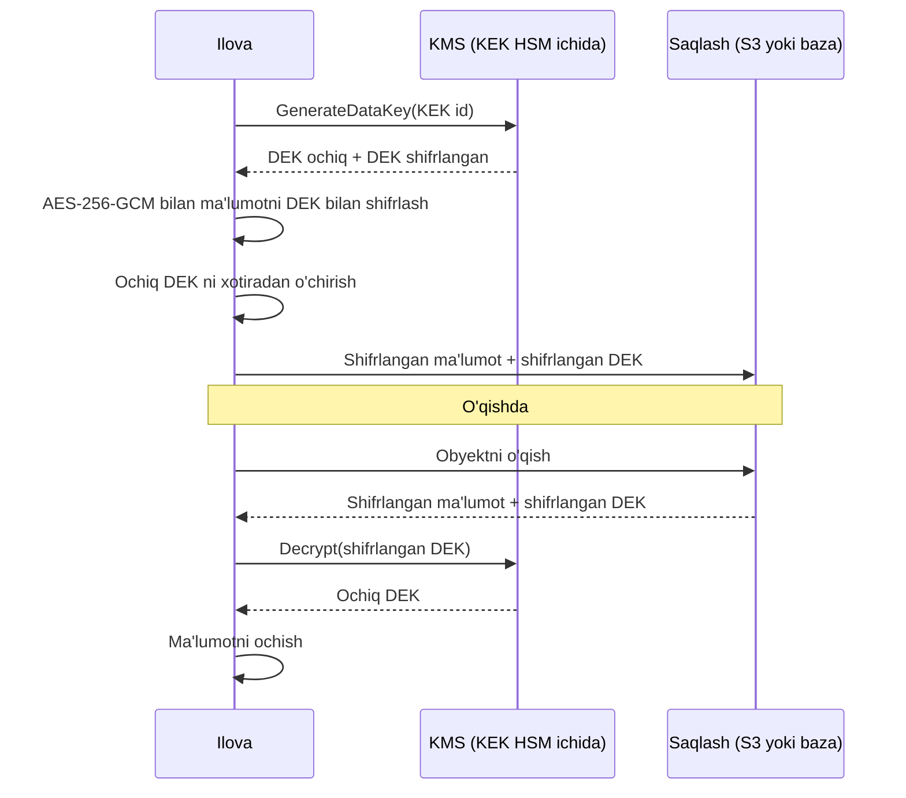
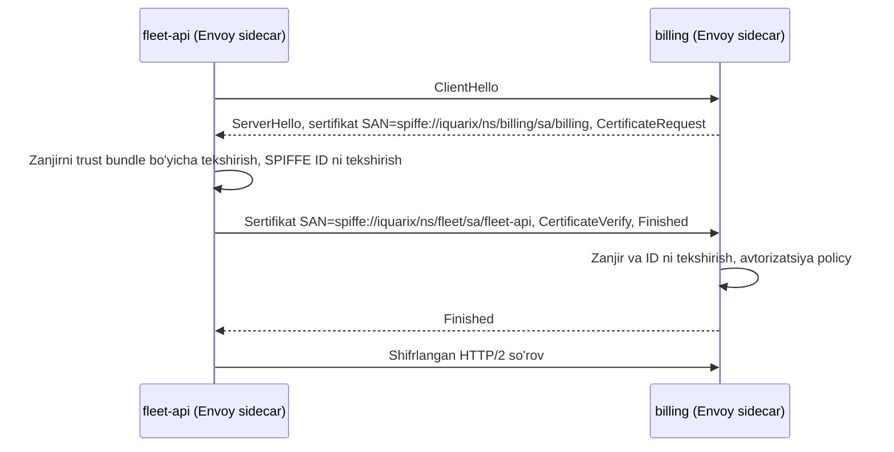

## Bu dars nima uchun kerak

71-73 darslarda "kim", "nima mumkin" va "qaysi tenant" savollarini ko'rdik. Lekin bu barcha mexanizmlar bitta taxminga tayanadi: **kalitlar va parollar sir saqlanadi, tarmoqdagi va diskdagi ma'lumotni begona o'qiy olmaydi**. Agar JWT imzolash kaliti Git repozitoriyda yotgan bo'lsa yoki ichki servislar ochiq HTTP bilan gaplashsa, eng chiroyli avtorizatsiya modeli ham hech narsa bermaydi.

Muammo haqiqiy: GitGuardian ning 2025 yilgi hisobotiga ko'ra 2024 yilda ommaviy GitHub commitlarida **23.7 milliondan ortiq** yangi "hardcoded" secret topilgan (oldingi yildan taxminan 25% ko'p), va 2022 yilda sizgan secretlarning 70 foizi hali ham amal qiladi. Ya'ni muammo faqat sizish emas, sizgandan keyin **almashtirilmaslik**.

System design nuqtai nazaridan bu dars uchta savolga javob beradi:

1. Ma'lumot **diskda** (at rest) qanday shifrlanadi va kalitlar qanday boshqariladi?
2. Ma'lumot **tarmoqda** (in transit), ayniqsa servislar orasida, qanday himoyalanadi va servis bir-birini qanday taniydi?
3. Parollar, API kalitlar, sertifikatlar (**secrets**) ilovaga qanday yetkaziladi, almashtiriladi va bekor qilinadi?

Bu darsdan keyin siz:

- envelope encryption, DEK/KEK ierarxiyasi va KMS ning ishlash mexanikasini tushuntira olasiz;
- shifrlashning qaysi qatlamda (disk, baza, ilova, ustun) qaysi tahdidga qarshi ishlashini ajrata olasiz;
- AES-GCM ning nonce cheklovini va undan kelib chiqadigan kalit almashtirish talabini bilasiz;
- mTLS ning ichki ishlashini, SPIFFE identity modelini va service mesh dagi avtomatik sertifikat aylanishini tushuntira olasiz;
- statik va dinamik secretlarni, Kubernetes Secret ning cheklovlarini va secret rotation ni loyihalay olasiz.

## Tahdid modeli: nimadan himoyalanamiz

Shifrlash "xavfsizlik qo'shish" emas, **aniq tahdidga qarshi chora**. Avval tahdidni ayting, keyin qatlamni tanlang:

| Tahdid | Yordam beradigan chora | Yordam bermaydigan chora |
|---|---|---|
| Data-markazdan disk o'g'irlandi yoki eski disk utilizatsiya qilinmadi | Disk / volume shifrlash | - |
| Backup fayl S3 bucketdan sizdi | Backup shifrlash, kalit boshqa joyda | Disk shifrlash (backup ochiq yoziladi) |
| Bazaga SQL injection yoki o'g'irlangan DB parol bilan kirildi | Ilova darajasidagi (ustun) shifrlash | Disk va TDE shifrlash - baza o'zi ochib beradi |
| Ichki tarmoqda trafik tinglandi yoki soxta servis o'zini boshqa servis deb ko'rsatdi | mTLS | Disk shifrlash |
| DBA yoki bulut provayder xodimi ma'lumotni o'qiydi | Client-side shifrlash, kalit faqat ilovada | Provayder boshqaradigan shifrlash |
| Repozitoriyda parol | Secrets manager, qisqa umrli credential, skaner | Repozitoriyni "private" qilish |

Asosiy saboq: **disk shifrlash faqat fizik tahdidga qarshi**. Baza ishlab turganida, unga ulangan har bir klient ma'lumotni ochiq ko'radi. Ko'p jamoalar "bizda encryption at rest yoqilgan" deb SQL injection xavfini yopilgan deb hisoblaydi - bu xato.

## Encryption at rest: envelope encryption

### Nima uchun bitta kalit yetmaydi

Sodda yondashuv: bitta AES kalit bilan hamma narsani shifrlash. Muammolar:

- Kalit qayerda saqlanadi? Agar ma'lumot bilan bir joyda bo'lsa - foydasiz.
- Kalitni almashtirish = **barcha** ma'lumotni qayta shifrlash (terabaytlar).
- Har bir shifrlash uchun markaziy kalit serveriga murojaat - latency va throughput chegarasi.

### DEK va KEK ierarxiyasi

**Envelope encryption** (AWS KMS hujjatidagi ta'rif): ma'lumot **data key (DEK)** bilan shifrlanadi, DEK esa boshqa kalit - **key encryption key (KEK)** bilan shifrlanadi. Shifrlangan DEK ma'lumot yonida saqlanadi. Ierarxiya tepasidagi **root key** hech qachon KMS ning HSM idan ochiq holda chiqmaydi (AWS KMS da FIPS 140-3 Level 3 validatsiyadan o'tgan HSM lar).

Bu nima beradi:

- **Hajm KMS ga bormaydi.** 2 GB video faylni shifrlash uchun KMS ga faqat 32 baytlik DEK ni ochish so'rovi boradi. Shifrlash lokal, AES-NI bilan CPU da soniyasiga gigabaytlar tezligida.
- **Kalit almashtirish arzon.** KEK almashtirilganda faqat DEK larni qayta shifrlash (re-wrap) kerak, ma'lumotni emas. 10 million obyekt × 32 bayt DEK - bu bir necha yuz MB, terabaytlar emas.
- **Kirish nazorati markazlashgan.** Kim `Decrypt` qila oladi - KMS policy belgilaydi va har chaqiruv audit logiga tushadi. Diskni o'g'irlagan odamda KMS ruxsati yo'q.
- **Crypto-shredding.** Tenant DEK ini (yoki tenant KEK ini) o'chirish = tenant ma'lumotini amalda o'qib bo'lmaydigan qilish, hatto backuplarda ham. Bu 78-darsdagi "o'chirish huquqi" uchun kuchli vosita.

### KMS ning cheklovlari: hisob-kitob

KMS - tarmoq servisi va unga **kvota** bor. AWS KMS hujjatiga ko'ra simmetrik kriptografik operatsiyalar (Encrypt, Decrypt, GenerateDataKey va h.k.) uchun umumiy kvota region bo'yicha soniyasiga 10 000, 20 000 yoki 100 000 so'rov (sozlanadi). RSA va ECC kalitlari uchun - soniyasiga 1 000.

Misol: iQuariX har bir telemetriya nuqtasini alohida DEK bilan shifrlashni xohlasa. 3 000 nuqta/s × 1 `GenerateDataKey` = 3 000 so'rov/s - kvotaga sig'adi, lekin har nuqtaga KMS round-trip (bir necha ms) qo'shiladi va o'qishda hisobot 1 million nuqtani ochishi uchun 1 million `Decrypt` kerak bo'ladi - 10 000/s kvotada 100 soniya. Bu absurd. To'g'ri yondashuv: DEK ni **obyekt yoki partition** darajasida (masalan, bir tenantning bir kunlik fayli uchun bitta DEK) yaratish va ochilgan DEK ni xotirada qisqa muddat cache qilish. AWS hujjati ham kvotaga yetganda data key caching ni tavsiya qiladi. Trade-off: cache dagi ochiq DEK - xotirada qo'shimcha sir, va bitta DEK bilan qancha ko'p ma'lumot shifrlansa, kompromatsiya oqibati shuncha katta.

### AES-GCM va nonce cheklovi

AES-GCM - authenticated encryption: shifrlash bilan birga butunlik tegi (tag) hisoblanadi, ma'lumot o'zgartirilsa ochishda xato chiqadi. Lekin uning bitta qattiq sharti bor: **bir kalit bilan bir xil IV (nonce) hech qachon ikki marta ishlatilmasligi kerak**. Takrorlansa, hujumchi ikki shifrmatnni XOR qilib ochiq matn haqida ma'lumot oladi va autentifikatsiya kalitini tiklab, soxta xabar yasay oladi.

NIST SP 800-38D (2007) tasodifiy 96-bitli IV lar bilan bitta kalitda shifrlash chaqiruvlarini **2^32** (taxminan 4.3 milliard) bilan cheklaydi, takrorlanish ehtimolini 2^-32 dan past ushlab turish uchun. Hisob: agar bitta kalit bilan soniyasiga 10 000 xabar shifrlansa, `2^32 / 10 000 ≈ 429 000` soniya ≈ **5 kun**. Ya'ni yuqori throughputli tizimda bitta kalitni oylab ishlatish standart chegarasini buzadi - bu kalit rotation ning ehtiyoj emas, **matematik majburiyat** ekanini ko'rsatadi. Envelope encryption da har obyekt yangi DEK olgani uchun bu muammo tabiiy yechiladi.

### Qaysi qatlamda shifrlash

| Qatlam | Misol | Nimadan himoya | Narx |
|---|---|---|---|
| Disk / volume | EBS, LUKS, bulut disk shifrlash | Fizik disk o'g'irligi | Deyarli bepul, shaffof |
| Baza (TDE) | Ba'zi DBMS larning transparent data encryption i | Fayllar, backup nusxa | Shaffof, lekin baza ichida hamma narsa ochiq |
| Object storage | S3 SSE-KMS | Bucket darajasidagi sizish (KMS ruxsatisiz o'qib bo'lmaydi) | KMS so'rovlari |
| Ilova / ustun | Pasport raqami, telefonni ilovada shifrlash | Bazaga kirgan hujumchi, DBA | Qidiruv, indeks, saralash yo'qoladi |
| Client-side | Kalit faqat klientda | Provayderning o'zi | Server ma'lumot ustida hech narsa qila olmaydi |

Ustun darajasidagi shifrlashning narxi muhim: shifrlangan ustun bo'yicha `WHERE phone = ?` ishlamaydi (har shifrlash tasodifiy nonce bilan boshqacha). Yechim - qo'shimcha **blind index**: `HMAC(key2, normalize(phone))` ni alohida ustunda saqlab, aniq moslik bo'yicha qidirish. Diapazon so'rovlari va `LIKE` baribir imkonsiz.

PostgreSQL hamjamiyat versiyasida o'rnatilgan TDE yo'q; odatda disk shifrlash, `pgcrypto` yoki ilova darajasidagi shifrlash ishlatiladi.

### Kubernetes misoli

Kubernetes hujjati ochiq ogohlantiradi: **Secret obyektlari etcd da standart holatda shifrlanmagan** holda saqlanadi; API ga yoki etcd ga kirish huquqi bor har kim ularni o'qiydi, va namespace da Pod yarata oladigan har kim o'sha namespace dagi istalgan Secret ni o'qiy oladi (Deployment yaratish orqali ham). `base64` - kodlash, shifrlash emas. Tavsiya etilgan minimal qadamlar: encryption at rest ni yoqish, RBAC bilan least-privilege, Secret ga kirishni konteynerlar bo'yicha cheklash, tashqi secret store larni ko'rib chiqish. Bitta Secret hajmi 1 MiB bilan cheklangan.

Encryption at rest ning KMS provayderi aynan envelope encryption: ma'lumot DEK bilan, DEK tashqi KMS dagi KEK bilan. KMS v1 Kubernetes 1.28 da deprecated, 1.29 dan standart o'chirilgan; KMS v2 1.29 da stable bo'lgan va unda API server bitta seed dan key derivation function orqali har shifrlash uchun bir martalik DEK hosil qiladi - har yozuvda KMS ga murojaat qilmasdan. Bu yuqoridagi KMS kvotasi va nonce muammolarining birgalikdagi yechimi.

## Encryption in transit: TLS va mTLS

### Oddiy TLS nima beradi va nima bermaydi

TLS 1.3 (7-dars) uchta narsa beradi: konfidensiallik, butunlik va **server autentifikatsiyasi** - klient serverning sertifikatini ishonchli CA zanjiri bo'yicha tekshiradi. Lekin server klientni bilmaydi: brauzer ham, hujumchi ham bir xil ko'rinadi. Shuning uchun klient o'zini dastur darajasida (parol, token) isbotlaydi.

Ichki tarmoqda ko'p yillar davomida "perimetr ichida hamma ishonchli" modeli ishlatilgan: tashqarida TLS, ichkarida ochiq HTTP. Zero trust yondashuvi bu taxminni rad etadi: bitta konteyner buzilsa, u ichki tarmoqdagi hamma servisga erkin so'rov yuboradi va trafikni tinglaydi.

### mTLS: ikki tomonlama autentifikatsiya

**Mutual TLS** da klient ham sertifikat taqdim etadi. TLS 1.3 handshake ida server `CertificateRequest` yuboradi, klient o'z sertifikati va `CertificateVerify` (handshake transkriptiga private key bilan imzo) bilan javob beradi. Natijada:

- ikkala tomon ham bir-birining **identitetini kriptografik** biladi;
- trafik shifrlangan;
- identitet tarmoq manziliga (IP) emas, sertifikatga bog'langan - Kubernetes da IP lar doim o'zgaradi, shuning uchun bu muhim.

### mTLS ning qiyin qismi: sertifikat hayot sikli

mTLS ning kriptografiyasi oddiy; qiyini - **minglab** workload uchun sertifikat chiqarish, yetkazish, almashtirish va bekor qilish. Qo'lda boshqarilgan uzoq umrli ichki sertifikatlar klassik uzilish manbai: bir yildan keyin sertifikat muddati tugaydi va hech kim eslamaydi.

Zamonaviy yondashuv - **qisqa umrli, avtomatik almashtiriladigan** sertifikatlar:

- **SPIFFE** (CNCF graduated, 2022) - workload identiteti standarti. Identitet - URI: `spiffe://trust-domain/path`, masalan `spiffe://iquarix.uz/ns/fleet/sa/fleet-api`. **X.509-SVID** - shu ID ni sertifikatning URI SAN maydonida tashiydigan sertifikat; spetsifikatsiya bo'yicha SVID da aniq bitta URI SAN bo'lishi shart, aks holda validator rad etadi. SPIRE - SPIFFE ning referens implementatsiyasi: workload ni attestatsiya qiladi (masalan, Kubernetes service account, node identiteti orqali) va unga SVID beradi.
- **Istio** - service mesh (55-dars). Istio hujjatiga ko'ra har bir workload ga X.509 sertifikat bilan identitet beriladi: Istio agent private key va CSR yaratadi, istiod dagi CA uni tekshirib imzolaydi, Envoy sertifikatni SDS API orqali oladi, agent muddatni kuzatib, jarayonni davriy takrorlaydi. Kubernetes da identitet - service account. Ilova kodi bunda hech narsa qilmaydi: mTLS sidecar lar orasida.
- **Istio PeerAuthentication rejimlari:** `PERMISSIVE` - ham mTLS, ham ochiq trafikni qabul qiladi (migratsiya uchun, va rejim berilmasa standart shu), `STRICT` - faqat mTLS. Istio hujjati `DISABLE` dan `STRICT` ga o'tishda oraliq `PERMISSIVE` bosqichini tavsiya qiladi.

Qisqa umr nima uchun yaxshi: sertifikat bir necha soat yoki kun yashasa, **revocation (CRL/OCSP) deyarli kerak bo'lmaydi** - buzilgan kalit tez orada o'z-o'zidan yaroqsiz bo'ladi. Bu 71-darsdagi qisqa umrli access token mantiqining aynan o'zi. Ommaviy internetda ham shu tendensiya: CA/Browser Forum SC-081 qaroriga ko'ra ommaviy TLS sertifikatlarining maksimal muddati 2026-yil 15-martdan 200 kun, 2027-yil 15-martdan 100 kun, 2029-yil 15-martdan 47 kunga qisqaradi - ya'ni avtomatik yangilash (ACME) majburiy amaliyotga aylanmoqda.

### mTLS narxi

- **Handshake:** asimmetrik operatsiyalar (ECDHE, imzo). Uzoq yashaydigan ulanishlar (HTTP/2, gRPC, connection pooling) bilan bu narx minglab so'rovga bo'linadi. Har so'rovda yangi ulanish ochilsa - sezilarli.
- **Sidecar:** har bir hop da qo'shimcha proxy - qo'shimcha latency va har pod ga qo'shimcha CPU/xotira (55-dars). Ambient/node-level proxy rejimlari bu narxni kamaytirishga qaratilgan.
- **Operatsion murakkablik:** CA ni o'zi qanday himoyalash (root key HSM da yoki offline), trust bundle ni klasterlar orasida tarqatish, sertifikat muddati bo'yicha monitoring.
- **Debug:** trafik shifrlangan - `tcpdump` endi foydasiz, observability proxy darajasida bo'lishi kerak.

### mTLS va avtorizatsiya

mTLS faqat "kim" savoliga javob beradi (servis darajasida). "Nima mumkin" alohida: masalan, Istio `AuthorizationPolicy` - "faqat `fleet-api` service account `billing` ning `POST /invoices` ga murojaat qila oladi". Foydalanuvchi konteksti esa (71-dars) alohida, odatda JWT orqali uzatiladi. Ya'ni ikki qatlam: **servis identiteti (mTLS)** + **foydalanuvchi identiteti (token)**.

## Secrets boshqaruvi

### Secret nima va u qayerda bo'lmasligi kerak

Secret - kirish huquqini beradigan har qanday qiymat: DB parol, API kalit, JWT imzolash kaliti, TLS private key, webhook secret, SMS provayder tokeni. Ular bo'lmasligi kerak bo'lgan joylar:

- **Kod va Git** - tarix abadiy; repozitoriyni o'chirish ham forklar va klonlarni o'chirmaydi.
- **Docker image** - image registry ga kirish huquqi bo'lgan har kim image qatlamlarini ochadi.
- **Ochiq env fayllar va CI loglari** - `console.log(process.env)` yoki xato stack trace i.
- **Konfiguratsiya fayllari ommaviy bucketda.**

### Statik va dinamik secretlar

| | Statik secret | Dinamik secret |
|---|---|---|
| Qanday | Bir marta yaratilgan, uzoq yashaydi | So'rov paytida yaratiladi, qisqa TTL |
| Kim ishlatadi | Hamma instancelar bir xil parol | Har instance o'z credentiali |
| Sizsa | Qo'lda topib, almashtirish kerak | TTL tugagach o'zi yaroqsiz |
| Audit | "Kim ishlatgan?" - aniqlab bo'lmaydi | Har credential bitta instancega tegishli |
| Murakkablik | Oddiy | Secrets manager va ilova integratsiyasi kerak |

**HashiCorp Vault** database secrets engine - dinamik secret ning klassik namunasi: ilova `/creds/<role>` ni o'qiganda Vault bazada **yangi foydalanuvchi** yaratadi; har so'rovchi o'z DB foydalanuvchisiga ega (shubhali faollikni aniq instancega bog'lash mumkin), credential lease ga ega (hujjatga ko'ra dinamik rollar uchun standart TTL 1 soat, maksimal 24 soat, yangilanadigan), lease tugagach Vault foydalanuvchini bekor qiladi.

Bulutda shunga o'xshash yondashuv - **workload identity**: ilova hech qanday statik kalitsiz, platforma bergan identitet (Kubernetes service account token, bulut instance roli) ni qisqa umrli bulut credentialiga almashtiradi. Eng yaxshi secret - umuman mavjud bo'lmagan secret.

### Secretni ilovaga yetkazish usullari

1. **Environment variable** - oddiy, lekin process ichida hamma kod va child process ko'radi, crash dump va debug endpointlarda sizishi mumkin; yangilash uchun restart kerak.
2. **Faylga mount** (Kubernetes Secret volume, Secrets Store CSI driver) - fayl ruxsatlari bilan cheklanadi, yangilanganda fayl o'zgaradi (ilova qayta o'qishi kerak).
3. **Ilova ishga tushganda secrets manager API dan o'qish** - eng moslashuvchan, lekin secrets manager mavjudligi startup ga bog'liqlik bo'ladi; cache va qayta urinish kerak.
4. **Sidecar/agent** (Vault Agent) - agent autentifikatsiya qiladi, secretni faylga yozadi va yangilaydi; ilova faqat faylni o'qiydi.

### Rotation: secretni almashtirish

Rotation ning asosiy qiyinligi - **uzilishsiz** almashtirish. Bir vaqtda ikkala qiymat amal qiladigan oraliq bosqich kerak:

1. Yangi secret yaratiladi va **qabul qiluvchi** tomonda eskisi bilan birga qabul qilinadi (masalan, DB da ikkinchi foydalanuvchi, JWKS da ikkinchi kalit, webhook tekshiruvida ikki secret).
2. Barcha **foydalanuvchi** instancelar yangi secretga o'tkaziladi (rolling restart yoki qayta o'qish).
3. Eski secret ishlatilmayotgani metrikalar bilan tasdiqlanadi.
4. Eski secret bekor qilinadi.

Bu 71-darsdagi JWKS key rotation bilan bir xil sxema. Agar tizim ikki qiymatni bir vaqtda qabul qila olmasa, rotation har doim uzilish bilan bo'ladi - va shuning uchun hech qachon qilinmaydi.

## Real tizimlardan misollar

- **AWS KMS** - envelope encryption, root kalitlar FIPS 140-3 Level 3 HSM da, simmetrik operatsiyalar AES-256-GCM; kvotalar region bo'yicha soniyasiga 10 000-100 000.
- **Kubernetes** - Secret lar standart holatda etcd da shifrlanmagan; KMS v2 provayderi (1.29 dan stable) envelope encryption bilan.
- **Istio** - workload sertifikatlarini istiod CA si orqali avtomatik chiqarish va aylantirish, SDS orqali Envoy ga yetkazish, `STRICT` mTLS.
- **SPIFFE/SPIRE** - platformadan mustaqil workload identiteti standarti (CNCF graduated).
- **HashiCorp Vault** - dinamik DB credentiallari, lease va avtomatik bekor qilish.

## iQuariX kontekstida

Faraz qilaylik, iQuariX Kubernetes da 15 ta servis bilan ishlaydi, PostgreSQL, Kafka, Redis va video uchun object storage ishlatadi. Maqbul arxitektura:

1. **Disk va backup** - barcha volumelar va backuplar shifrlangan; backup kaliti alohida KMS kalitida, backup bilan bir joyda emas.
2. **Video arxiv** - envelope encryption: har bir video segment fayliga (masalan, 1 daqiqalik bo'lak) alohida DEK yoki har tenant-kun uchun bitta DEK. Tenant shartnomasi tugasa - tenant KEK ini o'chirish orqali crypto-shredding (78-dars). Hisob: 2 000 kamera × 1 segment/daqiqa = 33 segment/s; har segmentga yangi DEK = 33 `GenerateDataKey`/s - KMS kvotasiga nisbatan juda kam, demak segment darajasi xavfsiz tanlov.
3. **Shaxsiy ma'lumot ustunlari** - haydovchi pasport ma'lumoti, telefon - ilova darajasida shifrlangan, telefon bo'yicha qidirish uchun HMAC blind index.
4. **Servislar orasi** - service mesh bilan `STRICT` mTLS, `AuthorizationPolicy` bilan "kim kimga murojaat qila oladi" ro'yxati; migratsiya `PERMISSIVE` orqali.
5. **Trekerlar** - ko'p arzon GPS trekerlar TLS ni qo'llamaydi va ochiq TCP orqali binar protokolda yuboradi. Bu o'zgartirib bo'lmaydigan cheklov: kompensatsiya - mobil operator APN/VPN orqali yopiq tarmoq, ingest gatewayni faqat shu tarmoqdan ochish, IMEI-tenant registr va anomaliya aniqlash (71-dars). TLS qo'llaydigan yangi trekerlar uchun - qurilma sertifikati bilan mTLS.
6. **Secrets** - Vault yoki bulut secrets manager; PostgreSQL uchun dinamik credentiallar (1 soat TTL); SMS va to'lov provayder kalitlari 90 kunlik rotation bilan; CI da secret skaneri (commit oldidan va pipeline da); JWT imzolash kaliti faqat auth servisda va KMS/HSM da.

## Ko'p uchraydigan xatolar

1. **"Encryption at rest yoqilgan, demak ma'lumot himoyalangan."** U faqat fizik tahdidga qarshi; ishlab turgan bazaga kirgan hujumchi hamma narsani ochiq ko'radi.
2. **Kalitni ma'lumot bilan bir joyda saqlash** - shifrlangan backup va uning kaliti bitta bucketda.
3. **AES-GCM da nonce takrorlash** - hisoblagichni restartda nolga qaytarish yoki bitta kalit bilan milliardlab xabar shifrlash.
4. **`base64` ni shifrlash deb hisoblash** - Kubernetes Secret, Basic Auth.
5. **Ichki tarmoq ishonchli deb hisoblash** - bitta buzilgan pod butun klaster trafigini ko'radi.
6. **Uzoq umrli, qo'lda boshqariladigan ichki sertifikatlar** - bir yildan keyin "to'satdan" uzilish.
7. **Rotation ni hech qachon mashq qilmaslik** - birinchi rotation hodisa paytida, stress ostida bo'ladi.
8. **Secret sizgandan keyin faqat Git tarixini tozalash** - avval secretni bekor qilish va almashtirish kerak, tarix - ikkinchi darajali.

## Xulosa

- Shifrlash aniq tahdidga qarshi chora: disk shifrlash - fizik o'g'irlikka, ustun shifrlash - bazaga kirishga, mTLS - tarmoq tinglash va soxtalashtirishga.
- Envelope encryption: ma'lumot DEK bilan lokal, DEK KEK bilan KMS da. Natija - KMS ga hajm bormaydi, kalit almashtirish arzon, crypto-shredding mumkin.
- AES-GCM da bitta kalit bilan nonce takrorlanmasligi shart; tasodifiy IV bilan chegarasi 2^32 chaqiruv - bu kalit rotation ni majburiy qiladi.
- mTLS ikki tomonni ham kriptografik autentifikatsiya qiladi; qiyini sertifikat hayot sikli. Yechim - SPIFFE identiteti va qisqa umrli, avtomatik aylanadigan sertifikatlar (Istio, SPIRE).
- mTLS servis identitetini beradi; avtorizatsiya va foydalanuvchi konteksti alohida qatlam.
- Eng yaxshi secret - mavjud bo'lmagani (workload identity), keyingisi - dinamik va qisqa umrli. Rotation ikki qiymat bir vaqtda amal qiladigan bosqich bilan loyihalanadi.

## Amaliy topshiriq

iQuariX uchun shifrlash va secrets arxitekturasini loyihalang. Kontekst: 60 000 mashina, 2 000 video kamera, 15 ta Kubernetes servisi, PostgreSQL, Kafka, Redis, object storage; 2 ta compliance mijoz; 30% trekerlar TLS ni qo'llamaydi.

1. Tahdid modeli: kamida 6 ta tahdidni yozing va har biriga qaysi qatlamdagi chora javob berishini jadvalda ko'rsating.
2. Video arxiv uchun envelope encryption: DEK granulyarligi (fayl, segment, tenant-kun), KMS so'rovlari soni (yozish va o'qish) va kvotaga nisbatan hisob, tenant ma'lumotini crypto-shredding bilan o'chirish jarayoni.
3. Servislararo mTLS: identitet formati (SPIFFE ID namunalari), sertifikat umri, rotation mexanizmi, `PERMISSIVE` dan `STRICT` ga o'tish rejasi va Kafka/PostgreSQL kabi mesh dan tashqari komponentlar bilan qanday ishlash.
4. TLS siz trekerlar: kompensatsion choralar va ularning qolgan xavflari.
5. Secrets: har bir secret turi (DB, Kafka, SMS provayder, JWT kaliti, webhook) uchun saqlash joyi, yetkazish usuli, TTL va rotation jarayoni. Bitta secret sizdi - 15 daqiqalik harakat rejasi.
6. Hisob: agar ustun darajasida shifrlash 5 ta jadvalga qo'shilsa, qaysi so'rovlar ishlamay qoladi va ularni qanday tiklaysiz (blind index va boshqalar)?

Yaxshi javobda bo'lishi kerak bo'lgan narsalar:

- har bir chora aniq tahdidga bog'langan, "hammasini shifrlaymiz" emas;
- KMS kvotasi va nonce chegarasi bo'yicha raqamli hisob;
- qisqa umrli sertifikatlar va avtomatik rotation;
- servis identiteti va foydalanuvchi identiteti alohida qatlamlar ekanligi;
- rotation da ikki qiymat bir vaqtda amal qiladigan bosqich;
- sizish holatida birinchi qadam - bekor qilish va almashtirish.

Javobni pastdagi maydonga yozib, chatga yuboring.

## Manbalar

- AWS. [AWS KMS cryptography essentials](https://docs.aws.amazon.com/kms/latest/developerguide/kms-cryptography.html) - envelope encryption, root key, AES-256-GCM, HSM. Va [Request quotas](https://docs.aws.amazon.com/kms/latest/developerguide/requests-per-second.html) - kriptografik operatsiyalar kvotalari.
- NIST. [SP 800-38D: Recommendation for Block Cipher Modes of Operation: GCM and GMAC](https://nvlpubs.nist.gov/nistpubs/Legacy/SP/nistspecialpublication800-38d.pdf), 2007. 8-bo'lim (IV unikalligi), 8.3 (2^32 chegarasi).
- Kubernetes. [Secrets](https://kubernetes.io/docs/concepts/configuration/secret/) - standart holatda etcd da shifrlanmaganligi, 1 MiB limiti; [Using a KMS provider for data encryption](https://kubernetes.io/docs/tasks/administer-cluster/kms-provider/) - KMS v1/v2, DEK/KEK.
- SPIFFE. [SPIFFE ID va SVID standarti](https://github.com/spiffe/spiffe/blob/main/standards/SPIFFE-ID.md) va [X.509-SVID](https://github.com/spiffe/spiffe/blob/main/standards/X509-SVID.md) - identitet formati va URI SAN qoidalari.
- Istio. [Security concepts](https://istio.io/latest/docs/concepts/security/) - identitet va sertifikat boshqaruvi, PERMISSIVE/STRICT rejimlar, AuthorizationPolicy.
- HashiCorp. [Vault database secrets engine](https://developer.hashicorp.com/vault/docs/secrets/databases) - dinamik credentiallar, lease va revocation.
- GitGuardian. [The State of Secrets Sprawl 2025](https://www.gitguardian.com/state-of-secrets-sprawl-report-2025) - sizgan secretlar statistikasi.
- DigiCert. [TLS certificate lifetimes will officially reduce to 47 days](https://www.digicert.com/blog/tls-certificate-lifetimes-will-officially-reduce-to-47-days) - CA/Browser Forum SC-081 jadvali.
