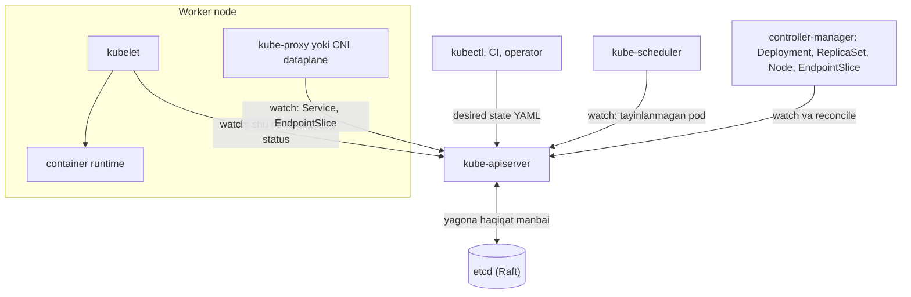
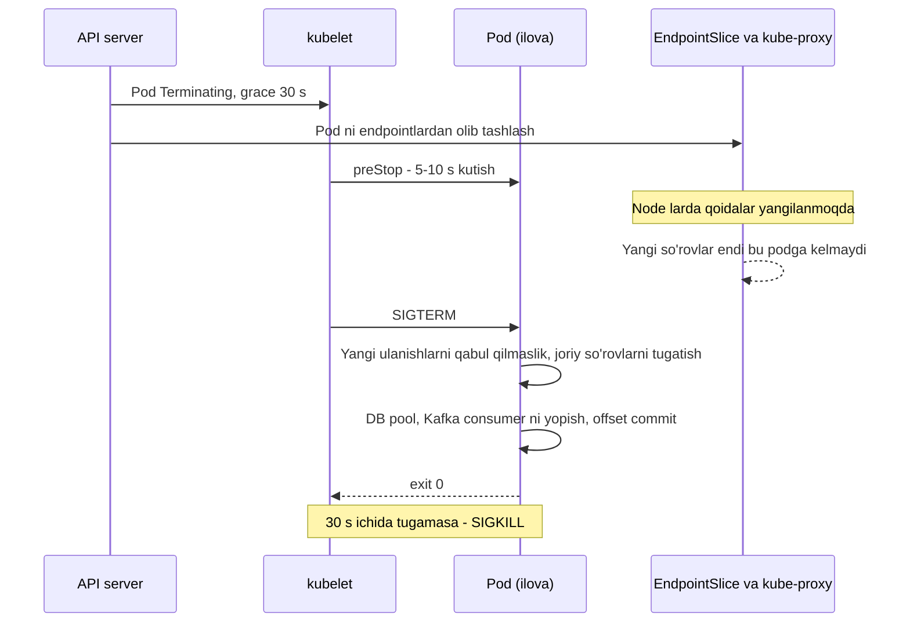

## Bu dars nima uchun kerak

Bu dars Kubernetes bo'yicha qo'llanma emas: `kubectl` buyruqlari va YAML sintaksisi bu yerda asosiy narsa emas. Maqsad - Kubernetes **qanday taqsimlangan tizim** ekanini va u sizning arxitekturangizga qanday kafolatlar beradi va qanday cheklovlar qo'yadi, shuni tushunish. Chunki ko'p muammolar ("deploy paytida 502 lar", "pod sababsiz restart bo'ldi", "node to'lib, servis sekinlashdi") Kubernetes ning xatosi emas, balki uning modelini ilova dizaynida hisobga olmaslik natijasi.

Oldingi darslar bilan bog'liqlik: stateless servislar (21-dars) Kubernetes ning asosiy taxmini; health check va load balancing (22-dars) - probe va Service; service discovery (53-dars) - DNS va EndpointSlice; sidecar va service mesh (55-dars); deploy strategiyalari (68-dars) - rolling update; graceful degradation (64-dars) - resurs limitlari va eviction. Autoscaling 76-darsda alohida.

Bu darsdan keyin siz:

- konteyner nima ekanini (namespace + cgroup) va VM dan farqini aniq ayta olasiz;
- Kubernetes ning arxitekturasini (API server, etcd, scheduler, controllerlar, kubelet) va "desired state + reconciliation loop" modelini tushuntira olasiz;
- requests va limits ning ichki mexanikasini, QoS sinflarini, CPU throttling va OOM kill ni bilasiz;
- probe'lar, graceful shutdown va rolling update ni to'g'ri sozlab, deploy paytida so'rov yo'qotmaslikni loyihalay olasiz;
- Kubernetes ning masshtab chegaralarini va stateful ilovalar (baza, Kafka) uchun trade-offlarni bilasiz.

## Konteyner: VM emas, cheklangan process

Konteyner - bu alohida "kichik kompyuter" emas, **oddiy Linux process**, unga ikki yadro mexanizmi qo'llangan:

- **Namespaces** - nimani **ko'rishini** cheklaydi: o'z PID daraxti, o'z tarmoq steki (IP, portlar), o'z mount nuqtalari, hostname, foydalanuvchi ID lari.
- **cgroups** - qancha **ishlatishini** cheklaydi: CPU vaqti, xotira, I/O, process soni.

Plus image - qatlamli fayl tizimi (overlay), ichida ilova va uning bog'liqliklari.

| Mezon | Virtual mashina | Konteyner |
|---|---|---|
| Izolyatsiya chegarasi | Hypervisor, alohida yadro | Umumiy host yadrosi |
| Ishga tushish vaqti | Daqiqalar yoki o'nlab soniya | Soniyadan kam (image mavjud bo'lsa) |
| Overhead | Har VM da to'liq OS | Faqat process |
| Zichlik | Host da o'nlab | Node da yuzgacha (Kubernetes 110 pod/node) |
| Xavfsizlik izolyatsiyasi | Kuchli | Kuchsizroq: yadro zaifligi barcha konteynerlarga ta'sir qiladi |
| Multi-tenant (begona kod) | Yaxshi | Qo'shimcha qatlam kerak (gVisor, Kata, microVM) |

System design uchun xulosa: konteyner **tez va zich**, lekin xavfsizlik chegarasi sifatida VM dan kuchsiz. Agar siz o'z kodingizni ishlatsangiz - muammo emas. Agar mijozlar yuklagan kodni (masalan, foydalanuvchi skriptlari) ishga tushirsangiz - sandbox kerak.

## Kubernetes arxitekturasi: taqsimlangan tizim sifatida

Kubernetes Google ning ichki **Borg** tizimidan kelib chiqqan (EuroSys 2015 maqolasi: Borg ko'p klasterlarda, har biri o'n minglab mashinali, yuz minglab joblarni boshqaradi). Kubernetes loyihasi Borg dagi eng yaxshi g'oyalarni olib, foydalanuvchilar yillar davomida duch kelgan og'riqli joylarni tuzatishga harakat qilgan.

Asosiy komponentlar:

- **etcd** - barcha klaster holatini saqlaydigan kalit-qiymat ombori, **Raft** consensus bilan (36-dars). U kichik metadata uchun mo'ljallangan: etcd hujjatiga ko'ra bitta so'rov standart chegarasi 1.5 MiB, ombor hajmi standart 2 GiB, tavsiya etilgan maksimum 8 GiB. Shu sabab Kubernetes obyektlariga katta ma'lumot (fayllar, katta ConfigMap) qo'yish xato.
- **kube-apiserver** - etcd bilan gaplashadigan yagona komponent. Qolgan hamma narsa (scheduler, controllerlar, kubelet) API server orqali **watch** qiladi: o'zgarishlar oqimini oladi.
- **kube-scheduler** - hali node ga tayinlanmagan podlarni ko'radi va node tanlaydi: **requests** sig'adimi, affinity/anti-affinity, taint/toleration, topology spread.
- **Controllerlar** - har biri bitta obyekt turi uchun nazorat sikli: Deployment controller ReplicaSet larni, ReplicaSet controller podlar sonini, EndpointSlice controller Service ortidagi tayyor pod IP larini boshqaradi.
- **kubelet** - har bir node dagi agent: o'z node iga tayinlangan podlarni ishga tushiradi, probe larni bajaradi, statusni API ga yozadi.

### Desired state va reconciliation loop

Kubernetes ning eng muhim g'oyasi: siz **qanday qilishni** emas, **nima bo'lishi kerakligini** (desired state) yozasiz. Har bir controller cheksiz sikl bajaradi:

1. joriy holatni kuzatish (watch);
2. desired state bilan solishtirish;
3. farqni kamaytiradigan bitta qadam qilish;
4. takrorlash.

Bu model **level-triggered**: controller "nima o'zgardi" hodisasiga emas, "hozir holat qanday" ga qarab ishlaydi. Shuning uchun hodisa yo'qolsa, controller restart bo'lsa yoki node qaytib kelsa - keyingi siklda holat baribir tuzatiladi. Bu 39-darsdagi idempotentlik g'oyasining arxitekturaviy ko'rinishi: har bir qadam takrorlansa ham xavfsiz bo'lishi kerak.

Natija: **hamma narsa eventual**. `kubectl apply` muvaffaqiyatli javob berdi - bu faqat "desired state etcd ga yozildi" degani; podlar hali ishga tushmagan bo'lishi mumkin. Pod o'chirildi - lekin uning IP manzili hali ba'zi node larning tarmoq qoidalarida bir necha soniya qolishi mumkin. Bu oxirgi nuqta deploy paytidagi xatolarning asosiy sababi (pastda).

### Masshtab chegaralari

Kubernetes hujjatidagi "katta klaster" chegaralari: **5 000 node** gacha, node boshiga **110 pod** dan ko'p emas, jami **150 000 pod** va **300 000 konteyner** dan ko'p emas. Bu qattiq to'siq emas, sinovdan o'tgan konfiguratsiya chegarasi. Amaliy xulosa: juda katta tizimlar bitta ulkan klaster o'rniga **bir nechta klaster** (region, muhit yoki cell bo'yicha, 73 va 77-darslar) bilan quriladi - bu blast radius ni ham kamaytiradi: control plane xatosi yoki noto'g'ri konfiguratsiya faqat bitta klasterga ta'sir qiladi.

## Pod, Service va tarmoq modeli

**Pod** - eng kichik joylashtirish birligi: bir yoki bir nechta konteyner, umumiy tarmoq namespace (bitta IP, localhost orqali gaplashadi) va umumiy volume lar bilan. Sidecar pattern (55-dars) shunday ishlaydi.

Kubernetes tarmoq modeli (hujjatdan): har pod klaster bo'yicha **o'z unikal IP** siga ega va podlar bir-biri bilan proxy yoki NAT siz to'g'ridan-to'g'ri gaplasha oladi. Borg da tasklar host IP sini bo'lishib, port ajratish bilan ishlagan - bu port to'qnashuvlari va murakkab konfiguratsiyaga olib kelgan; pod-per-IP buni yo'qotadi.

Pod lar **efemer**: o'ladi, boshqa node da boshqa IP bilan qayta tug'iladi. Shuning uchun barqaror manzil kerak:

- **Service** - barqaror virtual IP va DNS nomi (`billing.fleet.svc.cluster.local`), ortida tanlangan (label selector) tayyor podlar.
- **EndpointSlice** - Service ortidagi hozir **tayyor** pod IP lari ro'yxati; readiness probe muvaffaqiyatsiz bo'lsa, pod bu ro'yxatdan chiqariladi.
- **kube-proxy** (yoki eBPF asosidagi CNI) har bir node da virtual IP dan haqiqiy pod IP larga yo'naltirish qoidalarini o'rnatadi (iptables, nftables rejimlari).

Muhim nozik nuqta: Service ning virtual IP orqali yo'naltirish - **L4**, ulanish darajasida. gRPC yoki HTTP/2 kabi uzoq yashaydigan ulanishlarda klient bitta ulanishni ochib, hamma so'rovlarni bitta podga yuboradi - yangi podlar yuklama olmaydi. Yechim - L7 balanslash (service mesh, 55-dars) yoki klient tomonida balanslash (22-dars).

## Resurslar: requests, limits va QoS

Har bir konteyner uchun ikki qiymat:

- **requests** - scheduler uchun: "bu podga node da shuncha joy ajrat". Scheduler node dagi barcha podlar requests yig'indisi node sig'imidan oshmasligini ta'minlaydi, **haqiqiy foydalanishdan qat'i nazar**.
- **limits** - yuqori chegara, yadro (cgroups) tomonidan majburlanadi.

Kubernetes hujjati bo'yicha mexanika:

- **CPU limit** - qattiq ship: har bir scheduling oralig'ida yadro limitdan oshganini tekshiradi va oshgan bo'lsa cgroup ni kutishga majbur qiladi (**throttling**). Konteyner o'ldirilmaydi, lekin sekinlashadi.
- **CPU request** - raqobat bo'lganda og'irlik: kattaroq request - ko'proq CPU vaqti.
- **Memory limit** - oshsa, yadro OOM mexanizmi process ni o'ldiradi (**OOMKilled**); PID 1 bo'lsa, konteyner restart bo'ladi.
- **Memory request** - asosan scheduling uchun; node da xotira tanqis bo'lsa, request dan ko'p ishlatayotgan podlar **evict** qilinishi ehtimoli yuqori.

### QoS sinflari

| Sinf | Shart | Xotira tanqisligida |
|---|---|---|
| Guaranteed | Har bir konteynerda CPU va memory uchun request = limit | Oxirgi bo'lib evict qilinadi |
| Burstable | Kamida bitta request yoki limit bor, lekin Guaranteed emas | BestEffort dan keyin |
| BestEffort | Hech qanday request/limit yo'q | Birinchi evict qilinadi |

### CPU throttling hisob-kitobi

CFS kvota mexanizmi vaqtni davrlar bilan o'lchaydi (Linux da standart davr 100 ms). `limits.cpu: 500m` = har 100 ms da 50 ms CPU vaqti. Faraz qiling, Node.js servisi bitta so'rovga javob berish uchun 60 ms CPU ishlatadigan og'ir JSON serializatsiya qiladi. Davr boshida so'rov keldi: 50 ms ishladi, kvota tugadi, keyingi 50 ms **muzlatildi**, keyingi davrda qolgan 10 ms ni bajardi. Natija: 60 ms ish 110 ms javob vaqtiga aylandi. Agar ilovada bir nechta thread bo'lsa (masalan, libuv thread pool yoki GC thread lari), ular kvotani parallel tezroq yeydi va muzlatish yanada uzoq bo'ladi. Shu sabab latency ga sezgir servislarda p99 ko'pincha **o'rtacha CPU foydalanish past** bo'lsa ham throttling tufayli yomonlashadi. Ko'p jamoalar latency-kritik servislarda CPU limitni olib tashlab (yoki baland qo'yib), faqat request bilan ishlaydi; xotira limitini esa doim qo'yadi, chunki xotirani "throttle" qilib bo'lmaydi.

### Bin packing va narx

Scheduler **requests** bo'yicha joylashtiradi. Requests haqiqiy foydalanishdan ancha yuqori bo'lsa - node lar "to'la" ko'rinadi, lekin aslida bo'sh turadi. Hisob: 40 ta pod, har birida `requests.cpu: 1`, haqiqiy o'rtacha foydalanish 0.2 CPU. 8 vCPU li node larda (tizim uchun ~0.5 vCPU ajratilgan deylik, 7 ta pod sig'adi) `40 / 7 ≈ 6` node kerak. Requests 0.3 ga tushirilsa - har node ga 25 pod, lekin 110 pod/node chegarasi va xotira ham bor; CPU bo'yicha `40 × 0.3 = 12` vCPU = 2 node. Uch baravar farq - bu 79-darsdagi cost-aware dizaynning eng oddiy richagi. Teskari xavf: requests juda past bo'lsa, node haqiqatan to'lib, hamma podlar bir-biriga xalaqit beradi (noisy neighbor, 73-dars).

## Health: probe'lar

Kubernetes hujjati bo'yicha uch xil probe:

- **Startup probe** - ilova ishga tushdimi? U muvaffaqiyatli bo'lguncha liveness va readiness ishlamaydi. Sekin ishga tushadigan ilovalar uchun (cache isitish, katta model yuklash).
- **Readiness probe** - trafik qabul qilishga tayyormi? Muvaffaqiyatsiz bo'lsa, pod EndpointSlice dan chiqariladi, lekin **restart qilinmaydi**. Butun hayot davomida ishlaydi - vaqtinchalik ortiqcha yuklamada ham podni trafikdan chiqarish mumkin.
- **Liveness probe** - konteynerni restart qilish kerakmi? Masalan, deadlock: process tirik, lekin hech narsa qila olmaydi.

Eng xavfli xato - **liveness probe ga tashqi bog'liqlikni qo'shish**. Agar `/healthz` bazaga ping qilsa va baza 30 soniya sekinlashsa, **barcha** podlarning liveness i muvaffaqiyatsiz bo'ladi va Kubernetes ularni bir vaqtda restart qiladi. Restart dan keyin hammasi bir vaqtda bazaga ulanishga uriniladi (thundering herd) - kichik baza muammosi to'liq uzilishga aylanadi (64-dars: cascading failure). Qoida: liveness faqat **process ning o'z holatini** tekshiradi; bog'liqliklar holati - readiness ga (va u ham ehtiyotkorlik bilan: baza o'chsa, barcha podlarni trafikdan chiqarish ham to'liq uzilish).

## Graceful shutdown va rolling update

### Pod qanday o'ladi

Kubernetes hujjatidagi tugatish oqimi:

1. Pod o'chirish so'raladi, API da "Terminating" holatiga o'tadi, standart grace period - **30 soniya** (`terminationGracePeriodSeconds`).
2. Kubelet `preStop` hook ni bajaradi (bo'lsa), keyin konteynerlardagi PID 1 ga **SIGTERM** yuboradi.
3. **Shu bilan bir vaqtda** control plane podni EndpointSlice lardan olib tashlashni boshlaydi.
4. Grace period tugasa - **SIGKILL**.

Muammo 2 va 3-qadamlar **parallel va asinxron**. SIGTERM kelganda, kube-proxy va ingress controllerlar hali yangilanmagan bo'lishi mumkin va bir necha soniya davomida bu podga yangi so'rovlar keladi. Agar ilova SIGTERM da darhol yopilsa - bu so'rovlar "connection refused" yoki 502 oladi. Har deploy da kichik xatolar to'lqini - klassik simptom.

To'g'ri retsept:

1. `preStop` da qisqa kutish (masalan 5-10 soniya) - endpointlar yangilanishiga vaqt berish.
2. SIGTERM da: readiness ni "tayyor emas" ga o'tkazish, yangi ulanishlarni qabul qilmaslik, joriy so'rovlarni tugatish (HTTP keep-alive ulanishlarni yopish), Kafka consumer offset larini commit qilish va consumer group dan chiqish, navbatdagi ishni qaytarish.
3. Grace period = preStop + eng uzun so'rov + tozalash zaxirasi. Uzoq ishlaydigan ishlar (hisobot generatsiyasi 5 daqiqa) bo'lsa - ularni podda emas, navbat + idempotent worker bilan qiling (50-dars), shunda o'ldirilgan ish boshqa podda qayta boshlanadi.

Node.js uchun eslatma: agar konteynerda `npm start` PID 1 bo'lsa, SIGTERM `npm` ga keladi va u har doim ham child process ga uzatmaydi. Natija - ilova signalni umuman ko'rmaydi va 30 soniyadan keyin SIGKILL. Ilovani to'g'ridan-to'g'ri `node server.js` bilan yoki kichik init (tini, dumb-init) orqali ishga tushiring.

### Rolling update

Deployment ning standart strategiyasi - **RollingUpdate**, standart `maxUnavailable: 25%` va `maxSurge: 25%`: yangilanish davomida kamida 75% podlar ishlaydi va jami 125% dan oshmaydi. Yangi pod readiness dan o'tmaguncha eski pod o'chirilmaydi - shuning uchun readiness probe noto'g'ri bo'lsa (har doim "tayyor"), buzuq versiya ham "muvaffaqiyatli" tarqaladi. Canary va blue-green (68-dars) bu ustiga qurilgan qo'shimcha nazorat.

Hisob: 8 replika, `maxSurge 25%` = 2, `maxUnavailable 25%` = 2. Bir vaqtda 2 ta yangi pod qo'shiladi va 2 ta eski olib tashlanadi. Har pod tayyor bo'lishi 20 s, tugashi 15 s bo'lsa, taxminan `8 / 2 = 4` to'lqin × ~35 s ≈ 2-2.5 daqiqa. Shu vaqt ichida qolgan podlar 75% sig'im bilan butun yuklamani ko'taradi - agar servis odatda 85% yuklamada ishlasa, deploy paytida u ortiqcha yuklanadi. Demak `maxUnavailable` ni 0 ga, `maxSurge` ni yuqoriroq qo'yish yoki deploy oldidan zaxira bo'lishi kerak.

### Ixtiyoriy uzilishlar: PodDisruptionBudget

Node yangilash yoki klasterni kichraytirish (drain) - **ixtiyoriy uzilish** (voluntary disruption). PodDisruptionBudget (`minAvailable` yoki `maxUnavailable`) bir vaqtda nechta podni shunday yo'l bilan olib tashlash mumkinligini cheklaydi. Lekin u node buzilishi kabi **majburiy** uzilishlardan himoya qilmaydi - buning uchun replikalarni turli node va zonalarga taqsimlash kerak (pod anti-affinity, topology spread constraints).

## Stateful ilovalar: bazani Kubernetes da ishlatish kerakmi

Kubernetes dastlab stateless servislar uchun yaratilgan; **StatefulSet** (barqaror nom, tartibli ishga tushish, har podga alohida PersistentVolume) va **operator** pattern (controller + CRD, masalan PostgreSQL yoki Kafka operatorlari) stateful ilovalarni ham mumkin qildi.

| Mezon | Kubernetes ichida (operator bilan) | Managed servis (RDS, Cloud SQL, MSK) yoki alohida VM |
|---|---|---|
| Boshqaruv | Bir xil vosita, GitOps | Alohida vosita |
| Failover, backup | Operator sifatiga bog'liq | Provayder tomonidan, sinovdan o'tgan |
| Ishlash | Disk va tarmoq qatlami qo'shimcha o'zgaruvchanlik beradi | Bashorat qilinadigan |
| Node ni almashtirish | Pod ko'chishi = volume qayta ulanishi yoki replikadan tiklash | Provayder boshqaradi |
| Narx | Arzonroq bo'lishi mumkin | Qimmatroq, lekin operatsion yuk kam |
| Jamoa malakasi | Ham DB, ham Kubernetes chuqur bilimi kerak | Asosan DB bilimi |

Amaliy qoida: kichik jamoa uchun **asosiy ma'lumot bazasi** (yo'qotib bo'lmaydigan ma'lumot) - managed servis yoki yaxshi boshqariladigan alohida klaster; Kubernetes da esa stateless servislar, cache (Redis replika bilan) va qayta tiklanadigan ma'lumotlar. Lokal (O'zbekistondagi) data-markazda managed servis bo'lmasa (78-dars), operator tanlovi ongli va sinovdan o'tgan backup/failover mashqlari bilan bo'lishi kerak.

## Real tizimlardan misollar

- **Google Borg** - Kubernetes ning bevosita ajdodi; EuroSys 2015 maqolasi admission control, task packing, over-commitment va process darajasidagi ishlash izolyatsiyasi orqali yuqori utilizatsiyaga erishilganini tasvirlaydi.
- **Kubernetes hujjati** - 5 000 node / 150 000 pod chegaralari, standart 30 s grace period, 25% maxSurge/maxUnavailable, QoS eviction tartibi - bularning hammasi ilova dizayniga bevosita ta'sir qiladi.
- **etcd** - Raft asosidagi ombor, kichik metadata uchun: 1.5 MiB so'rov va 8 GiB tavsiya etilgan hajm chegarasi. Klaster masshtabining eng nozik joylaridan biri.
- **Kubernetes Secrets** - 74-darsda ko'rganimizdek, standart holatda etcd da shifrlanmagan.

## iQuariX kontekstida

Faraz qilaylik, iQuariX quyidagi workloadlarni Kubernetes ga ko'chirmoqda:

1. **TCP ingest gateway** (trekerlar uchun uzoq yashaydigan TCP ulanishlar, 60 000 ulanish). Bu oddiy HTTP servis emas: har pod minglab doimiy ulanishni ushlaydi. Muammolar: Service L4 bo'lgani uchun yangi podlar yangi ulanishlarni oladi, eskilari esa eski podlarda qoladi; deploy paytida pod o'chirilsa, uning barcha trekerlari bir vaqtda qayta ulanadi (reconnect storm). Yechim: `preStop` va SIGTERM da ulanishlarni bosqichma-bosqich yopish (masalan 60 soniya davomida tarqatib), grace period ni uzaytirish (masalan 120 s), trekerlar tomonida qayta ulanish jitter bilan (62-dars), `maxUnavailable` ni kichik qo'yish. Hisob: 6 pod, har birida 10 000 ulanish; bitta pod o'chirilsa 10 000 treker 60 soniya ichida tekis qayta ulansa - qolgan podlarga taxminan 170 yangi ulanish/s, bu boshqariladigan; 1 soniyada qayta ulansa - 10 000 handshake/s, bu boshqa podlarni ham yiqitishi mumkin.
2. **API servislar (Node.js, NestJS)** - klassik stateless Deployment: readiness `/ready` (process tayyor, pool lar ochiq), liveness `/live` (faqat event loop javob beradimi), CPU request bilan, CPU limitsiz yoki baland limit, memory limit bilan (Node.js da `--max-old-space-size` ni konteyner limitiga moslab).
3. **Kafka consumerlar** (telemetriya yozuvchilar) - SIGTERM da offset commit va consumer group dan to'g'ri chiqish; aks holda har deploy da rebalance va dublikat qayta ishlash (39 va 43-darslar).
4. **Video transcoding** - CPU-og'ir, alohida node pool (taint/toleration bilan), Guaranteed QoS, Job yoki navbat + worker sifatida.
5. **PostgreSQL va time-series baza** - managed yoki alohida klaster; Kubernetes ichida bo'lsa - operator, har replika alohida zona/node da, backup tiklash mashqi bilan.

## Ko'p uchraydigan xatolar

1. **SIGTERM ni ishlamaslik va preStop yo'qligi** - har deploy da 502 lar to'lqini.
2. **Liveness probe da tashqi bog'liqlik** - baza sekinlashganda barcha podlar bir vaqtda restart bo'ladi.
3. **Requests ni o'lchamasdan qo'yish** - yo juda yuqori (pul bo'sh turadi), yo yo'q (BestEffort, birinchi evict qilinadi, noisy neighbor).
4. **Latency-kritik servisda qattiq CPU limit** - o'rtacha CPU past bo'lsa ham p99 throttling tufayli yomon.
5. **gRPC/HTTP2 uchun L4 Service ga ishonish** - yuklama bir nechta podga yopishib qoladi.
6. **Barcha replikalar bitta node yoki zonada** - bitta node o'lishi to'liq uzilish. Anti-affinity va topology spread ishlating.
7. **etcd ni ma'lumot bazasi sifatida ishlatish** - katta ConfigMap lar va ko'p sonli CRD obyektlari bilan klaster control plane ini sekinlashtirish.
8. **Kubernetes ni "o'zi hamma narsani hal qiladi" deb hisoblash** - u reconcile qiladi, lekin ilova graceful shutdown, idempotentlik va qayta ulanishni o'zi bilishi kerak.

## Xulosa

- Konteyner - namespaces (nima ko'rinadi) va cgroups (qancha ishlatiladi) bilan cheklangan process; VM dan tez va zich, lekin izolyatsiyasi kuchsizroq.
- Kubernetes - etcd (Raft) ustida qurilgan, watch va level-triggered reconciliation loop lardan iborat taqsimlangan tizim; hamma narsa eventual.
- Requests scheduling va bin packing ni, limits esa throttling (CPU) va OOM kill (xotira) ni belgilaydi; QoS sinfi eviction tartibini belgilaydi.
- Startup, readiness va liveness probe'larining vazifasi har xil; liveness ga tashqi bog'liqlik qo'ymang.
- Pod tugatish va endpointdan chiqarish parallel: preStop kutish + SIGTERM da to'g'ri yopish - uzilishsiz deploy ning asosi.
- Klaster masshtabining chegaralari bor (5 000 node, 150 000 pod); katta tizimlar bir nechta klaster bilan quriladi.
- Stateful ilovalar uchun Kubernetes mumkin, lekin managed servis bilan trade-off ni ongli tanlang.

## Amaliy topshiriq

iQuariX ning TCP ingest gateway va telemetriya yozuvchi servislarini Kubernetes ga ko'chirish rejasini tuzing. Ma'lumotlar: 60 000 treker, har biri doimiy TCP ulanish, har 10 s da 1 nuqta; gateway bitta podda 12 000 ulanishni barqaror ko'taradi; yozuvchilar Kafka dan o'qib, time-series bazaga yozadi; haftada 3 marta deploy.

1. Gateway uchun: pod soni (N+2 zaxira bilan hisoblang), requests/limits, QoS sinfi, anti-affinity va zonalar bo'yicha taqsimot.
2. Gateway deploy rejasi: `maxSurge`, `maxUnavailable`, `preStop`, `terminationGracePeriodSeconds` qiymatlari va ulanishlarni bosqichma-bosqich yopish strategiyasi. Bitta pod o'chganda qolgan podlarga sekundiga nechta yangi ulanish tushishini hisoblang.
3. Probe'lar: gateway va yozuvchi uchun startup, readiness, liveness nimani tekshiradi va nimani **tekshirmaydi**.
4. Yozuvchi (Kafka consumer) uchun graceful shutdown ketma-ketligi: offset commit, rebalance, dublikat ehtimoli va uni idempotent yozish bilan yopish.
5. Node yangilash (drain) va zona uzilishi stsenariylari: PodDisruptionBudget va topology spread qanday sozlanadi?
6. Time-series bazani Kubernetes ichida yoki tashqarisida ishlatish qarorini trade-off jadvali bilan asoslang.

Yaxshi javobda bo'lishi kerak bo'lgan narsalar:

- ulanishlar soni va qayta ulanish tezligi bo'yicha raqamli hisob;
- preStop + SIGTERM ketma-ketligi va endpoint yangilanishining asinxronligi hisobga olingani;
- liveness da tashqi bog'liqlik yo'qligi;
- CPU throttling xavfi va requests/limits tanlovi asoslangani;
- Kafka offset commit va idempotentlik;
- ixtiyoriy va majburiy uzilishlar farqi.

Javobni pastdagi maydonga yozib, chatga yuboring.

## Manbalar

- Kubernetes hujjati. [Pod Lifecycle](https://kubernetes.io/docs/concepts/workloads/pods/pod-lifecycle/) - probe turlari, "Termination of Pods" bo'limi (30 s grace period, SIGTERM, EndpointSlice).
- Kubernetes hujjati. [Resource Management for Pods and Containers](https://kubernetes.io/docs/concepts/configuration/manage-resources-containers/) va [Pod Quality of Service Classes](https://kubernetes.io/docs/concepts/workloads/pods/pod-qos/) - requests, limits, throttling, OOM, eviction tartibi.
- Kubernetes hujjati. [Deployments](https://kubernetes.io/docs/concepts/workloads/controllers/deployment/) - RollingUpdate, maxSurge/maxUnavailable; [Disruptions](https://kubernetes.io/docs/concepts/workloads/pods/disruptions/) - PodDisruptionBudget.
- Kubernetes hujjati. [Considerations for large clusters](https://kubernetes.io/docs/setup/best-practices/cluster-large/) - 5 000 node, 110 pod/node, 150 000 pod.
- Kubernetes hujjati. [Services, Load Balancing, and Networking](https://kubernetes.io/docs/concepts/services-networking/) - pod-per-IP tarmoq modeli; [Virtual IPs and Service Proxies](https://kubernetes.io/docs/reference/networking/virtual-ips/).
- etcd. [System limits](https://github.com/etcd-io/website/blob/main/content/en/docs/v3.5/dev-guide/limit.md) - so'rov va ombor hajmi chegaralari.
- Abhishek Verma va boshq. [Large-scale cluster management at Google with Borg](https://research.google/pubs/large-scale-cluster-management-at-google-with-borg/), EuroSys 2015.
- Brendan Burns, Brian Grant, David Oppenheimer, Eric Brewer, John Wilkes. [Borg, Omega, and Kubernetes](https://research.google/pubs/borg-omega-and-kubernetes/), ACM Queue, 2016 - o'n yillik saboqlar.
