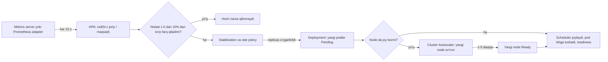
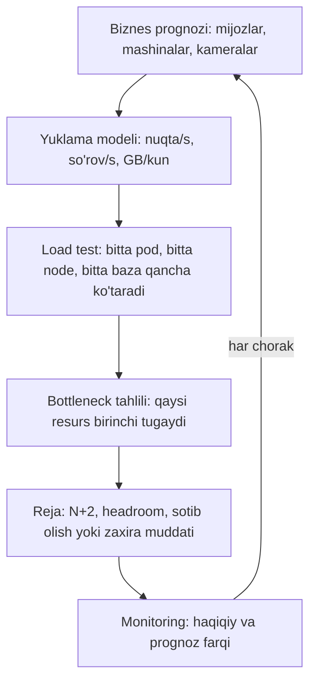

## Bu dars nima uchun kerak

Yuklama hech qachon tekis emas. Fleet tizimida u kun va hafta bo'yicha to'lqinsimon: ertalab 7-9 da mashinalar yo'lga chiqadi, tushlikda pasayadi, kechqurun yana ko'tariladi, tunda deyarli nolga yaqin. Oy oxirida hisobotlar, mavsumda (masalan, hosil yig'ish davrida yuk tashish) yangi mijozlar. Agar resurslarni **cho'qqiga** qarab qat'iy olsangiz - kunning ko'p qismida pul bo'sh turadi. Agar **o'rtachaga** qarab olsangiz - cho'qqida tizim sekinlashadi yoki yiqiladi.

Ikki xil savol bor va ular ko'pincha aralashtiriladi:

- **Autoscaling** - qisqa muddatli (daqiqa va soatlar): hozirgi yuklamaga qarab resurslarni avtomatik qo'shish va olib tashlash.
- **Capacity planning** - uzoq muddatli (oylar, choraklar): kelgusi o'sish uchun qancha va qanday resurs kerak, uni qachon sotib olish yoki zaxiralash kerak, va tizimning qaysi qismi birinchi bo'lib chegaraga yetadi.

Autoscaling capacity planning ni almashtirmaydi. Autoscaler faqat **mavjud** hovuzdan (bulut kvotasi, data-markazdagi serverlar, baza sig'imi) resurs oladi. Bazaning yozish sig'imi, Kafka partitionlar soni, lokal data-markazdagi rack lar - bularni avtomatik "scale" qilib bo'lmaydi va ular oldindan rejalashtiriladi.

Oldingi darslar bilan bog'liqlik: Little qonuni va percentile lar (3-dars), stateless servislar (21-dars), load shedding (63-dars), SLO (65-dars), metrikalar (67-dars), Kubernetes requests va scheduler (75-dars). Xarajat jihati 79-darsda.

Bu darsdan keyin siz:

- reaktiv, jadval asosidagi va prognozli autoscalingni va ularning qachon ishlashini bilasiz;
- Kubernetes HPA algoritmini (formula, tolerance, stabilization window) va Cluster Autoscaler ning ishlash mexanikasini tushuntira olasiz;
- autoscaling uchun to'g'ri metrikani tanlay olasiz va "nima uchun CPU har doim to'g'ri signal emas" ekanini bilasiz;
- autoscaling zanjiridagi kechikishlarni hisoblab, zaxira (headroom) qancha bo'lishi kerakligini aniqlay olasiz;
- capacity planning jarayonini (prognoz, load test, N+2, bottleneck tahlili) qura olasiz.

## Nima uchun 100% foydalanishda ishlab bo'lmaydi

Intuitiv fikr: "server 90% band - yaxshi, pul bekor ketmayapti". Lekin navbat nazariyasi boshqacha aytadi. Eng oddiy model (M/M/1 navbat: tasodifiy kelish, tasodifiy xizmat vaqti, bitta server) da o'rtacha javob vaqti `W = S / (1 - ρ)`, bu yerda `S` - bitta so'rovga xizmat vaqti, `ρ` - utilization (bandlik).

| Utilization ρ | O'rtacha javob vaqti (S = 10 ms) |
|---|---|
| 50% | 20 ms |
| 70% | 33 ms |
| 80% | 50 ms |
| 90% | 100 ms |
| 95% | 200 ms |
| 99% | 1 000 ms |

Haqiqiy tizimlar M/M/1 dan murakkab, lekin xulosa umumiy: **bandlik 70-80% dan oshganda latency chiziqli emas, egri chiziq bo'ylab portlaydi**, va percentile lar (p99) o'rtachadan ham oldinroq portlaydi. Shuning uchun autoscaling maqsadi odatda 50-70% bandlik, 100% emas. Bu farq - pulga sotib olinadigan latency.

## Autoscaling turlari

### Gorizontal va vertikal

- **Horizontal** - instancelar (podlar, VM lar) sonini o'zgartirish. Stateless servislar uchun asosiy usul (21-dars).
- **Vertical** - bitta instance hajmini (CPU, xotira) o'zgartirish. Stateful komponentlar yoki gorizontal masshtablanmaydigan ishlar uchun. Kubernetes VPA - requests ni haqiqiy foydalanishga qarab avtomatik belgilaydi; uning hujjatidagi cheklovlar: resurs yangilanganda pod qayta yaratiladi (boshqa node ga tushishi mumkin), va VPA ni HPA bilan **bir xil** resurs metrikasi (CPU yoki xotira) bo'yicha birga ishlatmaslik kerak - ikkalasi bir-biriga qarshi ishlaydi.

### Reaktiv, jadval va prognoz

| Tur | Qanday | Afzallik | Kamchilik |
|---|---|---|---|
| Reaktiv (metrikaga qarab) | CPU 70% dan oshdi - qo'sh | Har qanday yuklamaga moslashadi | Doim kech: zanjir kechikishi |
| Jadval (scheduled) | Har ish kuni 06:30 da 20 pod | Ma'lum to'lqinlar uchun oldindan tayyor | Kutilmagan o'zgarishni sezmaydi |
| Prognozli (predictive) | Tarixiy naqshdan kelajakni bashorat | Cho'qqidan oldin tayyor | Model kerak, g'ayrioddiy kunlarda xato |
| Navbat/event asosida | Navbat uzunligi yoki lag ga qarab | Asinxron ishlarga aniq signal | Faqat navbatli workloadlar uchun |

**Netflix Scryer** (2013) - prognozli autoscalingning klassik namunasi. Netflix trafigi kunlik va haftalik barqaror naqshlarga ega; reaktiv AWS Auto Scaling ba'zi holatlarni yaxshi qamramagan: instance ishga tushishi o'sha paytda 10-45 daqiqa olgani uchun keskin o'sishda kech qolgan, va uzilish paytida trafik tushib, tizim kichraygan, uzilish tugagach esa keskin qaytgan trafik uchun sig'im yetmagan. Scryer talabni oldindan bashorat qilib, jadval asosidagi scaling ni boshqargan, reaktiv autoscaler esa kutilmagan holatlar uchun xavfsizlik to'ri sifatida qolgan. Bu **gibrid** - eng amaliy yondashuv: prognoz yoki jadval asosiy sig'imni oldindan beradi, reaktiv qatlam qolganini tuzatadi.

## Kubernetes HPA: algoritm ichidan

Horizontal Pod Autoscaler - Kubernetes hujjatiga ko'ra nazorat sikli, standart holatda **har 15 soniyada** ishlaydi. Asosiy formula:

```
desiredReplicas = ceil( currentReplicas × currentMetricValue / desiredMetricValue )
```

Misol: 10 pod, maqsad o'rtacha CPU 60%, hozir 90%. `ceil(10 × 90 / 60) = ceil(15) = 15` pod. Agar hozir 30% bo'lsa: `ceil(10 × 30 / 60) = 5` pod.

Muhim detallar (hujjatdan):

- **Tolerance** - nisbat 1.0 ga yetarlicha yaqin bo'lsa (standart **0.1**, ya'ni ±10%), hech narsa qilinmaydi. 60% maqsadda 64% bandlik scaling ni ishga tushirmaydi. Bu tebranishni (flapping) kamaytiradi.
- **CPU utilization foizi requests ga nisbatan.** `requests.cpu: 500m` bo'lgan pod 400m ishlatsa - 80%. Requests noto'g'ri bo'lsa (75-dars), HPA ham noto'g'ri qaror qiladi.
- **Tayyor bo'lmagan va metrikasi yo'q podlar** ehtiyotkorlik bilan hisobga olinadi: scale-up da ular kam yuklangan deb, scale-down da to'liq yuklangan deb faraz qilinadi - ya'ni ikkala tomonda ham konservativ.
- **Scale-down stabilization window** - standart **300 soniya**: oxirgi 5 daqiqadagi eng katta tavsiya tanlanadi, shuning uchun qisqa pasayish darhol pod larni o'ldirmaydi.
- **Scale-up** - standart stabilization yo'q, va har 15 soniyada joriy replikalarning 100 foizigacha yoki 4 tagacha pod (qaysi biri katta bo'lsa) qo'shilishi mumkin. Ya'ni 10 poddan bir qadamda 20 gacha; 2 poddan 6 gacha.
- **Bir nechta metrika** bo'lsa, har biri bo'yicha `desiredReplicas` hisoblanadi va **eng kattasi** olinadi.



## Cluster Autoscaler: node darajasi

HPA pod qo'shadi, lekin podlar sig'masa ular **Pending** holatida qoladi. Cluster Autoscaler (CA) loyihasi FAQ ga ko'ra uning asosiy vazifasi - **pending podlarga joy topish**:

- **Scale-up:** CA davriy (standart `scan-interval` - 10 soniya) pending podlarni tekshiradi va ular qaysi node group da sig'ishini **simulyatsiya** qiladi, keyin bulut provayderdan node so'raydi. Muhim: CA **haqiqiy CPU foydalanishiga emas, pod requests ga** qaraydi. Node 95% CPU da yonsa ham, barcha podlar joylashgan bo'lsa, CA hech narsa qilmaydi.
- **Scale-down:** node dagi barcha podlar **requests** yig'indisi node ning allocatable resursining 50 foizidan kam bo'lsa (`scale-down-utilization-threshold` standart 0.5) va podlarni boshqa joyga ko'chirish mumkin bo'lsa, node 10 daqiqa (`scale-down-unneeded-time`) "keraksiz" bo'lib turgandan keyin o'chiriladi. Scale-up dan keyin 10 daqiqa (`scale-down-delay-after-add`) scale-down tekshirilmaydi. PodDisruptionBudget hurmat qilinadi.
- Node ni ishga tushirish vaqti CA ga bog'liq emas - bu bulut provayder va node bootstrap (image yuklash, CNI, kubelet ro'yxatdan o'tishi) vaqti.

**Overprovisioning** - CA FAQ dagi rasmiy usul: juda past prioritetli "pause" podlar resurs band qilib turadi. Haqiqiy pod kelganda pause pod preempt qilinadi (darhol joy bo'shaydi), pause pod esa Pending bo'lib CA ni yangi node qo'shishga undaydi. Ya'ni node qo'shish kechikishi foydalanuvchi trafigidan **oldinga** suriladi.

## Kechikish zanjiri va headroom hisob-kitobi

Reaktiv autoscaling har doim kech qoladi. Savol - qanchaga va shu vaqt ichida tizim omon qoladimi.

Zanjir (taxminiy, sizning muhitingizda o'lchang):

| Qadam | Taxminiy vaqt |
|---|---|
| Metrikaning yig'ilishi va o'rtachalanishi | 15-60 s |
| HPA sikli | 0-15 s |
| Pod ishga tushishi (image bor, Node.js ilova, readiness) | 10-40 s |
| Agar node kerak bo'lsa: CA aniqlashi + VM ishga tushishi + node Ready | 1-5 daqiqa |
| Yangi pod ning cache, JIT, connection pool isishi | 10-60 s |

Jami: node bor bo'lsa ~1 daqiqa, node kerak bo'lsa 3-6 daqiqa.

**Headroom hisobi.** Faraz qilaylik, API servisga yuklama ertalab 8:00 atrofida 5 daqiqada 2 baravar o'sadi (chiziqli). Maqsad bandlik 60%. Autoscaling javob vaqti (node bilan) 5 daqiqa. Eng yomon holatda autoscaler hech narsa qila olmasdan yuklama `60% × 2 = 120%` ga yetadi - tizim yiqiladi. Omon qolish uchun:

- maqsad bandlikni pastroq qo'yish: 45% bilan boshlansa, 5 daqiqadan keyin 90% - og'ir, lekin tirik;
- yoki node zaxirasi (overprovisioning) - shunda javob vaqti ~1 daqiqa, shu vaqt ichida yuklama `1 + 1/5 = 1.2` baravar o'sadi: `60% × 1.2 = 72%` - xavfsiz;
- yoki jadval asosida 7:45 da oldindan kengaytirish.

Umumiy formula: `maqsad_bandlik × (1 + o'sish_tezligi × reaksiya_vaqti) < xavfsiz_chegara`. Bu bitta tengsizlik autoscaling sozlamalarining asosiy "fizikasi".

## Qaysi metrika bo'yicha scale qilish

| Workload | Yaxshi signal | Nega CPU har doim to'g'ri emas |
|---|---|---|
| CPU-bog'liq API (JSON, hisoblash) | CPU, yoki so'rov/s pod boshiga | CPU yaxshi ishlaydi |
| I/O-bog'liq API (bazani kutadi) | In-flight so'rovlar, so'rov/s, latency | CPU past, lekin servis to'yingan (pool, event loop navbati) |
| Navbat consumer (Kafka, RabbitMQ) | Consumer lag yoki navbat uzunligi / qayta ishlash tezligi | Lag o'sadi, CPU esa past bo'lishi mumkin |
| WebSocket / TCP ulanishlar | Ulanishlar soni pod boshiga | Bo'sh ulanishlar CPU ishlatmaydi, lekin xotira va fd ishlatadi |
| Video transcoding | Navbatdagi ishlar soni | Har ish CPU ni 100% oladi, CPU signal emas |

Navbat consumerlari uchun **KEDA** (CNCF graduated loyiha) Kafka lag, SQS navbati va boshqa tashqi hodisa manbalariga qarab scaling qiladi, shu jumladan **nolgacha** va noldan.

**Kafka cheklovi:** consumer group da faol consumerlar soni partitionlar sonidan oshmaydi (43-dars). 24 partitionli topic uchun HPA 40 pod yaratsa, 16 tasi bo'sh turadi. Ya'ni consumer autoscaling ning shipi - partitionlar soni, va u **capacity planning** qarori.

**Teskari ta'sir xavfi:** autoscaling "pastki" bog'liqlikni ham yuklaydi. API 10 dan 40 podga kengaydi, har pod 20 ta DB ulanishli pool ochadi: 200 dan 800 ulanishga - PostgreSQL `max_connections` dan oshib ketishi mumkin. Autoscaling dizayni har doim **butun zanjirni** ko'radi: pool lar (PgBouncer), downstream rate limitlar, bazaning sig'imi.

## Capacity planning

Google SRE kitobi capacity planning uchun majburiy qadamlarni ko'rsatadi: **organik o'sish** prognozi (yangi resurs olish vaqtidan uzoqroq muddatga), **noorganik** o'sish (yangi funksiya, marketing kampaniya, yirik mijoz) ni prognozga qo'shish, va **muntazam load test** - xom resurslar (server, disk) qancha xizmat sig'imiga aylanishini o'lchash.

### Jarayon



1. **Biznes driverlarini yuklamaga aylantirish.** "Keyingi yil 3 ta yirik mijoz" - bu emas, "60 000 dan 110 000 mashinaga, 2 000 dan 5 000 kameraga" - bu. Har driver uchun yuklama modeli: mashina -> nuqta/s, kamera -> Mbit/s va TB/oy.
2. **Load test bilan birlik sig'imini o'lchash.** Bitta API pod p99 SLO ni buzmasdan qancha so'rov/s ko'taradi? Bitta Kafka broker, bitta PostgreSQL primary qancha yozuv/s? Hujjat yoki blog raqamiga emas, o'z o'lchovingizga tayaning.
3. **Bottleneck larni topish.** Har bir komponent uchun: hozirgi foydalanish / sig'im va o'sish sur'ati bo'yicha "qachon tugaydi". Odatda bu stateless servislar emas (ular autoscale qilinadi), balki baza yozish sig'imi, disk hajmi, partitionlar soni, tarmoq kanali, litsenziya limitlari.
4. **Redundancy.** Google SRE kitobi N+2 ni yaxshi "intent" namunasi sifatida keltiradi: talabni qondirish uchun N birlik + 2 zaxira - bittasi rejali texnik xizmatda, bittasi kutilmagan buzilishda bo'lsa ham. Zonalar bo'yicha: 3 zonada ishlasangiz va bitta zona o'chsa, qolgan ikkitasi 100% yuklamani ko'tarishi kerak - ya'ni har zona normal holatda ko'pi bilan ~66% band bo'lishi kerak.
5. **Lead time.** Bulutda yangi instance - daqiqalar. Lokal data-markazda yangi server - haftalar yoki oylar (xarid, yetkazish, montaj). Prognoz gorizonti lead time dan uzun bo'lishi shart.

### Hisob-kitob misoli

Telemetriya yozish yo'li. Hozir 60 000 mashina, har biri har 10 s da nuqta: 6 000 nuqta/s o'rtacha, cho'qqi 2x = 12 000 nuqta/s. Load test: bitta yozuvchi pod 3 000 nuqta/s ni p99 < 200 ms bilan ko'taradi; time-series baza klasteri 40 000 nuqta/s gacha barqaror. Kafka topic: 24 partition.

- Yozuvchi podlar cho'qqida: `12 000 / 3 000 = 4`, N+2 bilan **6**. HPA min 4, max 24 (partitionlar soni chegarasi).
- Bir yilda 110 000 mashina: cho'qqi `110 000 / 10 × 2 = 22 000` nuqta/s. Podlar: `22 000 / 3 000 ≈ 7.3 -> 8`, N+2 bilan 10 - partitionlar yetadi.
- Baza: `22 000 / 40 000 = 55%` cho'qqida - hali xavfsiz, lekin agar yangi firmware 5 s intervalga o'tsa: 44 000 nuqta/s - **110%**, ya'ni baza birinchi bottleneck. Buni bir yil oldin bilish kerak, cho'qqi kuni emas.
- Disk: 22 000 nuqta/s × 86 400 × 40 bayt (siqilgandan keyin, deylik) ≈ 76 GB/kun o'rtacha cho'qqida; o'rtacha yuklama bo'yicha yarmi, ~38 GB/kun, 90 kunlik saqlash bilan ~3.4 TB + replikatsiya. Retention siyosati (78-dars) bu raqamni bevosita belgilaydi.

## Real tizimlardan misollar

- **Kubernetes HPA** - 15 s sikl, ±10% tolerance, 5 daqiqalik scale-down stabilization, scale-up har 15 s da 100% yoki 4 pod.
- **Cluster Autoscaler** - requests asosida simulyatsiya, 50% utilization chegarasi va 10 daqiqalik kutish bilan scale-down, pause podlar bilan overprovisioning.
- **Netflix Scryer** - prognozli autoscaling, reaktiv autoscaler xavfsizlik to'ri sifatida.
- **Google Auxon** - SRE kitobida tasvirlangan "intent-based capacity planning": resurs sonini emas, talabni (masalan, "har regionda N+2 bilan talabni qondirish") yozib, reja solver bilan avtomatik hosil qilinadi.

## iQuariX kontekstida

Faraz qilaylik, iQuariX yuklamasi quyidagicha:

- **Telemetriya ingest** - mashinalar soniga proporsional, ish kunlari 07:00-20:00 da faol mashinalar ko'p, tunda kam. Lekin ko'p trekerlar o't o'chirilganda ham kam chastotada (masalan, 5 daqiqada bir) yuboradi, ya'ni tungi yuklama nol emas.
- **Dispetcher API** - ish vaqtida, 08:00-09:00 da keskin o'sish (smena boshlanishi).
- **Hisobotlar** - oy oxiri va boshida 10 baravar o'sish, navbat orqali.
- **Video** - voqea bo'lganda (masalan, avariya) bir vaqtda ko'p klip yuklanadi.

Strategiya:

1. Ingest gateway (TCP ulanishlar) - ulanishlar soni bo'yicha HPA, lekin scale-down juda ehtiyotkor (podni o'chirish 10 000 trekerni qayta ulaydi, 75-dars), deyarli statik, capacity planning bilan.
2. Kafka yozuvchilar - KEDA bilan consumer lag bo'yicha, max = partitionlar soni.
3. Dispetcher API - CPU va in-flight so'rovlar bo'yicha HPA + 07:45 da jadval asosida minimal replikalarni oshirish + bir node lik overprovisioning.
4. Hisobot workerlari - navbat uzunligi bo'yicha, noldan 30 gacha, alohida node pool (spot/arzon instancelar mumkin, 79-dars), per-tenant concurrency limit (73-dars).
5. Baza va Kafka sig'imi - chorakda bir marta capacity review: prognoz va haqiqiy yuklama farqi, keyingi 2 chorak uchun bottleneck ro'yxati.

## Ko'p uchraydigan xatolar

1. **Autoscalingni capacity planning o'rniga qo'yish.** Baza, Kafka partition, data-markaz serverlari avtomatik "scale" bo'lmaydi.
2. **I/O-bog'liq servisni CPU bo'yicha scale qilish.** Servis bazani kutib to'yingan, CPU 20% - HPA hech narsa qilmaydi.
3. **Requests noto'g'ri** - HPA foizi va CA qarorlari ikkalasi ham requests ga nisbatan.
4. **Maqsad bandlikni 85-90% qo'yish** - navbat effekti tufayli latency portlaydi va reaksiya zaxirasi qolmaydi.
5. **Downstream ni unutish** - 4 baravar ko'p pod = 4 baravar ko'p DB ulanishi va downstream so'rovlar.
6. **Consumer larni partitionlardan ko'p scale qilish** - ortiqcha podlar bo'sh turadi.
7. **Juda agressiv scale-down** - tebranish (flapping), har kichik pasayishda podlar o'ladi, cache sovuydi.
8. **Load test qilmasdan raqam qo'yish** - "bitta pod 1 000 so'rov/s ko'taradi" taxmini ko'pincha 3-5 baravar xato.

## Xulosa

- Autoscaling - qisqa muddatli moslashuv, capacity planning - uzoq muddatli tayyorgarlik; biri ikkinchisini almashtirmaydi.
- Navbat effekti tufayli 70-80% dan yuqori bandlikda latency portlaydi; maqsad bandlik reaksiya vaqti va o'sish tezligiga qarab tanlanadi.
- HPA: `ceil(N × joriy / maqsad)`, 15 s sikl, ±10% tolerance, 5 daqiqalik scale-down stabilization; metrika requests ga nisbatan.
- Cluster Autoscaler pending podlar va requests ga qaraydi, haqiqiy foydalanishga emas; node qo'shish daqiqalar oladi, overprovisioning bilan bu kechikish yashiriladi.
- Metrika workload ga mos bo'lsin: navbat uchun lag, ulanishlar uchun ulanish soni, I/O servis uchun in-flight so'rovlar.
- Capacity planning: biznes prognozi, load test bilan birlik sig'imi, bottleneck tahlili, N+2, lead time.

## Amaliy topshiriq

iQuariX dispetcher API va telemetriya yozish yo'li uchun autoscaling va capacity reja tuzing. Ma'lumotlar: hozir 60 000 mashina, 12 oyda 110 000; 3 000 dispetcher, 08:00-08:10 da faol foydalanuvchilar 5 baravar o'sadi; bitta API pod 400 so'rov/s ko'taradi (p99 < 300 ms); har dispetcher o'rtacha 1 so'rov/5 s; node qo'shish 4 daqiqa, pod ishga tushishi 30 s; Kafka topic 24 partition; time-series baza 40 000 nuqta/s gacha.

1. API uchun: cho'qqidagi so'rov/s ni hisoblang, kerakli podlar (N+2 bilan), HPA min/max va maqsad metrika. 08:00 dagi 10 daqiqalik o'sishda reaktiv autoscaling yetadimi? Headroom tengsizligini raqamlar bilan tekshiring.
2. Jadval yoki overprovisioning bilan qanday to'ldirasiz? Har birining oylik narxini (deylik, bitta node oyiga 120 dollar) taqqoslang.
3. Telemetriya yozuvchilar: KEDA lag metrikasi, max replikalar va partitionlar chegarasi. 110 000 mashinada partitionlar yetadimi?
4. Bottleneck jadvali: API podlar, PostgreSQL ulanishlari, Kafka, time-series baza, disk - har biri uchun hozirgi foydalanish, 12 oydan keyingi foydalanish, qachon chegaraga yetadi.
5. Firmware 10 s dan 5 s intervalga o'tsa nima sinadi va buni qanday oldindan aniqlaysiz?
6. Capacity review jarayoni: kim, qachon, qaysi metrikalar bilan, prognoz xatosi qancha bo'lsa reja qayta ko'riladi.

Yaxshi javobda bo'lishi kerak bo'lgan narsalar:

- cho'qqi va o'rtacha alohida, N+2 bilan hisob;
- autoscaling reaksiya vaqti va o'sish tezligi bo'yicha headroom tekshiruvi;
- downstream (DB ulanishlari, partitionlar) chegaralari;
- har workload uchun mos metrika;
- avtomatik scale bo'lmaydigan komponentlar uchun capacity reja;
- narx bilan solishtirilgan variantlar.

Javobni pastdagi maydonga yozib, chatga yuboring.

## Manbalar

- Kubernetes hujjati. [Horizontal Pod Autoscaling](https://kubernetes.io/docs/concepts/workloads/autoscaling/horizontal-pod-autoscale/) - algoritm, tolerance, stabilization window, standart scaling policy.
- Kubernetes Autoscaler. [Cluster Autoscaler FAQ](https://github.com/kubernetes/autoscaler/blob/master/cluster-autoscaler/FAQ.md) - scale-up/scale-down mexanikasi, parametr standartlari, overprovisioning.
- Kubernetes Autoscaler. [VPA known limitations](https://github.com/kubernetes/autoscaler/blob/master/vertical-pod-autoscaler/docs/known-limitations.md) - HPA bilan birga ishlatish cheklovi.
- [KEDA](https://github.com/kedacore/keda) - hodisa asosidagi autoscaling, noldan va nolgacha.
- Google. [Site Reliability Engineering, 1-bob "Introduction"](https://sre.google/sre-book/introduction/) - demand forecasting va capacity planning qadamlari; [18-bob "Software Engineering in SRE"](https://sre.google/sre-book/software-engineering-in-sre/) - Auxon va intent-based capacity planning, N+2.
- Netflix Technology Blog. [Scryer: Netflix's Predictive Auto Scaling Engine](https://netflixtechblog.com/scryer-netflixs-predictive-auto-scaling-engine-a3f8fc922270), 2013.
- Linux kernel hujjati. [CFS Bandwidth Control](https://github.com/torvalds/linux/blob/master/Documentation/scheduler/sched-bwc.rst) - kvota va davr (CPU limit mexanikasi, 75-dars bilan bog'liq).
