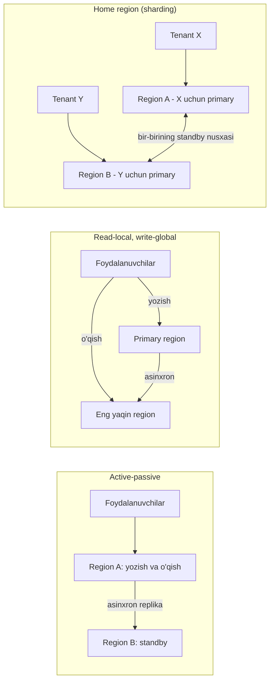
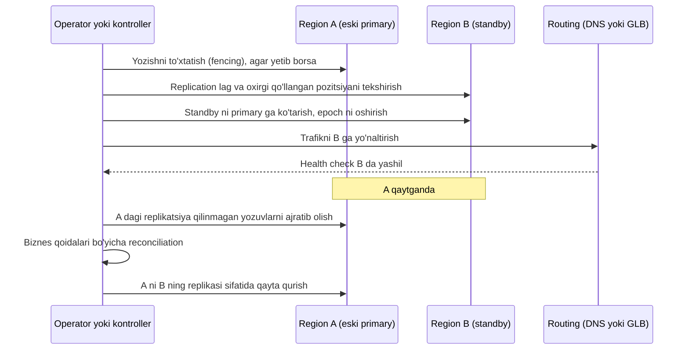

## Bu dars nima uchun kerak

Bitta region (yoki bitta data-markaz) ichida biz zonalar (availability zone) bo'yicha replikatsiya qilib, server, rack va hatto butun binoning ishdan chiqishiga chidamli tizim qura olamiz (61 va 69-darslar). Lekin uch xil sabab tizimni **bir nechta regionga** chiqishga majbur qiladi:

1. **Region darajasidagi nosozlik** - butun region yoki uning asosiy servisi soatlab ishlamay qolishi, tabiiy ofat, elektr tarmog'i, magistral optik kabel uzilishi.
2. **Latency** - foydalanuvchi va server orasidagi masofani fizika qisqartirmaydi. Toshkentdan Frankfurtgacha katta-aylana bo'yicha 4 671 km (haversine formulasi, Yer radiusi 6 371 km); optik tolada yorug'lik ~204 500 km/s, hisob uchun yaxlitlab 200 000 km/s tezlikda yuradi (2-dars), shuning uchun nazariy minimal round-trip `2 × 4 671 / 200 ≈ 47` ms, real marshrutlarda esa odatda ancha ko'p.
3. **Qonunchilik** - ma'lumot ma'lum bir mamlakatda saqlanishi talabi (78-dars).

Lekin multi-region - arxitekturadagi eng qimmat va eng murakkab qadamlardan biri. AWS ning multi-region qo'llanmasi buni ochiq aytadi: bitta region uchun yozilgan ilovani multi-region qilish ma'lumot izchilligi va latency muammolari tufayli juda qiyin, va resilience uchun multi-region qiladigan ko'pchilik workloadlarga **active-active kerak emas**.

Oldingi darslar bilan bog'liqlik: DNS va anycast (6-dars), replication va replication lag (26-dars), multi-leader va konfliktlar (27-dars), CAP va PACELC (34-dars), Raft va consensus (36-dars), CRDT (40-dars), RPO/RTO va failover (69-dars), cell lar (73-dars).

Bu darsdan keyin siz:

- multi-region ning to'rt asosiy topologiyasini (backup, active-passive, read-local/write-global, active-active) va ularning narx, RPO/RTO, murakkablik trade-offlarini bilasiz;
- asinxron va sinxron regionlararo replikatsiyaning fizik chegaralarini hisoblay olasiz;
- geo-routing usullarini (GeoDNS, latency-based DNS, anycast) va ularning failover tezligini taqqoslay olasiz;
- "home region" (data sharding by region) yondashuvini va u konfliktlarni qanday yo'qotishini tushuntira olasiz;
- failover jarayonini (split-brain, fencing, reconciliation) xavfsiz loyihalay olasiz.

## Fizika: regionlararo latency

Har qanday multi-region qarorining asosi - masofa. Optik tolada signal tezligi `c / n`, standart singlemode tolada n ≈ 1.467, ya'ni ~204 500 km/s (2-dars, Fiber Optic Association). Hisob uchun yaxlitlab 200 km/ms olamiz. Shuning uchun:

```
min_RTT ≈ 2 × masofa / 200 km/ms
```

Toshkentdan katta-aylana bo'yicha masofalar (shahar markazlari koordinatalari bo'yicha haversine hisobi, 10 km gacha yaxlitlangan) va nazariy minimal RTT:

| Manzil | Masofa | Nazariy minimal RTT |
|---|---|---|
| Samarqand | 270 km | 2.7 ms |
| Almati | 660 km | 6.6 ms |
| Mumbay | 2 500 km | 25 ms |
| Moskva | 2 790 km | 28 ms |
| Stokgolm | 4 020 km | 40 ms |
| Frankfurt | 4 670 km | 47 ms |

Bu - **pastki chegara**. Real kabellar to'g'ri chiziq bo'ylab yotmaydi, marshrutizatorlar va operatorlar orasidagi peering qo'shimcha kechikish beradi, shuning uchun real RTT har doim bundan katta va uning qanchaga kattaligi aniq marshrutga bog'liq. Rejalashtirishda shu jadvalni pastki chegara sifatida, real qiymatni esa o'z marshrutlaringizda `ping`/`mtr` bilan o'lchab oling.

Xulosa: agar har bir yozuv boshqa regionda sinxron tasdiqlanishi kerak bo'lsa, Toshkent-Frankfurt uchun har bir commit kamida bir necha o'n millisekund qo'shadi, ketma-ket bir nechta yozuvli tranzaksiyada esa bu ko'payadi. AWS qo'llanmasi buni shunday ifodalaydi: sinxron regionlararo replikatsiya bilan yozish latency si **bir tartibga** oshadi va buni tayyor ilovaga keyin "qo'shib" bo'lmaydi - timeout va retry strategiyasini qayta ko'rish kerak.

## CAP: regionlar orasida tanlov muqarrar

AWS qo'llanmasi CAP ga tayanadi (34-dars): regionlar orasida tarmoq bo'linishi (partition) bo'lishi tabiiy, shuning uchun regionlararo ma'lumot uchun **availability yoki consistency** tanlanadi:

- **Asinxron replikatsiya (availability).** Yozuv lokal regionda commit bo'ladi, keyin boshqa regionlarga yuboriladi. Yozish tez, lekin asosiy region ishdan chiqsa, hali yuborilmagan yozuvlar ko'rinmay qoladi (RPO > 0) va failover dan keyin **reconciliation** jarayoni kerak - va AWS bu jarayon baza tomonidan emas, **biznes mantiq** tomonidan hal qilinishini ta'kidlaydi.
- **Sinxron replikatsiya (consistency).** Yozuv bir nechta regionda tasdiqlanmaguncha commit bo'lmaydi. Ma'lumot yo'qolmaydi (RPO = 0), lekin latency oshadi va regionlardan biri sekinlashsa yozish to'xtaydi. Odatda uchta region va 2/3 kvorum kerak (Paxos/Raft, 35-36 darslar).

PACELC (34-dars) bu yerda to'liq ko'rinadi: bo'linish bo'lmaganda ham (Else) sinxron replikatsiya **latency** narxini to'laydi.

## To'rtta topologiya



### 1. Backup va restore (cold)

Boshqa regionda faqat backup lar. Eng arzon, lekin RTO soatlar (infratuzilmani ko'tarish, backupdan tiklash), RPO - oxirgi backup davri. Ko'p kichik tizimlar uchun to'g'ri boshlang'ich nuqta (69-dars).

### 2. Active-passive (warm / hot standby)

Bitta region trafikni qabul qiladi, ikkinchisi asinxron replika bilan tayyor turadi. "Pilot light" (faqat baza replikasi, compute minimal) yoki "warm standby" (kichik hajmda to'liq stack). Failover - standby ni primary ga ko'tarish va trafikni yo'naltirish. Asosiy xavf - **failover hech qachon mashq qilinmagan bo'lsa ishlamaydi**.

### 3. Read-local, write-global

Barcha yozuvlar bitta primary regionga boradi, o'qishlar eng yaqin regiondagi replikadan. O'qish ko'p, yozish kam bo'lgan workloadlar uchun. Muammo - **o'z yozuvini o'qish** (read-your-writes, 26-dars): foydalanuvchi profilni yangiladi va sahifa qayta yuklanganda eski versiyani ko'rdi, chunki o'qish replikadan. Yechimlar: yozuvdan keyin qisqa muddat o'sha foydalanuvchi o'qishlarini primary ga yo'naltirish yoki versiya/LSN ni klientda saqlab, replika shu versiyaga yetguncha kutish (72-darsdagi zookie g'oyasiga o'xshash).

AWS misoli: **Aurora Global Database** - bitta primary region va beshtagacha faqat o'qish uchun ikkilamchi region; Aurora User Guide ga ko'ra replikatsiya ajratilgan infratuzilma orqali, latency odatda bir soniyadan kam.

### 4. Active-active (multi-writer)

Har region ham o'qish, ham yozishni qabul qiladi. AWS DynamoDB blogi uchta shartni sanaydi: servislar stateless; istalgan regionda o'qish va yozish; regionlararo tez va ishonchli replikatsiya. Eng qiyin qismi - **konfliktlar**: bir xil yozuv ikki regionda bir vaqtda o'zgarsa nima bo'ladi?

**DynamoDB global tables** (MREC rejimi) misolida hujjatdagi faktlar:

- har region yozuvni qabul qiladi va fonda boshqalarga replikatsiya qiladi; yangi yozuv odatda bir soniya ichida tarqaladi, lekin bu latency uchun SLA yo'q;
- elementlar alohida replikatsiya qilinadi: bitta tranzaksiyada yangilangan elementlar birga yetib bormasligi mumkin, va masofaviy regionda yozuvlar tartibi manba regiondagidan farq qilishi mumkin;
- konflikt **last writer wins** bilan, element darajasida, vaqt belgisi bo'yicha hal qilinadi; yutqazgan yozuv jimgina yo'qoladi va bu CloudWatch yoki CloudTrail da qayd etilmaydi;
- MRSC rejimida esa tranzaksiya API lari umuman qo'llab-quvvatlanmaydi; MRSC jadvali aynan uchta regionda (uch replika yoki ikki replika + witness) joylashadi.

DynamoDB shuningdek **MRSC** (multi-region strong consistency) rejimini ham taklif qiladi: yozuv kamida yana bitta regionga sinxron replikatsiya qilinmaguncha muvaffaqiyatli deb qaytarilmaydi va har qanday faol regiondan strongly consistent o'qish mumkin. Bu yuqoridagi CAP tanlovining aynan boshqa tomoni - latency evaziga izchillik.

Last writer wins ning xavfi: element darajasida bo'lgani uchun, A regionda `status` ni, B regionda `driver_id` ni bir vaqtda o'zgartirsangiz, yutgan yozuv **butun elementni** belgilaydi. Bank balansi, ombor qoldig'i, ID hisoblagichi uchun bu qabul qilinmaydi - ular uchun CRDT (40-dars), yagona yozuvchi yoki sinxron kvorum kerak.

### Topologiyalar taqqoslamasi

| Topologiya | RPO | RTO | Yozish latency | Narx | Ilova o'zgarishi |
|---|---|---|---|---|---|
| Backup va restore | Soatlar (backup davri) | Soatlar | Bitta region | Eng past | Deyarli yo'q |
| Active-passive (async) | Soniyalar (replication lag) | Daqiqalar | Bitta region | O'rta | Failover jarayoni, reconciliation |
| Read-local, write-global | Soniyalar | Daqiqalar (yozish uchun) | Uzoq foydalanuvchilar uchun yuqori | O'rta-yuqori | Read-your-writes yechimi |
| Home region (sharded active-passive) | Soniyalar, faqat shard uchun | Daqiqalar, faqat shard uchun | Lokal (o'z regionida) | O'rta-yuqori | Routing, region pinning |
| Active-active (async, LWW) | Soniyalar + konflikt yo'qotishlari | Deyarli nol | Lokal | Yuqori | Idempotentlik, konflikt dizayni |
| Active-active (sync kvorum) | 0 | Deyarli nol | Yuqori (regionlararo RTT) | Eng yuqori | Timeout, retry, latency budjeti |

## Home region: konfliktni dizayn bilan yo'qotish

AWS qo'llanmasi ikki muhim maslahat beradi: (1) ko'p workloadlarga active-active kerak emas; (2) mijozlarni **shard** qilib, har shard uchun alohida primary region tanlash mumkin - "regionlarni cell sifatida ko'rish" (73-dars). DynamoDB qo'llanmasida bu "write to your region" rejimi: har bir element yoki ma'lumot to'plami o'z **home region**iga ega, yozish faqat o'sha regionda, boshqa regionlar o'qish uchun nusxa saqlaydi. Home region aniqlanishi mumkin:

- **ichki** - ma'lumotning o'zidan (masalan, partition kalitida region kodi);
- **kelishilgan** - alohida global servis tayinlaydi;
- **jadval bo'yicha** - har region uchun alohida jadval.

Natija: har bir yozuv uchun **yagona yozuvchi** bor, shuning uchun last-writer-wins konfliktlari umuman bo'lmaydi va regionning ichida kuchli izchillik saqlanadi. Region o'chsa, faqat unga tegishli shard boshqa regionga ko'chiriladi (failover), qolganlar ta'sirlanmaydi. Bu active-active ning latency afzalligini (har kim o'z regionida yozadi) va active-passive ning soddaligini birlashtiradi.

B2B SaaS uchun bu juda tabiiy: **tenant = shard**, va tenantning home region i shartnoma, foydalanuvchilar joylashuvi va qonunchilik bilan belgilanadi (78-dars).

## Geo-routing: foydalanuvchini qaysi regionga yuborish

| Usul | Qanday ishlaydi | Failover tezligi | Nozik nuqtalar |
|---|---|---|---|
| GeoDNS (geolocation) | Resolver joylashuviga qarab turli IP qaytarish | DNS TTL + resolver cache (soniyalar-daqiqalar) | Resolver joylashuvi foydalanuvchiniki bilan mos kelmasligi mumkin (EDNS Client Subnet yordam beradi) |
| Latency-based DNS | O'lchangan latency bo'yicha eng tez regionni qaytarish | TTL ga bog'liq | Deterministik emas: bir foydalanuvchi turli vaqtda turli regionga tushishi mumkin |
| Weighted DNS | Foizlar bo'yicha taqsimlash | TTL ga bog'liq | Migratsiya va canary uchun qulay |
| Anycast | Bir xil IP bir nechta joydan BGP orqali e'lon qilinadi, tarmoq eng yaqiniga yo'naltiradi | BGP konvergensiyasi (soniyalar) | O'z AS va IP bloklari yoki provayder kerak; uzoq TCP sessiyalari marshrut o'zgarsa uzilishi mumkin |
| Ilova darajasida (home region redirect) | Login dan keyin klientga tenant regioni URL i beriladi | Ilova boshqaradi | Eng aniq, ma'lumot joylashuvini kafolatlaydi |

AWS Route 53 routing siyosatlari: simple, weighted, geolocation, latency, IP-based, failover, multivalue answer, geoproximity. AWS ning DR blogi ta'kidlaydi: geolocation routing so'rovlarni **deterministik** taqsimlaydi - bu ma'lum foydalanuvchilar ma'lumotini ma'lum regionda saqlash (data residency) uchun kerak; latency routing esa faqat ishlash uchun.

**Anycast** ni Cloudflare misolida: bir xil IP manzillar barcha data-markazlardan e'lon qilinadi va tarmoqning o'zi so'rovni eng yaqin data-markazga olib boradi. Bu latency ni kamaytiradi va DDoS trafigini ko'plab joylarga tarqatadi (80-dars). Lekin anycast ni o'zingiz qurish uchun o'z uskunangiz, operatorlar bilan to'g'ridan-to'g'ri munosabat va marshrutlarni sozlash kerak.

DNS asosidagi failover ning yashirin muammosi: TTL 60 soniya bo'lsa ham, ba'zi resolverlar va klient kutubxonalari (masalan, JVM ning eski DNS cache sozlamalari, mobil ilovadagi ulanish pool lari) eski IP ni ancha uzoq ushlab turadi. Shuning uchun failover dan keyin eski regionga trafik bir muddat davom etadi - eski region "o'lik" bo'lsa, bu foydalanuvchilar uchun uzilish. Yechim: anycast yoki global load balancer (bitta IP ortida regionlar), klientlarda qisqa ulanish umri va qayta resolve qilish.

## Failover: eng xavfli operatsiya

### Kim qaror qiladi

Avtomatik regionlararo failover jozibali, lekin xavfli: regionlar orasidagi tarmoq uzilishi "boshqa region o'ldi" kabi ko'rinadi. Agar ikkala region ham o'zini primary deb e'lon qilsa - **split-brain**: ikkala regionda mustaqil yozuvlar, keyin ularni birlashtirish (reconciliation) og'riqli yoki imkonsiz. Shu sababli ko'p tashkilotlar regionlararo failover ni **inson tasdiqlaydigan, lekin to'liq avtomatlashtirilgan runbook** bilan qiladi: qaror - inson, bajarish - bitta tugma.

Agar avtomatik bo'lsa - qaror **uchinchi joydagi** kuzatuvchi yoki kvorum bilan (uchinchi region yoki witness), va eski primary ni **fencing** bilan yozishdan to'xtatish (38-dars): masalan, routing jadvalida tenant regionini o'zgartirishdan oldin eski regionning yozish huquqini bekor qilish yoki epoch/fencing token bilan eski primary yozuvlarini rad etish.

### Failover ketma-ketligi (asinxron active-passive)



Muhim nuqtalar:

- **Replikatsiya qilinmagan yozuvlar.** AWS qo'llanmasi: asinxron replikatsiyada asosiy region ishdan chiqqanda, yuborilishi kutilayotgan yozuvlar bo'lishi ehtimoli yuqori. Ular yo'qolmagan, lekin eski regionda "qamalib" qolgan. Region qaytgach ularni topish va biznes qoidalari bo'yicha qayta qo'llash (yoki rad etish) kerak. Event-driven arxitektura (46-dars) bu yerda yordam beradi: holatni hodisalarni qayta o'ynash bilan tiklash mumkin.
- **Navbat va streaming.** Kafka kabi tizimlar ma'lumotni bitta regionda buferlaydi; failover da kiruvchi oqimlarni yangi regionga yo'naltirish va eski regiondagi yetkazilmagan xabarlarni keyin qayta ishlash mexanizmi kerak.
- **Aurora PostgreSQL** misolida RPO ni boshqarish: `rds.global_db_rpo` parametri bilan barcha ikkilamchi klasterlar maqsad RPO dan orqada qolsa, primary da commitlar bloklanadi. Ya'ni RPO kafolati evaziga mavjudlik pasayadi - CAP ning yana bir amaliy ko'rinishi.
- **Failback** (eski regionga qaytish) - failover dan ham xavfliroq, chunki odatda kamroq mashq qilinadi.

### Mashq qilinmagan failover ishlamaydi

Netflix 2013 yilda Shimoliy Amerika servislarini us-east-1 va us-west-2 da active-active qilgan: odatiy holatda foydalanuvchilar geo-DNS bilan eng yaqin regionga yo'naltirilgan, blog bo'yicha bu "rough split of 50/50%" bergan, Cassandra asinxron replikatsiya qilgan (sinovda bir regionda yozilgan 1 million yozuv 500 ms dan keyin boshqa regionda muvaffaqiyatli o'qilgan), cache lar regionlar orasida replikatsiya qilinmasdan, SQS orqali invalidatsiya xabarlari bilan yangilangan. Ular "split-brain" testlari (regionlararo aloqani uzish) va "Chaos Kong" mashqi (trafikning ko'p qismini us-east-1 dan us-west-2 ga bosqichma-bosqich ko'chirib, 24 soatdan ortiq shu holatda ushlab turish) bilan buni muntazam tekshirgan. Saboq: multi-region - bu arxitektura emas, **mashq qilinadigan jarayon** (70-dars).

## Global izchil baza: Spanner

Agar haqiqatan ham global miqyosda kuchli izchil tranzaksiyalar kerak bo'lsa, Google Spanner (OSDI 2012) shu muammoni yechgan birinchi tizim sifatida taqdim etilgan: ma'lumotni global taqsimlash va externally consistent taqsimlangan tranzaksiyalar. Uning kaliti - soat noaniqligini ochiq ko'rsatadigan vaqt API si (TrueTime, 32-dars) va Paxos guruhlari. Lekin bu ham fizikani yengmaydi: regionlararo kvorum yozuvi baribir regionlararo RTT ni to'laydi. Spanner ning afzalligi - ilova dasturchisiga bu murakkablikni yashirishi, lekin latency budjetini emas.

## iQuariX kontekstida

Masala sharti: iQuariX mijozlari asosan O'zbekistonda, keyin Qozog'iston va boshqa Markaziy Osiyo mamlakatlarida. Ikki talab bor: O'zbekiston fuqarolari shaxsiy ma'lumoti O'zbekistonda saqlanishi (78-dars) va regional uzilishga chidamlilik.

Taklif:

1. **Home region modeli, tenant = shard.** O'zbek tenantlar uchun primary - Toshkentdagi data-markaz; qozog'istonlik tenantlar uchun - Almatidagi. Har tenant routing jadvalida `tenant_id -> home_region` (73-darsdagi cell router bilan bir xil g'oya).
2. **Region ichida zonaviy chidamlilik** - Toshkentda ikki mustaqil data-markaz (turli elektr va aloqa kanallari bilan), ular orasida sinxron yoki yarim sinxron PostgreSQL replikatsiyasi; masala shartida masofa 10-30 km, demak nazariy minimal RTT `2 × 30 / 200 = 0.3` ms, uskunalar bilan ham millisekund tartibida - sinxron replikatsiya narxi kichik.
3. **Regionlararo DR** - har bir regionning asinxron nusxasi boshqa joyda. Lekin data residency talabi bo'yicha O'zbekiston ma'lumotining nusxasi ham O'zbekiston ichida bo'lishi kerak bo'lishi mumkin (masalan, Samarqanddagi ikkinchi data-markaz, 270 km, nazariy minimal RTT 2.7 ms). Qaysi ma'lumot sinfi uchun bu majburiy ekani 78-darsda.
4. **Trekerlar** - ingest gateway lar har regionda; treker DNS nomi yoki IP orqali ulanadi. Failover da trekerlarni boshqa regionga o'tkazish qiyin (eski firmware IP ni qattiq kodlagan bo'lishi mumkin) - shuning uchun ingest uchun anycast yoki regionda bir nechta IP va treker konfiguratsiyasida zaxira server manzili.
5. **Video** - eng katta hajm (TB), regionlararo replikatsiya qimmat (79-dars): faqat muhim kliplar (avariya, hodisalar) boshqa regionga nusxalanadi, qolgani faqat lokal.

Hisob: 60 000 treker, har biri 10 s da 100 baytlik nuqta. Regionlararo asinxron replikatsiya trafigi `6 000 × 100 B = 600 KB/s ≈ 4.8 Mbit/s` - arzimas. Video: 2 000 kamera × 1 Mbit/s = 2 Gbit/s; to'liq regionlararo replikatsiya 30 kunlik oyda `2 Gbit/s × 2 592 000 s / 8 ≈ 648 TB` - bu juda qimmat va kanal sig'imini talab qiladi. Shuning uchun "hammasini replikatsiya qilish" emas, ma'lumot sinfi bo'yicha qaror.

## Ko'p uchraydigan xatolar

1. **Active-active ni sukut bo'yicha tanlash.** Ko'p hollarda home region yoki active-passive yetarli va ancha sodda.
2. **Last-writer-wins ni hamma ma'lumotga qo'llash.** Hisoblagich, balans, qoldiq uchun jim yo'qotishlar.
3. **Regionlararo sinxron chaqiruvlar zanjiri.** Bitta foydalanuvchi so'rovi ichida 5 ta regionlararo chaqiruv = 5 × RTT.
4. **DNS TTL ga to'liq ishonish.** Klientlar va resolverlar eski IP ni ushlab turadi.
5. **Failover ni mashq qilmaslik** va failback ni umuman o'ylamaslik.
6. **Split-brain ga qarshi fencing yo'q.** Ikkala region ham primary deb yozadi.
7. **Faqat bazani replikatsiya qilish.** Secretlar, konfiguratsiya, image registry, DNS, sertifikatlar, navbatlar ham ikkinchi regionda bo'lishi kerak.
8. **Data residency ni unutish.** Latency yoki DR uchun ma'lumotni boshqa mamlakatga nusxalash qonunni buzishi mumkin.

## Xulosa

- Multi-region uch sababdan: region nosozligi, latency va qonunchilik. U eng qimmat arxitektura qadamlaridan biri.
- Regionlararo latency fizika bilan cheklangan: ~200 km/ms, RTT ≈ 2 × masofa / 200; bu pastki chegara, real qiymat marshrutga bog'liq va o'lchanadi.
- Regionlar orasida availability (asinxron, RPO > 0, reconciliation) va consistency (sinxron kvorum, yuqori latency) o'rtasida tanlov muqarrar.
- Topologiyalar: backup/restore, active-passive, read-local/write-global, home region, active-active. Ko'pchilik uchun home region yoki active-passive yetarli.
- Home region (tenant = shard) yagona yozuvchini ta'minlab, konfliktlarni dizayn bilan yo'qotadi.
- Geo-routing: GeoDNS deterministik (residency uchun), latency DNS ishlash uchun, anycast tez failover va DDoS tarqatish uchun.
- Failover - fencing, reconciliation va muntazam mashq talab qiladigan jarayon.

## Amaliy topshiriq

iQuariX uchun multi-region strategiyasini loyihalang. Kontekst: 300 tenant (250 tasi O'zbekiston, 50 tasi Qozog'iston), O'zbekiston ma'lumoti O'zbekistonda qolishi kerak, maqsad - bitta data-markaz yoki shahar darajasidagi uzilishda RTO 30 daqiqa, RPO 1 daqiqa (telemetriya uchun) va RPO 0 (billing va shartnoma ma'lumotlari uchun).

1. Topologiyani tanlang va asoslang (jadval bilan): qaysi ma'lumot sinfi uchun qaysi replikatsiya (sinxron, asinxron, yo'q).
2. Data-markazlar joylashuvi va ular orasidagi minimal RTT ni hisoblang. Billing uchun RPO 0 ni qanday ta'minlaysiz va bu yozish latency siga qancha qo'shadi?
3. Geo-routing: dispetcherlar (brauzer), mobil ilova va trekerlar uchun alohida - qanday yo'naltiriladi va failover da qanday o'tadi? DNS TTL va klient cache muammosini qanday yechasiz?
4. Failover runbook: qadamlar, kim qaror qiladi, fencing qanday, replikatsiya qilinmagan telemetriya va hodisalarni qanday reconciliation qilasiz.
5. Video uchun replikatsiya siyosati va oylik trafik/hajm hisob-kitobi.
6. Mashq rejasi: qanchalik tez-tez, qanday stsenariylar (split-brain, failback), muvaffaqiyat mezonlari.

Yaxshi javobda bo'lishi kerak bo'lgan narsalar:

- ma'lumot sinfi bo'yicha har xil RPO va replikatsiya usuli;
- RTT bo'yicha raqamli hisob va sinxron replikatsiya narxi;
- tenant = shard (home region) yoki active-passive tanlovining asoslanishi;
- split-brain ga qarshi fencing;
- data residency cheklovi DR rejasiga qanday ta'sir qilishi;
- failover va failback mashqlari.

Javobni pastdagi maydonga yozib, chatga yuboring.

## Manbalar

- AWS Prescriptive Guidance. [Multi-Region fundamental 2: Understanding the data](https://docs.aws.amazon.com/prescriptive-guidance/latest/aws-multi-region-fundamentals/fundamental-2.html) - CAP, asinxron va sinxron replikatsiya, read local write global, regionlarni cell sifatida.
- AWS. [DynamoDB global tables: key facts about MREC](https://docs.aws.amazon.com/amazondynamodb/latest/developerguide/bp-global-table-design.html) va [Write to your Region mode](https://docs.aws.amazon.com/prescriptive-guidance/latest/dynamodb-global-tables/write-to-your-region.html) - last writer wins, home region.
- AWS. [Using switchover or failover in Amazon Aurora Global Database](https://docs.aws.amazon.com/AmazonRDS/latest/AuroraUserGuide/aurora-global-database-disaster-recovery.html) - RPO boshqaruvi va failover; [Aurora global database overview (User Guide manbasi, GitHub)](https://github.com/awsdocs/amazon-aurora-user-guide/blob/main/doc_source/aurora-global-database.md) - beshtagacha ikkilamchi region, odatda bir soniyadan kam lag.
- AWS Architecture Blog. [Disaster Recovery Architecture on AWS, Part IV: Multi-site Active/Active](https://aws.amazon.com/blogs/architecture/disaster-recovery-dr-architecture-on-aws-part-iv-multi-site-active-active/) - geolocation va latency routing.
- Netflix Technology Blog. [Active-Active for Multi-Regional Resiliency](https://netflixtechblog.com/active-active-for-multi-regional-resiliency-c47719f6685b), 2013 - geo-DNS taqsimoti, Cassandra 1 million yozuv / 500 ms testi, EVCache invalidatsiyasi SQS orqali, split-brain va Chaos Kong.
- Cloudflare. [A Brief Anycast Primer](https://blog.cloudflare.com/a-brief-anycast-primer/) - anycast, latency va DDoS.
- James C. Corbett va boshq. [Spanner: Google's Globally-Distributed Database](https://research.google/pubs/spanner-googles-globally-distributed-database-2/), OSDI 2012.
- Martin Kleppmann, Chris Riccomini. Designing Data-Intensive Applications, 2-nashr, O'Reilly, 2026 - 6-bob "Replication" (multi-leader, konfliktlar, read-your-writes) va 10-bob "Consistency and Consensus".
- Fiber Optic Association. [Fiber FAQs](https://foa.org/FiberFAQs.html) - tolada yorug'lik tezligi (SMF-28 uchun n = 1.467).
