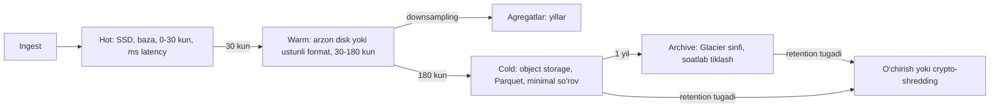
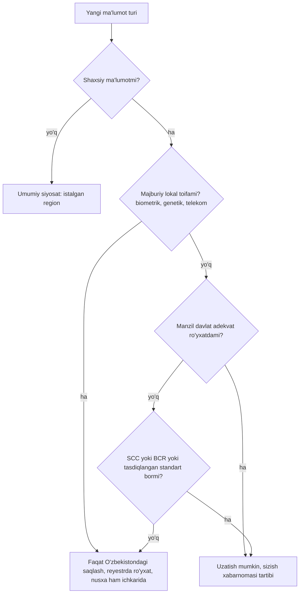

## Bu dars nima uchun kerak

Ko'p tizimlar ma'lumotni qanday **yozish** va **o'qish**ni yaxshi loyihalaydi, lekin uning **hayot oxiri**ni umuman o'ylamaydi. Natija bir necha yildan keyin keladi: baza 30 TB ga yetgan, 90 foizi hech kim o'qimaydigan eski telemetriya; `DELETE FROM points WHERE ts < ...` so'rovi bazani bir kecha yiqitadi; mijoz shartnomani bekor qilib "ma'lumotimizni o'chiring" deydi va hech kim backuplarda nima borligini bilmaydi; yangi qonun ma'lum ma'lumot turini mamlakat ichida saqlashni talab qiladi va u bulutda boshqa mamlakatdagi regionda yotibdi.

Data lifecycle - ma'lumot yaratilganidan to yo'q qilinishigacha bo'lgan yo'lni **oldindan** loyihalash:

1. **Retention** - har bir ma'lumot sinfi qancha saqlanadi va kim bu muddatni belgilaydi (biznes, qonun, mijoz shartnomasi).
2. **Tiering va arxivlash** - ma'lumot "sovigan" sari arzonroq va sekinroq saqlashga ko'chadi.
3. **O'chirish** - muddati tugagan yoki o'chirish talab qilingan ma'lumotni barcha nusxalardan (replika, cache, indeks, backup, analitika) haqiqatan yo'q qilish.
4. **Data residency** - ma'lumot jismonan qaysi mamlakatda saqlanishi va qayerga uzatilishi mumkinligi.

Oldingi darslar bilan bog'liqlik: hisob-kitob (1-2 darslar), OLTP va OLAP (16-dars), CDC (48-dars), object storage (60-dars), backup va DR (69-dars), multi-tenancy (73-dars), envelope encryption va crypto-shredding (74-dars), multi-region va home region (77-dars). Time-series saqlash va downsampling 81-darsda chuqur.

**Muhim eslatma:** bu darsdagi huquqiy ma'lumotlar rasmiy manbalardan (lex.uz) olingan va 2026-yil oktabr holatiga ko'ra tekshirilgan, lekin bu **yuridik maslahat emas**. Qonunchilik o'zgaradi, rasmiy matnlar o'zbek tilida va ko'p sharhlar norasmiy tarjimalarga tayanadi. Aniq loyiha uchun malakali yurist bilan maslahatlashing.

Bu darsdan keyin siz:

- ma'lumot sinflari bo'yicha retention siyosatini va uning saqlash narxiga ta'sirini hisoblay olasiz;
- hot/warm/cold tiering, downsampling va arxivlash arxitekturasini loyihalay olasiz;
- katta hajmdagi ma'lumotni bazani yiqitmasdan o'chirish usullarini (partition drop, TTL, crypto-shredding) bilasiz;
- "o'chirish" ning backup, replika va analitika tizimlarida nima anglatishini tushunasiz;
- O'zbekistonning shaxsiy ma'lumotlar to'g'risidagi qonunidagi lokalizatsiya talabining tarixi va 2026 yildagi holatini bilasiz va uni arxitekturaga aylantira olasiz.

## Ma'lumot sinflari va retention siyosati

Birinchi qadam - barcha ma'lumotni **sinflarga** ajratish. "Hamma narsani abadiy saqlaymiz" ham, "hamma narsani 90 kun" ham noto'g'ri; har sinfning o'z egasi, maqsadi va muddati bor.

| Ma'lumot sinfi | Misol | Kim muddatni belgilaydi | Tipik yondashuv |
|---|---|---|---|
| Xom telemetriya | Har 10 s dagi GPS nuqtasi | Biznes (mahsulot), mijoz shartnomasi | Qisqa (masalan 90 kun-1 yil) xom, keyin agregat |
| Agregatlar | Kunlik yurilgan masofa, yoqilg'i sarfi | Biznes, hisobot talablari | Uzoq (yillar) |
| Hodisalar | Yoqilg'i to'kish, avariya, tezlik oshirish | Biznes, ehtimoliy nizolar | Uzoq, ba'zan legal hold |
| Video | Kabina va yo'l kamerasi | Saqlash narxi, shaxsiy ma'lumot qoidalari | Qisqa aylanma (kunlar-haftalar), hodisa kliplari uzoqroq |
| Moliyaviy va shartnoma | Hisob-fakturalar, to'lovlar | Soliq va buxgalteriya qonunchiligi | Qonunda belgilangan muddat |
| Shaxsiy ma'lumot | Haydovchi F.I.Sh, telefon, pasport | Shaxsiy ma'lumot qonuni, rozilik | Maqsadga erishilguncha |
| Loglar va audit | API loglari, kirish auditi | Xavfsizlik, compliance | Operatsion loglar qisqa, audit uzoq |
| Backuplar | Baza snapshotlari | DR (69-dars), o'chirish talablari bilan ziddiyat | Aylanma (masalan 35 kun) |

O'zbekistonning "Shaxsga doir ma'lumotlar to'g'risida"gi qonuni (2019-yil 2-iyuldagi O'RQ-547) ham saqlash muddati tamoyilini belgilaydi: muddat to'plash va ishlov berish maqsadlariga erishilishi bilan aniqlanadi, va ma'lumot identifikatsiya qilinadigan shaklda faqat shu maqsadlar talab qilgancha saqlanadi; maqsadga erishilganda, rozilik qaytarib olinganda yoki rozilik muddati tugaganda ma'lumot yo'q qilinishi kerak (qonunning norasmiy tarjimasidagi 10 va 17-moddalar bo'yicha). Yevropa GDPR dagi "storage limitation" tamoyili ham shu mantiqda.

### Hisob-kitob: retention narxi

60 000 mashina, har biri har 10 s da nuqta, siqilgandan keyin nuqta ~40 bayt deylik (time-series bazalar ustunli siqish bilan bunga erishishi mumkin, 81-dars).

```
6 000 nuqta/s × 86 400 s = 518 400 000 nuqta/kun
518.4 mln × 40 B ≈ 20.7 GB/kun
```

| Xom retention | Hajm (bitta nusxa) | 3 nusxa (replika) bilan |
|---|---|---|
| 90 kun | ~1.9 TB | ~5.6 TB |
| 1 yil | ~7.6 TB | ~22.7 TB |
| 5 yil | ~37.8 TB | ~113 TB |

Endi downsampling: xom 90 kun, keyin 1 daqiqalik agregat (6 baravar kam nuqta, lekin har agregatda bir nechta maydon - deylik 3 baravar kichrayadi) 2 yil, keyin kunlik agregat abadiy. Bu 5 yillik xom saqlashga nisbatan hajmni bir tartibga qisqartiradi. Retention siyosati - saqlash narxining **eng katta richagi** (79-dars).

## Tiering: hot, warm, cold, archive

Ma'lumotga murojaat chastotasi yoshiga qarab keskin kamayadi. Dispetcher bugungi va kechagi marshrutni har kuni ko'radi, o'tgan oyni - hisobot uchun oyda bir marta, 2 yil oldingisini - faqat nizo yoki audit bo'lganda.



Object storage misolida (AWS S3 hujjati bo'yicha) sinflar va ularning cheklovlari:

| Sinf | Murojaat | Minimal saqlash muddati | Minimal hisoblanadigan obyekt | Izoh |
|---|---|---|---|---|
| S3 Standard | Millisekund | Yo'q | Yo'q | Tez-tez o'qiladigan |
| S3 Standard-IA | Millisekund | 30 kun | 128 KB | Har GB o'qish uchun to'lov |
| S3 Glacier Instant Retrieval | Millisekund | 90 kun | 128 KB | Chorakda bir o'qiladigan arxiv |
| S3 Glacier Flexible Retrieval | Daqiqalar-soatlar | 90 kun | Har obyektga ~40 KB metadata qo'shiladi | Avval restore kerak |
| S3 Glacier Deep Archive | Soatlar | 180 kun | Har obyektga ~40 KB metadata qo'shiladi | Eng arzon saqlash |

Bu jadvaldagi cheklovlar dizaynga bevosita ta'sir qiladi:

- **Mayda obyektlar tuzog'i.** Har bir GPS nuqtasini alohida obyekt qilib arxivlash - 128 KB minimal hisob yoki 40 KB metadata tufayli saqlash narxi o'nlab-yuzlab baravar oshadi. To'g'ri yondashuv: kunlik/tenant bo'yicha **katta fayllarga** (Parquet, siqilgan, 100 MB-1 GB) yig'ish.
- **Minimal muddat tuzog'i.** 90 kunlik minimal muddatli sinfga 30 kunlik ma'lumot qo'yib o'chirsangiz, baribir 90 kun uchun to'laysiz.
- **Tiklash vaqti.** Deep Archive dan tiklash soatlar oladi - bu RTO talablariga (69-dars) mos kelishi kerak.

Lifecycle qoidalari (S3 lifecycle, bazada partition boshqaruvi) bu o'tishlarni **avtomatik** qiladi; qo'lda arxivlash har doim unutiladi.

## O'chirish: eng qiyin qism

### Bazada katta hajmni o'chirish

PostgreSQL da `DELETE FROM points WHERE ts < now() - interval '90 days'` - eng yomon usul: har bir qator alohida o'chiriladi va WAL ga yoziladi, o'lik qatorlar (dead tuples) qoladi va VACUUM ularni tozalashi kerak, jadval va indekslar shishadi (bloat), replikalar WAL ni qabul qilishda orqada qoladi (replication lag, 26-dars).

PostgreSQL hujjati to'g'ridan-to'g'ri yechimni beradi: agar bulk o'chirish partition dizaynida hisobga olingan bo'lsa, partitionni `DROP TABLE` yoki `ALTER TABLE ... DETACH PARTITION` bilan olib tashlash ommaviy operatsiyadan ancha tez va bulk `DELETE` keltiradigan VACUUM yukini butunlay yo'qotadi. Millionlab qator deyarli bir zumda o'chadi, chunki har qator alohida o'chirilmaydi. Nozik nuqta: `DROP TABLE` ota jadvalda `ACCESS EXCLUSIVE` lock oladi; `DETACH PARTITION CONCURRENTLY` esa yengilroq lock bilan ishlaydi.

Demak retention **partition kaliti bilan birga** loyihalanadi:

- telemetriya - vaqt bo'yicha partition (kunlik yoki haftalik); retention = eski partitionlarni drop qilish;
- multi-tenant (73-dars) da agar tenantlar turli retention ga ega bo'lsa (Basic 90 kun, Enterprise 3 yil), bitta vaqt partitioni ichida ularni ajratish qiyin: yo tenant guruhi + vaqt bo'yicha ikki darajali partition, yo turli retention guruhlari uchun alohida jadvallar.

Time-series bazalarda bu o'rnatilgan: TimescaleDB da chunk lar va retention policy (eski chunk larni drop qilish), ClickHouse da `TTL` ifodasi va partition drop (81-dars). Cassandra kabi LSM tizimlarida (13-dars) TTL tombstone lar yaratadi va ular compaction gacha diskda qoladi - ko'p tombstone o'qishni sekinlashtiradi; time-window compaction strategiyasi bilan butun SSTable larni tushirish samaraliroq.

### "O'chirildi" nimani anglatadi

Tenant shartnomani tugatdi yoki haydovchi o'z ma'lumotini o'chirishni so'radi. Ma'lumot qayerlarda?

| Joy | O'chirish usuli | Muammo |
|---|---|---|
| Asosiy baza | `DELETE` yoki partition drop | Oddiy |
| Replikalar | Replikatsiya orqali avtomatik | Kechikish bilan |
| Cache (Redis) | Invalidatsiya yoki TTL | Unutilsa eski ma'lumot qaytadi |
| Qidiruv indeksi (Elasticsearch) | Alohida o'chirish yoki CDC orqali | Ko'pincha unutiladi |
| Analitika (DWH, ClickHouse, Parquet fayllar) | Alohida pipeline | Immutable fayllarni qayta yozish kerak |
| Kafka topiclar | Retention tugaguncha yoki compaction + tombstone (44-dars) | Retention davomida qoladi |
| Loglar | Log retention | Loglarda shaxsiy ma'lumot bo'lmasligi kerak edi |
| Backuplar | Backup aylanishi tugaguncha qoladi | Bitta yozuvni backupdan o'chirib bo'lmaydi |

Backup muammosi uchun amaliy yondashuvlar:

1. **Backup retention qisqa va hujjatlashtirilgan** (masalan 35 kun): "ma'lumot asosiy tizimdan darhol, backuplardan 35 kun ichida yo'qoladi". Va backupdan tiklanganda o'chirish ro'yxati qayta qo'llanadi (tombstone jurnali).
2. **Crypto-shredding** (74-dars): har tenant (yoki har foydalanuvchi) ma'lumoti o'z kaliti bilan shifrlangan bo'lsa, kalitni o'chirish barcha nusxalarni - backup, arxiv, replika - bir vaqtda o'qib bo'lmaydigan qiladi. Kalitlar kichik va bitta joyda (KMS), ma'lumot esa hamma joyda. Bu B2B SaaS da tenantni o'chirish uchun eng kuchli usul.
3. **Legal hold.** Ba'zan aksincha - ma'lumotni **o'chirmaslik** kerak: sud nizosi, tergov, audit. Retention avtomatikasi legal hold bayrog'ini hurmat qilishi kerak; aks holda tizim dalilni avtomatik yo'q qiladi.

Yevropa GDPR ning 17-moddasi (o'chirish huquqi) ham mutlaq emas: qonuniy majburiyatni bajarish yoki huquqiy da'volarni himoya qilish uchun zarur bo'lgan ma'lumot istisno qilinadi. Ya'ni "o'chirish" tizimi qaysi ma'lumot qaysi asosda saqlanayotganini bilishi kerak.

## Data residency: ma'lumot qayerda yotadi

Uch tushunchani ajrating:

- **Data residency** - ma'lumot jismonan qaysi mamlakat/regionda saqlanadi.
- **Data localization** - qonun ma'lum ma'lumotni mamlakat ichida saqlashni **majburlaydi**.
- **Transchegaraviy uzatish (cross-border transfer)** - ma'lumotni mamlakatdan tashqariga yuborish shartlari (nusxa, so'rov, support xodimining kirishi ham uzatish bo'lishi mumkin).

### O'zbekiston: qonunchilik tarixi va 2026-yil holati

Quyidagi faktlar lex.uz dagi rasmiy hujjatlar va ularning norasmiy tarjimalari asosida (2026-yil oktabr holatiga):

**1. Asosiy qonun.** "Shaxsga doir ma'lumotlar to'g'risida"gi O'zbekiston Respublikasi Qonuni, 2019-yil 2-iyuldagi O'RQ-547, 2019-yil 1-oktabrdan kuchga kirgan. U shaxsiy ma'lumotlar bazalarining Davlat reyestrini, transchegaraviy uzatish qoidalarini (15-modda: adekvat himoya ta'minlaydigan davlatlarga uzatish; adekvat himoya bo'lmagan davlatga esa subyekt roziligi, konstitutsiyaviy tuzum va boshqa muhim manfaatlarni himoya qilish yoki xalqaro shartnoma asosida) va ma'lumotlarni yo'q qilish shartlarini belgilaydi.

**2. 2021-yilgi lokalizatsiya talabi.** 2021-yil 14-yanvardagi O'RQ-666 Qonun (bir qator qonun hujjatlariga o'zgartirishlar) 13-moddasi bilan qonunga **27¹-modda** qo'shilgan. Uning mazmuni (norasmiy tarjima bo'yicha): O'zbekiston fuqarolarining shaxsiy ma'lumotlariga axborot texnologiyalari yordamida, jumladan internetda ishlov berishda, mulkdor va (yoki) operator ularni yig'ish, tizimlashtirish va saqlashni O'zbekiston hududida jismonan joylashgan texnik vositalarda va Davlat reyestrida ro'yxatdan o'tgan bazalarda amalga oshirishi shart. O'RQ-666 rasmiy e'lon qilingan kuni (2021-yil 15-yanvar) kuchga kirgan, lekin aynan bu modda (13-modda) kuchga kirgandan uch oy o'tib - ya'ni 2021-yil aprel o'rtalaridan amal qila boshlagan. Bu talab barcha shaxsiy ma'lumot turlariga tegishli edi va xalqaro servislar uchun jiddiy to'siq hisoblangan.

**3. 2026-yilgi o'zgarish: lokalizatsiya toraytirildi.** 2026-yil 26-martdagi O'RQ-1125 Qonun ("Shaxsga doir ma'lumotlar to'g'risida"gi Qonunga o'zgartirish va qo'shimcha kiritish haqida", rasmiy e'lon qilingan kundan, lex.uz bo'yicha 2026-yil 27-martdan kuchga kirgan) 27¹-moddani **to'liq yangi tahrirda** bayon qilgan:

- O'zbekiston hududida **majburiy saqlanishi** kerak bo'lgan shaxsiy ma'lumotlar uch toifa bilan cheklangan: **biometrik** ma'lumotlar, **genetik** ma'lumotlar va O'zbekistonda faoliyat yurituvchi **telekommunikatsiya operatorlari xizmatlaridan foydalanuvchi** jismoniy shaxslar ma'lumotlari.
- Boshqa shaxsiy ma'lumotlar xorijda saqlanishi va ishlov berilishi mumkin, agar quyidagilardan **biri** bajarilsa: xorijiy davlat adekvat himoya ta'minlovchi deb tan olingan; operator vakolatli organ talablariga mos standart shartnoma bandlari (SCC) yoki majburiy korporativ qoidalarni (BCR) qabul qilib, ularga amal qiladi; operator vakolatli organ tasdiqlagan ro'yxatdagi xalqaro ma'lumot boshqaruvi va saqlash standartlariga amal qiladi.
- Adekvat davlatlar ro'yxatini Vazirlar Mahkamasi belgilaydi.
- 20-moddaning birinchi qismi ham yangilangan: Davlat reyestrida ro'yxatdan o'tkazilishi kerak bo'lgan bazalar - 27¹-moddaning ikkinchi qismiga ko'ra O'zbekistonda saqlanishi shart bo'lgan bazalar.

**4. Adekvat davlatlar ro'yxati.** Vazirlar Mahkamasining 2026-yil 29-iyuldagi 415-son qarori (2026-yil 3-avgustdan kuchga kirgan) bilan **49 ta** davlat va hudud ro'yxati tasdiqlangan: Yevropa Ittifoqi davlatlari, Buyuk Britaniya, Shveytsariya, Norvegiya, Yaponiya, Janubiy Koreya, Singapur, Kanada, Isroil, Rossiya va boshqalar; AQSh esa izoh bilan - EU-US Data Privacy Framework ishtirokchisi bo'lgan kompaniyalar uchun. Qarorga ko'ra ro'yxatni yangilash bo'yicha takliflarni Ichki ishlar vazirligining Migratsiya va personallashtirish departamenti (vakolatli davlat organi) tayyorlaydi; ro'yxatdagi davlatlarga uzatish qo'shimcha ruxsatsiz mumkin; ma'lumot sizishi aniqlanganda operator vakolatli organni 24 soat ichida xabardor qilishi va 72 soat ichida batafsil ma'lumot berishi kerak; ro'yxatda bo'lmagan davlatlar uchun SCC va BCR talablarini uch oy ichida ishlab chiqish topshirilgan. Bu talablar 2026-yil oktabr holatiga chiqqan-chiqmagani bu dars uchun tekshirilmagan.

**Ochiq savollar (yuristga):** "biometrik ma'lumot" ta'rifi kabina kamerasidagi yuz tasvirlari va yuzni aniqlash (haydovchi charchoqni aniqlash, haydovchini identifikatsiya qilish) ga qanday qo'llanadi; GPS treker SIM-kartalari orqali ma'lumot "telekom operator foydalanuvchisi ma'lumoti" toifasiga kiradimi; qonun matnidagi vakolatli organ nomi (qonunning eski tarjimasida Vazirlar Mahkamasi huzuridagi Davlat personallashtirish markazi) va 2026-yilgi qarordagi IIV departamenti o'rtasidagi o'zgarish qanday rasmiylashtirilgan. Bu savollarga bu dars javob bermaydi.

Arxitektor uchun saboq: **lokalizatsiya qoidalari o'zgaradi** - 2021 da hamma narsa, 2026 da uch toifa. Agar tizim "hamma narsa bitta joyda" deb qattiq kodlangan bo'lsa, har o'zgarish katta migratsiya. Agar ma'lumot sinflari va ularning joylashuvi **konfiguratsiya** bo'lsa (77-darsdagi home region va routing jadvali), o'zgarish - siyosat yangilanishi.

### Residency ni arxitekturada qo'llash



Texnik choralar:

1. **Ma'lumot katalogi.** Har bir jadval va ustun uchun: sinf (shaxsiy, biometrik, moliyaviy, texnik), egasi, retention, residency talabi. Bu bo'lmasa, siyosatni qo'llab bo'lmaydi.
2. **Saqlash joyi konfiguratsiya sifatida.** Tenant yoki ma'lumot sinfi -> region/data-markaz xaritasi (77-dars home region). Bulutda: provayder policy lari bilan boshqa regionlarda resurs yaratishni taqiqlash.
3. **Barcha nusxalar.** Residency faqat asosiy bazaga emas, replikalar, backuplar, DR nusxasi, loglar, monitoring (APM, error tracking SaaS ga ketayotgan stack trace dagi shaxsiy ma'lumot), analitika va support vositalariga ham tegishli. Ko'pincha sizish aynan shu "yordamchi" tizimlar orqali bo'ladi.
4. **Masofaviy kirish ham uzatish.** Boshqa mamlakatdagi xodim yoki pudratchining production bazaga kirishi - ma'lumotni ko'rsatish, ya'ni amalda uzatish bo'lishi mumkin. Kirish nazorati va audit (72-dars).
5. **Psevdonimizatsiya va agregatsiya.** Agar analitika yoki ML xorijdagi platformada bo'lsa, unga shaxsni aniqlab bo'lmaydigan agregatlar yoki psevdonimlashtirilgan ma'lumot yuborish (kalit ichkarida qoladi). Ehtiyot: GPS treklari kabi joylashuv ma'lumoti "anonim" ID bilan ham ko'pincha shaxsni qayta aniqlash imkonini beradi (uy va ish manzili).
6. **Kalitlar ham residency qismi.** Ma'lumot xorijda, lekin shifrlash kaliti faqat mamlakat ichidagi HSM da bo'lsa (74-dars) - bu kuchli texnik nazorat, lekin u qonun talabini avtomatik qanoatlantirishini yurist tasdiqlashi kerak.

## Real tizimlardan misollar

- **PostgreSQL partitioning** - hujjatda bulk o'chirish uchun partition drop/detach tavsiya etiladi, VACUUM yukisiz.
- **AWS S3 lifecycle va storage class lar** - minimal saqlash muddati (30/90/180 kun) va minimal obyekt hajmi arxiv dizayniga bevosita ta'sir qiladi.
- **Kafka log compaction** (44-dars) - kalit bo'yicha tombstone yozib, eski qiymatlarni compaction da yo'q qilish.
- **GDPR 17-modda** - o'chirish huquqi va uning istisnolari (qonuniy majburiyat, huquqiy da'volar).
- **O'zbekiston O'RQ-547, O'RQ-666, O'RQ-1125 va VM 415-son qarori** - lokalizatsiya talabining keng (2021) dan tor (2026) shaklga o'zgarishi.

## iQuariX kontekstida

Faraz qilaylik, iQuariX ma'lumot sinflari va siyosati quyidagicha loyihalanmoqda:

| Sinf | Retention | Tiering | Residency (taxminiy, yurist tasdig'i kerak) |
|---|---|---|---|
| Xom GPS nuqtalari | Tier bo'yicha 90 kun - 1 yil | Hot 30 kun, keyin warm, keyin Parquet cold | Haydovchiga bog'langan joylashuv - shaxsiy ma'lumot; adekvat davlat yoki ichkarida |
| Kunlik agregatlar (masofa, yoqilg'i) | Shartnoma davomida + N yil | Baza | Shaxsga bog'lanmagan bo'lsa yengilroq |
| Yoqilg'i va avariya hodisalari | 3 yil, legal hold imkoniyati | Baza + arxiv | Shaxsiy (haydovchi bilan bog'langan) |
| Kabina videosi | 14 kun aylanma, hodisa kliplari 1 yil | Lokal disk/NVR, keyin object storage | Yuz tasviri - biometrik bo'lishi ehtimoli, **ichkarida** saqlash xavfsizroq tanlov |
| Haydovchi profili | Mehnat munosabati + qonuniy muddat | Baza | Shaxsiy; yuzni aniqlash shabloni bo'lsa - biometrik, ichkarida |
| Hisob-fakturalar | Soliq qonunchiligi muddati | Baza + arxiv | Tashkilot ma'lumoti |
| API va xavfsizlik loglari | 30-90 kun, audit 1 yil | Log tizimi, arxiv | Loglarda shaxsiy ma'lumotni maskalash |

Asosiy arxitektura qarorlari:

1. Barcha telemetriya jadvallari **vaqt bo'yicha partition**, retention - kunlik job bilan eski partitionlarni detach va drop (yoki time-series bazaning retention policy si).
2. Tenant tugaganda: tenant KEK ini o'chirish (crypto-shredding) + asosiy bazadan `tenant_id` bo'yicha o'chirish + qidiruv indeksi va analitikadan CDC orqali o'chirish + Kafka da retention tugashini kutish; jarayon tugaganligi haqida mijozga sertifikat.
3. Video va biometrikaga yaqin har qanday ma'lumot - faqat O'zbekistondagi data-markazda, DR nusxasi ham O'zbekiston ichidagi ikkinchi joyda (77-dars).
4. Ma'lumot katalogi har bir yangi ustun uchun majburiy (migration review da tekshiriladi).

Hisob: kabina videosi, 2 000 kamera × 1 Mbit/s, 14 kunlik aylanma: `2 000 × 125 KB/s × 86 400 × 14 ≈ 302 TB`. Agar 30 kunga uzaytirilsa - ~650 TB. Retention qarori to'g'ridan-to'g'ri yuzlab terabayt disk va O'zbekistondagi data-markazda rack joyini belgilaydi.

## Ko'p uchraydigan xatolar

1. **Retention siyosatisiz boshlash.** "Keyin o'ylaymiz" - va 3 yildan keyin `DELETE` bilan 20 TB jadvalni tozalashga urinish.
2. **Bulk `DELETE` bilan retention.** Bloat, VACUUM, replication lag. Partition dizayni retention bilan birga.
3. **Mayda obyektlarni arxiv sinfiga qo'yish.** Minimal hisoblanadigan hajm va metadata narxi.
4. **"O'chirish" faqat asosiy bazada.** Cache, qidiruv indeksi, analitika, loglar va backuplar unutiladi.
5. **Legal hold yo'q.** Avtomatik retention nizo dalilini o'chiradi.
6. **Residency faqat asosiy bazaga.** Monitoring, error tracking, support vositalari, DR nusxasi va xodimlarning masofaviy kirishi orqali ma'lumot chet elga chiqadi.
7. **Qonunni bir marta o'qib, kodga qattiq kodlash.** O'zbekistonda talab 2021 dan 2026 gacha tubdan o'zgardi; siyosat konfiguratsiya bo'lishi kerak.
8. **Yuridik savolni muhandislik taxmini bilan yopish.** "Bu biometrik emas" degan qarorni yurist qiladi.

## Xulosa

- Data lifecycle - retention, tiering, o'chirish va residency ni ma'lumot yaratilishidan oldin loyihalash.
- Har bir ma'lumot sinfining o'z egasi, maqsadi va muddati bor; retention - saqlash narxining eng katta richagi.
- Tiering (hot/warm/cold/archive) murojaat chastotasiga qarab; arxiv sinflarining minimal muddat va minimal obyekt cheklovlari fayl tuzilishini belgilaydi.
- Katta hajmni o'chirish - partition drop yoki TTL bilan, bulk `DELETE` bilan emas. Crypto-shredding barcha nusxalarni bir vaqtda o'qib bo'lmaydigan qiladi; legal hold esa o'chirishni to'xtatadi.
- O'zbekistonda 2021-yildagi O'RQ-666 barcha fuqarolar shaxsiy ma'lumotini mamlakat ichida saqlashni talab qilgan; 2026-yil martidagi O'RQ-1125 majburiy lokalizatsiyani biometrik, genetik va telekom foydalanuvchilari ma'lumotiga toraytirgan, qolganini adekvat davlatlar (VM 415-son qarori, 49 ta) yoki SCC/BCR/standartlar sharti bilan xorijda saqlashga ruxsat bergan. Bu yuridik maslahat emas.
- Residency barcha nusxalar va yordamchi tizimlarga tegishli; uni konfiguratsiya va ma'lumot katalogi orqali boshqaring.

## Amaliy topshiriq

iQuariX uchun data lifecycle siyosati va uning arxitekturasini loyihalang. Kontekst: 60 000 mashina (12 oyda 110 000), 2 000 kabina kamerasi (yangi AI funksiya: haydovchi charchoqni yuz tasviri orqali aniqlash), 300 tenant, Basic/Pro/Enterprise tier lar, mijozlar O'zbekiston va Qozog'istonda.

1. Ma'lumot katalogi: kamida 8 ta ma'lumot sinfi, har biri uchun egasi, maqsadi, retention, tiering va residency talabi (jadval). Qaysilari uchun yurist xulosasi kerakligini belgilang va savolni aniq yozing.
2. Hisob: xom telemetriya va video uchun 1 yil va 3 yil bo'yicha hajmlar (replika va DR nusxasi bilan), downsampling bilan va siz.
3. Telemetriya jadvallarining partition dizayni: tier bo'yicha turli retention ni qanday qo'llaysiz va o'chirish jobi qanday ishlaydi.
4. Tenantni o'chirish jarayoni: barcha joylar (baza, replika, cache, qidiruv, analitika, Kafka, loglar, backuplar) bo'yicha qadamlar va qancha vaqtda tugashi. Crypto-shredding ni qanday ishlatasiz?
5. Residency: qozog'istonlik tenant ma'lumoti va o'zbekistonlik tenant ma'lumoti qayerda saqlanadi; xorijdagi monitoring/analitika vositalariga nima yuborish mumkin va nima mumkin emas; yuz tasvirlari bilan ishlovchi AI modeli qayerda ishlaydi.
6. Qonun yana o'zgarsa (masalan, joylashuv ma'lumoti ham majburiy lokal toifaga qo'shilsa), tizimingizda nimani o'zgartirish kerak bo'ladi va bu qancha ish?

Yaxshi javobda bo'lishi kerak bo'lgan narsalar:

- ma'lumot sinflari bo'yicha alohida retention va raqamli hajm hisob-kitobi;
- partition drop yoki TTL bilan o'chirish, bulk DELETE emas;
- o'chirish barcha nusxalar va yordamchi tizimlarni qamrashi, backuplar uchun aniq siyosat va legal hold;
- O'zbekistonning 2026-yildagi qoidalariga (majburiy lokal toifalar va adekvatlik/SCC sharti) to'g'ri tayanish va yuridik savollarni ajratish;
- residency ni konfiguratsiya sifatida boshqarish.

Javobni pastdagi maydonga yozib, chatga yuboring.

## Manbalar

- O'zbekiston Respublikasi. ["Shaxsga doir ma'lumotlar to'g'risida"gi Qonun, 2019-yil 2-iyuldagi O'RQ-547](https://lex.uz/docs/4396419) (lex.uz, amaldagi tahrir) va [norasmiy inglizcha tarjima](https://lex.uz/ru/docs/4831939) - 10, 15, 17, 20, 27¹-moddalar.
- O'zbekiston Respublikasi. [2021-yil 14-yanvardagi O'RQ-666 Qonun](https://lex.uz/ru/docs/5220725) - 13-modda (27¹-moddani qo'shish) va 16-modda (kuchga kirish muddati).
- O'zbekiston Respublikasi. [2026-yil 26-martdagi O'RQ-1125 Qonun](https://lex.uz/ru/docs/8104580) - 27¹-moddaning yangi tahriri va 20-modda o'zgarishi.
- O'zbekiston Respublikasi Vazirlar Mahkamasi. [2026-yil 29-iyuldagi 415-son qarori](https://lex.uz/docs/8369688) - adekvat himoya ta'minlovchi xorijiy davlatlar ro'yxati.
- PostgreSQL 18 hujjati. [Table Partitioning](https://www.postgresql.org/docs/current/ddl-partitioning.html) - 5.12.1 va 5.12.2.2 bo'limlar (partition drop/detach orqali bulk o'chirish).
- AWS. [Understanding and managing Amazon S3 storage classes](https://docs.aws.amazon.com/AmazonS3/latest/userguide/storage-class-intro.html) - sinflar, minimal muddat va minimal obyekt hajmi.
- [GDPR, 17-modda: Right to erasure](https://gdpr-info.eu/art-17-gdpr/) - o'chirish huquqi va istisnolar.
- Martin Kleppmann, Chris Riccomini. Designing Data-Intensive Applications, 2-nashr, O'Reilly, 2026 - ma'lumotlarni o'chirish, immutable loglar va derived data bilan bog'liq boblar.
