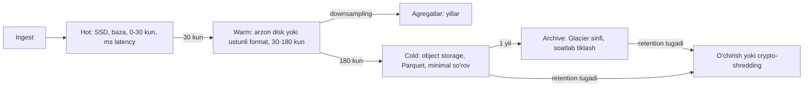
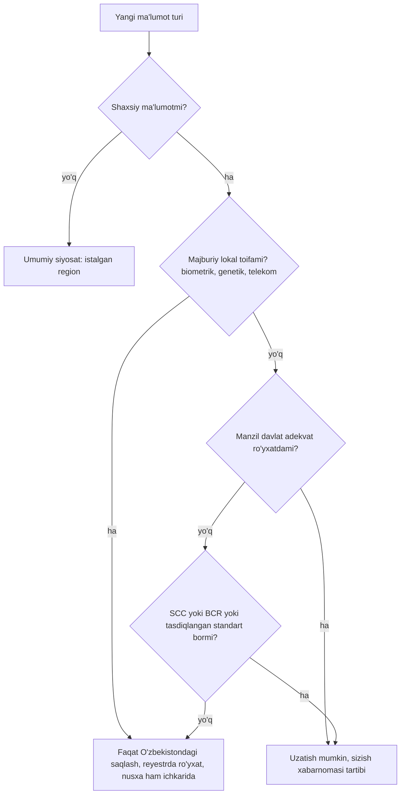

## Bu dars nima uchun kerak

Ko'p tizimlar ma'lumotni qanday **yozish** va **o'qish**ni yaxshi loyihalaydi, lekin uning **hayot oxiri**ni umuman o'ylamaydi. Natija bir necha yildan keyin keladi: baza 30 TB ga yetgan, 90 foizi hech kim o'qimaydigan eski telemetriya; `DELETE FROM points WHERE ts < ...` so'rovi bazani bir kecha yiqitadi; mijoz shartnomani bekor qilib "ma'lumotimizni o'chiring" deydi va hech kim backuplarda nima borligini bilmaydi; yangi qonun ma'lum ma'lumot turini mamlakat ichida saqlashni talab qiladi va u bulutda boshqa mamlakatdagi regionda yotibdi.

Data lifecycle - ma'lumot yaratilganidan to yo'q qilinishigacha bo'lgan yo'lni **oldindan** loyihalash:

1. **Retention** - har bir ma'lumot sinfi qancha saqlanadi va kim bu muddatni belgilaydi (biznes, qonun, mijoz shartnomasi).
2. **Tiering va arxivlash** - ma'lumot "sovigan" sari arzonroq va sekinroq saqlashga ko'chadi.
3. **O'chirish** - muddati tugagan yoki o'chirish talab qilingan ma'lumotni barcha nusxalardan (replika, cache, indeks, backup, analitika) haqiqatan yo'q qilish.
4. **Data residency** - ma'lumot jismonan qaysi mamlakatda saqlanishi va qayerga uzatilishi mumkinligi.

Oldingi darslar bilan bog'liqlik: hisob-kitob (1-2 darslar), OLTP va OLAP (16-dars), CDC (48-dars), object storage (60-dars), backup va DR (69-dars), multi-tenancy (73-dars), envelope encryption va crypto-shredding (74-dars), multi-region va home region (77-dars). Time-series saqlash va downsampling 81-darsda chuqur.

Darsdagi O'zbekiston qonunchiligi lex.uz dagi rasmiy matnlar bo'yicha 2026-yil 20-oktabr holatiga keltirilgan. Bu ta'limiy material, yuridik maslahat emas.

Bu darsdan keyin siz:

- ma'lumot sinflari bo'yicha retention siyosatini va uning saqlash narxiga ta'sirini hisoblay olasiz;
- hot/warm/cold tiering, downsampling va arxivlash arxitekturasini loyihalay olasiz;
- katta hajmdagi ma'lumotni bazani yiqitmasdan o'chirish usullarini (partition drop, TTL, crypto-shredding) bilasiz;
- "o'chirish" ning backup, replika va analitika tizimlarida nima anglatishini tushunasiz;
- O'zbekistonning shaxsiy ma'lumotlar to'g'risidagi qonunidagi lokalizatsiya talabining tarixi va 2026 yildagi holatini bilasiz va uni arxitekturaga aylantira olasiz.

## Ma'lumot sinflari va retention siyosati

Birinchi qadam - barcha ma'lumotni **sinflarga** ajratish. "Hamma narsani abadiy saqlaymiz" ham, "hamma narsani 90 kun" ham noto'g'ri; har sinfning o'z egasi, maqsadi va muddati bor.

| Ma'lumot sinfi | Misol | Kim muddatni belgilaydi | Tipik yondashuv |
|---|---|---|---|
| Xom telemetriya | Har 10 s dagi GPS nuqtasi | Biznes (mahsulot), mijoz shartnomasi | Qisqa (masalan 90 kun-1 yil) xom, keyin agregat |
| Agregatlar | Kunlik yurilgan masofa, yoqilg'i sarfi | Biznes, hisobot talablari | Uzoq (yillar) |
| Hodisalar | Yoqilg'i to'kish, avariya, tezlik oshirish | Biznes, ehtimoliy nizolar | Uzoq, ba'zan legal hold |
| Video | Kabina va yo'l kamerasi | Saqlash narxi, shaxsiy ma'lumot qoidalari | Qisqa aylanma (kunlar-haftalar), hodisa kliplari uzoqroq |
| Moliyaviy va shartnoma | Hisob-fakturalar, to'lovlar | Soliq va buxgalteriya qonunchiligi | Qonunda belgilangan muddat |
| Shaxsiy ma'lumot | Haydovchi F.I.Sh, telefon, pasport | Shaxsiy ma'lumot qonuni, rozilik | Maqsadga erishilguncha |
| Loglar va audit | API loglari, kirish auditi | Xavfsizlik, compliance | Operatsion loglar qisqa, audit uzoq |
| Backuplar | Baza snapshotlari | DR (69-dars), o'chirish talablari bilan ziddiyat | Aylanma (masalan 35 kun) |

O'zbekistonning "Shaxsga doir ma'lumotlar to'g'risida"gi qonuni (2019-yil 2-iyuldagi O'RQ-547) ham saqlash muddati tamoyilini belgilaydi: 10-moddaga ko'ra bazaga faqat vazifa uchun zarur ma'lumot yig'iladi, subyektni identifikatsiya qilish imkonini beradigan shaklda saqlash faqat yig'ish maqsadlari talab qilgancha davom etadi va saqlash muddati maqsadga erishilishi bilan tugaydi; 17-moddaga ko'ra ma'lumot maqsadga erishilganda, rozilik qaytarib olinganda, rozilik muddati tugaganda yoki sud qarori kuchga kirganda yo'q qilinadi. Yevropa GDPR dagi "storage limitation" tamoyili ham shu mantiqda.

### Hisob-kitob: retention narxi

Masala sharti: 60 000 mashina, har biri har 10 s da nuqta, siqilgandan keyin bitta nuqta 40 bayt (ustunli siqish va uning real koeffitsiyentlari 81-darsda).

```
6 000 nuqta/s × 86 400 s = 518 400 000 nuqta/kun
518.4 mln × 40 B ≈ 20.7 GB/kun
```

| Xom retention | Hajm (bitta nusxa) | 3 nusxa (replika) bilan |
|---|---|---|
| 90 kun | ~1.9 TB | ~5.6 TB |
| 1 yil | ~7.6 TB | ~22.7 TB |
| 5 yil | ~37.8 TB | ~113 TB |

Endi downsampling. Masala sharti: xom 90 kun, keyin 1 daqiqalik agregat 2 yil, keyin kunlik agregat. 1 daqiqalik agregatda nuqtalar 6 baravar kam, lekin har agregat qatorida bir nechta maydon (min, max, o'rtacha, oxirgi koordinata) bor; shartda agregat qatori 80 bayt. Unda 1 daqiqalik agregat kuniga `60 000 × 1 440 × 80 B ≈ 6.9 GB`, 2 yilda `6.9 × 730 ≈ 5 TB`; xom 90 kun 1.9 TB; kunlik agregat (`60 000 × 80 B ≈ 4.8 MB/kun`) yillar davomida ham gigabaytlar tartibida. Jami ~7 TB, 5 yillik xom saqlashdagi 37.8 TB ga nisbatan 5 baravardan ko'p kam; agregatlar 1 yilda qisqartirilsa, farq bir tartibga yetadi. Retention siyosati - saqlash narxining **eng katta richagi** (79-dars).

## Tiering: hot, warm, cold, archive

Ma'lumotga murojaat chastotasi yoshiga qarab keskin kamayadi. Dispetcher bugungi va kechagi marshrutni har kuni ko'radi, o'tgan oyni - hisobot uchun oyda bir marta, 2 yil oldingisini - faqat nizo yoki audit bo'lganda.



Object storage misolida (AWS S3 hujjati bo'yicha) sinflar va ularning cheklovlari:

| Sinf | Murojaat | Minimal saqlash muddati | Minimal hisoblanadigan obyekt | Izoh |
|---|---|---|---|---|
| S3 Standard | Millisekund | Yo'q | Yo'q | Tez-tez o'qiladigan |
| S3 Standard-IA | Millisekund | 30 kun | 128 KB | Har GB o'qish uchun to'lov |
| S3 Glacier Instant Retrieval | Millisekund | 90 kun | 128 KB | Chorakda bir o'qiladigan arxiv |
| S3 Glacier Flexible Retrieval | Daqiqalar-soatlar | 90 kun | Har obyektga ~40 KB metadata qo'shiladi | Avval restore kerak |
| S3 Glacier Deep Archive | Soatlar | 180 kun | Har obyektga ~40 KB metadata qo'shiladi | Eng arzon saqlash |

Bu jadvaldagi cheklovlar dizaynga bevosita ta'sir qiladi:

- **Mayda obyektlar tuzog'i.** Har bir GPS nuqtasini alohida obyekt qilib arxivlash - 128 KB minimal hisob yoki 40 KB metadata tufayli saqlash narxi o'nlab-yuzlab baravar oshadi. To'g'ri yondashuv: kunlik/tenant bo'yicha **katta fayllarga** (Parquet, siqilgan, 100 MB-1 GB) yig'ish.
- **Minimal muddat tuzog'i.** 90 kunlik minimal muddatli sinfga 30 kunlik ma'lumot qo'yib o'chirsangiz, baribir 90 kun uchun to'laysiz.
- **Tiklash vaqti.** Deep Archive dan tiklash soatlar oladi - bu RTO talablariga (69-dars) mos kelishi kerak.

Lifecycle qoidalari (S3 lifecycle, bazada partition boshqaruvi) bu o'tishlarni **avtomatik** qiladi; qo'lda arxivlash har doim unutiladi.

## O'chirish: eng qiyin qism

### Bazada katta hajmni o'chirish

PostgreSQL da `DELETE FROM points WHERE ts < now() - interval '90 days'` - eng yomon usul: har bir qator alohida o'chiriladi va WAL ga yoziladi, o'lik qatorlar (dead tuples) qoladi va VACUUM ularni tozalashi kerak, jadval va indekslar shishadi (bloat), replikalar WAL ni qabul qilishda orqada qoladi (replication lag, 26-dars).

PostgreSQL hujjati to'g'ridan-to'g'ri yechimni beradi: agar bulk o'chirish partition dizaynida hisobga olingan bo'lsa, partitionni `DROP TABLE` yoki `ALTER TABLE ... DETACH PARTITION` bilan olib tashlash ommaviy operatsiyadan ancha tez va bulk `DELETE` keltiradigan VACUUM yukini butunlay yo'qotadi. Millionlab qator deyarli bir zumda o'chadi, chunki har qator alohida o'chirilmaydi. Nozik nuqta: `DROP TABLE` ota jadvalda `ACCESS EXCLUSIVE` lock oladi; `DETACH PARTITION CONCURRENTLY` esa yengilroq lock bilan ishlaydi.

Demak retention **partition kaliti bilan birga** loyihalanadi:

- telemetriya - vaqt bo'yicha partition (kunlik yoki haftalik); retention = eski partitionlarni drop qilish;
- multi-tenant (73-dars) da agar tenantlar turli retention ga ega bo'lsa (Basic 90 kun, Enterprise 3 yil), bitta vaqt partitioni ichida ularni ajratish qiyin: yo tenant guruhi + vaqt bo'yicha ikki darajali partition, yo turli retention guruhlari uchun alohida jadvallar.

Time-series bazalarda bu o'rnatilgan: TimescaleDB da chunk lar va retention policy (eski chunk larni drop qilish), ClickHouse da `TTL` ifodasi va partition drop (81-dars). Cassandra kabi LSM tizimlarida (13-dars) TTL tombstone lar yaratadi va ular compaction gacha diskda qoladi - ko'p tombstone o'qishni sekinlashtiradi; time-window compaction strategiyasi bilan butun SSTable larni tushirish samaraliroq.

### "O'chirildi" nimani anglatadi

Tenant shartnomani tugatdi yoki haydovchi o'z ma'lumotini o'chirishni so'radi. Ma'lumot qayerlarda?

| Joy | O'chirish usuli | Muammo |
|---|---|---|
| Asosiy baza | `DELETE` yoki partition drop | Oddiy |
| Replikalar | Replikatsiya orqali avtomatik | Kechikish bilan |
| Cache (Redis) | Invalidatsiya yoki TTL | Unutilsa eski ma'lumot qaytadi |
| Qidiruv indeksi (Elasticsearch) | Alohida o'chirish yoki CDC orqali | Ko'pincha unutiladi |
| Analitika (DWH, ClickHouse, Parquet fayllar) | Alohida pipeline | Immutable fayllarni qayta yozish kerak |
| Kafka topiclar | Retention tugaguncha yoki compaction + tombstone (44-dars) | Retention davomida qoladi |
| Loglar | Log retention | Loglarda shaxsiy ma'lumot bo'lmasligi kerak edi |
| Backuplar | Backup aylanishi tugaguncha qoladi | Bitta yozuvni backupdan o'chirib bo'lmaydi |

Backup muammosi uchun amaliy yondashuvlar:

1. **Backup retention qisqa va hujjatlashtirilgan** (masalan 35 kun): "ma'lumot asosiy tizimdan darhol, backuplardan 35 kun ichida yo'qoladi". Va backupdan tiklanganda o'chirish ro'yxati qayta qo'llanadi (tombstone jurnali).
2. **Crypto-shredding** (74-dars): har tenant (yoki har foydalanuvchi) ma'lumoti o'z kaliti bilan shifrlangan bo'lsa, kalitni o'chirish barcha nusxalarni - backup, arxiv, replika - bir vaqtda o'qib bo'lmaydigan qiladi. Kalitlar kichik va bitta joyda (KMS), ma'lumot esa hamma joyda. Bu B2B SaaS da tenantni o'chirish uchun eng kuchli usul.
3. **Legal hold.** Ba'zan aksincha - ma'lumotni **o'chirmaslik** kerak: sud nizosi, tergov, audit. Retention avtomatikasi legal hold bayrog'ini hurmat qilishi kerak; aks holda tizim dalilni avtomatik yo'q qiladi.

Yevropa GDPR ning 17-moddasi (o'chirish huquqi) ham mutlaq emas: qonuniy majburiyatni bajarish yoki huquqiy da'volarni himoya qilish uchun zarur bo'lgan ma'lumot istisno qilinadi. Ya'ni "o'chirish" tizimi qaysi ma'lumot qaysi asosda saqlanayotganini bilishi kerak.

## Data residency: ma'lumot qayerda yotadi

Uch tushunchani ajrating:

- **Data residency** - ma'lumot jismonan qaysi mamlakat/regionda saqlanadi.
- **Data localization** - qonun ma'lum ma'lumotni mamlakat ichida saqlashni **majburlaydi**.
- **Transchegaraviy uzatish (cross-border transfer)** - ma'lumotni mamlakatdan tashqariga yuborish shartlari (nusxa, so'rov, support xodimining kirishi ham uzatish bo'lishi mumkin).

### O'zbekiston: qonunchilik tarixi va 2026-yil holati

Quyidagi faktlar lex.uz dagi rasmiy matnlar bo'yicha (2026-yil 20-oktabr holati):

**1. Asosiy qonun.** "Shaxsga doir ma'lumotlar to'g'risida"gi O'zbekiston Respublikasi Qonuni, 2019-yil 2-iyuldagi O'RQ-547 (Qonunchilik palatasi 2019-yil 16-aprelda qabul qilgan, Senat 2019-yil 21-iyunda ma'qullagan), 2019-yil 1-oktabrdan kuchga kirgan. Arxitektor uchun muhim moddalari:

- **4-modda** - shaxsga doir ma'lumot: muayyan jismoniy shaxsga tegishli yoki uni identifikatsiya qilish imkonini beradigan, elektron, qog'oz yoki boshqa moddiy shaklda qayd etilgan axborot.
- **8-modda** - shaxsga doir ma'lumotlar sohasidagi vakolatli davlat organi (pastda 5-bandga qarang).
- **15-modda** - transchegaraviy uzatish: shaxsga doir ma'lumotlar bir xil himoyani ta'minlovchi chet davlatlar hududiga uzatiladi; bunday himoya bo'lmagan davlatga esa faqat subyekt roziligi bilan, konstitutsiyaviy tuzum va boshqa muhim manfaatlarni himoya qilish uchun yoki xalqaro shartnoma asosida.
- **20-modda** - bazalarni Davlat reyestrida ro'yxatdan o'tkazish.
- **26-modda** - biometrik va genetik ma'lumotlarga ishlov berish (ta'riflar pastda, 6-bandda).

**2. 2021-yilgi lokalizatsiya talabi.** 2021-yil 14-yanvardagi O'RQ-666 Qonun ("O'zbekiston Respublikasining ayrim qonun hujjatlariga o'zgartish va qo'shimchalar kiritish to'g'risida") 13-moddasi bilan O'RQ-547 ga **27¹-modda** qo'shilgan: O'zbekiston fuqarolarining shaxsiy ma'lumotlariga axborot texnologiyalari yordamida, jumladan internetda ishlov berishda, mulkdor va (yoki) operator ularni yig'ish, tizimlashtirish va saqlashni O'zbekiston hududida jismonan joylashgan texnik vositalarda va Davlat reyestrida ro'yxatdan o'tgan bazalarda amalga oshirishi shart edi. O'RQ-666 rasmiy e'lon qilingan kuni, 2021-yil 15-yanvarda kuchga kirgan, lekin uning 16-moddasiga ko'ra aynan 13-modda qonun kuchga kirganidan **uch oy o'tgach** amal qila boshlagan: 2021-yil 15-yanvardan uch oy, ya'ni 2021-yil aprel o'rtasidan. Bu talab barcha shaxsiy ma'lumot turlariga tegishli edi.

**3. 2026-yilgi o'zgarish: lokalizatsiya toraytirildi.** 2026-yil 26-martdagi O'RQ-1125 Qonun ("Shaxsga doir ma'lumotlar to'g'risida"gi Qonunga o'zgartishlar va qo'shimcha kiritish haqida"; Qonunchilik palatasi 2026-yil 20-yanvarda qabul qilgan, Senat 2026-yil 5-fevralda ma'qullagan) 4-moddasiga ko'ra rasmiy e'lon qilingan kundan, lex.uz bo'yicha **2026-yil 27-martdan** kuchga kirgan. U 27¹-moddani ("Shaxsga doir ma'lumotlarni saqlash va ularga ishlov berishning alohida shartlari") **to'liq yangi tahrirda** bayon qilgan:

- 1-qism: fuqarolarning shaxsga doir ma'lumotlari qonunning asosiy prinsiplari ta'minlangan holda saqlanadi.
- 2-qism: O'zbekiston hududida **saqlanishi shart** bo'lgan uch toifa - jismoniy shaxslarning **biometrik** ma'lumotlari; **genetik** ma'lumotlari; O'zbekistonda faoliyat yurituvchi **telekommunikatsiya operatorlari xizmatlaridan foydalanuvchi** jismoniy shaxslar ma'lumotlari.
- 3-qism: 2-qismda nazarda tutilmagan ma'lumotlar quyidagi shartlardan **biri** bajarilsa, O'zbekistondan tashqarida saqlanishi va ishlov berilishi mumkin: (a) chet davlat bir xil himoyani ta'minlovchi deb tan olingan; (b) operator vakolatli davlat organi tasdiqlagan talablarga mos standart shartnoma shartlari (SCC) yoki majburiy korporativ qoidalarni (BCR) qabul qilib, ularga amal qiladi; (c) operator vakolatli davlat organi tasdiqlagan ro'yxatdagi xalqaro ma'lumot boshqaruvi va saqlash standartlariga amal qiladi.
- 4-qism: bir xil himoyani ta'minlovchi chet davlatlar ro'yxatini Vazirlar Mahkamasi belgilaydi.

Shu qonun bilan 20-moddaning birinchi qismi ham yangilangan: Davlat reyestrida ro'yxatdan o'tkazilishi shart bo'lgan bazalar - 27¹-moddaning ikkinchi qismiga ko'ra O'zbekistonda saqlanishi shart bo'lgan bazalar. 3-moddaga ham o'zgarish kiritilgan: qonun jismoniy shaxsning shaxsiy va maishiy maqsadlardagi ishlov berishiga tatbiq etilmaydi, cheklovlar esa davlat sirlaridan tashqari mudofaa va milliy xavfsizlik axborotiga ham tegishli. Qonunni amalga oshirish Ichki ishlar vazirligiga yuklangan (2-modda).

**4. Adekvat davlatlar ro'yxati.** Vazirlar Mahkamasining 2026-yil 29-iyuldagi 415-son qarori ("Shaxsga doir ma'lumotlar bir xil himoya qilinishini ta'minlovchi chet davlatlar ro'yxatini tasdiqlash to'g'risida") 2026-yil 3-avgustdan kuchga kirgan. Mazmuni:

- ilovada **49 ta** davlat va hudud: Yevropa Ittifoqining barcha 27 davlati, Islandiya, Lixtenshteyn, Norvegiya, Shveytsariya, Andorra, Buyuk Britaniya va uning Gernsi, Jersi, Men oroli hududlari, Farer orollari, Argentina, Braziliya, Urugvay, Kanada, Isroil, Yaponiya, Janubiy Koreya, Singapur, Gonkong, Yangi Zelandiya, Rossiya va AQSh. AQSh izoh bilan: faqat EU-US Data Privacy Framework doirasida faoliyat yurituvchi kompaniyalar uchun;
- 3-band: **Ichki ishlar vazirligi huzuridagi Migratsiya va personallashtirish departamenti** "vakolatli davlat organi" deb ataladi va ro'yxatga davlat kiritish yoki chiqarish bo'yicha takliflar uchun mas'ul;
- 4-band: ro'yxatdagi davlatlarga xalqaro shartnomalar asosidagi axborot tizimlari orqali uzatish qo'shimcha ruxsatsiz va vakolatli organni xabardor qilmasdan amalga oshiriladi, lekin sizishning oldini olish choralari ko'rilishi shart; ro'yxatda bo'lmagan davlatlarga uzatish faqat operator va baza mulkdori vakolatli organ belgilagan huquqiy, tashkiliy va texnik shartlarni bajarganda;
- 4-band: transchegaraviy uzatishda ma'lumot sizishi aniqlansa, operator vakolatli organni **24 soat** ichida xabardor qiladi va **72 soat** ichida sabablar va bartaraf etish choralari haqida batafsil ma'lumot beradi;
- 7-band: Ichki ishlar vazirligi Raqamli texnologiyalar vazirligi, Davlat xavfsizlik xizmati va Istiqbolli loyihalar milliy agentligi bilan birgalikda **uch oy** ichida ro'yxatga kiritilmagan davlatlarga uzatish uchun SCC va BCR talablarini tasdiqlashi kerak;
- 6-band: Tashqi ishlar vazirligiga vakolatli organ bilan uch oy ichida 1981-yil 28-yanvardagi Yevropa Kengashining shaxsiy ma'lumotlarni avtomatik qayta ishlashda himoya qilish to'g'risidagi konvensiyasiga (Strasburg konvensiyasi, Convention 108) qo'shilish bo'yicha takliflar tayyorlash topshirilgan.

**5. Vakolatli organ kim.** O'RQ-547 ning 8-moddasi lex.uz dagi matnda hali ham vakolatli davlat organi sifatida Vazirlar Mahkamasi huzuridagi Davlat personallashtirish markazini ko'rsatadi. Lekin amaldagi qonunosti hujjatlari boshqa tuzilmaga ishora qiladi: Prezidentning 2026-yil 19-yanvardagi PQ-14-son qarori (2026-yil 20-yanvardan kuchga kirgan, Prezidentning 2025-yil 11-martdagi PF-45 Farmonini ijro etish uchun qabul qilingan) bilan Ichki ishlar vazirligi huzuridagi Migratsiya va personallashtirish departamenti to'g'risidagi nizom tasdiqlangan, avvalgi hujjatlardagi "Adliya vazirligi huzuridagi Personallashtirish agentligi" so'zlari shu departament bilan almashtirilgan, departament va uning hududiy bo'linmalariga "Shaxsga doir ma'lumotlar to'g'risida"gi qonunni buzganlik uchun ma'muriy bayonnoma tuzish vakolati berilgan, Personallashtirish markazining bazalari esa 2026-yil oxirigacha IIV ning "Pasport-viza" tizimiga birlashtiriladi. VM 415-son qarori esa transchegaraviy uzatish masalalarida aynan shu departamentni "vakolatli davlat organi" deb nomlaydi. Ya'ni amalda shaxsga doir ma'lumotlar bo'yicha vakolatli organ - **IIV huzuridagi Migratsiya va personallashtirish departamenti**; qonunning 8-moddasi matni bu o'zgarishga hali moslashtirilmagan.

**6. SCC va BCR holati.** VM 415-son qarori 7-bandidagi uch oylik muddat 2026-yil 3-noyabrda tugaydi. 2026-yil 20-oktabr holatiga lex.uz qidiruvida SCC ("standart shartnomaviy shartlar") va BCR ("majburiy korporativ qoidalar") talablarini tasdiqlovchi hujjat yo'q: shu atamalar bo'yicha qidiruv faqat O'RQ-547, O'RQ-1125 va VM 415-son qarorini qaytaradi. Shuningdek 27¹-moddaning 3-qismi (c) bandidagi xalqaro standartlar ro'yxati ham hali e'lon qilinmagan. Demak hozircha ro'yxatda bo'lmagan davlatga (masalan, Qozog'istonga) uzatishning amaliy yo'li - 15-moddadagi istisnolar (subyekt roziligi va boshqalar) yoki SCC/BCR talablari chiqishini kutish.

**7. Kabina kamerasidagi yuz tasviri biometrik ma'lumotmi.** O'RQ-547 ning 26-moddasi (lex.uz dagi inglizcha tarjima) biometrik ma'lumotni subyektning **anatomik va fiziologik xususiyatlarini tavsiflovchi** shaxsga doir ma'lumot deb ta'riflaydi; genetik ma'lumot - biologik material tahlili natijasida aniqlangan irsiy yoki orttirilgan xususiyatlarga oid ma'lumot. Xuddi shu modda **subyektni identifikatsiya qilish uchun ishlatiladigan** biometrik va genetik ma'lumotlarga ishlov berishni subyekt roziligi bilan (xalqaro shartnoma, odil sudlov, ijro ishi va qonunda nazarda tutilgan holatlar bundan mustasno) cheklaydi. Bu ta'rifdan arxitektura uchun xulosalar:

- yuz shakli - anatomik xususiyat, shuning uchun **yuzni aniqlash shabloni** (face embedding, haydovchini identifikatsiya qilish uchun yuz vektori) ta'rifga to'liq tushadi va 27¹-modda 2-qismiga ko'ra O'zbekistonda saqlanishi shart;
- haydovchi yuzi aniq ko'rinadigan va u bilan bog'langan (kim haydaganini bilamiz) **kabina videosi va kadrlari** ham anatomik xususiyatlarni qayd etadi va identifikatsiya uchun ishlatilishi mumkin; qonun ta'rifi "faqat shablon" bilan cheklanmaydi, shuning uchun bunday videoni ham biometrik toifa sifatida mamlakat ichida saqlash - ta'rif matniga mos yagona xavfsiz talqin;
- yuz ko'rinmaydigan yo'l kamerasi (oldingi oyna) videosi va GPS treklari biometrik emas, lekin haydovchiga bog'langan bo'lsa oddiy shaxsga doir ma'lumot: ular 27¹-moddaning 3-qismi shartlari bilan xorijda saqlanishi mumkin.

GPS treker SIM-kartalari bo'yicha: 27¹-modda 2-qismining uchinchi toifasi telekommunikatsiya operatorlari xizmatlaridan **foydalanuvchi jismoniy shaxslar** ma'lumotlarini nazarda tutadi. Treker SIM-kartasining abonenti odatda yuridik shaxs (avtopark egasi), iQuariX esa telekom operator emas; shuning uchun iQuariX ning telemetriyasi bu toifaga kirmaydi, lekin operatordan olinadigan abonent ma'lumotlari (masalan, jismoniy shaxsga rasmiylashtirilgan SIM) kirsa, ular ichkarida qoladi.

Arxitektor uchun saboq: **lokalizatsiya qoidalari o'zgaradi** - 2021 da hamma narsa, 2026 da uch toifa. Agar tizim "hamma narsa bitta joyda" deb qattiq kodlangan bo'lsa, har o'zgarish katta migratsiya. Agar ma'lumot sinflari va ularning joylashuvi **konfiguratsiya** bo'lsa (77-darsdagi home region va routing jadvali), o'zgarish - siyosat yangilanishi.

### Residency ni arxitekturada qo'llash



Texnik choralar:

1. **Ma'lumot katalogi.** Har bir jadval va ustun uchun: sinf (shaxsiy, biometrik, moliyaviy, texnik), egasi, retention, residency talabi. Bu bo'lmasa, siyosatni qo'llab bo'lmaydi.
2. **Saqlash joyi konfiguratsiya sifatida.** Tenant yoki ma'lumot sinfi -> region/data-markaz xaritasi (77-dars home region). Bulutda: provayder policy lari bilan boshqa regionlarda resurs yaratishni taqiqlash.
3. **Barcha nusxalar.** Residency faqat asosiy bazaga emas, replikalar, backuplar, DR nusxasi, loglar, monitoring (APM, error tracking SaaS ga ketayotgan stack trace dagi shaxsiy ma'lumot), analitika va support vositalariga ham tegishli. Ko'pincha sizish aynan shu "yordamchi" tizimlar orqali bo'ladi.
4. **Masofaviy kirish ham uzatish.** Boshqa mamlakatdagi xodim yoki pudratchining production bazaga kirishi - ma'lumotni ko'rsatish, ya'ni amalda uzatish bo'lishi mumkin. Kirish nazorati va audit (72-dars).
5. **Psevdonimizatsiya va agregatsiya.** Agar analitika yoki ML xorijdagi platformada bo'lsa, unga shaxsni aniqlab bo'lmaydigan agregatlar yoki psevdonimlashtirilgan ma'lumot yuborish (kalit ichkarida qoladi). Ehtiyot: GPS treklari kabi joylashuv ma'lumoti "anonim" ID bilan ham ko'pincha shaxsni qayta aniqlash imkonini beradi (uy va ish manzili).
6. **Kalitlar ham residency qismi.** Ma'lumot xorijda, lekin shifrlash kaliti faqat mamlakat ichidagi HSM da bo'lsa (74-dars) - bu kuchli texnik nazorat va sizishda zararni kamaytiradi. Lekin 27¹-modda 2-qismi ma'lumotning o'zini "saqlash"ni talab qiladi, shifrlangan nusxani istisno qilmaydi: biometrik, genetik va telekom foydalanuvchi ma'lumotlari shifrlangan holda ham xorijda saqlanmaydi.

## Real tizimlardan misollar

- **PostgreSQL partitioning** - hujjatda bulk o'chirish uchun partition drop/detach tavsiya etiladi, VACUUM yukisiz.
- **AWS S3 lifecycle va storage class lar** - minimal saqlash muddati (30/90/180 kun) va minimal obyekt hajmi arxiv dizayniga bevosita ta'sir qiladi.
- **Kafka log compaction** (44-dars) - kalit bo'yicha tombstone yozib, eski qiymatlarni compaction da yo'q qilish.
- **GDPR 17-modda** - o'chirish huquqi va uning istisnolari (qonuniy majburiyat, huquqiy da'volar).
- **O'zbekiston O'RQ-547, O'RQ-666, O'RQ-1125 va VM 415-son qarori** - lokalizatsiya talabining keng (2021) dan tor (2026) shaklga o'zgarishi.

## iQuariX kontekstida

Masala sharti: iQuariX ma'lumot sinflari va siyosati quyidagicha loyihalanmoqda (residency ustuni yuqoridagi 27¹-modda va VM 415-son qarori bo'yicha):

| Sinf | Retention | Tiering | Residency (O'RQ-547, 27¹-modda bo'yicha) |
|---|---|---|---|
| Xom GPS nuqtalari | Tier bo'yicha 90 kun - 1 yil | Hot 30 kun, keyin warm, keyin Parquet cold | Haydovchiga bog'langan joylashuv - oddiy shaxsga doir ma'lumot: ichkarida yoki 415-son ro'yxatdagi davlatda |
| Kunlik agregatlar (masofa, yoqilg'i) | Shartnoma davomida + N yil | Baza | Haydovchiga bog'lanmagan (faqat mashina) bo'lsa shaxsga doir ma'lumot emas, cheklovsiz |
| Yoqilg'i va avariya hodisalari | 3 yil, legal hold imkoniyati | Baza + arxiv | Haydovchi bilan bog'langan - oddiy shaxsga doir: ichkarida yoki ro'yxatdagi davlatda |
| Kabina videosi | 14 kun aylanma, hodisa kliplari 1 yil | Lokal disk/NVR, keyin object storage | Haydovchi yuzi - anatomik xususiyat (26-modda): **faqat O'zbekistonda** |
| Haydovchi profili | Mehnat munosabati + qonuniy muddat | Baza | Oddiy shaxsga doir; yuzni aniqlash shabloni - biometrik, **faqat O'zbekistonda** |
| Hisob-fakturalar | Soliq qonunchiligi muddati | Baza + arxiv | Tashkilot ma'lumoti |
| API va xavfsizlik loglari | 30-90 kun, audit 1 yil | Log tizimi, arxiv | Loglarda shaxsiy ma'lumotni maskalash |

Asosiy arxitektura qarorlari:

1. Barcha telemetriya jadvallari **vaqt bo'yicha partition**, retention - kunlik job bilan eski partitionlarni detach va drop (yoki time-series bazaning retention policy si).
2. Tenant tugaganda: tenant KEK ini o'chirish (crypto-shredding) + asosiy bazadan `tenant_id` bo'yicha o'chirish + qidiruv indeksi va analitikadan CDC orqali o'chirish + Kafka da retention tugashini kutish; jarayon tugaganligi haqida mijozga sertifikat.
3. Video va biometrikaga yaqin har qanday ma'lumot - faqat O'zbekistondagi data-markazda, DR nusxasi ham O'zbekiston ichidagi ikkinchi joyda (77-dars).
4. Ma'lumot katalogi har bir yangi ustun uchun majburiy (migration review da tekshiriladi).

Hisob: kabina videosi, 2 000 kamera × 1 Mbit/s, 14 kunlik aylanma: `2 000 × 125 KB/s × 86 400 × 14 ≈ 302 TB`. Agar 30 kunga uzaytirilsa - ~650 TB. Retention qarori to'g'ridan-to'g'ri yuzlab terabayt disk va O'zbekistondagi data-markazda rack joyini belgilaydi.

## Ko'p uchraydigan xatolar

1. **Retention siyosatisiz boshlash.** "Keyin o'ylaymiz" - va 3 yildan keyin `DELETE` bilan 20 TB jadvalni tozalashga urinish.
2. **Bulk `DELETE` bilan retention.** Bloat, VACUUM, replication lag. Partition dizayni retention bilan birga.
3. **Mayda obyektlarni arxiv sinfiga qo'yish.** Minimal hisoblanadigan hajm va metadata narxi.
4. **"O'chirish" faqat asosiy bazada.** Cache, qidiruv indeksi, analitika, loglar va backuplar unutiladi.
5. **Legal hold yo'q.** Avtomatik retention nizo dalilini o'chiradi.
6. **Residency faqat asosiy bazaga.** Monitoring, error tracking, support vositalari, DR nusxasi va xodimlarning masofaviy kirishi orqali ma'lumot chet elga chiqadi.
7. **Qonunni bir marta o'qib, kodga qattiq kodlash.** O'zbekistonda talab 2021 dan 2026 gacha tubdan o'zgardi; siyosat konfiguratsiya bo'lishi kerak.
8. **Ta'rifni o'qimasdan toifa tanlash.** "Bu shunchaki video, biometrik emas" degan xulosa 26-moddadagi ta'rifga (anatomik va fiziologik xususiyatlar) qarshi tekshirilishi kerak; ma'lumot katalogida har sinf uchun qonun moddasiga havola yozing.

## Xulosa

- Data lifecycle - retention, tiering, o'chirish va residency ni ma'lumot yaratilishidan oldin loyihalash.
- Har bir ma'lumot sinfining o'z egasi, maqsadi va muddati bor; retention - saqlash narxining eng katta richagi.
- Tiering (hot/warm/cold/archive) murojaat chastotasiga qarab; arxiv sinflarining minimal muddat va minimal obyekt cheklovlari fayl tuzilishini belgilaydi.
- Katta hajmni o'chirish - partition drop yoki TTL bilan, bulk `DELETE` bilan emas. Crypto-shredding barcha nusxalarni bir vaqtda o'qib bo'lmaydigan qiladi; legal hold esa o'chirishni to'xtatadi.
- O'zbekistonda 2021-yildagi O'RQ-666 (27¹-modda, 2021-yil apreldan amalda) barcha fuqarolar shaxsiy ma'lumotini mamlakat ichida saqlashni talab qilgan; 2026-yil 27-martdan O'RQ-1125 majburiy lokalizatsiyani biometrik, genetik va telekom foydalanuvchilari ma'lumotiga toraytirgan, qolganini adekvat davlatlar (VM 415-son qarori, 2026-yil 3-avgustdan, 49 ta) yoki SCC/BCR/standartlar sharti bilan xorijda saqlashga ruxsat bergan. Vakolatli organ amalda - IIV huzuridagi Migratsiya va personallashtirish departamenti; transchegaraviy sizish haqida 24 soat ichida xabar, 72 soat ichida batafsil ma'lumot.
- Residency barcha nusxalar va yordamchi tizimlarga tegishli; uni konfiguratsiya va ma'lumot katalogi orqali boshqaring.

## Amaliy topshiriq

iQuariX uchun data lifecycle siyosati va uning arxitekturasini loyihalang. Kontekst: 60 000 mashina (12 oyda 110 000), 2 000 kabina kamerasi (yangi AI funksiya: haydovchi charchoqni yuz tasviri orqali aniqlash), 300 tenant, Basic/Pro/Enterprise tier lar, mijozlar O'zbekiston va Qozog'istonda.

1. Ma'lumot katalogi: kamida 8 ta ma'lumot sinfi, har biri uchun egasi, maqsadi, retention, tiering va residency talabi (jadval). Har sinf uchun qaysi qonun moddasi (O'RQ-547 ning 26, 27¹-moddalari, VM 415-son qarori) residency ni belgilashini yozing.
2. Hisob: xom telemetriya va video uchun 1 yil va 3 yil bo'yicha hajmlar (replika va DR nusxasi bilan), downsampling bilan va siz.
3. Telemetriya jadvallarining partition dizayni: tier bo'yicha turli retention ni qanday qo'llaysiz va o'chirish jobi qanday ishlaydi.
4. Tenantni o'chirish jarayoni: barcha joylar (baza, replika, cache, qidiruv, analitika, Kafka, loglar, backuplar) bo'yicha qadamlar va qancha vaqtda tugashi. Crypto-shredding ni qanday ishlatasiz?
5. Residency: qozog'istonlik tenant ma'lumoti va o'zbekistonlik tenant ma'lumoti qayerda saqlanadi; xorijdagi monitoring/analitika vositalariga nima yuborish mumkin va nima mumkin emas; yuz tasvirlari bilan ishlovchi AI modeli qayerda ishlaydi.
6. Qonun yana o'zgarsa (masalan, joylashuv ma'lumoti ham majburiy lokal toifaga qo'shilsa), tizimingizda nimani o'zgartirish kerak bo'ladi va bu qancha ish?

Yaxshi javobda bo'lishi kerak bo'lgan narsalar:

- ma'lumot sinflari bo'yicha alohida retention va raqamli hajm hisob-kitobi;
- partition drop yoki TTL bilan o'chirish, bulk DELETE emas;
- o'chirish barcha nusxalar va yordamchi tizimlarni qamrashi, backuplar uchun aniq siyosat va legal hold;
- O'zbekistonning 2026-yildagi qoidalariga (majburiy lokal toifalar, adekvat davlatlar ro'yxati, SCC/BCR talablari hali chiqmagani, 24/72 soatlik xabarnoma) to'g'ri tayanish;
- residency ni konfiguratsiya sifatida boshqarish.

Javobni pastdagi maydonga yozib, chatga yuboring.

## Manbalar

- O'zbekiston Respublikasi. ["Shaxsga doir ma'lumotlar to'g'risida"gi Qonun, 2019-yil 2-iyuldagi O'RQ-547](https://lex.uz/docs/4396419) (lex.uz, o'zbekcha amaldagi tahrir; [ruscha](https://lex.uz/ru/docs/4396428), [norasmiy inglizcha tarjima](https://lex.uz/ru/docs/4831939)) - 4, 8, 10, 15, 17, 20, 26, 27¹-moddalar.
- O'zbekiston Respublikasi. [2021-yil 14-yanvardagi O'RQ-666 Qonun](https://lex.uz/ru/docs/5220725), 2021-yil 15-yanvardan kuchga kirgan - 13-modda (27¹-moddani qo'shish) va 16-modda (13-modda uch oydan keyin amal qilishi).
- O'zbekiston Respublikasi. [2026-yil 26-martdagi O'RQ-1125 Qonun](https://lex.uz/docs/8099215) ([ruscha](https://lex.uz/ru/docs/8104580)), 2026-yil 27-martdan kuchga kirgan - 27¹-moddaning yangi tahriri, 3 va 20-moddalar o'zgarishi.
- O'zbekiston Respublikasi Vazirlar Mahkamasi. [2026-yil 29-iyuldagi 415-son qarori](https://lex.uz/docs/8369688), 2026-yil 3-avgustdan kuchga kirgan - 49 ta davlat ro'yxati, vakolatli organ, 24/72 soatlik xabarnoma, SCC/BCR topshirig'i.
- O'zbekiston Respublikasi Prezidenti. [2026-yil 19-yanvardagi PQ-14-son qarori](https://lex.uz/ru/docs/8003903) ([o'zbekcha](https://lex.uz/docs/8003859)) - IIV huzuridagi Migratsiya va personallashtirish departamenti nizomi, Personallashtirish agentligi o'rniga departament, 4-ilova.
- PostgreSQL 18 hujjati. [Table Partitioning](https://www.postgresql.org/docs/current/ddl-partitioning.html) - 5.12.1 va 5.12.2.2 bo'limlar (partition drop/detach orqali bulk o'chirish).
- AWS. [Understanding and managing Amazon S3 storage classes](https://docs.aws.amazon.com/AmazonS3/latest/userguide/storage-class-intro.html) - sinflar, minimal muddat va minimal obyekt hajmi.
- [GDPR, 17-modda: Right to erasure](https://gdpr-info.eu/art-17-gdpr/) - o'chirish huquqi va istisnolar.
- Martin Kleppmann, Chris Riccomini. Designing Data-Intensive Applications, 2-nashr, O'Reilly, 2026 - 4-bob "Storage and Retrieval" (LSM, compaction, tombstone), 12-bob "Stream Processing" va 14-bob "Doing the Right Thing" (shaxsiy ma'lumot, o'chirish va derived data).
