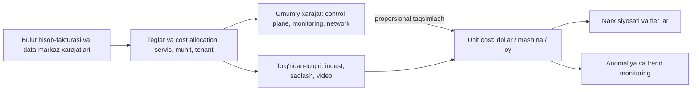

## Bu dars nima uchun kerak

Kursning 1-darsida aytilgandek, narx - nofunksional talablarning to'liq huquqli o'qi, xuddi latency yoki mavjudlik kabi. AWS Well-Architected Framework da ham u alohida ustun: cost optimization. Lekin amaliyotda narx ko'pincha arxitektura qarori qabul qilingandan **keyin**, birinchi katta hisob-faktura kelganda o'ylanadi. Shu paytda ko'p qarorlar allaqachon "qaytarilmaydigan" (1-dars): ma'lumot modeli, saqlash formati, regionlar soni, servislar orasidagi trafik naqshi.

B2B SaaS uchun narx - shunchaki tejamkorlik emas, **biznes modelining o'zi**. Agar iQuariX mijozdan har bir mashina uchun oyiga ma'lum summa olsa va infratuzilma bitta mashina uchun shu summaning 40 foizini yesa, kompaniya o'sgan sari ko'proq pul yo'qotadi. Shuning uchun arxitektor bilishi kerak bo'lgan asosiy raqam - **unit cost**: bitta biznes birligiga (mashina, tenant, so'rov, GB) tushadigan infratuzilma narxi.

Oldingi darslar bilan bog'liqlik: back-of-envelope hisob-kitob (2-dars), cache (23-dars), object storage (60-dars), multi-tenancy va noisy neighbor (73-dars), Kubernetes requests va bin packing (75-dars), autoscaling (76-dars), multi-region trafigi (77-dars), retention va tiering (78-dars).

Bu darsdan keyin siz:

- arxitektura uchun narx modelini tuzib, unit cost ni hisoblay olasiz;
- bulutdagi asosiy narx omillarini (compute, saqlash, tarmoq trafigi, so'rovlar, managed servislar) va ularning "yashirin" qismlarini bilasiz;
- on-demand, commitment (Savings Plans/rezervatsiya), spot va o'z serverlari (on-prem/colocation) o'rtasida ongli tanlov qila olasiz;
- narxni kamaytiradigan arxitektura patternlarini (tiering, siqish, batching, data locality, downsampling) qo'llay olasiz;
- narxni tenantlar bo'yicha taqsimlash (cost allocation) va FinOps jarayonini qura olasiz.

## Narx modeli: nimaga pul to'laymiz

Har qanday tizimning narxi bir necha komponentdan iborat va ularning har biri boshqa **o'lchov birligi** bilan o'sadi:

| Komponent | O'lchov birligi | Nima bilan o'sadi | Yashirin tuzoq |
|---|---|---|---|
| Compute | vCPU-soat, GB RAM-soat | Requests, replikalar, bo'sh sig'im | Bo'sh turgan zaxira, ortiqcha requests (75-dars) |
| Blok disk | GB-oy, IOPS | Bazalar hajmi, replikalar soni | Har replika to'liq nusxa, snapshotlar |
| Object storage | GB-oy, so'rovlar soni | Arxiv, video, backup | Mayda obyektlar, PUT/GET so'rovlari, minimal muddatlar (78-dars) |
| Tarmoq | GB (yo'nalishga qarab) | Internetga chiqish, zonalar va regionlar orasi | Zonalararo trafik, NAT orqali trafik |
| Managed servislar | Servisga xos (so'rov, soat, GB) | Foydalanish | Har birining o'z narx modeli |
| Observability | GB log, metrika seriyalari, trace spanlar | Trafik va cardinality | Ko'pincha butun infratuzilmaning sezilarli ulushi |
| Odamlar | Muhandis-soat | Operatsion murakkablik | "Arzon" self-hosted yechimning ekspluatatsiyasi |

Oxirgi qator eng ko'p unutiladi. AWS Well-Architected Framework ning cost optimization tamoyillaridan biri - "differensiatsiya qilmaydigan og'ir ishga pul sarflashni to'xtatish": data-markaz ekspluatatsiyasi va OS boshqaruvi kabi ishlarni managed servislar zimmasiga berish. Lekin bu ham trade-off: managed servis ko'pincha bir xil resursdan qimmatroq, va kichik jamoa uchun odamlar vaqti qimmatroq, katta yuklama uchun esa servis narxi.

## Bulut narxlari: bir nechta tekshirilgan raqam

Aniq narxlar region va vaqtga qarab o'zgaradi; quyidagilar AWS hujjatlaridan olingan namunaviy qiymatlar, tartibni his qilish uchun:

- **S3 Standard** - birinchi 50 TB uchun 0.023 dollar/GB-oy; **S3 Glacier Deep Archive** - 0.00099 dollar/GB-oy. Ya'ni arxiv taxminan **23 baravar** arzon (lekin tiklash soatlab va pullik).
- **Zonalararo trafik** (bitta region ichida turli availability zone lar orasida) - har yo'nalishda 0.01 dollar/GB. Bitta zona ichida - bepul.
- **NAT gateway** - AWS VPC narxlar sahifasidagi misolda (US East Ohio) soatiga 0.045 dollar plus **har GB uchun 0.045 dollar** qayta ishlash to'lovi, ustiga standart trafik narxi. S3 kabi servislarga trafikni gateway VPC endpoint orqali yuborish bu qayta ishlash to'lovini yo'qotadi.
- **Internetga chiqish** - har oy 100 GB bepul (barcha servis va regionlar bo'yicha jami), keyin pog'onali narx; AWS blogidagi misolda 0.09 dollar/GB, hajm va joylashuvga qarab 0.01-0.09 dollar oralig'ida.
- **Kirish trafigi** (internetdan bulutga) - odatda bepul.
- **Spot instancelar** - on-demand narxdan **90 foizgacha** arzon, lekin EC2 sig'imni qaytarib olishi kerak bo'lsa, **2 daqiqalik** ogohlantirish bilan to'xtatiladi.
- **Savings Plans** - 1 yoki 3 yillik soatlik sarf majburiyati evaziga **72 foizgacha** tejash (Compute Savings Plans - 66 foizgacha, lekin instance oilasi va regionni o'zgartirish erkinligi bilan).

Bu raqamlardan kelib chiqadigan intuitsiya: **saqlash arzon, tarmoq va bo'sh compute qimmat**. Ma'lumotni joyidan qimirlatmaslik, kerak bo'lmaganda compute ni o'chirish va arxivni to'g'ri sinfga qo'yish - eng katta richaglar.

## Yashirin xarajatlar: tarmoq trafigi

### Zonalararo trafik

Yuqori mavjudlik uchun hamma narsani 3 zonaga tarqatamiz (61-dars). Lekin har bir servis chaqiruvi, baza so'rovi va Kafka replikatsiyasi zonalar orasida yursa, har GB uchun ikki tomonlama to'lov bor.

Hisob: telemetriya oqimi 6 000 nuqta/s × 200 bayt (JSON, siqilmagan) = 1.2 MB/s. Bu oqim yo'lda: ingest gateway -> Kafka (replication factor 3) -> yozuvchi -> baza (2 replika). Har hop da trafikning taxminan 2/3 qismi boshqa zonaga tushadi (3 zonali tasodifiy joylashuvda). Taxminan 6 hop × 1.2 MB/s × 2/3 ≈ 4.8 MB/s zonalararo. Oyiga: `4.8 MB/s × 2.6 mln s ≈ 12.4 TB`. Har GB uchun ikki tomonga 0.01 dan = 0.02 dollar: `12 400 GB × 0.02 ≈ 250 dollar/oy`. Kichik. Lekin video bilan: 2 Gbit/s = 250 MB/s, xuddi shunday 3 hop bo'lsa ~500 MB/s zonalararo, oyiga ~1 300 TB, `1 300 000 × 0.02 ≈ 26 000 dollar/oy` - faqat zonalar orasidagi trafik uchun.

Yechimlar:

- **Siqish** (zstd, lz4): telemetriya JSON 5-10 baravar siqiladi; Protobuf/Avro (10-dars) yana kichraytiradi.
- **Topology-aware routing**: Kubernetes da trafikni iloji boricha shu zonadagi podlarga yo'naltirish; Kafka da consumer ni shu zonadagi replikadan o'qishga sozlash (follower fetching).
- **Video yo'lini qisqartirish**: video oqimni bir necha servis orqali "proxy" qilmasdan, kameradan to'g'ridan-to'g'ri object storage ga (presigned URL, 60-dars) yozish.

### Internetga chiqish (egress)

Dispetcherlar video ko'radi, mijozlar hisobot yuklab oladi, API javob beradi. 1 000 dispetcher kuniga o'rtacha 20 daqiqa 1 Mbit/s video ko'rsa: `1 000 × 20 × 60 s × 125 KB/s = 150 GB/kun ≈ 4.5 TB/oy`. 0.09 dollar/GB da ~400 dollar/oy. CDN (25-dars) va mos bitrate (84-dars) buni kamaytiradi.

## Compute: sotib olish modellari

| Model | Narx | Moslashuvchanlik | Qachon |
|---|---|---|---|
| On-demand | Bazaviy | To'liq | O'zgaruvchan, oldindan aytib bo'lmaydigan yuklama, yangi loyiha |
| Commitment (Savings Plans, rezervatsiya) | 72 foizgacha arzon | 1-3 yil majburiyat | Doimiy bazaviy yuklama (24/7 ishlaydigan qism) |
| Spot / preemptible | 90 foizgacha arzon | 2 daqiqalik ogohlantirish bilan to'xtatiladi | To'xtatilishga chidamli: batch, transcoding, CI, hisobotlar |
| O'z serverlari / colocation | Kapital xarajat + ekspluatatsiya | Sotib olish haftalar-oylar | Barqaror, katta, bashorat qilinadigan yuklama; data residency (78-dars) |

Amaliy strategiya - **qatlamli**: doimiy minimal yuklamani commitment bilan, kunlik to'lqinni on-demand autoscaling bilan (76-dars), to'xtatilishga chidamli ishlarni spot bilan qoplash.

Spot dan foydalanish shartlari - arxitekturaviy: ish idempotent va qayta boshlanadigan bo'lishi (39 va 50-darslar), holat podda emas, navbat va object storage da bo'lishi, 2 daqiqada graceful shutdown (75-dars), bir nechta instance turi va zona bo'yicha diversifikatsiya.

**Bo'sh compute.** AWS Well-Architected misoli: development va test muhitlari odatda ish haftasida kuniga 8 soat ishlatiladi; ishlatilmaganda ularni to'xtatish potentsial 75 foiz tejash beradi (haftada 168 soat o'rniga 40 soat). Ko'p kompaniyalarda dev/staging muhitlari production ga yaqin narx turadi - bu eng oson tejash.

## Arxitektura patternlari: narxni dizayn bilan kamaytirish

### 1. Ma'lumotni kichraytirish

- **Format**: JSON o'rniga ustunli formatlar (Parquet, ClickHouse) - telemetriya kabi bir xil tuzilmali ma'lumot 5-20 baravar kichrayadi (16 va 81-darslar).
- **Siqish**: tarmoq va saqlashda.
- **Downsampling va retention** (78-dars): xom ma'lumotni qisqa, agregatlarni uzoq saqlash.
- **Delta va o'zgarish asosida yuborish**: mashina to'xtab turgan bo'lsa, har 10 s da bir xil koordinatani yubormaslik (treker firmware darajasida yoki gateway da) - fleet tizimlarida to'xtab turish vaqti katta ulush.

### 2. Ish hajmini kamaytirish

- **Cache** (23-dars): qimmat so'rovni bir marta hisoblash.
- **Batching**: har bir nuqtani alohida baza tranzaksiyasi emas, 1 000 talik paket bilan yozish - CPU va IOPS bir necha baravar kam.
- **Oldindan hisoblash** (materialized view, CQRS, 47-dars): dispetcher har safar ochganda 30 kunlik agregatni hisoblamaslik.
- **Asinxronlik**: og'ir ishlarni navbatga qo'yib, arzon (spot) va tekis yuklangan workerlarda bajarish.

### 3. Data locality

Hisoblashni ma'lumot yoniga olib borish, ma'lumotni hisoblash yoniga emas: bir zonada ishlaydigan servislar, region ichida qoladigan analitika, va video kabi og'ir ma'lumotni faqat kerak bo'lganda ko'chirish.

### 4. Arxitektura uslubi va narx

Mayda microservice lar va serverless funksiyalar o'rtasidagi har bir chaqiruv - serializatsiya, tarmoq, ba'zan zonalararo trafik va har chaqiruv uchun to'lov. Juda mayda bo'linish (51-dars) narxni sezilarli oshirishi mumkin, ayniqsa yuqori chastotali ichki oqimlarda. Serverless o'zgaruvchan va kichik yuklamada arzon, doimiy yuqori yuklamada esa ko'pincha konteyner yoki VM dan qimmatroq. Bu "qaysi biri yaxshi" emas, "qaysi yuklama shaklida qaysi biri arzon" savoli.

### Taqqoslash: qayerda qancha tejaladi

| Chora | Odatiy ta'sir | Narxi (trade-off) |
|---|---|---|
| Retention va downsampling | Saqlash bir tartibga kamayadi | Eski ma'lumot detali yo'qoladi |
| Arxiv tiering | Arxiv saqlash ~23 baravar arzon (S3 Standard vs Deep Archive) | Soatlab tiklash, minimal muddat |
| Siqish va ustunli format | 5-20 baravar kam saqlash va trafik | CPU, format murakkabligi |
| Commitment | 72 foizgacha | 1-3 yillik majburiyat |
| Spot | 90 foizgacha | To'xtatilish, idempotentlik talabi |
| Dev/staging ni tunda o'chirish | Shu muhitlar narxining ~75 foizi | Biroz noqulaylik |
| Zonalararo trafikni kamaytirish | Trafik hissasi | Zona nosozligida balansni ehtiyotkorlik bilan saqlash |
| Requests ni to'g'rilash | Node lar soni 2-3 baravar kam bo'lishi mumkin (75-dars) | Noisy neighbor xavfi |

## Narx va ishonchlilik: N+2 ning narxi

Ishonchlilik har doim pul turadi. 3 zonada ishlash va bitta zona yo'qolganda omon qolish uchun har zona normal holatda ~66% dan ko'p yuklanmasligi kerak (76-dars). Ya'ni infratuzilmaning taxminan uchdan biri "bo'sh" zaxira. Multi-region active-passive - ikkinchi regionda kamida minimal infratuzilma va doimiy replikatsiya trafigi (77-dars). Har "to'qqiz" (99.9 dan 99.99 ga) narxni sezilarli oshiradi.

Shuning uchun SLO (65-dars) va narx bir-biriga bog'lanib muhokama qilinishi kerak: "99.99% kerak" deyishdan oldin "99.9% va 99.99% orasidagi farq oyiga qancha turadi va biznes buni to'laydimi?" degan savol.

## Unit economics: bitta mashina qancha turadi

B2B SaaS uchun eng foydali metrika - **unit cost**: oylik infratuzilma narxi / biznes birliklari soni. iQuariX uchun birlik - faol mashina (va alohida - kamera).

Misol hisob (faraziy raqamlar bilan, tartibni ko'rsatish uchun):

| Xarajat | Oyiga | Haydovchi |
|---|---|---|
| Telemetriya compute (ingest, Kafka, yozuvchilar) | 3 000 dollar | Mashinalar soni |
| Time-series saqlash (hot + warm, replikalar bilan) | 2 500 dollar | Mashinalar × retention |
| API va dispetcher UI | 1 500 dollar | Dispetcherlar soni |
| Observability | 1 200 dollar | Trafik va cardinality |
| Umumiy (control plane, network, secrets, CI) | 1 800 dollar | Deyarli doimiy |
| **Telemetriya qismi jami** | **10 000 dollar** | |
| Video (saqlash 14 kun, ingest, egress) | 9 000 dollar | Kameralar soni |

60 000 mashina: telemetriya `10 000 / 60 000 ≈ 0.17 dollar/mashina/oy`. 2 000 kamera: `9 000 / 2 000 = 4.5 dollar/kamera/oy`. Bu raqamlardan darhol ikki xulosa chiqadi: (1) telemetriya juda arzon, narx siyosati uni bemalol qoplaydi; (2) video 25 baravardan ko'p qimmat va uning narxi saqlash muddatiga to'g'ridan-to'g'ri proporsional - shuning uchun video tier lari (7, 14, 30 kun) alohida narxlanishi kerak. Bu - arxitekturadan biznesga to'g'ridan-to'g'ri yo'l.

Muhim nozik nuqta: unit cost **masshtab bilan** o'zgaradi. Umumiy (doimiy) xarajat 1 800 dollar 10 000 mashinada 0.18 dollar/mashina, 100 000 mashinada 0.018. Shuning uchun dastlabki mijozlar uchun unit cost yuqori ko'rinadi va bu normal; muhim narsa - o'zgaruvchan qismning trendi.

### Tenant bo'yicha cost allocation

Pool modelida (73-dars) tenant qancha resurs ishlatayotganini bilish uchun instrumentatsiya kerak: so'rovlar, saqlangan nuqtalar, video GB, hisobot CPU-soatlari tenant bo'yicha metrikalar. Bu ikki narsa uchun kerak: narx siyosati (zarar keltiradigan tenantlarni topish) va noisy neighbor ni aniqlash. AWS Well-Architected tamoyili ham shunday: xarajatlarni tahlil qilish va daromad oqimlari hamda workload egalariga bog'lash.

## FinOps: jarayon sifatida

Narx bir martalik optimizatsiya emas, **doimiy jarayon** (AWS buni Cloud Financial Management deb ataydi va uni xavfsizlik yoki operatsiyalar kabi alohida qobiliyat sifatida qurishni tavsiya qiladi). Amaliy minimal:

1. **Ko'rinish**: barcha resurslar teglangan (servis, muhit, egasi, tenant yoki "shared"); kunlik xarajat dashboardi.
2. **Budjet va anomaliya ogohlantirishlari**: kecha NAT trafigi 10 baravar oshdi - ertasi kuni bilish, oy oxirida emas.
3. **Arxitektura review da narx**: har bir yangi dizayn hujjatida (1-dars) "oylik narx taxmini va u nima bilan o'sadi" bo'limi.
4. **Muntazam tozalash**: yetim disklar, eski snapshotlar, ishlatilmayotgan load balancerlar, unutilgan test klasterlari.
5. **Unit cost trendi**: absolyut narx o'sishi normal (biznes o'smoqda), lekin dollar/mashina o'sishi - signal.

## Bulut yoki o'z data-markazi

O'zbekiston kontekstida bu savol ayniqsa dolzarb: lokal bulut provayderlar va data-markazlar tanlovi global hyperscalerlardan torroq, lekin ba'zi ma'lumotlar uchun lokalizatsiya talabi bor (78-dars: 2026 yildan biometrik, genetik va telekom foydalanuvchilari ma'lumoti). Trade-offlar:

| Mezon | Global bulut | Lokal bulut yoki colocation |
|---|---|---|
| Elastiklik | Daqiqalar | Haftalar-oylar (uskuna xaridi) |
| Managed servislar | Keng tanlov | Cheklangan, ko'p narsani o'zingiz ishlatasiz |
| Narx tuzilishi | Operatsion, egress va managed servislar qimmat | Kapital + ekspluatatsiya, trafik ko'pincha arzonroq |
| Latency O'zbekistondagi foydalanuvchilarga | Eng yaqin regionlargacha o'nlab ms (77-dars) | Bir necha ms |
| Residency | Ba'zi ma'lumot uchun mos kelmasligi mumkin | Mos |
| Odamlar | Kamroq infra muhandis | Ko'proq: apparat, tarmoq, baza ekspluatatsiyasi |

Ko'pincha optimal - **gibrid**: lokalizatsiya talab qilinadigan va katta hajmli barqaror yuklama (video arxiv, time-series) lokal data-markazda, o'zgaruvchan va global xizmatlar (CDN, ba'zi analitika, CI) bulutda. Lekin gibridning o'z narxi bor: ikki xil operatsion model va ular orasidagi trafik.

## iQuariX kontekstida

Faraz qilaylik, iQuariX oylik infratuzilma hisobini tahlil qilmoqda va video xarajati umumiy hisobning yarmidan ko'pi ekanini ko'rdi. Cost-aware qayta dizayn:

1. **Video**: hodisasiz video uchun qisqa aylanma (7 kun) treker yoki NVR ichida (edge), bulutga faqat hodisa kliplari va dispetcher so'ragan fragmentlar; markazga yuklash paytida transcoding emas, kerak bo'lganda. Natija: markaziy saqlash va ingest bir necha baravar kamayadi.
2. **Telemetriya**: gateway da harakatsiz nuqtalarni deduplikatsiya (mashina to'xtaganda), Protobuf + zstd, Kafka va bazaga batch bilan yozish.
3. **Hisobotlar**: spot node pool da, navbat orqali, kechasi (76-dars).
4. **Zonalar**: topology-aware routing, video yo'lini qisqartirish.
5. **Commitment**: doimiy minimal yuklama (ingest, Kafka, baza) uchun 1 yillik commitment yoki lokal data-markazda o'z serverlari.
6. **Unit cost dashboard**: dollar/mashina va dollar/kamera, tenant bo'yicha top-10 iste'molchi.

## Ko'p uchraydigan xatolar

1. **Narxni dizayn bosqichida hisoblamaslik** - birinchi hisob-faktura kelganda qaror allaqachon qaytarilmaydigan.
2. **Faqat compute ga qarash** - tarmoq trafigi (zonalararo, NAT, egress) va observability ko'pincha kutilmagan katta ulush.
3. **Mayda obyektlar va ko'p so'rovlar** - object storage da GB emas, so'rovlar va minimal hajmlar uchun to'lov.
4. **Dev/staging 24/7 ishlashi** - production narxiga yaqin bo'sh xarajat.
5. **Spot ni to'xtatilishga tayyor bo'lmagan workloadga qo'yish** - tejash uzilishlarga aylanadi.
6. **Commitment ni o'sish prognozisiz olish** - ishlatilmagan majburiyat ham pul.
7. **Teglar va cost allocation yo'q** - qaysi servis yoki tenant qimmatligini bilmaslik.
8. **Ishonchlilik talabini narxsiz qo'yish** - "99.99%" ning narxi muhokama qilinmagan.

## Xulosa

- Narx - nofunksional talab; uni dizayn bosqichida raqam bilan hisoblang va asosiy metrika sifatida unit cost dan foydalaning.
- Narx komponentlari turli birliklar bilan o'sadi: compute, saqlash, tarmoq, so'rovlar, managed servislar, observability va odamlar vaqti.
- Saqlash arzon, tarmoq va bo'sh compute qimmat: S3 Standard 0.023, Deep Archive 0.00099 dollar/GB-oy; zonalararo trafik har yo'nalishda 0.01 dollar/GB; NAT qayta ishlash har GB uchun alohida.
- Compute ni qatlamli sotib oling: commitment (72 foizgacha) bazaviy yuklama uchun, on-demand to'lqin uchun, spot (90 foizgacha, 2 daqiqalik ogohlantirish) to'xtatilishga chidamli ishlar uchun.
- Eng katta arxitektura richaglari: retention va downsampling, siqish va ustunli formatlar, data locality, batching, edge da filtrlash.
- Ishonchlilik va residency ham narxga ega; ularni ochiq trade-off sifatida muhokama qiling. FinOps - doimiy jarayon.

## Amaliy topshiriq

iQuariX uchun narx modelini tuzing va qayta dizayn taklif qiling. Ma'lumotlar: 60 000 mashina (har 10 s, 200 bayt JSON), 2 000 kamera (1 Mbit/s, hozir 30 kun to'liq saqlanadi), 3 000 dispetcher, 3 zona, barcha video bulutga yuklanadi va 3 ta servis orqali o'tadi. Narxlar uchun darsdagi namunaviy qiymatlardan foydalaning, qolganini taxmin qiling va taxminni ochiq yozing.

1. Narx modeli jadvali: har komponent (compute, saqlash, zonalararo trafik, egress, observability, umumiy) uchun oylik taxmin va uning haydovchisi.
2. Video uchun: 30 kunlik saqlash hajmi va narxi (S3 Standard narxida), zonalararo trafik narxi. Keyin 3 ta muqobil (7 kun + hodisa kliplari, edge saqlash, arxiv sinflari) bo'yicha qayta hisoblang.
3. Telemetriya uchun: JSON dan Protobuf + zstd ga va harakatsiz nuqtalarni deduplikatsiyaga o'tishning saqlash va trafik ta'sirini hisoblang (siqish koeffitsiyenti va to'xtab turish ulushini taxmin qiling).
4. Compute sotib olish strategiyasi: qaysi workload commitment, on-demand, spot ga.
5. Unit cost: dollar/mashina va dollar/kamera hozir va qayta dizayndan keyin. Video tier larini qanday narxlash kerak?
6. Bulut va lokal data-markaz gibridi: qaysi komponentlarni qayerga qo'yasiz va nima uchun (narx, residency, latency).

Yaxshi javobda bo'lishi kerak bo'lgan narsalar:

- har bir raqam formula bilan va taxminlar ochiq yozilgan;
- tarmoq trafigi (zonalararo va egress) alohida hisoblangan;
- video va telemetriya narxlarining tartibdagi farqi va undan kelib chiqqan biznes xulosa;
- spot uchun idempotentlik va to'xtatilishga chidamlilik sharti;
- narx va ishonchlilik/residency o'rtasidagi trade-offlar ochiq ko'rsatilgan.

Javobni pastdagi maydonga yozib, chatga yuboring.

## Manbalar

- AWS. [Well-Architected Framework: Cost Optimization Pillar - Design principles](https://docs.aws.amazon.com/wellarchitected/latest/cost-optimization-pillar/design-principles.html) - Cloud Financial Management, iste'mol modeli (dev/test 75% tejash misoli), xarajatni taqsimlash.
- AWS. [What are Savings Plans?](https://docs.aws.amazon.com/savingsplans/latest/userguide/what-is-savings-plans.html) va [Cost optimization: Savings Plans](https://docs.aws.amazon.com/whitepapers/latest/cost-optimization-reservation-models/savings-plans.html) - 72/66 foizgacha tejash, 1-3 yillik majburiyat.
- AWS. [Cost Optimization: Leveraging EC2 Spot Instances](https://docs.aws.amazon.com/whitepapers/latest/cost-optimization-leveraging-ec2-spot-instances/cost-optimization-leveraging-ec2-spot-instances.html) - 90 foizgacha chegirma, 2 daqiqalik ogohlantirish.
- AWS. [Amazon VPC Pricing](https://aws.amazon.com/vpc/pricing/) va [Pricing for NAT gateways](https://docs.aws.amazon.com/vpc/latest/userguide/nat-gateway-pricing.html) - NAT soatlik va har GB to'lovi, VPC endpoint bilan kamaytirish.
- AWS Architecture Blog. [Overview of Data Transfer Costs for Common Architectures](https://aws.amazon.com/blogs/architecture/overview-of-data-transfer-costs-for-common-architectures/) va [Amazon VPC FAQs](https://aws.amazon.com/vpc/faqs/) - zonalararo trafik 0.01 dollar/GB.
- AWS. [Amazon EC2 On-Demand Pricing - Data Transfer](https://aws.amazon.com/ec2/pricing/on-demand/) - oyiga 100 GB bepul egress va pog'onali narx.
- AWS. [Understanding and managing Amazon S3 storage classes](https://docs.aws.amazon.com/AmazonS3/latest/userguide/storage-class-intro.html) - sinflar va cheklovlar (narxlar uchun S3 narxlar sahifasi).
- Google. [Site Reliability Engineering, 18-bob](https://sre.google/sre-book/software-engineering-in-sre/) - intent-based capacity planning va resurs xarajatlari.
