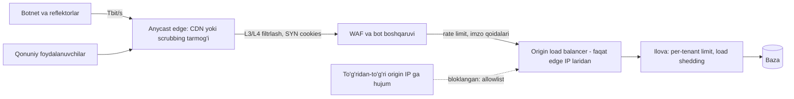

## Bu dars nima uchun kerak

Oldingi darslarda tizimni "qonuniy" yuklamaga - mijozlar, mashinalar, dispetcherlar - moslashtirdik: autoscaling (76-dars), rate limiting (56-dars), load shedding (63-dars). DDoS (Distributed Denial of Service) - bu boshqa masala: **dushmanona** yuklama, maqsadi tizimni foydali ish qilishdan to'xtatish. Uning ko'lami har qanday oddiy capacity planning dan bir necha tartib katta bo'lishi mumkin.

Raqamlar shuni ko'rsatadi. Cloudflare ning 2025-yil 4-chorak hisobotiga (2026-yil 5-fevral) ko'ra 2025 yilda ular 47.1 million DDoS hujumini qaytargan (2024 ga nisbatan 121% o'sish, soatiga o'rtacha 5 376 ta: 3 925 tasi tarmoq qatlamida, 1 451 tasi HTTP), yilning rekord hujumi **31.4 Tbit/s** ga yetgan va atigi 35 soniya davom etgan. Bu ikki raqamni aralashtirmang: alohida "The Night Before Christmas" kampaniyasida (2025-yil 19-dekabrdan) qayd etilgan maksimal qiymatlar 24 Tbit/s, soniyasiga 9 milliard paket va soniyasiga 205 million HTTP so'rov edi, ya'ni 31.4 Tbit/s - yil rekordi, 24 Tbit/s - shu kampaniya cho'qqisi. (Hisobot kirish qismida kampaniya so'rov tezligini "200 million rps dan ortiq" deydi, matn ichidagi bir joyda esa "20 million" deb yozilgan; maksimal 205 Mrps qiymati birinchisini tasdiqlaydi.) Kampaniyani olib borgan Aisuru-Kimwolf botneti asosan zararlangan Android TV qurilmalaridan iborat va 1-4 million host deb baholanadi. AWS ning DDoS whitepaperi esa AWS yiliga milliondan ortiq DDoS hujumini aniqlashini va mijozlariga qarshi har kuni minglab hujumni qaytarishini yozadi.

Bitta xulosa: **o'z serveringizda bunday hajmni "ko'tarib" bo'lmaydi**. 31.4 Tbit/s = 31 400 Gbit/s, ya'ni to'liq yuklangan 314 ta 100 Gbit/s port. Shuning uchun DDoS himoyasi asosan **arxitektura** masalasi: hujum trafigi sizning infratuzilmangizga yetib kelmasdan oldin, katta tarmoq chetida (edge) to'xtatilishi kerak.

WAF (Web Application Firewall) esa boshqa, lekin bog'liq vazifa: HTTP so'rovlar ichidagi zararli **mazmun**ni (SQL injection, XSS, path traversal) va avtomatlashtirilgan suiiste'molni (credential stuffing, scraping) to'xtatish.

Oldingi darslar bilan bog'liqlik: TCP handshake (5-dars), DNS va anycast (6 va 77-darslar), HTTP/2 (7-dars), L4/L7 load balancing (22-dars), CDN (25-dars), API Gateway (54-dars), rate limiting (56-dars), load shedding va graceful degradation (63-64 darslar).

Bu darsdan keyin siz:

- DDoS hujumlarining uch sinfini (volumetrik, protokol, ilova qatlami) va ularning mexanikasini (amplification, SYN flood, HTTP flood, HTTP/2 Rapid Reset) tushuntira olasiz;
- himoyaning qatlamli arxitekturasini (anycast edge, scrubbing, origin yashirish, L4 va L7 filtrlash) loyihalay olasiz;
- WAF qanday ishlashini, uning trade-offlarini (false positive, paranoia darajasi) va to'g'ri joriy etish jarayonini bilasiz;
- rate limiting ni DDoS kontekstida (kalit tanlash, oyna, aggregatsiya) sozlay olasiz;
- TCP/UDP asosidagi IoT ingest kabi HTTP bo'lmagan servislarni himoyalash xususiyatlarini bilasiz.

## DDoS sinflari

### 1. Volumetrik hujumlar (L3/L4, o'tkazuvchanlik)

Maqsad - kanalni to'ldirish. Server qanchalik kuchli bo'lmasin, unga olib boruvchi kanal 10 Gbit/s bo'lsa va 100 Gbit/s trafik kelsa, qonuniy paketlar yetib bormaydi.

**Reflection va amplification** - eng keng tarqalgan usul (AWS DDoS whitepaper): UDP holatsiz bo'lgani uchun hujumchi so'rov paketida manba IP sifatida **qurbonning** IP sini yozadi (spoofing) va uni ochiq UDP serverga (DNS, NTP, SSDP, CLDAP, Memcached, CharGen) yuboradi. Server javobni qurbonga yuboradi, va javob so'rovdan ko'p marta katta. AWS ma'lumotiga ko'ra DNS uchun amplification koeffitsiyenti 28-54 baravar: 64 baytlik so'rov 3 400 baytdan ortiq javob hosil qiladi. Memcached bilan 2018 yildagi hujumlarda Cloudflare 15 baytlik so'rovdan 750 kB javob kuzatgan va buni 51 200 baravar kuchayish deb baholagan (UDP port 11211); o'z laboratoriya sinovida esa 15 bayt 134 KB javob bergan, ya'ni ~10 000 baravar.

Hisob: hujumchida 1 Gbit/s chiquvchi kanal bor. DNS amplification (AWS diapazonining yuqori qismi, ×50) bilan qurbonga 50 Gbit/s, memcached bilan (×51 200, nazariy) 51 Tbit/s gacha - albatta, reflektorlar soni va ularning kanallari bilan cheklangan. Bu amplification ning kuchi: hujumchi narxi va qurbon narxi orasidagi assimetriya.

Ildiz sabab - IP spoofing. BCP 38 (RFC 2827, 2000) internet provayderlariga o'z mijozlaridan kelgan, lekin ularga tegishli bo'lmagan manba IP li paketlarni chegarada tashlab yuborishni tavsiya qiladi. AWS whitepaper ta'kidlaydi: provayderlar BCP 38 ni qanchalik keng joriy etsa, reflection hujumlari shuncha qiyinlashadi. Lekin bu global muammo va siz uni yolg'iz hal qila olmaysiz.

### 2. Protokol hujumlari (L4, holat tugashi)

Maqsad - server, firewall yoki load balancer dagi **holat jadvallarini** to'ldirish.

**SYN flood:** TCP handshake (5-dars) da server SYN olgach, yarim ochiq ulanish holatini saqlaydi va SYN-ACK yuboradi. Hujumchi millionlab SYN yuboradi (ko'pincha soxta manba IP bilan) va handshake ni tugatmaydi - server navbati to'ladi. **SYN cookies** (RFC 4987, 2007): server yarim ochiq ulanish uchun hech qanday holat saqlamaydi, kerakli ma'lumotni SYN-ACK ning sequence raqamiga kriptografik tarzda (secret, vaqt hisoblagichi, manzil va portlar asosida) kodlaydi. Qonuniy klient ACK qaytarsa, server cookie ni tekshirib holatni tiklaydi; soxta SYN lar resurs sarflamaydi. Kamchiligi - ba'zi TCP opsiyalari (masalan window scaling) to'liq saqlanmaydi, shuning uchun odatda faqat hujum paytida yoqiladi. AWS whitepaper zamonaviy OS larda SYN cookies standart yoqilganini yozadi.

**Connection tracking** ham zaif nuqta: stateful firewall har bir oqim uchun holat saqlaydi va hujum paytida uning jadvali to'lishi mumkin. AWS shuning uchun ommaviy listener (80/443) uchun security group larni connection tracking talab qilmaydigan qilib sozlashni tavsiya qiladi.

### 3. Ilova qatlami hujumlari (L7)

Maqsad - ilovaning **qimmat** operatsiyalarini ishga solish. AWS whitepaper ga ko'ra bunday hujumlar ba'zan juda kichik so'rov hajmi bilan erishiladi, shuning uchun aniqlash qiyin. Turlari:

- **HTTP flood** - qonuniy ko'rinadigan so'rovlar oqimi; murakkablari inson xatti-harakatini taqlid qiladi.
- **Cache-busting** - query string ni tasodifiy o'zgartirib (`/map?x=8731`), CDN cache ni chetlab o'tish va har so'rovni origin ga majburlash.
- **Qimmat endpointlar** - qidiruv, hisobot generatsiyasi, eksport, login (parol xeshlash ataylab sekin, 71-dars). Soniyasiga 100 ta "oxirgi 3 yillik hisobot" so'rovi bazani yiqitishga yetadi.
- **TLS hujumlari** - handshake asimmetrik kriptografiya talab qiladi, ko'p handshake yoki qayta muzokara serverni band qiladi.
- **DNS query flood** - tasodifiy subdomenlar bilan resolver cache ni chetlab o'tish.

AWS ta'kidlaydi: L7 hujumlari tobora qisqa va intensiv bo'lmoqda, shuning uchun aniqlash va javob soniyalarda bo'lishi kerak.

### HTTP/2 Rapid Reset (CVE-2023-44487)

Ilova qatlami va protokol hujumining zamonaviy namunasi. Google Cloud 2023-yil 10-oktabrda e'lon qilgan: 2023-yil avgustidagi eng katta hujum soniyasiga **398 million so'rovdan** oshgan. Mexanika: HTTP/2 da klient `RST_STREAM` freymi bilan so'rovni bir tomonlama bekor qila oladi. Hujumchi stream ochadi va darhol bekor qiladi, shuning uchun bir vaqtdagi stream limitiga hech qachon yetmaydi va ulanish ochiq qoladi. Server esa har bekor qilingan so'rov uchun haqiqiy ish qiladi (stream tuzilmalari, header dekompressiya, ba'zan backend ga yo'naltirish), hujumchi esa deyarli hech narsa sarflamaydi. Himoya: alohida so'rovlarni emas, suiiste'mol aniqlangan **butun TCP ulanishni** yopish; ulanish statistikasini kuzatish (masalan, 100 dan ortiq so'rovning 50 foizdan ko'pi bekor qilingan bo'lsa); HTTP/2 implementatsiyalarini yangilash.

Saboq: protokolning har bir "arzon klient, qimmat server" operatsiyasi - potentsial DDoS vektori.

| Sinf | Misol | O'lchov | Qayerda to'xtatiladi |
|---|---|---|---|
| Volumetrik | UDP reflection/amplification | Gbit/s, Tbit/s | Provayder yoki anycast edge, scrubbing |
| Protokol | SYN flood, ACK flood | Paket/s | Edge, SYN cookies, stateless filtrlash |
| Ilova (L7) | HTTP flood, cache-busting, Rapid Reset | So'rov/s | CDN/WAF, rate limiting, ilova ichida |

## Himoya arxitekturasi: qatlamlar

AWS DDoS whitepaper va amaliyotdagi umumiy tamoyillar: **hujum yuzasini kamaytirish**, **yutish uchun masshtab**, **origin ni yashirish**, **ilova darajasida filtrlash**, va **oldindan reja**.

### 1. Hujum yuzasini kamaytirish

Internetga faqat kerakli narsani oching. AWS misoli: oddiy veb-ilova uchun faqat TCP 80 va 443 ochiq bo'lsa, boshqa port va protokoldagi ko'p vektorlar avtomatik kesiladi. Bazalar, Redis, Kafka, admin panellar, SSH - hech qachon ommaviy IP da emas. Ochiq qolgan Redis yoki Memcached nafaqat sizni xavf ostiga qo'yadi, balki boshqalarga hujum uchun **reflektor** bo'ladi.

### 2. Masshtab bilan yutish: anycast edge

77-darsda ko'rganimizdek, anycast da bir xil IP ko'plab data-markazlardan e'lon qilinadi va tarmoq trafikni eng yaqiniga olib boradi. Cloudflare buni DDoS kontekstida tushuntiradi: botnet trafigi butun tarmoq bo'ylab taqsimlanadi va har bir data-markaz hujumning faqat bir qismini yutadi; tarmoq kengaygan sari yutish yuzasi ham kattalashadi. Hisob: 31.4 Tbit/s hujum 300 ta nuqtaga teng bo'linsa, har biriga `31 400 / 300 ≈ 105` Gbit/s tushadi - bitta katta data-markaz uchun boshqariladigan hajm. Haqiqatda botnet joylashuviga qarab taqsimot notekis, shuning uchun har nuqtada zaxira kerak.

Variantlar: CDN/edge provayder (Cloudflare, Akamai, AWS CloudFront + Shield, Google Cloud Armor), provayderning scrubbing markazi (hujum paytida BGP orqali trafikni tozalash markaziga burish), yoki operator darajasidagi filtrlash. Lokal data-markazdagi tizim uchun upstream operator bilan DDoS himoya shartnomasi - eng muhim qadam.

### 3. Origin ni yashirish

Agar hujumchi origin serverning haqiqiy IP sini bilsa, u edge ni chetlab o'tib to'g'ridan-to'g'ri unga hujum qiladi. Shuning uchun:

- origin faqat edge provayder IP diapazonlaridan (yoki mTLS bilan, 74-dars) trafik qabul qiladi;
- origin IP si DNS tarixida, email headerlarida (`Received:`), SSL sertifikat loglarida, xato sahifalarida sizmasligi kerak;
- IP sizgan bo'lsa - yangisiga almashtirish.

### 4. L7 filtrlash: WAF va rate limiting

L3/L4 qatlami trafik hajmini to'xtatadi, lekin "qonuniy ko'rinadigan" HTTP so'rovlar o'tib ketadi. Ular uchun WAF, bot boshqaruvi va rate limiting (pastda).

### 5. Ilova ichidagi himoya

Oxirgi qatlam - ilovaning o'zi. Hujum edge dan qisman o'tib ketsa ham tizim yiqilmasligi uchun:

- **qimmat endpointlarni** himoyalash: autentifikatsiya talab qilish, per-user/per-tenant limit, navbat orqali asinxron bajarish (hisobotlar);
- **load shedding** (63-dars): ortiqcha yuklamada past prioritetli so'rovlarni tez rad etish, asosiy funksiyani saqlash;
- **cache** strategiyasi: query string ni normalizatsiya qilish (cache-busting ga qarshi), noma'lum parametrlarni cache kalitidan chiqarish;
- **timeout lar va ulanish limitlari**: sekin klientlarga qarshi (Slowloris turidagi), har IP/ulanish uchun stream limitlari.

### 6. Oldindan reja (runbook)

Hujum paytida birinchi marta o'ylash - kech. Kerakli narsalar: kim qaror qiladi, provayder bilan qanday bog'lanish, "hujum rejimi" ga o'tish tugmasi (qattiqroq rate limit, CAPTCHA/challenge, ba'zi endpointlarni vaqtincha o'chirish), aloqa shabloni mijozlar uchun (70-dars incident management).

## WAF: ichki mexanika va trade-offlar

WAF - HTTP so'rovlarni (URL, headerlar, body, cookie) qoidalar bo'yicha tekshirib, bloklaydigan, belgilaydigan yoki qo'shimcha tekshiruvga yuboradigan reverse proxy qatlami. Joylashuvi: CDN edge da, load balancer da (masalan, AWS WAF ALB yoki CloudFront ga ulangan) yoki ilova oldidagi proxy da (ModSecurity, Coraza).

### Qoida turlari

1. **Imzo (signature) qoidalari** - ma'lum hujum naqshlari: SQL injection (`' OR 1=1--`), XSS (`<script>`), path traversal (`../../etc/passwd`), shell injection. Eng mashhur ochiq to'plam - **OWASP Core Rule Set (CRS)**: ModSecurity, Coraza va boshqa mos WAF lar uchun umumiy hujum aniqlash qoidalari, OWASP Top Ten ni qamrab olishga mo'ljallangan.
2. **Rate-based qoidalar** - kalit (IP, header, token, tenant) bo'yicha so'rovlar sonini cheklash.
3. **Reputatsiya va geo** - ma'lum zararli IP ro'yxatlari, mamlakatlar bo'yicha cheklov (ehtiyotkorlik bilan: B2B mijozlaringiz qayerda?).
4. **Bot boshqaruvi** - JavaScript challenge, TLS fingerprint, xatti-harakat tahlili, CAPTCHA.
5. **Ijobiy (positive) model** - API sxemasi (OpenAPI) bo'yicha faqat ruxsat etilgan endpoint, metod va parametrlarni o'tkazish. Eng kuchli, lekin sxemani yangilab turish kerak.

### Paranoia darajasi va false positive

OWASP CRS buni **paranoia level** (PL) bilan boshqaradi: PL1 deyarli hech qachon noto'g'ri signal bermaydigan qoidalar; PL2 qo'shimcha qoidalar bilan ko'proq hujumni aniqlaydi, lekin qonuniy so'rovlarni ham bloklash ehtimoli bor; PL3 va PL4 - yanada agressiv, PL4 deyarli har qanday hujumni aniqlaydi, lekin ko'p qonuniy trafikni ham zararli deb belgilaydi. Bu klassik **aniqlik va to'liqlik** (precision va recall) trade-offi.

| Mezon | Past sezgirlik (PL1) | Yuqori sezgirlik (PL3-4) |
|---|---|---|
| Aniqlanadigan hujumlar | Asosiy, keng tarqalgan | Deyarli hammasi |
| False positive | Juda kam | Ko'p, ehtiyotkor sozlash kerak |
| Sozlash mehnati | Kam | Ko'p (istisno qoidalari) |
| Qachon | Ko'p ilovalar uchun boshlanish | Yuqori xavfli, yaxshi o'rganilgan ilovalar |

Fleet API misolida false positive qanday paydo bo'ladi: geofence poligoni JSON da ko'p qavs va maxsus belgilarga ega; hisobot filtri SQL ga o'xshash ifodani (`speed > 90 AND zone = 'A'`) o'z ichiga oladi; foydalanuvchi izohida HTML. Qattiq WAF bularni SQL injection yoki XSS deb bloklaydi - va mijoz "tizim ishlamayapti" deydi.

### To'g'ri joriy etish jarayoni

1. **Count/detect rejimida boshlash** - qoidalar bloklamaydi, faqat log yozadi. 1-2 hafta haqiqiy trafikni kuzatish.
2. **False positive larni tahlil qilish** va nuqtali istisnolar yozish (aniq endpoint va parametr uchun, butun qoidani o'chirmasdan).
3. **Bosqichma-bosqich block rejimiga** o'tish: avval yuqori ishonchli qoidalar.
4. **Monitoring**: bloklangan so'rovlar soni, endpoint va tenant bo'yicha; keskin o'zgarish - yo hujum, yo yangi deploy dagi false positive.
5. **WAF - qo'shimcha qatlam, xavfsiz kod o'rnini bosmaydi.** Parametrlashtirilgan SQL so'rovlar, chiqishni escape qilish, avtorizatsiya (72-dars) - asosiy himoya. WAF ma'lum hujumlar uchun "virtual patch" va chuqur himoya qatlami (defense in depth).

## Rate limiting DDoS kontekstida

56-darsda rate limiting algoritmlarini (token bucket, sliding window) ko'rdik. DDoS da asosiy savol - **kalit nima**?

| Kalit | Yaxshi tomoni | Muammo |
|---|---|---|
| Manba IP | Oddiy, autentifikatsiyasiz ishlaydi | Botnet millionlab IP; CGNAT ortida minglab qonuniy foydalanuvchi bitta IP da |
| IP prefiksi (/24, ASN) | Taqsimlangan hujumni ushlaydi | Qonuniy foydalanuvchilarni ham to'sadi |
| API kalit yoki token | Aniq, tenantga bog'liq | Faqat autentifikatsiyadan keyin |
| Tenant | Noisy neighbor bilan bir xil mexanizm (73-dars) | Tenant ichidagi buzilgan akkaunt boshqalarini ham to'sadi |
| Endpoint bo'yicha | Qimmat endpointlarni alohida himoyalash | Ko'p qoida |

O'zbekiston kontekstida muhim nuqta: mobil operatorlar ko'pincha CGNAT ishlatadi, ya'ni ko'p abonent bitta ommaviy IP ortida. Faqat IP bo'yicha qattiq limit - haydovchi ilovasining yuzlab foydalanuvchisini bir vaqtda bloklashi mumkin. Shuning uchun autentifikatsiyalangan trafik uchun token yoki tenant bo'yicha limit, autentifikatsiyasiz (login, ro'yxatdan o'tish) uchun IP + challenge kombinatsiyasi.

AWS WAF rate-based qoidalarida baholash oynasi 60, 120, 300 yoki 600 soniya (standart 300), minimal limit 10 so'rov, limit har bir aggregatsiya instansiyasiga (masalan har IP ga) qo'llanadi. Hujjatdagi "caveats" bo'limiga ko'ra WAF tezlikni yaqin so'rovlarga ko'proq og'irlik beradigan algoritm bilan baholaydi va limitga aniq moslikni kafolatlamaydi; tarqalish kechikishlari tufayli juda yuqori tezlik bir necha daqiqagacha aniqlanmasdan o'tishi mumkin, tezlik pasayganini aniqlash esa odatda 30 soniyadan kam oladi. Ya'ni WAF rate limit - qo'pol filtr; aniq per-user kvotalar ilova yoki API gateway da (54-dars).

Hisob (masala sharti): login endpointi, normal holatda 20 so'rov/s. Credential stuffing botneti 50 000 IP dan har biri daqiqasiga 3 ta urinish qiladi: `50 000 × 3 / 60 = 2 500` so'rov/s. Per-IP limit (masalan, 5 daqiqada 20 urinish) bunga ta'sir qilmaydi - har IP limitdan past. Kerakli choralar: login uchun global limit va anomaliya aniqlash (so'rov/s 100 baravar oshdi), muvaffaqiyatsiz urinishlar foizi monitoring, akkaunt bo'yicha limit (bitta login ga minglab IP dan urinish), challenge, MFA. Bu "sekin va taqsimlangan" hujumlar qanday ishlashi va nega bitta qatlam yetmasligining yaxshi namunasi.

## HTTP bo'lmagan servislar: IoT ingest

iQuariX ning GPS trekerlari TCP (yoki UDP) orqali binar protokolda ulanadi. HTTP uchun mo'ljallangan CDN va WAF bu yerda ishlamaydi. Himoya choralari:

- **L4 DDoS himoyasi** - anycast L4 proxy yoki provayder scrubbing (masalan, AWS hujjatida TCP/UDP ilovalar - gaming, IoT, VoIP - uchun Global Accelerator va Shield Advanced bilan anycast statik IP arxitekturasi tasvirlangan).
- **Yopiq tarmoq** - trekerlar mobil operator APN/VPN orqali ulansa (74-dars), ingest gateway umuman internetda ko'rinmaydi. Bu eng kuchli "hujum yuzasini kamaytirish".
- **Tez rad etish** - protokol handshake ining birinchi baytlarida noto'g'ri paketlarni arzon rad etish, autentifikatsiyadan o'tmagan ulanishlarga qisqa timeout, IMEI bo'yicha ulanish limiti (bitta IMEI dan 1-2 ulanish).
- **UDP ehtiyotkorligi** - agar UDP ishlatilsa, javob hech qachon so'rovdan katta bo'lmasligi kerak (aks holda siz reflektorga aylanasiz) va autentifikatsiyadan oldin katta javob yubormaslik.

## Real tizimlardan misollar

- **Cloudflare** - 2025 yilda 47.1 million hujum, yil rekordi 31.4 Tbit/s (35 soniya), "Night Before Christmas" kampaniyasi cho'qqisi 24 Tbit/s va 205 Mrps, anycast tarmog'i bo'ylab yutish.
- **Google Cloud** - HTTP/2 Rapid Reset (CVE-2023-44487), 398 million so'rov/s dan ortiq; ulanish darajasida himoya.
- **Memcached amplification** (2018) - ochiq qolgan UDP 11211 portlari 51 200 baravargacha kuchayish bilan reflektorga aylangan.
- **AWS Best Practices for DDoS Resiliency** - hujum turlari, hujum yuzasini kamaytirish, SYN cookies, connection tracking, L7 hujumlar evolyutsiyasi.
- **OWASP CRS** - paranoia darajalari bilan ochiq WAF qoidalari to'plami.

## iQuariX kontekstida

Masala sharti: iQuariX quyidagi ommaviy kirish nuqtalariga ega: dispetcher veb-paneli va API, mobil ilova API si, mijoz integratsiya API si, treker ingest (TCP), va ommaviy "reysni kuzatish" havolalari (72-dars). Himoya rejasi:

1. **Veb va API** - anycast CDN/WAF provayderi orqasida; statik resurslar cache da; origin faqat provayder IP laridan qabul qiladi; WAF CRS PL1 dan count rejimida boshlab, 2 haftada block ga; geofence va hisobot filtri endpointlari uchun nuqtali istisnolar.
2. **Login va ro'yxatdan o'tish** - IP + akkaunt bo'yicha limit, muvaffaqiyatsiz urinishlar foizi alerti, bot challenge, MFA (71-dars).
3. **Qimmat endpointlar** (hisobotlar, eksport, video arxiv) - faqat autentifikatsiya bilan, per-tenant concurrency limit (73-dars), navbat orqali.
4. **Ommaviy kuzatish havolalari** - token bilan, qisqa umr, cache qilinadigan javob (bir necha soniyalik joylashuv), havola bo'yicha rate limit.
5. **Treker ingest** - imkon qadar operator APN orqali yopiq tarmoq; ochiq qism uchun L4 DDoS himoyasi bilan anycast IP, IMEI bo'yicha ulanish limiti va tez rad etish.
6. **Runbook** - "hujum rejimi": WAF ni qattiqroq sozlamaga o'tkazish, ommaviy havolalarni vaqtincha o'chirish, dispetcher funksiyalarini saqlab qolish uchun hisobotlarni to'xtatish (graceful degradation, 64-dars).

Hisob (masala sharti): dispetcher API ning normal cho'qqisi 1 000 so'rov/s, origin 3 000 so'rov/s gacha ko'taradi. 200 000 so'rov/s L7 hujumida edge 99.5 foizini to'xtatsa, origin ga `200 000 × 0.005 = 1 000` so'rov/s yetib keladi - qonuniy trafik bilan birga 2 000, sig'imga sig'adi. Agar edge faqat 98 foizini to'xtatsa - 4 000 + 1 000 = 5 000 so'rov/s, origin yiqiladi. Ya'ni filtr samaradorligining 1.5 foizlik farqi tizim yashashini belgilaydi; shuning uchun ilova ichidagi load shedding - majburiy oxirgi qatlam.

## Ko'p uchraydigan xatolar

1. **"Bizni hech kim hujum qilmaydi"** - hujumlar ko'pincha avtomatik va tasodifiy; B2B SaaS raqobatchilar yoki tovlamachilar uchun ham nishon.
2. **Origin IP ochiq qolishi** - CDN ortida bo'lsa ham to'g'ridan-to'g'ri hujum mumkin.
3. **Ommaviy internetda baza, Redis, Memcached, admin panellar** - hujum nishoni va reflektor.
4. **WAF ni darhol block rejimida yoqish** - qonuniy mijozlar bloklanadi, keyin WAF butunlay o'chiriladi.
5. **WAF ni xavfsiz kod o'rniga qo'yish** - SQL injection ga qarshi asosiy himoya parametrlashtirilgan so'rovlar.
6. **Faqat IP bo'yicha rate limit** - botnetlarni ushlamaydi va CGNAT ortidagi qonuniy foydalanuvchilarni to'sadi.
7. **Qimmat endpointlar autentifikatsiyasiz va limitsiz** - kichik L7 hujum bazani yiqitadi.
8. **Runbook va provayder kontakti yo'q** - hujum paytida birinchi marta reja tuzish.

## Xulosa

- DDoS uch sinfda: volumetrik (kanalni to'ldirish, amplification), protokol (holat jadvallarini to'ldirish, SYN flood) va ilova qatlami (qimmat operatsiyalarni ishga solish, HTTP flood, Rapid Reset).
- Zamonaviy hujumlar Tbit/s va yuzlab million so'rov/s darajasida; ularni o'z serverda ko'tarib bo'lmaydi - himoya arxitektura va edge masalasi.
- Qatlamlar: hujum yuzasini kamaytirish, anycast edge bilan yutish, origin ni yashirish, WAF va rate limiting, ilova ichida load shedding, oldindan runbook.
- Amplification ning ildizi - IP spoofing (BCP 38); SYN flood ga qarshi - SYN cookies; Rapid Reset ga qarshi - ulanish darajasida himoya.
- WAF - imzo, rate, reputatsiya, bot va ijobiy model qoidalari; paranoia darajasi aniqlik va to'liqlik trade-offi; count rejimidan boshlab bosqichma-bosqich joriy etiladi. U xavfsiz kod o'rnini bosmaydi.
- Rate limit kaliti hujum turiga mos bo'lishi kerak; taqsimlangan "sekin" hujumlarga qarshi global anomaliya va akkaunt darajasidagi limitlar kerak.

## Amaliy topshiriq

iQuariX uchun DDoS va WAF himoya arxitekturasini loyihalang. Kontekst: dispetcher veb/API (normal cho'qqi 1 000 so'rov/s, origin sig'imi 3 000), mobil API (25 000 haydovchi, ko'pchiligi CGNAT ortida), mijoz integratsiya API si, 60 000 treker TCP ingest (30 foizi operator APN orqali, qolgani ochiq internet), ommaviy reys kuzatish havolalari. Infratuzilma Toshkentdagi data-markazda (77-78 darslar).

1. Hujum yuzasi inventarizatsiyasi: barcha ommaviy endpoint, port va protokollar ro'yxati; qaysilarini yopish yoki yashirish mumkin.
2. Har bir kirish nuqtasi uchun qatlamli himoya: L3/L4 (kim, qayerda), L7 (WAF, rate limit), ilova ichida. Lokal data-markaz uchun upstream DDoS himoyasini qanday tashkil qilasiz?
3. Rate limiting jadvali: har endpoint uchun kalit (IP, token, tenant, akkaunt), limit, oyna va harakat; CGNAT muammosini qanday hal qilasiz.
4. WAF joriy etish rejasi: boshlang'ich qoidalar to'plami va paranoia darajasi, count rejimi muddati, fleet-ga xos false positive larni (geofence JSON, hisobot filtrlari) qanday ko'rib chiqasiz.
5. Treker ingest himoyasi: ochiq qismdagi trekerlar uchun choralar va ularni APN ga ko'chirish rejasi.
6. Hisob va runbook: 300 000 so'rov/s L7 hujumida edge filtr samaradorligi qancha bo'lishi kerakki origin yashasin? "Hujum rejimi" qadamlari va qaysi funksiyalar birinchi o'chiriladi.

Yaxshi javobda bo'lishi kerak bo'lgan narsalar:

- hujum sinflari bo'yicha alohida choralar (volumetrik, protokol, L7);
- origin yashirish va faqat edge dan trafik qabul qilish;
- CGNAT va taqsimlangan hujumlarni hisobga olgan rate limit kalitlari;
- WAF ni count rejimidan bosqichma-bosqich joriy etish va false positive boshqaruvi;
- HTTP bo'lmagan ingest uchun alohida yondashuv;
- filtr samaradorligi va origin sig'imi bo'yicha raqamli hisob hamda graceful degradation.

Javobni pastdagi maydonga yozib, chatga yuboring.

## Manbalar

- AWS. [Best Practices for DDoS Resiliency](https://docs.aws.amazon.com/whitepapers/latest/aws-best-practices-ddos-resiliency/aws-best-practices-ddos-resiliency.html), 2023-yil 9-avgust (AWS uni hozir "historical reference" deb belgilagan) - "Infrastructure layer attacks", ["UDP reflection attacks"](https://docs.aws.amazon.com/whitepapers/latest/aws-best-practices-ddos-resiliency/udp-reflection-attacks.html), ["SYN flood attacks"](https://docs.aws.amazon.com/whitepapers/latest/aws-best-practices-ddos-resiliency/syn-flood-attacks.html), ["Application layer attacks"](https://docs.aws.amazon.com/whitepapers/latest/aws-best-practices-ddos-resiliency/application-layer-attacks.html) bo'limlari.
- Cloudflare. [2025 Q4 DDoS threat report](https://blog.cloudflare.com/ddos-threat-report-2025-q4/), 2026-yil 5-fevral - 2025 yil statistikasi, 31.4 Tbit/s yil rekordi va kampaniyaning 24 Tbit/s / 9 Bpps / 205 Mrps cho'qqilari.
- Google Cloud. [How it works: The novel HTTP/2 'Rapid Reset' DDoS attack](https://cloud.google.com/blog/products/identity-security/how-it-works-the-novel-http2-rapid-reset-ddos-attack), 2023 - CVE-2023-44487.
- Cloudflare. [Memcrashed - Major amplification attacks from UDP port 11211](https://blog.cloudflare.com/memcrashed-major-amplification-attacks-from-port-11211/), 2018 va [A Brief Anycast Primer](https://blog.cloudflare.com/a-brief-anycast-primer/).
- IETF. [RFC 4987: TCP SYN Flooding Attacks and Common Mitigations](https://www.rfc-editor.org/rfc/rfc4987.html), 2007 - SYN cookies; [RFC 2827 (BCP 38): Network Ingress Filtering](https://www.rfc-editor.org/rfc/rfc2827.html), 2000 - spoofing ga qarshi filtrlash.
- OWASP. [Core Rule Set](https://github.com/coreruleset/coreruleset) va [Paranoia Levels](https://github.com/coreruleset/documentation/blob/main/content/2-how-crs-works/2-2-paranoia_levels.md) - WAF qoidalari va sezgirlik darajalari.
- AWS. [Rate-based rule high-level settings in AWS WAF](https://docs.aws.amazon.com/waf/latest/developerguide/waf-rule-statement-type-rate-based-high-level-settings.html) - baholash oynasi, limit va aggregatsiya; [Rate-based rule caveats](https://docs.aws.amazon.com/waf/latest/developerguide/waf-rule-statement-type-rate-based-caveats.html) - yaqinlashtirilgan baholash va aniqlash kechikishi.
