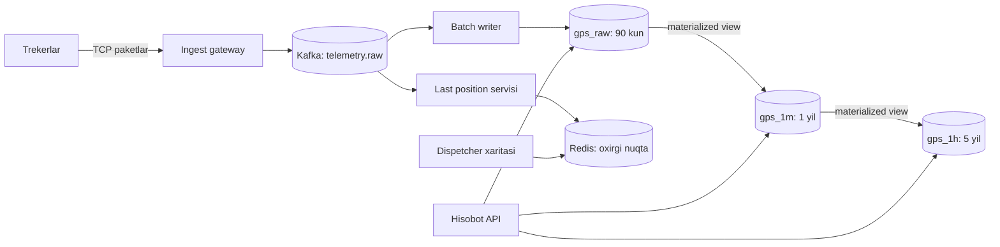

## Bu dars nima uchun kerak

GPS treker har 10 soniyada nuqta yuboradi, yoqilg'i datchigi (ДУТ) har bir necha soniyada sath o'lchaydi, CAN-shina tezlik, aylanish, harorat beradi. Bu ma'lumotlarning umumiy xususiyati bor: har bir yozuv **vaqt belgisiga** ega, deyarli faqat qo'shiladi (append), eski yozuv deyarli hech qachon o'zgartirilmaydi, so'rovlar esa doim vaqt oralig'i bo'yicha keladi ("kechagi marshrut", "oxirgi 30 kundagi yoqilg'i sarfi"). Bunday ma'lumot **time-series** deyiladi.

1-darsdagi hisobda 10 000 qurilma kuniga taxminan 8.6 GB, yiliga 3 TB hosil qilishini ko'rdik. Oddiy PostgreSQL jadvali bunda uchta joyda sinadi: B-tree indekslar xotiraga sig'may qoladi, eski ma'lumotni `DELETE` bilan o'chirish bazani qiynaydi (vacuum, bloat), "oylik o'rtacha" kabi agregat so'rovlar milliardlab qatorni o'qiydi. Time-series tizimlar aynan shu uch muammo uchun qurilgan.

Bu dars 13-dars (LSM-tree), 14-dars (B-tree, WAL), 16-dars (column-oriented storage), 28-dars (partitioning) va 78-dars (retention) ustiga quriladi.

Bu darsdan keyin siz:

- time-series yuklamaning xususiyatlarini va nega u umumiy OLTP bazadan boshqa saqlashni talab qilishini tushuntira olasiz;
- vaqt bo'yicha partitioning, columnar siqish (delta-of-delta, XOR/Gorilla) qanday ishlashini bilasiz;
- TimescaleDB (hypertable, chunk, columnstore, continuous aggregate) va ClickHouse (MergeTree, sparse index, TTL, materialized view) ichki mexanikasini taqqoslay olasiz;
- downsampling va retention siyosatini loyihalay olasiz;
- fleet telemetriyasi uchun sxema, partition va saqlash darajalarini hisob bilan asoslay olasiz.

## Time-series yuklamaning xususiyatlari

Time-series ma'lumotni boshqa yuklamalardan ajratib turadigan beshta xususiyat:

1. **Yozish ustun.** Yozish/o'qish nisbati odatda katta: millionlab nuqta yoziladi, ularning kichik qismi o'qiladi. Yozish doimiy va bir tekis oqim.
2. **Append-only, deyarli tartiblangan.** Yangi nuqta odatda eng yangi vaqtga tushadi. Istisno - **late data**: qurilma tunnel yoki tog'da aloqasiz yurib, keyin to'plangan nuqtalarni yuboradi. Bu GPS trekerlarda juda ko'p uchraydi va dizaynda albatta hisobga olinishi kerak (45-darsdagi event time va watermark).
3. **So'rovlar vaqt oralig'i bo'yicha.** "Qurilma X ning 2026-10-19 kungi nuqtalari", "Oxirgi soatda tezligi 90 dan oshgan mashinalar". Bitta qatorni ID bo'yicha olish kam.
4. **Yangi ma'lumot issiq, eskisi sovuq.** Oxirgi bir necha kun ko'p o'qiladi, 6 oy oldingisi kamdan-kam. Bu saqlash darajalariga (tiering) olib keladi.
5. **Eski ma'lumotning aniqligi kamroq kerak.** 2 yil oldingi har 10 soniyalik nuqta kerak emas, lekin kunlik yurilgan masofa kerak. Bu **downsampling** ga olib keladi.

Bundan tashqari **kardinallik** (cardinality) tushunchasi muhim: noyob seriyalar soni. Bitta seriya - (qurilma, metrika) juftligi. 10 000 qurilma x 20 metrika = 200 000 seriya. Prometheus kabi tizimlarda har bir label kombinatsiyasi alohida seriya bo'lgani uchun, label sifatida, masalan, haydovchi ID yoki marshrut ID qo'shish seriyalar sonini portlatib yuborishi mumkin. Columnar bazalarda (ClickHouse) kardinallik kamroq muammo, chunki seriya alohida obyekt sifatida saqlanmaydi.

## Saqlashning uchta asosiy g'oyasi

### 1. Vaqt bo'yicha partitioning

Ma'lumot vaqt oraliqlari bo'yicha alohida bo'laklarga (partition, chunk) bo'linadi: masalan, har kun yoki har hafta. Bu uchta narsani beradi:

- **Partition pruning.** "Kechagi marshrut" so'rovi faqat kechagi bo'lakni o'qiydi, boshqalarini butunlay o'tkazib yuboradi.
- **Arzon retention.** 90 kundan eski ma'lumotni o'chirish `DELETE ... WHERE ts < ...` emas (millionlab qatorni belgilash, keyin vacuum), balki butun bo'lakni tashlash: `DROP` - fayl darajasidagi metadata amali, bir zumda bajariladi.
- **Indeks xotiraga sig'adi.** Har bir bo'lakning o'z kichik indeksi bor. Faol yozilayotgan bo'lak indeksi RAM da turadi, eskilari esa diskda yotaveradi.

Bo'lak hajmini tanlash - trade-off. Juda katta bo'lak: indekslari xotiraga sig'maydi. Juda kichik: bo'laklar soni minglab, planner har birining metadata'sini ko'rib chiqishga vaqt sarflaydi.

### 2. Columnar saqlash va maxsus siqish

16-darsda ko'rganimizdek, columnar saqlashda bir ustunning qiymatlari ketma-ket yotadi. Time-series uchun bu ayniqsa foydali, chunki qo'shni qiymatlar bir-biriga juda o'xshash: vaqt belgisi har doim taxminan 10 soniyaga oshadi, yoqilg'i sathi sekin o'zgaradi, qurilma ID bir xil takrorlanadi. Bu o'xshashlikni ishlatadigan maxsus kodeklar bor.

**Delta va delta-of-delta (vaqt belgilari uchun).** Facebook ning 2015 yilgi Gorilla maqolasi bu g'oyani mashhur qildi. Vaqt belgilarini to'g'ridan-to'g'ri saqlash o'rniga ularning farqini, keyin farqlar farqini saqlaymiz:

| Vaqt (s) | Delta | Delta-of-delta |
|---|---|---|
| 1000 | - | - |
| 1010 | 10 | - |
| 1020 | 10 | 0 |
| 1030 | 10 | 0 |
| 1041 | 11 | 1 |

Davriy yuboriladigan ma'lumotda delta-of-delta deyarli doim 0. Gorilla da 0 bitta bit bilan kodlanadi. Maqolaga ko'ra Facebook ma'lumotlarida vaqt belgilarining taxminan 96 foizi bitta bitga siqilgan.

**XOR (float qiymatlar uchun).** Qiymatni oldingisi bilan XOR qilamiz. Qiymat o'zgarmagan bo'lsa natija 0 - yana bitta bit. O'zgargan bo'lsa, XOR natijasida boshida va oxirida ko'p nol bo'ladi, faqat o'rtadagi "ma'noli" bitlar saqlanadi. Gorilla maqolasida qiymatlarning taxminan 51 foizi bitta bitga siqilgan (oldingi bilan bir xil). Natijada 16 baytlik (64-bit vaqt + 64-bit qiymat) nuqta o'rtacha taxminan 1.37 baytga tushgan - taxminan 12 barobar siqish.

**Boshqa usullar:** dictionary encoding (qurilma ID, holat kodlari kabi takrorlanuvchi qiymatlar), run-length encoding (bir xil qiymatlar ketma-ketligi: "dvigatel o'chiq" 3 soat davomida), keyin umumiy maqsadli siqish (LZ4, ZSTD).

ClickHouse da bular ustun darajasidagi kodeklar sifatida bor: `DoubleDelta` (doimiy qadamli monoton ketma-ketlik, masalan vaqt belgilari), `Gorilla` va `FPC` (sekin o'zgaradigan float), `T64` (butun sonlarning ishlatilmaydigan yuqori bitlarini tashlaydi), `Delta` va `GCD` (tayyorlovchi kodeklar, ular ustidan ZSTD yoki LZ4 qo'yiladi). Standart siqish self-managed ClickHouse da LZ4, ClickHouse Cloud da ZSTD.

### 3. Agregatlarni oldindan hisoblash (downsampling)

Xom ma'lumot ustida "oxirgi yil bo'yicha har oy yurilgan masofa" so'rovi milliardlab qatorni o'qiydi. Yechim - xom ma'lumotdan **rollup** (yig'ma) jadvallar hosil qilish: 1 daqiqalik, 1 soatlik, 1 kunlik. Har bir rollup qatori oynadagi `min`, `max`, `sum`, `count`, `first`, `last` kabi qiymatlarni saqlaydi.

Muhim nozik joy: **o'rtachani o'rtacha qilib bo'lmaydi.** Soatlik `avg` lardan kunlik `avg` ni hisoblash noto'g'ri (har soatda nuqtalar soni har xil bo'lishi mumkin). Shuning uchun rollupda `sum` va `count` saqlanadi, `avg = sum / count` o'qishda hisoblanadi. Percentile uchun esa oddiy son yetmaydi - t-digest yoki HDR histogram kabi birlashtiriladigan (mergeable) sketch kerak.

Downsampling ning yana bir nozik joyi: **late data**. Agar 1 soatlik rollup soat 11:00 da yopilgan bo'lsa-yu, 11:40 da qurilma 10:15 dagi nuqtalarni yuborsa, 10:00-11:00 oynasini qayta hisoblash kerak. Time-series tizimlar buni invalidation (eskirgan oynani belgilab, qayta hisoblash) yoki agregatlarni birlashtiriladigan holatda saqlash orqali hal qiladi.

## TimescaleDB ichida

TimescaleDB - PostgreSQL kengaytmasi (extension). Asosiy afzalligi: to'liq SQL, JOIN, tranzaksiyalar, PostGIS, mavjud PostgreSQL ekotizimi (Prisma, Kysely, pg_dump, replication) ishlayveradi.

### Hypertable va chunk

`create_hypertable` bilan oddiy jadval **hypertable** ga aylanadi. Tashqaridan bu bitta jadval, ichida esa vaqt oralig'i bo'yicha avtomatik yaratiladigan ko'plab **chunk** lar (har biri oddiy PostgreSQL jadvali). `INSERT` kelganda TimescaleDB vaqt belgisiga qarab to'g'ri chunk ni topadi yoki yangisini yaratadi.

Rasmiy hujjat bo'yicha raqamlar:

- vaqt ustuni uchun standart `chunk_time_interval` - **7 kun**;
- tavsiya: faol yozilayotgan chunk larning indekslari asosiy xotiraning taxminan **25 foizi**ga (taxminan `shared_buffers`) sig'sin;
- hujjatdagi misol: 64 GB RAM, `shared_buffers` taxminan 16 GB; kuniga 2 GB indeks o'sishi bo'lsa 7 kun mos (14 GB), kuniga 10 GB bo'lsa 1 kun;
- bitta hypertable da 1 000 dan ortiq chunk bo'lsa, chunk metadata'sini ko'rib chiqish so'rov rejalashtirishda sezilarli vaqt ola boshlaydi.

Retention: `add_retention_policy('gps_points', INTERVAL '90 days')` - fon jarayoni eski chunk larni butunlay tashlaydi (`drop_chunks`).

### Hypercore: rowstore va columnstore

TimescaleDB ning hybrid storage engine'i **hypercore** deb ataladi. Yangi ma'lumot avval **rowstore** ga (oddiy PostgreSQL qatorlari, tez insert, update, upsert) tushadi. Chunk "sovugach" (masalan, 7 kundan keyin) policy uni **columnstore** ga o'tkazadi: qatorlar ustun bo'yicha batch'larga (hujjatga ko'ra har bir ustundan 1 000 tagacha qiymat) yig'iladi va siqiladi. Hujjatda saqlash hajmi 90 foizdan ko'proq qisqarishi aytiladi (ma'lumotga bog'liq).

Ikki asosiy sozlama:

- `segmentby` - batch'lar qaysi ustun bo'yicha guruhlanadi. Eng ko'p filtrlanadigan ustun: fleet uchun `device_id`. Shunda "qurilma X ning marshruti" so'rovi faqat shu qurilma batch'larini ochadi.
- `orderby` - batch ichidagi tartib, odatda `ts DESC`. Bu delta kodlash samarasini ham oshiradi.

### Continuous aggregates

**Continuous aggregate** - avtomatik, inkremental yangilanadigan materialized view. `time_bucket('1 hour', ts)` bilan guruhlangan agregat yoziladi, fon policy uni muntazam yangilaydi. Oddiy PostgreSQL materialized view dan farqi: har safar hammasini qayta hisoblamaydi, faqat o'zgargan oynalarni. Eski vaqtdagi ma'lumot o'zgarsa (late data), o'zgarish log'ga yoziladi va refresh paytida tegishli bucket'lar qayta hisoblanadi.

**Real-time aggregation** - so'rov paytida materializatsiya qilingan natijaga hali materializatsiya qilinmagan eng yangi xom qatorlarni qo'shib berish. TimescaleDB 2.13 dan boshlab standart holatda **o'chirilgan** (oldin yoqilgan edi). Ya'ni yoqmasangiz, agregat refresh oralig'icha "orqada" qoladi.

Continuous aggregate ustiga ham alohida retention qo'yish mumkin: xom ma'lumot 90 kun, soatlik agregat 2 yil, kunlik agregat 5 yil.

## ClickHouse ichida

ClickHouse - ochiq kodli columnar OLAP DBMS. U PostgreSQL emas: tranzaksiyalar, `UPDATE` va JOIN cheklangan, lekin skanerlash va agregatsiya juda tez.

### MergeTree: LSM ga o'xshash mexanika

ClickHouse ning asosiy engine oilasi **MergeTree**. Mexanika 13-darsdagi LSM-tree ga o'xshash:

1. Har bir `INSERT` diskda yangi o'zgarmas **part** yaratadi. Part ichida qatorlar `ORDER BY` kaliti bo'yicha saralangan, har bir ustun alohida faylda siqilgan.
2. Fon jarayoni kichik part larni katta part larga **merge** qiladi (xuddi compaction).
3. Part lar `PARTITION BY` ifodasi bo'yicha guruhlanadi (masalan, `toYYYYMM(ts)`); merge faqat bitta partition ichida bo'ladi. Partition'ni butunlay tashlash `ALTER TABLE ... DROP PARTITION` bilan arzon.

Shu sabab ClickHouse **kichik va tez-tez insert** ni yoqtirmaydi: har bir insert part, ko'p part esa merge yuklamasi va oxir-oqibat "Too many parts" xatosi. Rasmiy tavsiya: kamida 1 000 qator, ideal holda 10 000 - 100 000 qatorli batch, taxminan soniyasiga bitta insert. Agar mijozlar ko'p va har biri kichik yozsa, `async_insert` yoqiladi - server batching'ni o'zi qiladi.

### Sparse primary index

ClickHouse har bir qator uchun indeks yozuvi saqlamaydi. Qatorlar **granule** larga bo'linadi (standart `index_granularity` = 8 192 qator), primary index esa har bir granule'ning birinchi qatori kalitini saqlaydi (**mark**). So'rov kelganda mark lar bo'yicha binary search qilinib, kerakli granule'lar topiladi va faqat ular o'qiladi.

ClickHouse hujjatidagi misol: 8.87 million qatorli jadvalda 1 083 ta granule, primary index xotirada taxminan 97 KiB. Kalitning birinchi ustuni bo'yicha filtr bilan so'rov 19 qadamli binary search orqali bitta granule'ni (8 192 qatorga yaqin) tanlaydi, 8.87 million qatorni skanerlash o'rniga.

Bundan muhim xulosa: **`ORDER BY` kaliti - eng muhim dizayn qarori.** Fleet uchun `ORDER BY (device_id, ts)` tanlansa, "bitta qurilmaning bir kunlik nuqtalari" diskda ketma-ket yotadi: bitta qurilmaning 8 640 kunlik nuqtasi (24 x 360) bir-ikkita granule. `ORDER BY (ts, device_id)` tanlansa, aksincha, "hamma qurilmalarning oxirgi 5 daqiqasi" tez bo'ladi, lekin bitta qurilma marshruti butun kun bo'ylab sochilib ketadi. Kalit ustunlarini past kardinallikdan yuqoriga tartiblash ham siqishni yaxshilaydi (masalan, `tenant_id, device_id, ts`).

### Agregatlar: materialized view va AggregatingMergeTree

ClickHouse da materialized view - **insert trigger**: manba jadvalga kelgan har bir insert blokini SELECT orqali o'tkazib, natijani boshqa jadvalga yozadi. Maqsad jadval odatda `SummingMergeTree` yoki `AggregatingMergeTree`: merge paytida bir xil kalitli qatorlarni birlashtiradi. `AggregatingMergeTree` da agregat **holati** saqlanadi (`avgState`, `uniqState`, `quantileState`), o'qishda `avgMerge` bilan yakunlanadi. Bu "o'rtachani o'rtacha qilib bo'lmaydi" muammosini to'g'ri hal qiladi va late data ni tabiiy qabul qiladi: kech kelgan blok shunchaki yana bir qisman holat sifatida qo'shiladi.

E'tibor: merge darhol bo'lmaydi, shuning uchun o'qishda baribir `GROUP BY` bilan yakuniy birlashtirish kerak.

### TTL

ClickHouse da TTL qoidalari jadvalga yoziladi:

- `TTL ts + INTERVAL 90 DAY DELETE` - eski qatorlarni o'chirish;
- `TTL ts + INTERVAL 30 DAY GROUP BY ... SET ...` - o'chirishdan oldin yig'ish (rollup); GROUP BY ustunlari primary key prefiksi bo'lishi kerak;
- `TTL ts + INTERVAL 7 DAY TO VOLUME 'cold'` - sovuq diskka ko'chirish (ClickHouse Cloud da qo'llab-quvvatlanmaydi);
- `RECOMPRESS CODEC(ZSTD(...))` - eski part'larni kuchliroq siqish.

TTL faqat merge paytida qo'llanadi; `merge_with_ttl_timeout` standart qiymati 14 400 soniya (4 soat). Ya'ni muddati o'tgan qator bir necha soat ko'rinib turishi mumkin.

### Deduplication

GPS trekerlar tez-tez bir xil paketni qayta yuboradi (ACK yo'qolsa). ClickHouse da `UNIQUE` cheklov yo'q. Variantlar: `ReplacingMergeTree` (merge paytida bir xil `ORDER BY` kalitli qatorlardan bittasini qoldiradi, lekin merge qachon bo'lishi kafolatlanmagan, shuning uchun o'qishda `FINAL` yoki `argMax` kerak) yoki deduplikatsiyani ingest qatlamida qilish (39-dars: idempotency).

## TimescaleDB va ClickHouse taqqoslash

| Mezon | TimescaleDB | ClickHouse |
|---|---|---|
| Asos | PostgreSQL kengaytmasi | Mustaqil columnar DBMS |
| SQL va JOIN | To'liq PostgreSQL, PostGIS, FK | ClickHouse SQL dialekti, JOIN cheklangan va qimmatroq |
| Yangi ma'lumotga UPDATE/upsert | Rowstore da oddiy | Qimmat (mutation) yoki ReplacingMergeTree |
| Insert shakli | Kichik insert ham normal | Katta batch shart yoki async_insert |
| Agregat skanerlash tezligi | Columnstore bilan yaxshi | Odatda eng tez, vektorlashtirilgan |
| Downsampling | Continuous aggregate + policy | Materialized view + AggregatingMergeTree, TTL GROUP BY |
| Retention | drop_chunks policy | TTL, DROP PARTITION |
| Gorizontal masshtab | Asosan bitta tugun + replica | Sharding va replication ichida bor |
| Operatsion murakkablik | Jamoa PostgreSQL ni bilsa past | Yangi tizim, ClickHouse Keeper, merge tuning |
| Qachon tanlash | Telemetriya + biznes ma'lumot bitta joyda, o'rta hajm | Juda katta hajm, og'ir analitika, ko'p mijozli dashboardlar |

Boshqa variantlar ham bor: InfluxDB, Prometheus (metrikalar uchun, uzoq saqlashga mo'ljallanmagan), QuestDB, Apache Druid. Lekin fleet platforma uchun qaror odatda shu ikkitasi orasida bo'ladi.

## Real tizimlardan misollar

**Facebook Gorilla (2015).** Monitoring metrikalari uchun in-memory TSDB. Oxirgi 26 soat ma'lumot xotirada, delta-of-delta va XOR siqish bilan nuqta o'rtacha 1.37 bayt. Maqolaga ko'ra 2015 yil bahorida 2 milliarddan ortiq seriya va soniyasiga taxminan 12 million nuqta, oldingi tizimga nisbatan so'rovlar 70 barobardan ko'proq tez. Bu kodlash keyinchalik Prometheus, InfluxDB va ClickHouse `Gorilla` kodekiga asos bo'ldi.

**Cloudflare HTTP Analytics (2018).** Cloudflare analitika pipeline'ini PostgreSQL rollup bazasi va 12 tugunli Citus klasteridan ClickHouse ga ko'chirdi: 36 tugun, replication factor 3, barcha pipeline'lar bo'yicha o'rtacha soniyasiga taxminan 11 million qator. Agregatlar materialized view orqali `SummingMergeTree` jadvallarga yozildi, noyob tashrifchilar uchun `AggregatingMergeTree`. Granularlik: daqiqa, soat, kun, oy - aynan downsampling piramidasi.

## Hisob-kitob: fleet telemetriya hajmi

Faraz qiling: 10 000 qurilma, har 10 soniyada nuqta. Nuqtada: `device_id` (UInt32), `ts` (DateTime64, 8 bayt), `lat`, `lon` (Float64), `speed` (UInt16), `course` (UInt16), `fuel_level` (Float32), `ignition` (UInt8), `sats` (UInt8), yana 10 ta datchik ustuni. Xom hajm taxminan 80 bayt.

**Yozish:** 10 000 / 10 = 1 000 nuqta/s. Kuniga 1 000 x 86 400 = 86.4 million nuqta.

**Xom hajm:** 86.4 M x 80 B = 6.9 GB/kun. 90 kun: taxminan 620 GB. PostgreSQL oddiy jadvalda qator sarlavhasi (23 bayt) va indekslar bilan bu yana 1.5-2 barobar ko'p bo'ladi.

**Columnar siqish bilan:** time-series ma'lumotda 10 barobar siqish real (Gorilla maqolasida 12x). Taxminan 0.7 GB/kun, 90 kun - taxminan 62 GB. Bu bitta serverning NVMe diskiga bemalol sig'adi.

**Downsampling:** 1 daqiqalik rollup qurilma uchun kuniga 1 440 qator: 10 000 x 1 440 = 14.4 million qator/kun (xomdan 6 barobar kam). 1 soatlik: 240 000 qator/kun (360 barobar kam). 3 yillik soatlik agregat: 240 000 x 1 095 = taxminan 263 million qator - bitta ClickHouse tugunida sekundlar ichida skanerlanadigan hajm.

**ClickHouse insert:** 1 000 nuqta/s. Agar har bir nuqtani alohida insert qilsak - soniyasiga 1 000 part, bu ClickHouse uchun halokat. Ingest worker 1-2 soniya buferlab, 1 000-2 000 qatorli batch yuborsa - soniyasiga bitta insert, tavsiyaga mos. Yoki Kafka dan iste'mol qiluvchi bitta consumer batch qiladi.

**TimescaleDB chunk hajmi:** kuniga 6.9 GB xom, `(device_id, ts)` indeks taxminan 1.5-2 GB/kun deylik. 32 GB RAM, `shared_buffers` 8 GB bo'lsa, 7 kunlik chunk indekslari (taxminan 12 GB) sig'maydi - 1-2 kunlik chunk tanlash kerak. 90 kunlik retention da 1 kunlik chunk: 90 ta chunk, 1 000 chegarasidan ancha past.

## iQuariX kontekstida: telemetriya saqlash arxitekturasi

Deylik, iQuariX telemetriyani quyidagicha saqlaydi.



Asosiy qarorlar:

**Sxema (ClickHouse varianti):**

```sql
CREATE TABLE gps_raw (
  tenant_id   UInt32,
  device_id   UInt32,
  ts          DateTime64(3) CODEC(DoubleDelta, ZSTD),
  received_at DateTime64(3) CODEC(DoubleDelta, ZSTD),
  lat         Float64 CODEC(Gorilla, ZSTD),
  lon         Float64 CODEC(Gorilla, ZSTD),
  speed       UInt16  CODEC(T64, ZSTD),
  fuel_level  Float32 CODEC(Gorilla, ZSTD),
  ignition    UInt8
)
ENGINE = ReplacingMergeTree
PARTITION BY toYYYYMMDD(ts)
ORDER BY (tenant_id, device_id, ts)
TTL toDateTime(ts) + INTERVAL 90 DAY DELETE;
```

- `ts` (qurilma vaqti) va `received_at` (server qabul qilgan vaqt) alohida. Late data ni aniqlash va watermark uchun ikkalasi ham kerak.
- `ORDER BY (tenant_id, device_id, ts)` - asosiy so'rov "bitta mashinaning kunlik marshruti" va multi-tenancy (73-dars) filtri.
- `ReplacingMergeTree` - qayta yuborilgan paketlar merge paytida bitta qoladi; marshrut so'rovida `FINAL` ishlatiladi yoki ingest qatlamida dedup qilinadi.
- Kunlik partition: 90 kun = 90 partition, retention `DROP PARTITION` yoki TTL bilan.

**Yoqilg'i (ДУТ) uchun rollup.** Yoqilg'i sathi shovqinli (chayqalish, nishablik). Daqiqalik rollupda `min`, `max`, `avg` (state), `first`, `last` saqlanadi: quyish va to'kish hodisalarini aniqlash algoritmi `first`/`last` farqi va median filtr bilan ishlaydi, lekin hodisa aniqlangan oynaning xom nuqtalari baribir 90 kun saqlanadi - mijoz bahslashsa, xom grafikni ko'rsatish kerak.

**Masofa va yurish vaqti.** Kunlik yurilgan masofani soatlik agregatdan olish uchun har bir soatda `sum(distance_delta)` saqlanadi. Masofani koordinatadan har safar qayta hisoblash (haversine) o'rniga ingest paytida qo'shni nuqtalar orasidagi masofa hisoblanib ustun sifatida yoziladi.

**Oxirgi joylashuv alohida.** "Xaritada hozir qayerda" eng ko'p o'qiladigan so'rov. Uni 90 kunlik jadvaldan `ORDER BY ts DESC LIMIT 1` bilan olish isrof. Redis da `device_id -> oxirgi nuqta` hash saqlanadi (23-dars).

**TimescaleDB qachon yetarli.** Agar iQuariX da 10-20 ming qurilma bo'lsa va jamoa PostgreSQL bilan ishlasa, TimescaleDB bitta stack'da (biznes jadvallar, PostGIS geozonalar, telemetriya) qolish imkonini beradi: `segmentby = device_id`, `orderby = ts DESC`, 1 kunlik chunk, 7 kundan keyin columnstore, 90 kunlik retention, soatlik va kunlik continuous aggregate. ClickHouse ga o'tish trigger'i: yuz minglab qurilma, ko'p tenant'li og'ir dashboardlar yoki bitta tugun yozish limitiga yaqinlashish.

## Ko'p uchraydigan xatolar

1. **Time-series ni oddiy jadvalda va bitta katta B-tree indeks bilan saqlash.** Indeks RAM dan oshgach, har bir insert random IO ga aylanadi va yozish keskin sekinlashadi.
2. **Retention ni `DELETE` bilan qilish.** Millionlab qator o'chirish vacuum va bloat keltiradi. Partition/chunk ni butunlay tashlang.
3. **ClickHouse ga har bir nuqtani alohida insert qilish.** Part lar soni portlaydi. Batch yoki `async_insert`.
4. **Noto'g'ri `ORDER BY`/`segmentby`.** Asosiy so'rov shakliga emas, "intuitiv" tartibga qarab tanlash. Kalit qurilma marshruti so'roviga mos bo'lishi kerak.
5. **O'rtachalarning o'rtachasini olish.** Rollupda `sum` va `count` (yoki agregat state) saqlang.
6. **Late data ni unutish.** Rollup oynasi yopilgandan keyin kelgan nuqtalar agregatga tushmaydi yoki noto'g'ri hisoblanadi. Qurilma vaqti va server vaqtini alohida saqlang, invalidation mexanizmini tekshiring.
7. **Xom ma'lumotni juda erta tashlash.** Yoqilg'i o'g'irligi bo'yicha bahs yoki sug'urta holati bo'lsa, xom nuqtalar kerak bo'ladi. Retention ni biznes va huquqiy talabdan chiqaring (78-dars).
8. **Prometheus label'iga yuqori kardinallik qo'yish.** Har bir `device_id` ni label qilish millionlab seriya yaratadi. Biznes telemetriyasi monitoring tizimiga emas, TSDB/OLAP ga tegishli.

## Xulosa

- Time-series: vaqt belgili, append-only, vaqt oralig'i bo'yicha so'raladigan, yangisi issiq va eskisi sovuq ma'lumot.
- Uchta asosiy g'oya: vaqt bo'yicha partitioning, columnar siqish (delta-of-delta, XOR, dictionary), oldindan hisoblangan rollup.
- TimescaleDB: PostgreSQL ichida hypertable, chunk, hypercore columnstore, continuous aggregate va retention policy.
- ClickHouse: MergeTree part va merge, sparse primary index (8 192 qatorli granule), materialized view + AggregatingMergeTree, TTL.
- `ORDER BY` / `segmentby` kaliti asosiy so'rov shaklidan chiqadi.
- Retention - partition tashlash, `DELETE` emas. Downsampling - `sum`/`count` yoki agregat state bilan.
- Late data va dublikat paketlar GPS telemetriyada norma, ularni sxema darajasida hisobga oling.

## Amaliy topshiriq

Faraz qiling, iQuariX 25 000 qurilmaga o'smoqda. Har bir qurilma har 10 soniyada GPS nuqta va har 5 soniyada yoqilg'i datchigi o'qishini yuboradi. Talablar: xom GPS 90 kun, xom yoqilg'i 180 kun (bahsli holatlar uchun), kunlik hisobotlar 3 yil, dashboard so'rovlari p95 2 soniyadan tez.

1. Yozish yuklamasini (nuqta/s) va kunlik xom hajmni hisoblang, siqishdan oldin va keyin. Taxminlaringizni ochiq yozing.
2. TimescaleDB yoki ClickHouse ni tanlang va 3 ta asosli sabab keltiring. Qaysi shart o'zgarsa qaroringizni qayta ko'rasiz?
3. GPS va yoqilg'i uchun jadval sxemalarini yozing: partition kaliti, `ORDER BY`/`segmentby`, kodeklar, deduplication usuli.
4. Downsampling piramidasini loyihalang: qaysi darajalar, har birida qaysi ustunlar (min/max/sum/count/first/last), har birining retention'i va taxminiy hajmi.
5. Qurilma 3 kun aloqasiz yurib, keyin 26 000 ta eski nuqtani yuborgan holatni ko'rib chiqing: xom jadval, rollup va dashboard bilan nima bo'ladi?
6. Bir yillik umumiy disk hajmini hisoblang va qaysi qismi issiq (NVMe), qaysi qismi sovuq (HDD yoki object storage) darajada turishini ayting.

Yaxshi javobda bo'lishi kerak bo'lgan narsalar:

- yozish yuklamasi GPS va yoqilg'i uchun alohida hisoblangan, batch hajmi va insert chastotasi ko'rsatilgan;
- `ORDER BY` kaliti asosiy so'rovdan (qurilma bo'yicha marshrut, tenant filtri) asoslangan;
- rollupda `avg` emas, `sum` + `count` yoki agregat state saqlangan;
- late data uchun qurilma va server vaqti ajratilgan, rollup qayta hisoblanishi tushuntirilgan;
- retention partition tashlash yoki TTL orqali, `DELETE` bilan emas;
- hajm hisobida siqish koeffitsienti taxmin ekanligi va uni real ma'lumotda o'lchash rejasi aytilgan.

Javobni pastdagi maydonga yozib, chatga yuboring.

## Manbalar

- Pelkonen va boshq. "Gorilla: A Fast, Scalable, In-Memory Time Series Database", VLDB 2015. [Maqola konspekti (The Morning Paper)](https://blog.acolyer.org/2016/05/03/gorilla-a-fast-scalable-in-memory-time-series-database/) - delta-of-delta, XOR siqish, 1.37 bayt/nuqta.
- TimescaleDB hujjati: [Sizing hypertable chunks](https://www.tigerdata.com/docs/learn/hypertables/sizing-hypertable-chunks) - standart 7 kunlik interval, 25% xotira qoidasi.
- TimescaleDB hujjati: [Hypercore](https://www.tigerdata.com/docs/api/latest/hypercore) - rowstore/columnstore, segmentby, orderby.
- TimescaleDB hujjati: [About continuous aggregates](https://www.tigerdata.com/docs/use-timescale/latest/continuous-aggregates/about-continuous-aggregates) - materializatsiya, invalidation, real-time aggregation.
- ClickHouse hujjati: [A practical introduction to primary indexes](https://clickhouse.com/docs/guides/best-practices/sparse-primary-indexes) - granule, mark, sparse index.
- ClickHouse hujjati: [Column compression codecs](https://clickhouse.com/docs/reference/statements/create/table/codec), [Manage data with TTL](https://clickhouse.com/docs/en/guides/developer/ttl), [Bulk inserts](https://clickhouse.com/docs/cloud/bestpractices/bulk-inserts).
- Cloudflare. [HTTP Analytics for 6M requests per second using ClickHouse](https://blog.cloudflare.com/http-analytics-for-6m-requests-per-second-using-clickhouse/), 2018.
- Martin Kleppmann, Chris Riccomini. Designing Data-Intensive Applications, 2-nashr, O'Reilly, 2026 - column-oriented storage va siqish bo'limlari.
