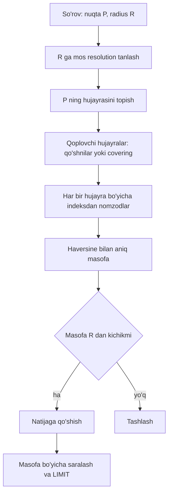

## Bu dars nima uchun kerak

Fleet platformada eng ko'p beriladigan savollarning yarmi geografik: "Shu nuqtaga eng yaqin 5 ta bo'sh mashina qaysi?", "Mashina qaysi geozonada turibdi?", "Chilonzor tumanidagi barcha mashinalar", "Qaysi hududda soat 8-9 da tirbandlik ko'p?". Bularning hammasi **ikki o'lchovli** so'rov: kenglik (latitude) va uzunlik (longitude).

15-darsda ko'rgan B-tree bir o'lchovli tartibga asoslangan. `(lat, lon)` composite indeksi `lat` bo'yicha oraliqni tez topadi, lekin `lon` bo'yicha filtr esa shu oraliq ichida yana skanerlashga aylanadi: 41.30 dan 41.32 gacha kenglikdagi barcha nuqtalar (butun dunyo bo'ylab sharqdan g'arbgacha bo'lgan tasma) o'qiladi. Geospatial indekslash bu muammoni ikki xil yo'l bilan hal qiladi:

1. **Ikki o'lchovni bir o'lchovga aylantirish** (space-filling curve): geohash, S2, H3. Natija oddiy son yoki satr, uni B-tree, Redis sorted set, Cassandra yoki Kafka kaliti sifatida ishlatsa bo'ladi.
2. **Ikki o'lchovli daraxt**: quadtree, R-tree. Daraxt fazoni bevosita bo'ladi.

Bu darsdan keyin siz:

- B-tree nega 2D so'rovni yaxshi qilolmasligini tushuntira olasiz;
- geohash, quadtree, S2, H3, R-tree ichida qanday ishlashini va har birining chekka holatlarini bilasiz;
- radius va "eng yaqin K ta" so'rovi qanday bajarilishini qadam-baqadam ko'rsata olasiz;
- vazifaga qarab (proximity, agregatsiya, polygon saqlash, sharding) to'g'ri indeksni tanlay olasiz;
- hujayra (cell) o'lchamini so'rov radiusiga qarab hisoblay olasiz.

Geofencing va proximity search ning to'liq dizayni 83-darsda, ride-hailing case 95-darsda.

## Asosiy tushunchalar va hisob

**Koordinata.** GPS WGS84 tizimida kenglik -90..90, uzunlik -180..180 daraja beradi. Darajani metrga aylantirish:

- 1 daraja kenglik taxminan 111 km (deyarli doimiy);
- 1 daraja uzunlik = 111 km x cos(kenglik). Toshkentda (taxminan 41.3 daraja) cos(41.3) taxminan 0.75, ya'ni 1 daraja uzunlik taxminan 83 km.

Bundan muhim xulosa: "0.01 daraja radius" Toshkentda shimol-janubga 1.1 km, sharq-g'arbga 0.83 km. Ya'ni darajalar bilan qilingan "doira" aslida ellips. Shu sabab masofa hisoblari haversine (sferik) yoki geodezik formulalar bilan, darajada emas, metrda qilinadi.

**Ikki bosqichli filtr.** Deyarli barcha geospatial indekslar bir xil sxemada ishlaydi:

1. **Grubiy filtr (index scan).** Indeks so'rov hududini qamraydigan nomzodlarni tez topadi. Bu taxminiy: chetdagi ortiqcha nuqtalar ham keladi.
2. **Aniq filtr (refine).** Har bir nomzod uchun haqiqiy masofa yoki "poligon ichidami" tekshiruvi.

Indeks sifati - birinchi bosqichda nechta ortiqcha nomzod chiqishi (false positive) va nechta hujayra/tugun o'qilishi.

## Geohash: Z-order curve

Geohash ni 2008 yilda Gustavo Niemeyer e'lon qilgan va public domain ga bergan. Algoritm:

1. Uzunlik oralig'ini [-180, 180] ikkiga bo'lamiz: nuqta o'ng yarmida bo'lsa bit 1, chap yarmida 0. Keyin shu yarmini yana ikkiga bo'lamiz va hokazo.
2. Kenglik [-90, 90] uchun ham xuddi shunday.
3. Bitlarni navbatma-navbat qo'shamiz (interleave): uzunlik, kenglik, uzunlik, kenglik... Bu **Z-order (Morton) curve**.
4. Har 5 bitni base32 belgiga aylantiramiz (alifbo: 0-9 va a, i, l, o dan tashqari lotin harflari).

Natija: `tz6s...` kabi satr. Har bir qo'shimcha belgi hujayrani 32 ga bo'ladi. Hujayra o'lchami (ekvatorda, belgilar soni bo'yicha):

| Uzunlik | Kenglik x balandlik |
|---|---|
| 5 | taxminan 4.89 x 4.89 km |
| 6 | taxminan 1.22 x 0.61 km |
| 7 | taxminan 153 x 153 m |
| 8 | taxminan 38 x 19 m |
| 9 | taxminan 4.8 x 4.8 m |

Toshkent kengligida hujayra kengligi cos(41.3) ga ko'paytiriladi, ya'ni taxminan 25% torroq.

**Afzalligi:** umumiy prefiks - yaqinlik. "Hujayra `tz6s4` ichidagi hamma" so'rovi oddiy prefiks yoki B-tree oralig'i: `WHERE gh >= 'tz6s4' AND gh < 'tz6s5'`. Har qanday KV store da ishlaydi.

**Kamchiliklari:**

- **Chegara muammosi.** Ikki nuqta 10 metr masofada bo'lsa ham, katta hujayra chegarasining ikki tomonida bo'lsa, umumiy prefiksi bo'lmasligi mumkin. Ekvator, Grinvich meridiani va 180-meridian atrofida ayniqsa yomon. Yechim: radius so'rovida markaz hujayra **va uning 8 qo'shnisi** tekshiriladi.
- **Z-curve sakrashlari.** Z harfi shaklidagi egri chiziq ba'zi joylarda uzoqqa sakraydi: ketma-ket ID lar har doim ham qo'shni hujayra emas.
- **Notekis hujayralar.** Toq uzunlikda hujayra kvadrat emas, qutblarga yaqinlashgan sari tor bo'lib boradi.

**Redis GEO** aynan shu g'oyada qurilgan: `GEOADD` koordinatani 52-bitli interleaved geohash butun soniga aylantirib, sorted set score sifatida saqlaydi (double 52-bitli butun sonni aniqliksiz yo'qotmasdan saqlay oladi). `GEOSEARCH` markaz hujayra va 8 qo'shnisi uchun score oraliqlarini hisoblab, sorted set dan oladi, keyin haversine bilan aniq filtrlaydi. Hujjatga ko'ra Yer sfera deb olingani uchun eng yomon holatda xato 0.5% gacha, kenglik esa taxminan +/-85.05 daraja bilan cheklangan.

## Quadtree: moslashuvchan bo'lish

Quadtree (Finkel va Bentley, 1974) fazoni rekursiv to'rtga bo'ladi:

1. Butun hudud - ildiz tugun.
2. Agar tugundagi nuqtalar soni chegaradan (masalan, 100) oshsa, u 4 ta bolaga bo'linadi: shimoli-g'arb, shimoli-sharq, janubi-g'arb, janubi-sharq.
3. Nuqtalar bolalarga taqsimlanadi, jarayon takrorlanadi.

Asosiy farq geohash dan: **bo'linish ma'lumot zichligiga moslashadi.** Toshkent markazida daraxt chuqur (kichik kataklar), cho'lda sayoz (katta kataklar). Geohash da esa hamma joyda bir xil to'r.

Radius so'rovi: ildizdan pastga tushamiz, so'rov doirasi bilan kesishmaydigan tugunlarni butunlay tashlaymiz, kesishganlarining bargidagi nuqtalarni aniq tekshiramiz.

Trade-off: quadtree odatda **xotirada** quriladi (masalan, servis ishga tushganda). Doimiy harakatlanayotgan obyektlar uchun (har 5-10 s yangilanadigan mashinalar) daraxtni yangilash, bo'lish va birlashtirish qimmat va concurrency talab qiladi. Shuning uchun quadtree statik yoki sekin o'zgaradigan ma'lumotda yaxshi: bizneslar, POI, geozonalar. Alex Xu "System Design Interview" 2-jildidagi "Proximity Service" (Yelp kabi) bobida aynan shu sababli quadtree xotirada, bizneslar bazada saqlanadi.

S2 ham, H3 ham aslida quadtree/hierarchical grid g'oyasining sferaga moslashtirilgan variantlari.

## S2: kub, Hilbert curve va 64-bit ID

S2 - Google ning sferik geometriya kutubxonasi (Apache 2.0). Mexanikasi:

1. Yer sferasi atrofiga **kub** quriladi, sfera 6 ta kub yuzasiga proyeksiya qilinadi. Har bir yuza - 0-darajadagi hujayra.
2. Har bir hujayra rekursiv 4 ga bo'linadi: 0 dan 30 gacha **daraja (level)**. 30-darajadagi barg hujayra taxminan 1 sm.
3. Hujayralar **Hilbert curve** bo'yicha raqamlanadi. Z-curve dan farqli, Hilbert curve uzoqqa sakramaydi: ketma-ket ID lar deyarli doim qo'shni hujayralar. 6 ta yuzaning egri chiziqlari bitta uzluksiz halqaga ulangan.
4. Har bir hujayra **64-bitli `S2CellId`**: 3 bit yuza, har bir daraja uchun 2 bit bola tanlovi va oxirida 1 bit. Eng past o'rnatilgan bit holatidan daraja aniqlanadi. Ota hujayrani topish - bitlar amali.

Ba'zi darajalarda o'rtacha hujayra maydoni (S2 statistikasi bo'yicha):

| Daraja | O'rtacha maydon | Taxminiy tomon |
|---|---|---|
| 10 | 81 km2 | 7-10 km |
| 12 | 5.07 km2 | 2 km |
| 13 | 1.27 km2 | 0.85-1.2 km |
| 14 | 0.32 km2 | 425-610 m |
| 16 | 19 800 m2 | 106-153 m |
| 20 | 77 m2 | 7-10 m |

**Region covering.** S2 ning eng kuchli tomoni - `S2RegionCoverer`: istalgan shaklni (doira, poligon) turli darajadagi hujayralar to'plami bilan qoplaydi. Standart `max_cells` = 8. Hujjatdagi statistika: 8 hujayra bilan qoplama maydoni haqiqiy maydondan mediana bo'yicha taxminan 1.98 barobar katta, 100 hujayra bilan taxminan 1.11 barobar. Ya'ni hujayra ko'p - aniqroq, lekin so'rovda oraliqlar ko'p.

So'rov qanday bajariladi: doira 8-20 ta hujayra bilan qoplanadi, har bir hujayra `S2CellId` oralig'iga aylanadi (hujayra ichidagi barcha barg ID lar bitta uzluksiz oraliqda, Hilbert tartibi tufayli), bazada shu oraliqlar bo'yicha B-tree range scan qilinadi, keyin aniq masofa tekshiriladi.

S2 hujjati kutubxona Google ning katta geografik ma'lumotlarida sinovdan o'tganini aytadi; uni boshqa tizimlar ham ishlatadi (masalan, MongoDB ning `2dsphere` indeksi S2 ga asoslangani manbalarda tilga olinadi, lekin bu darsda rasmiy hujjat bilan tekshirilmagan).

## H3: olti burchakli to'r

H3 - Uber 2018 yilda ochiq kodga chiqargan ierarxik olti burchakli (hexagonal) indeks. Mexanikasi:

1. Sfera **ikosaedr** (20 yuzali ko'pyoqli) yuzalariga gnomonik proyeksiya qilinadi.
2. 0-darajada **122 ta** asosiy hujayra: 110 olti burchak va 12 besh burchak (pentagon). 12 pentagon ikosaedr uchlarida turadi va okeanga tushadigan qilib joylashtirilgan.
3. 0 dan 15 gacha **16 ta resolution**. Har bir hujayraning 7 ta bolasi bor (**aperture 7**): har bir keyingi resolution da hujayralar soni taxminan 7 barobar ko'p.
4. Har bir hujayra 64-bitli butun son (mode, resolution, base cell va 15 tagacha raqamli yo'l).

Nega olti burchak? Kvadrat to'rda qo'shnilar ikki xil: tomon bo'yicha (4 ta) va burchak bo'yicha (4 ta), markazlar orasidagi masofa har xil. Olti burchakda **barcha 6 qo'shni bir xil masofada**. Bu silliqlash (smoothing), gradient, "k qadam uzoqlikdagi hududlar" kabi tahlillarni sodda qiladi. Uber blogiga ko'ra H3 narx (surge pricing) uchun shahardagi talab va taklifni olti burchaklar bo'yicha hisoblashda ishlatiladi.

Narxi: **ierarxiya aniq emas.** Olti burchakni 7 ta kichik olti burchakka aniq bo'lib bo'lmaydi, shuning uchun bola hujayralar ota hujayra ichida faqat taxminan yotadi. Mantiqiy (ID darajasida) ierarxiya aniq, geometrik emas. S2 da esa bolalar otani aniq qoplaydi.

Resolution jadvali (rasmiy H3 hujjati):

| Res | O'rtacha maydon | O'rtacha tomon |
|---|---|---|
| 7 | 5.16 km2 | 1.41 km |
| 8 | 0.737 km2 | 531 m |
| 9 | 0.105 km2 | 201 m |
| 10 | 0.015 km2 | 76 m |
| 15 | 0.9 m2 | 0.58 m |

Asosiy funksiyalar (H3 v4 API): `latLngToCell` (koordinata -> hujayra), `cellToParent`/`cellToChildren`, `gridDisk(cell, k)` (k qadamgacha bo'lgan barcha hujayralar), `gridRing`, `polygonToCells` (poligonni hujayralar bilan to'ldirish), `compactCells` (to'liq to'ldirilgan ota hujayralarni birlashtirish; hujjatdagi Kaliforniya misolida 10 633 hujayra 901 ga qisqargan).

`gridDisk(k)` hujayralar soni: k-halqada 6k hujayra, demak 1 + 6(1 + 2 + ... + k) = 3k(k+1) + 1. k = 1 da 7, k = 2 da 19, k = 3 da 37. Pentagon yaqinida natija kamroq bo'lishi mumkin.

## R-tree: obyektlarni to'rtburchaklar bilan

R-tree (Guttman, 1984) nuqtalar emas, **shakllar** (poligon, chiziq) uchun eng keng tarqalgan indeks. B-tree ning 2D varianti:

1. Har bir obyekt o'zining **MBR** (minimum bounding rectangle - eng kichik o'rab turuvchi to'rtburchak) bilan ifodalanadi.
2. Barg tugunlarda obyektlar MBR lari, ichki tugunlarda bolalarning MBR larini o'rab turuvchi to'rtburchak.
3. Daraxt muvozanatli, tugunlar disk sahifasiga mos (B-tree kabi).
4. Qidiruv: so'rov to'rtburchagi bilan kesishgan tugunlarga tushamiz. Farq B-tree dan: aka-uka tugunlarning MBR lari **ustma-ust tushishi** mumkin, shuning uchun bir nechta shoxga tushishga to'g'ri keladi. Daraxt sifati - overlap qanchalik kam ekanida (R*-tree kabi variantlar insert algoritmini shu uchun yaxshilaydi).

**PostGIS** R-tree ni PostgreSQL GiST (Generalized Search Tree) ustida quradi: `CREATE INDEX ... USING GIST (geom)`. Indeksda geometriyaning o'zi emas, bounding box saqlanadi, shuning uchun ikki bosqichli filtr: indeks `&&` (bounding box kesishadimi) bilan nomzodlarni beradi, keyin `ST_Intersects`, `ST_Contains`, `ST_DWithin` aniq hisoblaydi. Bu funksiyalar indeksni avtomatik ishlatadi.

**KNN.** "Eng yaqin 5 ta" uchun PostGIS da `ORDER BY geom <-> nuqta LIMIT 5`. `<->` operatori indeksni faqat `ORDER BY` ichida va bir tomoni konstanta bo'lganda ishlatadi. Daraxt bo'ylab "best-first" qidiruv: eng yaqin MBR li tugunlar birinchi ochiladi. Aniq KNN masofasi PostGIS 2.2 va PostgreSQL 9.5 dan beri. `geography` turida tartib sferaga asoslanadi.

Boshqa tizimlar: Lucene/Elasticsearch `geo_point` va `geo_shape` uchun BKD-tree (k-d tree oilasi) ishlatadi (59-dars).

## Qaysi birini qachon

| Mezon | Geohash | Quadtree | S2 | H3 | R-tree (PostGIS) |
|---|---|---|---|---|---|
| Natija | Satr yoki int | Xotiradagi daraxt | 64-bit int | 64-bit int | Disk indeksi |
| Hujayra shakli | To'rtburchak, notekis | Moslashuvchan kvadrat | Kvadratga yaqin | Olti burchak | Obyekt MBR i |
| Qo'shnilar | 8 ta, har xil masofa | Murakkab | 8 ta | 6 ta, bir xil masofa | Yo'q tushuncha |
| Ierarxiya | Prefiks, aniq | Aniq | Aniq | Taxminiy | Daraxt |
| Har qanday KV/DB da ishlaydimi | Ha | Yo'q | Ha | Ha | Faqat qo'llovchi DB |
| Poligon qoplash | Qo'pol | O'rtacha | Juda yaxshi (RegionCoverer) | Yaxshi (polygonToCells) | Aniq geometriya |
| Kuchli tomoni | Oddiy, Redis | Zichlikka moslashuv | Aniq qoplama, sharding | Agregatsiya, qo'shnilik tahlili | Aniq spatial SQL |
| Odatiy qo'llash | Redis GEO, oddiy proximity | POI qidiruvi xotirada | Spanner/Bigtable uslubidagi sharding, MongoDB | Narx, talab xaritasi, heatmap | Geozonalar, GIS so'rovlar |

Qisqa qoida:

- **Saqlash va aniq geometrik so'rov** (poligon ichidami, chiziq kesishadimi) - R-tree (PostGIS).
- **Harakatlanuvchi obyektlar uchun tez proximity** (har 5 s yangilanadi) - hujayra ID (geohash/S2/H3) bo'yicha hash yoki sorted set, ya'ni yangilash O(1) yoki O(log N).
- **Agregatsiya va analitika** (hudud bo'yicha talab, heatmap) - H3.
- **Geografik sharding** - S2 yoki H3 hujayrasi partition kaliti sifatida (28-30 darslar).

## Radius so'rovi qadam-baqadam

**Resolution tanlash hisobi.** So'rov: Toshkentda P nuqtadan 1 km radius ichidagi mashinalar, H3 bilan.

- Res 9: tomon taxminan 201 m. Olti burchakda qo'shni markazlar orasidagi masofa = sqrt(3) x tomon taxminan 348 m.
- 1 km ni qoplash uchun k = ceil(1000 / 348) = 3. `gridDisk(k=3)` = 37 hujayra. Bu nomzodlarni beradi, hammasi aniq masofa bilan filtrlanadi.
- Qoplangan maydon: 37 x 0.105 = 3.9 km2; doira maydoni pi x 1^2 = 3.14 km2. Ortiqcha nomzodlar taxminan 25%.
- Res 8 bilan (tomon 531 m, qo'shni masofasi taxminan 920 m): k = 2, 19 hujayra x 0.737 = 14 km2 - doiradan 4.5 barobar katta, ortiqcha nomzodlar ko'p.
- Res 10 bilan (qo'shni masofasi taxminan 131 m): k = 8, 3x8x9+1 = 217 hujayra. Aniqroq, lekin 217 ta kalitga so'rov.

Ya'ni resolution trade-off: katta hujayra - kam kalit, ko'p ortiqcha nomzod; kichik hujayra - aniq, lekin ko'p kalit (ko'p Redis/DB round-trip yoki katta `IN` ro'yxati). Amaliy qoida: hujayra tomoni radiusning taxminan 1/3 - 1/5 qismi.

**"Eng yaqin K ta" (KNN).** Radius noma'lum. Hujayra asosida: k = 1 dan boshlab halqa-halqa kengaytiramiz, K tadan ko'p nomzod topilgach, yana bitta halqa qo'shamiz (chunki tashqi halqada yaqinroq nuqta bo'lishi mumkin), keyin saralaymiz. R-tree da esa best-first qidiruv buni tabiiy qiladi.

## iQuariX kontekstida

Deylik, iQuariX da uch xil geospatial vazifa bor va ular uchun turli indekslar tanlanadi.

**1. Oxirgi joylashuv bo'yicha "yaqin mashinalar" (dispetcher, SOS).** 20 000 mashina har 10 s da yangilanadi: 2 000 yangilanish/s. Har bir yangilanishda PostGIS GiST indeksini o'zgartirish (UPDATE, yangi tuple, indeks yozuvi, vacuum) mumkin, lekin isrofli. Variant: Redis da har bir tenant uchun `GEOADD fleet:{tenant} lon lat device_id` - O(log N) yangilash, `GEOSEARCH ... BYRADIUS 2 km ASC COUNT 10` bilan qidiruv. Yoki H3 res 9 hujayra bo'yicha `cell -> set(device_id)` xaritasi: mashina hujayradan chiqqanda eski setdan o'chirib, yangisiga qo'shish.

**2. Geozonalar (zavod hududi, ombor, mijoz obyekti).** Poligonlar, kam o'zgaradi, aniq "ichidami" javobi kerak. PostGIS `geometry(Polygon, 4326)` + GiST indeksi. Har bir GPS nuqta uchun "qaysi geozonalarda" so'rovini bazaga yuborish 2 000 so'rov/s - buni 83-darsda xotiradagi indeks va H3 oldindan filtr bilan tezlashtiramiz.

**3. Analitika: talab va hodisalar xaritasi.** "Qaysi hududlarda keskin tormozlash ko'p?" - har bir hodisaga ingest paytida `h3_res8` ustuni yoziladi, ClickHouse da `GROUP BY h3_res8` (ClickHouse da `geoToH3` funksiyasi bor). Natija - olti burchakli heatmap, res 7 ga o'tish uchun `cellToParent`.

**Telemetriya jadvaliga hujayra ustunini qo'shish.** 81-darsdagi `gps_raw` jadvaliga `h3_r9 UInt64` qo'shilsa, "kecha shu hududdan o'tgan mashinalar" so'rovi `WHERE h3_r9 IN (...)` bilan bo'ladi. Lekin `ORDER BY (tenant_id, device_id, ts)` bo'lgani uchun bu so'rov baribir ko'p granule o'qiydi; bunday so'rov tez-tez bo'lsa, `h3_r7` bo'yicha tartiblangan alohida projection yoki materialized view kerak. Indeks so'rov shaklidan kelib chiqadi - bu qoida geospatial uchun ham amal qiladi.

## Ko'p uchraydigan xatolar

1. **`(lat, lon)` B-tree indeksini geospatial indeks deb o'ylash.** U faqat birinchi ustun bo'yicha toraytiradi.
2. **Darajada masofa hisoblash.** `sqrt(dlat^2 + dlon^2) < 0.01` Toshkentda doira emas, ellips beradi va metrda noaniq. Haversine yoki PostGIS `geography` ishlating.
3. **Faqat bitta geohash hujayrasini tekshirish.** Chegara yonidagi nuqtalar yo'qoladi. Har doim qo'shnilar yoki covering.
4. **Noto'g'ri resolution.** Juda katta hujayra - minglab ortiqcha nomzod; juda kichik - yuzlab kalit va round-trip.
5. **H3 ierarxiyasini geometrik aniq deb hisoblash.** Bola hujayralarni yig'ib ota maydonini aniq olib bo'lmaydi; aniq hudud kerak bo'lsa, poligon bilan ishlang.
6. **Tez o'zgaradigan nuqtalarni og'ir disk indeksida saqlash.** Har 10 s da UPDATE qilinadigan 20 000 qator GiST indeksida bloat va WAL yuklamasini keltiradi. Oxirgi joylashuvni xotiradagi strukturada saqlang.
7. **KNN da yetarli halqa qo'shmaslik.** Birinchi K ta topilgach to'xtash - tashqi halqadagi yaqinroq nuqtani o'tkazib yuboradi.

## Xulosa

- 2D so'rovni B-tree yaxshi qila olmaydi; yechim - space-filling curve (1D ga aylantirish) yoki 2D daraxt.
- Geohash: Z-order, base32 prefiks, oddiy, lekin chegara va notekislik muammosi; Redis GEO shunga asoslangan.
- Quadtree: zichlikka moslashadi, xotirada statik ma'lumot uchun yaxshi.
- S2: kub + Hilbert curve, 64-bit ID, aniq ierarxiya, kuchli region covering.
- H3: ikosaedr ustida olti burchak, 16 resolution, aperture 7, bir xil masofadagi 6 qo'shni; agregatsiya uchun ideal, ierarxiya taxminiy.
- R-tree: shakllar uchun, MBR va ikki bosqichli filtr; PostGIS da GiST.
- Har qanday spatial so'rov: grubiy indeks filtri + aniq geometrik tekshiruv. Resolution radiusga qarab hisoblanadi.

## Amaliy topshiriq

Faraz qiling, iQuariX yangi "SOS" funksiyasini qo'shmoqda: haydovchi favqulodda tugmani bosganda, 3 km radius ichidagi eng yaqin 5 ta servis mashinasi (evakuator, mexanik) topiladi. 30 000 mashina, har biri har 10 s da joylashuv yuboradi, ularning 1 500 tasi servis mashinasi. SOS so'rovi kuniga taxminan 2 000 ta, javob p99 200 ms dan tez bo'lishi kerak.

1. Joylashuv yangilanish yuklamasini (yozuv/s) va SOS so'rov yuklamasini hisoblang. Qaysi biri dizaynni belgilaydi?
2. Indeks tanlang (Redis GEO, H3 hujayra xaritasi, PostGIS GiST yoki boshqa) va 3 ta sabab keltiring.
3. Agar H3 tanlasangiz: resolution ni hisoblang, 3 km uchun `gridDisk` k qiymati va hujayralar sonini toping. Ortiqcha qoplama foizini baholang.
4. KNN algoritmini yozing: 3 km ichida 5 tadan kam mashina bo'lsa nima bo'ladi? Halqalarni qachon to'xtatasiz?
5. Mashina 40 soniya aloqa bermasa, uni natijadan qanday chiqarasiz (eskirgan joylashuv)?
6. Servis mashinalari Toshkent va viloyatlar bo'ylab notekis taqsimlangan. Bu sizning tanlovingizga qanday ta'sir qiladi?

Yaxshi javobda bo'lishi kerak bo'lgan narsalar:

- yozish yuklamasi (3 000 yangilanish/s) so'rov yuklamasidan ancha katta ekani va shu sabab yangilash arzon bo'lishi kerakligi;
- faqat servis mashinalari alohida indeksda saqlanishi (30 000 emas, 1 500);
- resolution hisobi ochiq: qo'shni masofasi, k, hujayralar soni;
- ikki bosqichli filtr: hujayra bo'yicha nomzod, keyin haversine;
- eskirgan joylashuv uchun TTL yoki oxirgi yangilanish vaqti bo'yicha filtr;
- KNN da qo'shimcha halqa yoki radius kengaytirish logikasi.

Javobni pastdagi maydonga yozib, chatga yuboring.

## Manbalar

- Uber Engineering. [H3: Uber's Hexagonal Hierarchical Spatial Index](https://www.uber.com/blog/h3/), 2018 - nega olti burchak, ikosaedr, surge pricing.
- H3 hujjati: [Tables of Cell Statistics Across Resolutions](https://h3geo.org/docs/core-library/restable), [Hierarchical indexing](https://h3geo.org/docs/highlights/indexing), [Grid traversal functions](https://h3geo.org/docs/api/traversal).
- S2 Geometry: [S2 Cell Hierarchy](http://s2geometry.io/devguide/s2cell_hierarchy) - kub yuzalari, Hilbert curve, S2CellId, RegionCoverer; [S2 Cell Statistics](http://s2geometry.io/resources/s2cell_statistics).
- [Geohash](https://en.wikipedia.org/wiki/Geohash) (Wikipedia) - Niemeyer 2008, Z-order, chegara holatlari; hujayra o'lchamlari: [Movable Type Scripts - Geohashes](https://movable-type.co.uk/scripts/geohash.html).
- Redis hujjati: [GEOADD](https://redis.io/docs/latest/commands/geoadd/) - 52-bit geohash score, 9 hujayrali qidiruv, 0.5% xato.
- PostGIS: [Spatial Indexing workshop](https://postgis.net/workshops/postgis-intro/indexing.html) - GiST R-tree, ikki bosqichli filtr; [<-> KNN operatori](https://postgis.net/docs/geometry_distance_knn.html).
- A. Guttman. [R-Trees: A Dynamic Index Structure for Spatial Searching](https://www.csd.uoc.gr/~hy460/pdf/p47-guttman.pdf), SIGMOD 1984.
- Alex Xu, Sahn Lam. System Design Interview, 2-jild, 1-bob "Proximity Service" - geohash va quadtree taqqoslash.
