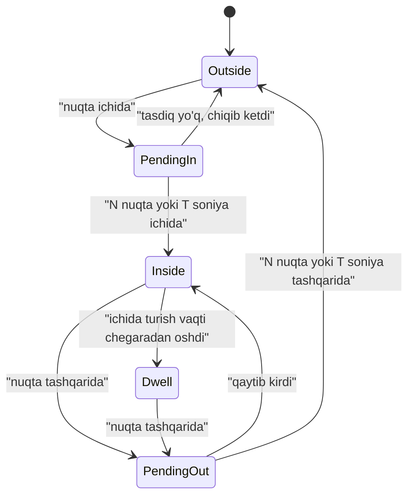
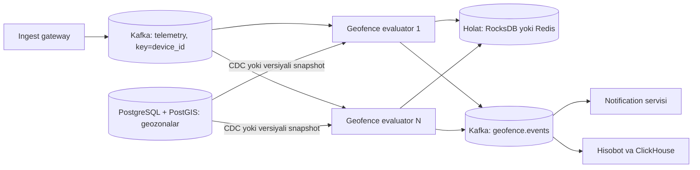

## Bu dars nima uchun kerak

82-darsda geospatial indekslarni (geohash, S2, H3, R-tree) ko'rdik. Bu dars ularni ikki real vazifaga qo'llaydi:

- **Geofencing** - "mashina shu poligonga kirdimi yoki chiqdimi?" Har bir GPS nuqta kelganda minglab geozonalar bilan solishtirish va **hodisa** (enter, exit, dwell) chiqarish.
- **Proximity search** - "shu nuqta atrofidagi eng yaqin obyektlar". Obyektlar o'zi harakatlanayotgan bo'lsa (mashinalar), bu doimiy yangilanadigan indeks masalasi.

Fleet platformada geofencing - asosiy funksiyalardan biri: zavodga kirish-chiqish vaqti, ruxsat etilmagan hududga kirish, mijoz obyektida turish vaqti, marshrutdan chetga chiqish. Muammo shundaki, bu oddiy SQL so'rov emas, **oqim (stream) ustidagi holatli (stateful) hisob**: "kirdi" hodisasi uchun oldingi holatni (tashqarida edi) bilish kerak, GPS shovqini esa chegarada "kirdi-chiqdi-kirdi" kabi soxta hodisalar beradi.

Bu dars 45-dars (stream processing, event time, watermark), 41-dars (delivery semantics), 39-dars (idempotency) va 82-dars ustiga quriladi.

Bu darsdan keyin siz:

- point-in-polygon algoritmini va uni tezlashtirish usullarini (bbox, H3/S2 covering, ikki darajali indeks) bilasiz;
- geofence holat mashinasini (outside, inside, dwell) GPS shovqini va kechikkan nuqtalarni hisobga olib loyihalay olasiz;
- har bir GPS nuqtada minglab geozonani tekshiradigan servisni hisob bilan masshtablay olasiz;
- harakatlanuvchi obyektlar uchun proximity indeksini va KNN ni loyihalay olasiz;
- Uber geofence servisi misolida real raqamlar va qarorlarni tahlil qila olasiz.

## Point-in-polygon: asosiy test

Geozona - poligon (ko'pburchak), ba'zan doira (markaz + radius). Doira oddiy: haversine masofa radiusdan kichikmi. Poligon uchun klassik algoritm - **ray casting** (nur otish):

1. Nuqtadan bitta yo'nalishda (masalan, o'ngga) cheksiz nur chiqaramiz.
2. Nur poligonning nechta tomonini kesib o'tishini sanaymiz.
3. Toq son - nuqta ichida, juft son - tashqarida.

Murakkablik: poligon tomonlari soni n bo'lsa, O(n). Oddiy zavod hududi 10-50 nuqta, lekin tuman chegarasi yoki aniq chizilgan yo'l koridori 1 000-10 000 nuqta bo'lishi mumkin.

Chekka holatlar: nur aynan uchdan o'tsa yoki nuqta aynan chegarada bo'lsa - kutubxonalar (GEOS, JTS, Turf, PostGIS) buni maxsus qoidalar bilan hal qiladi. O'zingiz yozmang, tayyor kutubxona ishlating.

Proyeksiya masalasi: ray casting tekislikda ishlaydi. Shahar ichidagi kichik poligonlar uchun lat/lon ni to'g'ridan-to'g'ri tekislik deb olish amalda yetarli. Yuzlab km li yoki 180-meridianni kesuvchi poligonlar uchun sferik geometriya (S2, PostGIS `geography`) kerak.

## Tezlashtirish: har bir nuqtani hamma geozona bilan solishtirmaslik

Faraz qiling: 50 000 geozona, 3 000 GPS nuqta/s. Naiv yondashuv: 3 000 x 50 000 = 150 million point-in-polygon testi soniyasiga, har biri o'rtacha 30 tomon. Bu imkonsiz. Yechim - yana ikki bosqichli filtr (82-dars).

### 1. Bounding box filtri

Har bir poligonning MBR i (min/max lat/lon) oldindan hisoblanadi. Nuqta MBR ichida bo'lmasa, poligon tekshirilmaydi. Bu 4 ta taqqoslash. Lekin 50 000 ta MBR ni ketma-ket tekshirish ham soniyasiga 150 million taqqoslash - indeks kerak.

### 2. Spatial indeks: R-tree yoki hujayra covering

**R-tree xotirada.** Barcha geozona MBR lari xotiradagi R-tree ga (masalan, JTS STRtree, `rbush` JS kutubxonasi, GEOS) yuklanadi. Nuqta uchun so'rov O(log n) da bir necha nomzod beradi, keyin aniq test.

**H3/S2 covering.** Har bir geozona oldindan hujayralar to'plami bilan qoplanadi (H3 `polygonToCells`, S2 `RegionCoverer`). Xaritada `cell_id -> [geofence_id...]` saqlanadi. Nuqta kelganda: `latLngToCell` (bir necha mikrosekund), xaritadan nomzodlar, keyin aniq test. Bu hash lookup - O(1).

Nozik joy: H3 `polygonToCells` standart holatda **markaz bo'yicha** (centroid) qamrab oladi: hujayra markazi poligon ichida bo'lsa hujayra kiradi. Demak chegaradagi ba'zi hujayralar tushib qoladi va poligonning chetidagi nuqta nomzod bo'lmay qolishi mumkin. Indeks uchun **to'liq qoplash** kerak: chegaradan o'tadigan hujayralarni ham qo'shish (`polygonToCellsExperimental` ning "overlapping" rejimi yoki poligonni bir hujayra kengligida bufer qilib, keyin qoplash).

Hujayralarni ikki turga bo'lish foydali optimizatsiya:

- **Ichki hujayra** - butunlay poligon ichida. Nuqta shunday hujayrada bo'lsa, aniq test **kerak emas**: javob "ichida".
- **Chegara hujayrasi** - poligon chegarasi o'tadi. Faqat shu holda ray casting.

Katta poligonlar uchun nuqtalarning ko'pchiligi ichki hujayralarga tushadi, ya'ni aniq test kamdan-kam bajariladi.

### 3. Ierarxiya (tenant, shahar)

Ko'pincha eng oddiy va eng samarali filtr - biznes ierarxiyasi. Fleet platformada mashina faqat **o'z tenant'ining** geozonalariga tekshiriladi. 50 000 geozona 500 tenant ga bo'linsa, o'rtacha tenant'da 100 ta - bunda R-tree ham shart bo'lmasligi mumkin.

## Real misol: Uber geofence servisi (2016)

Uber muhandislik blogi (2016) shahar geozonalari bo'yicha "bu nuqta qaysi geozonalarda" so'rovini beradigan Go servisini tasvirlaydi:

- **Algoritm:** ikki darajali ierarxiya. Avval chiziqli skan bilan shahar geozonasi topiladi, keyin shu shahar ichidagi geozonalar chiziqli skan qilinadi. Bu qidiruv maydonini o'n minglab geozonalardan yuzlabgacha qisqartirgan. Point-in-polygon - ray casting. Murakkab indeks (R-tree, S2) o'rniga ataylab oddiy yechim tanlangan.
- **Raqamlar:** 2015 yil Yangi yil kechasi cho'qqisi soniyasiga 170 ming so'rov, 40 ta mashina, CPU taxminan 35%. Javob vaqti p95 5 ms dan, p99 50 ms dan kam.
- **Ma'lumot yangilash:** geozonalar xotirada, fon jarayonlar ma'lumot manbalarini muntazam so'raydi, yangi indeks yonida quriladi va atomik almashtiriladi (read-write lock). Tez qayta ishga tushish uchun lokal diskka serializatsiya qilinadi.
- **Nega Go:** point-in-polygon CPU-intensiv. Node.js ning bitta oqimli modelida fon JSON parsing so'rovlarni to'xtatib qo'yishi mumkin edi; Go goroutine'lari bir necha yadroda parallel ishlaydi.

Saboq: indeks murakkabligi geozona soniga va taqsimotiga qarab tanlanadi. Agar ierarxiya (shahar, tenant) nomzodlarni yuzlabgacha qisqartirsa, oddiy chiziqli skan yetarli va soddaroq.

## Geofence holat mashinasi

Point-in-polygon faqat "hozir ichidami" deydi. Biznesga esa **hodisa** kerak: "08:47 da zavodga kirdi", "12:10 da chiqdi", "2 soatdan ortiq turdi". Buning uchun har bir `(device_id, geofence_id)` juftligi uchun holat saqlanadi.

`PendingIn` va `PendingOut` - **debounce** holatlari. GPS aniqligi shaharda odatda bir necha metrdan o'nlab metrgacha, baland binolar orasida (multipath) yoki to'xtab turganda (drift) yanada yomon. Mashina chegara yonida tursa, nuqtalar ichkari-tashqariga sakraydi va debounce siz har daqiqada "kirdi-chiqdi" hodisasi chiqadi.

Shovqinga qarshi uch usul (birgalikda ishlatiladi):

1. **Vaqt yoki nuqta soni bo'yicha tasdiq.** Holat o'zgarishi uchun ketma-ket N nuqta (masalan, 2-3) yoki T soniya (masalan, 30 s) yangi holatda bo'lish kerak. Hodisa vaqti sifatida **birinchi** o'tish nuqtasining vaqti yoziladi, tasdiq vaqti emas.
2. **Gisterezis (hysteresis).** Kirish uchun poligonning o'zi, chiqish uchun esa 20-50 m ga kengaytirilgan (buffer) poligon. Chegarada "tebranish" yo'qoladi.
3. **Sifat filtri.** HDOP katta yoki sun'iy yo'ldoshlar soni kam nuqtalar holat o'zgarishiga hissa qo'shmaydi; tezlik 0 bo'lgan turish paytidagi drift e'tiborsiz qoldiriladi.

Trade-off: debounce kuchaygan sari soxta hodisa kamayadi, lekin **kechikish** oshadi va qisqa kirish (masalan, 20 soniyalik) yo'qolishi mumkin. Taqiqlangan hududga kirish ogohlantirishi uchun tez, ish vaqti hisobi uchun aniq bo'lishi kerak - ba'zan bir geozona uchun ikki xil sozlama.

### Siyrak nuqtalar va interpolatsiya

Nuqtalar har 10-30 s da keladi. 60 km/soat da 30 s - 500 m. Kichik geozonadan (yoqilg'i quyish shoxobchasi, 50 x 50 m) mashina ikki nuqta orasida o'tib ketishi mumkin. Yechim: ketma-ket ikki nuqta orasidagi **segment** bilan poligon kesishishini tekshirish (line-polygon intersection). Bu qimmatroq, shuning uchun faqat kichik geozonalar yoki "o'tib ketish" muhim bo'lgan holatlar uchun.

### Kechikkan va tartibsiz nuqtalar

GPS trekerlar aloqa yo'qolganda nuqtalarni bufer qilib, keyin to'plab yuboradi. Holat mashinasi **event time** (qurilma vaqti) bo'yicha ishlashi kerak, aks holda tartib buziladi. 45-darsdagi yondashuvlar:

- har bir qurilma uchun nuqtalarni kichik oynada (masalan, 30-60 s) vaqt bo'yicha saralab, keyin holat mashinasiga berish;
- juda kech kelgan nuqtalar (soatlar o'tib) uchun: real vaqt ogohlantirishi yuborilmaydi, lekin tarixiy hodisalar jurnali qayta hisoblanadi (backfill);
- hodisaning idempotent kaliti: `(device_id, geofence_id, event_type, event_ts)` - qayta ishlashda dublikat ogohlantirish chiqmasligi uchun (39-dars).

## Masshtablash: arxitektura

Asosiy qarorlar:

1. **Kafka partition kaliti `device_id`.** Bitta qurilmaning barcha nuqtalari bitta partition ga, demak bitta evaluator ga, tartib bilan keladi (43-dars). Holat mashinasi lokal bo'lishi mumkin - taqsimlangan lock kerak emas.
2. **Geozona indeksi har bir evaluator xotirasida to'liq.** Geozonalar kam o'zgaradi va kichik (50 000 geozona x o'rtacha 50 nuqta x 16 bayt = 40 MB, hujayra xaritasi bilan bir necha yuz MB). Har bir instansiya to'liq nusxani saqlaydi va yangilanishlarni CDC (48-dars) yoki versiyali snapshot orqali oladi. Uber kabi: yangi indeks yonida quriladi va atomik almashtiriladi.
3. **Holat - per-device.** `(device_id, geofence_id) -> {state, since, last_ts}`. Kafka Streams/Flink da lokal state store (RocksDB) va changelog topic, yoki Redis hash. Partition boshqa instansiyaga o'tganda holat tiklanishi kerak.
4. **Chiqish - hodisalar topic'i.** Notification (85-dars), hisobot, ClickHouse - hammasi alohida iste'molchi. Evaluator faqat hodisa chiqaradi.

Geozona o'zgarganda nima bo'ladi? Agar mijoz poligonni kengaytirsa, ichida turgan mashinalar uchun "kirdi" hodisasi chiqarilishi kerakmi? Bu biznes qarori. Odatda: geozona versiyasi o'zgarganda holatlar qayta baholanadi, lekin bu "sun'iy" hodisalar alohida belgilanadi yoki ogohlantirish yuborilmaydi.

### Hisob-kitob

Faraz qiling: 30 000 qurilma, har 10 s da nuqta: 3 000 nuqta/s, cho'qqida 6 000. 2 000 tenant, jami 60 000 geozona, o'rtacha tenant'da 30 ta, eng katta tenant'da 3 000 ta.

- **Tenant filtri bilan:** o'rtacha qurilma 30 ta geozonaga tekshiriladi. bbox filtri ulardan 1-2 tasini qoldiradi. Aniq test: 6 000 x 2 = 12 000 ray casting/s, har biri 50 tomon - 600 ming qirra tekshiruvi/s. Bitta yadro buni bemalol ko'taradi (har bir qirra o'nlab nanosekund).
- **Eng katta tenant (3 000 geozona):** chiziqli bbox skani 3 000 taqqoslash nuqta boshiga. Shu tenant'da 5 000 qurilma, 500 nuqta/s cho'qqida 1 000: 3 million bbox tekshiruvi/s - hali ham bitta yadroga sig'adi, lekin chegarada. Shu tenant uchun H3 res 9 hujayra xaritasi qo'yilsa, nuqta boshiga bitta hash lookup.
- **Holat xotirasi:** faqat "ichida" yoki "pending" holatdagi juftliklar saqlanadi (outside - standart, saqlanmaydi). 30 000 qurilmaning har biri bir vaqtda o'rtacha 1-2 geozonada: 60 000 yozuv x 100 bayt = 6 MB.

Xulosa: bu masala CPU va to'g'ri partitioning masalasi, katta klaster emas. 2-4 ta evaluator instansiyasi (HA uchun) yetarli. Bu misol 1-darsdagi "yuklamani 1000x ortiq hisoblash" xatosining aksi - avval hisoblang.

## Proximity search: harakatlanuvchi obyektlar

82-darsda indekslarni ko'rdik. Endi dinamik holat: obyektlar har 5-10 s da joyini o'zgartiradi, so'rovlar ham real vaqtda.

### Ikki xil yuklama

| Holat | Misol | Indeks |
|---|---|---|
| Statik obyektlar, ko'p so'rov | Yoqilg'i shoxobchalari, servis markazlari, mijoz obyektlari | PostGIS GiST yoki xotiradagi R-tree/quadtree; natijani CDN/cache da saqlash mumkin |
| Dinamik obyektlar, ko'p yangilanish | Mashinalar, kurerlar | Xotiradagi hujayra xaritasi yoki Redis GEO; yangilash O(1)/O(log N) |

### Dinamik indeks dizayni

**Variant A: Redis GEO.** `GEOADD vehicles:{tenant} lon lat device_id` har bir nuqtada; `GEOSEARCH vehicles:{tenant} FROMLONLAT lon lat BYRADIUS 3 km ASC COUNT 10 WITHDIST`. Sorted set ichida, yangilash O(log N). Eskirgan nuqtalarni tozalash kerak: Redis sorted set a'zosida TTL yo'q, shuning uchun alohida `last_seen` sorted set (score = vaqt) va davriy `ZRANGEBYSCORE` bilan eskilarini `ZREM` qilish, yoki natijani `last_seen` bo'yicha filtrlash.

**Variant B: hujayra xaritasi.** `cell(res 9) -> set(device_id)` va `device_id -> {cell, lat, lon, ts}`. Nuqta kelganda: yangi hujayra eski bilan bir xil bo'lsa - faqat koordinata yangilanadi; farq qilsa - eski setdan o'chirish, yangisiga qo'shish. So'rov: `gridDisk(k)` hujayralari bo'yicha setlarni yig'ish, keyin haversine. Redis da yoki servis xotirasida qurilishi mumkin; shardlash `cell` ning ota hujayrasi bo'yicha (res 5-6) - geografik sharding.

**Variant C: PostGIS.** Oxirgi joylashuv jadvali va GiST indeksi. Bir necha ming qurilmagacha ishlaydi va eng sodda (bitta baza, SQL, tranzaksiyalar). Har 10 s UPDATE da GiST indeks ham yangilanadi; PostgreSQL da HOT update indekslangan ustun o'zgarganda ishlamaydi, ya'ni har bir yangilanish yangi indeks yozuvi va vacuum ishi. Bir necha ming yangilanish/s dan oshganda og'irlashadi.

### KNN va "ETA bo'yicha eng yaqin"

To'g'ri chiziq masofasi bo'yicha eng yaqin mashina yo'l bo'yicha eng yaqin bo'lmasligi mumkin: daryo, temir yo'l, bir tomonlama ko'chalar. Amaliy yondashuv:

1. Hujayra/radius bo'yicha K x 3 nomzod (masalan, 15 ta) olish - arzon.
2. Ular uchun marshrutlash servisi (OSRM, Valhalla yoki tijorat API) orqali ETA hisoblash - qimmat, shuning uchun nomzodlar soni cheklangan.
3. ETA bo'yicha saralab, K tasini qaytarish.

Ride-hailing case (95-dars) shu sxemaning to'liq variantini ko'radi.

## iQuariX kontekstida

Deylik, iQuariX mijozlari uchun quyidagi geofence turlari kerak:

| Tur | Misol | Muhim parametr |
|---|---|---|
| Obyekt geozonasi | Zavod, ombor, mijoz manzili | Kirish/chiqish vaqti aniq, debounce 30-60 s |
| Taqiqlangan hudud | Shahar markazi (yuk mashinalari uchun soat 7-22 da) | Tez ogohlantirish, vaqt jadvali bilan |
| Yoqilg'i shoxobchasi | AYoQSh | Kichik, siyrak nuqtalarda segment kesishuvi; ДУТ quyish hodisasi bilan solishtirish |
| Marshrut koridori | Belgilangan yo'l bo'ylab 200 m bufer | Chiziq bufer poligoni minglab nuqtali; H3 covering bilan |
| Dwell | Mijozda 2 soatdan ortiq turish | Taymer, nuqta kelmasa ham ishlashi kerak |

Ikki qiziq integratsiya:

**Yoqilg'i va geofence.** ДУТ datchigi "40 litr quyildi" hodisasini aniqladi (81-dars). Agar shu vaqtda mashina hech qaysi AYoQSh geozonasida bo'lmasa - bu shubhali (kanistrdan quyish yoki datchik manipulyatsiyasi). Aksincha, AYoQSh da turib yoqilg'i quyilmagan, lekin yoqilg'i kartasi bo'yicha to'lov bo'lgan bo'lsa - boshqa turdagi shubha. Bu ikki oqimni `device_id` va vaqt oynasi bo'yicha birlashtirish (stream join, 45-dars).

**Dwell taymeri.** "2 soatdan ortiq turdi" hodisasi uchun yangi nuqta kelishini kutib bo'lmaydi: mashina dvigatelni o'chirsa, treker kamdan-kam yuboradi. Holat mashinasiga taymer kerak: `Inside` holatiga kirganda "since + 2 soat" uchun timer ro'yxatga olinadi (Flink/Kafka Streams da processing time timer yoki alohida delayed queue). Ammo event time va processing time farqini unutmang: qurilma 3 soat oflayn bo'lsa, "turdi" hodisasi taxmin, keyin kelgan nuqtalar bilan tasdiqlanadi yoki bekor qilinadi.

## Ko'p uchraydigan xatolar

1. **Har bir GPS nuqtani bazadagi `ST_Contains` so'roviga aylantirish.** 3 000 so'rov/s bazaga keraksiz yuklama. Geozonalar xotirada, baza faqat manba.
2. **Debounce siz hodisa chiqarish.** Chegarada turgan mashina har daqiqada kirdi-chiqdi ogohlantirishini yuboradi, foydalanuvchilar ogohlantirishlarni o'chirib qo'yadi.
3. **Processing time bo'yicha holat.** To'plab yuborilgan nuqtalar tartibni buzadi; event time va per-device saralash kerak.
4. **H3 `polygonToCells` markaz rejimini indeks uchun ishlatish.** Chegaradagi nuqtalar nomzod bo'lmay qoladi; chegarani to'liq qoplang.
5. **Partition kalitini qurilmadan boshqa narsa qilish.** Bitta qurilma nuqtalari turli consumer'larga tushsa, holat mashinasi uchun taqsimlangan lock kerak bo'ladi.
6. **Geozona yangilanishini unutish.** Mijoz poligonni o'zgartirdi, evaluator eski versiya bilan ishlayapti. Versiyalash va atomik almashtirish kerak.
7. **Kichik geozonani siyrak nuqtalar bilan tekshirish.** 50 m li AYoQSh ni 30 s oraliqdagi nuqtalar "ko'rmaydi".
8. **Dwell ni faqat yangi nuqta kelganda tekshirish.** Mashina to'xtaganda nuqta kelmaydi - taymer kerak.

## Xulosa

- Geofencing = point-in-polygon (ray casting) + holat mashinasi + hodisa oqimi.
- Tezlashtirish: biznes ierarxiyasi (tenant, shahar), bbox, xotiradagi R-tree yoki H3/S2 covering (ichki va chegara hujayralari).
- Uber geofence servisi: ikki darajali chiziqli skan, 170 ming QPS, p99 50 ms dan kam - oddiy yechim yetarli bo'lishi mumkin.
- GPS shovqini uchun debounce, gisterezis va sifat filtri; trade-off - kechikish.
- Event time, per-device tartib, idempotent hodisa kaliti, kech kelgan nuqtalar uchun backfill.
- Kafka kaliti `device_id`, geozona indeksi har bir instansiyada to'liq, holat lokal.
- Proximity: statik obyektlar uchun disk indeksi, dinamik obyektlar uchun xotiradagi hujayra xaritasi yoki Redis GEO; ETA uchun nomzodlarni qisqartirib, keyin marshrutlash.

## Amaliy topshiriq

Faraz qiling, iQuariX ga yirik logistika mijozi kelmoqda: 8 000 yuk mashinasi (har 15 s da nuqta), 4 000 ta mijoz manzili geozonasi (har biri 8-200 nuqtali poligon), 300 ta AYoQSh geozonasi, 50 ta marshrut koridori (har biri 2 000-5 000 nuqtali bufer poligon). Talablar: kirish/chiqish hodisasi 60 soniyadan kech emas, soxta hodisalar 1% dan kam, dwell (mijozda 3 soatdan ortiq) ogohlantirishi.

1. Yuklamani hisoblang: nuqta/s (o'rtacha va cho'qqi), naiv holatda point-in-polygon testlari soni, sizning indeksingiz bilan testlar soni.
2. Geozona indeksini tanlang va asoslang: R-tree, H3 covering yoki ierarxiya. Marshrut koridorlari uchun alohida yondashuv kerakmi?
3. Holat mashinasini chizing yoki yozing: debounce parametrlari (N nuqta, T soniya, gisterezis buferi) va ularning kechikishga ta'siri.
4. 15 s oraliqda 70 km/soat tezlikdagi mashina 40 x 40 m li AYoQSh dan o'tib ketsa, uni qanday aniqlaysiz?
5. Mashina 2 soat aloqasiz bo'lib, keyin 480 ta nuqtani bir paketda yubordi. Hodisalar, ogohlantirishlar va dwell taymeri bilan nima bo'ladi?
6. Mijoz geozonani tahrirlaganda evaluator'lar qanday yangilanadi va qaysi hodisalar chiqariladi?

Yaxshi javobda bo'lishi kerak bo'lgan narsalar:

- hisob-kitob ochiq (8 000 / 15 = 533 nuqta/s, cho'qqi koeffitsienti), indeks bilan va indekssiz testlar soni;
- katta poligonlar uchun ichki va chegara hujayralari yoki shunga o'xshash optimizatsiya;
- debounce parametrlari va 60 soniyalik kechikish talabi o'rtasidagi bog'liqlik ko'rsatilgan;
- segment kesishuvi yoki interpolatsiya kichik geozona uchun;
- event time bo'yicha qayta ishlash, kech kelgan paket uchun ogohlantirish yubormaslik, lekin jurnalni to'ldirish;
- geozona versiyasi va atomik almashtirish.

Javobni pastdagi maydonga yozib, chatga yuboring.

## Manbalar

- Uber Engineering. [How We Built Uber Engineering's Highest Query per Second Service Using Go](https://www.uber.com/blog/go-geofence-highest-query-per-second-service/), 2016 - ikki darajali geofence indeksi, 170k QPS, p95/p99.
- H3 hujjati: [Regions functions (polygonToCells, containment modes)](https://h3geo.org/docs/api/regions).
- S2 Geometry: [S2 Cell Hierarchy va S2RegionCoverer](http://s2geometry.io/devguide/s2cell_hierarchy).
- PostGIS: [Spatial Indexing workshop](https://postgis.net/workshops/postgis-intro/indexing.html) - ST_Contains, ST_DWithin va ikki bosqichli filtr.
- Redis hujjati: [GEOSEARCH](https://redis.io/docs/latest/commands/geosearch/) va [GEOADD](https://redis.io/docs/latest/commands/geoadd/).
- Alex Xu, Sahn Lam. System Design Interview, 2-jild, 1-bob "Proximity Service" va 2-bob "Nearby Friends" - statik va dinamik proximity.
- Martin Kleppmann, Chris Riccomini. Designing Data-Intensive Applications, 2-nashr, O'Reilly, 2026 - stream processing bobi (event time, stream join, holat).
