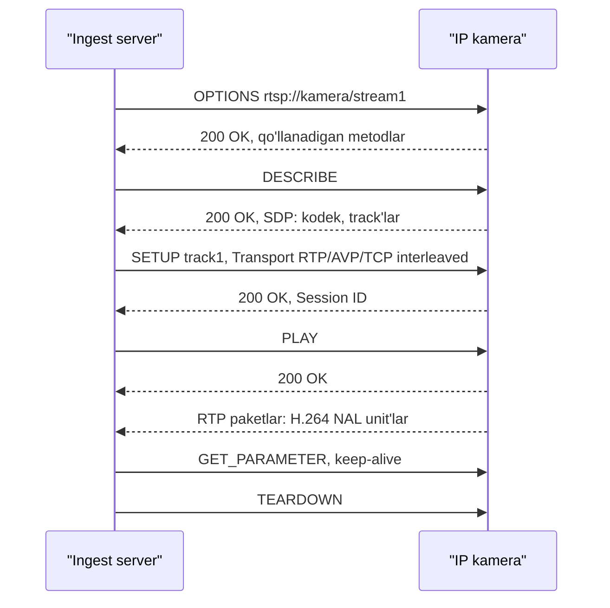
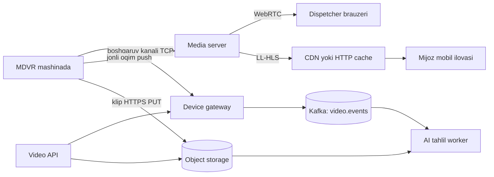

## Bu dars nima uchun kerak

Video - fleet platformadagi eng "og'ir" ma'lumot. Solishtirish uchun shartlar: GPS treker har 10 s da 80 baytlik nuqta yuboradi (8 bayt/s), kamera esa 1 Mbit/s (125 000 bayt/s) oqim beradi. Bitta kamera GPS dan 125 000 / 8 = 15 625 barobar, 4 kamerali mashina esa 62 500 barobar ko'p trafik hosil qiladi. Shu sabab video tizimi dizayni boshqa qoidalarga bo'ysunadi: **tarmoq kanali va saqlash narxi** asosiy cheklov, protokol tanlovi esa kechikish (latency), moslik va masshtab o'rtasidagi trade-off.

Video tizimida uchta alohida muammo bor:

1. **Ingest** - videoni manbadan (kamera, MDVR, dashcam) serverga olib kelish. Odatda RTSP, RTMP, SRT yoki ishlab chiqaruvchining o'z protokoli.
2. **Qayta ishlash** - transcoding (boshqa kodek yoki bitrate ga o'tkazish), transmuxing (kodekni o'zgartirmay konteynerni almashtirish), segmentlash, thumbnail, AI tahlil.
3. **Yetkazish (delivery)** - minglab tomoshabinga HTTP orqali (HLS, DASH) yoki past kechikish bilan (WebRTC).

Bu dars 5-dars (TCP/UDP), 7-dars (HTTP), 25-dars (CDN), 60-dars (object storage) va 79-dars (cost-aware dizayn) ustiga quriladi. Video platformaning to'liq case'i (YouTube) 98-darsda.

Bu darsdan keyin siz:

- video kodek, kadr turlari (I/P/B), GOP va bitrate tushunchalarini va ularning tizim dizayniga ta'sirini bilasiz;
- RTSP/RTP qanday ishlashini va IP kameralardan ingest qilish xususiyatlarini tushunasiz;
- HLS ichki tuzilishi (playlist, segment, target duration, ABR) va kechikish qayerdan kelishini hisoblay olasiz;
- transcoding va transmuxing farqini va ularning CPU/narx oqibatlarini bilasiz;
- mashina kameralari uchun ingest, saqlash va jonli ko'rish arxitekturasini hisob bilan loyihalay olasiz.

## Video asoslari: tizim dizayneri bilishi kerak bo'lgan minimum

**Kodek** (codec) - videoni siqish algoritmi. Asosiylari: H.264/AVC (eng keng mos), H.265/HEVC (H.264 dan samaraliroq siqish uchun ishlab chiqilgan, lekin brauzer mosligi cheklangan), AV1 (ochiq, samarali, encode qimmat). Kameralar ko'pincha H.264 yoki H.265 beradi.

**Kadr turlari:**

- **I-frame (keyframe, IDR)** - mustaqil kadr, to'liq rasm. Eng katta.
- **P-frame** - oldingi kadrga nisbatan farq.
- **B-frame** - oldingi va keyingi kadrlarga nisbatan. Encode kechikishini oshiradi, shuning uchun jonli va kameralarda ko'pincha ishlatilmaydi.

**GOP (Group of Pictures)** - bitta I-frame dan keyingisigacha bo'lgan kadrlar guruhi. GOP uzunligi tizim uchun juda muhim, chunki:

- tomoshabin videoni faqat **I-frame dan** boshlab dekodlay oladi. Uzun GOP - ulanganda uzoq kutish;
- HLS segmenti I-frame dan boshlanishi kerak, ya'ni segment chegaralari GOP ga bog'liq;
- uzun GOP - kam bitrate (kam I-frame), qisqa GOP - tez kirish, lekin ko'proq trafik.

Apple HLS authoring spetsifikatsiyasi (1.13-band) key frame (IDR) larni har **2 soniyada** qo'yishni tavsiya qiladi (SHOULD), 7.4-band esa har bir video segment IDR bilan boshlanishi shartligini (MUST) aytadi. Kamerada GOP odatda kadrlar sonida (I-frame interval) beriladi: 15 FPS da 2 soniyalik GOP uchun interval 30 kadr. Kameraning joriy qiymatini ingest paytida tekshirish (masalan, `ffprobe -show_frames` bilan ketma-ket keyframe'lar orasidagi vaqtni o'lchash) - konfiguratsiyada birinchi qilinadigan ish.

**Bitrate.** CBR (constant) - kanal rejalash oson, VBR (variable) - sifat yaxshiroq, lekin cho'qqilar bor. Apple authoring spetsifikatsiyasidagi namunaviy H.264 ladder'da (16:9, 1.25-band): 640x360 uchun 365 kbit/s (30 FPS gacha), 1280x720 uchun 3 000 va 4 500 kbit/s, 1920x1080 uchun 6 000 va 7 800 kbit/s. Bu umumiy kontent (kino, TV) uchun bitta mumkin bo'lgan to'plam. Kuzatuv kamerasining bitrate'i esa sahna harakati, FPS, kodek va kamera sozlamasiga bog'liq, shuning uchun bu darsdagi hisoblarda u **masala sharti** sifatida beriladi (masalan, 720p, 15 FPS, 1 Mbit/s). Real qiymatni kamerada CBR chegarasini o'rnatib yoki bir kunlik yozuv hajmini o'lchab (bayt / soniya x 8) aniqlang.

**Konteyner** - siqilgan oqim o'raladigan format: MPEG-TS, MP4/fMP4 (fragmented MP4), MKV. Kodek va konteyner har xil narsa: H.264 ni TS ga ham, fMP4 ga ham qo'yish mumkin.

## Ingest: RTSP va RTP

**RTSP** (Real Time Streaming Protocol) - oqimni **boshqarish** protokoli, "tarmoq pulti". RTSP 1.0 - RFC 2326 (1998), RTSP 2.0 - RFC 7826 (2016), lekin 2.0 1.0 bilan orqaga mos emas va amaliyotda kameralar asosan 1.0 ni ishlatadi. Standart port 554. IP kameralarning ko'pchiligi RTSP ni qo'llab-quvvatlaydi (xususan ONVIF profillari bilan).

RTSP o'zi videoni tashimaydi. Ketma-ketlik:



- **DESCRIBE** javobida **SDP** (Session Description Protocol) keladi: qaysi kodek, qaysi track (video, audio), kodek parametrlari.
- **SETUP** da transport tanlanadi: RTP **UDP** orqali (alohida portlar, kam kechikish, lekin NAT va paket yo'qolishi muammo) yoki RTSP TCP ulanishi ichida **interleaved** (bitta TCP ulanish, NAT dan oson o'tadi, lekin paket yo'qolsa TCP qayta yuborishi tufayli kechikish sakraydi - head-of-line blocking, 5-dars).
- **RTP** paketlari ichida video kadr bo'laklari (H.264 NAL unit'lar), sequence number va timestamp. **RTCP** - qabul statistikasi va sinxronizatsiya.

### Muhim nuqta: kim kimga ulanadi?

RTSP da **server kameraga ulanadi** (pull). Ofisdagi statik IP li kamera uchun bu normal. Lekin mashinadagi kamera **mobil tarmoqda (LTE), NAT ortida**, IP o'zgarib turadi - unga tashqaridan ulanib bo'lmaydi. Shuning uchun mobil qurilmalarda **push** modeli kerak: qurilma o'zi serverga ulanadi. Variantlar:

- qurilma RTMP yoki SRT bilan serverga push qiladi;
- qurilma serverga doimiy TCP boshqaruv kanali ochadi, server "video yubor" buyrug'ini shu kanal orqali beradi va qurilma video oqimini serverga yuboradi. MDVR (mobile digital video recorder) qurilmalarida bu model standartlashtirilgan: Xitoy Transport vazirligining **JT/T 1078-2016** "GNSS system for operating vehicles - Video communication protocol" standarti avtomobildagi video terminal va video platforma orasidagi audio-video aloqa protokolini belgilaydi; u JT/T 808-2011 (GNSS terminal protokoli) ustiga qurilgan va uning xabar tuzilmasi, uzatish qoidalari va buyruqlarini meros qilib oladi;
- VPN/APN (operatorning xususiy tarmog'i) orqali qurilmalarga ichki IP berish va RTSP pull - operator bilan kelishuv talab qiladi.

### Boshqa ingest protokollari

| Protokol | Transport | Kechikish | Qayerda ishlatiladi |
|---|---|---|---|
| RTSP/RTP | UDP yoki TCP interleaved | Segmentsiz, asosan jitter bufer va GOP ga bog'liq | IP kameralar, pull, lokal tarmoq |
| RTMP | TCP | Segmentsiz, TCP va bufer sozlamasiga bog'liq | Eski, lekin hali ham keng ingest (OBS, enkoderlar), push |
| SRT | UDP + qayta yuborish (ARQ) | Sozlanadigan bufer (latency parametri) | Beqaror tarmoqda push, broadcast |
| WebRTC (WHIP) | UDP, SRTP | Interaktiv: RFC 8825 ta'rifida yuzlab millisekunddan oshmaydi | Brauzerdan ingest, interaktiv |
| MDVR vendor protokoli | TCP/UDP | Har xil | Mashina kameralari, push |

## Yetkazish: HLS

**HLS** (HTTP Live Streaming) - Apple yaratgan, RFC 8216 (2017, Informational) sifatida nashr etilgan protokol. G'oya oddiy: videoni kichik **segment** fayllarga bo'lib, oddiy HTTP orqali yetkazish. Shuning uchun HLS CDN (25-dars), object storage (60-dars), HTTP cache - hamma mavjud infratuzilma bilan ishlaydi. Bu uning asosiy afzalligi.

### Tuzilma

**Master playlist** - bir xil kontentning turli variantlari (bitrate/resolution):

```
#EXTM3U
#EXT-X-STREAM-INF:BANDWIDTH=800000,RESOLUTION=640x360
360p/index.m3u8
#EXT-X-STREAM-INF:BANDWIDTH=2500000,RESOLUTION=1280x720
720p/index.m3u8
```

**Media playlist** - segmentlar ro'yxati:

```
#EXTM3U
#EXT-X-VERSION:7
#EXT-X-TARGETDURATION:6
#EXT-X-MEDIA-SEQUENCE:1042
#EXT-X-MAP:URI="init.mp4"
#EXTINF:6.000,
seg_1042.m4s
#EXTINF:6.000,
seg_1043.m4s
#EXTINF:6.000,
seg_1044.m4s
```

Asosiy qoidalar (RFC 8216):

- `EXT-X-TARGETDURATION` majburiy: har bir segment davomiyligi (butun songa yaxlitlanganda) undan oshmasligi kerak va u sessiya davomida o'zgarmaydi. RFC tipik qiymat sifatida 10 soniyani aytadi, Apple authoring spetsifikatsiyasi esa 6 soniyani tavsiya qiladi.
- Segment formatlari: MPEG-2 TS, fMP4, packed audio, WebVTT (subtitrlar).
- **Live** playlist da `EXT-X-ENDLIST` yo'q; server yangi segment qo'shib, eskisini olib tashlaydi (sliding window, 6.2.2). Olib tashlangan segment yana bir muddat (segment davomiyligi + tarqatilgan eng uzun playlist davomiyligi) mavjud bo'lishi kerak. Server segmentni olib tashlab playlist davomiyligini 3 x target duration dan kam qilmasligi kerak (MUST NOT).
- **Playlist'ni qayta yuklash (6.3.4).** Mijoz live playlist'ni davriy qayta yuklashi shart, lekin RFC belgilaganidan tez emas: o'zgargan playlist yuklangandan keyin keyingi yuklashgacha kamida **target duration** kutadi (oxirgi yuklash boshlangan paytdan hisoblanadi); playlist o'zgarmagan bo'lsa, qayta urinishdan oldin **target duration ning yarmi** kutadi. 6 s target duration da bu 6 s va 3 s.
- `EXT-X-PLAYLIST-TYPE:VOD` - o'zgarmaydi; `EVENT` - faqat oxiriga qo'shiladi (yozib olish davom etayotgan voqea).

### Adaptive bitrate (ABR)

Pleyer tarmoq tezligini o'lchab, har bir segmentda variantni tanlaydi: tezlik tushsa 360p ga, ko'tarilsa 720p ga. Bu ishlashi uchun barcha variantlarda segment chegaralari bir xil joyda bo'lishi kerak - ya'ni barcha variantlar bir xil GOP tuzilmasi bilan encode qilinadi.

### HLS kechikishi qayerdan keladi

Oddiy HLS kechikishini RFC qoidalaridan hisoblash mumkin. Hisob uchun shartlar: 6 s segment (Apple tavsiyasi), yuklash va CDN ga tarqalish uchun 1 s (bu qiymat infratuzilmangizga bog'liq, o'lchanadi).

1. Enkoder segmentni to'liq yozib bo'lishi kerak: **6 s**.
2. Segmentni yuklash, playlist yangilash, CDN ga tarqalish: shart bo'yicha **1 s**.
3. Pleyer start nuqtasi: RFC 8216 6.3.3 ga ko'ra mijoz playlist oxiridan 3 target duration dan kam masofada boshlanadigan segmentni tanlamasligi kerak (SHOULD NOT): **3 x 6 = 18 s** bufer.
4. Playlist qayta yuklash oralig'i (6.3.4): yangi segment playlist'da paydo bo'lgandan keyin mijoz uni 0 dan 6 s gacha kechikib ko'radi.

Jami: 6 + 1 + 18 = 25 s, qayta yuklash bilan 25-31 s. Segmentni 2 s ga qisqartirsak: 2 + 1 + 3 x 2 = 9 s, qayta yuklash bilan 9-11 s. Lekin playlist va segment so'rovlari soni 3 barobar ko'payadi va siqish samarasi biroz tushadi (har bir segment IDR bilan boshlanadi).

**Low-Latency HLS (LL-HLS)** - segmentni kichik **partial segment** (part) larga bo'ladi va pleyer ularni segment tugashini kutmasdan oladi (blocking playlist reload, preload hint). Apple authoring spetsifikatsiyasi (14-bo'lim): part target duration kamida P95 RTT ga teng bo'lishi shart (MUST) va P95 RTT ning 3 barobaridan kam bo'lmasligi kerak (SHOULD), tavsiya etilgan qiymat - 1 soniya; `PART-HOLD-BACK` (pleyer jonli chetdan qancha orqada turishi) kamida 3 x part target duration bo'lishi shart. Apple hujjati LL-HLS kechikishini umumiy so'z bilan "standart televizion translyatsiya darajasida" deb ta'riflaydi, aniq raqam bermaydi. Hisob: 1 s part bilan `PART-HOLD-BACK` kamida 3 s; ustiga part yozish (1 s) va yetkazish (shart bo'yicha 1 s) qo'shilsa, jonli chetdan 5 s atrofida orqada. Ya'ni bu darsda LL-HLS uchun 3-5 s - shu hisobning natijasi.

**DASH** (MPEG-DASH) - HLS ga o'xshash ochiq standart (manifest XML, segmentlar). CMAF (umumiy fMP4 segment formati) bilan bir xil segmentlarni ham HLS, ham DASH ga berish mumkin.

**WebRTC** - interaktiv real vaqt uchun qurilgan (RFC 8825 ta'rifida "real-time" - yuzlab millisekunddan oshmaydigan kechikish), UDP va SRTP ustida, brauzerda tayyor. Lekin har bir tomoshabin uchun holatli ulanish, SFU (Selective Forwarding Unit) server kerak, CDN bilan oddiy cache qilib bo'lmaydi. 1-2 dispetcher bitta kamerani ko'rsa - yaxshi; 100 000 tomoshabinli translyatsiya uchun qimmat.

### Protokollar taqqoslash

| Mezon | HLS | LL-HLS | WebRTC | RTSP to'g'ridan-to'g'ri |
|---|---|---|---|---|
| Kechikish (yuqoridagi hisob) | 6 s segmentda 25-31 s, 2 s da 9-11 s | 1 s part bilan 3-5 s | Interaktiv, yuzlab ms | Segmentsiz, yuzlab ms darajasi |
| Transport | HTTP, TCP | HTTP, TCP | UDP (SRTP) | TCP/UDP |
| CDN va cache | To'liq | Ha, lekin CDN qo'llashi kerak | Yo'q, SFU kerak | Yo'q |
| Brauzerda | Safari native, boshqalarda hls.js | hls.js, Safari | Native | Yo'q, gateway kerak |
| Server holati | Stateless fayllar | Deyarli stateless | Har bir ulanish holatli | Har bir ulanish holatli |
| Ko'p tomoshabinga masshtab | Juda yaxshi | Yaxshi | Qimmat | Yomon |
| Yaxshi joy | VOD, ommaviy jonli | Sport, jonli interaktivga yaqin | Dispetcher jonli ko'rish, PTZ, ovoz | Lokal tarmoq, ingest |

## Transcoding va transmuxing

**Transcoding** - videoni dekodlab, qayta encode qilish: boshqa kodek, resolution yoki bitrate. Bu **CPU/GPU jihatdan qimmat**: har bir kadr to'liq dekodlanadi va qayta siqiladi (harakat qidiruvi, transformatsiya, entropiya kodlash). Bitta oqimga qancha yadro ketishi kodek, preset, resolution va apparatga bog'liq - uni o'z serveringizda o'lchang: FFmpeg bilan bir nechta parallel oqimni ishga tushirib, real vaqtdan tez (`speed=1x` va undan yuqori) ishlaydigan maksimal oqimlar sonini toping. GPU (NVENC) yoki maxsus apparat (Intel Quick Sync, AWS MediaLive kabi servislar) narxni tushiradi.

**Transmuxing (remux)** - kodekni o'zgartirmasdan faqat konteynerni almashtirish: RTP ichidagi H.264 ni olib, fMP4 segmentlarga o'rash. Dekodlash va encode yo'q, faqat bitlar qayta o'raladi, shuning uchun oqim boshiga CPU narxi transcoding'dan bir necha tartib kam. FFmpeg da `-c copy`. Bitta serverdagi oqimlar soni chegarasini xuddi shu usulda yuklama testi bilan o'lchang.

Fleet uchun asosiy xulosa: **kamera allaqachon H.264 beradigan bo'lsa, transcode qilmang, faqat transmux qiling.** Ladder (ABR) kerak bo'lsa va kamera ikkinchi oqim (sub-stream, past resolution) bera olsa - uni ishlatish serverda transcoding qilishdan arzon, chunki encode kamerada bajarilgan. Shuning uchun kamera tanlashda sub-stream mavjudligi talablar ro'yxatiga kiritiladi.

Transcoding qachon kerak:

- kamera H.265 beradi, brauzerlar esa uni har doim ham o'ynata olmaydi - H.264 ga transcode;
- arxivni kichikroq bitrate da saqlash (kechasi, batch rejimida, arzon spot instance larda);
- ommaviy VOD platformada ladder (Netflix kabi).

**Real misol: Netflix per-title encoding (2015).** Netflix barcha filmlar uchun bir xil bitrate ladder (eng yuqori pog'onasi 1080p uchun 5 800 kbit/s) o'rniga har bir kontentning murakkabligiga qarab ladder tanlashga o'tdi. Multfilm kabi oddiy kontent kam bitrate da ham yuqori sifat beradi: maqoladagi animatsion klip 1920x1080, 2 350 kbit/s da yuqori sifatli encode bergan, fixed ladder esa 2 350 kbit/s ni 1280x720 ga bog'lagan. Saboq kuzatuv kameralari uchun ham to'g'ri: statik sahna (to'xtab turgan mashina) kam bitrate talab qiladi, shuning uchun VBR va past FPS katta tejash beradi.

## iQuariX kontekstida: mashina kameralari arxitekturasi

Masala sharti: 2 000 mashinaga MDVR o'rnatilgan, har birida 4 kamera (old yo'l, haydovchi, yuk bo'limi, orqa), 720p, 15 FPS, H.264, 1 Mbit/s (CBR). Video MDVR ichidagi SD karta yoki HDD ga uzluksiz yoziladi.

### Hisob-kitob: hammasini bulutga yuborib bo'ladimi?

- Bitta kamera: 1 Mbit/s = 125 KB/s = 450 MB/soat.
- Mashina (4 kamera), kuniga 10 soat harakat: 4 x 450 MB x 10 = **18 GB/kun**.
- 2 000 mashina: **36 TB/kun** trafik va saqlash.
- Mashina boshiga oyiga 18 GB x 30 = 540 GB mobil trafik. Bu raqamni operatoringizning korporativ tarifidagi GB narxiga ko'paytiring - mashina boshiga oylik video trafik narxi obuna narxidan oshib ketishini ko'rasiz. Bundan tashqari mashina harakat davomida 4 x 1 = 4 Mbit/s uplink'ni uzluksiz ushlab turishi kerak; real uplink'ni marshrut bo'ylab o'lchab (drive test) solishtiring.
- Saqlash: 36 TB/kun x 30 kun = 1 PB oyiga. Object storage da (60-dars) har oy petabayt - katta xarajat (79-dars).

Xulosa: uzluksiz yuklash imkonsiz. **Edge-first** arxitektura kerak: video MDVR da yotadi, bulutga faqat kerakli qismi chiqadi.

### Uch xil oqim

1. **Hodisa klipi (event clip).** Keskin tormoz, to'qnashuv (akselerometr), haydovchi charchoq/telefon (MDVR dagi AI, ADAS/DMS), SOS tugmasi. MDVR hodisa atrofidagi masalan 10 s oldin + 10 s keyin (ring bufer) klipni MP4 qilib, HTTP orqali object storage ga yuklaydi (presigned URL, multipart, 60-dars). Klip boshiga 20 s x 4 kamera x 125 KB/s = 10 MB. Mashina kuniga 5 ta hodisa: 50 MB/kun - 360 barobar kam.
2. **Jonli ko'rish (live view).** Dispetcher "hozir kabinani ko'rsat" bosadi. Server boshqaruv kanali orqali MDVR ga buyruq yuboradi, MDVR video oqimini media serverga push qiladi, server uni dispetcherga beradi. Sessiya cheklangan (masalan, 5 daqiqa, keyin avtomatik to'xtaydi), chunki har bir daqiqa trafik.
3. **Arxivdan so'rash (playback on demand).** "Kecha 14:00-14:15 dagi videoni yukla" - MDVR mashina onlayn bo'lganda (yoki Wi-Fi zonasiga, masalan depoga kirganda) shu oraliqni yuklaydi. Asinxron vazifa: navbat, holat, qayta urinish.



### Jonli ko'rish uchun protokol tanlash

- Dispetcher odatda bitta kamerani 1-2 kishi ko'radi. Kechikish muhim (ayniqsa, haydovchi bilan ovozli aloqa bo'lsa). **WebRTC** mos: interaktiv kechikish (yuzlab ms), brauzerda native. Media server (masalan, ochiq kodli MediaMTX, Janus, mediasoup yoki tijorat yechimlar) kelgan H.264 oqimni transcodingsiz WebRTC ga uzatadi. Shart: oqim brauzer dekodlay oladigan profilda bo'lsin. RFC 7742 ga ko'ra WebRTC endpoint'lari H.264 Constrained Baseline profilini qo'llashi shart (Constrained High - tavsiya), Constrained Baseline esa B-slice'larni o'z ichiga olmaydi - shuning uchun kamerada B-frame'larni o'chirish xavfsiz tanlov.
- Agar bitta kamerani ko'p kishi ko'rsa yoki mobil ilovada oddiylik kerak bo'lsa - **LL-HLS** yoki **HLS**: 2 s GOP, 1 s part, yuqoridagi hisob bo'yicha kechikish 3-5 s.
- Fallback: WebRTC UDP korporativ firewall da bloklanganda TURN (TCP/TLS 443) yoki HLS.

### Saqlash va retention

- Hodisa klipi: object storage, `tenant/device/date/event_id/cam_N.mp4`, metadata (vaqt, GPS, hodisa turi, AI natijasi) PostgreSQL da. Retention: oddiy hodisalar 30-90 kun, to'qnashuvlar sug'urta va sud uchun 1-3 yil (78-dars), sovuq storage klassiga o'tkazish (lifecycle policy).
- Thumbnail: har bir klipdan 1 ta JPEG - ro'yxat sahifasi videoni yuklamasdan ko'rsatadi.
- Imzolangan (signed) URL bilan berish, to'g'ridan-to'g'ri ommaviy havola emas: haydovchi kabinasidagi video - shaxsiy ma'lumot.

### Kanalni boshqarish

LTE uplink cheklangan va o'zgaruvchan. MDVR da prioritet navbat: SOS/to'qnashuv klipi birinchi, jonli ko'rish ikkinchi, oddiy hodisalar uchinchi, arxiv so'rovlari - faqat Wi-Fi yoki tunda. Bu 50-darsdagi backpressure va prioritetlash g'oyasining "edge" varianti.

## Ko'p uchraydigan xatolar

1. **Hamma videoni bulutga uzluksiz yuborish.** Trafik va saqlash narxi biznesni o'ldiradi. Edge-first, hodisa asosida yuklash.
2. **Kerak bo'lmagan transcoding.** Kamera H.264 bersa, transmux yetarli. Transcoding har bir kadrni dekodlab qayta siqadi va oqim boshiga CPU narxini transmux'ga nisbatan bir necha tartibga oshiradi.
3. **Uzun GOP ni e'tiborsiz qoldirish.** 10 s GOP - jonli ko'rish 10 s gacha kech boshlanadi, HLS segmentlari ham uzun. Kamerada GOP ni 1-2 s ga sozlang.
4. **NAT ortidagi mobil qurilmaga RTSP pull qilishga urinish.** Mobil qurilmalarda push modeli yoki xususiy APN kerak.
5. **HLS dan sub-second kechikish kutish.** Oddiy HLS 6 s segmentda 25-31 s, 2 s segmentda ham 9-11 s (yuqoridagi hisob); past kechikish uchun LL-HLS yoki WebRTC.
6. **Jonli sessiyalarni cheklamaslik.** Dispetcher tabni ochiq qoldirib ketsa, mashina soatlab video yuboradi. Taymer va heartbeat bilan avtomatik to'xtatish.
7. **Video URL larini ochiq qilish.** Kabina videosi maxfiy; qisqa muddatli signed URL, audit log, tenant izolyatsiyasi (73-dars).
8. **Segment yuklashni sinxron API ichida qilish.** Arxiv so'rovi daqiqalar yoki soatlar olishi mumkin (mashina oflayn). Asinxron vazifa va holat kerak.

## Xulosa

- Video tizimining asosiy cheklovi - kanal va saqlash narxi; dizayn hisobdan boshlanadi.
- GOP va I-frame interval kirish kechikishi va segment chegaralarini belgilaydi; Apple har 2 s da IDR tavsiya qiladi.
- RTSP - boshqaruv, RTP - tashish; RTSP da server kameraga ulanadi, mobil qurilmalarda esa push modeli kerak.
- HLS - HTTP segmentlar va playlist: CDN bilan cheksiz masshtab, lekin kechikish 3 x target duration bufer va segment uzunligidan kelib chiqadi (6 s segmentda 25-31 s); LL-HLS 1 s part bilan 3-5 s; WebRTC interaktiv (yuzlab ms), lekin holatli.
- Transmuxing deyarli bepul, transcoding qimmat - imkon bo'lsa kamera oqimini o'zgartirmay uzating.
- Fleet video: edge'da yozish, bulutga hodisa klipi, cheklangan jonli sessiya va asinxron arxiv so'rovi.

## Amaliy topshiriq

Masala sharti: iQuariX 5 000 avtobus (shahar jamoat transporti) uchun video modul qurmoqda. Har avtobusda 6 kamera (720p, 15 FPS, H.264, 0.8 Mbit/s CBR). Avtobus kuniga 16 soat ishlaydi. Talablar: (a) dispetcher istalgan avtobusning istalgan kamerasini 3 s dan kam kechikish bilan jonli ko'ra olsin, bir vaqtda 200 tagacha jonli sessiya; (b) yo'lovchi bilan bog'liq hodisa (shikoyat, nizo) bo'lsa, oxirgi 7 kun ichidagi istalgan 10 daqiqalik video olinadi; (c) to'qnashuv klipi 5 soniya ichida bulutda bo'lsin.

1. Uzluksiz yuklash bo'lsa kunlik trafik va oylik saqlash hajmini hisoblang. Nega bu yo'l tanlanmasligini raqam bilan ko'rsating.
2. Edge saqlash hajmini hisoblang: 7 kunlik videoni sig'dirish uchun avtobusdagi disk necha TB bo'lishi kerak?
3. Jonli ko'rish arxitekturasini loyihalang: protokol (WebRTC yoki LL-HLS), media server, 200 sessiyada media server uchun kerakli kiruvchi va chiquvchi trafik.
4. Kamerada qaysi sozlamalarni (GOP, sub-stream, bitrate) o'zgartirishni talab qilasiz va nega?
5. Arxivdan 10 daqiqalik video so'rash oqimini yozing: API, navbat, avtobus oflayn bo'lsa nima bo'ladi, foydalanuvchiga holat qanday ko'rsatiladi.
6. To'qnashuv klipi uchun 5 soniyalik talabni LTE uplink cheklovida qanday bajarasiz?

Yaxshi javobda bo'lishi kerak bo'lgan narsalar:

- trafik hisobi ochiq: kamera, avtobus, park bo'yicha va kunlik/oylik;
- edge disk hajmi kunlik yozuvdan to'g'ri hisoblangan va zaxira bilan;
- jonli ko'rish uchun transcoding qilinmasligi yoki uning narxi asoslangan;
- GOP 1-2 s va sub-stream ishlatish taklifi;
- arxiv so'rovi asinxron, holat mashinasi va retry bilan;
- uplink prioritetlash (to'qnashuv birinchi), klip hajmi va yuklash vaqti hisoblangan;
- maxfiylik: signed URL, audit, tenant izolyatsiyasi.

Javobni pastdagi maydonga yozib, chatga yuboring.

## Manbalar

- R. Pantos, W. May. [RFC 8216: HTTP Live Streaming](https://datatracker.ietf.org/doc/html/rfc8216), 2017 - playlist, segment, target duration (4.3.3.1, 6.2.1), live playlist (6.2.2), start nuqtasi (6.3.3), playlist qayta yuklash (6.3.4); keyingi tahrir: [draft-pantos-hls-rfc8216bis](https://datatracker.ietf.org/doc/html/draft-pantos-hls-rfc8216bis) (LL-HLS qoidalari).
- Apple. [HLS authoring specification for Apple devices](https://developer.apple.com/documentation/http-live-streaming/hls-authoring-specification-for-apple-devices) - 1.13 (IDR har 2 s), 1.25 (bitrate ladder), 7.4-7.5 (segment IDR bilan, target duration 6 s), 14 (LL-HLS part target duration, PART-HOLD-BACK).
- Apple. [Enabling Low-Latency HTTP Live Streaming (HLS)](https://developer.apple.com/documentation/http-live-streaming/enabling-low-latency-http-live-streaming-hls) - partial segment, blocking reload, preload hint.
- China Ministry of Transport. JT/T 1078-2016 "GNSS system for operating vehicles - Video communication protocol" ([tavsif va mundarija](https://www.chinesestandard.net/PDF.aspx/JTT1078-2016)) - avtomobil video terminali va platforma orasidagi protokol, JT/T 808-2011 asosida.
- [RFC 7742: WebRTC Video Processing and Codec Requirements](https://www.rfc-editor.org/rfc/rfc7742), 2016 - H.264 Constrained Baseline majburiy; [RFC 8825: Overview: Real-Time Protocols for Browser-Based Applications](https://www.rfc-editor.org/rfc/rfc8825), 2021 - "real-time" va "interactive" ta'rifi (yuzlab millisekunddan oshmaydi); [Advanced Video Coding](https://en.wikipedia.org/wiki/Advanced_Video_Coding) (Wikipedia) - Constrained Baseline da B-slice yo'q.
- H. Schulzrinne va boshq. [RFC 7826: Real-Time Streaming Protocol Version 2.0](https://datatracker.ietf.org/doc/html/rfc7826), 2016 - metodlar, transport, SDP, port 554, RTSP 1.0 bilan faqat versiya kelishuvi darajasida mos.
- [Real-Time Streaming Protocol](https://en.wikipedia.org/wiki/Real-Time_Streaming_Protocol) (Wikipedia) - RFC 2326, port 554, interleaved TCP, ONVIF kameralar.
- Netflix Technology Blog. [Per-Title Encode Optimization](https://netflixtechblog.com/per-title-encode-optimization-7e99442b62a2), 2015 - bitrate ladder va kontent murakkabligi.
- [WebRTC](https://en.wikipedia.org/wiki/WebRTC) (Wikipedia) - W3C Recommendation 2021, ICE/STUN/TURN, signaling.
- Alex Xu. System Design Interview, 1-jild, 14-bob "Design YouTube" - video yuklash, transcoding pipeline, CDN narxi.
