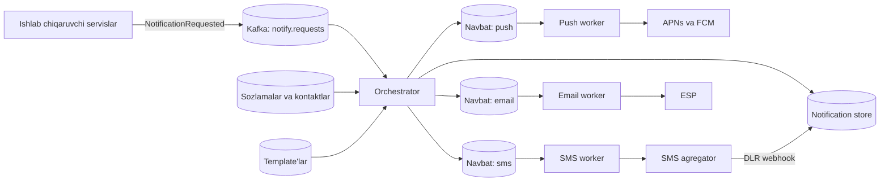
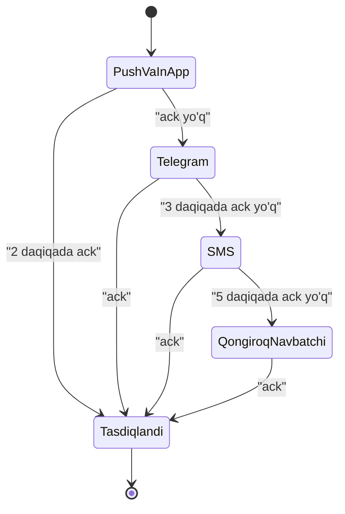

## Bu dars nima uchun kerak

Deyarli har bir mahsulotda "foydalanuvchiga xabar ber" funksiyasi bor va u tez-tez oddiy ko'rinadi: hodisa bo'ldi, `sendSms()` chaqirildi. Real tizimda esa bu alohida servis, chunki:

- kanallar har xil: mobil push (APNs, FCM), SMS (operator yoki agregator), email (SMTP, ESP), messenjer (Telegram bot), web push, ilova ichidagi xabar;
- har bir kanalning o'z cheklovlari bor: payload hajmi, tezlik limiti, narx, yetkazish kafolati yo'qligi;
- tashqi provayderlar sekin, ba'zan ishlamaydi, ba'zan bir xil xabarni ikki marta yetkazadi;
- foydalanuvchi sozlamalari (qaysi kanal, qaysi turdagi xabar, tungi soatlar), qonunchilik (obunadan chiqish, reklama xabarlariga rozilik);
- eng muhimi: **juda ko'p xabar ham, xabar yo'qligi ham** zarar. Soxta ogohlantirishlar oqimi foydalanuvchini barcha xabarlarni o'chirishga majbur qiladi; muhim ogohlantirish (to'qnashuv, o'g'irlik) yetib bormasa - biznes zarar ko'radi.

Bu dars 41-dars (delivery semantics), 39-dars (idempotency), 50-dars (retry, DLQ), 56-dars (rate limiting), 62-63 darslar (timeout, circuit breaker) ustiga quriladi. 83-darsdagi geofence hodisalari va 81-darsdagi yoqilg'i hodisalari shu servisga keladi.

Bu darsdan keyin siz:

- push (APNs, FCM), SMS va email ning ichki ishlash usuli va cheklovlarini bilasiz;
- notification servisi arxitekturasini (qabul, preference, template, navbat, kanal worker'lari, holat) loyihalay olasiz;
- dublikatsiz va yo'qotishsiz yetkazishni (idempotency, outbox, retry, DLQ) ta'minlay olasiz;
- rate limiting, prioritet, agregatsiya (digest) va eskalatsiya zanjirini loyihalay olasiz;
- fleet ogohlantirishlari uchun kanallar va narxni hisoblay olasiz.

## Kanallar: ichki ishlash va cheklovlar

### Mobil push: APNs va FCM

Mobil ilova serveringizga to'g'ridan-to'g'ri doimiy ulanish ushlab turmaydi (batareya, OS cheklovlari). Buning o'rniga OS ning o'z kanali bor: Apple uchun **APNs**, Android (va iOS uchun ham, ichkarida APNs orqali) **FCM**. Oqim:

1. Ilova ishga tushganda OS dan **device token** oladi va uni sizning backend'ingizga yuboradi.
2. Backend token ni foydalanuvchiga bog'lab saqlaydi (bir foydalanuvchida bir nechta qurilma bo'lishi mumkin).
3. Xabar yuborishda backend provayderga `token + payload` yuboradi, provayder qurilmaga yetkazadi.

APNs (Apple hujjati bo'yicha):

- HTTP/2 va TLS 1.2+ orqali `api.push.apple.com:443` (yoki 2197-port); bitta ulanishda bir nechta parallel stream (aniq soni server yuklamasiga bog'liq), ulanishni soatlab-kunlab qayta ishlatish tavsiya etiladi;
- autentifikatsiya: token-based (JWT, `.p8` kalit) yoki sertifikat;
- payload maksimal **4 KB** (4 096 bayt), VoIP uchun 5 KB;
- `apns-priority`: 10 - darhol, 5 - qurilma quvvatini hisobga olib, 1 - qurilmani uyg'otmasdan;
- `apns-expiration`: 0 bo'lsa bir marta urinadi va saqlamaydi; aks holda belgilangan vaqtgacha (30 kun yoki undan kam) saqlab, qurilma onlayn bo'lganda yetkazadi;
- APNs har bir bundle ID uchun qurilmaga **faqat bitta** kutilayotgan xabarni saqlaydi (hujjatga ko'ra ko'p hollarda oxirgisini, lekin qisqa vaqtda ko'p xabar kelsa bu kafolatlanmaydi);
- `apns-collapse-id` (64 baytgacha) - bir xil ID li xabarlar qurilmada bittaga birlashadi;
- best-effort: xabarlar tartibi o'zgarishi, guruhlanishi, throttle qilinishi va ba'zan yetkazilmasligi mumkin.

FCM (Firebase hujjati bo'yicha):

- **notification message** (OS o'zi ko'rsatadi) va **data message** (ilova o'zi qayta ishlaydi);
- data message payload maksimal 4 KB;
- `collapse_key` - qurilmaga yetmagan eski xabarni yangisi bilan almashtiradi; bir qurilmada bir vaqtda ko'pi bilan 4 ta turli collapse key;
- priority: normal (data message uchun standart; uxlab turgan qurilmada tarmoq ulanishini ochmaydi, batareya uchun kechiktirilishi mumkin) va high (notification message uchun standart; vaqt muhim xabarlar uchun, batareyani ko'proq sarflaydi);
- TTL 0 dan 2 419 200 soniyagacha (28 kun), berilmasa standart 4 hafta.

**Token hayotiy sikli.** Ilova o'chirilganda token bekor bo'ladi: APNs `410` (`Unregistered`), FCM `UNREGISTERED` qaytaradi. Bunday tokenni darhol o'chirish kerak, aks holda o'lik tokenlar ro'yxati o'sadi va har bir yuborishda behuda so'rov ketadi. Token yangilanishi ham bo'ladi - ilova har ishga tushganda token ni yuborib, backend upsert qiladi.

Asosiy xulosa: **push - kafolatsiz kanal.** "Provayder 200 OK qaytardi" = "provayder qabul qildi", "foydalanuvchi ko'rdi" emas. Muhim ogohlantirish uchun ilova ichida tasdiq (ack) yoki boshqa kanal bilan eskalatsiya kerak.

### SMS

SMS yetkazish zanjiri: sizning servis -> SMS agregator (HTTP API) -> operator SMSC (SMPP protokoli) -> abonent. Xususiyatlari:

- **narx** - har bir xabar uchun to'lov, push va emaildan ancha qimmat;
- matn cheklangan: GSM-7 kodlashda 160 belgi, 16-bitli (UCS-2, masalan kirill) kodlashda 70 belgi; uzun xabar bir necha qismga bo'linadi (har bir qismda UDH sarlavhasi uchun joy ketadi: GSM-7 da 153, UCS-2 da 67 belgi qoladi) va agregatorlar odatda har bir qismni alohida xabar sifatida hisoblaydi (tarifni shartnomadan tekshiring). "Ogohlantirish: avtomobil 01A123BC zonadan chiqdi" kirill harflarida yozilsa, 70 belgidan oshib, ikki SMS narxiga tushishi mumkin;
- **yetkazish hisoboti (DLR)** asinxron keladi: agregator webhook yoki polling orqali "delivered/failed" xabar beradi, ba'zan daqiqalar o'tib;
- alfa-nom (sender ID) ishlatish shartlari mamlakat va operatorga bog'liq - agregator bilan kelishiladi;
- agregatorning tezlik limiti (soniyasiga N xabar) bor.

Asosiy qo'llash: OTP (bir martalik kod), favqulodda ogohlantirishlar (internet yo'q bo'lsa ham yetadi).

### Email

Email zanjiri: servis -> ESP (Amazon SES, SendGrid, Mailgun yoki o'z SMTP serveringiz) -> qabul qiluvchi pochta serveri (MX). Xususiyatlari:

- arzon, katta hajmli kontent (hisobot, PDF), lekin real vaqt uchun emas;
- **deliverability** - eng katta muammo: SPF, DKIM, DMARC yozuvlari to'g'ri sozlanmasa, xat spamga tushadi; bounce (yetkazib bo'lmadi) va complaint (spam deb belgilandi) darajasi yuqori bo'lsa, ESP hisobingizni cheklaydi;
- **hard bounce** (manzil yo'q) - manzilni suppression ro'yxatiga qo'shib, boshqa yubormaslik; **soft bounce** (quti to'la) - qayta urinish;
- ommaviy (marketing) xatlar uchun obunadan chiqish havolasi va List-Unsubscribe sarlavhasi.

### Messenjer: Telegram bot

Korporativ ogohlantirishlar uchun Telegram guruhlari ham kanal sifatida ishlatiladi. Bot API orqali yuborish oddiy, lekin cheklovlar bor (Telegram Bots FAQ bo'yicha): bitta chatga soniyasiga 1 xabardan ko'p yubormaslik tavsiya etiladi, guruhga bot daqiqasiga 20 tadan ko'p xabar yubora olmaydi, ommaviy yuborishda 30 xabar/s atrofida (pullik broadcast yoqilsa 1 000 xabar/s gacha, Telegram Stars evaziga va qo'shimcha shartlar bilan). Oshib ketsa 429 xatosi. Ya'ni bitta mijozning 500 kishilik dispetcher guruhiga daqiqasiga 100 ta ogohlantirish yuborib bo'lmaydi - agregatsiya majburiy.

### Kanallar taqqoslash

| Mezon | Push (APNs/FCM) | SMS | Email | Telegram bot | In-app (WebSocket) |
|---|---|---|---|---|---|
| Narx | Deyarli bepul | Xabar boshiga to'lov | Juda arzon | Bepul (limitli) | O'z infratuzilmangiz |
| Kechikish | Soniyalar, kafolatsiz | Soniyalar-daqiqalar | Daqiqalar | Soniyalar | Millisekund-soniya |
| Hajm | 4 KB | 160/70 belgi | Katta | 4 096 belgi matn (sendMessage) | Erkin |
| Yetkazish tasdig'i | Faqat provayder qabul qildi | DLR (asinxron) | Bounce; ochilish - faqat tracking pixel orqali, ishonchsiz | Yuborildi | Ilova ack |
| Ilovasiz ishlaydimi | Yo'q | Ha | Ha | Telegram kerak | Yo'q, ilova ochiq bo'lishi kerak |
| Yaxshi joy | Tezkor ogohlantirish | OTP, favqulodda | Hisobot, hujjat | Korporativ guruhlar | Dispetcher ekrani |

## Arxitektura

Qatlamlar:

1. **Qabul (ingest).** Biznes servislar to'g'ridan-to'g'ri SMS API chaqirmaydi, balki "foydalanuvchi U ga T turidagi xabar, ma'lumot D bilan" degan **hodisa** yuboradi. Idempotency kaliti majburiy (masalan, `geofence_event:{id}:exit`). Hodisa bazadagi biznes o'zgarish bilan birga transactional outbox orqali chiqariladi (48-dars), aks holda "tranzaksiya commit bo'ldi, xabar yo'qoldi" yoki aksincha holat bo'ladi.
2. **Orchestrator.** Har bir so'rov uchun: dedup (idempotency kaliti bo'yicha unique constraint yoki Redis `SET NX`), foydalanuvchi sozlamalari (qaysi turdagi xabarni qaysi kanalda oladi, tungi rejim, til), template render, kanal tanlash, rate limit va agregatsiya qarori. Natija - har bir kanal uchun alohida **delivery** yozuvi va navbatga vazifa.
3. **Kanal navbatlari.** Har kanal alohida navbat va worker pool. Sabab - **bulkhead** (63-dars): SMS agregator sekinlashsa, push xabarlar kutib qolmaydi.
4. **Kanal worker'lari.** Provayderni chaqiradi, javobni tahlil qiladi: muvaffaqiyat, vaqtinchalik xato (retry), doimiy xato (token o'lik, raqam noto'g'ri - retry yo'q, kontaktni belgilash).
5. **Holat (notification store).** Har bir delivery: `pending -> sent -> delivered/failed`, urinishlar soni, provayder ID si. Bu foydalanuvchi uchun "bildirishnomalar tarixi" va qo'llab-quvvatlash uchun "xabar ketdimi?" savoliga javob.

### Yetkazish semantikasi va idempotency

Tashqi provayderlar bilan **exactly-once yo'q** (39-dars). Klassik holat: worker SMS agregatorga so'rov yubordi, timeout bo'ldi - agregator xabarni yubordimi yoki yo'qmi, noma'lum. Ikki variant:

- qayta yuborish - dublikat xavfi (foydalanuvchi ikkita SMS oladi);
- qayta yubormaslik - yo'qolish xavfi.

Amaliy yechim:

- provayderning o'z idempotency kalitini ishlatish, agar qo'llasa (ko'p agregatorlar va ESP'lar mijoz xabar ID sini qabul qiladi va dublikatni rad etadi);
- APNs da `apns-id` va `apns-collapse-id`, FCM da `collapse_key` - qurilmada dublikat ko'rinmasligi uchun;
- xabar turiga qarab qaror: OTP uchun dublikat zararsiz (bir xil kod), to'lov eslatmasi uchun dublikat yoqimsiz lekin xavfsiz, "to'qnashuv" ogohlantirishi uchun yo'qolish ancha yomonroq - shuning uchun at-least-once.

### Retry va DLQ

- Vaqtinchalik xato (5xx, timeout, 429): exponential backoff + jitter (62-dars). 429 da provayder `Retry-After` bersa, unga amal qilish.
- Doimiy xato (`410 Unregistered`, noto'g'ri raqam, hard bounce): retry yo'q, kontaktni o'chirish yoki bloklash.
- Urinishlar tugasa - DLQ (50-dars) va monitoring.
- **TTL:** eskirgan xabarni yubormaslik. "Mashina hozir zonadan chiqdi" ogohlantirishi 2 soatdan keyin keraksiz va chalg'ituvchi. Har bir xabar turida `expires_at`.

### Prioritet

Bitta navbatda marketing xati va "o'g'irlik shubhasi" ogohlantirishi bir qatorda turmasligi kerak. Variantlar: prioritet bo'yicha alohida navbatlar (high, normal, bulk) va worker'larning ko'p qismi high ga ajratilgan; yoki bitta navbat ichida prioritet (RabbitMQ priority queue, 42-dars). Uber ning RAMEN push platformasida ham xabarlar yuqori, o'rta va past prioritetga ega va kamayish tartibida yuboriladi.

## Rate limiting, agregatsiya va charchoq

### Uch xil limit

1. **Provayder limiti** - agregator soniyasiga N SMS, Telegram ommaviy yuborishda 30 xabar/s atrofida. Worker'lar umumiy token bucket (56-dars) bilan cheklanadi, odatda Redis da.
2. **Foydalanuvchi limiti** - bitta odamga soatiga ko'pi bilan N ta xabar (turiga qarab). Spamdan himoya.
3. **Biznes limiti va budjet** - tenant uchun kunlik SMS budjeti. Konfiguratsiya xatosi tufayli 100 000 SMS ketib qolmasligi kerak.

### Agregatsiya (digest)

Bitta mashina chegarada turib 30 daqiqada 40 marta "zonadan chiqdi" hodisasini chiqarsa (83-darsdagi debounce ishlamasa) yoki 200 ta mashinali park yomg'irda hammasi "keskin tormoz" bersa - 200 ta push yuborish o'rniga bitta: "So'nggi 10 daqiqada 37 ta mashinada keskin tormoz hodisasi". Mexanika:

- hodisalar `(user, notification_type)` kaliti bo'yicha vaqt oynasida (masalan, 5 daqiqa) to'planadi;
- oyna yopilganda bitta xabar yuboriladi;
- kritik turlar (SOS, to'qnashuv) agregatsiyadan o'tmaydi - darhol.

Bu 45-darsdagi windowing ning bevosita qo'llanishi.

### Eskalatsiya zanjiri

Kritik ogohlantirish uchun bitta kanal yetarli emas:

Bu PagerDuty kabi incident tizimlarining modeli: escalation policy - tartiblangan qoidalar (darajalar), har birida escalation timeout; javobgar shu vaqt ichida tasdiqlamasa, keyingi darajaga o'tadi, ack yoki resolve bo'lsa zanjir to'xtaydi (PagerDuty da standart timeout 30 daqiqa, sozlanadi; kritik fleet ogohlantirishi uchun yuqoridagi daqiqalar - masala sharti). Taymer uchun kechiktirilgan navbat (delayed queue, SQS delay, Redis sorted set + poller) yoki workflow dvigateli (Temporal) ishlatiladi.

## Real misol: Uber RAMEN

Uber 2020 yilgi muhandislik blogida o'zining real vaqt push platformasi **RAMEN** ni tasvirlaydi. Undan oldin ilovalar holatni polling bilan olgan va bir paytda backend API gateway so'rovlarining 80 foizi polling chaqiruvlari bo'lgan. RAMEN:

- ilova bilan doimiy ulanish (dastlab SSE, keyingi avlod gRPC bidirectional stream);
- **at-least-once** yetkazish: har bir xabarga oshib boruvchi sequence number, mijoz qayta ulanganda oxirgi ko'rgan raqamini yuboradi va server yetkazilmaganlarini qayta beradi;
- server har 4 soniyada 1 baytlik heartbeat yuboradi, mijoz 7 soniya davomida heartbeat yoki xabar olmasa qayta ulanadi;
- har bir xabarda TTL (bir necha soniyadan 30 daqiqagacha) va deduplikatsiya: bir turdagi xabardan faqat eng oxirgisi;
- prioritet: yuqori, o'rta, past;
- blog yozilgan paytda 1.5 milliondan ortiq bir vaqtdagi ulanish va soniyasiga 250 mingdan ortiq xabar.

Saboq: APNs/FCM "uyg'otish" uchun, lekin ilova ochiq bo'lganda holatni sinxronlash uchun o'z kanalingiz (WebSocket, SSE, gRPC) va sequence number asosidagi qayta yetkazish ancha ishonchli. Bu mavzu 86-darsda (chat va presence) davom etadi.

## Hisob-kitob

Hisob uchun shartlar: 30 000 mashina, 1 500 tenant, 6 000 dispetcher/menejer foydalanuvchi; mashina boshiga kuniga o'rtacha 10 ta ogohlantirish beradigan hodisa (geofence, tezlik, yoqilg'i, tormoz); har bir hodisa o'rtacha 3 kishiga; xabarlarning 80 foizi past prioritetli va digest ga tushadi; cho'qqi koeffitsienti 15.

**Hodisalar:** 30 000 x 10 = 300 000 hodisa/kun. x 3 = 900 000 potensial xabar/kun.

**Agregatsiyadan keyin:** 900 000 x 0.2 = 180 000 darhol yuboriladigan xabar; 720 000 past prioritetli xabar foydalanuvchi va tur bo'yicha 5 daqiqalik oynada digest'larga yig'iladi; shart: bitta digest o'rtacha 10 ta xabarni birlashtiradi - 72 000 digest. Jami 180 000 + 72 000 = 252 000, ya'ni taxminan 250 000 xabar/kun. 250 000 / 86 400 = 2.9, ya'ni o'rtacha 3 xabar/s; cho'qqi 15 barobar - 45-50 xabar/s. Bu tizim uchun kichik yuklama, ya'ni muammo throughput emas, **to'g'rilik va narx**.

**SMS narxi:** agar har bir xabar SMS bilan ketsa, 250 000 SMS/kun - oyiga 250 000 x 30 = 7.5 million SMS. Oylik xarajat = 7.5 M x segmentlar soni x agregator tarifidagi bitta segment narxi; kirill matnda xabar ko'pincha 2 segment bo'ladi. Shuning uchun SMS faqat kritik ogohlantirish va eskalatsiya uchun: shart bo'yicha kuniga 2 000 ta - 250 000 / 2 000 = 125 barobar kam.

**Telegram limiti:** masala sharti - bitta yirik tenant'ning dispetcher guruhiga cho'qqida daqiqasiga 60 ta ogohlantirish. Bu guruh limitidan (20/daqiqa) 3 barobar ko'p. Yechim: guruhga daqiqalik digest, kritiklari alohida shaxsiy chatlarga.

## iQuariX kontekstida: ogohlantirish matritsasi

Quyidagi matritsa hodisa turlari uchun namunaviy sozlama (har bir tenant o'zgartira oladi):

| Hodisa | Prioritet | Kanallar | Agregatsiya | TTL |
|---|---|---|---|---|
| SOS tugmasi, to'qnashuv | Kritik | In-app + push + Telegram, 2 daqiqada ack yo'q - SMS, keyin qo'ng'iroq | Yo'q | 30 daqiqa |
| Yoqilg'i to'kish shubhasi | Yuqori | Push + Telegram | Mashina boshiga 15 daqiqada 1 | 2 soat |
| Taqiqlangan zonaga kirish | Yuqori | Push + in-app | Mashina va zona boshiga 10 daqiqada 1 | 1 soat |
| Tezlik oshishi | Normal | In-app, kunlik digest email | 1 soatlik digest | 24 soat |
| Kunlik hisobot | Past | Email (PDF havola) | Yo'q | 48 soat |
| Treker oflayn 24 soatdan ortiq | Normal | Email + Telegram | Tenant boshiga kunlik ro'yxat | 24 soat |

Muhim dizayn nuqtalari:

- **Tenant izolyatsiyasi.** Bitta tenant'ning hodisalar portlashi (masalan, noto'g'ri sozlangan geozona tufayli) boshqalarning ogohlantirishlarini kechiktirmasligi kerak: tenant bo'yicha fair queueing yoki per-tenant rate limit (73-dars).
- **Tungi rejim.** Menejer 23:00-07:00 da faqat kritik xabarlarni olsin. Vaqt foydalanuvchi time zone'ida.
- **Til.** Template'lar o'zbek (lotin), rus tillarida; kirill SMS 70 belgilik segment ekanini hisobga olib qisqa template.
- **Kontekst havolasi.** Push/Telegram xabarida hodisaning xaritadagi va videodagi (84-dars) havolasi; havola autentifikatsiyasiz ochilmasligi kerak.
- **Audit.** "Sizga ogohlantirish kelmadi" degan shikoyatga javob: notification store dan delivery holati, provayder javobi, DLR.

## Ko'p uchraydigan xatolar

1. **Biznes kod ichidan to'g'ridan-to'g'ri provayderni chaqirish.** Provayder sekinlashsa butun so'rov sekinlashadi, retry va dedup yo'q. Hodisa va navbat orqali.
2. **Outbox siz hodisa chiqarish.** Tranzaksiya rollback bo'ldi, xabar ketdi; yoki commit bo'ldi, xabar yo'qoldi.
3. **Barcha kanallar bitta navbatda.** SMS agregator to'xtasa, push ham to'xtaydi. Kanal bo'yicha bulkhead.
4. **O'lik tokenlarni o'chirmaslik.** 410/UNREGISTERED javoblarini e'tiborsiz qoldirish provayder bilan muammoga va isrofga olib keladi.
5. **TTL yo'q.** Navbat to'lib qolib, 3 soat oldingi "hozir zonadan chiqdi" ogohlantirishlari ketadi.
6. **Agregatsiya va foydalanuvchi limiti yo'q.** Ogohlantirish charchog'i - foydalanuvchilar bildirishnomalarni butunlay o'chiradi, muhimlari ham ko'rinmay qoladi.
7. **Push ni kafolatli deb hisoblash.** Kritik xabar uchun ack va eskalatsiya kerak.
8. **Kirill SMS segmentlarini hisobga olmaslik.** Har bir xabar ikki-uch barobar qimmatga tushadi.

## Xulosa

- Notification - alohida servis: qabul, sozlamalar, template, kanal navbatlari, worker'lar va holat.
- APNs/FCM: 4 KB payload, priority, TTL/expiration, collapse; best-effort, token hayotiy siklini boshqarish kerak.
- SMS qimmat va qisqa (160/70 belgi), DLR asinxron; email arzon, lekin deliverability (SPF, DKIM, DMARC, bounce) muhim.
- Tashqi provayder bilan exactly-once yo'q: idempotency kaliti, provayder dedup, at-least-once va xabar turiga qarab qaror.
- Kanal bo'yicha bulkhead, prioritet navbatlar, TTL, retry + DLQ.
- Rate limit uch darajada (provayder, foydalanuvchi, budjet), agregatsiya (digest) va eskalatsiya zanjiri ogohlantirish charchog'iga qarshi.

## Amaliy topshiriq

Masala sharti: iQuariX yangi "Kritik hodisalar markazi" modulini qurmoqda. Kritik hodisalar: SOS tugmasi, to'qnashuv (akselerometr), yoqilg'i to'kish shubhasi, treker kuchlanishdan uzilishi (o'g'irlik belgisi). 30 000 mashina, kritik hodisalar kuniga 1 500 ta, lekin ommaviy holatlarda (masalan, mobil operator uzilishi tufayli minglab trekerlar bir vaqtda "uzildi") 10 daqiqada 8 000 ta. Talab: kritik hodisa haqida mas'ul shaxs 3 daqiqa ichida xabardor bo'lishi va buni tasdiqlashi kerak.

1. Kanallar va eskalatsiya zanjirini loyihalang: qaysi kanal, qaysi taymer, kim mas'ul (dispetcher, menejer, navbatchi).
2. Idempotency kalitini va dedup mexanizmini aniqlang. Treker bir xil SOS paketini 3 marta yuborsa nima bo'ladi?
3. Ommaviy "uzilish" holatini qanday ajratasiz va qanday agregatsiya qilasiz, shu bilan birga haqiqiy o'g'irlikni yo'qotmaysiz?
4. SMS agregator 15 daqiqa ishlamay qoldi. Tizim xatti-harakatini yozing: navbat, circuit breaker, muqobil kanal, ack taymerlari.
5. Kunlik SMS budjetini hisoblang (oddiy va ommaviy holat uchun) va himoya limitini taklif qiling.
6. "Ogohlantirish kelmadi" shikoyatini tekshirish uchun qaysi ma'lumotlar saqlanishi kerak?

Yaxshi javobda bo'lishi kerak bo'lgan narsalar:

- idempotency kaliti hodisa ID siga asoslangan, dedup qabul qatlamida;
- eskalatsiya taymerlari 3 daqiqalik talabga hisob bilan mos;
- ommaviy hodisa uchun korrelyatsiya (bir operator, bir hudud, bir vaqt) va digest, lekin alohida belgilar (masalan, GPS harakat, eshik datchigi) bo'yicha istisno;
- kanal bulkhead, circuit breaker va fallback kanal;
- SMS budjeti va per-tenant limit;
- delivery holati, provayder javoblari va ack vaqtlari audit uchun saqlangan.

Javobni pastdagi maydonga yozib, chatga yuboring.

## Manbalar

- Apple Developer. [Sending notification requests to APNs](https://developer.apple.com/documentation/usernotifications/sending-notification-requests-to-apns) - HTTP/2, 4 KB payload, apns-priority, apns-expiration, apns-collapse-id.
- Firebase. [About FCM messages](https://firebase.google.com/docs/cloud-messaging/concept-options) - notification va data message, collapse_key (4 tagacha), priority, TTL (28 kun).
- [SMS](https://en.wikipedia.org/wiki/SMS) (Wikipedia) - 160/70 belgi, concatenated SMS da 153/67 belgi (UDH).
- Uber Engineering. [Uber's Real-Time Push Platform](https://www.uber.com/blog/real-time-push-platform/), 2020 - RAMEN, at-least-once, sequence number, prioritet, TTL.
- Telegram. [Bots FAQ - broadcast limits](https://core.telegram.org/bots/faq) - chat (1/s), guruh (20/daqiqa), ommaviy (30/s), paid broadcasts (1 000/s); [Bot API sendMessage](https://core.telegram.org/bots/api#sendmessage) - matn 1-4 096 belgi.
- PagerDuty. [Escalation Policies](https://support.pagerduty.com/main/docs/escalation-policies) - darajalar, escalation timeout, ack bilan to'xtash.
- Alex Xu. System Design Interview, 1-jild, 10-bob "Design a Notification System" - kanallar, retry, dedup, template, rate limit.
- Chris Richardson. [Pattern: Transactional outbox](https://microservices.io/patterns/data/transactional-outbox.html) - hodisani tranzaksiya bilan birga chiqarish.
- Google SRE book. [Monitoring Distributed Systems](https://sre.google/sre-book/monitoring-distributed-systems/) - ogohlantirish charchog'i va faqat amal talab qiladigan alertlar.
