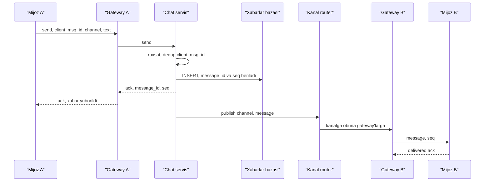

## Bu dars nima uchun kerak

Chat tizimi tashqaridan oddiy: xabar yozildi, boshqa tomonda paydo bo'ldi. Ichkarida esa u bir nechta qiyin muammoni bir joyga yig'adi:

- **millionlab doimiy ulanish** (WebSocket) - har biri server xotirasida holat;
- **fan-out** - bitta xabar kanaldagi barcha onlayn a'zolarga yetishi kerak, guruh katta bo'lsa bu minglab yetkazish;
- **tartib** - xabarlar bir kanal ichida barcha qatnashchilarda bir xil tartibda ko'rinishi;
- **yo'qotmaslik va dublikatsizlik** - mobil tarmoq uzilganda ham, qayta ulanganda ham;
- **presence** - kim onlayn ekanini ko'rsatish, bu esa xabarlardan ham ko'proq hodisa yaratadi;
- **tarix** - trillionlab xabarni saqlash va tez sahifalash.

Bu dars 8-dars (WebSocket, SSE, MQTT), 29-dars (consistent hashing), 43-dars (Kafka, partition ichida tartib), 57-dars (Snowflake ID), 39-dars (idempotency) va 85-dars (push) ustiga quriladi. News feed fan-out 87-darsda, collaborative editing 97-darsda.

Bu darsdan keyin siz:

- chat tizimining asosiy komponentlarini (gateway, chat servis, kanal routing, saqlash, push) va ular orasidagi oqimni loyihalay olasiz;
- xabar tartibi, idempotency va qayta ulanishda sinxronlashni (sequence, cursor) ta'minlay olasiz;
- katta guruhlarda fan-out muammosini va uning yechimlarini tushuntira olasiz;
- presence ni heartbeat, TTL va fan-out cheklash bilan loyihalay olasiz;
- xabarlarni saqlash sxemasini (partition, bucket, clustering) hisob bilan tanlay olasiz.

## Talablar va asosiy qarorlar

Odatiy funksional talablar: 1:1 va guruh chat, xabar tarixi, yetkazildi/o'qildi belgilari, onlayn holat, "yozmoqda..." indikatori, oflayn foydalanuvchiga push, bir nechta qurilmada sinxron.

Asosiy nofunksional talablar: xabar 1 soniyadan tez yetsin (bir region ichida), yuborilgan va server tasdiqlagan xabar yo'qolmasin, kanal ichida tartib barqaror bo'lsin.

Birinchi qaror - **transport.** Mijoz-server ikki tomonlama, past kechikishli kanal kerak. Variantlar (8-dars): WebSocket (eng keng), SSE + HTTP POST (server -> mijoz SSE, mijoz -> server oddiy HTTP; Uber RAMEN dastlab shunday, 85-dars), MQTT (IoT va mobil, kichik overhead), gRPC streaming. Brauzer va mobil chat uchun odatda WebSocket.

Muhim tushuncha: **ulanish holati (stateful) va biznes mantiq (stateless) alohida.** WebSocket ulanishlarini ushlab turadigan **gateway** serverlar faqat ulanishni boshqaradi: autentifikatsiya, heartbeat, kim qaysi kanalga obuna. Xabarni saqlash, ruxsatni tekshirish, kimga yuborishni hal qilish - stateless chat servisida. Sabab: gateway qayta ishga tushsa, millionlab ulanish uziladi; uni kamdan-kam deploy qilish va oddiy saqlash kerak.

## Xabar yuborish oqimi

Qadamlar:

1. Mijoz xabarga o'zi **`client_msg_id`** (UUID) beradi. Tarmoq uzilib qayta yuborsa, server shu ID bo'yicha dublikatni aniqlaydi (39-dars). Bu "yuborilmoqda..." holatidagi xabarni xavfsiz qayta yuborish imkonini beradi.
2. Chat servis ruxsatni tekshiradi, xabarga **server ID** (Snowflake, vaqt bo'yicha tartiblanadigan, 57-dars) va kerak bo'lsa kanal ichidagi **sequence number** beradi va bazaga yozadi.
3. **Faqat saqlangandan keyin** mijozga ack. Shu nuqtadan boshlab xabar yo'qolmaydi.
4. Xabar kanalga obuna bo'lgan gateway'larga tarqatiladi, ular ulangan mijozlarga yuboradi.
5. Onlayn bo'lmagan a'zolar uchun push servisga (85-dars) hodisa.

### Kanal router: kim qaysi gateway'da?

Chat servis "kanal X ning onlayn a'zolari qaysi gateway'larda" ekanini bilishi kerak. Uch yondashuv:

- **Pub/sub broker** (Redis Pub/Sub, NATS, Kafka): har bir gateway o'z mijozlari obuna bo'lgan kanallarga obuna bo'ladi; chat servis kanalga publish qiladi. Oddiy, lekin juda ko'p kanal va obuna bo'lsa broker yuklamasi katta.
- **Kanal serverlar consistent hashing bilan** (29-dars): har bir kanal bitta kanal serverga tegishli, u o'z kanallari uchun obunachi gateway'lar ro'yxatini xotirada saqlaydi.
- **Foydalanuvchi -> gateway reyestri** (Redis): `user_id -> gateway_id`; chat servis a'zolar ro'yxatini olib, har biri uchun gateway ni topadi. 1:1 chat uchun yaxshi, katta guruh uchun qimmat.

**Real misol: Slack (2023).** Slack muhandislik blogi real vaqt tizimini to'rt Java servisi bilan tasvirlaydi: **Channel Server** (holatli, xotirada, har biri consistent hashing bilan kanallarning bir qismiga ega; cho'qqida bir hostda taxminan 16 million kanal), **Gateway Server** (holatli, foydalanuvchi WebSocket obunalari, bir nechta regionda, mijoz eng yaqiniga ulanadi), **Admin Server** (stateless, web backend va channel server orasida) va **Presence Server** (kim onlayn, foydalanuvchilar hostlarga hash qilinadi). Xabar: mijoz -> webapp -> admin server -> kanal egasi bo'lgan channel server -> shu kanalga obuna bo'lgan har bir gateway -> mijozlar. Blogga ko'ra xabarlar butun dunyoda taxminan 500 ms ichida yetkaziladi, ishdan chiqqan channel server o'rniga yangisi 20 soniyadan kam vaqtda tayyor bo'ladi.

## Tartib, sinxronlash va qayta ulanish

### Tartib

Ikki foydalanuvchi bir vaqtda yozsa, ularning xabarlari hamma qatnashchida bir xil tartibda ko'rinishi kerak. Mijoz vaqti ishonchsiz (32-dars). Yechim: **tartibni server beradi**, kanal darajasida:

- kanal ichida monoton `seq` (masalan, kanal egasi bo'lgan server yoki baza ketma-ketligi beradi);
- yoki vaqt bo'yicha tartiblanadigan Snowflake ID - deyarli tartib, lekin turli serverlarda millisekund ichida bir oz farq qilishi mumkin.

Global tartib kerak emas - faqat kanal ichida. Bu kanal bo'yicha partitioning ni mumkin qiladi (Kafka da partition key = channel_id, 43-dars).

### Yetkazildi va o'qildi

- **Delivered** - mijoz xabarni oldi va ack yubordi.
- **Read** - foydalanuvchi kanalni ochib ko'rdi. Har bir xabar uchun alohida "o'qildi" yozuvi o'rniga har bir `(user, channel)` uchun **`last_read_seq`** saqlanadi. O'qilmagan xabarlar soni = `channel.last_seq - last_read_seq`. Bu O(1) va katta guruhlarda ham ishlaydi.
- 1:1 chatda "o'qildi" belgisi qarshi tomonga yuboriladi; 10 000 kishilik guruhda har bir o'qish hodisasini hammaga tarqatish ma'nosiz - faqat agregat yoki umuman yo'q.

### Qayta ulanish va bir nechta qurilma

Mobil tarmoq uziladi. Qayta ulanganda mijoz har bir kanal uchun oxirgi olgan `seq` ni yuboradi (yoki bitta umumiy foydalanuvchi "inbox" cursor'i), server undan keyingi xabarlarni beradi. Bu Uber RAMEN dagi modelning o'zi (85-dars): sequence number asosidagi at-least-once qayta yetkazish, mijoz `message_id` bo'yicha dedup qiladi.

Ikki model:

- **Kanal bo'yicha cursor**: har bir kanal uchun `seq`. Ko'p kanalli foydalanuvchida qayta ulanish ko'p so'rov.
- **Foydalanuvchi inbox'i**: har bir foydalanuvchi uchun "uning kanallaridagi barcha yangi hodisalar" log'i (fan-out on write, 87-dars). Sinxronlash bitta cursor bilan, lekin har bir xabar har bir a'zo inbox'iga yoziladi - katta guruhlarda qimmat. Odatda kichik guruhlar va 1:1 uchun inbox, katta kanallar uchun kanal cursor'i.

## Katta guruhlarda fan-out

Bitta xabar N ta onlayn a'zoga: N ta yetkazish. 10 000 onlayn a'zoli kanalda soniyasiga 10 ta xabar - 100 000 yetkazish/s. Presence va "yozmoqda" hodisalari bilan bundan ham ko'p.

**Real misol: Discord (2017).** Discord Elixir/Erlang da har bir server (guild) uchun bitta jarayon (process), har bir foydalanuvchi WebSocket sessiyasi uchun bitta jarayon ishlatgan. Taxminan 5 million bir vaqtdagi foydalanuvchida katta guild'lar (30 000 gacha bir vaqtdagi foydalanuvchi) muammo bo'lgan: bitta `send` 30-70 mikrosekund, demak bitta hodisani guild ning barcha sessiyalariga yuborish 900 ms dan 2.1 s gacha. Erlang jarayoni amalda bitta oqimli bo'lgani uchun guild jarayoni navbatda orqada qolgan. Yechim - **Manifold** kutubxonasi: qabul qiluvchilarni ular joylashgan uzoq tugun bo'yicha guruhlab, har bir tugunga bitta xabar yuborish va o'sha tugunda lokal tarqatish. Bu CPU va tugunlararo trafikni kamaytirgan. Blogga ko'ra eng katta yuklama manbalaridan biri - presence fan-out.

Umumiy yechimlar:

1. **Ierarxik fan-out:** chat servis har bir gateway ga bitta xabar yuboradi (Slack, Discord Manifold), gateway o'z ulanishlariga lokal tarqatadi. 10 000 a'zo 50 gateway da bo'lsa - 50 ta tugunlararo xabar.
2. **Faqat faol ko'rinishga yuborish:** katta kanalda faqat hozir shu kanalni ochib turganlarga to'liq xabar; qolganlarga faqat "yangi xabar bor" belgisi yoki hech narsa (keyin ochganda yuklaydi).
3. **Ephemeral hodisalarni cheklash:** "yozmoqda" katta guruhlarda o'chiriladi yoki throttle qilinadi.
4. **Katta kanal - alohida klass:** e'lon kanallari kabi ko'p o'quvchi, kam yozuvchi kanallar uchun fan-out on read (87-dars).

## Presence

Presence - "foydalanuvchi onlayn/oflayn/band". Qiyinligi: o'zgarish tez-tez bo'ladi va har bir o'zgarish ko'p kishiga qiziq.

### Aniqlash: heartbeat va TTL

TCP ulanishi uzilganini server har doim darhol bilmaydi (mobil tarmoq "jimgina" uzilishi mumkin). Shuning uchun:

1. Mijoz har T soniyada heartbeat yuboradi (masalan, 30 s).
2. Server presence yozuvini TTL bilan yangilaydi: Redis da `SET presence:{user} online EX 90`.
3. Heartbeat 2-3 marta kelmasa, TTL tugaydi - foydalanuvchi oflayn.
4. Aniq uzilish (WebSocket close) bo'lsa - darhol oflayn, lekin **debounce** bilan: mobil ilova tarmoqni almashtirganda (Wi-Fi dan LTE ga) 2-5 soniyalik uzilish "oflayn-onlayn" chaqnashi bo'lmasligi uchun, oflayn hodisasi biroz kechiktirib e'lon qilinadi.

Trade-off: qisqa TTL - aniq, lekin ko'p heartbeat trafik va batareya; uzun TTL - "arvoh onlayn" foydalanuvchilar.

Hisob: 1 million onlayn foydalanuvchi, heartbeat har 30 s - 33 000 heartbeat/s. Har biri Redis `SET EX` - bitta Redis instansiyasi ko'taradi, lekin zaxira va shardlash bilan bir nechta.

### Tarqatish

Presence o'zgarishini kimga yuborish kerak? Foydalanuvchining barcha kontaktlariga yoki uning barcha guruh a'zolariga yuborish - presence bo'roni: 1 000 kishilik 10 ta guruhda a'zo bo'lgan foydalanuvchi onlayn bo'lsa - 10 000 hodisa. Yechimlar:

- **Pull + obuna faqat ko'rinayotganlarga:** mijoz ekranda ko'rinayotgan foydalanuvchilar (ochiq chat, ro'yxatning ko'rinadigan qismi) presence'iga obuna bo'ladi.
- **Katta guruhlarda presence yo'q** yoki faqat son ("1 245 onlayn"), taxminiy va kamdan-kam yangilanadigan.
- **Batch:** presence o'zgarishlarini 1-5 soniyalik oynada yig'ib yuborish.

## Xabarlarni saqlash

Kirish shakli: "kanal X ning oxirgi 50 ta xabari", "shu xabardan oldingi 50 tasi" (sahifalash). Ya'ni **kanal bo'yicha guruhlangan, vaqt bo'yicha tartiblangan** o'qish. Yozish ko'p, o'zgartirish kam (tahrirlash, o'chirish).

**Real misol: Discord saqlashi.** 2017 yilda (kuniga 120 milliondan ortiq xabar) Discord Cassandra da `PRIMARY KEY ((channel_id, bucket), message_id)` sxemasini tanlagan: partition = kanal + vaqt bucket'i (taxminan 10 kun, eng katta kanallarda ham partition taxminan 100 MB dan oshmasligi uchun), clustering key = Snowflake `message_id`, ya'ni partition ichida xabarlar vaqt bo'yicha tartiblangan. 2023 yilgi blogga ko'ra trillionlab xabar 177 tugunli Cassandra klasterida hot partition, GC pauzalari va compaction muammolariga duch kelgan; Discord ScyllaDB ga ko'chgan (72 tugun), tarixiy xabarlarni o'qish p99 40-125 ms dan 15 ms ga, yozish p99 5-70 ms dan barqaror 5 ms ga tushgan. Oraliqda Rust da "data services" qatlami qurilgan: bir xil qatorga bir vaqtdagi so'rovlarni bitta baza so'roviga birlashtirish (request coalescing) - mashhur kanalda yangi xabar chiqqanda minglab mijoz bir vaqtda bir xil narsani so'raydi.

Saboqlar:

- partition kaliti kanal, lekin cheksiz o'smasligi uchun vaqt bucket'i bilan (30-dars, hot partition);
- clustering tartibi vaqt bo'yicha tartiblanadigan ID;
- mashhur kanal - hot key: cache, coalescing (24-dars).

Kichik masshtabda (yuz minglab xabar/kun) PostgreSQL ham to'liq yetarli: `messages(channel_id, id)` bo'yicha indeks, `WHERE channel_id = $1 AND id < $cursor ORDER BY id DESC LIMIT 50` - keyset pagination (9-dars). Vaqt bo'yicha partitioning (81-dars) eski xabarlarni arxivlash uchun.

### Taqqoslash

| Qaror | Variant A | Variant B | Qachon qaysi |
|---|---|---|---|
| Transport | WebSocket | SSE + HTTP POST | Ikki tomonlama ko'p trafik bo'lsa WebSocket; asosan serverdan mijozga bo'lsa SSE soddaroq |
| Routing | Pub/sub broker | Consistent hash kanal serverlari | Kichik-o'rta masshtabda broker; juda ko'p kanal va past kechikishda kanal serverlari |
| Sinxronlash | Kanal cursor | Foydalanuvchi inbox'i | Katta kanallar - cursor; 1:1 va kichik guruhlar - inbox |
| Fan-out | Hammaga push | Faqat faol ko'rinishga, qolganlarga belgi | Guruh hajmi bir necha yuzdan oshsa B |
| Saqlash | PostgreSQL | Cassandra/ScyllaDB | Bitta tugun yozishni ko'tarsa PostgreSQL; aks holda wide-column |
| Presence | Hammaga tarqatish | Faqat ko'rinayotganlarga obuna | Kontaktlar soni ko'p bo'lsa B |

## Ulanishlar soni va resurslar

Bitta server qancha WebSocket ushlay oladi? Bu asosan xotira va fayl deskriptorlari masalasi. WhatsApp 2012 yilda Erlang va FreeBSD da bitta serverda 2 milliondan ortiq TCP ulanishni ko'rsatgan. Node.js da esa amaliyotda ulanish boshiga o'nlab KB xotira (TLS buferlari, `ws` obyekti, ilova holati) ketadi, shuning uchun bitta jarayon odatda o'n minglab - yuz minglab ulanish bilan cheklanadi (aniq raqamni yuklama testi bilan o'lchang).

Hisob: 200 000 bir vaqtdagi ulanish, ulanish boshiga 50 KB deylik: 10 GB xotira. 4 ta gateway instansiyasi (har biri 50 000 ulanish, taxminan 2.5 GB) va N+1 zaxira. Bitta instansiya o'chsa, 50 000 mijoz bir vaqtda qayta ulanadi - **thundering herd**: qayta ulanishda tasodifiy kechikish (jitter, 62-dars) va gateway'larda ulanish qabul qilish tezligini cheklash shart.

Load balancer: WebSocket uzoq yashaydi, shuning uchun L4 yoki L7 LB da idle timeout heartbeat oralig'idan katta bo'lishi kerak (22-dars). Deploy paytida gateway'ni "drain" qilish: yangi ulanish qabul qilmaslik, mavjudlarini asta-sekin yopish.

## iQuariX kontekstida: dispetcher - haydovchi chat va qurilma presence

Deylik, iQuariX ikki yangi funksiya qo'shmoqda.

**1. Dispetcher va haydovchi orasida chat.** Haydovchi ilovasi (Android planshet, kabinada) va dispetcher web paneli. Xususiyatlari:

- haydovchi tez-tez aloqasiz hududlarga kiradi: xabarlar mijozda lokal navbatda turadi, `client_msg_id` bilan qayta yuboriladi, server dedup qiladi;
- shablon xabarlar ("yukni topshirdim", "tirbandlik") va tasdiq tugmalari - strukturalashtirilgan xabar turi, matn emas;
- haydovchi harakatda bo'lsa, ilova xabarni ovoz bilan o'qiydi (xavfsizlik), shuning uchun "o'qildi" belgisi "eshitildi" bo'lishi mumkin;
- kanal modeli: har bir mashina/reys uchun kanal, a'zolar - haydovchi va shu mashinaga mas'ul dispetcherlar. Kanallar kichik (2-10 a'zo), shuning uchun fan-out muammo emas, oddiy pub/sub (Redis) yetarli;
- saqlash: PostgreSQL, `messages(tenant_id, channel_id, id)`, keyset pagination, 1 yil retention.

Hisob: 30 000 mashina, kuniga mashina boshiga 20 xabar - 600 000 xabar/kun, o'rtacha 7 xabar/s, cho'qqi 50-70/s. Bu PostgreSQL uchun kichik yuklama; Cassandra kerak emas.

**2. Qurilma va haydovchi presence.** Dispetcher xaritasida mashina holati: "onlayn" (treker ma'lumot yuboryapti), "aloqa yo'q 5 daqiqadan beri", "dvigatel o'chiq". Bu chat presence'ining IoT varianti:

- treker heartbeat'i - uning GPS paketlari; alohida heartbeat shart emas;
- Redis da `device_last_seen` sorted set (score = oxirgi paket vaqti) - "5 daqiqadan beri jim" qurilmalarni `ZRANGEBYSCORE` bilan topish;
- presence o'zgarishi dispetcher paneliga WebSocket orqali, lekin **faqat ko'rinayotgan** mashinalar uchun: dispetcher xaritada 200 ta mashinani ko'rib turgan bo'lsa, butun 30 000 lik park emas. Panel ochilganda boshlang'ich holat snapshot, keyin o'zgarishlar oqimi;
- debounce: LTE qisqa uzilganda (tunnel, 20 s) "oflayn" chiqmasligi uchun chegara 2-3 daqiqa.

**Dispetcher paneli uchun real vaqt joylashuv oqimi** ham shu gateway infratuzilmasidan foydalanadi: panel `tenant:{id}:viewport` obunasi bilan ko'rinadigan hududdagi mashinalar yangilanishini oladi. 82-darsdagi H3 hujayralari bo'yicha obuna (`cell -> obunachilar`) fan-out ni kamaytiradi.

## Ko'p uchraydigan xatolar

1. **Gateway ichida biznes mantiq.** Har bir deploy millionlab ulanishni uzadi. Ulanish qatlamini yupqa va barqaror saqlang.
2. **Saqlashdan oldin ack berish.** Server qulasa, mijoz "yuborildi" deb ko'rgan xabar yo'qoladi.
3. **Mijoz vaqti bo'yicha tartiblash.** Telefon soati noto'g'ri bo'lsa, xabar tarixning o'rtasiga tushadi. Tartibni server beradi.
4. **`client_msg_id` siz qayta yuborish.** Yomon tarmoqda dublikat xabarlar.
5. **Har bir xabar uchun alohida "o'qildi" yozuvi.** Katta guruhda yozuvlar soni a'zolar x xabarlar. `last_read_seq` ishlating.
6. **Presence ni hammaga tarqatish.** Presence bo'roni xabarlardan ko'p yuklama beradi. Faqat ko'rinayotganlarga.
7. **Qayta ulanishda jitter yo'q.** Bitta gateway o'chsa, hamma mijozlar bir soniyada qaytib, qolgan gateway'larni yiqitadi.
8. **Partition ni faqat channel_id qilish.** Juda faol kanal cheksiz partition va hot partition. Vaqt bucket'i qo'shing.

## Xulosa

- Chat = stateful gateway (ulanishlar) + stateless chat servis (mantiq) + routing + saqlash + push.
- Xabar: `client_msg_id` bilan dedup, server ID/seq bilan tartib, saqlangandan keyin ack, keyin fan-out.
- Tartib faqat kanal ichida kerak; partition key = kanal.
- Qayta ulanish: cursor/seq bo'yicha yetishmaganlarni olish, mijozda dedup; o'qilmaganlar `last_seq - last_read_seq`.
- Katta guruh: ierarxik fan-out (gateway boshiga bitta), faqat faol ko'rinishga, ephemeral hodisalarni cheklash.
- Presence: heartbeat + TTL, debounce, faqat ko'rinayotganlarga obuna.
- Saqlash: kanal + vaqt bucket'i bo'yicha partition, vaqt bo'yicha tartiblangan ID; kichik masshtabda PostgreSQL yetarli.

## Amaliy topshiriq

Faraz qiling, iQuariX yirik taksi parki uchun "dispetcher markazi" chatini qurmoqda: 12 000 haydovchi, 150 dispetcher. Kanallar: har bir haydovchi bilan shaxsiy kanal, smena guruhlari (300-800 haydovchi), bitta umumiy e'lon kanali (12 000 a'zo, faqat dispetcherlar yozadi). Har bir haydovchi kuniga 30 xabar yozadi, dispetcherlar umumiy kanalga kuniga 50 ta e'lon. Haydovchilarning 70% i ish vaqtida onlayn.

1. Yuklamani hisoblang: xabar/s, yetkazish/s (fan-out bilan), bir vaqtdagi WebSocket ulanishlar, presence heartbeat/s.
2. Gateway, routing va saqlash arxitekturasini chizing. Pub/sub broker yoki kanal serverlari - qaysi birini tanlaysiz va nega?
3. Umumiy e'lon kanalidagi bitta xabarni 8 400 onlayn haydovchiga qanday yetkazasiz? Oflayn 3 600 tasiga-chi?
4. Haydovchi 20 daqiqa aloqasiz bo'lib qaytdi. Qaysi protokol bilan u yetishmagan xabarlarni oladi va dublikat ko'rmaydi?
5. Dispetcher ekranidagi haydovchilar presence'ini qanday loyihalaysiz (heartbeat, TTL, debounce, kimga tarqatiladi)?
6. Gateway instansiyalaridan biri qulasa nima bo'ladi? Thundering herd ga qarshi choralar.

Yaxshi javobda bo'lishi kerak bo'lgan narsalar:

- hisob ochiq: 12 000 x 30 / 86 400 va ish soatlariga konsentratsiya; e'lon kanalida fan-out alohida hisoblangan;
- e'lon kanali uchun ierarxik fan-out yoki fan-out on read, oflaynlar uchun push (85-dars);
- `client_msg_id` dedup va seq/cursor bo'yicha sinxronlash;
- `last_read_seq` asosidagi o'qilmaganlar soni;
- presence debounce va faqat ko'rinayotganlarga tarqatish;
- qayta ulanishda jitter va gateway drain;
- saqlash tanlovi raqam bilan asoslangan.

Javobni pastdagi maydonga yozib, chatga yuboring.

## Manbalar

- Slack Engineering. [Real-time Messaging](https://slack.engineering/real-time-messaging/), 2023 - Channel, Gateway, Admin, Presence serverlari, consistent hashing, 500 ms.
- Discord. [How Discord Stores Billions of Messages](https://discord.com/blog/how-discord-stores-billions-of-messages), 2017 - (channel_id, bucket), message_id sxemasi.
- Discord. [How Discord Stores Trillions of Messages](https://discord.com/blog/how-discord-stores-trillions-of-messages), 2023 - Cassandra dan ScyllaDB ga, request coalescing, p99 raqamlari.
- Discord. [How Discord Scaled Elixir to 5,000,000 Concurrent Users](https://discord.com/blog/how-discord-scaled-elixir-to-5-000-000-concurrent-users), 2017 - guild/session jarayonlari, Manifold, presence fan-out.
- WhatsApp. [1 million is so 2011](https://blog.whatsapp.com/1-million-is-so-2011), 2012 - bitta serverda 2 milliondan ortiq TCP ulanish.
- Uber Engineering. [Uber's Real-Time Push Platform](https://www.uber.com/blog/real-time-push-platform/), 2020 - sequence number, heartbeat, qayta ulanish.
- Alex Xu. System Design Interview, 1-jild, 12-bob "Design a Chat System" - stateful/stateless servislar, sinxronlash, presence.
