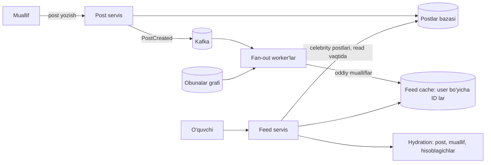

## Bu dars nima uchun kerak

1-darsda Twitter home timeline misolini qisqa ko'rdik: o'qish yozishdan ikki tartib ko'p, shuning uchun lenta oldindan hisoblanadi, lekin millionlab obunachili akkauntlar uchun gibrid yo'l kerak. Bu dars shu g'oyani to'liq ochadi.

News feed - "men obuna bo'lgan manbalardan kelgan yangi elementlar, tartiblangan holda" degan har qanday ko'rinish. Ijtimoiy tarmoq lentasi faqat bitta misol. Xuddi shu muammo:

- dispetcher "mening mashinalarim bo'yicha hodisalar lentasi"ni ochganda;
- menejer "mening filiallarimdagi barcha ogohlantirishlar"ni ko'rganda;
- GitHub "kuzatayotgan repolaringizdagi faollik";
- bildirishnomalar inbox'i (85-dars), chat inbox'i (86-dars).

Asosiy savol bitta: **ishni qachon qilish kerak - yozishda yoki o'qishda?** Javob o'qish/yozish nisbati, obunalar taqsimoti (kimda qancha obunachi) va yangilik talabiga bog'liq.

Bu dars 23-24 darslar (caching), 28-30 darslar (sharding, hot key), 41-43 darslar (navbat, Kafka), 46-47 darslar (event-driven, CQRS) va 9-dars (pagination) ustiga quriladi.

Bu darsdan keyin siz:

- fan-out on write (push) va fan-out on read (pull) modellarini mexanika va narx darajasida taqqoslay olasiz;
- "celebrity" muammosi va gibrid modelni hisob bilan asoslay olasiz;
- feed saqlash tuzilmasini (ID lar ro'yxati + hydration), sahifalash va o'chirishni loyihalay olasiz;
- ranking qatlami (candidate generation, scoring, mixing) feed arxitekturasiga qanday qo'shilishini bilasiz;
- fleet hodisalari lentasini tenant va ruxsatlar bilan loyihalay olasiz.

## Ikki model

### Fan-out on read (pull)

Foydalanuvchi lentani ochganda:

1. Uning obunalari ro'yxatini olamiz (masalan, 300 ta manba).
2. Har bir manbaning oxirgi N ta postini olamiz.
3. Birlashtirib (k-way merge), vaqt yoki ball bo'yicha saralab, birinchi 20 tasini qaytaramiz.

Narx: **yozish arzon** (post bitta joyga yoziladi), **o'qish qimmat** (har o'qishda 300 ta so'rov yoki scatter-gather). Yangilik ideal: post yozilgan zahoti ko'rinadi. Faol bo'lmagan foydalanuvchilar uchun hech qanday ish qilinmaydi.

### Fan-out on write (push)

Post yozilganda:

1. Muallifning obunachilari ro'yxatini olamiz.
2. Har bir obunachining **tayyor lentasiga** (cache, odatda Redis list yoki sorted set) post ID sini qo'shamiz.
3. Lentani o'qish - bitta kalitdan oxirgi 20 ta ID ni olish.

Narx: **o'qish juda arzon** (bitta O(1)/O(log N) operatsiya), **yozish qimmat** (obunachilar soniga proporsional). Fan-out asinxron bajariladi, shuning uchun yangilik bir necha soniya kechikadi. Faol bo'lmagan foydalanuvchilarning lentasi ham to'ldiriladi - isrof.

### Real misol: Twitter (2012-2013)

High Scalability da Raffi Krikorian taqdimoti bo'yicha konspekt (2013):

- 150 million faol foydalanuvchi, home timeline o'qish 300 ming QPS, yozish 6 ming so'rov/s;
- tvit kelganda fan-out jarayoni uning ID sini har bir obunachining home timeline'iga qo'shadi;
- timeline'lar Redis da, har biri 800 tagacha yozuv, 3 ta mashinada 3 nusxa; faqat faol foydalanuvchilar (oxirgi 30 kun ichida kirgan) xotirada;
- timeline da faqat tvit ID lari saqlanadi, to'liq tvit keyin "hydrate" qilinadi;
- maqsad - 5 soniya ichida obunachilarga yetkazish, ko'p obunachili akkauntlarda bu ba'zan oshgan;
- juda ko'p obunachili akkauntlar uchun fan-out ni o'tkazib yuborib, ularning tvitlarini o'qish paytida lentaga qo'shish (merge) yo'nalishi aytilgan.

## Celebrity muammosi va gibrid model

Hisob. Shartlar: muallifda 30 million obunachi, Redis klasteri soniyasiga 1 million yozuv qila oladi. Fan-out on write da bitta post = 30 million Redis yozuvi, ya'ni 30 M / 1 M = 30 soniya klasterni band qiladi; mashhur akkaunt soatiga bir necha marta yozsa, boshqa hamma postlar navbatda kutadi. Bundan tashqari obunachilarning katta qismi faol emas - yozuvlarning ko'pi behuda.

Gibrid yechim:

1. Obunachilar soni chegaradan kam bo'lgan mualliflar - **push**. Chegara tizim parametri: yuqoridagi hisob bo'yicha uni fan-out navbatining ruxsat etilgan kechikishidan chiqaring (masalan, 1 M yozuv/s klasterda bitta post 0.1 s dan ko'p band qilmasin desak, chegara 100 000 obunachi).
2. Chegaradan ko'p (celebrity) - **pull**: ularning postlari faqat o'z jadvalida (yoki "celebrity postlari" cache'ida).
3. O'qishda: foydalanuvchining tayyor lentasi + u obuna bo'lgan celebrity'larning oxirgi postlari (odatda bir nechta, ularning postlari bitta issiq cache'da) birlashtiriladi.

Qo'shimcha optimizatsiyalar:

- **faqat faol foydalanuvchilarga push:** oxirgi N kunda kirmaganlarning lentasi to'ldirilmaydi; ular qaytganda lenta pull bilan qayta quriladi (cold start);
- **cheklangan uzunlik:** lentada oxirgi N ta ID (Twitter da 800); undan eskisi pull bilan;
- **prioritetli fan-out:** onlayn obunachilarga birinchi, qolganlarga keyin.

## Taqqoslash

| Mezon | Fan-out on write | Fan-out on read | Gibrid |
|---|---|---|---|
| Yozish narxi | Obunachilar soniga proporsional | O(1) | Oddiy mualliflar uchun proporsional, celebrity uchun O(1) |
| O'qish narxi | O(1) - bitta kalit | Obunalar soniga proporsional (scatter-gather) | Lenta + bir nechta celebrity |
| Yangilik | Soniyalar kechikish (asinxron) | Darhol | Aralash |
| Faol bo'lmaganlar | Behuda ish | Ish yo'q | Faqat faollarga push |
| Saqlash | Har obunachi uchun nusxa (ID) | Faqat postlar | O'rtacha |
| O'chirish va tahrir | Qiyin (minglab lentada) | Oson | O'rtacha |
| Qachon mos | O'qish ko'p, obunachilar soni cheklangan | Yozish ko'p yoki obunachilar juda notekis, yoki o'qish kam | Ijtimoiy tarmoqlar, katta masshtab |

## Feed saqlash tuzilmasi

### ID lar va hydration

Lentada faqat **post ID** (va ehtimol ball, muallif ID) saqlanadi, to'liq kontent emas. Sabablari:

- post tahrirlansa yoki o'chirilsa, minglab nusxani yangilash kerak bo'lmaydi;
- xotira: 8 baytli ID x 800 x 100 million faol foydalanuvchi = 640 GB. To'liq post (1 KB) bilan bu 80 TB bo'lardi.

O'qish ikki bosqichli: (1) lentadan 20 ta ID; (2) **hydration** - post cache'idan (multi-get) post matni, muallif profili, like/izoh hisoblagichlari. Hydration cache'i hit rate'i yuqori bo'lishi kerak (23-dars), chunki mashhur postlar ko'p lentada.

### Tartib va sahifalash

Vaqt bo'yicha tartiblanadigan ID (Snowflake, UUIDv7 - 57-dars) bilan lenta Redis sorted set (score = ID yoki vaqt) yoki list. Sahifalash **offset bilan emas, cursor bilan** (9-dars): "shu ID dan eskiroq 20 tasi". Sabab: lentaga yangi postlar tepadan qo'shiladi, offset siljiydi va foydalanuvchi dublikat yoki o'tkazib yuborilgan postlarni ko'radi.

### O'chirish, blok, obunadan chiqish

- **Post o'chirildi:** fan-out qilingan ID larni hamma lentadan o'chirish qimmat. Amaliy yo'l - hydration paytida filtr: o'chirilgan post qaytarilmaydi (tombstone). Lentada ID qoladi, lekin ko'rinmaydi.
- **Obunadan chiqish/blok:** shu muallifning postlari hydration paytida filtrlanadi; fon jarayon asta-sekin tozalaydi.
- **Ruxsatlar:** "faqat do'stlarga" kabi ko'rinish qoidalari o'qish paytida tekshiriladi - fan-out paytidagi ruxsat keyin o'zgargan bo'lishi mumkin.

Bu umumiy tamoyil: **fan-out - optimizatsiya, haqiqat manbai emas.** Haqiqat manbai - postlar va obunalar jadvallari; lenta cache'i ulardan qayta qurilishi mumkin bo'lishi kerak (47-dars, CQRS: read model).

## Ranking: xronologik lentadan algoritmik lentaga

Zamonaviy lentalar sof xronologik emas. Arxitektura odatda uch bosqichli:

1. **Candidate generation (nomzodlar).** Turli manbalardan yuzlab-minglab nomzod: obunalar lentasi (yuqoridagi fan-out), obuna bo'lmagan, lekin o'xshash foydalanuvchilar yoqtirgan postlar, mavzular.
2. **Ranking (baholash).** ML model har bir nomzodga ball beradi (bosish, yoqtirish ehtimoli).
3. **Filtr va mixing.** Bir muallifdan ketma-ket ko'p post bo'lmasligi, takrorlanmaslik, reklama va boshqa elementlarni aralashtirish.

**Real misol: Twitter "For You" (2023).** Twitter ochiq kodga chiqargan tavsifga ko'ra: har bir so'rovda yuzlab millionlik pooldan eng yaxshi 1 500 ta nomzod tanlanadi, o'rtacha 50 foizi obunalardan (in-network), 50 foizi obuna bo'lmaganlardan; 48 million parametrga yaqin neyron tarmoq har bir nomzodga bir nechta engagement ehtimolini beradi; Home Mixer servisi lentani yig'adi. Pipeline kuniga 5 milliard martaga yaqin ishlaydi va o'rtacha 1.5 soniyadan tez tugaydi, lekin bitta bajarilish 220 CPU-soniya talab qiladi. Ya'ni bu yerda fan-out faqat nomzod manbalaridan biri; asosiy narx - ranking. Recommendation va ML serving 89-darsda.

## Operatsion masalalar: fan-out pipeline, cold start va hot key

### Fan-out pipeline

Fan-out worker'lari odatda Kafka (43-dars) dan `PostCreated` hodisalarini oladi. Bir nechta nozik joy:

- **Obunachilar ro'yxatini sahifalab o'qish.** 50 000 obunachili muallif uchun ro'yxat bitta so'rovda emas, 1 000 talik bo'laklarda olinadi va har bo'lak alohida vazifa sifatida navbatga qo'yiladi. Shunda bitta katta muallif bitta worker'ni uzoq band qilmaydi va qisman bajarilgan ish qayta urinishda boshidan boshlanmaydi.
- **Idempotency.** Worker qayta ishga tushsa, xuddi shu post ID lentaga ikkinchi marta qo'shilmasligi kerak. Redis sorted set da score = post ID bo'lsa, `ZADD` tabiatan idempotent: bir xil a'zo qayta qo'shilsa dublikat paydo bo'lmaydi (39-dars).
- **Backpressure.** Fan-out navbati o'sib ketsa (masalan, yangilik voqeasi paytida hamma yozadi), lentalar kechikadi, lekin post yozish to'xtamaydi. Navbat lag'i alohida metrika va alert (67-dars). Kechikish SLO dan oshsa, vaqtincha ko'proq mualliflarni pull rejimiga o'tkazish mumkin - celebrity chegarasini dinamik pasaytirish.
- **Prioritet.** Onlayn obunachilar (86-darsdagi presence ma'lumoti) uchun fan-out birinchi navbatda, oflaynlar uchun keyinroq yoki umuman o'qishda.

### Cold start va lentani qayta qurish

Uzoq vaqt kirmagan foydalanuvchining lentasi cache'da yo'q. U qaytganda: obunalari bo'yicha pull bilan lenta quriladi (bir martalik qimmat so'rov), natija cache'ga yoziladi va foydalanuvchi "faol" ro'yxatiga qaytadi - shundan keyin push qayta boshlanadi. Xuddi shu mexanizm Redis klasteri yo'qolganda yoki lenta formati o'zgarganda butun cache'ni qayta qurish uchun ham ishlatiladi. Agar bu yo'l ishlamasa, cache haqiqat manbaiga aylanib qolgan bo'ladi.

Cache yo'qolganda hamma foydalanuvchi bir vaqtda cold start ga tushsa, postlar bazasiga bo'ron keladi (24-dars, stampede). Himoya: lentani qayta qurishni rate limit bilan cheklash, birinchi navbatda faqat onlayn foydalanuvchilar uchun, qolganlariga vaqtincha soddalashtirilgan lenta (masalan, faqat celebrity va mashhur postlar) ko'rsatish.

### Hot key: mashhur post

Mashhur post millionlab lentada va har bir o'qishda hydration cache'idan so'raladi. Bitta Redis kaliti bitta shardga tushadi va shu shard cho'qqiga chiqadi. Yechimlar (24-dars): ilova xotirasida juda qisqa TTL li lokal cache, kalitni bir nechta nusxaga ko'paytirish (`post:{id}:{0..N}`), like/izoh hisoblagichlarini real vaqtda emas, sekundlik agregat bilan yangilash. Discord ham mashhur kanallarda bir xil so'rovlarni birlashtirish (request coalescing) orqali shu muammoni yumshatgan (86-dars).

## Hisob-kitob: feed cache hajmi va fan-out yuklamasi

Hisob uchun shartlar: 50 million foydalanuvchi, 10 million kunlik faol (DAU). Har biri kuniga 2 post yozadi (20 million post/kun), lentani 10 marta ochadi (100 million o'qish/kun). O'rtacha obunachi 200 ta, faol obunachilar ulushi 20%, cho'qqi koeffitsienti 4-5.

**O'qish:** 100 M / 86 400 = 1 157, ya'ni 1 160 QPS o'rtacha; cho'qqi 4-5 barobar - 4 600-5 800, hisobda 5 000 QPS.

**Push fan-out (faqat faollarga):** 20 M post x 200 x 0.2 = 800 million lenta yozuvi/kun = 800 M / 86 400 = 9 260 yozuv/s o'rtacha, cho'qqi 4-5 barobar - 37-46 ming/s. Redis klasteri uchun normal, bir necha shard.

**Agar hamma obunachilarga push qilsak:** 4 milliard yozuv/kun - 5 barobar ko'p, ularning 80% i hech qachon o'qilmaydi.

**Pull bilan:** har bir o'qishda 200 ta manba - 5 000 QPS x 200 = 1 million kichik so'rov/s cho'qqida. Post jadvali bo'yicha scatter-gather; bu ancha qimmat.

**Feed cache hajmi:** 10 M faol x 500 ID x 8 bayt = 40 GB sof ma'lumot. Redis sorted set har bir a'zo uchun skiplist tuguni va hash yozuvi saqlaydi, shuning uchun real hajm bundan bir necha barobar katta; shart sifatida overhead koeffitsientini 3-5 deb olamiz (real qiymat: bitta namunaviy lentani yozib, `MEMORY USAGE key` bilan o'lchang) - 120-200 GB, 3 nusxada 360-600 GB. Bir necha o'nlab Redis shard.

Xulosa: bu nisbatda gibrid push (faollarga) iqtisodiy jihatdan aniq yutadi.

## iQuariX kontekstida: hodisalar lentasi

Misol: iQuariX web panelida "Hodisalar lentasi" bor deb olamiz (raqamlar masala sharti): foydalanuvchi o'ziga tegishli mashinalar bo'yicha hodisalarni (geofence, tezlik, yoqilg'i, video klip, texnik xizmat) vaqt bo'yicha ko'radi. Bu feed muammosi, lekin ijtimoiy tarmoqdan farqli:

- "obuna" - bu **ruxsat**: menejer o'z filialidagi 300 ta mashinani, regional direktor 3 000 tasini, tenant admini hammasini (masalan, 20 000) ko'radi;
- mualliflar (mashinalar) soni ko'p, o'quvchilar (foydalanuvchilar) kam: 30 000 mashina, 6 000 foydalanuvchi;
- hodisalar soni katta: kuniga 300 000 (85-dars hisobidagi shart);
- o'qish nisbatan kam: foydalanuvchi panelni kuniga bir necha marta ochadi.

### Variant A: fan-out on read (tavsiya etiladi)

Hodisalar ClickHouse da (81-dars) yoki PostgreSQL da `(tenant_id, ts)` bo'yicha. So'rov: `WHERE tenant_id = $t AND device_id IN (foydalanuvchi ruxsatidagi mashinalar) AND ts < $cursor ORDER BY ts DESC LIMIT 50`.

- 300 ta mashinali menejer uchun `IN` ro'yxati bilan ClickHouse `ORDER BY (tenant_id, device_id, ts)` da - 300 ta qisqa oraliq o'qish, millisekundlar.
- Tenant admini uchun (hamma mashinalar) - filtr faqat `tenant_id` bo'yicha, `ORDER BY (tenant_id, ts)` li projection yoki alohida jadval.
- Ruxsat har doim o'qish paytida - mashina boshqa filialga o'tkazilsa, lenta darhol to'g'ri.

### Nega bu yerda fan-out on write yomon?

Tenant adminining lentasiga 20 000 mashinaning barcha hodisalarini push qilish - har bir hodisa 1-50 ta foydalanuvchi lentasiga, ruxsat o'zgarganda (mashina boshqa menejerga o'tdi) lentalarni qayta qurish kerak, va o'qishlar kam. Push iqtisodiy jihatdan foyda bermaydi.

### Qachon push mantiqli bo'ladi

**Real vaqt yangilanishlari.** Panel ochiq turganda yangi hodisalar tepadan paydo bo'lishi kerak. Bu - "online foydalanuvchilarga push" (86-dars): hodisa Kafka dan WebSocket gateway'ga, gateway esa faqat shu tenant va ruxsatdagi ochiq sessiyalarga yuboradi. Ya'ni: **tarix uchun pull, jonli yangilanish uchun faqat onlayn sessiyalarga push** - gibridning boshqa ko'rinishi.

**O'qilmaganlar hisoblagichi.** "Sizda 12 ta yangi kritik hodisa" - har bir foydalanuvchi uchun hisoblagich: hodisa kelganda ruxsati bor foydalanuvchilarning hisoblagichi oshiriladi (kichik fan-out, chunki faqat kritik hodisalar va foydalanuvchilar soni kam), yoki 86-darsdagi `last_read_ts` dan keyingi kritik hodisalar sonini so'rov bilan hisoblash.

## Ko'p uchraydigan xatolar

1. **Hamma narsani push qilish.** Celebrity va faol bo'lmagan foydalanuvchilar fan-out xarajatini portlatadi.
2. **Lentada to'liq kontentni saqlash.** Xotira isrofi, tahrir va o'chirish imkonsiz bo'ladi. Faqat ID va hydration.
3. **Offset pagination.** Yangi elementlar qo'shilganda dublikat va tushib qolgan postlar.
4. **Ruxsatni faqat fan-out paytida tekshirish.** Keyin o'zgargan ruxsat yoki blok hisobga olinmaydi; o'qishda filtrlash kerak.
5. **Feed cache'ni haqiqat manbai deb hisoblash.** Redis yo'qolsa lentalarni qayta qurib bo'lmasa - ma'lumot yo'qoldi. Cache qayta qurilishi mumkin bo'lishi kerak.
6. **Fan-out ni sinxron bajarish.** Post yozish so'rovi 1 million obunachi uchun yozuv tugashini kutmasligi kerak. Navbat va worker'lar.
7. **Biznes lentada ijtimoiy tarmoq modelini ko'r-ko'rona qo'llash.** O'qishlar kam va ruxsatlar tez o'zgarsa, pull soddaroq va to'g'riroq.

## Xulosa

- Fan-out on write: o'qish O(1), yozish obunachilar soniga proporsional; fan-out on read: aksincha.
- Tanlov o'qish/yozish nisbati, obunachilar taqsimoti va yangilik talabidan chiqadi.
- Gibrid: oddiy mualliflar push, celebrity'lar pull; faqat faol foydalanuvchilarga push.
- Lentada faqat ID, kontent hydration orqali; cursor pagination; o'chirish va ruxsat o'qishda filtrlanadi.
- Lenta cache'i - qayta quriladigan read model, haqiqat manbai emas.
- Algoritmik lentada fan-out faqat nomzod manbalaridan biri; asosiy narx ranking.
- Fleet hodisalar lentasi: tarix uchun pull, jonli yangilanish uchun onlayn sessiyalarga push.

## Amaliy topshiriq

Masala sharti: iQuariX haydovchilar uchun mobil ilovada "Kompaniya lentasi" funksiyasini qo'shmoqda: kompaniya rahbariyati, filial menejerlari va dispetcherlar e'lon, yo'riqnoma, yo'l holati haqida post yozadi; haydovchilar o'z filiali, o'z smenasi va kompaniya bo'yicha postlarni ko'radi. Masshtab: 400 tenant, eng kattasida 15 000 haydovchi; jami 120 000 haydovchi, kunlik faol 70%. Postlar kuniga jami 5 000 ta. Haydovchi lentani kuniga 8 marta ochadi. Kompaniya bo'yicha post - tenant'dagi barcha haydovchilarga.

1. O'qish va yozish yuklamasini hisoblang (QPS, fan-out yozuvlari soni push va pull uchun).
2. Push, pull yoki gibrid - qaysi birini tanlaysiz? "Celebrity" analogi bu yerda nima va chegarani qanday belgilaysiz?
3. Lenta saqlash tuzilmasini yozing: nima saqlanadi, qayerda, qancha uzunlik, cache hajmi.
4. Haydovchi boshqa filialga o'tkazildi. Uning lentasi bilan nima bo'ladi?
5. Post o'chirildi yoki tahrirlandi. Lentalarda nima bo'ladi?
6. "Muhim" belgisi qo'yilgan post uchun push bildirishnoma va "o'qidim" tasdig'i kerak. Buni feed va notification servisi (85-dars) bilan qanday bog'laysiz?

Yaxshi javobda bo'lishi kerak bo'lgan narsalar:

- hisob ochiq: 120 000 x 0.7 x 8 o'qish, 5 000 post x auditoriya hajmi fan-out;
- kompaniya bo'yicha postlar (15 000 auditoriya) celebrity analogi sifatida pull bilan;
- lentada ID, hydration, cursor pagination;
- ruxsat (filial, smena) o'qishda tekshiriladi, filial o'zgarganda lenta qayta quriladi yoki filtrlanadi;
- o'chirish tombstone va hydration filtri bilan;
- "o'qidim" uchun alohida (post_id, user_id) yozuv va hisobot, notification bilan eskalatsiya.

Javobni pastdagi maydonga yozib, chatga yuboring.

## Manbalar

- [The Architecture Twitter Uses to Deal with 150M Active Users](https://highscalability.com/the-architecture-twitter-uses-to-deal-with-150m-active-users/), High Scalability, 2013 - fan-out on write, Redis timeline, 800 yozuv, 300K/6K QPS, celebrity muammosi.
- Redis hujjati: [MEMORY USAGE](https://redis.io/docs/latest/commands/memory-usage/) - kalit egallagan xotirani o'lchash.
- Martin Kleppmann, Chris Riccomini. Designing Data-Intensive Applications, 2-nashr, O'Reilly, 2026 - 2-bob "Defining Nonfunctional Requirements" (ijtimoiy tarmoq home timeline misoli, yuklamani tasvirlash).
- Twitter Engineering. [Twitter's Recommendation Algorithm](https://blog.x.com/engineering/en_us/topics/open-source/2023/twitter-recommendation-algorithm), 2023 - candidate sourcing, ranking, Home Mixer, 1 500 nomzod.
- N. Bronson va boshq. [TAO: Facebook's Distributed Data Store for the Social Graph](https://www.usenix.org/conference/atc13/technical-sessions/presentation/bronson), USENIX ATC 2013 - ijtimoiy graf, soniyasiga milliard o'qish.
- Alex Xu. System Design Interview, 1-jild, 11-bob "Design a News Feed System" - feed publishing va retrieval, gibrid model.
- Martin Fowler. [CQRS](https://martinfowler.com/bliki/CQRS.html) - read model alohida va qayta quriladigan.
