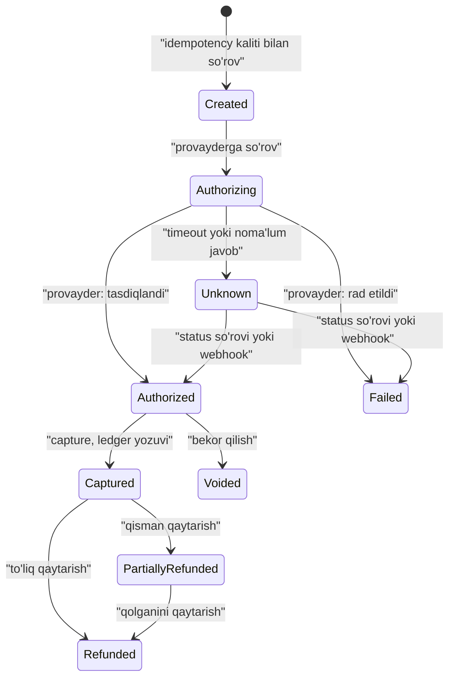

## Bu dars nima uchun kerak

To'lov tizimida xato narxi boshqa tizimlardan farq qiladi. Chat xabari ikki marta yetsa - noqulaylik. Mijozdan ikki marta pul yechilsa - shikoyat, qaytarish, ishonch yo'qolishi. Pul "hech qayerdan" paydo bo'lsa yoki yo'qolsa - buxgalteriya hisobi yopilmaydi, audit va soliq muammolari boshlanadi.

Shu sabab to'lov tizimlari dizaynida uchta tamoyil boshqa hamma narsadan ustun turadi:

1. **Pul yaratilmaydi va yo'qolmaydi** - faqat hisoblar orasida ko'chadi. Buni double-entry ledger kafolatlaydi.
2. **Har bir operatsiya aynan bir marta ta'sir qiladi** - tarmoq qanchalik ishonchsiz bo'lmasin. Buni idempotency va holat mashinasi kafolatlaydi.
3. **Hamma narsa izlanadigan va tekshiriladigan** - o'zgarmas (immutable) yozuvlar, tashqi tizimlar bilan muntazam solishtirish (reconciliation).

Bu dars 17-19 darslar (tranzaksiyalar, isolation), 37-dars (2PC), 39-dars (idempotency va exactly-once), 46-dars (event sourcing), 48-dars (outbox), 49-dars (saga) va 62-dars (retry) ustiga quriladi. Chipta sotish va flash sale case'i 99-darsda.

Bu darsdan keyin siz:

- double-entry ledger modelini (hisob, jurnal yozuvi, debit/kredit, balans) loyihalay va SQL da amalga oshira olasiz;
- idempotency kalitlarini Stripe uslubida (saqlangan javob, parametr tekshiruvi, recovery point) qura olasiz;
- to'lov holat mashinasini (authorize, capture, refund) va tashqi provayder bilan noaniq holatlarni boshqara olasiz;
- webhook'larni xavfsiz va dublikatsiz qabul qila olasiz;
- reconciliation jarayonini va pul miqdorlarini to'g'ri saqlashni bilasiz.

## Pulni qanday saqlash kerak

Birinchi va eng oddiy qoida: **pul miqdorini hech qachon float'da saqlamang.** IEEE 754 da 0.1 + 0.2 aniq 0.3 emas; millionlab operatsiyada yaxlitlash xatolari yig'iladi. Ikki to'g'ri usul:

- **eng kichik birlikdagi butun son** (minor units): 10.99 USD = 1099 sent, `BIGINT`. Stripe API ham shunday ishlaydi: ikki xonali valyutalarda `amount: 1000` = 10 USD, nol xonali valyutalarda (masalan, JPY) `amount: 10` = 10 JPY;
- **aniq o'nlik tur**: PostgreSQL `NUMERIC(20, 2)`, JavaScript da esa `number` emas, `bigint` yoki decimal kutubxona.

Har bir miqdor yonida **valyuta** (ISO 4217 kodi). Turli valyutalarni bitta ustunda qo'shish - xato. Konvertatsiya - alohida operatsiya, kurs va manba bilan yoziladi.

Yaxlitlash qoidasi (bank yaxlitlashi, foiz hisoblashda qoldiqni kimga yozish) - biznes qarori va u kodda bitta joyda bo'lishi kerak.

## Double-entry ledger

### Nega oddiy `balance` ustuni yetmaydi

Naiv dizayn: `accounts(id, balance)` va `UPDATE accounts SET balance = balance - 100 WHERE id = A`. Muammolari:

- tarix yo'q: balans nega shunday ekanini ko'rsatib bo'lmaydi;
- ikki `UPDATE` orasida xato bo'lsa, pul bir joydan ketib, boshqasiga kelmaydi;
- bug yoki qo'lda tuzatish izsiz yo'qoladi; audit imkonsiz.

### Model

Double-entry - XIII asr oxiridagi Italiya savdogarlari yozuvlaridan ma'lum bo'lgan va 1494 yilda Luca Pacioli kitobida birinchi marta tizimli bayon qilingan buxgalteriya usuli. Har bir pul harakati **kamida ikkita yozuvdan** iborat: bir hisobdan chiqim (debit yoki kredit) va boshqasiga kirim, **yig'indisi nolga teng**.

Uchta asosiy tushuncha:

- **Account (hisob)** - pul "yashaydigan" joy: mijoz balansi, kompaniya daromadi, bank hisobi, provayder bilan hisob-kitob, komissiya, soliq.
- **Journal entry (tranzaksiya)** - bitta biznes hodisasi: "mijoz obuna uchun to'ladi".
- **Posting (yozuv)** - jurnal yozuvining hisobga ta'siri: hisob, summa (musbat yoki manfiy), valyuta.

Invariant: har bir journal entry ichidagi postinglar yig'indisi (har bir valyuta bo'yicha) = 0. Shuning uchun butun tizim bo'yicha barcha hisoblar yig'indisi ham doim 0.

Misol (shartlar): mijoz iQuariX obunasi uchun 1 200 000 so'm to'ladi, provayder komissiyasi 1.5% (1 200 000 x 0.015 = 18 000 so'm):

| Hisob | Summa |
|---|---|
| provider_clearing (provayderdan keladigan pul) | +1 182 000 |
| provider_fees (xarajat) | +18 000 |
| customer_receivable:tenant_42 (mijoz qarzi) | -1 200 000 |
| Yig'indi | 0 |

Ishora konvensiyasi (debit musbat, kredit manfiy yoki aksincha) tanlanadi va hamma joyda bir xil qo'llanadi.

### Real misollar

**Square Books (2019).** Square o'zining immutable double-entry buxgalteriya servisi **Books** ni tasvirlaydi: har bir jurnal yozuvi nolga balanslanishi shart; jurnal va "book entry" lar faqat qo'shiladi, hech qachon yangilanmaydi yoki o'chirilmaydi; yagona o'zgaruvchan ma'lumot - har bir hisob ("book") balansi va uning versiya hisoblagichi; xatolar yangi tuzatuvchi yozuvlar bilan tuzatiladi, shuning uchun audit izi saqlanadi. Servis Google Cloud Spanner ustida qurilgan; maqola yozilganda u 20 TB ga yaqin ma'lumotni boshqargan va uni uch kishilik jamoa ishlab chiqib, yuritgan.

**Uber Gulfstream (2020).** Uber ning beshinchi avlod to'lov platformasi double-entry tamoyillariga qurilgan: har bir to'lovdagi yozuvlar nolga teng, pul faqat hisoblar orasida ko'chadi; buyurtmalar (order) o'zgarmas va qayta ishlashdan oldin saqlanadi; qayta ishlangan buyurtma ID lari exactly-once ni ta'minlaydi. Blogga ko'ra platforma kuniga 18 milliondan ortiq so'rovga xizmat qiladi.

### SQL sxema

```sql
CREATE TABLE accounts (
  id         BIGINT PRIMARY KEY,
  tenant_id  BIGINT NOT NULL,
  code       TEXT NOT NULL,          -- 'customer_receivable', 'revenue', ...
  currency   CHAR(3) NOT NULL,
  balance    BIGINT NOT NULL DEFAULT 0,  -- minor units, kesh (cache)
  version    BIGINT NOT NULL DEFAULT 0
);

CREATE TABLE journal_entries (
  id              UUID PRIMARY KEY,
  idempotency_key TEXT NOT NULL UNIQUE,
  kind            TEXT NOT NULL,     -- 'subscription_payment', 'refund', ...
  occurred_at     TIMESTAMPTZ NOT NULL,
  metadata        JSONB
);

CREATE TABLE postings (
  id         BIGSERIAL PRIMARY KEY,
  entry_id   UUID NOT NULL REFERENCES journal_entries(id),
  account_id BIGINT NOT NULL REFERENCES accounts(id),
  amount     BIGINT NOT NULL,        -- musbat yoki manfiy
  currency   CHAR(3) NOT NULL
);
```

Yozish bitta tranzaksiyada:

1. `journal_entries` ga INSERT (idempotency_key UNIQUE - dublikat bo'lsa konflikt, mavjud yozuv qaytariladi);
2. barcha `postings` INSERT;
3. ta'sirlangan hisoblar balansini yangilash: `UPDATE accounts SET balance = balance + $d, version = version + 1 WHERE id = $a`; agar hisob manfiyga tushmasligi kerak bo'lsa, `AND balance + $d >= 0` sharti va ta'sirlangan qatorlar sonini tekshirish;
4. ilova darajasida (yoki deferred constraint trigger bilan) `SUM(amount) = 0` tekshiruvi.

Muhim nozik joylar:

- **Haqiqat manbai - postinglar.** `balance` - ulardan hosil qilingan kesh. Fon jarayon muntazam `SUM(postings)` ni `balance` bilan solishtiradi; farq - alarm.
- **Hech qachon UPDATE/DELETE posting.** Xato bo'lsa - teskari (reversal) jurnal yozuvi.
- **Hisoblarni bir xil tartibda qulflash** (masalan, `id` bo'yicha o'sish tartibida `SELECT ... FOR UPDATE`) - aks holda ikki parallel o'tkazma deadlock beradi.
- **Hot account.** Hamma to'lovlar bitta "revenue" hisobiga tushsa, uning qatori qulf uchun raqobat nuqtasi bo'ladi. Yechimlar: hisobni bir nechta sub-hisoblarga bo'lish (sharded counter), yoki bunday hisoblar uchun balansni sinxron emas, postinglardan asinxron hisoblash.

## Idempotency

### Muammo

Mijoz "To'lash" tugmasini bosdi. So'rov serverga yetdi, server provayderdan pul yechdi, javob qaytayotganda tarmoq uzildi. Mijoz (yoki uning HTTP kutubxonasi) qayta yuboradi. Idempotency bo'lmasa - ikki marta yechiladi.

39-darsda ko'rganimizdek, tarmoq orqali exactly-once **yetkazish** mumkin emas, lekin exactly-once **ta'sir** mumkin: at-least-once yetkazish + idempotent qayta ishlash.

### Stripe modeli

Stripe API hujjati va blogi bo'yicha:

- mijoz har bir operatsiya uchun noyob kalit yaratadi (UUIDv4 tavsiya etiladi) va `Idempotency-Key` sarlavhasida yuboradi; kalit 255 belgigacha;
- server shu kalit bilan birinchi so'rovning **status kodi va javob tanasini** saqlaydi (endpoint bajarilishi boshlangandan keyin), shu kalit bilan qayta so'rovlar saqlangan javobni oladi, hatto 500 xato bo'lsa ham;
- qayta so'rov parametrlari asl so'rovnikidan farq qilsa - xato (kalitni noto'g'ri qayta ishlatishdan himoya);
- parametr validatsiyasidan o'tmagan yoki shu kalit bilan parallel bajarilayotgan so'rov bilan to'qnashgan so'rov natijasi saqlanmaydi - ularni qayta yuborish mumkin;
- kalitlar kamida 24 soatdan keyin o'chirilishi mumkin;
- faqat POST da ma'noli; GET va DELETE tabiatan idempotent.

Mijoz tomonida: qayta urinish exponential backoff va jitter bilan (62-dars), har safar **bir xil** kalit.

### Ichki ishlash: atomic phases va recovery points

Brandur Leach (Stripe) maqolasi murakkab endpoint uchun yondashuvni tushuntiradi. Asosiy g'oya: **foreign state mutation** - tashqi tizimdagi o'zgarish (provayderdan pul yechish, email yuborish), uni lokal tranzaksiya bilan qaytarib bo'lmaydi. Shuning uchun so'rov **atomic phase** larga bo'linadi: har bir tashqi chaqiruv orasidagi lokal ishlar bitta tranzaksiyada, va har bir faza oxirida `recovery_point` yangilanadi.

`idempotency_keys` jadvali:

| Ustun | Ma'nosi |
|---|---|
| `(user_id, key)` UNIQUE | Dublikat kalit yaratilmaydi |
| `locked_at` | Hozir bajarilmoqda; parallel qayta so'rov 409 oladi |
| `request_method`, `request_path`, `request_params` | Kalit boshqa parametrlar bilan ishlatilganini aniqlash |
| `recovery_point` | Bu darsdagi to'lov misoli uchun: `started`, `payment_created`, `charge_succeeded`, `finished` |
| `response_code`, `response_body` | Tugagach saqlangan javob |

Qayta so'rov kelganda: kalit bo'yicha yozuv topiladi; `finished` bo'lsa saqlangan javob qaytariladi; aks holda (va qulf bo'shagan bo'lsa) `recovery_point` dan davom ettiriladi. Fon jarayonlar: **completer** (tugamagan ko'rinadigan so'rovlarni topib oxirigacha yetkazadi) va **reaper** (eski kalitlarni o'chiradi; maqolada 72 soat atrofidagi chegara taklif qilinadi - juma kuni chiqqan bug'ni dushanba kuni tuzatib, so'rovlarni qayta o'ynatish mumkin bo'lishi uchun). Maqoladagi misol (Rocket Rides) recovery point'lari: `started`, `ride_created`, `charge_created`, `finished`.



### Noma'lum holat (Unknown)

Eng xavfli holat: provayderga so'rov yuborildi, javob kelmadi. Pul yechildimi? Noma'lum. Qoidalar:

- **hech qachon yangi kalit bilan qayta yubormang** - bu ikki marta yechish yo'li;
- provayderga **o'sha** idempotency kaliti (yoki sizning order ID ingiz) bilan qayta yuboring, agar provayder qo'llasa;
- yoki provayderning status API sini order ID bo'yicha so'rang;
- yoki provayder webhook'ini kuting;
- holat aniqlanmaguncha mijozga "to'lov tekshirilmoqda" ko'rsating, "muvaffaqiyatsiz" emas.

Shuning uchun **order ID ni o'zingiz yaratasiz va provayderga yuborishdan oldin bazaga yozasiz.** Shunda har qanday holatda "biz nimani so'raganmiz" ma'lum.

## Tashqi provayderlar: webhook va reconciliation

### Webhook

Provayderlar (Stripe, mahalliy to'lov tizimlari, banklar) natijani asinxron webhook bilan xabar qiladi. Stripe hujjati bo'yicha xatti-harakatlar umumiy qoida sifatida foydali:

- bir xil hodisa bir necha marta kelishi mumkin - qayta ishlangan **event ID** larni saqlab, dublikatni o'tkazib yuborish;
- hodisalar tartibi kafolatlanmaydi - `invoice.paid` `invoice.created` dan oldin kelishi mumkin; tartibga bog'liq bo'lmang, kerak bo'lsa obyektni API dan qayta oling;
- yetkazib bo'lmasa, live rejimda 3 kungacha exponential backoff bilan qayta urinadi (sandbox da bir necha soat ichida 3 marta);
- imzoni tekshirish (HMAC-SHA256, `Stripe-Signature` sarlavhasi, xom tana ustida), timestamp bilan replay hujumidan himoya (kutubxonalarda standart tolerans 5 daqiqa);
- tez 2xx qaytarish va murakkab ishni asinxron navbatda bajarish.

Webhook handler shabloni: imzo tekshiruvi, `INSERT INTO processed_events(event_id) ON CONFLICT DO NOTHING`, agar yangi bo'lsa - hodisani navbatga (outbox, 48-dars) yozish, 200 qaytarish. Asosiy ish worker'da, holat mashinasi o'tishlari bilan (masalan, `Unknown -> Authorized`).

### Reconciliation (solishtirish)

Hech qanday real vaqt mexanizmi 100% emas: webhook yo'qolishi, bug, qo'lda o'zgartirish. Shuning uchun har kuni (yoki tez-tez):

1. provayderdan settlement hisoboti (kecha qaysi to'lovlar, qancha komissiya, qachon bank hisobiga o'tkaziladi) olinadi;
2. ichki ledger yozuvlari bilan order ID bo'yicha solishtiriladi;
3. farqlar toifalanadi: bizda bor, provayderda yo'q; provayderda bor, bizda yo'q; summa farqi; valyuta/komissiya farqi;
4. avtomatik tuzatish (masalan, kech kelgan muvaffaqiyatli to'lov) yoki inson tekshiruvi navbatiga.

Bank hisobi bilan ham xuddi shunday: provayder o'tkazgan summa (`provider_clearing` hisobidan `bank` hisobiga) bank ko'chirmasidagi tushum bilan solishtiriladi.

## Taqqoslash: to'lov oqimini tashkil qilish

| Yondashuv | Qanday | Afzallik | Kamchilik |
|---|---|---|---|
| Sinxron so'rov ichida hammasi | API provayderni chaqiradi, ledger yozadi, javob qaytaradi | Oddiy | Timeout va noma'lum holatlar, uzun so'rov |
| Idempotency + atomic phases | Stripe uslubi, recovery point | Qayta urinish xavfsiz, oraliq holat tiklanadi | Murakkabroq kod |
| Asinxron buyurtma + holat mashinasi | Order yoziladi, worker provayder bilan ishlaydi, webhook yakunlaydi | Ishonchli, kuzatiladigan, retry tabiiy | Mijozga "kutilmoqda" holati ko'rsatiladi |
| 2PC (37-dars) | Taqsimlangan tranzaksiya | Nazariy atomarlik | Tashqi provayderlar qo'llamaydi, bloklanish |
| Saga (49-dars) | Qadamlar + kompensatsiya (refund) | Ko'p servisli oqimlar | Kompensatsiya har doim mumkin emas, oraliq holatlar ko'rinadi |

Amaliyotda: ichki ledger uchun bitta bazadagi ACID tranzaksiya, tashqi dunyo bilan idempotency + holat mashinasi + webhook + reconciliation.

## Hisob-kitob

Hisob uchun shartlar: iQuariX billing tizimi: 1 500 tenant, oylik obuna (qurilma boshiga to'lov), qo'shimcha xizmatlar (SMS paketlari, video saqlash), hamkorlarga (dilerlar) komissiya. Oy boshida 1 500 hisob-faktura, to'lovlar oy davomida, SMS paketlari kuniga 50 ta; kuniga 100-200 ta journal entry, oy boshida cho'qqi 2 000; har bir entry 3-5 posting.

- Yuklama: kuniga 200 entry ham soniyasiga 0.002 tranzaksiya - bitta PostgreSQL uchun arzimas. Bu yerda muammo throughput emas, **to'g'rilik**.
- Postinglar: o'rtacha 190 entry/kun x 365 = 69 350, ya'ni yiliga 70 000 ga yaqin entry; x 4 posting = 280 000, yaxlitlab 300 000 posting. 10 yilda 3 million qator - hech qanday sharding kerak emas.
- Idempotency kalitlari: kuniga yuzlab, 72 soatlik saqlash - bir necha ming qator.

Taqqoslash uchun, agar iQuariX "foydalanilgan yoqilg'i uchun yoqilg'i kartalari orqali to'lov" kabi tranzaksion biznesga kirsa (shart: 30 000 mashina, kuniga 2 ta quyish, cho'qqi koeffitsienti 15-30): 60 000 to'lov/kun, 60 000 / 86 400 = 0.7 TPS o'rtacha, cho'qqi 10-20 TPS. Bu ham bitta PostgreSQL uchun kichik, lekin hot account (masalan, bitta "fuel_payable" hisobi) qulf raqobati tufayli sub-hisoblarga bo'lish kerak bo'lishi mumkin.

Xulosa: ko'pchilik B2B tizimlarda to'lov qismi ma'lumot hajmi bo'yicha kichik, lekin eng qat'iy kafolatlar talab qiladi. To'lov ledger'ini telemetriya bilan bir xil "eventual" infratuzilmaga qo'ymang.

## iQuariX kontekstida: billing va hamkorlar hisob-kitobi

Quyida iQuariX billing moduli uchun namunaviy loyiha ko'rib chiqiladi.

**Hisoblar rejasi (chart of accounts):**

- `tenant:{id}:receivable` - mijozning bizga qarzi (hisob-faktura chiqqanda ortadi, to'lovda kamayadi);
- `tenant:{id}:prepaid` - oldindan to'langan balans (SMS paketlari shu balansdan yechiladi);
- `revenue:subscription`, `revenue:sms`, `revenue:video_storage`;
- `provider:{name}:clearing` - to'lov provayderidan kutilayotgan pul;
- `expense:provider_fees`, `expense:sms_cost`;
- `partner:{id}:payable` - dilerga to'lanadigan komissiya;
- `bank:main`.

**Oqim: oylik obuna.**

1. Oy boshida billing job har bir tenant uchun qurilmalar sonini oladi (metering), hisob-faktura yaratadi. Journal entry: `receivable +X`, `revenue:subscription -X`. Idempotency kaliti: `invoice:{tenant}:{yyyy-mm}` - job ikki marta ishlasa ham hisob-faktura bitta.
2. Mijoz to'laydi (provayder sahifasi yoki bank o'tkazmasi). Order yaratiladi (`Created`), provayder webhook'i keladi (`Authorized/Captured`). Journal entry: `provider:clearing +X-fee`, `expense:provider_fees +fee`, `receivable -X`.
3. Dilerga komissiya: `revenue:subscription +c` (yoki `expense:partner_commission +c`), `partner:payable -c`. Oyda bir marta to'lov: `partner:payable +c`, `bank:main -c`.
4. Har kuni reconciliation: provayder settlement hisoboti va bank ko'chirmasi.

**Bank o'tkazmasi bilan to'lov** (B2B da ko'p uchraydi): mijoz to'lov topshiriqnomasida hisob-faktura raqamini yozadi, bank ko'chirmasi har kuni import qilinadi va tayinlash maqsadi bo'yicha avtomatik moslanadi; moslanmaganlari buxgalter navbatiga. Bu reconciliation ning eng amaliy shakli.

**Prepaid SMS balansi.** 85-darsdagi notification servisi SMS yuborishdan oldin `tenant:prepaid` dan yechishi kerak. Har bir SMS uchun ledger yozuvi - ko'p qator; amaliy yo'l: notification servis SMS sonini hisoblaydi, billing esa soatlik yoki kunlik agregat bilan bitta entry yozadi (`prepaid +n*narx`, `revenue:sms -n*narx`), real vaqtda esa balans limiti Redis hisoblagich bilan tekshiriladi va kun oxirida ledger bilan solishtiriladi. Bu - aniqlik va throughput o'rtasidagi ongli trade-off.

## Ko'p uchraydigan xatolar

1. **Pulni float'da saqlash.** Yaxlitlash xatolari yig'iladi. Minor units `BIGINT` yoki `NUMERIC`.
2. **Faqat `balance` ustuni, ledger'siz.** Tarix va audit yo'q, xatoni topib bo'lmaydi.
3. **Postinglarni UPDATE/DELETE qilish.** Xato teskari yozuv bilan tuzatiladi.
4. **Timeout bo'lganda yangi kalit bilan qayta yuborish.** Ikki marta yechish. Bir xil kalit yoki status so'rovi.
5. **Webhook'ni dublikatsiz va tartibli deb hisoblash.** Event ID bo'yicha dedup, tartibga bog'lanmaslik.
6. **Webhook imzosini tekshirmaslik.** Soxta "to'landi" hodisasi bilan bepul xizmat olish.
7. **Reconciliation yo'q.** Farqlar oylab yig'iladi va kech topiladi.
8. **Order ID ni provayderga yuborgandan keyin saqlash.** Server shu oraliqda qulasa, "yetim" to'lov paydo bo'ladi.

## Xulosa

- To'lov tizimida asosiy talab - to'g'rilik: pul yaratilmaydi, yo'qolmaydi, ikki marta yechilmaydi.
- Pul - minor units da butun son yoki aniq o'nlik, valyuta bilan.
- Double-entry: har bir journal entry postinglari yig'indisi nol; postinglar immutable, balans - ulardan hosil bo'lgan kesh.
- Idempotency: mijoz kaliti, saqlangan javob, parametr tekshiruvi, qulf, recovery point'lar; completer va reaper.
- Tashqi provayder bilan noma'lum holat - eng xavfli; bir xil kalit bilan qayta so'rash yoki status tekshirish.
- Webhook: imzo, dedup, tartibga bog'lanmaslik, tez 2xx, asinxron ishlov.
- Reconciliation - oxirgi himoya chizig'i: provayder, bank va ledger muntazam solishtiriladi.

## Amaliy topshiriq

Masala sharti: iQuariX "Yoqilg'i kartasi" xizmatini ishga tushirmoqda: tenant oldindan pul o'tkazadi (prepaid), haydovchilar hamkor AYoQSh larda karta bilan yoqilg'i quyadi, AYoQSh tarmog'i har bir quyishni API orqali iQuariX ga yuboradi va iQuariX tenant balansidan yechadi, oy oxirida AYoQSh tarmog'iga umumiy summani o'tkazadi. iQuariX har bir litrdan kichik komissiya oladi. Shu bilan birga ДУТ datchigi ma'lumoti (81-dars) bilan har bir quyish solishtiriladi.

1. Hisoblar rejasini tuzing va to'rtta operatsiya uchun journal entry'larni yozing: tenant prepaid to'ldirishi, yoqilg'i quyish, quyishni bekor qilish (AYoQSh xatosi), oy oxiridagi AYoQSh ga to'lov.
2. AYoQSh API si bir xil quyishni 3 marta yubordi (ularning retry'i). Idempotency kalitini va mexanizmni aniqlang.
3. Tenant balansi yetarli emas, lekin quyish allaqachon bo'lgan (offline terminal). Ledger buni qanday aks ettiradi?
4. 30 000 mashina, kuniga 2 quyish. Hot account muammosi qayerda paydo bo'ladi va qanday hal qilasiz?
5. Kunlik reconciliation jarayonini yozing: qaysi manbalar (AYoQSh hisoboti, ledger, ДУТ ma'lumoti), qanday farqlar toifalanadi, qaysilari avtomatik tuzatiladi.
6. "Quyilgan" deb yozilgan, lekin ДУТ datchigi bo'yicha bakka tushmagan 60 litr - bu ledger muammosimi yoki boshqa jarayonmi? Javobingizni asoslang.

Yaxshi javobda bo'lishi kerak bo'lgan narsalar:

- har bir journal entry nolga balanslangan, miqdorlar minor units da;
- AYoQSh tranzaksiya ID siga asoslangan idempotency kaliti va UNIQUE constraint;
- bekor qilish - teskari yozuv, o'chirish emas;
- manfiy balans uchun alohida hisob yoki kredit limiti siyosati, ochiq trade-off;
- hot account uchun sub-hisoblar yoki asinxron agregatsiya;
- reconciliation farqlari toifalangan, ДУТ farqi esa moliyaviy emas, nazorat (fraud) jarayoni sifatida ajratilgan.

Javobni pastdagi maydonga yozib, chatga yuboring.

## Manbalar

- Stripe. [Idempotent requests (API reference)](https://docs.stripe.com/api/idempotent_requests) - Idempotency-Key, saqlangan javob, 24 soat, parametr tekshiruvi.
- Brandur Leach. [Designing robust and predictable APIs with idempotency](https://stripe.com/blog/idempotency), Stripe blog, 2017.
- Brandur Leach. [Implementing Stripe-like Idempotency Keys in Postgres](https://brandur.org/idempotency-keys) - atomic phases, recovery points, completer va reaper.
- Stripe. [Receive Stripe events in your webhook endpoint](https://docs.stripe.com/webhooks) - dublikat, tartib, retry, imzo tekshiruvi; [Supported currencies](https://docs.stripe.com/currencies) - minor units.
- Square. [Books, an immutable double-entry accounting database service](https://developer.squareup.com/blog/books-an-immutable-double-entry-accounting-database-service/), 2019 - append-only jurnal, book balansi va versiyasi, Spanner, 20 TB.
- [Double-entry bookkeeping](https://en.wikipedia.org/wiki/Double-entry_bookkeeping) (Wikipedia) - tarix: Farolfi kompaniyasi 1299-1300 ledger'i, Luca Pacioli 1494.
- Uber Engineering. [Revolutionizing Money Movements at Scale with Strong Data Consistency](https://www.uber.com/blog/money-scale-strong-data/), 2020 - beshinchi avlod platforma, double-entry, immutable orders, exactly-once, kuniga 18 M dan ortiq so'rov.
- Uber Engineering. [Engineering Uber's Next-Gen Payments Platform](https://www.uber.com/blog/payments-platform/), 2018 - idempotency orqali exactly-once va double-entry orqali auditability.
- Alex Xu, Sahn Lam. System Design Interview, 2-jild, 11-bob "Payment System" - pay-in/pay-out, reconciliation, double-entry.
