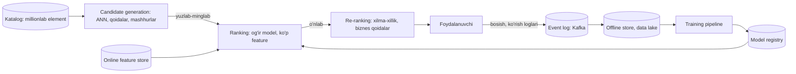

## Bu dars nima uchun kerak

87-darsda Twitter "For You" lentasida asosiy narx fan-out emas, ranking ekanini ko'rdik: har so'rovda 1 500 nomzod, 48 million parametrga yaqin model. Bu dars shu "ranking" qatlamini tizim dizayneri ko'zi bilan ochadi: ML modeli qanday qilib so'rovga millisekundlarda javob beradigan servisga aylanadi, unga ma'lumot (feature) qayerdan keladi, va bularning hammasi qanday buziladi.

Muhim tushuncha: ishlab chiqarishdagi ML tizimida **model - eng kichik qism.** Uning atrofida ma'lumot yig'ish, feature hisoblash, saqlash, train qilish, versiyalash, serving, monitoring va qayta train qilish turadi. Ko'p muammolar modeldan emas, shu "quvurlar"dan chiqadi.

Bu dars 16-dars (OLTP/OLAP), 23-dars (caching), 45-dars (stream processing), 58-dars (batch processing), 66-dars (observability), 68-dars (canary, feature flag) ustiga quriladi. LLM tizimlari 90-darsda.

Bu darsdan keyin siz:

- recommendation tizimining ko'p bosqichli arxitekturasini (candidate generation, ranking, re-ranking) va har bosqich narxini bilasiz;
- embedding va approximate nearest neighbor (ANN) qidiruv qanday ishlashini tushunasiz;
- feature store, online va offline feature'lar, training-serving skew muammosini tushuntira olasiz;
- online, batch va streaming inference o'rtasida tanlay olasiz;
- model deploy (shadow, canary, A/B), monitoring va drift ni loyihalay olasiz;
- fleet platformasi uchun ML funksiyalarini (haydovchi skoringi, anomaliya, bashorat) to'g'ri serving usuli bilan loyihalay olasiz.

## Recommendation: ko'p bosqichli voronka

Muammo: katalogda millionlab element (video, mahsulot, post), foydalanuvchiga 20 tasini 100-200 ms ichida (masala sharti) ko'rsatish kerak. Har bir element uchun og'ir modelni ishlatish imkonsiz: shart bo'yicha element boshiga 1 ms bo'lsa, 10 million element x 1 ms = 10 000 soniya.

Yechim - **voronka (funnel)**: har bosqichda nomzodlar soni kamayadi, model esa og'irlashadi.

**Real misol: YouTube (2016).** Google ning "Deep Neural Networks for YouTube Recommendations" maqolasi (RecSys 2016) klassik ikki bosqichli tuzilmani tasvirlaydi: chuqur **candidate generation** modeli juda katta korpusdan kichik nomzodlar to'plamini tanlaydi, alohida chuqur **ranking** modeli esa ularni ko'proq feature bilan baholaydi. Bu tuzilma hozir ham deyarli barcha katta recommendation tizimlarining asosi.

### 1. Candidate generation

Maqsad - tez va keng: yuqori recall (yaxshi elementlarni o'tkazib yubormaslik), aniqlik ikkinchi darajali. Bir nechta manba parallel ishlaydi va natijalar birlashtiriladi:

- **Embedding asosidagi ANN:** foydalanuvchi va elementlar bir xil vektor fazosiga joylashtiriladi (two-tower model: foydalanuvchi minorasi va element minorasi). Foydalanuvchi vektoriga eng yaqin K ta element vektori - nomzodlar.
- **Collaborative filtering:** "buni ko'rganlar buni ham ko'rgan" (item-to-item).
- **Qoidalar va mashhurlik:** trend, yangi, yaqin atrofdagi.
- **Ijtimoiy graf:** obunalar (87-dars fan-out lentasi).

### 2. Ranking

Har bir nomzod uchun og'ir model (gradient boosting yoki neyron tarmoq) ko'p feature bilan ball beradi: bosish, ko'rish vaqti, yoqtirish ehtimoli. Feature'lar uch turdagi:

- **foydalanuvchi feature'lari:** tarix, demografiya, oxirgi faollik;
- **element feature'lari:** kategoriya, mashhurlik, yoshi;
- **kontekst:** vaqt, qurilma, joylashuv.

Nomzodlar batch qilib bitta model chaqiruvida baholanadi - GPU/CPU vektorlash samarasi uchun.

### 3. Re-ranking

Biznes va UX qoidalari: bir muallifdan ketma-ket ko'p element bo'lmasligi, allaqachon ko'rilganlarni chiqarish, xilma-xillik, reklama joylashtirish, ruxsat va qonuniy filtrlar.

### Narx hisobi

Hisob uchun shartlar: 5 000 so'rov/s cho'qqi, so'rov boshiga 500 nomzod rank qilinadi, ranking modeli CPU da batch bilan element boshiga 20 mikrosekund oladi (real qiymat modelga bog'liq va profiling bilan o'lchanadi). 5 000 x 500 = 2.5 million element-baholash/s. 2.5 M x 20 us = 50 CPU-soniya har soniyada, ya'ni 50 yadro faqat ranking uchun; 60-70 foiz yuklama chegarasi bilan 70-85, zaxira bilan 80-100. Nomzodlar sonini 500 dan 200 ga tushirish - 2.5 barobar tejash. Shu sabab nomzodlar soni - asosiy narx dastagi.

## Embedding va ANN qidiruv

**Embedding** - obyektning (foydalanuvchi, element, matn, rasm) zich vektor ko'rinishi, masalan 64-1024 o'lchovli float massiv. O'xshash obyektlar vektorlari yaqin (kosinus o'xshashligi yoki skalyar ko'paytma katta).

Aniq eng yaqin qo'shnilar (exact kNN): har bir so'rovda barcha N vektor bilan solishtirish - O(N x d). 10 million x 256 o'lchov = 2.56 milliard ko'paytirish har so'rovda. Juda qimmat.

**ANN (approximate nearest neighbor)** - aniqlikning ozgina qismini tezlikka almashtirish: natija recall@k bilan o'lchanadi va indeks parametrlari (HNSW da `ef_search`, IVF da `nprobe`) recall va latency o'rtasida sozlanadi. Asosiy oilalar:

- **IVF (inverted file):** vektorlar k-means bilan klasterlarga bo'linadi; so'rov faqat eng yaqin bir nechta klaster ichida qidiriladi. 82-darsdagi hujayra g'oyasining yuqori o'lchovli varianti.
- **HNSW (Hierarchical Navigable Small World):** ko'p qatlamli graf (Malkov va Yashunin, 2016). Yuqori qatlamlarda siyrak "uzoq sakrash" bog'lanishlari, pastda zich. Qidiruv yuqoridan boshlab ochko'z (greedy) tushadi; maqolaga ko'ra murakkablik logarifmik o'sadi. Tez va aniq, lekin xotira ko'p talab qiladi va qurish sekin.
- **Quantization (PQ, scalar):** vektorlarni siqish, aniqlik biroz tushadi. Siqish darajasi formuladan kelib chiqadi: float32 dan int8 scalar quantization ga - 4 bayt o'rniga 1 bayt, 4 barobar; 256 o'lchovli vektorni PQ bilan 32 ta 8-bitli kodga siqish - 1 024 bayt o'rniga 32 bayt, 32 barobar.

Amaliy kutubxona va tizimlar: Faiss (Meta, C++/Python, GPU qo'llab-quvvatlash bilan), PostgreSQL uchun pgvector (HNSW va IVFFlat indekslari), Elasticsearch/OpenSearch kNN, maxsus vector bazalar. 90-darsda RAG uchun xuddi shu texnologiya ishlatiladi.

Hisob: 10 million element, 256 o'lchovli float32 vektor: 10 M x 256 x 4 bayt = 10.24 GB, ya'ni taxminan 10 GB xom. HNSW graf bog'lanishlari: M = 16 (pgvector standart qiymati) bo'lsa, 0-qatlamda vektor boshiga 2M = 32 qo'shni (Faiss HNSW implementatsiyasidagi kabi), har biri 4 baytlik ID - 128 bayt, ya'ni 10 M x 128 B = 1.28 GB, xom vektorlarning 12.5 foizi (yuqori qatlamlar bilan biroz ko'proq). Bitta katta serverga sig'adi. 1 milliard element bo'lsa - 1 TB, quantization va sharding shart.

## Feature store va training-serving skew

### Muammo

Model train qilinganda feature'lar data warehouse'dan SQL yoki Spark bilan hisoblanadi (masalan, "haydovchining oxirgi 30 kundagi keskin tormoz soni"). Serving paytida esa xuddi shu feature 10 ms ichida kerak - warehouse'dan so'rab bo'lmaydi. Agar ikki joyda ikki xil kod bilan hisoblansa, ular albatta farq qiladi (vaqt oynasi chegarasi, null qiymatlar, time zone). Natija: offline'da a'lo ko'rsatkichli model production'da yomon ishlaydi. Bu **training-serving skew** deyiladi.

Yana bir nozik muammo - **data leakage (point-in-time to'g'rilik)**: train ma'lumotida har bir misol uchun feature o'sha misol vaqtida ma'lum bo'lgan qiymat bo'lishi kerak, bugungi qiymat emas. "Haydovchi kelajakda avariya qilganmi" kabi kelajakdan ma'lumot feature'ga sizib kirsa, model offline'da sun'iy ravishda yaxshi ko'rinadi.

### Feature store

Feature store - bir xil feature ta'rifidan ikki saqlashni boshqaradigan qatlam:

- **offline store** (data lake, warehouse, ClickHouse): butun tarix, train uchun, point-in-time join bilan;
- **online store** (Redis, Cassandra, DynamoDB): har bir entity uchun oxirgi qiymat, millisekundli o'qish.

Feature'lar batch (kunlik Spark/SQL) yoki streaming (Kafka + Flink, 45-dars) pipeline'larida bir marta hisoblanib, ikkala store'ga yoziladi.

**Real misol: Uber Michelangelo (2017).** Uber ichki ML platformasi oltita bosqichni qamraydi: ma'lumotni boshqarish, train, baholash, deploy, prediction, monitoring. Online prediction uchun kerakli feature'lar oldindan hisoblanib Cassandra da saqlanadi (batch yoki Samza streaming bilan); umumiy Feature Store da o'sha paytda 10 000 ga yaqin feature bo'lgan. Online modellar prediction servis klasterida ishlaydi, offline modellar Spark batch job sifatida va natijani Hive ga yozadi. Blogga ko'ra P95 latency Cassandra feature'lari kerak bo'lmagan modellar uchun 5 ms dan, kerak bo'lganlar uchun 10 ms dan kam; eng ko'p trafikli modellar soniyasiga 250 mingdan ortiq prediction beradi.

Skew ga qarshi amaliy qoida: **serving paytida ishlatilgan feature'larni log qiling** va keyingi train'ni shu loglardan qiling. Shunda train va serving bir xil qiymatni ko'radi.

## Inference usullari

| Usul | Qanday | Latency | Narx | Qachon |
|---|---|---|---|---|
| Batch (offline) | Davriy job hamma entity uchun bashorat qiladi, natija jadvalga | Soatlar (yangilik), o'qish ms | Arzon, GPU/CPU to'liq yuklangan | Natija sekin o'zgaradi: kunlik skor, tavsiyalar ro'yxati |
| Online (request-time) | So'rov kelganda model chaqiriladi | 1-100 ms | Doimiy ishlaydigan servislar, cho'qqiga mo'ljallash | Kontekstga bog'liq: qidiruv, ranking |
| Streaming | Hodisa kelganda model chaqiriladi, natija hodisa sifatida | Soniyalar | O'rtacha | Anomaliya, fraud, real vaqt ogohlantirish |
| Edge (qurilmada) | Model qurilmada ishlaydi | Eng past, tarmoqsiz | Qurilma resursi | Kamera AI, offline ishlash |

Ko'p tizimlar aralash: batch bilan nomzodlar tayyorlanadi, online bilan rank qilinadi (Uber Michelangelo da ham online va offline modellar alohida yo'l bilan ishlaydi).

### Online serving tafsilotlari

- **Model servis** - alohida servis (TorchServe, Triton, TF Serving, ONNX Runtime yoki oddiy FastAPI/gRPC wrapper). Ilova kodidan ajratilgan, chunki resurs profili boshqa (GPU, katta xotira) va deploy sikli boshqa.
- **Dynamic batching:** GPU da so'rovlarni bittadan bajarish samarasiz. Server bir necha millisekund kutib, kelgan so'rovlarni bitta batch qiladi: throughput keskin oshadi, latency biroz oshadi. Bu 3-darsdagi throughput/latency trade-off ning aniq ko'rinishi.
- **Timeout va fallback:** model servis sekinlashsa, ranking o'rniga oddiy evristika (mashhurlik) qaytariladi (64-dars, graceful degradation). Recommendation ishlamay qolishi sahifa ishlamay qolishiga aylanmasligi kerak.
- **Natija cache'i:** bir xil kirish uchun natija qisqa TTL bilan cache'lanadi (23-dars).

## Deploy, monitoring va qayta train

### Deploy

Model - kod kabi artefakt: versiya, model registry, qayta tiklanadigan train (ma'lumot snapshot'i, kod versiyasi, gipermparametrlar). Deploy bosqichlari (68-dars):

1. **Offline baholash** - tarixiy ma'lumotda metrikalar (AUC, precision/recall, NDCG).
2. **Shadow** - yangi model real trafikda ishlaydi, lekin natijasi foydalanuvchiga ko'rsatilmaydi, faqat log qilinadi va eski bilan solishtiriladi. Latency va xatolarni xavfsiz tekshirish.
3. **Canary / A/B test** - trafikning kichik qismi yangi modelga; biznes metrikasi (bosish, konversiya, ushlab qolish) statistik ahamiyatli farq bilan o'lchanadi.
4. **To'liq rollout** va eski modelni zaxirada saqlash (tez rollback).

### Monitoring

Oddiy servis monitoringi (latency, xatolar, 67-dars) yetarli emas. ML ga xos:

- **Data drift** - kirish feature'lari taqsimoti o'zgardi (yangi mijoz sektori, mavsum, yangi treker modeli boshqa formatda yuboradi);
- **Prediction drift** - chiqish taqsimoti o'zgardi (birdan hamma haydovchi "xavfli" bo'lib qoldi);
- **Concept drift** - kirish va natija orasidagi bog'liqlik o'zgardi;
- **Feature sifati** - null ulushi, qiymat diapazoni, feature pipeline kechikishi (online store'dagi qiymat necha daqiqa eski).

Haqiqiy natija (label) ko'pincha kech keladi (masalan, "avariya bo'ldimi" haftalar o'tib). Shuning uchun proxy metrikalar va drift - tezkor signal.

### Feedback loop

Recommendation o'zi ko'rsatgan narsalar haqida ma'lumot yig'adi va keyingi model shu ma'lumotda train qilinadi. Ko'rsatilmagan element hech qachon bosilmaydi - model uni hech qachon "yaxshi" deb o'rganmaydi. Yechim - kichik **exploration** ulushi (tasodifiy yoki yangi elementlar) va pozitsiya effektini hisobga olish.

## iQuariX kontekstida: fleet ML funksiyalari

Misol: fleet platformasi uchun quyidagi ML funksiyalarini ko'rib chiqamiz. Har biri uchun serving usuli boshqacha - va bu asosiy dizayn qarori.

| Funksiya | Kirish | Serving | Sabab |
|---|---|---|---|
| Haydovchi xavf skori | 30 kunlik tormoz, tezlanish, tezlik, tungi haydash, telefon (DMS) hodisalari | Batch, kunlik | Skor sekin o'zgaradi; 30 000 haydovchi x 1 bashorat - bir necha daqiqalik job |
| Yoqilg'i to'kish anomaliyasi | ДУТ oqimi, tezlik, dvigatel holati, joylashuv | Streaming | Hodisa bir necha daqiqada aniqlanishi kerak (81, 85-darslar) |
| Texnik xizmat bashorati | Probeg, dvigatel soatlari, CAN xato kodlari | Batch, kunlik yoki haftalik | Natija kunlar oldin kerak |
| Haydovchi charchog'i, telefon ishlatish | Kabina kamerasi videosi | Edge (MDVR ichida) | Video bulutga uzluksiz chiqmaydi (84-dars), kechikish soniyadan kam |
| Yetib kelish vaqti (ETA) | Joriy joylashuv, marshrut, tirbandlik tarixi | Online | Dispetcher so'rovida, kontekstga bog'liq |
| Dispetcherga "tavsiya etilgan mashina" | Joylashuv, yuk, haydovchi smenasi | Online, ikki bosqichli | Candidate: 83-darsdagi proximity; ranking: ETA, haydovchi soatlari, xarajat |

### Haydovchi skori: batch pipeline

1. Kunlik job ClickHouse dagi hodisalardan (81-dars) har bir haydovchi uchun feature'lar: 100 km ga keskin tormozlar, tezlik limitidan oshish ulushi, tungi haydash soatlari va h.k. Feature ta'rifi bitta SQL/kod modulida.
2. Model (gradient boosting) skor va tushuntirish (qaysi feature qancha hissa qo'shdi) beradi - menejer "nega bu haydovchi xavfli" deb so'raydi, javobsiz skor ishonchsiz.
3. Natija PostgreSQL ga `driver_scores(driver_id, date, score, model_version, explanation)`. UI faqat shu jadvaldan o'qiydi.
4. Label: keyingi 90 kundagi avariya yoki sug'urta hodisasi - kech va kam keladi. Shuning uchun model sodda va tushunarli bo'lishi, avval qoidalar asosidagi skor bilan solishtirilishi kerak. ML siz boshlash - to'liq to'g'ri qaror bo'lishi mumkin.

Hisob (shartlar: 30 000 haydovchi, 50 feature, 85-darsdagi 300 000 hodisa/kun): 30 kunlik hodisalar 300 000 x 30 = 9 million qator. ClickHouse uchun bu kichik hajm (81-darsdagi sparse index misolida 8.87 million qator 1 083 granule edi); agregatsiya vaqtini o'z klasteringizda `system.query_log` dagi `query_duration_ms` bilan o'lchang. Model inference - 30 000 qator; gradient boosting uchun bu bitta CPU da bajariladigan kichik batch (o'z modelingizda `predict` vaqtini o'lchang). Bu yerda GPU, model servis va feature store kerak emas. Murakkablik foydaga mos bo'lishi kerak.

### Yoqilg'i anomaliyasi: streaming

ДУТ qiymatlari Kafka dan Flink/Kafka Streams ga (45-dars), qurilma bo'yicha oynada feature'lar (sath o'zgarish tezligi, dvigatel holati, tezlik, geozona), model yoki qoida bashorati, natija `fuel.anomalies` topic'iga va notification servisga (85-dars). Online store: qurilmaning oxirgi oynadagi holati lokal state store'da. Model versiyasi har bir anomaliya hodisasida yoziladi - keyin "bu ogohlantirishni qaysi model chiqardi" savoliga javob.

Drift xavfi aniq: yangi turdagi ДУТ datchigi boshqa kalibrovka bilan o'rnatilsa, feature taqsimoti o'zgaradi va soxta ogohlantirishlar ko'payadi. Datchik modeli bo'yicha drift monitoringi va yangi qurilma turlari uchun shadow rejim kerak.

## Ko'p uchraydigan xatolar

1. **Train va serving uchun feature'larni ikki xil kod bilan hisoblash.** Training-serving skew. Bitta ta'rif, feature store yoki serving loglaridan train.
2. **Point-in-time to'g'rilikni buzish.** Kelajak ma'lumoti feature'ga sizib kiradi, offline metrikalar yolg'on.
3. **Hamma narsani online inference qilish.** Kuniga bir marta o'zgaradigan skor uchun doimiy model servis va GPU - isrof.
4. **Fallback yo'q.** Model servis yiqilsa butun sahifa yiqiladi.
5. **Faqat infratuzilma monitoringi.** Latency normal, lekin model bir haftadan beri chiqindi bashorat qilmoqda (drift).
6. **Model versiyasini natija bilan saqlamaslik.** Qaysi bashorat qaysi modeldan ekanini bilmasangiz, muammoni tahlil qilib bo'lmaydi.
7. **Exploration siz feedback loop.** Model faqat o'zi ko'rsatgan narsani o'rganadi va tor doirada qoladi.
8. **Juda erta murakkab ML.** Qoidalar asosidagi baseline'siz model qurish - uning foydasini o'lchab bo'lmaydi.

## Xulosa

- ML tizimida model - kichik qism; ma'lumot, feature, serving va monitoring quvurlari asosiy ish.
- Recommendation - voronka: candidate generation (keng, arzon, ANN), ranking (og'ir model), re-ranking (qoidalar). Nomzodlar soni - asosiy narx dastagi.
- Embedding + ANN (IVF, HNSW, quantization) yuqori o'lchovli yaqinlik qidiruvini millisekundlarga tushiradi.
- Feature store offline va online store'ni bitta ta'rifdan boshqaradi; training-serving skew va point-in-time to'g'rilik asosiy xavf.
- Inference usuli (batch, online, streaming, edge) natija qanchalik tez o'zgarishi va kechikish talabidan tanlanadi.
- Deploy: offline baholash, shadow, canary/A-B, rollback; monitoring: drift, feature sifati, model versiyasi.

## Amaliy topshiriq

Masala sharti: iQuariX dispetcherlar uchun "Buyurtmaga eng mos mashina" tavsiya funksiyasini qurmoqda: yangi yuk tashish buyurtmasi kelganda (olish nuqtasi, yuk turi va og'irligi, vaqt oynasi) tizim 3 ta eng mos mashinani tavsiya qiladi. Parkda 5 000 mashina (bir tenant), kuniga 3 000 buyurtma, cho'qqida daqiqasiga 20 ta. Javob 500 ms dan tez bo'lishi kerak.

1. Voronkani loyihalang: candidate generation qanday (geospatial, yuk sig'imi, haydovchi ish soatlari), nechta nomzod, ranking qaysi feature'lar bilan, re-ranking qoidalari.
2. Har bir feature uchun manbani va yangilik talabini aniqlang (real vaqt joylashuv, kunlik haydovchi skori, mashina holati). Qaysilari online store'da, qaysilari so'rov paytida hisoblanadi?
3. Latency budjetini taqsimlang: candidate, feature olish, ETA hisoblash, model, re-ranking. ETA servisi sekin bo'lsa nima qilasiz?
4. Label nima bo'ladi (dispetcher tanlovi, buyurtma o'z vaqtida bajarilishi, xarajat)? Feedback loop va exploration muammosi qanday ko'rinadi?
5. Birinchi versiyani ML siz (qoidalar va og'irliklar bilan) qanday qurasiz va qachon ML ga o'tasiz?
6. Yangi modelni qanday deploy qilasiz: shadow, A/B, qaysi metrika bo'yicha?

Yaxshi javobda bo'lishi kerak bo'lgan narsalar:

- candidate generation 83-darsdagi proximity va qattiq filtrlar (sig'im, ish soatlari) bilan, nomzodlar soni asoslangan;
- feature'lar manbasi va yangiligi alohida, training-serving skew ga qarshi chora;
- latency budjeti raqamlar bilan, ETA uchun timeout va fallback;
- label tanlovi va uning kamchiliklari (dispetcher tanlovi - tarafkash label);
- qoidalar asosidagi baseline va undan ML ga o'tish mezoni;
- shadow va A/B test, biznes metrikasi (bo'sh probeg, kechikkan buyurtmalar ulushi).

Javobni pastdagi maydonga yozib, chatga yuboring.

## Manbalar

- P. Covington, J. Adams, E. Sargin. [Deep Neural Networks for YouTube Recommendations](https://research.google/pubs/deep-neural-networks-for-youtube-recommendations/), RecSys 2016 - candidate generation va ranking.
- Uber Engineering. [Meet Michelangelo: Uber's Machine Learning Platform](https://www.uber.com/blog/michelangelo-machine-learning-platform/), 2017 - feature store, online/offline serving, latency va throughput.
- Yu. A. Malkov, D. A. Yashunin. [Efficient and robust approximate nearest neighbor search using Hierarchical Navigable Small World graphs](https://arxiv.org/abs/1603.09320), 2016 - HNSW.
- Meta FAIR. [Faiss](https://github.com/facebookresearch/faiss) - zich vektorlar bo'yicha o'xshashlik qidiruvi kutubxonasi.
- Twitter Engineering. [Twitter's Recommendation Algorithm](https://blog.x.com/engineering/en_us/topics/open-source/2023/twitter-recommendation-algorithm), 2023 - nomzodlar, ranking, Home Mixer.
- Chip Huyen. Designing Machine Learning Systems, O'Reilly, 2022 - 5-bob "Feature Engineering" (data leakage), 7-bob "Model Deployment and Prediction Service" (batch va online prediction), 8-bob "Data Distribution Shifts and Monitoring" (drift), 9-bob "Continual Learning and Test in Production" (shadow, A/B, canary), 10-bob "Infrastructure and Tooling for MLOps" (feature store, model store). [Bob xulosalari (GitHub)](https://github.com/chiphuyen/dmls-book/blob/main/summary.md).
- Alex Xu, Sahn Lam. System Design Interview, 2-jild, 1-bob "Proximity Service" va 2-bob "Nearby Friends" (candidate generation uchun geospatial asos).
- [pgvector README](https://github.com/pgvector/pgvector) - HNSW `m` standart 16, `ef_construction` 64; [Faiss HNSW.cpp](https://github.com/facebookresearch/faiss/blob/main/faiss/impl/HNSW.cpp) - 0-qatlamda 2M qo'shni.
