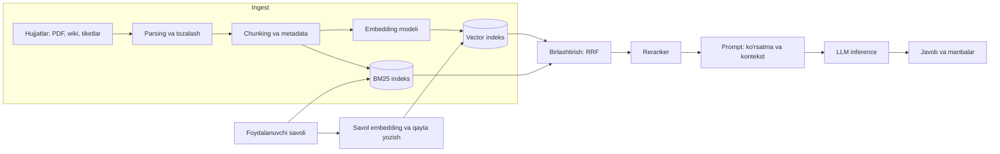

## Bu dars nima uchun kerak

LLM (large language model) ni API orqali chaqirish - bitta HTTP so'rov. Lekin uni mahsulotga aylantirish - to'liq tizim dizayni masalasi:

- model korxona ma'lumotlarini (shartnomalar, yo'riqnomalar, telemetriya hisobotlari) bilmaydi va eskirgan bo'ladi - **RAG** (Retrieval-Augmented Generation) kerak;
- javob vaqti soniyalar, narx har bir token uchun, throughput GPU xotirasi bilan cheklangan - **inference serving** iqtisodi boshqa servislardan tubdan farq qiladi;
- natija deterministik emas, xato qilishi (hallucination), ruxsatsiz ma'lumotni oshkor qilishi, prompt injection ga uchrashi mumkin - **xavfsizlik va baholash** alohida qatlam.

Bu dars 89-dars (embedding, ANN, ML serving), 59-dars (qidiruv, inverted index), 72-73 darslar (avtorizatsiya, multi-tenancy), 23-dars (caching), 56-dars (rate limiting), 79-dars (cost-aware dizayn) ustiga quriladi.

Bu darsdan keyin siz:

- RAG pipeline'ining har bir bosqichini (ingest, chunking, embedding, indekslash, retrieval, rerank, generation) va ularning trade-off'larini bilasiz;
- hybrid qidiruv (BM25 + vector), reranking va ruxsatlarni retrieval darajasida qo'llashni loyihalay olasiz;
- LLM inference ichki mexanikasini (prefill, decode, KV cache) va throughput/latency metrikalarini (TTFT, TPOT) tushuntira olasiz;
- vLLM dagi PagedAttention va continuous batching nima hal qilishini bilasiz;
- GPU xotirasi, token narxi va throughput ni hisoblay olasiz;
- fleet platformasi uchun xavfsiz "AI yordamchi" arxitekturasini loyihalay olasiz.

## RAG: g'oya va pipeline

RAG atamasi Lewis va boshqalarning 2020 yilgi maqolasidan keng tarqalgan: modelning parametrlaridagi "ichki xotira"ni tashqi, qidiriladigan xotira (o'sha ishda - Wikipedia ning dense vector indeksi) bilan birlashtirish. Amaliy ma'nosi: savolga javob berishdan oldin tegishli hujjat bo'laklarini topib, ularni promptga qo'yish. Model javobni shu kontekstdan tuzadi.

Nega fine-tuning emas? Fine-tuning modelga **uslub va ko'nikma** o'rgatadi, lekin tez o'zgaradigan **faktlar** uchun yomon: har yangi hujjatda qayta train, manbani ko'rsatib bo'lmaydi, ruxsatlarni (kim nimani ko'ra oladi) modelga "tikib" bo'lmaydi. RAG da esa bilim indeksda: yangilash - indeksga yozish, manba - havola, ruxsat - qidiruv filtri.

### 1. Ingest va chunking

Hujjatlar matnga aylantiriladi (PDF jadvallar, skanerlangan hujjatlar uchun OCR - eng ko'p sifat yo'qotiladigan joy) va **chunk** larga bo'linadi. Chunk hajmi - asosiy trade-off:

- kichik chunk (100-200 token): aniq qidiruv, lekin kontekst yo'qoladi ("bu shartnoma" qaysi shartnoma?);
- katta chunk (1 000+ token): kontekst saqlanadi, lekin embedding "xiralashadi" va promptga kam chunk sig'adi.

Amaliy yondashuvlar: tuzilma bo'yicha bo'lish (sarlavhalar, bo'limlar), qo'shni chunklar bilan qisman overlap, har bir chunkga hujjat nomi va bo'lim sarlavhasini qo'shish. Har bir chunk bilan **metadata** saqlanadi: `tenant_id`, hujjat ID, versiya, sana, ruxsat guruhlari, manba havolasi.

Ingest - stream yoki batch pipeline (46, 48-darslar): hujjat o'zgarganda (CDC yoki webhook) uning eski chunklari o'chirilib, yangilari yoziladi. Hujjat versiyasini kuzatmaslik - eski va yangi qoidalar bir vaqtda qidiruvda chiqishiga olib keladi.

### 2. Embedding va indeks

Har bir chunk embedding modelidan o'tib vektorga aylanadi va ANN indeksga (89-dars: HNSW, IVF) yoziladi. Variantlar: pgvector (PostgreSQL ichida HNSW va IVFFlat indekslari, L2, inner product, kosinus masofalari), OpenSearch/Elasticsearch kNN, maxsus vector bazalar. Kichik va o'rta hajmda (millionlab chunk) pgvector ko'pincha eng sodda - metadata filtri, tranzaksiyalar va ruxsatlar bitta SQL da.

Embedding modelini almashtirish - **qaytarilmaydigan qarorga yaqin** (1-dars): barcha vektorlar boshqa fazoda, butun korpusni qayta embedding qilish kerak. Shuning uchun har bir vektor bilan model nomi va versiyasini saqlang.

### 3. Retrieval: hybrid qidiruv

Faqat vector qidiruv semantik o'xshashlikni yaxshi topadi, lekin aniq atamalar, kodlar, raqamlarda yomon: "01A123BC davlat raqamli mashina", "P0420 xato kodi". BM25 (59-dars, inverted index) esa aniq so'zlarni yaxshi topadi, sinonimlarni topmaydi. **Hybrid** - ikkalasini parallel ishlatib, natijalarni birlashtirish. Keng tarqalgan birlashtirish usuli - **Reciprocal Rank Fusion (RRF)**: har bir hujjat uchun `sum(1 / (k + rank_i))`, ballarni normallashtirish shart emas.

**Ruxsatlar retrieval darajasida.** Eng muhim xavfsizlik qoidasi: foydalanuvchi ko'rish huquqi bo'lmagan chunk promptga **hech qachon** tushmasligi kerak. Filtr qidiruv so'rovining o'zida (`WHERE tenant_id = $t AND acl && $user_groups`), LLM ga "buni ko'rsatma" deb aytish bilan emas. LLM ga ko'rsatma - xavfsizlik chegarasi emas.

### 4. Reranking

Retrieval 50-100 ta nomzod qaytaradi, **reranker** (cross-encoder: savol va chunk birga o'qiladigan model) ularni aniqroq tartiblaydi va eng yaxshi 5-10 tasi promptga kiradi. Bu 89-darsdagi voronkaning o'zi: arzon keng qidiruv, keyin qimmat aniq baholash.

### 5. Generation

Prompt tuzilmasi: tizim ko'rsatmasi (rol, uslub, "faqat berilgan kontekst asosida javob ber, manbani ko'rsat, bilmasang ayt"), kontekst chunklari (har biri ID bilan), savol. Javobdagi iqtiboslar chunk ID lariga bog'lanadi va UI manba havolasini ko'rsatadi - foydalanuvchi tekshira oladi.

### Baholash (evaluation)

RAG sifati ikki qismdan iborat va ular alohida o'lchanadi:

- **Retrieval sifati:** savollar to'plami va har biri uchun to'g'ri chunklar; recall@k (to'g'ri chunk top-k da bormi), MRR.
- **Generation sifati:** javob kontekstga asoslanganmi (faithfulness), savolga javob berdimi, manbalar to'g'rimi. Odatda inson baholashi va LLM-as-judge aralashmasi.

Har bir o'zgarish (chunk hajmi, embedding modeli, prompt) shu to'plamda regressiya testidan o'tadi - 89-darsdagi offline baholashning analogi.

## LLM inference ichida

### Prefill va decode

Transformer modeli matnni token-token generatsiya qiladi. So'rov ikki fazadan o'tadi:

1. **Prefill** - butun prompt (masalan, 3 000 token) bitta parallel o'tishda qayta ishlanadi. Hisoblashga bog'liq (compute-bound), GPU yaxshi yuklanadi. Bu faza **TTFT** (time to first token) ni belgilaydi.
2. **Decode** - har bir yangi token uchun bitta o'tish. Har qadamda modelning barcha og'irliklari xotiradan o'qiladi, lekin hisob kam - **xotira o'tkazuvchanligiga bog'liq** (memory-bandwidth-bound). Bu faza **TPOT** (time per output token, yoki ITL - inter-token latency) ni belgilaydi.

Foydalanuvchi ko'radigan umumiy vaqt: `TTFT + chiqish_tokenlar x TPOT`. Streaming (SSE, 8-dars) bilan foydalanuvchi birinchi tokenni ko'rgan zahoti o'qishni boshlaydi, shuning uchun interaktiv ilovada TTFT eng muhim metrika.

### KV cache

Decode da har bir yangi token oldingi barcha tokenlarning attention **key** va **value** vektorlariga qaraydi. Ularni har safar qayta hisoblamaslik uchun GPU xotirasida saqlanadi - **KV cache**. Hajmi:

`KV bayt = 2 (K va V) x qatlamlar x KV_head'lar x head_o'lchami x bayt_per_qiymat x tokenlar`

Hisob. Faraz qilaylik, model 8B parametr klassida: 32 qatlam, grouped-query attention bilan 8 ta KV head, head o'lchami 128, FP16 (2 bayt).

- token boshiga: 2 x 32 x 8 x 128 x 2 = 131 072 bayt = 128 KB;
- 8 000 tokenli kontekst: 8 000 x 128 KB = 1 GB **bitta so'rov uchun**;
- model og'irliklari FP16 da: 8 milliard x 2 bayt = 16 GB.

80 GB li GPU da: 16 GB og'irliklar, aktivatsiyalar va runtime uchun bir necha GB, qolgan taxminan 55-60 GB KV cache uchun - 8 000 tokenli kontekstda bir vaqtda taxminan 55-60 ta so'rov. Ya'ni **parallel so'rovlar soni (va demak throughput) KV cache xotirasi bilan cheklanadi**, hisoblash quvvati bilan emas.

### PagedAttention va vLLM

An'anaviy serving tizimlari har bir so'rov uchun KV cache ni maksimal uzunlikka mo'ljallangan **uzluksiz** xotira bloki sifatida ajratgan. So'rov qancha token generatsiya qilishi oldindan noma'lum - xotira ichki va tashqi fragmentatsiya bilan isrof bo'ladi.

Kwon va boshqalar (SOSP 2023) **PagedAttention** ni taklif qilgan: OS dagi virtual xotira va sahifalash (paging) g'oyasi. KV cache kichik bloklarga (sahifalarga) bo'linadi, bloklar fizik xotirada uzluksiz bo'lishi shart emas, so'rov o'sgan sari yangi blok beriladi; bir xil prefiksli so'rovlar bloklarni bo'lishishi mumkin (copy-on-write). Maqolaga ko'ra vLLM shu latency darajasida mashhur LLM'lar throughput'ini 2-4 barobar oshiradi (FasterTransformer va Orca bilan solishtirganda).

vLLM ning boshqa asosiy imkoniyatlari (README bo'yicha):

- **continuous batching** - so'rovlar tayyor bo'lganda batch'ga qo'shiladi va tugaganda chiqadi, butun batch tugashini kutmasdan. Statik batching da qisqa javoblar uzun javob tugashini kutib bo'sh turadi;
- **chunked prefill** - uzun promptning prefill fazasi bo'laklarga bo'linadi va decode qadamlari bilan aralashtiriladi, shunda bitta uzun prompt boshqalarning decode'ini to'xtatib qo'ymaydi;
- **prefix caching** - umumiy prefiks (bir xil tizim ko'rsatmasi, bir xil hujjat) KV cache'i qayta ishlatiladi: TTFT va hisob tejaladi;
- **speculative decoding** - kichik "taxmin qiluvchi" model bir nechta tokenni oldindan taklif qiladi, katta model ularni bitta o'tishda tekshiradi;
- **quantization** (FP8, INT8, INT4, GPTQ/AWQ va boshqalar) - og'irliklar va KV cache xotirasini kamaytirish;
- tensor, pipeline va boshqa parallelizm turlari - model bitta GPU ga sig'masa;
- OpenAI-mos API server.

### Throughput va latency trade-off

Batch kattalashsa - GPU yaxshiroq yuklanadi, token/s (throughput) oshadi, lekin har bir so'rovning TPOT i oshadi. Bu 3-darsdagi umumiy qonuniyat. SLO odatda shunday yoziladi: "p95 TTFT 1 s dan kam va p95 TPOT 50 ms dan kam bo'lgan holda maksimal throughput". Load test shu ikki metrika bo'yicha qilinadi, faqat "so'rov/s" bo'yicha emas.

### Serving variantlari

| Mezon | Tashqi API (hosted) | O'z GPU larida open-weight model | Gibrid (router) |
|---|---|---|---|
| Boshlash | Darhol | Infratuzilma, MLOps kerak | Ikkalasi |
| Sifat | Odatda eng kuchli modellar | Model tanloviga bog'liq | Vazifaga qarab |
| Narx modeli | Token boshiga | GPU-soat (yuklanmasa ham to'lanadi) | Aralash |
| Kichik yuklamada narx | Arzon | Qimmat (bo'sh GPU) | - |
| Katta barqaror yuklamada narx | Qimmatlashadi | Arzonlashishi mumkin | - |
| Ma'lumot joylashuvi | Provayder shartlari | To'liq nazorat (78-dars) | Sezgir ma'lumot ichkarida |
| Operatsion yuk | Past | Yuqori (GPU, versiyalar, autoscaling) | O'rtacha |

Router: oddiy vazifalar (tasniflash, qisqa ekstraksiya) arzon kichik modelga, murakkab tahlil kuchli modelga. Bu 79-darsdagi cost-aware dizaynning bevosita qo'llanishi.

## Narx va sig'im hisobi

Faraz: iQuariX AI yordamchisi, 6 000 foydalanuvchi, kuniga har biri 10 ta savol. So'rov: 4 000 kirish tokeni (ko'rsatma + 8 ta chunk x 400 token + savol), 400 chiqish tokeni.

- Kunlik: 60 000 so'rov, 240 million kirish tokeni, 24 million chiqish tokeni.
- Ish soatlarida (10 soat) konsentratsiya: 60 000 / 36 000 s = 1.7 so'rov/s o'rtacha, cho'qqi 3-5 barobar - 5-8 so'rov/s.
- Bir vaqtdagi so'rovlar (Little qonuni, 3-dars): javob o'rtacha 8 s bo'lsa, 6 so'rov/s x 8 s = 48 ta parallel so'rov.

**Hosted API narxi:** narx = kirish_tokenlar x kirish_narxi + chiqish_tokenlar x chiqish_narxi. Narxlar provayder va modelga qarab o'nlab barobar farq qiladi va tez o'zgaradi, shuning uchun formulaga joriy narxlarni qo'ying. Muhim kuzatish: bu misolda kirish tokenlari chiqishdan 10 barobar ko'p - **kontekst hajmi asosiy xarajat**. Chunklar sonini 8 dan 5 ga tushirish yoki prompt caching kirish narxini sezilarli kamaytiradi.

**O'z GPU larida:** 48 parallel so'rov, har biri taxminan 4 400 token kontekst. Yuqoridagi 8B klassidagi modelda 4 400 x 128 KB = 550 MB KV cache so'rov boshiga, 48 x 550 MB = 26 GB. Bitta 80 GB GPU ga og'irliklar bilan sig'adi. Lekin kattaroq model (masalan, 70B klassi) bir nechta GPU talab qiladi. Va GPU kechasi ham to'lanadi - yuklama 10 soat bo'lsa, 14 soat bo'sh.

## Xavfsizlik va ishonchlilik

- **Prompt injection.** Hujjat yoki foydalanuvchi matnida "oldingi ko'rsatmalarni unut va ..." kabi buyruq bo'lishi mumkin. RAG da bu ayniqsa xavfli: indekslangan hujjatning o'zi hujum vektori. Himoya: modelga berilgan har qanday kontekstni ma'lumot sifatida ko'rish, model chaqira oladigan vositalarni (tools) minimal ruxsatlar bilan cheklash, xavfli amallar (o'chirish, yuborish, to'lov) uchun inson tasdig'i.
- **Ruxsatlar va tenant izolyatsiyasi** - retrieval filtrida (73-dars), model ko'rsatmasida emas.
- **Hallucination.** "Faqat kontekstdan" ko'rsatmasi, majburiy iqtiboslar, kontekstda javob yo'q bo'lsa "bilmayman" javobi, raqamli savollar uchun esa LLM o'zi hisoblamasin - aniq SQL/API vositasi chaqirsin.
- **Rate limit va budjet.** Foydalanuvchi va tenant bo'yicha token limiti (56-dars), cheksiz sikl yoki suiiste'mol bitta kunda katta hisob chiqarmasligi uchun.
- **Timeout, retry, fallback.** Provayder API 429 yoki 5xx qaytaradi - backoff (62-dars), zaxira model yoki provayder, circuit breaker (63-dars).
- **Kuzatuv.** Har bir so'rov uchun: prompt versiyasi, model, olingan chunk ID lari, token soni, TTFT, umumiy vaqt, foydalanuvchi bahosi. Bularsiz sifat muammosini tahlil qilib bo'lmaydi.

## iQuariX kontekstida: "Fleet AI yordamchi"

Deylik, iQuariX dispetcher va menejerlar uchun AI yordamchi qurmoqda. Savollar ikki xil va ular **turli** arxitektura talab qiladi:

1. **Hujjat savollari (RAG):** "Mijoz X bilan shartnomada kechikish uchun jarima qancha?", "ДУТ datchigini kalibrlash yo'riqnomasi", "Yangi haydovchi uchun xavfsizlik qoidalari". Manba: shartnomalar, yo'riqnomalar, ichki wiki, tiketlar.
2. **Ma'lumot savollari:** "Kecha qaysi 5 ta mashina eng ko'p yoqilg'i sarfladi?", "01A123BC oxirgi hafta necha marta tezlikni oshirgan?". Bu RAG emas - javob ClickHouse va PostgreSQL da (81-dars). LLM bu yerda savolni **tuzilgan vosita chaqiruviga** aylantiradi: `get_top_fuel_consumers(date, limit)` kabi oldindan belgilangan, tenant va ruxsatlar bilan cheklangan funksiyalar. Natijani esa tushunarli matnga o'giradi.

Ikkinchi turda LLM ga erkin SQL yozdirish xavfli (boshqa tenant ma'lumoti, og'ir so'rov bazani to'xtatishi). Oldindan belgilangan vositalar, parametr validatsiyasi, read-only replika va so'rov timeout'i - xavfsiz yo'l.

**Arxitektura qarorlari:**

- **Indeks:** pgvector, `chunks(id, tenant_id, doc_id, doc_version, acl_groups, text, embedding, model_version)`, HNSW indeks + `tenant_id` filtri; BM25 uchun PostgreSQL full-text yoki OpenSearch. Hajm: 1 500 tenant x o'rtacha 200 hujjat x 30 chunk = 9 million chunk; 1 024 o'lchovli float32 da 9 M x 4 KB = 36 GB vektor. Bitta katta PostgreSQL yoki halfvec/quantization bilan kamroq.
- **Til:** savollar o'zbek va rus tillarida, hujjatlar ham aralash. Ko'p tilli embedding modeli va har ikki tilda baholash to'plami shart; BM25 uchun ikki tilning morfologiyasi (o'zbek qo'shimchalari) muammo - hybrid qidiruvda vector qismi buni qisman qoplaydi.
- **Ingest:** hujjat yuklanganda yoki o'zgarganda navbat orqali (41-dars) parsing, chunking, embedding; eski versiya chunklari o'chiriladi. Skanerlangan shartnomalar uchun OCR sifati alohida tekshiriladi.
- **Model:** sezgir ma'lumot (shartnomalar, haydovchi shaxsiy ma'lumotlari) bo'yicha qonuniy talablar (78-dars) hosted API ishlatishga ruxsat beradimi - avval shu aniqlanadi. Agar yo'q bo'lsa, o'z GPU da open-weight model va vLLM; agar ha bo'lsa, hosted API va keyinroq yuklama barqarorlashganda qayta baholash.
- **Kuzatuv va baholash:** har bir tenant'dan 50-100 ta haqiqiy savol bilan baholash to'plami, har bir o'zgarishda retrieval recall@k va javob sifati.

## Ko'p uchraydigan xatolar

1. **Ruxsatni prompt bilan "ta'minlash".** "Boshqa mijoz ma'lumotini ko'rsatma" ko'rsatmasi xavfsizlik emas. Filtr retrieval'da.
2. **Faqat vector qidiruv.** Davlat raqami, xato kodi, shartnoma raqami kabi aniq atamalar topilmaydi. Hybrid + rerank.
3. **Chunk metadata'siz.** Qaysi hujjat, qaysi versiya, kim ko'ra oladi - bilmasdan iqtibos ham, ruxsat ham, yangilash ham bo'lmaydi.
4. **Embedding model versiyasini saqlamaslik.** Model almashganda eski va yangi vektorlar aralashadi va qidiruv jimgina buziladi.
5. **Raqamli savollarni RAG bilan yechish.** "Kechagi yoqilg'i sarfi" hujjatda emas, bazada. Tuzilgan vositalar kerak.
6. **Baholash to'plamisiz o'zgarish kiritish.** Chunk hajmi yoki prompt o'zgarishi sifatni yaxshiladimi yoki buzdimi - bilmay qolasiz.
7. **Throughput ni faqat so'rov/s da o'lchash.** LLM serving uchun TTFT, TPOT va parallel so'rovlar soni (KV cache) asosiy.
8. **Kontekstni "har ehtimolga" to'ldirish.** Ko'p chunk - ko'p kirish token narxi va ko'pincha yomonroq javob (ahamiyatsiz kontekst modelni chalg'itadi).

## Xulosa

- RAG = ingest (parsing, chunking, metadata, embedding, indeks) + retrieval (hybrid, filtr, rerank) + generation (ko'rsatma, kontekst, iqtiboslar) + baholash.
- Faktlar va ruxsatlar uchun RAG, uslub va ko'nikma uchun fine-tuning; ruxsat filtri retrieval darajasida.
- Inference: prefill (compute-bound, TTFT) va decode (memory-bandwidth-bound, TPOT); KV cache parallel so'rovlar sonini cheklaydi.
- PagedAttention KV cache fragmentatsiyasini kamaytiradi; continuous batching, chunked prefill, prefix caching, quantization throughput va latency'ni yaxshilaydi.
- Narx asosan kirish tokenlaridan (kontekst hajmi); hosted API va o'z GPU tanlovi yuklama shakli va ma'lumot talablariga bog'liq.
- Raqamli savollar uchun LLM - tuzilgan, ruxsat bilan cheklangan vositalar orkestratori, SQL generatori emas.

## Amaliy topshiriq

Faraz qiling, iQuariX texnik qo'llab-quvvatlash bo'limi uchun "Montajchi yordamchisi" qurmoqda: montajchilar (GPS treker, ДУТ, MDVR o'rnatuvchilar) mobil ilovadan savol beradi: "Shu treker modeliga ДУТ ni qanday ulash kerak?", "Xato kodi E07 nimani bildiradi?", "Shu mashina modelida CAN-shina qayerda?". Manbalar: 400 ta ishlab chiqaruvchi PDF qo'llanmasi (rus, ingliz, xitoy tillarida, ko'pi skanerlangan), ichki wiki (o'zbek, rus), 30 000 ta yopilgan tiket. 150 montajchi, kuniga har biri 15 savol, ko'pincha yomon mobil aloqada.

1. Ingest pipeline'ini loyihalang: parsing va OCR, chunking strategiyasi (jadvallar, sxemalar, xato kodlari ro'yxati), metadata (treker modeli, mashina modeli, til, versiya).
2. Retrieval: hybrid qidiruvni qanday sozlaysiz? "E07" va "FMB920" kabi aniq kodlar va "datchik noto'g'ri ko'rsatyapti" kabi erkin tavsiflar uchun.
3. Tiketlardan foydalanish: ular foydali, lekin shaxsiy ma'lumot (mijoz nomi, telefon) va noto'g'ri yechimlar bor. Qanday tozalaysiz va qanday vazn berasiz?
4. Yuklama va narxni hisoblang: so'rov/s, token soni, hosted API yoki o'z GPU. Yomon mobil aloqa uchun streaming va timeout siyosati.
5. Baholash to'plamini qanday yig'asiz va qaysi metrikalarni kuzatasiz?
6. Model noto'g'ri ulash sxemasini aytsa, uskuna buzilishi mumkin. Qanday himoya qatlamlari qo'yasiz?

Yaxshi javobda bo'lishi kerak bo'lgan narsalar:

- chunk metadata'sida uskuna modeli va versiyasi, qidiruvda shu bo'yicha filtr;
- hybrid qidiruv: aniq kodlar uchun BM25/keyword, erkin tavsif uchun vector, RRF va rerank;
- tiketlar uchun PII tozalash va "tasdiqlangan yechim" belgisi bilan vazn;
- hisob ochiq: 150 x 15 so'rov, token soni, narx formulasi;
- majburiy iqtiboslar va manba sahifasini ko'rsatish, kontekstda javob yo'q bo'lsa "bilmayman";
- baholash to'plami va retrieval recall@k, javob sifati alohida;
- xavfli ko'rsatmalar uchun ogohlantirish va rasmiy qo'llanma sahifasiga havola.

Javobni pastdagi maydonga yozib, chatga yuboring.

## Manbalar

- P. Lewis va boshq. [Retrieval-Augmented Generation for Knowledge-Intensive NLP Tasks](https://arxiv.org/abs/2005.11401), 2020 - RAG g'oyasi, parametrik va parametrik bo'lmagan xotira.
- W. Kwon va boshq. [Efficient Memory Management for Large Language Model Serving with PagedAttention](https://arxiv.org/abs/2309.06180), SOSP 2023 - PagedAttention, vLLM, 2-4x throughput.
- [vLLM loyihasi (GitHub)](https://github.com/vllm-project/vllm) - continuous batching, chunked prefill, prefix caching, speculative decoding, quantization, parallelizm.
- [pgvector](https://github.com/pgvector/pgvector) - PostgreSQL da HNSW va IVFFlat indekslari, masofa operatorlari.
- Yu. A. Malkov, D. A. Yashunin. [HNSW](https://arxiv.org/abs/1603.09320), 2016 - vector indeks asosi.
- Chip Huyen. AI Engineering, O'Reilly, 2025 - RAG, baholash, inference optimizatsiyasi boblari.
- Martin Kleppmann, Chris Riccomini. Designing Data-Intensive Applications, 2-nashr, O'Reilly, 2026 - saqlash, indekslash va qidiruv boblari.
