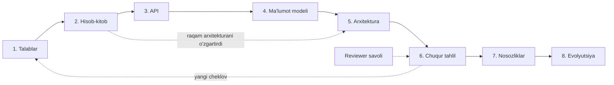

## Bu dars nima uchun kerak

90 ta darsda siz qurilish bloklarini o'rgandingiz: indeks, replication, Kafka, Raft, cache, rate limiter, geo-indeks. Lekin ko'p tajribali muhandislar system design interview da yoki arxitektura review da aynan bilim yetishmagani uchun emas, **taqdimot tuzilmasi** yo'qligi uchun yiqiladi: 40 daqiqadan 30 tasini bitta qismga sarflaydi, raqamsiz gapiradi, trade-off ni aytmaydi yoki savolga himoyalanib javob beradi.

Bu modulning qolgan 8 ta case study darsi (92-99) bir xil skeletga qurilgan - 1-darsdagi 8 qadamli jarayon. Bu darsda shu skeletni **taqdimot va review vositasi** sifatida mustahkamlaymiz: vaqtni qanday taqsimlash, har bir qadamda nima aytish, qanday hujjat yozish va boshqa birovning dizaynini qanday ko'rib chiqish.

Bu darsdan keyin siz:

- 45-60 daqiqalik interview yoki review uchun vaqt rejasini tuza olasiz;
- 8 qadamning har birida "minimal yetarli" natija nima ekanini bilasiz;
- design doc va ADR (Architecture Decision Record) yozish formatini bilasiz;
- Google SRE dagi Production Readiness Review (PRR) yo'nalishlarini review checklist sifatida ishlata olasiz;
- boshqa birovning dizaynini tuzilmali savollar bilan tekshira olasiz;
- interviewer yoki reviewer nimani baholashini va qaysi xatolar eng qimmatga tushishini bilasiz.

## Interview va real review: farqi va o'xshashligi

Interview va ishdagi dizayn review bir xil ko'nikmani tekshiradi, lekin shartlari boshqa:

| Jihat | System design interview | Ishdagi dizayn review |
|---|---|---|
| Vaqt | 45-60 daqiqa, bir martalik | Hujjat bir necha kun yoziladi, review 1-2 soat |
| Talablar | Ataylab noaniq, siz aniqlashtirasiz | Biznes, mijoz va mavjud tizim cheklovlaridan keladi |
| Raqamlar | Taxminiy, tartib muhim | Real metrika va prod ma'lumot bilan tekshiriladi |
| Natija | Signal: qanday fikrlaysiz | Qaror: nima quriladi, nima qurilmaydi |
| Xato narxi | Bitta interview | Oylar davomidagi qayta ishlash |
| Asosiy artefakt | Doskadagi diagramma va gap | Design doc, ADR, PRR checklist |

Umumiy jihat: ikkalasida ham baholanadigan narsa - **asoslangan qaror zanjiri**. "Biz Cassandra ishlatamiz" emas, "yozish 50 ming/s, o'qish asosan bitta kalit bo'yicha, multi-region yozish kerak, shuning uchun leaderless wide-column; evaziga ikkilamchi indeks va tranzaksiyadan voz kechamiz".

Alex Xu "System Design Interview" kitobining 1-jildi, 3-bobida ("A Framework For System Design Interviews") to'rt bosqichli freymvork beradi: masalani tushunish va ko'lamni belgilash, yuqori darajadagi dizaynni taklif qilib kelishish, chuqur tahlil, yakun. Bizning 8 qadam shu to'rt bosqichni ichidan ochadi: 1-2 qadam birinchi bosqichga, 3-5 ikkinchisiga, 6 uchinchisiga, 7-8 to'rtinchisiga to'g'ri keladi.

## 8 qadam taqdimot sifatida: vaqt rejasi

1-darsdagi jarayonni eslaymiz va har bir qadamga vaqt hamda "chiqish" (deliverable) beramiz. 50 daqiqalik interview uchun namunaviy reja:

| Qadam | Vaqt | Minimal natija | Qaysi darslar |
|---|---|---|---|
| 1. Talablar | 5-7 daq | 3-5 FR, 4-6 o'lchanadigan NFR, ko'lamdan tashqari ro'yxat | 1 |
| 2. Hisob-kitob | 3-5 daq | QPS (o'rtacha va cho'qqi), hajm/kun, hajm/yil, egress | 2, 3 |
| 3. API | 3-5 daq | 3-6 endpoint yoki xabar, idempotency, pagination | 9, 10 |
| 4. Ma'lumot modeli | 3-5 daq | Asosiy jadvallar/kalitlar, asosiy so'rov shakllari, partition key | 11, 20, 28 |
| 5. Arxitektura | 5-8 daq | 6-12 blokli diagramma, yozish va o'qish yo'li | 21-25, 41-43 |
| 6. Chuqur tahlil | 12-15 daq | 2-3 eng xavfli qism, har biri alternativalar bilan | butun kurs |
| 7. Nosozliklar | 4-5 daq | Har bir stateful blok uchun "o'chsa nima bo'ladi" | 61-64, 69 |
| 8. Evolyutsiya | 2-4 daq | 10x da nima birinchi sinadi va reja | 76, 79 |

Eng ko'p uchraydigan vaqt xatosi - 1-5 qadamlarga 35 daqiqa sarflab, chuqur tahlilga 5 daqiqa qoldirish. Interviewer aynan chuqur tahlilda kuchli va o'rta nomzodni ajratadi. Shuning uchun 5-qadam oxirida soatga qarang: 25-daqiqadan oshgan bo'lsa, diagrammani "yetarli" deb tugatib, chuqur tahlilga o'ting.

### 1-qadam: talablar - savol berish san'ati

Bu qadamda maqsad - masalani **toraytirish**. Har bir savol dizaynni o'zgartiradigan bo'lishi kerak. Yaxshi savollar:

- "Asosiy foydalanuvchi kim va eng ko'p bajariladigan amal qaysi?" - o'qish yoki yozish og'irligini aniqlaydi.
- "Ma'lumot yo'qolishi qanchalik qimmat?" - sync replication, acks, RPO ni belgilaydi (26, 44, 69-darslar).
- "Qancha eskirgan ma'lumot qabul qilinadi?" - cache va consistency modelini belgilaydi (23, 33-darslar).
- "Global mi yoki bitta region mi?" - multi-region (77-dars).
- "Qaysi qism ko'lamga kirmaydi?" - eng ko'p vaqt tejaydigan savol.

Yomon savollar: "Qaysi dasturlash tilida?", "Kubernetes ishlatsak bo'ladimi?" - bular dizaynni o'zgartirmaydi yoki hali erta.

Talablarni doskaga yozing. Keyin har bir qaror shu ro'yxatga havola qiladi: "NFR-2 (yo'qotmaslik) tufayli acks=all".

### 2-qadam: hisob-kitob - tartib, aniqlik emas

2-darsdagi qoidalar: kuniga 86 400 soniya, taxminan 10^5 deb yaxlitlash mumkin; cho'qqi o'rtachadan 2-10 marta; har bir taxminni ochiq ayting. Natijada uchta savolga javob bo'lishi kerak:

1. Bitta mashina yetadimi? (yozish 1 000/s - ha; 1 000 000/s - yo'q, sharding kerak).
2. Ma'lumot xotiraga sig'adimi? (issiq to'plam 50 GB - bitta Redis; 5 TB - taqsimlangan cache yoki SSD).
3. Tarmoq chiqishi (egress) qancha? (video va fayllarda bu narxning asosiy qismi, 79-dars).

Hisob-kitobning maqsadi - **arxitektura qarorini o'zgartirish**. Agar hisoblaganingiz hech qanday qarorga ta'sir qilmasa, uni qisqartiring.

### 3-4 qadamlar: API va ma'lumot modeli

API ni yozganda reviewer uchta narsaga qaraydi: yozish operatsiyalari idempotentmi (9, 39-darslar), ro'yxatlar cursor bilan sahifalanganmi, asinxron jarayonlar uchun status endpoint bormi. Ma'lumot modelida esa asosiy savol: **"eng ko'p bajariladigan so'rov qaysi kalit bo'yicha ketadi va bu kalit partition key bilan mos keladimi?"** (28, 30-darslar). Agar asosiy so'rov partition key dan boshqa maydon bo'yicha bo'lsa, scatter-gather yoki ikkilamchi indeks muammosi bor.

### 5-qadam: diagramma qoidalari

- Yozish yo'li va o'qish yo'lini alohida ko'rsating (ko'pincha ular butunlay boshqa).
- Har bir strelkada protokol yoki sinxron/asinxron belgisi bo'lsin.
- Stateful bloklar (baza, navbat, cache) aniq ajralib tursin, chunki 7-qadamda aynan ular so'raladi.
- 12 blokdan oshirmang. Ichki tafsilot chuqur tahlilda ochiladi.

### 6-qadam: chuqur tahlilni qanday tanlash

Chuqur tahlil uchun 2-3 qism tanlang, mezonlar:

1. **Eng ko'p yuklama** tushadigan joy (hot path).
2. **Eng qimmat xato** bo'ladigan joy (pul, ma'lumot yo'qolishi, xavfsizlik).
3. **Eng katta noaniqlik** (yangi texnologiya, aniq bo'lmagan algoritm).

Har bir chuqur tahlil bir xil shablonda: muammo, 2-3 alternativa, trade-off jadvali, tanlov va "qachon qayta ko'rish kerak" sharti. Masalan, URL shortener da (92-dars) chuqur tahlil - qisqa kod generatsiyasi va o'qish cache i; chipta sotishda (99-dars) - joyni ushlab turish konkurentligi va navbat.

### 7-qadam: nosozliklar - tuzilmali o'tish

Har bir stateful blok uchun to'rt savol:

1. To'liq o'chsa - foydalanuvchi nimani ko'radi?
2. Sekinlashsa (eng xavflisi, 64-dars) - kim kutib qoladi, timeout va circuit breaker bormi?
3. Ma'lumot yo'qolishi mumkinmi - RPO qancha?
4. Qanday tiklanadi - RTO qancha, avtomatikmi?

Bu savollarni jadval qilib bersangiz, reviewer uchun eng oson tekshiriladigan qism bo'ladi.

### 8-qadam: evolyutsiya

"10x bo'lsa" savoliga yaxshi javob - **ro'yxat emas, tartib**: "birinchi bo'lib X sinadi, chunki hisob-kitobda u chegaraga eng yaqin; uni Y bilan yechamiz; keyin Z". Va teskari savol ham: "hozir qaysi murakkablikni ataylab qo'ymadik va qachon qo'shamiz" (YAGNI).

## Muloqot: interviewer va reviewer nimani baholaydi

Bu kursda baholashni to'rt o'qqa ajratamiz (bu umumlashtirilgan sxema, har bir kompaniyaning aniq rubrikasi o'ziniki):

| O'q | Kuchli signal | Zaif signal |
|---|---|---|
| Masalani tuzish | Savollar bilan ko'lamni toraytirdi, NFR raqamli | Darhol chizishni boshladi |
| Texnik chuqurlik | Ichki mexanikani biladi: nega LSM, nega ISR, nega fencing token | Faqat nomlar: "Kafka qo'yamiz" |
| Trade-off | Har qarorda nima berilganini aytadi | "Bu eng yaxshi yechim" |
| Muloqot | Fikrini ovoz chiqarib aytadi, savolni qabul qiladi | Jim chizadi yoki himoyalanadi |

### Savolga qanday javob berish

Reviewer "Agar Redis o'chsa-chi?" deb so'rasa, bu hujum emas, chuqur tahlilga taklif. Yaxshi javob shabloni:

1. **Tasdiqlang**: "Ha, hozirgi dizaynda Redis yagona nuqta."
2. **Ta'sirini baholang**: "Hold ma'lumoti yo'qoladi, lekin PostgreSQL dagi holat haqiqat manbai, shuning uchun overselling bo'lmaydi; faqat foydalanuvchilar 10 daqiqa ichida ushlagan joylarini qayta tanlaydi."
3. **Yechim va narxini ayting**: "Redis Sentinel yoki cluster bilan replica qo'shamiz; async replication tufayli failover da oxirgi bir necha hold yo'qolishi mumkin, bu qabul qilinadi."

Bilmagan narsangizda "bilmayman, lekin shunday tekshirgan bo'lardim" deyish noto'g'ri ma'lumot o'ylab topishdan ancha yaxshi signal.

### "Ovoz chiqarib o'ylash"

Doskaga jim chizish interviewer uchun eng yomon holat: u sizning qaror zanjiringizni ko'rmaydi. Har bir blok qo'shganda bir gap: "Navbat qo'shyapman, chunki gateway yozuvchi sekinlashganda nuqtalarni yo'qotmasligi kerak (NFR-1)".

## Yozma format: design doc va ADR

Ishdagi review interview dan farqli ravishda yozma hujjatga tayanadi.

### Google design doc tuzilmasi

Malte Ubl ning "Design Docs at Google" maqolasiga ko'ra (2020), Google dagi design doc odatda quyidagi bo'limlardan iborat:

- **Context and scope** - qisqa fon va nima quriladi.
- **Goals and non-goals** - maqsadlar va ataylab maqsad qilinmagan narsalar (bizning "ko'lamdan tashqari").
- **The actual design** - tizim konteksti diagrammasi, API, ma'lumot saqlash, kerak bo'lsa kod yoki psevdokod.
- **Alternatives considered** - muallif buni eng muhim bo'limlardan biri deb ataydi, chunki u tanlangan yechim nega maqsadlarga eng mos ekanini ko'rsatadi.
- **Cross-cutting concerns** - xavfsizlik, maxfiylik, observability.

Hajm bo'yicha maqoladagi tavsiya: katta loyiha uchun 10-20 sahifa atrofida; kichik o'zgarishlar uchun 1-3 sahifalik "mini design doc". Uzunroq bo'lsa, masalani bo'lish kerak.

Bizning 8 qadam bu tuzilmaga to'g'ridan-to'g'ri joylashadi: 1-qadam goals/non-goals, 2-5 actual design, 6 alternatives, 7-8 cross-cutting va operatsion qism.

### ADR - qarorning tarixi

Michael Nygard 2011 yilda (Cognitect blogida) har bir muhim arxitektura qarorini qisqa alohida yozuv sifatida saqlashni taklif qilgan. ADR bo'limlari:

- **Title** - qisqa nom, raqam bilan: "ADR-7: Telemetriya uchun Kafka".
- **Context** - qarorga ta'sir qilayotgan kuchlar, neytral fakt sifatida.
- **Decision** - "Biz ... qilamiz" shaklida.
- **Status** - proposed, accepted, deprecated yoki superseded (qaysi ADR bilan almashtirilgani).
- **Consequences** - ijobiy, salbiy va neytral oqibatlar.

ADR ning qiymati - ikki yildan keyin "nega bu yerda Kafka?" degan savolga javob bor. 1-darsdagi "trade-off ni ochiq yozing" qoidasining hujjat shakli aynan shu. Design doc bitta katta dizaynni tasvirlasa, ADR lar uning ichidagi alohida qaytarilmaydigan (1-tur) qarorlarni qayd etadi.

### Production Readiness Review

Google SRE kitobining "The Evolving SRE Engagement Model" bobida PRR - servis production ga tayyorligini tekshirish jarayoni. U quyidagi yo'nalishlarni ko'rib chiqadi:

1. Tizim arxitekturasi va servislararo bog'liqliklar.
2. Instrumentatsiya, metrikalar va monitoring.
3. Favqulodda javob (emergency response), oldingi incident va postmortemlar.
4. Capacity planning.
5. Change management (deploy qanchalik xavfsiz).
6. Performance: mavjudlik, latency, samaradorlik.

Bu ro'yxat dizayn review uchun ham ajoyib checklist: 7-qadam (nosozliklar) 3-bandni, 8-qadam 4-bandni, 66-68 darslar 2 va 5-bandlarni yopadi.

## Review qiluvchi sifatida: boshqa dizaynni tekshirish

Senior muhandisning ishining katta qismi - boshqalarning dizaynini ko'rib chiqish. Tuzilmali review savollari (8 qadam bo'yicha):

| Qadam | Review savoli |
|---|---|
| Talablar | NFR lar o'lchanadimi? Non-goals yozilganmi? |
| Hisob-kitob | Cho'qqi qayerdan olingan? Eng og'ir operatsiya qaysi? |
| API | Retry bo'lsa ikki marta bajariladimi? Versiyalash qanday? |
| Ma'lumot | Asosiy so'rov partition key bilan mosmi? Hot key bormi? |
| Arxitektura | Har bir sinxron chaqiruv zanjiri qancha uzun? SPOF qayerda? |
| Chuqur tahlil | Alternativalar haqiqatan ko'rib chiqilganmi? |
| Nosozliklar | Sekinlashish (to'liq o'chish emas) holati ko'rilganmi? |
| Evolyutsiya | Qaysi qaror qaytarilmaydi va u yetarlicha asoslanganmi? |

Review ohangi: "nega X emas?" o'rniga "X ni ko'rib chiqdingizmi, u Y muammoni hal qilardi, lekin Z narxi bor" - bu muallifni himoyaga emas, fikrlashga undaydi.

## Hisob-kitob uchun tezkor jadval

Interview da kalkulyatorsiz ishlash uchun eslab qolishga arziydigan raqamlar (2-darsdan):

| Ifoda | Qiymat |
|---|---|
| 1 kun | 86 400 s, taxminan 10^5 |
| 1 million / kun | taxminan 12 / s |
| 100 million / kun | taxminan 1 160 / s |
| 1 milliard / kun | taxminan 11 600 / s |
| 1 oy | taxminan 2.6 million s |
| 1 Gbit/s | 125 MB/s |
| 2^32 | taxminan 4.3 milliard |
| 62^7 | taxminan 3.5 trillion |

Misol: "kuniga 50 million yozuv, har biri 1 KB, 5 yil saqlanadi, 3 replica". 50 million ÷ 86 400 ≈ 580 yozuv/s; cho'qqi ×3 ≈ 1 750/s. Hajm: 50 GB/kun × 365 × 5 ≈ 91 TB, ×3 replica ≈ 274 TB. Xulosa: yozish yuklamasi kichik, lekin hajm bitta mashinaga sig'maydi - demak muammo storage tiering va retention da (78-dars), yozish QPS da emas.

## iQuariX kontekstida: ichki dizayn review

Masala sharti: jamoa iQuariX ga "video arxivni bulutga yuklash" modulini qo'shmoqchi (bu o'quv ssenariysi, real ichki reja emas). Siz review o'tkazasiz. 8 qadamli tuzilma bo'yicha savollaringiz shunday bo'lishi mumkin:

- **Talablar:** qaysi video yuklanadi - hammasi yoki faqat hodisa (event) atrofidagi 30 soniyalik kliplar? Bu bitta savol hajmni 100 marta o'zgartirishi mumkin.
- **Hisob-kitob:** hisob uchun shartlar - 5 000 kamerali mashina, har biri kuniga 20 ta 30 soniyalik klip, klip 1 Mbit/s da: 30 s × 1 Mbit/s = 30 Mbit ≈ 3.75 MB; 5 000 × 20 × 3.75 MB ≈ 375 GB/kun. Mobil trafik narxi qancha?
- **API:** mashina aloqa uzilganda yuklashni qayerdan davom ettiradi (resumable upload, 98-dars)?
- **Nosozliklar:** SIM trafik limiti tugasa nima bo'ladi? Klip qurilmada qancha saqlanadi?
- **ADR:** "Kliplar S3-ga mos object storage da, metadata PostgreSQL da" qarori alohida ADR sifatida yozilishi kerak, chunki u qaytarish qiyin qaror.

Bu misolda texnologiya haqida deyarli gap yo'q - review ning qiymati noto'g'ri savolga to'g'ri javob berishning oldini olishda.

## Ko'p uchraydigan xatolar

1. **Talablarni so'ramasdan chizish.** Natijada noto'g'ri masalaning yaxshi yechimi chiqadi.
2. **Hisob-kitobni ritual sifatida qilish.** Raqamlar hisoblanadi, lekin hech bir qarorga ta'sir qilmaydi. Har bir raqamdan keyin "demak..." deb xulosa chiqaring.
3. **Hamma narsani bir xil chuqurlikda.** Login, profil, sozlamalar - bularni chuqur tahlil qilish kerak emas.
4. **Buzzword arxitektura.** "Kafka, Kubernetes, microservices" - har bir blokning nega kerakligi aytilmasa, reviewer uni olib tashlashni so'raydi.
5. **Trade-off siz qaror.** "Eng yaxshisi" degan so'z dizayn hujjatida bo'lmasligi kerak.
6. **Nosozliklarni faqat "server o'chdi" deb tushunish.** Sekinlashish, qisman yo'qolish, takroriy xabar va split-brain ko'pincha qimmatroq.
7. **Savolga himoyalanish.** Reviewer topgan muammo - dizaynni yaxshilash imkoniyati, shaxsiy tanqid emas.
8. **Yozma qarorlar yo'qligi.** ADR siz bir yildan keyin hech kim nega shunday qilinganini bilmaydi va qaror tasodifan bekor qilinadi.

## Xulosa

- Interview va review bir xil ko'nikmani tekshiradi: talabdan qarorgacha asoslangan zanjir.
- 8 qadamning har biriga vaqt va minimal natija belgilang; chuqur tahlilga eng ko'p vaqt qolsin.
- Har bir hisob-kitob arxitektura qaroriga ta'sir qilishi kerak.
- Chuqur tahlil uchun eng ko'p yuklama, eng qimmat xato va eng katta noaniqlik bo'lgan 2-3 qismni tanlang.
- Nosozliklarni har bir stateful blok uchun to'rt savol bilan tekshiring: o'chish, sekinlashish, yo'qotish, tiklash.
- Yozma formatlar: design doc (goals/non-goals va alternatives muhim), ADR (bitta qaror tarixi), PRR (production tayyorligi).
- Savolga javob: tasdiqlash, ta'sirni baholash, yechim va narxini aytish.

## Amaliy topshiriq

O'zingiz yaxshi bilgan bitta mavjud modul uchun (masalan, iQuariX dagi geofence ogohlantirishlari yoki hisobot generatsiyasi - faraziy tavsif bo'lsa ham bo'ladi) **mini design doc va ADR** yozing:

1. **Goals va non-goals.** 4-5 ta maqsad va kamida 3 ta ataylab maqsad qilinmagan narsa.
2. **Hisob-kitob.** Asosiy yuklama parametri, o'rtacha va cho'qqi QPS, kunlik hajm. Har bir raqamdan keyin "demak..." bilan qaysi qarorga ta'sir qilganini yozing.
3. **Arxitektura.** 6-10 blokli diagramma (mermaid yoki matn), yozish va o'qish yo'li alohida.
4. **Alternatives considered.** Eng muhim qaror uchun 2 ta alternativa va trade-off jadvali.
5. **Bitta ADR.** Nygard formatida: Title, Context, Decision, Status, Consequences (ijobiy va salbiy).
6. **PRR mini-checklist.** 6 ta PRR yo'nalishi bo'yicha har biriga bitta gapdan holat va ochiq savol.

Yaxshi javobda bo'lishi kerak bo'lgan narsalar:

- non-goals aniq va dizaynni haqiqatan soddalashtiradigan;
- hisob-kitob natijalari qarorlarga bog'langan;
- alternativalar "somon odam" emas, haqiqatan ishlaydigan variantlar;
- ADR da salbiy oqibatlar ham yozilgan;
- PRR da kamida bitta ochiq muammo tan olingan.

Javobni pastdagi maydonga yozib, chatga yuboring.

## Manbalar

- Malte Ubl. [Design Docs at Google](https://www.industrialempathy.com/posts/design-docs-at-google/), 2020 - design doc bo'limlari, "alternatives considered" ahamiyati, hajm bo'yicha tavsiya.
- Michael Nygard. [Documenting Architecture Decisions](https://cognitect.com/blog/2011/11/15/documenting-architecture-decisions), Cognitect blog, 2011 - ADR formati.
- Google. [Site Reliability Engineering, 32-bob "The Evolving SRE Engagement Model"](https://sre.google/sre-book/evolving-sre-engagement-model/) - Production Readiness Review yo'nalishlari.
- Google. [The Site Reliability Workbook, 18-bob "SRE Engagement Model"](https://sre.google/workbook/engagement-model/) - review jarayonining amaliy tomoni.
- Alex Xu. System Design Interview, 1-jild, 3-bob "A Framework For System Design Interviews". [Kitob sharhi](https://blog.pragmaticengineer.com/system-design-interview-an-insiders-guide-review/) - to'rt bosqichli freymvork.
- Jeff Bezos. 2015 yilgi aksiyadorlarga maktub - 1 va 2-tur qarorlar. [Tahlil](https://fs.blog/reversible-irreversible-decisions/).
- Martin Kleppmann, Chris Riccomini. [Designing Data-Intensive Applications, 2-nashr](https://www.oreilly.com/library/view/designing-data-intensive/9781098119058/), O'Reilly, 2026 - 1-2 boblar: trade-off va nofunksional talablar.
