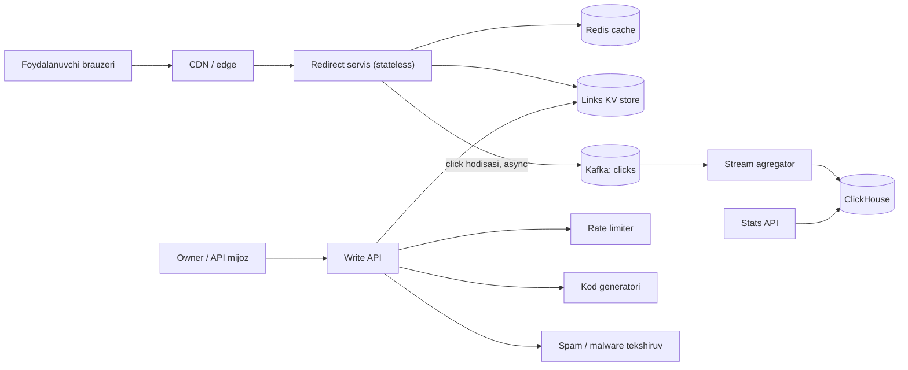

## Bu dars nima uchun kerak

URL shortener - eng oddiy ko'rinadigan, lekin system design ning deyarli barcha asosiy savollarini qamrab oladigan masala: noyob ID generatsiyasi, o'qishi juda og'ir yuklama, cache, HTTP semantikasi (301 va 302), analitika uchun asinxron oqim, suiiste'mol (spam, phishing) himoyasi. Masala kichik bo'lgani uchun 8 qadamning har birini to'liq ko'rsatish oson - shu sabab case study lar seriyasini aynan shu bilan boshlaymiz.

Bu dars 91-darsdagi taqdimot freymvorkini birinchi marta to'liq qo'llaydi. Har bir qadamda qaysi oldingi darsdan qaysi texnika olinganini ko'rsatamiz.

Bu darsdan keyin siz:

- qisqa kod generatsiyasining 4 yondashuvini (hash, counter, oldindan generatsiya, Snowflake) trade-off lari bilan taqqoslay olasiz;
- 301 va 302 redirect tanlovi analitika va cache ga qanday ta'sir qilishini tushuntira olasiz;
- o'qishi og'ir tizim uchun cache hajmini hisoblay olasiz;
- click analitikani redirect yo'lidan qanday ajratishni bilasiz;
- shortener ning nosozlik va suiiste'mol stsenariylarini loyihalay olasiz.

## 1-qadam: talablar

**Funksional talablar:**

- FR-1: foydalanuvchi uzun URL beradi, tizim qisqa havola qaytaradi (`sho.rt/aB3xK9p`).
- FR-2: qisqa havolaga o'tilganda asl URL ga redirect qilinadi.
- FR-3: ixtiyoriy custom alias (`sho.rt/iquarix-demo`) va amal qilish muddati (expiry).
- FR-4: havola egasi click statistikasini ko'radi: kunlik soni, mamlakat, referrer, qurilma.
- FR-5: havolani o'chirish yoki o'chirib qo'yish (masalan, phishing aniqlanganda).

**Ko'lamdan tashqari:** havolani tahrirlash (boshqa URL ga yo'naltirish), QR kod generatsiyasi, A/B redirect, foydalanuvchi boshqaruvi tafsilotlari.

**Nofunksional talablar:**

- NFR-1: redirect p99 latency server tomonida 20 ms dan kam (cache hit holatida), cho'qqi yuklamada.
- NFR-2: redirect mavjudligi oyiga 99.99% - bu yaratishdan muhimroq. Yaratish uchun 99.9% yetadi.
- NFR-3: yaratilgan havola yo'qolmaydi va 10 yil ishlaydi (agar expiry belgilanmagan bo'lsa).
- NFR-4: qisqa kod 7 belgidan oshmasin va ketma-ket kodlarni oldindan topish (sanab chiqish) qiyin bo'lsin.
- NFR-5: statistika 1-5 daqiqa kechikishi mumkin, lekin click lar 0.1% dan ko'p yo'qolmasin.
- NFR-6: bitta foydalanuvchi yoki IP minutiga N tadan ko'p havola yarata olmasin (suiiste'mol).

E'tibor bering: NFR-2 va NFR-5 tizimni ikkiga bo'ladi. Redirect - qat'iy latency va mavjudlik; analitika - kechikishga chidamli. Bu ikki yo'lni alohida loyihalash kerakligini bildiradi.

## 2-qadam: hisob-kitob

**Hisob uchun shartlar** (bu masala sharti, real servis statistikasi emas):

| Parametr | Qiymat |
|---|---|
| Yangi havolalar | kuniga 100 million |
| O'qish/yozish nisbati | 10:1 (har havola o'rtacha 10 marta ochiladi; real taqsimot juda notekis) |
| Saqlash muddati | 10 yil |
| Cho'qqi koeffitsiyenti | yaratish ×3, redirect ×5 |
| Bitta yozuv (indeks va overhead bilan) | 500 B (yuqori chegara) |
| Kunlik noyob ochilgan havolalar | 200 million |
| Issiq ulush (Pareto 80/20) | noyob havolalarning 20% i |
| Bitta click hodisasi | 200 B |

**Yozish:** 100 000 000 ÷ 86 400 ≈ **1 160 yaratish/s**. Cho'qqi ×3 ≈ 3 500/s.

**O'qish:** 1 160 × 10 ≈ **11 600 redirect/s**. Cho'qqi (viral havola, ish soatlari) ×5 ≈ 58 000/s.

**Yozuvlar soni:** 100 million × 365 × 10 ≈ **365 milliard** havola.

**Kod uzunligi:** base62 alfavit (a-z, A-Z, 0-9). 62^6 ≈ 56.8 milliard - yetmaydi. 62^7 ≈ 3.52 trillion - 365 milliarddan ~10 baravar ko'p. Demak **7 belgi** yetadi va zichlik ~10% bo'ladi, bu tasodifiy kodlarda to'qnashuv ehtimolini past ushlaydi (pastda).

**Hajm:** bitta yozuv: kod 7 B, uzun URL o'rtacha ~100 B, egasi ID 8 B, vaqt 8 B, expiry 8 B, indeks va qator overhead bilan 250-500 B oralig'ida; shartdagi yuqori chegara 500 B ni olamiz. 365 milliard × 500 B ≈ **182 TB** (replicasiz). 3 replica bilan ~550 TB. Bu bitta PostgreSQL ga sig'maydi - sharding yoki wide-column/KV storage kerak (28, 20-darslar).

**Cache:** shartdagi Pareto qoidasi: kunlik trafikning 80% ini 20% havolalar beradi. Kuniga 11 600 × 86 400 ≈ 1 milliard redirect, shartga ko'ra ulardan 200 million noyob havola; ularning 20% = 40 million issiq havola × 500 B ≈ **20 GB**. Bu bitta katta Redis yoki kichik cluster ga sig'adi (23, 24-darslar).

**Tarmoq:** redirect javobi kichik (~500 B header bilan). 58 000/s × 500 B ≈ 29 MB/s - ahamiyatsiz.

**Analitika:** har bir click hodisasi ~200 B; kuniga 1 milliard × 200 B = 200 GB/kun xom hodisa. Bu redirect jadvalidan tez o'sadi va alohida OLAP saqlashga ketishi kerak (16-dars).

Xulosalar: (1) o'qish yo'li cache bilan yopiladi, (2) asosiy saqlash muammosi - yozuvlar soni va 10 yillik hajm, (3) analitika hajmi havolalarnikidan katta, demak alohida pipeline.

## 3-qadam: API

```
POST /v1/links
  Headers: Authorization, Idempotency-Key
  Body: { "url": "https://...", "alias": "iquarix-demo"?, "expiresAt": "2027-01-01T00:00:00Z"? }
  201: { "code": "aB3xK9p", "shortUrl": "https://sho.rt/aB3xK9p" }
  409: alias band
  429: limitdan oshdi

GET /{code}
  302 Location: https://...   (yoki 301, pastda)
  404 / 410 Gone: topilmadi yoki muddati o'tgan

GET /v1/links/{code}/stats?from=...&to=...&groupBy=day|country
DELETE /v1/links/{code}
```

Muhim jihatlar:

- **Idempotency-Key** (9, 39-darslar): mijoz timeout dan keyin qayta yuborsa, ikki xil kod yaratilmasligi kerak. Server kalit bo'yicha birinchi javobni 24 soat saqlaydi.
- **Bir xil URL ga bir xil kod qaytarish shartmi?** Agar talab qilinsa, uzun URL bo'yicha indeks kerak (100 B kalit, 365 milliard yozuv - qimmat ikkilamchi indeks). Ko'p xizmatlar har bir so'rovga yangi kod beradi, chunki turli egalar alohida statistika xohlaydi. Biz shuni tanlaymiz.
- **410 Gone** muddati o'tgan havola uchun 404 dan ko'ra aniqroq semantika beradi.

### 301 yoki 302

Bu kichik ko'rinadigan, lekin arxitekturaga ta'sir qiladigan qaror:

| | 301 Moved Permanently | 302 Found |
|---|---|---|
| Brauzer cache | Standart bo'yicha cache qilinadi, keyingi bosishlarda serverga umuman kelmasligi mumkin | Standart bo'yicha cache qilinmaydi |
| Server yuklamasi | Kamroq | Har bir click serverga keladi |
| Analitika aniqligi | Takroriy click lar yo'qoladi | Har bir click ko'rinadi |
| Havolani o'chirish yoki bloklash | Brauzerda cache lansa, bloklash ta'sir qilmaydi | Darhol ta'sir qiladi |
| SEO | Signal yangi manzilga o'tadi | Signal asl manzilda qoladi |

Bizda FR-4 (statistika) va FR-5 (phishing havolani bloklash) bor, shuning uchun **302** tanlaymiz va javobga `Cache-Control: private, max-age=0` yoki qisqa max-age qo'yamiz. Narxi: server yuklamasi 301 dagidan ko'p. 307 ham variant - u metodni o'zgartirmaydi, lekin GET redirect uchun amalda 302 bilan bir xil.

## 4-qadam: ma'lumot modeli

Asosiy so'rov - `code` bo'yicha bitta kalitni o'qish. JOIN yo'q, tranzaksiya kerak emas (yaratish bitta yozuv). Bu key-value yoki wide-column uchun ideal shakl (11, 20-darslar).

```
links
  code         string(7)   PRIMARY KEY  -- partition key
  long_url     string
  owner_id     int64
  created_at   timestamp
  expires_at   timestamp?
  status       enum(active, disabled)

links_by_owner          -- egasining havolalari ro'yxati uchun
  owner_id     PARTITION KEY
  created_at   CLUSTERING (desc)
  code

click_events (OLAP, ClickHouse)
  code, ts, country, referrer_domain, device, ip_hash
  ORDER BY (code, ts)
```

- **Partition key = code.** Hash bo'yicha taqsimlanadi (28, 29-darslar), shuning uchun yozuvlar shardlar orasida tekis tarqaladi. Agar kod ketma-ket counter bo'lsa va range partitioning ishlatilsa, barcha yangi yozuvlar bitta shardga tushadi - hot partition (30-dars). Hash partitioning buni yo'qotadi.
- **links_by_owner** - ikkilamchi kirish yo'li uchun alohida denormalizatsiya qilingan jadval (30-dars, local va global indeks muammosi o'rniga).
- **click_events** - umuman boshqa saqlash: ustunli OLAP baza, chunki so'rovlar "kod bo'yicha kunlik soni" kabi agregatsiyalar (16-dars).

Saqlash variantlari: DynamoDB yoki Cassandra (yozish oson masshtablanadi, multi-region), yoki sharded PostgreSQL/Vitess. 182 TB va oddiy kalit so'rovi uchun birinchi guruh tabiiyroq; PostgreSQL ni tanlasangiz, shard boshqaruvini o'zingiz qilasiz.

## 5-qadam: yuqori darajadagi arxitektura



**Yozish yo'li:** Write API → rate limit (56-dars) → URL ni normalizatsiya va qora ro'yxat tekshiruvi → kod generatsiya → KV store ga yozish → javob. Chuqur malware tekshiruvi asinxron: havola yaratiladi, lekin shubhali bo'lsa keyin `disabled` qilinadi.

**O'qish yo'li:** Redirect servis → Redis (cache-aside, 23-dars) → miss bo'lsa KV store → cache ga yozish → 302. Click hodisasi Kafka ga fire-and-forget yuboriladi (lokal bufer bilan) - redirect latency siga ta'sir qilmasligi kerak.

**Analitika yo'li:** Kafka → stream agregator (45-dars: 1 daqiqalik tumbling oyna, kod va mamlakat bo'yicha hisoblagich) → ClickHouse.

Redirect servis va Write API alohida deploy qilinadi: ularning yuklamasi, SLO va masshtablash profili boshqa (21, 51-darslar).

## 6-qadam: chuqur tahlil

Eng xavfli uch qism: (1) kod generatsiyasi - qaytarilmaydigan qaror, chunki kodlar 10 yil yashaydi; (2) o'qish yo'lidagi cache va hot key; (3) analitikaning redirect dan ajratilishi.

### 6.1. Qisqa kod generatsiyasi

To'rt yondashuv:

**A. Hash + qisqartirish.** `base62(sha256(long_url + salt))[:7]`. Muammo: 7 belgi ≈ 41.6 bit; 365 milliard yozuvda to'qnashuv muqarrar. Har bir yaratishda "bunday kod bormi?" deb tekshirish kerak, to'qnashsa salt o'zgartiriladi. Bu har yozuvga qo'shimcha o'qish va shartli yozish (conditional put) degani. Ijobiy tomoni: koordinatsiya kerak emas.

To'qnashuv ehtimoli: tasodifiy 7 belgili kod tanlanganda, bazada n ta kod bo'lsa, yangi kod band bo'lish ehtimoli n / 62^7. 365 milliard / 3.52 trillion ≈ 10%. Ya'ni 10 yil oxirida har 10 ta yaratishdan biri qayta urinish talab qiladi. Bu ishlaydi, lekin tizim to'lgan sari sekinlashadi.

**B. Markaziy counter + base62.** Har yangi havola uchun global counter oshiriladi va base62 ga o'giriladi. To'qnashuv yo'q. Muammo 1: counter - bitta nuqta va bottleneck. Yechim: **diapazon (range) ajratish**: har bir Write API instance koordinatordan (ZooKeeper/etcd yoki bitta PostgreSQL qatori) 10 000 lik blok oladi (`UPDATE counters SET next = next + 10000 RETURNING next`) va uni xotirada ishlatadi. Koordinatorga murojaat 10 000 yaratishda bir marta. Instance o'lsa, blokning ishlatilmagan qismi yo'qoladi - 3.5 trillionlik maydonda bu ahamiyatsiz. Muammo 2: ketma-ket kodlarni oldindan topish oson (NFR-4) - raqib barcha havolalarni sanab chiqishi mumkin. Yechim: counter ni base62 ga o'girishdan oldin **teskari aylanadigan aralashtirish** (masalan, kichik Feistel shifr yoki modulli ko'paytirish teskari element bilan) - bu 1:1 akslantirish, shuning uchun noyoblik saqlanadi, lekin natija tasodifiy ko'rinadi.

**C. Oldindan generatsiya qilingan kalitlar (Key Generation Service).** Alohida servis oldindan noyob tasodifiy kodlar to'plamini generatsiya qilib, "ishlatilmagan" jadvalda saqlaydi; Write API ulardan paket oladi. Bu B ning tasodifiy varianti, lekin qo'shimcha saqlash (trillionlab kalit emas, faqat buferni) va servis talab qiladi.

**D. Snowflake ID.** 57-darsda ko'rgan 64-bitli ID (41 bit vaqt, 10 bit mashina, 12 bit ketma-ketlik). Muammo: 64 bitni base62 da yozish 11 belgi oladi - NFR-4 ni buzadi.

| Yondashuv | To'qnashuv | Koordinatsiya | Oldindan topilishi | Uzunlik |
|---|---|---|---|---|
| Hash + qisqartirish | Bor, tekshirish kerak | Yo'q | Qiyin | 7 |
| Counter diapazonlari | Yo'q | Har 10k da bir marta | Aralashtirish bilan qiyin | 7 |
| KGS | Yo'q | KGS servisi | Qiyin | 7 |
| Snowflake | Yo'q | Mashina ID ajratish | O'rtacha | 11 |

**Tanlov: B (counter diapazonlari + aralashtirish).** Yozish yo'lida qo'shimcha o'qish yo'q, to'qnashuv yo'q, koordinator yuklamasi ahamiyatsiz. Custom alias lar uchun esa alohida yo'l: shartli yozish (`PUT IF NOT EXISTS`) va band bo'lsa 409. Custom alias lar counter maydonidan to'qnashmasligi uchun ular 8+ belgi yoki `-` belgisini o'z ichiga olishi talab qilinadi.

Qachon qayta ko'rish kerak: agar multi-region yozish kerak bo'lsa, har bir region o'z diapazonini oladi - bu baribir ishlaydi; agar 7 belgi tugasa (zichlik 50% dan oshsa), 8 belgiga o'tiladi - eski kodlar o'zgarmaydi.

### 6.2. O'qish yo'li: cache va hot key

Cache-aside (23-dars): Redis da `code -> long_url, status, expires_at`. TTL 24 soat + jitter. Hisob-kitob bo'yicha 20 GB issiq to'plam. Kutilgan hit rate 90%+ bo'lsa, KV store ga ~1 200-6 000 o'qish/s qoladi.

Uchta nozik joy:

1. **Viral havola (hot key, 24-dars).** Bitta kod sekundiga 50 000 marta ochilsa, u bitta Redis shardiga tushadi. Yechim: redirect servis ichida kichik **lokal in-process cache** (masalan, 10 000 element, 5-10 soniya TTL). 100 instance bo'lsa, bitta kalit uchun Redis ga sekundiga ~10-20 so'rov qoladi.
2. **Negative cache.** Mavjud bo'lmagan kodlar bilan skanerlash (bot) har safar bazaga tushadi. "Topilmadi" natijasini ham 1-5 daqiqa cache lash kerak.
3. **Bloklash va cache.** Havola phishing deb `disabled` qilinsa, cache dagi nusxa 24 soat yashamasligi kerak. Yechim: status o'zgarganda cache dan o'chirish (delete) va lokal cache TTL ini qisqa ushlash; kritik bo'lsa pub/sub orqali invalidation (24-dars).

CDN da redirect javobini cache lash mumkinmi? 302 + qisqa `s-maxage` (masalan 60 s) bilan edge da cache lansa, viral havola yuklamasi deyarli butunlay edge ga o'tadi (25-dars). Narxi: edge dagi click lar bizgacha kelmaydi - analitika uchun CDN loglaridan foydalanish kerak bo'ladi. Bu trade-off ni NFR-5 bilan muvofiqlashtirish kerak; boshlang'ich dizaynda CDN cache ni o'chirib qo'yamiz.

### 6.3. Analitikani ajratish

Agar redirect servis har click da ClickHouse yoki PostgreSQL ga sinxron yozsa, analitika bazasining har qanday sekinlashishi redirect latency sini buzadi (64-dars: cascading failure). Shuning uchun:

- Redirect servis hodisani xotiradagi bufer orqali Kafka ga yuboradi (`acks=1` yetarli - NFR-5 0.1% yo'qotishga ruxsat beradi; 44-dars).
- Kafka mavjud bo'lmasa, bufer to'lganda hodisalar tashlanadi (load shedding, 63-dars) - redirect davom etadi.
- Agregator 1 daqiqalik oynalar bilan hisoblaydi, kech kelgan hodisalar uchun watermark (45-dars).
- Bot va crawler click larini filtrlash (User-Agent, IP reputatsiyasi) agregator bosqichida.

## 7-qadam: nosozlik stsenariylari

| Blok | Nima bo'ladi | Ta'sir | Himoya |
|---|---|---|---|
| Redis cluster | O'chadi | Barcha o'qish KV store ga, 10x yuklama | Lokal cache, KV store capacity zaxirasi, request coalescing |
| KV store bitta shard | O'chadi | Shu sharddagi havolalar ochilmaydi (cache da bo'lmasa) | Replication factor 3, quorum o'qish (27-dars) |
| Counter koordinatori | O'chadi | Yangi diapazon olinmaydi | Har instance keyingi blokni oldindan oladi (2 blok bufer) - minutlab davom etadi |
| Kafka | O'chadi | Click lar yo'qoladi | Redirect davom etadi, bufer, keyin tashlash |
| Write API | Sekinlashadi | Yaratish sekin | Redirect alohida servis, ta'sir qilmaydi |
| Butun region | O'chadi | Redirect to'xtaydi | Multi-region read replica, DNS failover (69, 77-darslar) |

**Suiiste'mol stsenariylari** ham nosozlik turi:

- **Phishing va malware.** Qisqa havola asl manzilni yashiradi. Yaratishda Google Safe Browsing kabi ro'yxatlar bilan tekshirish, keyin davriy qayta tekshirish va `disabled` holati.
- **Enumeratsiya.** Ketma-ket kodlar bilan barcha havolalarni yig'ish. Aralashtirish (6.1) va redirect servisda IP bo'yicha rate limit.
- **Yaratish spami.** NFR-6: token bucket (56-dars) foydalanuvchi va IP bo'yicha.

## 8-qadam: evolyutsiya (10x)

10x: kuniga 1 milliard yaratish (11 600/s), 116 000 redirect/s o'rtacha, cho'qqida 500 000+/s.

1. **Birinchi bo'lib sinadigan narsa - kod maydoni.** 10 yilda 3.65 trillion havola - 62^7 dan ko'p. 8 belgiga o'tish kerak (62^8 ≈ 218 trillion). Bu orqaga mos o'zgarish: yangi kodlar 8 belgili, eskilari ishlaydi.
2. **Saqlash** ~1.8 PB (replicasiz). Expiry bo'lmagan, lekin 1 yildan beri ochilmagan havolalarni sovuq saqlashga ko'chirish (78-dars) va cache miss da sovuq qatlamdan o'qish.
3. **Redirect** - CDN edge cache ni yoqish va analitikani CDN loglaridan yig'ish.
4. **Multi-region** - redirect barcha regionlarda lokal o'qiydi; yozish region diapazonlari bilan.

Ataylab hozir qo'shmagan narsalar: multi-region yozish, CDN cache, sovuq qatlam. Har biri uchun trigger metrikasi yoziladi (masalan, "redirect p99 > 50 ms yoki 200k/s dan oshsa CDN cache yoqiladi").

## Real tizimlardan misollar

- **Bitly** (High Scalability, 2014): oyiga ~6 milliard click va ~600 million yangi havola; ~400 server, ulardan faqat ~30 tasi tashqi trafikni qabul qiladi, qolganlari saqlash, metrika va analiz uchun. Arxitektura - kichik servislar va NSQ orqali asinxron xabarlar; havola yaratish esa ataylab sinxron qoldirilgan. Bu bizning "redirect sinxron, analitika asinxron" bo'linishimizga mos.
- **Twitter Snowflake** (2010): Twitter UUID ni 128 bit bo'lgani uchun, MySQL ticket server ni esa tartib kafolati yo'qligi uchun rad etib, 64-bitli, taxminan vaqt bo'yicha tartiblangan, koordinatsiyasiz ID ni tanlagan. Bizda 7 belgi cheklovi Snowflake ni chiqarib tashladi - bir xil muammo, boshqa talab, boshqa yechim.

## iQuariX kontekstida

Masala sharti (o'quv ssenariysi): iQuariX haydovchilarga SMS orqali "marshrutni ko'rish" havolasini yoki mijozga "mashina qayerda" havolasini yuboradi (`iqx.uz/t/aB3xK9p`). Farqlar:

- **Hajm kichik:** shartga ko'ra kuniga 50 ming havola - bitta PostgreSQL jadvali yetadi. 6.1 dagi counter diapazonlari o'rniga oddiy `bigserial` + aralashtirish yetarli.
- **Xavfsizlik muhimroq:** havola mashinaning real joylashuvini ko'rsatadi. Kodni oldindan topib bo'lmasligi kerak (aralashtirish yetmaydi - kamida 10-12 belgili tasodifiy token: base62 da 10 × log2(62) ≈ 59.5 bit, 12 belgi ≈ 71.5 bit entropiya) va qisqa expiry (masalan, 24 soat).
- **301 umuman mumkin emas:** havola muddati tugaganda darhol ishlamay qolishi kerak.

Bu misol shuni ko'rsatadi: bir xil "URL shortener" masalasi talablar o'zgarganda butunlay boshqa qarorlarga olib keladi.

## Ko'p uchraydigan xatolar

1. **Uzun URL ning hash ini to'qnashuv tekshiruvisiz ishlatish.** 7 belgida to'qnashuv nazariy emas, amaliy.
2. **Ketma-ket counter ni ochiq base62 sifatida berish.** Barcha havolalar sanab chiqiladi.
3. **301 ni o'ylamasdan tanlash.** Analitika va bloklash imkoniyati yo'qoladi.
4. **Click ni sinxron yozish.** Analitika bazasi redirect ni sekinlashtiradi.
5. **Range partitioning ketma-ket kalit bilan.** Barcha yangi yozuvlar bitta shardga.
6. **Hot key ni hisobga olmaslik.** Viral havola bitta Redis shardini yiqitadi.
7. **Negative cache yo'qligi.** Botlar mavjud bo'lmagan kodlar bilan bazani bombardimon qiladi.
8. **Suiiste'molni ko'lamdan tashqari qoldirish.** Ochiq shortener birinchi haftada phishing vositasiga aylanadi.

## Xulosa

- Talablar tizimni ikki yo'lga bo'ladi: qat'iy latency li redirect va kechikishga chidamli analitika.
- 365 milliard yozuv uchun 7 belgili base62 yetadi (62^7 ≈ 3.5 trillion), lekin 10x da 8 belgi kerak.
- Counter diapazonlari + teskari aylanadigan aralashtirish to'qnashuvsiz, koordinatsiyasi arzon va oldindan topib bo'lmaydigan kod beradi.
- 302 analitika va bloklashni saqlaydi; 301 yuklamani kamaytiradi, lekin nazoratni brauzerga beradi.
- Issiq to'plam ~20 GB - Redis; viral havola uchun lokal cache, mavjud bo'lmagan kodlar uchun negative cache.
- Click hodisalari Kafka orqali asinxron, OLAP bazaga; Kafka o'chsa redirect davom etadi.
- Suiiste'mol (phishing, enumeratsiya, spam) - dizaynning birinchi darajali qismi.

## Amaliy topshiriq

iQuariX uchun **"mijozga mashina joylashuvini ulashish" havolasi** servisini loyihalang (faraziy): dispetcher bir tugma bilan mijozga 2 soat amal qiladigan havola yuboradi, mijoz brauzerda mashinaning jonli joylashuvini ko'radi.

1. **Talablar.** FR va o'lchanadigan NFR (havola qancha vaqtda bekor qilinishi kerak, jonli joylashuv qancha kechikishi mumkin). Ko'lamdan tashqari ro'yxat.
2. **Hisob-kitob.** Hisob uchun shartlar: 3 000 mijoz kompaniya, kuniga 20 000 havola, har bir havola o'rtacha 15 marta ochiladi va ochiq sahifa har 10 soniyada joylashuv so'raydi. Yaratish/s, sahifa ochish/s va joylashuv so'rovi/s ni hisoblang.
3. **Token dizayni.** Token uzunligi va entropiyasini asoslang. Nega bu yerda 7 belgili base62 yetmaydi?
4. **Arxitektura.** Havola yaratish, tekshirish va jonli joylashuv oqimi (polling yoki SSE/WebSocket - 8-dars). Mermaid diagramma.
5. **Bekor qilish.** Dispetcher havolani muddatidan oldin bekor qilsa, qancha vaqtda ishlamay qoladi? Cache bilan qanday muvofiqlashtirasiz?
6. **Nosozliklar va suiiste'mol.** Havola ommaviy chatga tashlansa nima bo'ladi?

Yaxshi javobda bo'lishi kerak bo'lgan narsalar:

- token entropiyasi bitlarda hisoblangan va brute-force vaqti baholangan;
- joylashuv so'rovlari havola ochishdan ko'p ekani hisob-kitobda ko'rsatilgan;
- 302 yoki to'g'ridan-to'g'ri sahifa tanlovi asoslangan, 301 rad etilgan;
- bekor qilish va cache TTL o'rtasidagi bog'liqlik aniq raqam bilan;
- rate limit va havola bo'yicha bir vaqtdagi tomoshabinlar soni cheklovi o'ylangan.

Javobni pastdagi maydonga yozib, chatga yuboring.

## Manbalar

- [Bitly: Lessons Learned Building a Distributed System that Handles 6 Billion Clicks a Month](https://highscalability.com/bitly-lessons-learned-building-a-distributed-system-that-han/), High Scalability, 2014 - Bitly hajmi, servislar va asinxron arxitektura.
- Twitter Engineering. [Announcing Snowflake](https://blog.x.com/engineering/en_us/a/2010/announcing-snowflake), 2010 - 64-bitli koordinatsiyasiz ID talablari, UUID va ticket server rad etilgani.
- [Snowflake ID](https://en.wikipedia.org/wiki/Snowflake_ID), Wikipedia - bit tuzilmasi (41/10/12).
- [301 Moved Permanently](https://http.dev/301), http.dev - 301 va 302 ning cache xatti-harakati.
- Alex Xu. System Design Interview, 1-jild, 8-bob "Design A Url Shortener". [Kitob sharhi](https://blog.pragmaticengineer.com/system-design-interview-an-insiders-guide-review/).
- Martin Kleppmann, Chris Riccomini. [Designing Data-Intensive Applications, 2-nashr](https://www.oreilly.com/library/view/designing-data-intensive/9781098119058/), O'Reilly, 2026 - partitioning va hot spot bo'limlari.
