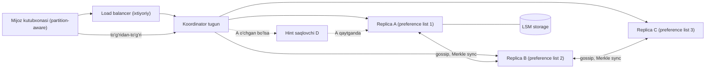
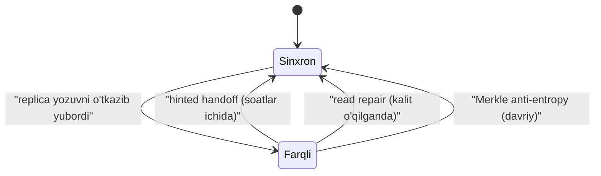

## Bu dars nima uchun kerak

Amazon ning 2007 yildagi Dynamo maqolasi distributed systems tarixidagi eng ta'sirli maqolalardan biri: Cassandra, Riak, Voldemort va boshqa ko'plab leaderless bazalar uning g'oyalariga qurilgan. Bu masala 3-4 modullardagi deyarli barcha nazariyani bitta tizimda birlashtiradi: consistent hashing va virtual node (29-dars), leaderless replication va quorum (27-dars), vector clock (32-dars), CAP va PACELC (34-dars), CRDT va konflikt hal qilish (40-dars), gossip va nosozlik aniqlash (31-dars), LSM-tree (13-dars).

Bu dars - o'zingiz "Dynamo uslubidagi" KV store ni 8 qadam bo'yicha loyihalash. Har bir qarorda Dynamo maqolasi nima qilganini va DynamoDB (2012 yildan boshqariladigan servis) nimani o'zgartirganini solishtiramiz - bu "bir xil masala, boshqa talab" saboqini yana bir bor ko'rsatadi.

Bu darsdan keyin siz:

- har doim yozishga ruxsat beradigan (always-writeable) KV store ni boshidan oxirigacha loyihalay olasiz;
- N, R, W parametrlarini talabga qarab tanlay olasiz va ularning latency va consistency ga ta'sirini hisoblay olasiz;
- sloppy quorum, hinted handoff, read repair va Merkle tree anti-entropy qanday birgalikda ishlashini tushuntira olasiz;
- vector clock va last-write-wins (LWW) orasidagi trade-off ni bilasiz;
- nega DynamoDB Dynamo arxitekturasidan voz kechib, partition bo'yicha Multi-Paxos ga o'tganini tushuntira olasiz.

## 1-qadam: talablar

Dynamo maqolasidagi motivatsiya: Amazon savat (shopping cart) servisi hech qachon yozishni rad etmasligi kerak - mijoz mahsulot qo'shganda xato ko'rsa, savdo yo'qoladi. Shu talabdan hamma narsa kelib chiqadi.

**Funksional talablar:**

- FR-1: `put(key, context, value)` - qiymatni yozish. Value - noaniq bayt massivi (1 MB gacha).
- FR-2: `get(key)` - bitta yoki bir nechta konfliktli versiya va kontekst qaytaradi.
- FR-3: kalit faqat birlamchi kalit bo'yicha kirish. Range scan, ikkilamchi indeks, tranzaksiya yo'q.

**Ko'lamdan tashqari:** ko'p kalitli tranzaksiyalar, SQL, ikkilamchi indekslar, xavfsizlik (ichki ishonchli muhit deb faraz qilingan - Dynamo maqolasidagi kabi).

**Nofunksional talablar:**

- NFR-1: **always writeable** - tugunlar yoki tarmoq qismi ishdan chiqqanda ham yozish qabul qilinadi.
- NFR-2: o'qish va yozish **p99.9** latency 300 ms dan kam (Dynamo maqolasidagi tipik SLA aynan 99.9-percentile da o'lchanadi).
- NFR-3: gorizontal kengayish - tugun qo'shish yuklamani avtomatik qayta taqsimlaydi, qo'lda sharding yo'q.
- NFR-4: markaziy tugun yo'q (simmetriya) - har bir tugun bir xil vazifani bajaradi.
- NFR-5: tasdiqlangan yozuv yo'qolmaydi (durability), hatto bitta data-markaz yo'qolsa ham.
- NFR-6: eventual consistency qabul qilinadi; konfliktlarni ilova hal qiladi.

NFR-1 va NFR-6 - eng muhim qaror: CAP nuqtai nazaridan partition paytida **availability** tanlanadi (34-dars). PACELC bo'yicha esa normal holatda ham latency consistency dan ustun (PA/EL).

## 2-qadam: hisob-kitob

Taxmin: biz bitta katta ichki platforma uchun KV store quramiz.

- Kalitlar: 10 milliard, o'rtacha qiymat 2 KB, kalit 50 B.
- Yuklama: 500 000 o'qish/s va 200 000 yozish/s cho'qqida.
- N = 3 replica.

**Hajm:** 10 × 10^9 × 2 KB = 20 TB mantiqiy. ×3 replica = **60 TB**. LSM storage da space amplification ~1.2-1.5 (13-14 darslar) - ~80-90 TB disk.

**Tugunlar soni:** bitta tugun deylik 2 TB foydali NVMe va ~20 000 yozish/s + 40 000 o'qish/s (replica operatsiyalarini hisobga olgan holda) ko'taradi.

- Disk bo'yicha: 90 TB / 2 TB ≈ 45 tugun.
- Yozish bo'yicha: har bir mijoz yozuvi N = 3 replica yozuviga aylanadi: 200 000 × 3 = 600 000 replica-yozuv/s / 20 000 ≈ 30 tugun.
- O'qish bo'yicha: R = 2 bo'lsa 500 000 × 2 = 1 000 000 replica-o'qish/s / 40 000 ≈ 25 tugun.

Disk cheklovchi omil: **~50 tugun** (zaxira bilan 60). Bu muhim xulosa: replica soni va space amplification tugun sonini yuklamadan ko'ra ko'proq belgilaydi.

**Tarmoq:** 200 000 yozish × 2 KB × 3 = 1.2 GB/s tugunlar orasida, ya'ni ~10 Gbit/s - 60 tugunga taqsimlansa har biriga ~200 Mbit/s. Muammo emas.

**Merkle daraxt metadata:** har tugunda masalan 256 ta virtual node diapazoni, har biriga 2^15 bargli daraxt × 32 B hash ≈ 1 MB - jami ~256 MB xotira. Qabul qilinadi.

## 3-qadam: API

Dynamo maqolasidagi interfeys juda kichik va bu ataylab:

```
get(key) -> ( [value1, value2, ...], context )
put(key, context, value) -> ok
delete(key, context) -> ok      // tombstone yoziladi
```

- **context** - mijoz uchun shaffof bo'lmagan (opaque) obyekt, ichida vector clock bor. Mijoz `get` dan olgan kontekstni `put` ga qaytarib beradi - shu orqali tizim yangi yozuv qaysi versiyalarni almashtirishini biladi.
- Agar `get` bir nechta versiya qaytarsa, ilova ularni birlashtiradi (savat uchun - to'plamlar birlashmasi) va birlashtirilgan qiymatni bitta `put` bilan yozadi. Bu kontekst ikkala versiyani ham qamraydi, shuning uchun ular yopiladi.
- Mijoz har so'rov uchun R va W ni o'zgartira olishi mumkin (Cassandra dagi consistency level kabi), lekin N jadval darajasida.

## 4-qadam: ma'lumot modeli va saqlash

Mantiqiy model: `key (bytes) -> set of (value, vector_clock)`. Fizik saqlash har tugunda alohida, almashtiriladigan **storage engine**: Dynamo maqolasida Berkeley DB, MySQL va xotiradagi bufer variantlari ko'rilgan. Bugun tabiiy tanlov - LSM-tree (RocksDB): yozish og'ir yuklama uchun sequential yozish, Bloom filter bilan nuqtali o'qish (13-dars).

Har bir tugunda saqlanadigan qo'shimcha holat:

- **Hinted handoff navbati:** boshqa tugun uchun vaqtincha qabul qilingan yozuvlar va ularning "egasi".
- **Merkle daraxtlari:** har bir egalik qilinadigan kalit diapazoni uchun.
- **Membership va token xaritasi:** gossip orqali tarqatiladigan halqa holati.
- **Tombstone lar:** o'chirilgan kalitlar, gc_grace muddatigacha (aks holda o'chirilgan qiymat eski replica dan "tiriladi").

## 5-qadam: yuqori darajadagi arxitektura



Har bir tugun bir xil dastur: so'rov qabul qilish (koordinator), replica sifatida saqlash, gossip, anti-entropy. **Koordinator** - kalitning preference list idagi birinchi sog'lom tugun. Mijoz ikki yo'l bilan murojaat qila oladi: load balancer orqali tasodifiy tugunga (u kerak bo'lsa yo'naltiradi - qo'shimcha hop) yoki **partition-aware** kutubxona orqali to'g'ridan-to'g'ri koordinatorga. Dynamo maqolasi ikkinchisi latency ni sezilarli kamaytirganini qayd etadi.

**Yozish oqimi (W = 2, N = 3):**

1. Koordinator kalitni hash qiladi va halqada preference list ni topadi.
2. Yangi vector clock yaratadi (o'z hisoblagichini oshiradi), lokal yozadi.
3. Qolgan N-1 replica ga parallel yuboradi.
4. W - 1 ta javob kelgach (o'zi bilan W), mijozga OK.

**O'qish oqimi (R = 2):** koordinator N ta replica dan so'raydi, R ta javobni kutadi, vector clock lar bo'yicha bir-birini qamraydigan versiyalarni olib tashlaydi, qolgan konfliktli versiyalarni mijozga qaytaradi. Eskirgan replica larga keyin yangi versiyani yozadi (**read repair**).

## 6-qadam: chuqur tahlil

Uchta eng murakkab qism: (1) partitioning va membership, (2) quorum va nosozlikka chidamlilik, (3) versiyalash va konflikt hal qilish.

### 6.1. Partitioning: consistent hashing va virtual node

29-darsdan: kalit hash qilinadi (Dynamo da MD5, 128 bit) va halqadagi pozitsiyaga tushadi; soat yo'nalishi bo'yicha birinchi N ta **turli fizik** tugun - preference list.

Dynamo maqolasi uchta strategiyani solishtiradi:

1. Har tugun T ta tasodifiy token oladi va diapazon tokenlar bilan belgilanadi.
2. Tasodifiy tokenlar, lekin halqa teng bo'laklarga bo'lingan.
3. **Halqa Q ta teng bo'lakka bo'linadi va har tugunga Q/S ta bo'lak beriladi** (S - tugunlar soni).

Maqola 3-strategiya eng yaxshi yuklama muvozanatini berganini, membership metadata sini 1-strategiyaga nisbatan taxminan uch tartibga kamaytirganini va arxivlash hamda yangi tugunni ishga tushirishni soddalashtirganini ko'rsatadi. Sabab: bo'laklar chegarasi o'zgarmaydi - tugun qo'shilganda butun bo'laklar fayl sifatida ko'chiriladi, kalitlarni qayta skanerlash kerak emas.

Bizning dizayn: Q = 4096 bo'lak, 60 tugun - har biriga ~68 bo'lak. Yangi tugun qo'shilganda u har bir mavjud tugundan ~1 bo'lak oladi - yuklama barcha tugunlardan teng olinadi.

**Membership:** Dynamo da tugunlar qo'shilishi va chiqishi **aniq administrator amali** bilan bo'ladi (vaqtinchalik uzilish a'zolikni o'zgartirmaydi). Halqa holati **gossip** orqali tarqaladi: har tugun taxminan har soniyada tasodifiy qo'shni bilan holat almashadi. Mantiqiy bo'linishning oldini olish uchun **seed tugunlar** - hamma biladigan bir nechta tugun.

Nega aniq amal? Agar har qanday 10 soniyalik uzilish halqani qayta taqsimlasa, tarmoq tebranishi ma'lumotning massiv ko'chishiga olib keladi. Vaqtinchalik nosozlik hinted handoff bilan, doimiy esa operator qarori bilan hal qilinadi.

### 6.2. Quorum, sloppy quorum va hinted handoff

27-darsdan: **R + W > N** bo'lsa, o'qish va yozish to'plamlari kesishadi, ya'ni o'qish kamida bitta eng yangi yozuvni ko'radi. Dynamo dagi keng tarqalgan konfiguratsiya **(N, R, W) = (3, 2, 2)**.

| Konfiguratsiya | O'qish latency | Yozish latency | Consistency | Nosozlikka chidamlilik |
|---|---|---|---|---|
| N=3, R=1, W=3 | Eng tez | Eng sekin (eng sekin replica ni kutadi) | R+W>N | Bitta tugun o'chsa yozish to'xtaydi (sloppy siz) |
| N=3, R=2, W=2 | O'rta | O'rta | R+W>N | 1 tugun nosozligiga chidaydi |
| N=3, R=3, W=1 | Eng sekin | Eng tez | R+W>N | O'qish 1 nosozlikda to'xtaydi |
| N=3, R=1, W=1 | Tez | Tez | Kafolat yo'q | Eng yuqori |

**Latency nuqtai nazari (3-dars, tail latency):** W = 2 da koordinator 3 ta replica dan eng tez 2 tasini kutadi. Agar bitta replica GC pauzasida bo'lsa, u kutilmaydi. Ya'ni N > W bo'lishi tail latency ni yashiradi. W = N bo'lsa, eng sekin replica latency ni belgilaydi.

**Sloppy quorum:** qat'iy quorum da preference list dagi 3 tugundan 2 tasi o'chsa, W = 2 bajarilmaydi va yozish rad etiladi - NFR-1 buziladi. Dynamo esa halqada keyingi **sog'lom** tugunlarni oladi: A o'chgan bo'lsa, yozuv D ga "bu aslida A niki" degan **hint** bilan yoziladi. D hintni alohida saqlaydi va A qaytganini gossip orqali bilganda unga yetkazadi, keyin o'chiradi - **hinted handoff**.

Narxi: sloppy quorum da R + W > N kafolati endi ishlamaydi - yozuv D va B ga, o'qish esa A va C dan bo'lishi mumkin, ular kesishmaydi. Ya'ni sloppy quorum - durability va availability uchun, consistency uchun emas. Cassandra da hint lar standart bo'yicha replica 3 soatdan ko'p o'chiq bo'lsa saqlanmaydi (`max_hint_window`); undan keyin faqat read repair va to'liq anti-entropy repair qoladi.

**Anti-entropy: Merkle tree.** Hint yo'qolishi mumkin (hint saqlovchi tugun o'zi o'chsa). Doimiy farqlarni topish uchun replica lar har bir kalit diapazoni bo'yicha Merkle daraxtlarini solishtiradi: ildiz hashlari teng bo'lsa - sinxronlash kerak emas; teng bo'lmasa, daraxt bo'ylab pastga tushib faqat farqli barglar (kalitlar to'plami) ko'chiriladi. Bu 1 milliard kalitli diapazonni solishtirishni hamma kalitni yuborish o'rniga bir necha KB hash almashuviga aylantiradi.

Uchta mexanizm birgalikda:



### 6.3. Versiyalash: vector clock va konfliktlar

32-darsdan: vector clock - `(tugun, hisoblagich)` juftlari ro'yxati. Agar A versiyasining barcha hisoblagichlari B nikidan kichik yoki teng bo'lsa, A - B ning ajdodi va tashlanishi mumkin. Aks holda versiyalar **parallel** va ikkalasi saqlanadi.

Misol:

1. Sx tugun birinchi yozuvni qiladi: D1 `[(Sx,1)]`.
2. Sx yana yangilaydi: D2 `[(Sx,2)]` - D1 ni qamraydi.
3. Ikki mijoz D2 ni o'qib, parallel yozadi: biri Sy orqali D3 `[(Sx,2),(Sy,1)]`, ikkinchisi Sz orqali D4 `[(Sx,2),(Sz,1)]`.
4. D3 va D4 parallel - hech biri ikkinchisini qamramaydi. Keyingi `get` ikkalasini qaytaradi.
5. Mijoz birlashtirib Sx orqali yozadi: D5 `[(Sx,3),(Sy,1),(Sz,1)]` - ikkalasini ham qamraydi.

**Vector clock o'sishi:** ko'p tugun yozgan kalitlarda ro'yxat uzayadi. Dynamo har juftga vaqt belgisi qo'shadi va juftlar soni chegaradan oshsa (maqolada 10), eng eskisini o'chiradi. Bu qamrash munosabatini noto'g'ri aniqlashga olib kelishi mumkin, lekin amalda muammo bo'lmagan.

**Amaliy statistika:** maqolaga ko'ra, 24 soatlik kuzatuvda savat so'rovlarining 99.94% i aynan bitta versiyani ko'rgan - konfliktlar kam, lekin nol emas.

**Savat anomaliyasi:** birlashtirish "qo'shilgan narsalarni saqlaydi", lekin o'chirilgan narsalar qayta paydo bo'lishi mumkin - agar bir versiyada o'chirilgan, boshqasida esa hali bor bo'lsa, birlashma uni qaytaradi. Bu oddiy to'plam birlashmasi muammosi; to'g'ri yechim - OR-Set CRDT (40-dars), u qo'shish va o'chirishni teglar bilan kuzatadi.

**Alternativa: LWW (last-write-wins).** Cassandra har bir ustunga vaqt belgisi qo'yadi va kattasi yutadi. Afzalligi: oddiy, mijoz konflikt ko'rmaydi. Kamchiligi: soatlar farqi (32-dars) tufayli parallel yozuvlardan biri **jim yo'qoladi**.

| | Vector clock + ilova birlashtiradi | LWW (timestamp) | CRDT |
|---|---|---|---|
| Ma'lumot yo'qolishi | Yo'q | Parallel yozuvlarda bor | Yo'q |
| Mijoz murakkabligi | Yuqori - merge yozish kerak | Past | O'rta - tayyor tiplar |
| Metadata | Vector clock har kalitda | 8 B timestamp | Tipga bog'liq, ba'zan katta |
| Qachon mos | Savat, biznes mantiqli birlashma | Keshlar, oxirgi holat (sensor) | Hisoblagich, to'plam, matn |

## 7-qadam: nosozlik stsenariylari

| Stsenariy | Nima bo'ladi | Mexanizm |
|---|---|---|
| 1 tugun vaqtincha o'chdi | Yozuvlar keyingi tugunga hint bilan | Sloppy quorum + hinted handoff |
| Tugun disk bilan butunlay yo'qoldi | Operator uni halqadan chiqaradi, bo'laklar boshqalarga ko'chadi | Aniq membership + bo'lak ko'chirish |
| Hint saqlovchi ham o'chdi | Hint yo'qoladi, replica farqli qoladi | Merkle anti-entropy |
| Tarmoq bo'linishi (data-markazlar orasida) | Ikki tomon ham yozishni qabul qiladi | Parallel versiyalar, keyin birlashtirish |
| Sekin tugun (GC, disk) | Koordinator uni kutmaydi (W < N) | Quorum + eng tez javoblar |
| Koordinator yozuv o'rtasida o'ldi | Mijoz timeout oladi, yozuv qisman qo'llangan | Mijoz qayta yuboradi; vector clock tufayli takror zararsiz |
| O'chirilgan kalit "tirildi" | Tombstone gc dan oldin eski replica ga yetmagan | gc_grace > repair davri sharti |

**Data-markaz nosozligi:** Dynamo preference list ni bir nechta data-markazga tarqatadi. NFR-5 uchun N = 3 replica 3 ta availability zone ga joylashtirilishi kerak (rack/zone aware placement). Aks holda bitta zone yo'qolishi bilan uchala replica ham yo'qolishi mumkin.

## 8-qadam: evolyutsiya (10x)

10x: 100 milliard kalit, 5M o'qish/s, 2M yozish/s, ~600 tugun.

1. **Gossip va to'liq membership** - har tugun butun halqa holatini biladi; 600 tugunda gossip konvergensiyasi sekinlashadi. Yechim: membership ni alohida konsensus-asosli konfiguratsiya servisiga (etcd/ZooKeeper, 36, 38-darslar) ko'chirish, gossip faqat sog'liq signallari uchun.
2. **Repair narxi** - Merkle daraxtlarini qurish disk o'qishini talab qiladi va 600 tugunda doimiy fon yuklamasiga aylanadi. Inkremental repair (faqat oxirgi repairdan keyingi ma'lumot).
3. **Hot partition** - bitta mashhur kalit bitta preference list ga tushadi. Yechim: kalitni ilova darajasida bo'laklash (`key#0..key#9`) yoki oldiga cache (24-dars).
4. **Operatsion murakkablik** - eventual consistency ni har bir ilova jamoasi to'g'ri tushunishi qiyin. Bu aynan DynamoDB ning tanlovi sababi (pastda).

## Real tizimlardan misollar

**Dynamo (2007)** - yuqoridagi barcha mexanizmlar maqoladan. Qo'shimcha: maqola savat kabi "har doim yozish" talabini birinchi o'ringa qo'yib, consistency ni ataylab ilovaga topshiradi.

**Cassandra** - Dynamo ning partitioning va replication g'oyalarini Bigtable uslubidagi ma'lumot modeli (wide-column, LSM) bilan birlashtirgan. Konflikt hal qilish - LWW ustun darajasida. Uchta eventual consistency mexanizmi: hint lar (standart 3 soatlik oyna), read repair va anti-entropy repair; hujjatlar hint lar "eng yaxshi harakat" ekanini va to'liq repair o'rnini bosmasligini ta'kidlaydi.

**DynamoDB (2012 dan)** - nomi o'xshash, lekin arxitekturasi boshqa. USENIX ATC 2022 maqolasiga ko'ra: har bir partition ning replica lari **Multi-Paxos** bilan leader tanlaydi; yozuvlar va strongly consistent o'qishlar leader orqali, eventually consistent o'qishlar istalgan replica dan. Ya'ni leaderless emas, **partition bo'yicha single-leader + consensus**. Sabab - boshqariladigan servis mijozlari uchun bashorat qilinadigan xatti-harakat va kuchli consistency imkoniyati. 2021 Prime Day da DynamoDB cho'qqida sekundiga 89.2 million so'rovni bir xonali millisekund latency bilan bajargan. Bu darsning asosiy saboqlaridan biri: Dynamo g'oyalari (consistent hashing, replication) qoldi, lekin "konfliktni mijoz hal qilsin" g'oyasi keng auditoriya uchun juda qimmat bo'lib chiqdi.

## iQuariX kontekstida

Faraz qiling, iQuariX da "har bir qurilmaning oxirgi holati" (oxirgi koordinata, zajiganie, yoqilg'i sathi, oxirgi aloqa vaqti) uchun KV store kerak: 100 000 kalit, har biri har 10 soniyada yangilanadi (10 000 yozish/s), dispetcher UI dan 2 000 o'qish/s.

- **Qiymat semantikasi:** oxirgi holat - tabiiy LWW, chunki yangi nuqta eskisini to'liq almashtiradi. Lekin timestamp **serverniki emas, qurilma GPS vaqti** bo'lishi kerak: oflayn qurilma keyin eski nuqtalarni yuborsa (black box), ular yangi holatni bosib ketmasligi kerak. Shartli yozish: `if incoming.gps_time > stored.gps_time`.
- **Hajm:** 100 000 × 500 B = 50 MB - bu Dynamo uslubidagi 60 tugunli cluster emas, bitta Redis (replica bilan) masalasi. Dynamo ni loyihalashni bilish uni **qachon kerak emasligini** bilishni ham o'z ichiga oladi.
- **Qachon Dynamo uslubi kerak bo'ladi:** agar iQuariX bir necha mamlakatda regionlar bo'yicha ishlab, har bir region mustaqil yozishi kerak bo'lsa (multi-region active-active, 77-dars) - bunda LWW + GPS vaqti bilan Cassandra yoki DynamoDB global tables tabiiy variant.

## Ko'p uchraydigan xatolar

1. **Sloppy quorum ni strong consistency deb o'ylash.** R + W > N sloppy rejimda kesishishni kafolatlamaydi.
2. **LWW ni server soati bilan ishlatish.** Soatlar farqi parallel yozuvlarni jim yo'qotadi.
3. **Tombstone gc muddatini repair davridan qisqa qo'yish.** O'chirilgan ma'lumot "tiriladi".
4. **Replica larni bitta zone/rack ga joylashtirish.** N = 3 qog'ozda, amalda 1.
5. **Har vaqtincha uzilishda halqani qayta taqsimlash.** Tarmoq tebranishi massiv ma'lumot ko'chishiga aylanadi.
6. **Konflikt birlashtirishni oddiy union bilan qilish.** O'chirilgan elementlar qaytadi; OR-Set kerak.
7. **Kichik masala uchun Dynamo qurish.** 50 MB ma'lumot uchun 60 tugunli leaderless cluster - operatsion yuk.

## Xulosa

- Dynamo ning markaziy qarori - "har doim yozish": partition paytida availability, consistency esa ilovaga.
- Consistent hashing + teng bo'laklar (3-strategiya) yuklama muvozanati va oddiy rebalancing beradi.
- (N, R, W) = (3, 2, 2) - tipik; N > W tail latency ni yashiradi.
- Sloppy quorum + hinted handoff yozish mavjudligini, read repair va Merkle anti-entropy esa yakuniy sinxronlikni ta'minlaydi.
- Vector clock parallel versiyalarni aniqlaydi; LWW sodda, lekin ma'lumot yo'qotadi; CRDT o'rtadagi yo'l.
- DynamoDB keyinchalik partition bo'yicha Multi-Paxos va leader ga o'tdi - bashorat qilinadigan consistency ko'pchilik mijoz uchun qimmatroq.

## Amaliy topshiriq

iQuariX uchun **multi-region "qurilma konfiguratsiyasi" store** ni loyihalang (faraziy): har bir qurilmaning sozlamalari (yuborish intervali, geofence ro'yxati, datchik kalibrovkasi). Ikki region (Toshkent va Olmaota) mustaqil ishlashi va bir-biridan uzilganda ham yozishni qabul qilishi kerak.

1. **Talablar.** Qaysi operatsiyalar ikkala regionda yozilishi mumkin? Konflikt bo'lsa, biznes nuqtai nazaridan qaysi natija to'g'ri?
2. **Hisob-kitob.** 200 000 qurilma, har biri o'rtacha 5 KB konfiguratsiya, kuniga 2% o'zgaradi. Hajm, yozish/s, regionlararo trafik.
3. **N, R, W tanlovi.** Har bir region ichida va regionlararo. Lokal latency va consistency ga ta'sirini yozing.
4. **Konflikt strategiyasi.** Butun hujjat LWW, maydon bo'yicha LWW, vector clock yoki CRDT? Geofence ro'yxati (to'plam) uchun alohida o'ylang.
5. **Nosozliklar.** Regionlar 6 soat uzilsa nima bo'ladi? Hint oynasi yetadimi? Qanday qayta sinxronlanadi?
6. **Alternativa.** Bitta "asosiy" region + boshqasida read-only replica (single-leader) bilan solishtiring. Qaysi biri iQuariX uchun to'g'riroq va nega?

Yaxshi javobda bo'lishi kerak bo'lgan narsalar:

- geofence to'plami uchun oddiy union ning o'chirish muammosi aniqlangan va OR-Set yoki shunga o'xshash yechim taklif qilingan;
- LWW ishlatilsa, timestamp manbai va soat farqi muammosi muhokama qilingan;
- hint oynasidan uzun uzilish uchun anti-entropy rejasi;
- hajm kichik ekani va single-leader variant jiddiy ko'rib chiqilgani;
- R + W > N ning sloppy rejimdagi cheklovi tilga olingan.

Javobni pastdagi maydonga yozib, chatga yuboring.

## Manbalar

- G. DeCandia va boshq. [Dynamo: Amazon's Highly Available Key-value Store](https://www.allthingsdistributed.com/files/amazon-dynamo-sosp2007.pdf), SOSP 2007 - 4-bo'lim (partitioning, replication, versioning, sloppy quorum, Merkle trees, membership), 6-bo'lim (partitioning strategiyalari, versiyalar statistikasi).
- M. Elhemali va boshq. [Amazon DynamoDB: A Scalable, Predictably Performant, and Fully Managed NoSQL Database Service](https://www.usenix.org/conference/atc22/presentation/vig), USENIX ATC 2022 - Multi-Paxos replication, Prime Day raqamlari.
- Marc Brooker. [DynamoDB paper sharhi](https://brooker.co.za/blog/2022/07/12/dynamodb.html), 2022 - Dynamo va DynamoDB farqi.
- Apache Cassandra. [Hints hujjati](https://cassandra.apache.org/doc/4.0/cassandra/operating/hints.html) - hint oynasi, read repair va anti-entropy repair bilan bog'liqlik.
- Martin Kleppmann, Chris Riccomini. [Designing Data-Intensive Applications, 2-nashr](https://www.oreilly.com/library/view/designing-data-intensive/9781098119058/), O'Reilly, 2026 - leaderless replication va quorum bo'limlari.
- Alex Xu. System Design Interview, 1-jild, "Design a Key-value Store" bobi. [Kitob sharhi](https://blog.pragmaticengineer.com/system-design-interview-an-insiders-guide-review/).
