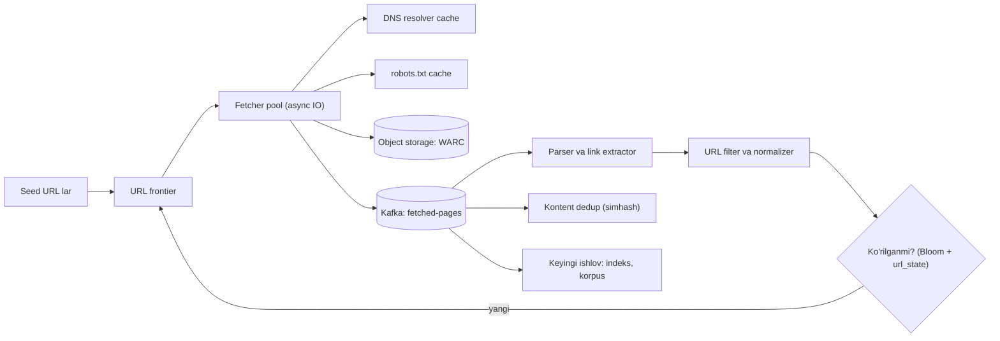
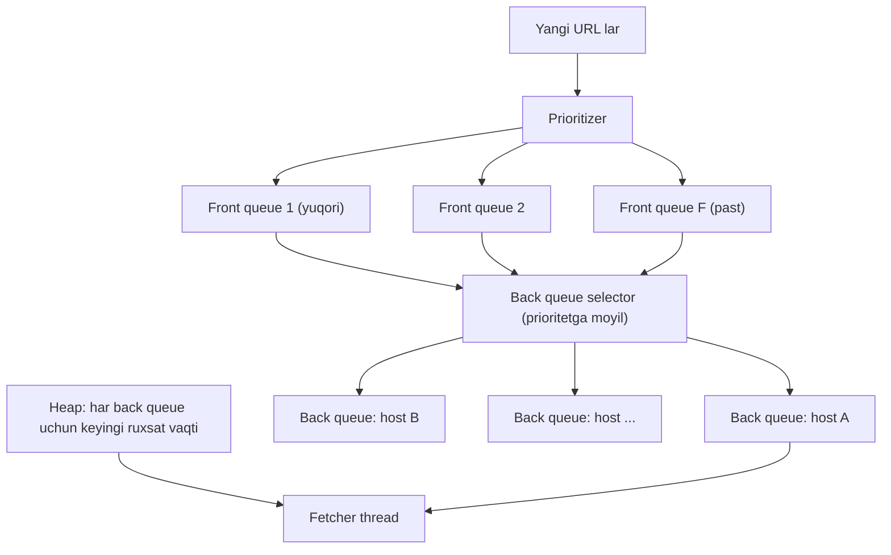

## Bu dars nima uchun kerak

Web crawler - "ko'p ishni ko'p mashinada, tashqi dunyoga hurmat bilan bajarish" masalasi. Boshqa case study lardan farqi: bu yerda yuklama foydalanuvchilardan emas, **biz o'zimiz yaratamiz** va asosiy cheklov - bizning resurslarimiz emas, **boshqa saytlarning chidamliligi** (politeness). Shu bilan birga u katta hajmdagi deduplikatsiya (Bloom filter, simhash), prioritetli navbatlar, DNS keshlash, ishonchsiz tashqi tizimlar bilan ishlash (timeout, tuzoqlar) va batch/stream ishlov berish chegarasini bir joyda ko'rsatadi.

Darsda Mercator (1999) va Stanford "Introduction to Information Retrieval" kitobidagi klassik URL frontier dizayni, RFC 9309 (robots.txt standarti) va Common Crawl ning real raqamlari asosida ishlaymiz.

Bu darsdan keyin siz:

- URL frontier ning ikki qatlamli tuzilmasini (prioritet va politeness navbatlari) loyihalay olasiz;
- milliard sahifalik crawl uchun throughput, saqlash va tarmoqni hisoblay olasiz;
- URL va kontent deduplikatsiyasini (Bloom filter, checksum, simhash) tanlay olasiz;
- robots.txt qoidalarini (kesh muddati, xato kodlari) to'g'ri qo'llay olasiz;
- crawler tuzoqlari va ishonchsiz serverlarga qarshi himoyani loyihalay olasiz.

## 1-qadam: talablar

Masala: umumiy maqsadli crawler - qidiruv indeksi yoki LLM training korpusi uchun ochiq vebni yig'ish.

**Funksional talablar:**

- FR-1: boshlang'ich URL lar (seed) dan boshlab, sahifalarni yuklab, ulardagi havolalarni chiqarib, yangi URL larni navbatga qo'shish.
- FR-2: yuklangan HTML ni (va metadata: status, header lar, vaqt) keyingi ishlov berish uchun saqlash.
- FR-3: sahifalarni o'zgarish chastotasiga qarab qayta crawl qilish (recrawl).
- FR-4: robots.txt qoidalariga rioya qilish.

**Ko'lamdan tashqari:** JavaScript render qilish (headless brauzer), rasm va video yuklash, indekslash va ranking (59-dars), login talab qiladigan sahifalar.

**Nofunksional talablar:**

- NFR-1: oyiga 1 milliard sahifa (bitta to'liq crawl sikli).
- NFR-2: **politeness** - bitta host ga bir vaqtda bittadan ortiq ulanish emas va so'rovlar orasida pauza; robots.txt majburiy.
- NFR-3: crawler bitta mashina o'lsa, ishni yo'qotmasdan davom etadi; takroriy yuklash 1% dan kam.
- NFR-4: bir xil yoki deyarli bir xil kontentni qayta saqlamaslik.
- NFR-5: tuzoqlarga (cheksiz URL generatsiyasi) tushmaslik.
- NFR-6: muhim (yuqori prioritetli) sahifalar birinchi navbatda yuklanadi.

## 2-qadam: hisob-kitob

**Throughput:** 1 milliard / oy = 10^9 / (30 × 86 400) ≈ 10^9 / 2.6 × 10^6 ≈ **385 sahifa/s** o'rtacha. Xavfsizlik zaxirasi ×2 - **~800 sahifa/s** maqsad.

**Hajm:** o'rtacha HTML sahifa deylik 100 KB (siqilmagan). 10^9 × 100 KB = **100 TB/oy** xom HTML. gzip yoki zstd bilan HTML odatda 4-6 marta siqiladi - ~20 TB/oy. 5 yillik arxiv ≈ 1.2 PB siqilgan - object storage (60-dars).

Solishtirish uchun real raqam: Common Crawl ning 2026 yil avgust arxivi 2.14 milliard sahifa, 360 TiB siqilmagan kontent, 40.2 million host va 33.1 million ro'yxatdan o'tgan domenni o'z ichiga oladi. Bu ~170 KB/sahifa beradi (header va metadata bilan) - bizning 100 KB taxminimiz pastroq, lekin bir tartibda.

**Tarmoq:** 800 sahifa/s × 100 KB = 80 MB/s ≈ **640 Mbit/s**. 1-2 Gbit/s kanal yetadi.

**Parallellik (Little qonuni, 3-dars):** bitta yuklash o'rtacha 1 soniya (DNS, TCP/TLS handshake, sekin serverlar). L = λ × W = 800 × 1 = **800 ta bir vaqtdagi ulanish**. Asinxron IO bilan (epoll, Node.js yoki Go) bitta mashina bir necha ming ulanishni ko'taradi, demak tarmoq bo'yicha 2-4 mashina yetadi. Cheklovchi omil - HTML parse qilish CPU si va politeness.

**Politeness cheklovi:** bitta host ga har 1-2 soniyada bitta so'rov bo'lsa, 800 sahifa/s uchun bir vaqtda kamida **800-1 600 ta turli host** faol bo'lishi kerak. Ya'ni frontier hostlar bo'yicha keng bo'lishi shart - bu dizaynning asosiy shakllantiruvchi raqami.

**URL frontier hajmi:** har sahifada o'rtacha deylik 50 ta havola, ularning ko'pi takror. Agar noyob yangi URL lar sahifaga ~5 ta bo'lsa, oyiga 5 milliard yangi URL. URL o'rtacha 80 B: 400 GB - bu xotiraga sig'maydi, frontier diskda bo'lishi kerak.

**Ko'rilgan URL lar to'plami (dedup):** 10 milliard URL. To'liq URL saqlash: 800 GB. 8 baytlik hash (fingerprint): 80 GB. Bloom filter 1% false positive bilan: ~9.6 bit/element × 10^10 ≈ **12 GB** - bitta mashina xotirasiga sig'adi (13-dars).

## 3-qadam: API va interfeyslar

Crawler tashqi API emas, ichki pipeline. Uning interfeyslari - komponentlar orasidagi kontraktlar:

```
Frontier:
  enqueue(url, priority, discovered_from)       // idempotent: ko'rilgan bo'lsa e'tiborsiz
  lease(worker_id, max=100) -> [ (url, host, lease_id) ]   // politeness ga mos URL lar
  complete(lease_id, result: ok|retry|gone, next_crawl_at?)

Fetcher natijasi (Kafka topic: fetched-pages):
  { url, final_url, status, headers, body_ref (S3 key), fetched_at, content_hash, simhash }

Boshqaruv API:
  POST /seeds           -- yangi seed lar
  PUT  /hosts/{host}/policy  { maxQps, blocked }   -- qo'lda cheklov yoki bloklash
  GET  /stats           -- sahifa/s, xato darajasi, frontier hajmi
```

`lease` modeli (SQS dagi visibility timeout kabi, 42-dars) muhim: worker URL ni oladi, lekin uni ma'lum vaqt ichida `complete` qilmasa, URL qaytib frontier ga tushadi. Bu NFR-3 ni ta'minlaydi.

## 4-qadam: ma'lumot modeli

```
url_state (KV, URL fingerprint bo'yicha shard)
  url_fp        uint64  PK
  url           string
  host          string
  last_fetch    timestamp
  last_status   int
  content_hash  bytes
  change_rate   float     -- recrawl prioriteti uchun
  next_fetch    timestamp

host_state (KV, host bo'yicha)
  host, robots_txt, robots_fetched_at, crawl_delay, last_access, error_count, ip

pages (object storage, WARC fayllar)
  s3://crawl/2026-10/part-00042.warc.gz   -- ko'p sahifa bitta katta faylda

content_fingerprints (simhash indeksi)
  simhash 64 bit -> url_fp
```

- **WARC formati** (Web ARChive) - bir nechta HTTP javobini metadata bilan bitta faylga yig'ish standarti. Har sahifani alohida obyekt qilib saqlash 10^9 kichik obyekt va katta so'rov narxi degani; ~1 GB lik WARC fayllar esa object storage uchun ideal (60-dars).
- **Shard kaliti:** `url_state` URL fingerprint bo'yicha, lekin frontier **host bo'yicha** guruhlanadi - chunki politeness host darajasida.

## 5-qadam: yuqori darajadagi arxitektura



Oqim: frontier politeness ga mos URL beradi → fetcher DNS va robots.txt keshini tekshiradi → yuklaydi → xom javobni WARC ga, metadata ni Kafka ga yozadi → parser havolalarni chiqaradi → filter normalizatsiya qiladi va tuzoqlarni kesadi → ko'rilmagan URL lar frontier ga qaytadi.

Fetcher va parser ataylab ajratilgan: fetcher IO-bound (minglab ochiq ulanish, kam CPU), parser CPU-bound. Ularni bitta jarayonda ushlash bir-birini bloklashiga olib keladi. Kafka ular orasida bufer va backpressure vazifasini bajaradi (50-dars).

## 6-qadam: chuqur tahlil

Eng murakkab uchta qism: (1) URL frontier - politeness va prioritet, (2) deduplikatsiya, (3) robots.txt va tuzoqlar.

### 6.1. URL frontier: ikki qatlamli navbat

Mercator crawler i taklif qilgan va Stanford IR kitobining 20-bobida tasvirlangan klassik dizayn:



**Front queue lar (prioritet):** F ta FIFO navbat. Prioritizer har URL ga 1..F prioritet beradi (sahifaning muhimligi, o'zgarish chastotasi, PageRank kabi signal). Back queue to'ldirilganda tanlov yuqori prioritetli navbatlarga moyil - muhim URL lar tezroq o'tadi (NFR-6).

**Back queue lar (politeness):** B ta FIFO navbat, **har biri faqat bitta host** ning URL larini saqlaydi. `host -> back queue` jadvali bor. Back queue bo'shasa, front queue lardan URL olinadi; agar uning host i uchun allaqachon back queue bo'lsa, URL o'shanga qo'shiladi va keyingisi olinadi - shu yo'l bilan bo'sh navbat yangi host bilan to'ldiriladi.

**Heap:** har back queue uchun bitta element - bu host ga keyingi murojaat mumkin bo'lgan eng erta vaqt `t_e`. Fetcher heap ildizini oladi, kerak bo'lsa `t_e` gacha kutadi, URL ni yuklaydi, keyin yangi `t_e` bilan qaytarib qo'yadi.

**Pauza qoidasi:** kitobdagi misol - keyingi ruxsat vaqti = hozir + **10 × oxirgi yuklash davomiyligi**. Server 200 ms da javob bersa, keyingi so'rov 2 soniyadan keyin; server sekinlashsa (1 s), pauza avtomatik 10 s ga oshadi. Bu adaptiv politeness: biz qiynalayotgan serverni yanada qiynamaymiz.

**Back queue soni:** Mercator mualliflari crawler thread laridan **taxminan 3 baravar ko'p** back queue tavsiya qiladi - shunda thread lar host pauzalarini kutib bo'sh turmaydi. Bizning 800 parallel ulanish uchun ~2 400 back queue.

**Taqsimlash:** frontier ni bir nechta mashinaga bo'lganda **host bo'yicha** sharding (`hash(host) mod M`) - har host faqat bitta frontier tugunida, shuning uchun politeness lokal tekshiriladi, taqsimlangan lock kerak emas. Parser topgan URL host hash i bo'yicha tegishli tugunga yuboriladi.

**Saqlash:** front queue lar milliardlab URL - diskda (masalan, RocksDB yoki Kafka topic lar), back queue larning boshi va heap xotirada.

### 6.2. Deduplikatsiya: URL va kontent

**URL dedup** - yuklashdan oldin:

1. **Normalizatsiya:** sxema va host ni kichik harfga, standart port ni olib tashlash, `#fragment` ni kesish, query parametrlarni saralash, ma'lum tracking parametrlarini (`utm_*`) olib tashlash. Aks holda bitta sahifa o'nlab URL bilan qayta yuklanadi.
2. **Bloom filter (13-dars)** - "aniq ko'rilmagan" javobini tez beradi. 10^10 URL, 1% false positive: ~12 GB. False positive = yangi URL ni noto'g'ri "ko'rilgan" deb tashlash, ya'ni 1% yangi sahifalarni o'tkazib yuborish. Qabul qilinmasa: Bloom "ko'rilgan" desa, `url_state` dan tekshirish (ikki bosqichli).
3. Agar faqat Bloom filter bo'lsa, recrawl uchun "qachon oxirgi marta ko'rilgan" ma'lumoti yo'q - shuning uchun `url_state` baribir kerak; Bloom faqat uning oldidagi tez filtr.

**Kontent dedup** - yuklashdan keyin:

- **To'liq takror:** body ning checksum i (SHA-256 yoki 64-bitli fingerprint). Bir xil kontentli mirror saytlar, `?sessionid=` variantlari.
- **Deyarli takror:** sahifalar faqat reklama, sana yoki hisoblagichda farq qiladi. Bunda checksum yordam bermaydi. **Simhash** (Charikar): sahifa xususiyatlari (so'zlar, shingle lar) vazn bilan bitta 64-bitli fingerprint ga aylantiriladi; o'xshash sahifalar faqat bir necha bitda farq qiladi. Google ning WWW 2007 maqolasida (Manku, Jain, Das Sarma) 8 milliard sahifalik repozitoriy uchun 64-bitli simhash va **k = 3 bit** Hamming masofasi chegarasi ishlatilgan - mualliflar bu qiymatda precision va recall ikkalasi ~0.75 atrofida ekanini qayd etadi. Tez qidirish uchun fingerprint lar bir necha permutatsiyalangan saralangan jadvallarda saqlanadi.

| Usul | Nimani topadi | Narx | Qachon |
|---|---|---|---|
| URL normalizatsiya | Bir sahifaning turli URL lari | Juda arzon | Har doim, birinchi |
| Bloom filter | Ko'rilgan URL | ~1.2 B/URL xotira, false positive | Frontier oldida |
| Checksum | Bayt-bayt bir xil kontent | 8-32 B/sahifa | Yuklashdan keyin |
| Simhash | Deyarli bir xil kontent | 8 B/sahifa + qidiruv jadvallari | Saqlash yoki indekslashdan oldin |

### 6.3. robots.txt, DNS va tuzoqlar

**robots.txt (RFC 9309, 2022).** Standartning crawler dizayniga ta'sir qiladigan qoidalari:

- Kesh: crawler robots.txt ni keshlashi mumkin, lekin keshlangan versiyani **24 soatdan ko'p ishlatmasligi kerak** (agar fayl mavjud bo'lmasa, istisno). Demak `host_state.robots_fetched_at` va 24 soatlik TTL.
- Hajm: parse qilish limiti kamida **500 KiB** bo'lishi kerak.
- **4xx** (masalan, 404): fayl "mavjud emas" - crawler istalgan resursga kirishi mumkin.
- **5xx yoki tarmoq xatosi:** fayl "yetib bo'lmaydigan" - crawler **to'liq taqiq** deb hisoblashi kerak. Bu muhim: server qiynalayotgan bo'lsa, biz uni yanada yuklamaymiz.
- Redirect: kamida 5 ta ketma-ket redirect ga ergashish kerak.

Dizayn oqibati: robots.txt - har host uchun birinchi so'rov va u fetcher dagi kesh orqali; frontier host ning back queue sini robots.txt yuklanmaguncha "bloklangan" holatda ushlaydi.

**DNS.** Har bir yangi host uchun DNS so'rov 10-200 ms. 800 sahifa/s da sinxron DNS bottleneck ga aylanadi (Mercator mualliflari ham DNS ni asosiy muammolardan biri sifatida ko'rsatgan). Yechim: lokal keshlovchi resolver, asinxron so'rovlar va host_state da IP ni TTL ga rioya qilib saqlash (6-dars).

**Tuzoqlar (NFR-5):**

- Cheksiz kalendar: `/calendar?date=2026-10-21`, keyingi kun havolasi abadiy.
- Sessiya ID li URL lar: har yuklashda yangi URL.
- Chuqur yo'llar: `/a/b/a/b/a/b/...`.

Himoyalar: URL uzunligi limiti (masalan 2 KB), yo'l chuqurligi limiti, bitta host dan crawl budjeti (oyiga N sahifa, host muhimligiga qarab), takrorlanuvchi yo'l segmentlarini aniqlash, simhash bo'yicha host ichida juda ko'p deyarli bir xil sahifa bo'lsa host ni pasaytirish.

**Recrawl strategiyasi (FR-3).** Har sahifa uchun o'zgarish ehtimolini baholash: oldingi yuklashlarda content_hash necha marta o'zgargan. Tez-tez o'zgaradigan va muhim sahifalar (yangiliklar bosh sahifasi) - soatlar ichida, statik sahifalar - oylar. Shartli so'rovlar (`If-Modified-Since`, `If-None-Match`) bilan o'zgarmagan sahifa 304 qaytaradi va trafik tejaladi.

## 7-qadam: nosozlik stsenariylari

| Stsenariy | Ta'sir | Himoya |
|---|---|---|
| Fetcher mashinasi o'ldi | Lease qilingan URL lar to'xtab qoladi | Lease muddati tugaydi, URL frontier ga qaytadi |
| Frontier tugun o'ldi | Uning host lari crawl qilinmaydi | Front queue lar diskda/Kafka da, replica; tugun qayta ko'tariladi yoki shard boshqa tugunga |
| Parser orqada qoldi | Kafka da lag o'sadi | Fetcher sekinlashtiriladi (backpressure), parser masshtablanadi |
| Sayt sekin javob beradi | Ulanishlar band | Qat'iy timeout (connect 5 s, total 30 s), adaptiv pauza (10x qoidasi) |
| Sayt 5xx beradi | Biz yuklamani oshiramiz | Host bo'yicha circuit breaker (63-dars), exponential backoff (62-dars) |
| Juda katta javob | Xotira tugaydi | Body hajmi limiti (masalan 10 MB), stream bilan yozish |
| Sayt egasi shikoyat qiladi | Huquqiy va obro' xavfi | User-Agent da aloqa sahifasi, host bo'yicha bloklash API si |

## 8-qadam: evolyutsiya (10x)

10x: oyiga 10 milliard sahifa, ~4 000-8 000 sahifa/s.

1. **Birinchi sinadigan:** `url_state` va dedup. 100 milliard URL - Bloom filter ~120 GB, bitta mashinaga sig'maydi. URL fingerprint bo'yicha sharding (Bloom ham shardlanadi, har frontier tugunida o'z host lari uchun).
2. **Saqlash:** 1 PB/oy xom, ~200 TB siqilgan. Object storage narxi asosiy xarajatga aylanadi (79-dars) - eski crawl larni sovuq qatlamga.
3. **Geografik taqsimlash:** fetcher larni turli regionlarga joylashtirish - uzoq saytlarga RTT kamayadi, Little qonuni bo'yicha kerakli parallellik ham kamayadi.
4. **JavaScript render:** zamonaviy saytlarning bir qismi kontentni faqat JS bilan ko'rsatadi. Headless brauzer sahifasiga CPU narxi oddiy HTTP yuklashdan ~10-100 baravar qimmat - faqat muhim host lar uchun alohida pipeline.

## Real tizimlardan misollar

- **Mercator** (Heydon va Najork, Compaq, 1999) - yuqoridagi frontier dizaynining manbai: front/back queue lar, host bo'yicha politeness, DNS ni alohida muammo sifatida hal qilish, modulli protokol va ishlov beruvchilar.
- **Common Crawl** - har oy ochiq crawl arxivini WARC formatida e'lon qiladi; 2026 yil avgust arxivi 2.14 milliard sahifa va 360 TiB. Bu "1 milliard sahifa/oy" maqsadimizning real analogi.
- **Google** - 2019 yilda robots.txt ni IETF standarti sifatida rasmiylashtirish tashabbusini e'lon qilgan va o'z parser ini ochiq kodga chiqargan; bu ish 2022 yilda RFC 9309 sifatida nashr etilgan. Simhash bo'yicha WWW 2007 maqolasi ham Google mualliflariniki.

## iQuariX kontekstida

Faraz qiling, iQuariX savdo jamoasi uchun potensial mijozlar bazasini (logistika va transport kompaniyalari) ochiq manbalardan - kompaniyalar reyestrlari, kataloglar, ish e'lonlari saytlaridan yig'ish kerak. Bu kichik "fokuslangan crawler":

- **Hajm:** 20-50 ta sayt, har biridan bir necha ming sahifa. Umumiy crawler arxitekturasining 90% i keraksiz - bitta jarayon, PostgreSQL dagi `SELECT ... FOR UPDATE SKIP LOCKED` navbat va host bo'yicha pauza yetadi.
- **Politeness va huquq yanada muhim:** bir nechta sayt bo'lgani uchun har biriga ko'p so'rov ketadi. robots.txt, saytning foydalanish shartlari va shaxsiy ma'lumotlar qonunchiligi tekshirilishi kerak; ko'p kataloglar rasmiy API yoki eksport taqdim etadi - avval shuni tekshiring.
- **Deduplikatsiya** - sahifa emas, **entitet** darajasida: bir kompaniya bir nechta katalogda turli nom yozilishi bilan (`"Trans Logistic" MChJ` va `TransLogistic LLC`). Bu entity resolution masalasi, simhash emas.

## Ko'p uchraydigan xatolar

1. **Politeness ni global rate limit deb o'ylash.** Cheklov host darajasida; global 800/s bitta saytga tushishi mumkin.
2. **URL normalizatsiyasiz dedup.** Bitta sahifa o'nlab variantda qayta yuklanadi.
3. **robots.txt 5xx ni "ruxsat" deb talqin qilish.** Standart aksini talab qiladi - to'liq taqiq.
4. **Sinxron DNS.** Har yangi host ga 100 ms blok.
5. **Fetcher va parser ni bitta jarayonda ushlash.** CPU va IO bir-birini bloklaydi.
6. **Har sahifani alohida obyekt sifatida saqlash.** Milliardlab kichik obyekt - qimmat va sekin; WARC kabi katta fayllar kerak.
7. **Tuzoq himoyasi yo'qligi.** Bitta cheksiz kalendar butun crawl budjetini yeydi.
8. **Lease siz navbat.** Worker o'lsa URL lar abadiy "jarayonda" qoladi.

## Xulosa

- Crawler ning asosiy cheklovi - o'z resurslari emas, boshqa saytlarga hurmat (politeness).
- Oyiga 1 milliard sahifa ≈ 385 sahifa/s; Little qonuni bo'yicha ~800 parallel ulanish va kamida shuncha turli host.
- Frontier ikki qatlamli: front queue lar prioritet uchun, host bo'yicha back queue lar va heap politeness uchun; back queue lar thread lardan ~3 baravar ko'p.
- Frontier host bo'yicha shardlanadi - politeness lokal tekshiriladi.
- Dedup bosqichlari: normalizatsiya, Bloom filter, checksum, simhash (64 bit, k = 3).
- RFC 9309: robots.txt 24 soatdan ko'p keshlanmaydi, 5xx - to'liq taqiq, 4xx - ruxsat.
- Xom sahifalar WARC fayllarda object storage da; metadata Kafka orqali keyingi ishlov berishga.

## Amaliy topshiriq

iQuariX uchun **yoqilg'i narxlari monitoringi crawler i**ni loyihalang (faraziy): O'zbekiston va qo'shni mamlakatlardagi 300 ta yoqilg'i quyish shoxobchasi tarmoqlari va agregator saytlaridan narxlarni har 2 soatda yig'ib, mijozlarga yoqilg'i xarajatlari hisobotida ko'rsatish.

1. **Talablar.** FR va NFR (narx qancha eskirishi mumkin, qaysi xato qabul qilinmaydi). Ko'lamdan tashqari ro'yxat.
2. **Hisob-kitob.** Sahifalar soni, so'rov/s, har bir host ga so'rovlar orasidagi pauza bilan bir sikl qancha vaqt oladi.
3. **Frontier dizayni.** Bu masala uchun ikki qatlamli frontier kerakmi yoki soddaroq yechim yetadimi? Asoslang.
4. **Kontent o'zgarishini aniqlash.** Sahifa o'zgarmagan bo'lsa qayta parse qilmaslik uchun nima ishlatasiz (ETag, checksum, simhash)?
5. **Nosozliklar.** Sayt tuzilmasi o'zgarib parser noto'g'ri narx chiqara boshlasa qanday aniqlaysiz? Sayt 5xx bersa nima qilasiz?
6. **Huquqiy va etik jihat.** robots.txt va foydalanish shartlarini qanday tekshirasiz; API mavjud bo'lsa nima qilasiz?

Yaxshi javobda bo'lishi kerak bo'lgan narsalar:

- hajm kichikligi tufayli soddalashtirilgan arxitektura asoslangan;
- host bo'yicha politeness raqam bilan;
- narx anomaliyalarini aniqlash (masalan, oldingi qiymatdan 50% dan ko'p farq) - parser buzilishi signali;
- robots.txt ning 5xx va 4xx qoidalari to'g'ri qo'llangan;
- shartli so'rovlar yoki checksum orqali keraksiz ishlov berishdan qochish.

Javobni pastdagi maydonga yozib, chatga yuboring.

## Manbalar

- A. Heydon, M. Najork. [Mercator: A Scalable, Extensible Web Crawler](https://courses.cs.washington.edu/courses/cse454/13wi/papers/mercator.pdf), World Wide Web, 1999 - frontier, politeness, DNS.
- C. Manning, P. Raghavan, H. Schütze. [Introduction to Information Retrieval, 20-bob, "The URL frontier"](https://nlp.stanford.edu/IR-book/html/htmledition/the-url-frontier-1.html) - front va back queue lar, heap, 3x va 10x qoidalari.
- M. Koster va boshq. [RFC 9309: Robots Exclusion Protocol](https://datatracker.ietf.org/doc/html/rfc9309), 2022 - 2.3-2.5 bo'limlar: xato kodlari, kesh, hajm limiti.
- G. Manku, A. Jain, A. Das Sarma. [Detecting Near-Duplicates for Web Crawling](https://www.www2007.cpsc.ucalgary.ca/papers/paper215.pdf), WWW 2007 - simhash, k = 3.
- Common Crawl. [August 2026 Crawl Archive Now Available](https://commoncrawl.org/blog/august-2026-crawl-archive-now-available) - real crawl hajmi.
- Google Search Central. [Formalizing the Robots Exclusion Protocol Specification](https://developers.google.com/search/blog/2019/07/rep-id), 2019.
- Alex Xu. System Design Interview, 1-jild, "Design a Web Crawler" bobi. [Kitob sharhi](https://blog.pragmaticengineer.com/system-design-interview-an-insiders-guide-review/).
