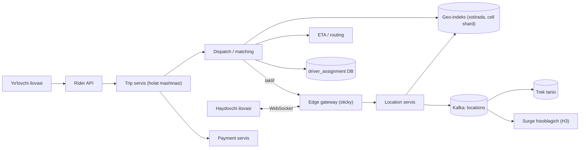
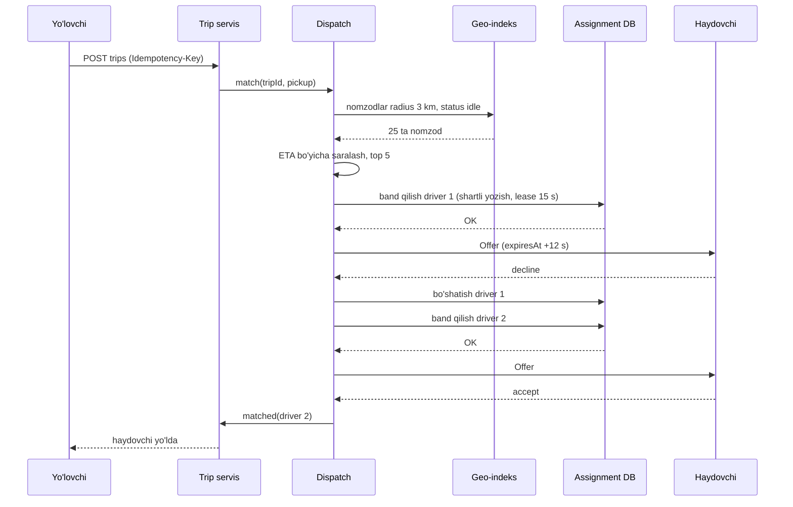
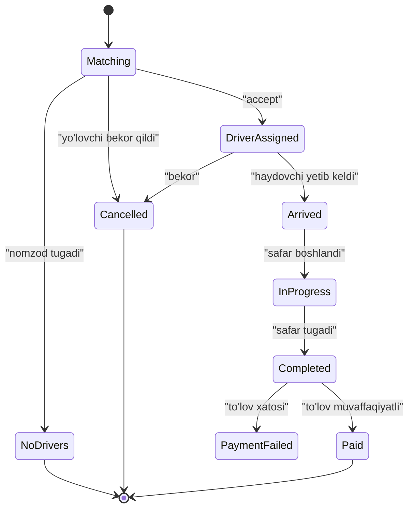

## Bu dars nima uchun kerak

Ride-hailing - real vaqtli geospatial tizimning eng mashhur namunasi: yuz minglab haydovchi bir necha soniyada joylashuv yuboradi, yo'lovchi so'rovi kelganda bir soniya ichida eng yaxshi haydovchini topish, unga taklif yuborish, rad etsa keyingisiga o'tish va bitta haydovchini ikki yo'lovchiga bermaslik kerak. Bu masalada 82-83 darslardagi geo-indekslash va proximity search, 8-darsdagi real-time aloqa, 38-darsdagi lease va lock, 49-darsdagi saga (safar va to'lov) va 77-darsdagi multi-region failover bir joyda ishlaydi.

Bu dars iQuariX uchun alohida qiziq: fleet tracking (96-dars) va ride-hailing bir xil ingest muammosiga ega, lekin ride-hailing da qo'shimcha ravishda **matching** (moslashtirish) va **holat mashinasi** (safar hayot sikli) bor.

Bu darsdan keyin siz:

- haydovchi joylashuvi ingest yuklamasini va geo-indeks hajmini hisoblay olasiz;
- geo-indeksni xotirada, cell ID bo'yicha sharding bilan loyihalay olasiz;
- matching oqimini (qidiruv, ETA bo'yicha saralash, taklif, timeout) va ikki marta band qilishdan himoyani loyihalay olasiz;
- safar holat mashinasini va to'lov bilan bog'liqligini tushuntira olasiz;
- Uber ning real yechimlarini (S2, H3, Ringpop, DISCO, telefonda state digest) bilasiz.

## 1-qadam: talablar

**Funksional talablar:**

- FR-1: haydovchi ilovasi onlayn bo'lganda har bir necha soniyada joylashuv yuboradi.
- FR-2: yo'lovchi xaritada yaqin mashinalarni va taxminiy kutish vaqtini ko'radi.
- FR-3: yo'lovchi safar so'raydi; tizim mos haydovchini topib, unga taklif yuboradi; haydovchi 10-15 soniya ichida qabul yoki rad qiladi.
- FR-4: safar davomida ikkala tomon bir-birining joylashuvini real vaqtda ko'radi.
- FR-5: safar oxirida narx hisoblanadi va to'lov olinadi.
- FR-6: talab yuqori bo'lgan hududlarda dinamik narx (surge).

**Ko'lamdan tashqari:** haydovchilarni ro'yxatdan o'tkazish va hujjat tekshiruvi, reyting, chat, birgalikdagi safar (pool), yetkazib berish.

**Nofunksional talablar:**

- NFR-1: matching (so'rovdan haydovchiga taklif yetguncha) p99 2 soniyadan kam.
- NFR-2: **bitta haydovchi bir vaqtda faqat bitta faol taklif yoki safarga** ega bo'lishi kerak - qat'iy invariant.
- NFR-3: yaqin mashinalar xaritasi 5 soniyagacha eskirishi mumkin.
- NFR-4: safar boshlangandan keyin data-markaz nosozligi safarni to'xtatmasligi kerak.
- NFR-5: to'lov aynan bir marta olinadi.
- NFR-6: shahar bo'yicha mustaqil masshtablanish - bitta shahardagi muammo boshqasiga tarqalmasin.

E'tibor bering: NFR-2 va NFR-5 kuchli consistency talab qiladi, NFR-3 esa eventual consistency ga ruxsat beradi. Demak tizimning turli qismlari turli consistency modellarida ishlaydi (33-dars).

## 2-qadam: hisob-kitob

**Hisob uchun shartlar** (o'rta katta platforma; bu masala sharti, faqat yuborish intervali real manbadan):

| Parametr | Qiymat | Manba |
|---|---|---|
| Cho'qqida onlayn haydovchilar | 1 million | shart |
| Joylashuv yuborish intervali | 4 soniya | Uber, QCon London 2015 (Matt Ranney taqdimoti, InfoQ va High Scalability yozuvlari) |
| Kuniga safarlar | 20 million, cho'qqi ×5 | shart |
| "Yaqin mashinalar" ni ko'rayotgan yo'lovchilar | cho'qqida 3 million, har biri 5 s da so'rov | shart |
| Joylashuv xabari (driver_id, lat, lon, heading, speed, ts, status) | 100 B | shart |
| Trek nuqtasi siqilgan holda | 50 B | shart |
| Matching da ETA hisoblanadigan nomzodlar | 10-20 | shart |
| Bitta geo-indeks shard tugunining sig'imi | 50 000 operatsiya/s | shart |

**Joylashuv yozish:** 1 000 000 / 4 = **250 000 yangilanish/s**. Har biri 100 B: 250 000 × 100 B = 25 MB/s ingest.

**Geo-indeks hajmi:** faqat oxirgi joylashuv kerak: 1 million × 100 B = **100 MB**. Bu butunlay xotiraga sig'adi - hatto bitta mashinaga. Muammo hajmda emas, **yozish chastotasi va so'rovlar sonida**.

**Yaqin mashinalar so'rovi:** 3 000 000 / 5 = **600 000 o'qish/s** - yozishdan ham ko'p.

**Safar so'rovlari:** 20 000 000 / 86 400 ≈ 230 safar/s o'rtacha; cho'qqi (juma kechqurun, yomg'ir) ×5 ≈ **1 200 safar/s**. Har safar so'roviga matching: geo-qidiruv + 10-20 nomzod uchun ETA hisoblash = sekundiga 12 000-24 000 ETA hisobi.

**Trek tarixini saqlash:** 250 000 nuqta/s × 86 400 = 21.6 milliard nuqta/kun × 50 B = 1.08 TB, ya'ni ≈ **1 TB/kun**. Bu alohida time-series yoki data lake ga ketadi (81-dars), real-time yo'lga emas.

**Tarmoq (WebSocket/push):** safar davomida yo'lovchiga haydovchi joylashuvi har 4 soniyada: bir vaqtda 1 million faol safar bo'lsa ~250 000 push/s.

Xulosalar: (1) geo-indeks xotirada va kichik, lekin yozish va o'qish chastotasi yuqori - shardlash yuklama uchun, hajm uchun emas; (2) matching CPU va ETA hisobiga bog'liq; (3) trek tarixi alohida asinxron pipeline.

## 3-qadam: API

```
// Haydovchi ilovasi (doimiy ulanish: WebSocket yoki gRPC stream)
-> LocationUpdate { driverId, lat, lon, heading, speed, accuracy, ts, seq }
<- Offer { offerId, tripId, pickup, eta, expiresAt }
-> OfferResponse { offerId, accept | decline }
-> TripEvent { tripId, type: arrived | started | completed, ts }

// Yo'lovchi ilovasi
GET  /v1/nearby?lat=..&lon=..&radius=2km        -> [ {lat, lon, heading} ]  (anonim, driverId siz)
POST /v1/trips  Idempotency-Key                 { pickup, dropoff, productType }
     -> 202 { tripId, status: "matching" }
GET  /v1/trips/{tripId}                          (yoki stream orqali status)
POST /v1/trips/{tripId}/cancel
```

- **Idempotency-Key** safar yaratishda (9, 39-darslar): yo'lovchi tugmani ikki marta bossa yoki tarmoq timeout bo'lsa, ikkita safar yaratilmasligi kerak.
- **Safar so'rovi asinxron** (202): matching bir necha soniya va bir necha taklif-rad siklini olishi mumkin. Status stream orqali yetkaziladi.
- **`seq`** joylashuv xabarlarida: tarmoq tartibni buzsa, eski nuqta yangisini almashtirmasligi uchun.
- `nearby` javobida haydovchi ID si yo'q - maxfiylik va raqobatchilar skrapingiga qarshi.

## 4-qadam: ma'lumot modeli

```
-- Xotirada (geo-indeks servisi), cell bo'yicha shard
driver_location: driverId -> { lat, lon, cellId, status: idle|offered|on_trip, ts, seq }
cell_index:      cellId   -> set<driverId>

-- Kuchli consistency kerak (PostgreSQL yoki Spanner/CockroachDB uslubidagi baza)
trips
  trip_id PK, rider_id, driver_id?, status, pickup, dropoff,
  created_at, matched_at, started_at, completed_at, fare, version
driver_assignment          -- NFR-2 invariantini ushlovchi jadval
  driver_id PK, trip_id, offer_id, state, lease_expires_at, version

-- Asinxron
location_history (time-series / data lake): driver_id, ts, lat, lon, trip_id?
payments (ledger, 88-dars)
```

`driver_assignment` jadvalida `driver_id` birlamchi kalit - bu bitta haydovchiga bitta faol yozuvni **baza darajasida** kafolatlaydi. Geo-indeksdagi `status` esa faqat tezkor filtr (eventual), haqiqat manbai emas.

## 5-qadam: yuqori darajadagi arxitektura



**Joylashuv yo'li:** haydovchi → gateway → location servis → geo-indeksni yangilash (sinxron, xotirada) va Kafka ga (asinxron, tarix va surge uchun).

**Matching yo'li:** yo'lovchi → trip servis (safar `matching` holatida yaratiladi) → dispatch: geo-indeksdan nomzodlar → ETA bo'yicha saralash → birinchi nomzodni `driver_assignment` da atomik band qilish → gateway orqali taklif → qabul/rad/timeout.

**Ajratish:** geo-indeks, dispatch va trip servis turli consistency talablariga ega, shuning uchun alohida (52-dars: bounded context).

## 6-qadam: chuqur tahlil

Uchta eng murakkab qism: (1) geo-indeks va uni shardlash, (2) matching va ikki marta band qilishdan himoya, (3) safar holatini data-markaz nosozligidan saqlash.

### 6.1. Geo-indeks: cell lar va sharding

82-darsdan: proximity qidiruvni samarali qilish uchun yer yuzi cell larga bo'linadi (geohash, S2, H3). Har haydovchi o'z joylashuvining cell ID siga yoziladi; qidiruvda radius ni qoplaydigan cell lar ro'yxati hisoblanadi va faqat ular tekshiriladi.

**Uber ning 2015 yilgi yondashuvi** (Matt Ranney ning QCon London 2015 dagi "Scaling Uber's Real-time Market Platform" taqdimoti; quyidagi tafsilotlar High Scalability ning 2015-yil 14-sentabrdagi taqdimot konspektidan, InfoQ yozuvi 3.31 km² li cell lar va 4 soniyani tasdiqlaydi): Google **S2** kutubxonasi, **12-darajali** cell lar (joylashuvga qarab 3.31 dan 6.38 km² gacha). **Cell ID shard kaliti**: har joylashuv yangilanishi o'z cell i egasi bo'lgan shardga boradi va bir nechta replica ga yoziladi. Qidiruvda S2 yo'lovchi atrofidagi doirani qoplaydigan cell larni hisoblaydi va faqat shu shardlar so'raladi. Cheklov: cell o'lchami 12-darajada qotirilgan; kichikroq cell lar so'rov fanout ini oshiradi.

**H3** - Uber 2018 yilda ochiq kodga chiqargan olti burchakli ierarxik indeks. Asosiy afzallik: olti burchakda markazdan barcha qo'shnilar markazigacha masofa bir xil (kvadratda ikki xil, uchburchakda uch xil) - bu gradientlarni silliqlash va qo'shnilar bo'yicha agregatsiyani soddalashtiradi. 16 ta rezolyutsiya bor. Uber surge narxini har shahardagi olti burchaklar bo'yicha talab va taklifni o'lchab hisoblaydi.

| Rezolyutsiya (H3) | O'rtacha maydon | O'rtacha qirra | Qo'llanish |
|---|---|---|---|
| 7 | 5.16 km² | 1.41 km | Shahar tumanlari, shard birligi |
| 8 | 0.74 km² | 0.53 km | Surge, talab/taklif agregatsiyasi |
| 9 | 0.105 km² | 0.20 km | Pickup nuqtalari, yaqin qidiruv |

**Bizning dizayn:**

- Geo-indeks servisi xotirada: `cellId -> set<driverId>` va `driverId -> location`.
- Shard birligi - **katta cell** (masalan, H3 res 7 yoki S2 level 12), cell ID bo'yicha consistent hashing (29-dars). Bitta shahar ko'p shardga tarqaladi.
- Haydovchi cell chegarasidan o'tganda: eski cell dan o'chirish va yangisiga qo'shish. Agar ular turli shardlarda bo'lsa - ikki shardga yozish; oraliq holatda haydovchi qisqa vaqt ikki joyda yoki hech qayerda bo'lmasligi mumkin, bu NFR-3 ga ko'ra qabul qilinadi.
- Eskirish: 30 soniya yangilanmagan haydovchi qidiruvdan chiqariladi (TTL) - ilova yopilib qolgan haydovchilar uchun.

**Yuklama:** 250 000 yozish/s + 600 000 o'qish/s = 850 000 operatsiya/s. Shartdagi 50 000 operatsiya/s sig'im bilan: 850 000 / 50 000 = 17 tugun + replica. High Scalability konspektiga ko'ra Uber 2015 da geo-indeks yuzlab jarayonda ishlagan va sekundiga million yozishni ko'tarish maqsadi qo'yilgan.

**Hot spot:** aeroport yoki stadion atrofida bitta cell ga minglab haydovchi. Yechim: hot cell larni kichikroq cell larga bo'lish (ierarxik indeksning afzalligi) yoki o'qish replica lari. High Scalability konspektiga ko'ra (2015) Uber aeroportlarda kelish tartibini saqlash uchun virtual taksi navbatini emulyatsiya qiladi - bu yerda geo-qidiruv umuman boshqa mantiq bilan almashtiriladi.

### 6.2. Matching va ikki marta band qilishdan himoya

**Oqim:**



**1. Nomzodlar (coarse filter).** Geo-indeksdan pickup atrofidagi `idle` haydovchilar. To'g'ri chiziqli masofa faqat qo'pol filtr: daryoning narigi tomonidagi 500 m uzoqlikdagi mashina 3 km dagisidan kechroq yetishi mumkin.

**2. ETA bo'yicha saralash.** Routing servis yo'l grafigi va real-time tirbandlik bo'yicha har nomzod uchun yetib kelish vaqtini hisoblaydi. Uber ning DeepETA maqolasiga (2022) ko'ra, routing engine xarita va real-time trafik asosida ETA beradi, ustiga ML model esa routing bahosi va real natija orasidagi **qoldiqni (residual)** bashorat qiladi; model bir necha millisekund ichida javob berishi kerak va u Uber dagi eng yuqori QPS li model. High Scalability konspektiga ko'ra Uber ning DISCO dispatch tizimi faqat eng yaqinni emas, kutish va ortiqcha yurishni kamaytirishni ko'zlaydi: geo-indeks qo'pol filtr beradi, nomzodlar yo'l tarmog'i bo'yicha ETA bilan saralanadi, va hozir yo'lovchi tashiyotgan haydovchi uzoqroqdagi bo'sh haydovchidan yaxshiroq nomzod bo'lishi mumkin.

**3. Atomik band qilish (NFR-2).** Ikki parallel matching (ikki yo'lovchi bir vaqtda) bir xil haydovchini tanlashi mumkin. Geo-indeksdagi `status` eventual - unga ishonib bo'lmaydi. Haqiqat manbai - `driver_assignment`:

```sql
INSERT INTO driver_assignment (driver_id, trip_id, offer_id, state, lease_expires_at, version)
VALUES ($1, $2, $3, 'offered', now() + interval '15 seconds', 1)
ON CONFLICT (driver_id) DO UPDATE
  SET trip_id = EXCLUDED.trip_id, offer_id = EXCLUDED.offer_id,
      state = 'offered', lease_expires_at = EXCLUDED.lease_expires_at,
      version = driver_assignment.version + 1
  WHERE driver_assignment.state = 'free'
     OR (driver_assignment.state = 'offered' AND driver_assignment.lease_expires_at < now())
RETURNING version;
```

Agar qator qaytmasa - haydovchi band, keyingi nomzodga o'tamiz. Bu 38-darsdagi **lease** pattern: taklif muddati tugasa (haydovchi javob bermadi, ilova o'ldi), lock avtomatik bo'shaydi. `version` - **fencing token**: kech kelgan "accept" eski `offer_id` bilan bo'lsa, rad etiladi.

**4. Taklif va timeout.** Taklif 10-15 soniya amal qiladi. Javob bo'lmasa, lease tugaydi va dispatch keyingisiga o'tadi. Haydovchi rad etsa - darhol bo'shatish. Bir nechta haydovchiga parallel taklif yuborish tezroq, lekin "bir nechtasi qabul qildi" holatida qolganlarini bekor qilish va ularning tajribasini buzish narxi bor - shu sabab bu dizaynda ketma-ket taklifni tanlaymiz.

**Batch matching (alternativa).** Har so'rovni darhol eng yaxshi haydovchiga berish (greedy) o'rniga, 1-2 soniyalik oynada barcha so'rov va haydovchilarni yig'ib, global optimallashtirish (bipartite matching). Natija umumiy ETA bo'yicha yaxshiroq, lekin har bir so'rovga 1-2 soniya kechikish qo'shiladi.

| | Greedy (darhol) | Batch (oyna) |
|---|---|---|
| Matching latency | Minimal | +oyna davomiyligi |
| Umumiy samaradorlik | Lokal optimal | Global optimalga yaqin |
| Murakkablik | Past | Yuqori (optimallashtirish, shard chegaralari) |
| Qachon | Kam zichlik | Yuqori zichlik, cho'qqi vaqtlar |

### 6.3. Safar holati va data-markaz nosozligi

Safar holat mashinasi:



Har o'tish `version` bilan shartli yozish (optimistic concurrency, 18-dars) - ikki parallel hodisa (yo'lovchi bekor qildi va haydovchi "yetib keldim" bosdi) bir-birini jim bosib ketmasligi uchun.

**Completed → Paid** - to'lov tashqi servis bilan, saga (49-dars) va idempotency kaliti `trip_id` (88-dars). To'lov xatosi safarni bekor qilmaydi - u qarz sifatida qayd etiladi va qayta urinish bo'ladi.

**Data-markaz nosozligi (NFR-4).** Uber ning 2015 yilgi yechimi (QCon taqdimoti; InfoQ va High Scalability yozuvlari) ibratli: zaxira data-markaz bor, lekin jarayondagi safar ma'lumoti unga sinxron replikatsiya qilinmagan. Buning o'rniga dispatch davriy ravishda **shifrlangan "state digest" ni haydovchi telefoniga** yuboradi. Failover dan keyin haydovchi telefoni yangi data-markazga noma'lum safar uchun joylashuv yuborsa, dispatch telefondan digest ni so'raydi va holatni tiklaydi - safar davom etadi. Bu klassik "har yozuvni sinxron regionlararo replikatsiya" (latency va narx) o'rniga mijozni zaxira saqlash joyi sifatida ishlatish. Trade-off: digest faqat oxirgi davriy holatni saqlaydi, shuning uchun bir necha soniyalik hodisalar yo'qolishi mumkin - lekin safar uchun muhim holat (kim, qayerdan, qachon boshlangan) saqlanadi.

**Ringpop.** Uber dispatch servislarini o'z ichiga o'rnatilgan consistent hash halqasi va SWIM asosidagi gossip kutubxonasi bilan shardlagan: istalgan tugun so'rovni qabul qilib, halqa bo'yicha egasiga yo'naltiradi. Bu AP tizim - availability ustun. High Scalability konspektiga ko'ra (2015) Ringpop o'sha paytgacha minglab tugungacha masshtablangan.

## 7-qadam: nosozlik stsenariylari

| Stsenariy | Ta'sir | Himoya |
|---|---|---|
| Geo-indeks shard o'ldi | Shu hududda haydovchilar ko'rinmaydi | Replica dan o'qish; haydovchilar 4 s ichida qayta yuboradi - indeks o'z-o'zidan tiklanadi |
| Haydovchi ilovasi aloqani yo'qotdi | Taklif yetmaydi | Lease tugaydi, keyingi nomzod; TTL bilan indeksdan chiqadi |
| Assignment DB sekinlashdi | Matching sekinlashadi | Timeout, circuit breaker; shahar bo'yicha alohida DB (NFR-6) |
| ETA servis o'ldi | Saralash yo'q | Degradatsiya: to'g'ri chiziqli masofa bilan saralash (64-dars) |
| Tarmoq dublikat accept yubordi | Ikki marta qayta ishlash | offer_id va version bo'yicha idempotent |
| Data-markaz o'ldi | Faol safarlar | Telefondagi state digest; yangi so'rovlar boshqa region ga |
| Surge servis o'ldi | Narx noto'g'ri | Oxirgi ma'lum koeffitsient yoki 1.0 bilan davom etish |

Geo-indeksning o'z-o'zidan tiklanishi muhim xususiyat: u **yumshoq holat (soft state)** - haqiqat manbai haydovchi telefonlari, indeks ularning 4-30 soniyalik nusxasi. Shuning uchun uni diskka saqlash yoki sinxron replikatsiya qilish shart emas.

## 8-qadam: evolyutsiya (10x)

10x: 10 million onlayn haydovchi, 2.5M joylashuv/s, 12 000 safar/s cho'qqida.

1. **Birinchi sinadigan:** joylashuv ingest va gateway ulanishlari (10 million doimiy WebSocket). Gateway larni region va shahar bo'yicha bo'lish; joylashuv xabarlarini batch lash (ilova 4 s da bitta xabar o'rniga harakatsiz bo'lsa kamroq yuboradi).
2. **ETA hisobi** - 120 000-240 000 ETA/s. Kesh: bir xil cell juftlari uchun ETA ni 30-60 soniya keshlash; ML model inference ni GPU ga.
3. **Assignment DB** - shahar bo'yicha shardlash tabiiy, chunki safar va haydovchi deyarli har doim bitta shaharda.
4. **Multi-region** - har region o'z shaharlariga xizmat qiladi (77-dars); global faqat hisob va to'lov.

## iQuariX kontekstida

Masala sharti (o'quv ssenariysi): iQuariX mijozlaridan biri - shahar ichida yetkazib berish kompaniyasi - "eng yaqin bo'sh mashinani buyurtmaga avtomatik tayinlash" funksiyasini so'radi. Ride-hailing dan farqlari:

- **Masshtab kichik:** shartga ko'ra bir mijozda 200-500 mashina. Geo-indeks uchun alohida servis kerak emas: PostGIS dagi `ST_DWithin` va GiST indeksi (15, 82-darslar) yoki Redis GEO yetadi.
- **Joylashuv manbai - treker, telefon emas.** Shartga ko'ra treker har 10-30 soniyada yuboradi va haydovchi "taklif"ni qabul qila olmaydi. Demak qabul qilish oqimi haydovchi ilovasi yoki dispetcher orqali bo'lishi kerak.
- **Invariant bir xil:** bitta mashina bitta faol buyurtma. `vehicle_assignment` jadvali `vehicle_id` birlamchi kaliti bilan va lease - xuddi 6.2 dagidek.
- **ETA:** OSRM yoki Valhalla kabi ochiq routing engine bilan; o'z tarixiy trek ma'lumotlaringizdan tumanlar bo'yicha o'rtacha tezliklarni o'rganish.

## Ko'p uchraydigan xatolar

1. **Joylashuvni har yangilanishda diskka/PostgreSQL ga yozish.** 250 000 UPDATE/s - xotiradagi indeks va asinxron tarix kerak.
2. **To'g'ri chiziqli masofa bo'yicha matching.** Yo'l tarmog'i va tirbandlik ETA ni butunlay o'zgartiradi.
3. **Geo-indeksdagi status ga ishonib band qilish.** Eventual holat - ikki marta tayinlash. Atomik shartli yozish kerak.
4. **Taklif uchun lease yo'qligi.** Haydovchi javob bermasa, u abadiy "band" qoladi.
5. **Kech kelgan accept ni tekshirmaslik.** Fencing token (version) siz eski taklif yangi safarni buzadi.
6. **Hot cell ni hisobga olmaslik.** Aeroport bitta shardni yiqitadi.
7. **Trek tarixini real-time yo'lda saqlash.** 1 TB/kun matching bazasini to'ldiradi.
8. **Safar holatini regionlararo sinxron replikatsiya qilish.** Har o'tishga kamida bitta regionlararo RTT qo'shiladi; Uber ning telefon digest i kabi arzonroq yechimlar bor.

## Xulosa

- Geo-indeks kichik (1 million haydovchi ≈ 100 MB), lekin yozish (250k/s) va o'qish (600k/s) chastotasi yuqori - xotirada, cell bo'yicha shardlangan, yumshoq holat.
- Uber S2 level 12 cell larni shard kaliti sifatida ishlatgan; H3 olti burchaklari surge va agregatsiya uchun.
- Matching: geo coarse filter → ETA bo'yicha saralash → atomik lease bilan band qilish → taklif → timeout yoki keyingi nomzod.
- "Bitta haydovchi - bitta safar" invarianti eventual geo-indeksda emas, kuchli consistency li baza va fencing token bilan ushlanadi.
- Safar - holat mashinasi, har o'tish shartli yozish; to'lov - saga va idempotency.
- Data-markaz nosozligida safar holatini mijoz qurilmasida saqlash - sinxron replikatsiyaga arzon alternativa.

## Amaliy topshiriq

iQuariX uchun **"avtomatik buyurtma tayinlash" modulini** loyihalang (faraziy): yetkazib berish kompaniyasi mijozi, 1 000 mashina, kuniga 15 000 buyurtma, har buyurtma 30 daqiqalik vaqt oynasi bilan; mashinalarda treker (har 15 s) va haydovchi ilovasi bor.

1. **Talablar.** FR va NFR (tayinlash qancha vaqtda bo'lishi kerak, haydovchi rad etsa nima bo'ladi, bir mashinaga bir vaqtda nechta buyurtma mumkin).
2. **Hisob-kitob.** Joylashuv yozish/s, tayinlash/s cho'qqida, ETA hisoblari/s.
3. **Geo-indeks tanlovi.** PostGIS, Redis GEO yoki xotiradagi H3 indeks - hisob-kitobga asoslanib tanlang.
4. **Band qilish.** Ikki dispetcher yoki avtomatik tayinlash bir mashinani parallel tanlasa nima bo'ladi? SQL yoki psevdokod bilan atomik band qilishni yozing.
5. **Greedy yoki batch.** Vaqt oynali buyurtmalar uchun qaysi biri mosroq? Trade-off jadvali.
6. **Nosozliklar.** Treker 5 daqiqa joylashuv yubormasa, haydovchi ilovasi oflayn bo'lsa, routing servisi o'chsa.

Yaxshi javobda bo'lishi kerak bo'lgan narsalar:

- hajm kichikligi tufayli ortiqcha murakkablik rad etilgan;
- band qilish baza darajasida atomik va lease/timeout bilan;
- eskirgan joylashuvli mashinalar nomzodlikdan chiqarilgani;
- batch matching vaqt oynalari bilan asoslangan;
- ETA servisi o'chganda degradatsiya rejimi.

Javobni pastdagi maydonga yozib, chatga yuboring.

## Manbalar

- [How Uber Scales Their Real-time Market Platform](https://highscalability.com/how-uber-scales-their-real-time-market-platform/), High Scalability, 14.09.2015 - Matt Ranney ning QCon London 2015 taqdimoti konspekti: 4 soniyalik joylashuv, S2 level 12 sharding, DISCO, Ringpop, telefondagi state digest, aeroport navbati.
- InfoQ. [Uber's Real-time Market Platform](https://www.infoq.com/news/2015/03/uber-realtime-market-platform), 15.03.2015 - shu taqdimot haqida: har 4 soniyada joylashuv, 3.31 km² li cell lar bo'yicha sharding, shifrlangan state digest.
- Uber Engineering. [H3: Uber's Hexagonal Hierarchical Spatial Index](https://www.uber.com/en/blog/h3/), 2018 - olti burchaklar afzalligi, 16 rezolyutsiya, surge.
- [H3 rezolyutsiyalar jadvali](https://h3geo.org/docs/core-library/restable/) - cell maydonlari va qirra uzunliklari.
- Uber Engineering. [DeepETA: How Uber Predicts Arrival Times Using Deep Learning](https://www.uber.com/en-CA/blog/deepeta-how-uber-predicts-arrival-times/), 2022 - routing + ML residual, latency talabi.
- Martin Kleppmann. [How to do distributed locking](https://martin.kleppmann.com/2016/02/08/how-to-do-distributed-locking.html), 2016 - lease va fencing token.
- Alex Xu, Sahn Lam. System Design Interview, 2-jild, 1-bob "Proximity Service" va 2-bob "Nearby Friends". [Boblar ro'yxati](https://system-design.space/en/chapter/system-design-interview-vol2-book).
