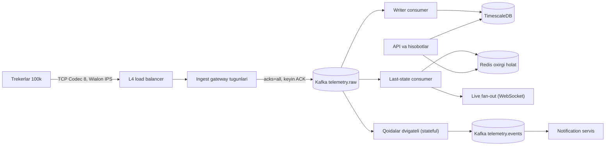
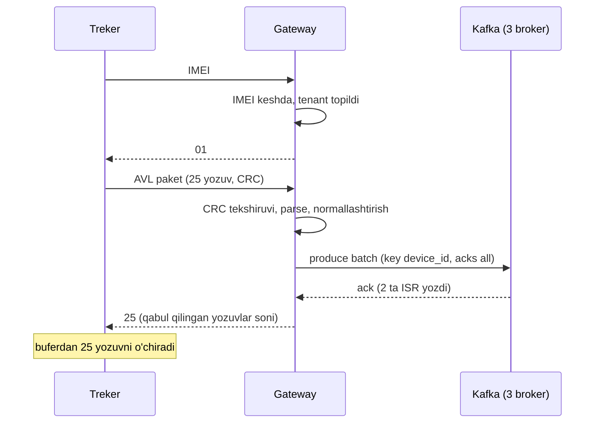

## Bu dars nima uchun kerak

Bu case study - kursning "uyga qaytishi". 1-darsda biz 10 000 trekerdan GPS nuqtalarni qabul qilishning birinchi, sodda arxitekturasini chizgan edik va "96-darsda shu masalani boshidan oxirigacha to'liq loyihalaymiz" deb va'da qilgan edik. Endi o'sha masalani 100 000 qurilma, yoqilg'i datchiklari (ДУТ), real-time qoidalar (geofence, tezlik, yoqilg'i to'kish) va ko'p mijozli (multi-tenant) SaaS shartlarida loyihalaymiz.

Bu tizim boshqa case study lardan bir necha jihat bilan farq qiladi va aynan shu farqlar dizaynni shakllantiradi:

- **Mijoz - brauzer emas, treker.** U ikkilik (binary) protokolda gapiradi, TCP ulanishni soatlab ushlab turadi, firmware ni yangilash qiyin va u sizning API kontraktingizni emas, ishlab chiqaruvchi protokolini biladi.
- **Mijoz o'zi bufer.** Treker aloqa yo'qolganda nuqtalarni ichki xotirasida ("black box") saqlaydi va keyin yuboradi. Bu backpressure ni ham, kech keladigan ma'lumot muammosini ham beradi.
- **Vaqt ikki xil.** Nuqta GPS da qayd etilgan vaqt (event time) va serverga kelgan vaqt (processing time) soatlab farq qilishi mumkin (45-dars).
- **Yozish o'qishdan ko'p.** Ko'p tizimlardan farqli: nuqtalarning aksariyati hech qachon alohida o'qilmaydi, faqat agregatlar va hisobotlar orqali.

Bu darsda kursning taxminan 30 ta darsidagi texnikalar birga ishlaydi. Har birida havola beramiz.

Bu darsdan keyin siz:

- 100 000 qurilmali telemetriya platformasi uchun to'liq hisob-kitob qila olasiz: ulanishlar, nuqta/s, hajm, siqish, narx;
- ingest gateway ni "ACK = durability chegarasi" tamoyili bilan loyihalay olasiz;
- reconnect bo'roni va black box to'lqinini hisoblab, ularga qarshi himoya qura olasiz;
- telemetriya saqlashni (Kafka, time-series baza, oxirgi holat keshi, downsampling, retention) qatlamlarga bo'la olasiz;
- event time asosidagi real-time qoidalar dvigatelini (geofence, tezlik, yoqilg'i) loyihalay olasiz;
- multi-tenant izolyatsiya va "shovqinli qo'shni" muammosini hal qila olasiz;
- 10x (1 million qurilma) da nima birinchi sinishini bilasiz.

## 1-qadam: talablar

Masala faraziy, lekin real fleet management platformasiga yaqin: korporativ avtoparklar uchun GPS tracking, yoqilg'i nazorati va ogohlantirishlar. iQuariX haqida aniq ichki ma'lumot emas - bu "deylik" darajasidagi namunaviy dizayn.

**Funksional talablar:**

- FR-1: trekerlar (Teltonika Codec 8/8E, Wialon IPS va boshqa protokollar) TCP orqali ulanadi va AVL yozuvlarini yuboradi: vaqt, koordinata, tezlik, yo'nalish, sun'iy yo'ldoshlar soni, IO elementlar (zajiganie, kuchlanish, yoqilg'i datchigi, CAN ma'lumotlari).
- FR-2: dispetcher o'z parkidagi barcha mashinalarni xaritada real vaqtda ko'radi.
- FR-3: istalgan mashinaning istalgan davrdagi treki (marshrut) va undagi to'xtashlar.
- FR-4: real-time ogohlantirishlar: geofence ga kirish/chiqish, tezlik oshishi, yoqilg'i to'kish va quyish, zajiganie ish vaqtidan tashqari, aloqa uzilishi.
- FR-5: hisobotlar: kunlik yurgan masofa, yoqilg'i sarfi, harakat va to'xtash vaqti, haydovchi skoringi uchun hodisalar (keskin tormoz, tezlanish).
- FR-6: qurilmaga buyruq yuborish (masalan, yuborish intervalini o'zgartirish, rele boshqaruvi).
- FR-7: ko'p mijozli: har bir korporativ mijoz (tenant) faqat o'z mashinalarini ko'radi.

**Ko'lamdan tashqari:** video oqimlar (84-dars, alohida pipeline), mobil haydovchi ilovasi, billing, qurilmalarni ombor hisobi, AI analitika modellari (ular shu platformaning ma'lumotini iste'mol qiladi, lekin alohida tizim).

**Nofunksional talablar:**

- NFR-1: **qurilmaga ACK yuborilgan nuqta yo'qolmaydi.** Bu eng muhim talab. ACK berilmagan nuqtani qurilma qayta yuboradi - demak ACK dan oldin yo'qotish qabul qilinadi, keyin emas.
- NFR-2: xaritadagi oxirgi joylashuv qurilmadan kelganidan keyin 3 soniyadan kech ko'rinmasin (p95).
- NFR-3: real-time ogohlantirish nuqta kelganidan keyin 10 soniya ichida (p95).
- NFR-4: bir kunlik trek so'rovi p99 1 soniyadan tez; bir oylik hisobot 30 soniyadan tez (yoki asinxron).
- NFR-5: xom nuqtalar 1 yil (ba'zi mijozlar uchun 3 yil), agregatlar 5 yil saqlanadi.
- NFR-6: ingest mavjudligi oyiga 99.95% (taxminan 22 daqiqa uzilish). Uzilish paytida ham ma'lumot yo'qolmaydi - qurilmalar buferlaydi.
- NFR-7: 100 000 dan 1 000 000 qurilmagacha arxitekturani tubdan o'zgartirmasdan o'sish.
- NFR-8: bir tenant ning og'ir hisoboti boshqa tenantlar ingest i va xaritasiga ta'sir qilmasin.
- NFR-9: takroriy nuqtalar (qurilma ACK olmagani uchun qayta yuborgan) hisobotlarda ikki marta hisoblanmasin.

## 2-qadam: hisob-kitob

### Yuklama parametrlari

Taxminlar (ochiq yozamiz, keyin tekshiriladi):

- 100 000 qurilma, hammasi doimiy TCP ulanishda.
- Yuborish rejimi trekerlarda odatda vaqt, masofa va burilish burchagi bo'yicha sozlanadi. Deylik: harakatda har **10 soniyada** yozuv (burilishlarda qo'shimcha), to'xtab turganda har **5 daqiqada**.
- Ish soatlarida (cho'qqi) qurilmalarning **50%** harakatda, tunda 10%.
- Yozuvlar paketlarda keladi: treker deylik har 30-60 soniyada to'plangan yozuvlarni bitta paketda yuboradi (Codec 8 bitta paketda bir nechta AVL yozuvini olib keladi).

### Nuqtalar/s

Cho'qqi: 50 000 harakatda / 10 s = 5 000; 50 000 to'xtagan / 300 s ≈ 170; burilishlar uchun +20% → **~6 200 nuqta/s**.

Tun: 10 000 / 10 + 90 000 / 300 = 1 000 + 300 = 1 300 nuqta/s.

Kunlik o'rtacha taxminan **4 000 nuqta/s** deb olamiz. Kuniga: 4 000 × 86 400 ≈ **345 million nuqta**.

Paketlar/s: agar har qurilma o'rtacha har 45 soniyada paket yuborsa: 100 000 / 45 ≈ **2 200 paket/s**. TCP darajasidagi operatsiyalar soni nuqtalardan kam - bu gateway uchun muhim (har paket - bitta parse, bitta Kafka batch, bitta ACK).

### Ekstremal stsenariy: black box to'lqini

Normal yuklama dizaynni belgilamaydi. Belgilaydigan narsa - **mobil operator uzilishi**. Faraz qiling, operator 2 soat ishlamadi va 40 000 qurilma (bitta operator ulushi) aloqasiz qoldi. Har biri bufer to'pladi: harakatdagi qurilma 2 soat × 360 yozuv/soat = 720 yozuv, o'rtacha deylik 400 yozuv. Jami: 40 000 × 400 = **16 million nuqta**, ular aloqa tiklangach bir necha daqiqa ichida kelishga harakat qiladi.

Agar 5 daqiqa ichida kelsa: 16 000 000 / 300 ≈ **53 000 nuqta/s** - normal cho'qqidan ~9 baravar ko'p. Bundan tashqari 40 000 ta TCP qayta ulanish (va TLS bo'lsa handshake) bir necha soniya ichida - **reconnect bo'roni**.

Xulosa: ingest va keyingi bosqichlar normal 6 000/s uchun emas, **kamida 50 000/s qisqa to'lqin** uchun loyihalanishi yoki to'lqinni boshqariladigan tezlikka tekislashi kerak. Bu 6.1 va 6.2 dagi chuqur tahlilning asosiy sababi.

### Hajm

**Simdagi hajm:** Codec 8 AVL yozuvi: 8 B vaqt + 1 B prioritet + 15 B GPS elementi + IO elementlar (deylik 10-20 ta IO, ~40 B) ≈ **65 B**. Kuniga: 345M × 65 B ≈ 22 GB trafik (paket overhead siz).

**Normallashtirilgan qator:** `tenant_id, device_id, ts, lat, lon, speed, course, alt, sats, ignition, voltage, fuel_raw, io jsonb...` - qator va indeks bilan siqilmagan PostgreSQL da deylik **150 B**. Kuniga: 345M × 150 B ≈ **52 GB/kun**. Yiliga ≈ **19 TB** siqilmagan.

**Siqish:** telemetriya juda yaxshi siqiladi: vaqt deyarli muntazam (delta-of-delta), koordinatalar asta-sekin o'zgaradi (delta), ko'p IO qiymatlar takrorlanadi. TimescaleDB hujjatlarida muntazam intervalli vaqt belgisi uchun delta-of-delta ideal holatda 64 baravar siqish berishi, float ustunlar uchun Facebook Gorilla asosidagi XOR siqishi ishlatilishi aytiladi. Gorilla maqolasida o'rtacha 12 baravar siqish qayd etilgan. Real GPS ma'lumotda konservativ **8-10 baravar** deylik: 19 TB → **~2 TB/yil** siqilgan. 3 yil, replica bilan: ~12 TB. Bu boshqariladigan hajm.

**Agregatlar:** kunlik/soatlik har qurilma bo'yicha masofa, sarf, vaqtlar: 100 000 qurilma × 24 soat × 200 B ≈ 480 MB/kun - ahamiyatsiz.

### Ulanishlar va xotira

100 000 doimiy TCP ulanish. Linux da bitta ulanishning yadro tomoni bir necha KB dan (bufferlar sozlamasiga qarab) o'nlab KB gacha; ilova tomonida (Node.js yoki Go) parse holati, bufer va metadata bilan deylik 10-30 KB. 100 000 × 30 KB = **3 GB** - bitta katta mashinaga sig'adi, lekin bitta mashina SPOF bo'lgani uchun **4-6 gateway tugun** (har birida 20-25 ming ulanish), reconnect bo'roni uchun zaxira bilan.

### O'qish tomoni

- Faol dispetcher sessiyalari: deylik 3 000 tenant, cho'qqida 5 000 ochiq xarita. Har xarita o'z parkining yangilanishlarini oladi: agar o'rtacha park 30 mashina va har biri 10 s da yangilansa, jami push: barcha harakatdagi qurilmalar soniga teng - ~5 000 yangilanish/s ga yaqin, chunki har qurilma odatda 1-2 ta dispetcherda ochiq. Kichik.
- Trek so'rovlari: 5 000 dispetcher × soatiga 10 ta = ~14 so'rov/s, har biri bitta qurilmaning bir kuni = ~8 640 nuqta (10 s da). Indeks bo'yicha ketma-ket o'qish - arzon.
- Hisobotlar: kam, lekin og'ir: "500 mashinaning 1 oylik yoqilg'i hisoboti" = 500 × 30 × ~10 000 nuqta = 150 million nuqta skaneri. Xom ma'lumotdan emas, agregatlardan hisoblanishi kerak (NFR-8).

### Hisob-kitobdan xulosalar

1. Normal ingest (6 000/s) - bitta yaxshi PostgreSQL ham ko'taradigan yozish. **Asosiy xavf - to'lqinlar** (black box, reconnect), shuning uchun ingest va saqlash orasida bufer (Kafka) majburiy.
2. Saqlash - yiliga ~19 TB siqilmagan; siqish va retention siz bu tez qimmatlashadi. Time-series ustunli siqish **majburiy**.
3. Ulanishlar - bir necha gateway tugun; ular stateful (TCP sessiya), shuning uchun L4 load balancing.
4. Og'ir hisobotlar xom nuqtalardan emas, oldindan hisoblangan agregatlardan.

## 3-qadam: API va protokollar

Tizimning uchta "tashqi" chegarasi bor va har birining kontrakti boshqa.

### 3.1. Qurilma protokoli (biz boshqarmaymiz)

Teltonika Codec 8 TCP oqimi (ishlab chiqaruvchi hujjatidan):

1. Qurilma 2 baytlik uzunlik va IMEI ni ASCII da yuboradi.
2. Server `01` (qabul) yoki `00` (rad) bilan javob beradi - bu yerda **autentifikatsiya**: IMEI ro'yxatda va tenant ga bog'langanmi.
3. Qurilma AVL paket yuboradi: 4 bayt nol preambula, 4 bayt ma'lumot uzunligi, Codec ID (`0x08`, yoki 8 Extended uchun `0x8E`), yozuvlar soni, yozuvlar, yana yozuvlar soni (birinchisiga teng bo'lishi shart), 4 baytlik CRC-16/IBM.
4. Server **qabul qilingan yozuvlar sonini 4 baytli butun son** sifatida qaytaradi. Agar bu son yuborilganga teng bo'lmasa, qurilma ma'lumotni qayta yuboradi.

Wialon IPS esa matnli protokol: `#L#` login, `#D#` to'liq ma'lumot, `#SD#` qisqa ma'lumot, `#B#` black box (buferlangan yozuvlar to'plami), 2.0 versiyasida CRC16. Transport TCP yoki UDP.

Dizayn uchun eng muhim kuzatuv: **server ACK - bu "men bu yozuvlar uchun javobgarlikni oldim" degani**. ACK dan keyin qurilma yozuvlarni o'z xotirasidan o'chirishi mumkin. Demak ACK faqat ma'lumot **bardoshli (durable) saqlanganidan keyin** yuborilishi kerak (NFR-1). Bu 41 va 44-darslardagi "producer acks" muammosining aynan o'zi, faqat bu yerda producer - qurilma.

### 3.2. Ichki kanonik xabar

Har bir protokol adapteri o'z formatini bitta ichki formatga o'giradi (Protobuf, 10-dars):

```
message Telemetry {
  string  tenant_id   = 1;
  string  device_id   = 2;   // ichki ID, IMEI emas
  int64   gps_time_ms = 3;   // event time
  int64   recv_time_ms= 4;   // processing time (gateway)
  sint32  lat_e7      = 5;   // daraja x 10^7
  sint32  lon_e7      = 6;
  uint32  speed_kmh   = 7;
  uint32  course      = 8;
  sint32  alt_m       = 9;
  uint32  satellites  = 10;
  uint32  priority    = 11;
  map<uint32, int64> io = 12; // IO element ID -> qiymat
  string  protocol    = 13;
  bytes   dedup_key   = 14;  // hash(device_id, gps_time_ms, lat, lon)
}
```

`lat_e7` butun son sifatida - float xatolaridan qochish va yaxshiroq delta-siqish uchun. `dedup_key` NFR-9 uchun (6.2 da).

### 3.3. Ilova API (dispetcher UI va integratsiyalar)

```
GET  /v1/vehicles?status=moving                 -> oxirgi holatlar (Redis dan)
GET  /v1/vehicles/{id}/track?from=..&to=..&simplify=true
GET  /v1/vehicles/{id}/stops?date=2026-10-20
WS   /v1/live?fleet=...                         -> joylashuv oqimi (SSE yoki WebSocket, 8-dars)
POST /v1/reports  { type: "fuel", vehicles: [...], from, to }   -> 202 { reportId }
GET  /v1/reports/{reportId}                     -> status, natija havolasi
POST /v1/geofences  { name, polygon (GeoJSON), rules }
POST /v1/devices/{id}/commands  Idempotency-Key  { type: "set_interval", value: 30 }
GET  /v1/alerts?since=cursor                    -> cursor pagination (9-dars)
```

- Og'ir hisobotlar **asinxron** (202 + status), sinxron so'rov emas - NFR-8.
- `simplify=true` - trekni ekran uchun soddalashtirish (Douglas-Peucker): 8 640 nuqtali kunlik trek xaritada 500-1 000 nuqtada bir xil ko'rinadi.
- Buyruqlar uchun Idempotency-Key: dispetcher "dvigatelni bloklash" tugmasini ikki marta bossa, ikki buyruq ketmasin.

## 4-qadam: ma'lumot modeli

Ma'lumot to'rt xil "temperatura" va so'rov shakliga ega - shuning uchun to'rt xil saqlash (20-dars: baza tanlash freymvorki).

| Ma'lumot | So'rov shakli | Hajm | Saqlash |
|---|---|---|---|
| Xom nuqtalar oqimi | Ketma-ket yozish, qayta o'qish (replay) | Kunlar | Kafka |
| Oxirgi holat | Kalit bo'yicha, juda tez-tez | 100k x 500 B = 50 MB | Redis |
| Tarixiy nuqtalar | `device_id + vaqt oralig'i`, agregatsiya | TB lar | TimescaleDB yoki ClickHouse |
| Metadata (tenant, qurilma, geofence, qoida) | Relyatsion, tranzaksiyali | GB | PostgreSQL |

### Kafka

```
topic: telemetry.raw      partitions: 64, key: device_id, RF: 3, min.insync.replicas: 2
topic: telemetry.events   key: device_id   (aniqlangan hodisalar: stop, geofence, fuel)
topic: device.commands    key: device_id
retention: 7 kun (raw), compaction: yo'q
```

Kalit `device_id` - bitta qurilmaning barcha nuqtalari bitta partition da, ya'ni **tartibda** (43-dars). Bu qoidalar dvigateli uchun muhim: "oldingi nuqta" har doim to'g'ri. 64 partition - 6 000-50 000 nuqta/s uchun keng zaxira va consumer parallelligi uchun.

### Tarixiy nuqtalar (TimescaleDB varianti)

```sql
CREATE TABLE points (
  tenant_id   int         NOT NULL,
  device_id   int         NOT NULL,
  ts          timestamptz NOT NULL,     -- gps_time
  recv_ts     timestamptz NOT NULL,
  lat_e7      int, lon_e7 int,
  speed       smallint, course smallint, alt smallint, sats smallint,
  ignition    boolean, voltage_mv int, fuel_raw int,
  io          jsonb
);
SELECT create_hypertable('points', 'ts', chunk_time_interval => interval '1 day');
CREATE UNIQUE INDEX ON points (device_id, ts);   -- dedup va asosiy so'rov
ALTER TABLE points SET (timescaledb.compress,
  timescaledb.compress_segmentby = 'tenant_id, device_id',
  timescaledb.compress_orderby   = 'ts');
SELECT add_compression_policy('points', interval '3 days');
SELECT add_retention_policy('points', interval '365 days');
```

- **Chunk = 1 kun.** Har chunk ~52 GB siqilmagan; joriy chunk va uning indekslari xotirada ishlashi uchun RAM ga mos bo'lishi yaxshi (81-dars).
- **segmentby device_id** - siqilgan blok ichida bitta qurilmaning ketma-ket nuqtalari, shuning uchun delta-siqish samarali va "bitta qurilma, bitta kun" so'rovi faqat kerakli segmentlarni ochadi.
- **UNIQUE (device_id, ts)** - takroriy nuqtalar `ON CONFLICT DO NOTHING` bilan tashlanadi (NFR-9). Bu dedup kalitining baza darajasidagi kafolati.
- 3 kundan keyin siqish: black box ma'lumotlarining aksariyati 3 kun ichida keladi; siqilgan chunk ga kech yozish mumkin, lekin qimmatroq.

**ClickHouse varianti:** `MergeTree ORDER BY (tenant_id, device_id, ts)`, `PARTITION BY toYYYYMM(ts)`, ustunlarga `Delta`/`DoubleDelta` (vaqt), `Gorilla` (float) kodeklari + ZSTD, `TTL ts + INTERVAL 1 YEAR`. Dedup uchun `ReplacingMergeTree` - lekin u dublikatlarni faqat fon merge da olib tashlaydi, shuning uchun so'rovlarda `FINAL` yoki agregatsiyada hisobga olish kerak.

| | TimescaleDB | ClickHouse |
|---|---|---|
| Yozish modeli | Qatorli (joriy chunk), keyin ustunli siqish | Ustunli, batch insert (minglab qator) |
| Dedup | UNIQUE indeks, darhol | ReplacingMergeTree, kechikkan |
| Analitik so'rov tezligi | Yaxshi (siqilgan chunk) | Juda yuqori |
| Tranzaksiya, JOIN metadata bilan | PostgreSQL to'liq | Cheklangan |
| Jamoa tajribasi (PostgreSQL) | Bevosita | Yangi tizim |
| Qachon | 100k qurilma, bitta jamoa | 1M+ qurilma yoki og'ir analitika |

100 000 qurilma va PostgreSQL tajribali jamoa uchun **TimescaleDB** bilan boshlash oqilona (1-tur qaror emas: Kafka dan ClickHouse ga parallel yozish keyin qo'shilishi mumkin - 8-qadamda).

### Agregatlar

```sql
CREATE MATERIALIZED VIEW device_hourly WITH (timescaledb.continuous) AS
SELECT device_id, tenant_id, time_bucket('1 hour', ts) AS hour,
       count(*) AS points, max(speed) AS max_speed,
       sum(dist_m) AS distance_m,           -- dist_m ingest da oldingi nuqtadan hisoblangan
       min(fuel_l) AS fuel_min, max(fuel_l) AS fuel_max
FROM points GROUP BY 1, 2, 3;
```

Hisobotlar soatlik/kunlik agregatlardan: "500 mashina, 1 oy" = 500 × 720 soat = 360 000 qator - xom 150 million o'rniga.

### Oxirgi holat (Redis)

```
HSET dev:{device_id} ts 1729400000000 lat_e7 ... speed ... ignition 1 fuel_l 182.5
```

Yangilash **shartli**: faqat `incoming.gps_time > stored.ts` bo'lsa (Lua skript bilan atomik). Aks holda black box dan kelgan eski nuqtalar xaritadagi mashinani o'tmishga "sakratadi" (93-darsdagi LWW muammosi).

## 5-qadam: yuqori darajadagi arxitektura



Uchta mustaqil iste'molchi guruh (consumer group, 43-dars) bitta Kafka topic ni o'qiydi:

1. **Writer** - tarixiy bazaga batch yozish (har 500-5 000 qator yoki 1 soniya).
2. **Last-state** - Redis va jonli xarita. Kechikishga eng sezgir (NFR-2).
3. **Qoidalar dvigateli** - geofence, tezlik, yoqilg'i, to'xtashlar; natijasi alohida `events` topic iga.

Bu ajratishning asosiy qiymati - **izolyatsiya**: TimescaleDB sekinlashsa, writer lag i o'sadi, lekin xarita va ogohlantirishlar ishlayveradi (64-dars). Har guruh o'z tezligida va o'z offset i bilan.

Metadata (tenant, qurilma, IMEI xaritasi, geofence lar, qoidalar) - PostgreSQL da; gateway va qoidalar dvigateli uni lokal keshda ushlaydi va o'zgarishlarni CDC (48-dars) yoki pub/sub orqali oladi.

## 6-qadam: chuqur tahlil

To'rtta eng xavfli qism: (1) ingest gateway va ACK semantikasi, (2) to'lqinlar: reconnect bo'roni va black box, (3) saqlash yo'li: dedup, tartib, kech ma'lumot, (4) event time asosidagi qoidalar dvigateli (yoqilg'i to'kish misolida). Va qo'shimcha (5) multi-tenant izolyatsiya.

### 6.1. Ingest gateway: ACK = durability chegarasi

Gateway vazifalari: TCP ulanishni ushlash, protokolni parse qilish, IMEI ni autentifikatsiya qilish, kanonik formatga o'girish, Kafka ga yozish va qurilmaga ACK yuborish. Kalit savol - **ACK ni qachon yuborish**:

| Variant | Latency | Yo'qotish xavfi | Izoh |
|---|---|---|---|
| Parse dan keyin darhol ACK | Minimal | Gateway o'lsa, xotiradagi nuqtalar yo'qoladi | NFR-1 ni buzadi |
| Kafka acks=1 dan keyin | +2-5 ms | Leader broker o'lsa va follower lar ulgurmasa | Kam, lekin bor |
| Kafka acks=all, min.insync=2 dan keyin | +5-15 ms | Ikki broker bir vaqtda disk bilan yo'qolishi kerak | Tanlov |
| Bazaga yozilgandan keyin | +50-500 ms, baza holatiga bog'liq | Eng kam | Baza sekinlashsa ingest to'xtaydi |

**Tanlov: acks=all + min.insync.replicas=2 dan keyin ACK** (44-dars). Gateway Kafka producer ni idempotent rejimda ishlatadi (39-dars), shunda producer qayta urinishlari Kafka da dublikat hosil qilmaydi.

Oqim har paket uchun:



Muhim nozikliklar:

- **CRC xato bo'lsa** - ACK yubormaslik yoki 0 yuborish; qurilma qayta yuboradi. Buzilgan ma'lumotni hech qachon "qabul qildim" demang.
- **Qisman qabul.** Agar 25 dan 3 tasi validatsiyadan o'tmasa (masalan, GPS vaqti 1970 yil - fix yo'q), ularni baribir `telemetry.invalid` topic iga yozib, 25 deb ACK qilish kerak. Aks holda qurilma bir xil "yomon" yozuvni abadiy qayta yuboradi va keyingi yozuvlar tiqilib qoladi (poison message, 50-dars).
- **Batch va latency.** Producer `linger.ms` ni kichik (5-10 ms) ushlash - ACK kechikishi qurilma bufer to'lishiga ta'sir qiladi.
- **Gateway stateful, lekin holati yumshoq.** Unda faqat TCP sessiya va parse buferi. Gateway o'lsa, qurilmalar qayta ulanadi va ACK olinmagan paketlarni qayta yuboradi - ma'lumot yo'qolmaydi, faqat dublikat bo'lishi mumkin (6.3 da hal qilinadi).
- **Load balancing L4** (22-dars): TCP ulanish butun umri davomida bitta gateway da. L7 LB bu binary protokolni tushunmaydi. Algoritm - least connections, chunki ulanishlar uzoq yashaydi va round-robin yangi tugunni bo'sh qoldiradi.
- **Protokol adapterlari plagin sifatida** - har protokol alohida port yoki alohida gateway pool (bulkhead, 63-dars): yangi protokol adapteridagi xato boshqa protokollarni yiqitmasin.
- **Buyruqlar (FR-6)** teskari yo'nalishda: buyruq `device.commands` topic iga yoziladi; qaysi gateway bu qurilmaning ulanishini ushlayotganini bilish uchun `device_id -> gateway_node` xaritasi Redis da (ulanishda yoziladi, TTL bilan). Buyruq servisi to'g'ri tugunga yo'naltiradi; qurilma oflayn bo'lsa, buyruq navbatda kutadi va qayta ulanishda yuboriladi.

**Alternativa - MQTT broker.** Yangi qurilmalar (yoki o'z firmware ingiz) MQTT ishlatsa, gateway o'rniga tayyor broker (EMQX, HiveMQ, Mosquitto) va undan Kafka ga ko'prik. EMQX 2022 yilda 23 tugunli cluster da 100 million MQTT ulanishga erishganini e'lon qilgan. Lekin bozordagi trekerlarning aksariyati ishlab chiqaruvchi TCP protokolida - shuning uchun o'z gateway ingiz baribir kerak, MQTT esa qo'shimcha kirish yo'li.

### 6.2. To'lqinlar: reconnect bo'roni va black box

2-qadamdagi hisob: operator uzilishidan keyin 40 000 qurilma bir necha soniyada qayta ulanadi va 16 million buferlangan nuqtani yuboradi.

**Reconnect bo'roni.** Barcha qurilmalar bir vaqtda TCP (va TLS bo'lsa handshake) qiladi. TLS handshake CPU qimmat; IMEI autentifikatsiyasi har birida metadata so'rovi bo'lsa - PostgreSQL ga 40 000 so'rov bir zumda. Himoyalar:

- IMEI → tenant/device xaritasi **gateway xotirasida to'liq** (100 000 × ~100 B = 10 MB) - autentifikatsiya bazaga tegmaydi.
- Gateway da **qabul qilish tezligi limiti** (token bucket, 56-dars): masalan, tugun boshiga sekundiga 2 000 yangi ulanish. Ortiqchalari TCP darajasida rad etiladi yoki backlog da kutadi; qurilma o'z backoff i bilan qayta urinadi. Ko'p trekerlarda qayta ulanish intervali sozlanadi - firmware sozlamasida jitter bo'lishi ideal (62-dars), lekin buni nazorat qila olmasligingiz mumkin.
- Gateway tugunlari 30-50% zaxira bilan: 4 tugundan biri o'lsa, uning 25 000 ulanishi qolgan 3 taga tushadi.

**Black box to'lqini - qurilma bufer sifatida.** Bu tizimning eng chiroyli xususiyati: **backpressure ning tabiiy manbai qurilmaning o'zi.** Agar Kafka yoki gateway ortda qolsa, gateway shunchaki ACK ni kechiktiradi - qurilma navbatdagi paketni yubormaydi (Codec 8 da qurilma ACK kutadi) va ma'lumot uning xotirasida qoladi. Ya'ni tizim to'lqinni o'z tezligida "so'rib oladi" (50-dars: backpressure). Shartlar:

- Qurilma buferi yetarli bo'lishi kerak (treker modeliga qarab o'nlab mingdan yuz minggacha yozuv - bu qurilma tanlashdagi talab).
- Gateway timeout lari qurilmaning ACK kutish timeout idan qisqa bo'lishi kerak, aks holda qurilma uzilib, qayta ulanib, bir xil paketni qayta yuboradi - dublikat va qo'shimcha yuk.

Kafka dan keyingi bosqichlar to'lqinni **consumer lag** sifatida ko'radi: 16 million nuqta 64 partition da - har biriga 250 000. Writer sekundiga 30 000 qator yozsa, to'lqin ~9 daqiqada hazm bo'ladi. Bu vaqt ichida:

- Last-state consumer real-time nuqtalar va eski black box nuqtalarini aralash oladi. **Shartli yangilash** (gps_time bo'yicha) tufayli xarita to'g'ri qoladi.
- Qoidalar dvigateli eski nuqtalar uchun "jonli" ogohlantirish yubormasligi kerak (6.4).

**Ustuvorlik.** Codec 8 yozuvlarida prioritet maydoni bor (masalan, panic yoki trevoga hodisalari yuqori prioritetli). Ularni alohida `telemetry.priority` topic iga ham yozish mumkin - to'lqin paytida ham trevoga darhol ishlov topadi.

### 6.3. Saqlash yo'li: dublikatlar, tartib, kech ma'lumot

**Dublikatlar qayerdan:** (1) qurilma ACK olmagani uchun qayta yubordi (gateway ACK dan oldin o'ldi yoki tarmoq ACK ni yo'qotdi); (2) writer bazaga yozib, offset ni commit qilishdan oldin o'ldi va qayta ishlaydi (at-least-once, 41-dars). Exactly-once ni oxirigacha ta'minlash (39-dars) murakkab va qimmat; arzon yo'l - **idempotent yozish**: tabiiy kalit `(device_id, gps_time)` va `ON CONFLICT DO NOTHING`. Bitta qurilma bir millisekundda ikki xil nuqta yozmaydi, shuning uchun bu kalit yetarli. (Ba'zi trekerlarda vaqt aniqligi soniya bo'lsa va bir soniyada ikki hodisa yozuvi bo'lsa, kalitga `priority` yoki event ID qo'shiladi.)

**Writer batch lash:** har bir `INSERT` alohida tranzaksiya bo'lsa, 6 000/s da WAL va commit overhead sezilarli; 1 000-5 000 qatorli `COPY` yoki multi-row `INSERT ... ON CONFLICT` bilan sekundiga o'nlab ming qator oddiy. Batch commit qilingandan **keyin** Kafka offset commit qilinadi.

**Tartib:** Kafka partition ichida tartib - qurilma yuborgan tartib. Lekin bu GPS vaqt tartibi emas: black box yozuvlari real-time yozuvlardan keyin keladi. Bazada bu muammo emas (indeks `ts` bo'yicha), lekin **oldingi nuqtaga bog'liq hisoblar** (masofa, to'xtashlar, qoidalar) uchun muhim.

**Masofani hisoblash (dist_m).** Naiv: har yangi nuqtada "oldingi nuqtadan masofa" (haversine). Black box kelganda oldingi nuqta noto'g'ri bo'ladi. Yechim: kunlik masofani **ingest da emas, trekni vaqt bo'yicha saralab** hisoblash - continuous aggregate yangilanganda yoki kech ma'lumot kelganda tegishli soatni qayta hisoblash (TimescaleDB continuous aggregate lar kech kelgan ma'lumot uchun refresh oynasini qo'llab-quvvatlaydi).

**GPS shovqini va map matching.** Xom GPS 5-15 m xatoga ega, tunnel va binolar orasida sakraydi, to'xtab turgan mashina "dreyf" qiladi (masofa noldan katta bo'lib boradi). Filtrlar: sun'iy yo'ldoshlar soni < 4 bo'lsa tashlash, fizik imkonsiz tezlik (oldingi nuqtadan 300 km/s), zajiganie o'chiq va tezlik 0 bo'lsa koordinatani qotirish. Aniqroq masofa va "qaysi yo'lda yurgan" uchun **map matching**: Newson va Krumm (2009) Hidden Markov Model yondashuvi - GPS nuqtalar ketma-ketligini yo'l tarmog'idagi eng ehtimolli marshrutga moslash; ochiq implementatsiya - Valhalla tarkibidagi Meili. Bu og'ir operatsiya, shuning uchun real-time yo'lda emas, trek so'ralganda yoki tungi batch da.

### 6.4. Qoidalar dvigateli: event time va yoqilg'i misoli

Qoidalar dvigateli - Kafka dan `device_id` bo'yicha partition lar oladigan **stateful stream processor** (45-dars). Har qurilma uchun xotirada holat: oxirgi nuqta, joriy geofence lar, to'xtash boshlangan vaqt, yoqilg'i oynasi. Holat periodik ravishda checkpoint qilinadi (Kafka Streams state store yoki Flink checkpoint), shunda instance o'lsa, boshqasi holatni tiklab davom etadi.

**Event time muammosi.** Treker 2 soat aloqasiz yurdi va shu vaqtda geofence dan chiqdi. Black box kelganda "geofence dan chiqdi" hodisasi aniqlanadi. Qanday ishlash kerak?

- Hodisa **qayd etilishi** shart - hisobotda va hodisalar tarixida bo'lishi kerak (event time bilan).
- Lekin dispetcherga "**hozir** chiqdi" deb push yuborish noto'g'ri va chalg'ituvchi.

Qoida: har hodisada `event_time` va `detected_at` ikkalasi saqlanadi. Notification servis faqat `detected_at - event_time < 5 daqiqa` bo'lsa jonli push yuboradi; aks holda hodisa "kechikkan" belgisi bilan ro'yxatga tushadi. Bu 45-darsdagi allowed lateness ning amaliy ko'rinishi.

**Holat tartibi.** Dvigatel bitta qurilmaning nuqtalarini kelish tartibida oladi, lekin event time bo'yicha saralangan bo'lishi kerak. Real-time oqim va black box aralashganda: black box yozuvlari har doim joriy holatdan "orqada". Ikki yondashuv:

1. Black box paketlarini (Wialon `#B#` yoki Codec 8 da vaqt bo'yicha eski yozuvlar) alohida "tarixiy" yo'lga yo'naltirish, u qurilma holatini o'zgartirmasdan, o'zining vaqtinchalik holati bilan qoidalarni qayta hisoblaydi.
2. Har qurilma uchun kichik qayta tartiblash buferi (masalan, 30 soniya) - qisqa tartibsizlikni yopadi, lekin soatlab kechikishni emas.

Amalda ikkalasi birga: qisqa bufer + uzoq kechikish uchun alohida yo'l.

**Yoqilg'i to'kish va quyishni aniqlash (ДУТ).** Bu faraziy, soddalashtirilgan algoritm - real tizimda kalibrovka va datchik turiga qarab ancha murakkab:

1. **Kalibrovka:** datchikning xom qiymati (masalan, 0-4095) bakdagi litrga kalibrovka jadvali orqali o'giriladi - har mashina va bak uchun alohida, metadata da.
2. **Shovqin:** harakatda yoqilg'i chayqaladi; nishablikda sath o'zgaradi. Shuning uchun xom qiymatlar sliding median filtr (masalan, oxirgi 10-20 o'qish) dan o'tkaziladi.
3. **To'xtash oynasi:** mashina to'xtaganda (tezlik 0, N daqiqa), to'xtashdan oldingi barqaror sath (median) va to'xtashdan keyingi barqaror sath solishtiriladi.
4. **Qaror:** farq > chegara (masalan, 10 litr yoki bak hajmining 5%) va zajiganie ish vaqtidagi tabiiy sarf bilan izohlanmasa - to'kish shubhasi; o'sish - quyish.
5. **Tasdiqlash oynasi:** hodisa faqat to'xtashdan keyin sath barqarorlashganda (masalan, 2-3 daqiqa) chiqariladi - shuning uchun NFR-3 (10 soniya) yoqilg'i hodisalariga emas, faqat geofence va tezlikka tegishli. Bu talablarni aniqlashtirish misoli: yoqilg'i ogohlantirishi uchun alohida NFR "3 daqiqa ichida" bo'lishi kerak.

Bu algoritm stateful (to'xtash boshlanishi, oldingi sath), shuning uchun aynan `device_id` bo'yicha partitioning va lokal holat kerak. False positive narxi yuqori (haydovchini noto'g'ri ayblash), shuning uchun chegaralar har tenant uchun sozlanadi va har hodisa xom ma'lumot grafigi bilan birga saqlanadi - dispetcher tekshira olishi uchun.

**Geofence tekshiruvi** (83-dars): har nuqtada qurilma tenant ining barcha geofence lari bilan "point in polygon". Tenant da 5 000 geofence bo'lsa, har nuqtada 5 000 tekshiruv - 6 000 nuqta/s da 30 million/s. Yechim: geofence larni H3 yoki S2 cell lar bilan oldindan qoplash (polyfill) va `cell -> geofence ro'yxati` indeksi; nuqtaning cell i bo'yicha faqat bir nechta nomzod poligon tekshiriladi. Holat: "ichida/tashqarida" ning o'zgarishi hodisa, shuning uchun har qurilma uchun joriy geofence to'plami saqlanadi.

### 6.5. Multi-tenant izolyatsiya va shovqinli qo'shni

73-darsdan: ko'p mijozli SaaS da uchta xavf - ma'lumot sizib chiqishi, resurs talashuvi va bir mijoz xatosining hammaga tarqalishi.

- **Ma'lumot izolyatsiyasi:** har jadvalda `tenant_id`; API qatlamida tenant JWT dan (71-dars) olinadi va har so'rovga majburan qo'shiladi; PostgreSQL Row-Level Security qo'shimcha himoya qatlami. Qurilma tenant ga IMEI orqali gateway da bog'lanadi - qurilma tenant ni o'zi aytmaydi.
- **Hisobot izolyatsiyasi (NFR-8):** og'ir hisobotlar asosiy bazaning replica sida yoki alohida analitik bazada; hisobot navbati tenant bo'yicha adolatli (fair queue) - bitta tenant 50 ta oylik hisobot yuborsa, boshqalarniki uning orqasida turib qolmasin. Har tenant ga parallel hisobotlar limiti.
- **Ingest izolyatsiyasi:** bitta tenant ning noto'g'ri sozlangan 5 000 trekeri har soniyada yuborsa (sozlama xatosi), bu yuklamani 5 baravar oshiradi. Gateway da qurilma va tenant bo'yicha rate limit va anomaliya alert i (qurilma odatdagidan 10 baravar ko'p yuboryapti).
- **Katta tenant:** agar bitta mijozda 30 000 mashina bo'lsa, u Kafka da ko'p partition larga tarqaladi (kalit device_id), shuning uchun hot partition bo'lmaydi; lekin uning hisobotlari alohida resurs talab qilishi mumkin - "bulkhead" sifatida alohida hisobot worker pool i.

## 7-qadam: nosozlik stsenariylari

| Komponent | Nosozlik | Nima bo'ladi | Himoya va tiklanish |
|---|---|---|---|
| Gateway tugun | O'ldi | 25 000 qurilma uziladi, ACK siz paketlar qurilmada | LB boshqa tugunlarga; qurilmalar qayta ulanib qayta yuboradi; dublikatlar baza dedup bilan |
| Kafka broker | 1 tasi o'ldi | ISR 2 ta qoladi, yozish davom etadi | RF 3, min.insync 2; broker qaytganda replikatsiya |
| Kafka | 2 broker o'ldi | acks=all bajarilmaydi, gateway ACK bermaydi | Qurilmalar buferlaydi - ma'lumot yo'qolmaydi, faqat kechikadi |
| TimescaleDB | Sekinlashdi | Writer lag o'sadi | Xarita va qoidalar ishlaydi; 7 kunlik Kafka retention - kunlab buferlash |
| TimescaleDB primary | O'ldi | Yozish to'xtaydi | Streaming replica ga failover (Patroni kabi, 26, 38-darslar); writer qayta ulanadi, offset dan davom |
| Redis | O'ldi | Xarita bo'sh | Replica; yoki Kafka dan so'nggi daqiqalarni qayta o'qib to'ldirish - 100k qurilma uchun soniyalar |
| Qoidalar dvigateli | Instance o'ldi | Uning partition lari to'xtaydi | Consumer group rebalance, holat checkpoint dan; qayta ishlangan hodisalar uchun idempotent hodisa ID |
| Notification (SMS, push) | Tashqi provayder o'ldi | Ogohlantirish yetmaydi | Navbat, retry, zaxira provayder (85-dars) |
| Mobil operator | 2 soat uzilish | 40 000 qurilma jim | Black box; keyin to'lqin (6.2); "aloqa yo'q" ogohlantirishi operator bo'yicha guruhlangan bo'lishi kerak, 40 000 ta alohida emas |
| Treker soati | GPS fix yo'q, vaqt 1970 yoki kelajakda | Noto'g'ri chunk ga yozish | Validatsiya: event time recv_time dan 30 kundan ko'p eski yoki 5 daqiqadan ko'p kelajak bo'lsa - invalid topic |
| Butun region | Data-markaz yo'q | Ingest to'xtaydi | Qurilmalar buferlaydi (soatlab); DR region ga DNS yoki IP ni almashtirish (69-dars) |

Ikkita nozik holat alohida e'tiborga loyiq:

**Ogohlantirish bo'roni.** Operator uzilishida 40 000 ta "aloqa uzildi" ogohlantirishi - dispetcherlar uchun foydasiz shovqin va notification provayderi uchun yuk. Yechim: korrelatsiya - bir xil operator yoki hududdagi ko'p qurilma bir vaqtda jim bo'lsa, bitta "operator muammosi" hodisasi (67-dars: alert dizayni).

**Tiklanishdagi to'lqin - o'z-o'zidan DDoS.** Ingest qayta ishga tushganda barcha qurilmalar bir vaqtda keladi. Agar gateway lar shu paytda "sovuq" (kesh bo'sh, JIT isinmagan) bo'lsa, ular yiqiladi, qurilmalar qayta urinadi - tsikl. Himoya: 6.2 dagi qabul qilish limiti va bosqichma-bosqich trafikni qaytarish (load shedding, 63-dars).

**RPO va RTO:** Kafka acks=all tufayli bitta broker yo'qolishida RPO = 0. Butun region yo'qolsa va Kafka boshqa regionga async replikatsiya qilinsa (MirrorMaker), RPO = replikatsiya lag i, lekin ACK olinmagan nuqtalar qurilmada qolgani uchun amalda yo'qotish faqat "ACK olingan, lekin replikatsiya qilinmagan" oynada. RTO - DR region ga qurilmalarni yo'naltirish vaqti; agar trekerlar server manzilini DNS orqali olsa, DNS TTL (6-dars) RTO ning pastki chegarasi.

## 8-qadam: evolyutsiya (10x - 1 million qurilma)

Raqamlar ×10: cho'qqida ~62 000 nuqta/s normal, to'lqinda 500 000/s; 1 million TCP ulanish; ~190 TB/yil siqilmagan, ~20 TB/yil siqilgan.

Nima birinchi sinadi (tartib bilan):

1. **Tarixiy baza yozishi va analitik so'rovlar.** 62 000 qator/s va oylik hisobotlar uchun bitta TimescaleDB primary chegaraga yaqinlashadi (yozish asosan WAL va indeks). Yechim: Kafka dan **ClickHouse** ga parallel yozishni qo'shish (yangi consumer group - mavjud tizimga tegmasdan) va hisobotlarni unga ko'chirish; TimescaleDB faqat so'nggi 30 kun va operatsion so'rovlar uchun. Yoki TimescaleDB ni tenant bo'yicha shardlash (Citus kabi). Bu - Kafka ni markazda qo'yganimizning asosiy foydasi: yangi saqlash qo'shish = yangi consumer group.
2. **Gateway ulanishlari.** 1 million ulanish - 20-40 tugun. Ulanishlar holati uchun `device_id -> gateway` xaritasi Redis da 1 million kalit - muammo emas. Region bo'yicha gateway lar (Toshkent, Olmaota, Moskva) - mobil tarmoq RTT kamayadi.
3. **Qoidalar dvigateli holati.** 1 million qurilma × geofence va yoqilg'i oynasi holati ~ bir necha GB - stream processing framework (Flink yoki Kafka Streams) ning RocksDB state store i bilan.
4. **Live fan-out.** 50 000 ochiq xarita - WebSocket servislarini gorizontal masshtablash va tenant bo'yicha pub/sub kanallar (86-dars, chat dagi presence ga o'xshash).
5. **Narx.** Saqlash va hisoblash xarajatini tenant bo'yicha hisoblash (79-dars) - qaysi mijoz qancha resurs ishlatmoqda; 3 yillik retention ni faqat yuqori tarifdagi mijozlarga.

Ataylab hozir qilmayotgan narsalar va trigger lari:

| Hozir yo'q | Qachon qo'shiladi |
|---|---|
| ClickHouse | Oylik hisobot p95 > 30 s yoki TimescaleDB CPU > 60% doimiy |
| Multi-region active-active ingest | Mijozlarning 30% dan ko'pi boshqa mamlakatda yoki data residency talabi (78-dars) |
| Flink | Qoidalar soni va holati bitta Kafka Streams ilovasiga sig'maganda |
| Map matching real-time | Mijozlar real-time yo'l bo'yicha tezlik nazoratini talab qilganda |

## Real tizimlardan misollar

- **Teltonika Codec 8** - yuqoridagi handshake, paket tuzilmasi va "qabul qilingan yozuvlar soni" ACK semantikasi ishlab chiqaruvchi hujjatidan. Bu ACK modelidan to'g'ridan-to'g'ri "ACK faqat durable yozuvdan keyin" tamoyili chiqadi.
- **Wialon IPS** (Gurtam) - matnli protokol, alohida black box xabar turi (`#B#`) bilan; ko'p ishlab chiqaruvchilar uni universal protokol sifatida qo'llab-quvvatlaydi.
- **Uber** (2015) - haydovchilar har 4 soniyada joylashuv yuboradi va geo-indeks sekundiga million yozish maqsadiga loyihalangan (95-dars). Bizning 6 000 nuqta/s - ikki tartib kichik, shuning uchun ancha soddaroq arxitektura yetadi.
- **Facebook Gorilla** (VLDB 2015) - vaqt uchun delta-of-delta, qiymatlar uchun XOR; o'rtacha 12 baravar siqish. TimescaleDB ning float siqishi shu yondashuvga asoslangan.
- **EMQX** - 2022 yilda 23 tugunli cluster da 100 million MQTT ulanish, cho'qqida sekundiga 1 milliondan ortiq xabar; IoT ingest uchun tayyor broker variantining yuqori chegarasi.

## iQuariX kontekstida: amaliy yo'l xaritasi

Yuqoridagi dizayn - 100 000 qurilma uchun. Faraz qiling, bugun platformada 10 000 qurilma va NestJS + PostgreSQL monolit bor. Qadam-baqadam yo'l (51-dars: modular monolit dan boshlash):

1. **Gateway ni ajratish** - eng birinchi, chunki u eng ko'p ulanish va eng qat'iy durability talabiga ega. Fastify yoki Node `net` moduli asosidagi alohida servis, protokol adapterlari bilan.
2. **Gateway va baza orasiga Kafka** (yoki boshlanishda Redpanda) - to'lqinlarni yutish va consumer larni ajratish uchun. ACK ni Kafka acks=all ga bog'lash.
3. **TimescaleDB** - mavjud PostgreSQL ga extension sifatida; nuqtalar jadvalini hypertable ga, siqish va retention siyosati.
4. **Oxirgi holat Redis da** shartli yangilash bilan; xarita uchun WebSocket.
5. **Qoidalar dvigateli** - avval monolit ichida Kafka consumer sifatida, keyin alohida servis.
6. **Kuzatuv** (66-67 darslar): consumer lag har guruh bo'yicha, ingest nuqta/s tenant bo'yicha, "ACK latency" p99, invalid yozuvlar ulushi, qayta ulanishlar/s - bular eng muhim SLI lar.

Har qadam alohida qiymat beradi va qaytariladigan (2-tur) - faqat Kafka kalit sxemasi va kanonik xabar formati 1-tur qaror sifatida ADR da qayd etilishi kerak (91-dars).

## Ko'p uchraydigan xatolar

1. **ACK ni bazaga yoki Kafka ga yozishdan oldin yuborish.** Gateway o'lishi bilan qurilma o'chirgan nuqtalar abadiy yo'qoladi.
2. **Har nuqtani alohida INSERT bilan to'g'ridan-to'g'ri bazaga.** Normal yuklamada ishlaydi, black box to'lqinida baza yiqiladi va ingest to'xtaydi.
3. **Oxirgi holatni server vaqti bo'yicha yangilash.** Black box nuqtalari xaritada mashinani o'tmishga sakratadi.
4. **Poison yozuvni rad etish.** Qurilma bitta yomon yozuvni abadiy qayta yuboradi va butun buferi tiqilib qoladi.
5. **Black box hodisalari uchun jonli ogohlantirish.** Dispetcher 2 soat oldingi geofence chiqishini "hozir" deb ko'radi.
6. **Hisobotlarni xom nuqtalardan hisoblash.** Bitta tenant ning oylik hisoboti hamma uchun bazani sekinlashtiradi.
7. **Siqish va retention siyosatisiz boshlash.** Bir yildan keyin 20 TB siqilmagan jadval va migratsiya og'riq.
8. **GPS shovqinini filtrlamaslik.** To'xtab turgan mashina "kuniga 15 km yurgan" bo'lib chiqadi va mijoz ishonchi yo'qoladi.

## Xulosa

- 100 000 qurilma: normal ~6 000 nuqta/s, kuniga ~345 million nuqta, yiliga ~19 TB siqilmagan va ~2 TB siqilgan; dizaynni normal yuklama emas, black box va reconnect to'lqinlari (10x) belgilaydi.
- ACK - durability chegarasi: Kafka acks=all dan keyin; qurilmaning o'zi tabiiy bufer va backpressure manbai.
- Kafka `device_id` kaliti bilan - qurilma bo'yicha tartib va mustaqil consumer guruhlari (writer, oxirgi holat, qoidalar) orqali izolyatsiya.
- To'rt saqlash: Kafka (oqim), Redis (oxirgi holat, shartli LWW), TimescaleDB yoki ClickHouse (siqilgan tarix), PostgreSQL (metadata).
- Dublikatlar `(device_id, gps_time)` tabiiy kaliti bilan idempotent yozish orqali yo'qotiladi.
- Qoidalar event time da ishlaydi; kech kelgan hodisalar qayd etiladi, lekin jonli push qilinmaydi.
- Multi-tenant: tenant_id hamma joyda, hisobotlar agregatlardan va izolyatsiyalangan resurslarda, tenant bo'yicha rate limit.
- 10x da birinchi bo'lib tarixiy baza va analitika sinadi - Kafka markazda bo'lgani uchun ClickHouse ni yangi consumer sifatida qo'shish arzon.

## Amaliy topshiriq

Bu darsdagi dizaynni **o'z platformangizning real (yoki realistik faraziy) parametrlari bilan** qayta hisoblang va himoya qiling:

1. **Parametrlar.** Qurilmalar soni (bugun va 2 yildan keyin), qurilma modellari va protokollari, yuborish rejimi (harakatda/to'xtaganda interval), IO elementlar soni, ДУТ ulangan mashinalar ulushi, mobil operatorlar taqsimoti.
2. **Hisob-kitob.** Cho'qqi nuqta/s, paket/s, kunlik va yillik hajm (siqilgan va siqilmagan), eng katta operator 3 soat uzilgandagi black box to'lqini (nuqtalar soni va qanday tezlikda hazm bo'ladi).
3. **ACK siyosati.** Hozirgi tizimingiz ACK ni qachon yuboradi? NFR-1 bajariladimi? Agar yo'q bo'lsa - o'tish rejasi.
4. **Saqlash.** TimescaleDB yoki ClickHouse - parametrlaringizga asoslanib tanlang; chunk/partition, segmentby/ORDER BY, siqish va retention siyosatini yozing. Bitta oylik yoqilg'i hisobotining so'rov rejasini tavsiflang.
5. **Yoqilg'i to'kish qoidasi.** Shovqin filtri, to'xtash oynasi, chegara va false positive ni kamaytirish mexanizmlarini batafsil yozing. Black box dan kelgan to'kish hodisasi bilan nima qilasiz?
6. **Nosozliklar va 10x.** Eng xavfli 3 ta nosozlik va ularning RPO/RTO si; 10x da birinchi sinadigan komponent va trigger metrikasi.

Yaxshi javobda bo'lishi kerak bo'lgan narsalar:

- black box to'lqini raqam bilan hisoblangan va backpressure qurilma buferiga tayanishi tushuntirilgan;
- ACK durable yozuvdan keyin va poison yozuvlar uchun alohida yo'l;
- dedup kaliti va oxirgi holat uchun GPS vaqti bo'yicha shartli yangilash;
- yoqilg'i qoidasida kalibrovka, median filtr va tasdiqlash oynasi; false positive narxi tan olingan;
- hisobotlar agregatlardan va tenant izolyatsiyasi;
- evolyutsiya rejasida aniq trigger metrikalari.

Javobni pastdagi maydonga yozib, chatga yuboring.

## Manbalar

- Teltonika. [Codec - Teltonika Wiki](https://wiki.teltonika-gps.com/view/Codec) - Codec 8/8E TCP va UDP: IMEI handshake, AVL paket tuzilmasi, CRC, server ACK semantikasi.
- flespi. [Wialon IPS protocol](https://flespi.com/protocols/wialon-ips) - xabar turlari (#L#, #D#, #SD#, #B#), transport, 2.0 versiya.
- Tiger Data (TimescaleDB). [Compression methods](https://www.tigerdata.com/docs/learn/columnar-storage/compression-methods) - delta-of-delta, Gorilla asosidagi XOR, dictionary siqish.
- T. Pelkonen va boshq. Gorilla: A Fast, Scalable, In-Memory Time Series Database, VLDB 2015. [Sharh: The Morning Paper](https://blog.acolyer.org/2016/05/03/gorilla-a-fast-scalable-in-memory-time-series-database/) - siqish algoritmlari va 12x natija.
- P. Newson, J. Krumm. [Hidden Markov Map Matching Through Noise and Sparseness](https://www.microsoft.com/research/publication/hidden-markov-map-matching-noise-sparseness/), ACM SIGSPATIAL GIS 2009 - map matching.
- Mapillary. [Large-scale Map Matching with Meili](https://blog.mapillary.com/update/2016/07/14/meili.html), 2016 - Valhalla tarkibidagi ochiq map matching.
- EMQX. [Reaching 100M MQTT Connections With EMQX 5.0](https://dzone.com/articles/reaching-100-m-mqtt-connections-with-emqx-50), 2022 - MQTT broker masshtabi.
- Martin Kleppmann, Chris Riccomini. [Designing Data-Intensive Applications, 2-nashr](https://www.oreilly.com/library/view/designing-data-intensive/9781098119058/), O'Reilly, 2026 - stream processing, event time va exactly-once bo'limlari.
