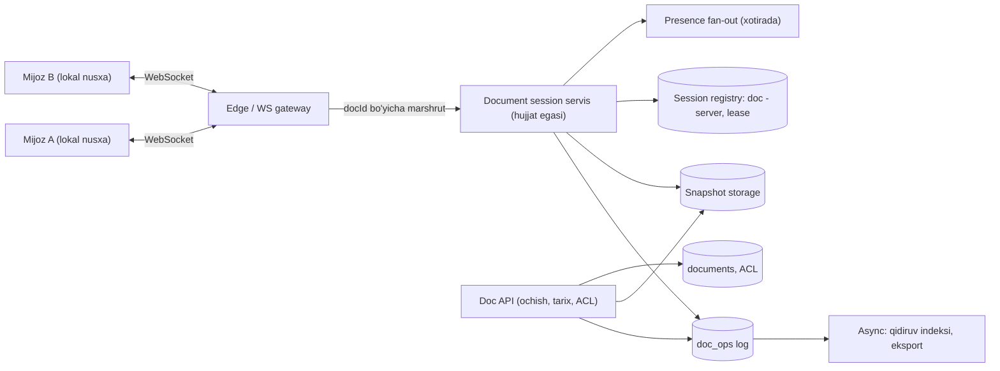
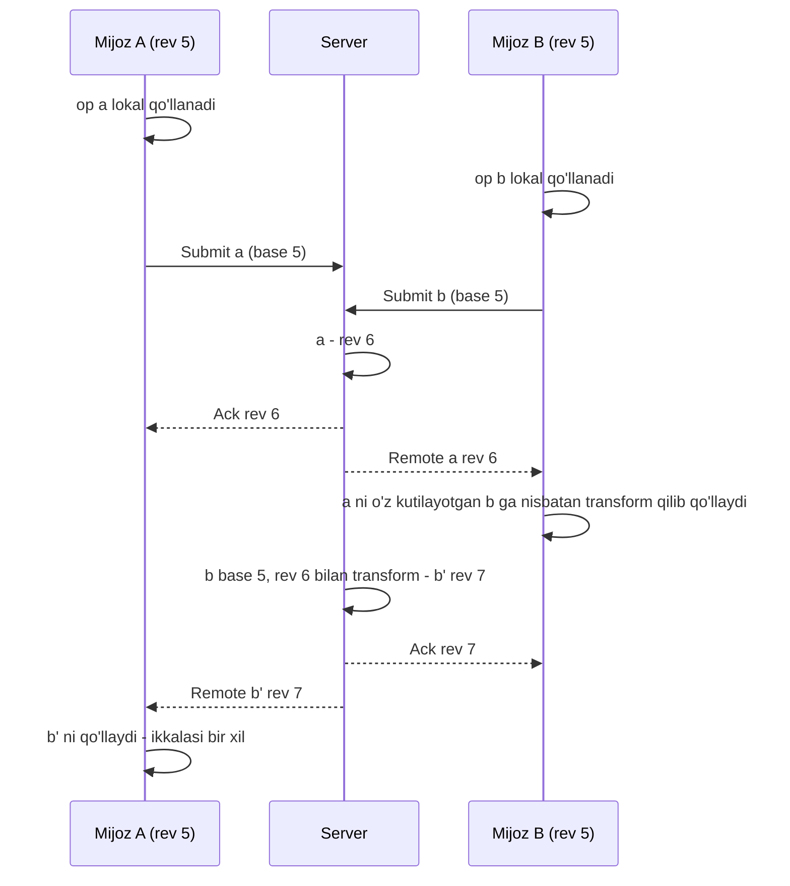

## Bu dars nima uchun kerak

Bir nechta odam bitta hujjatni bir vaqtda tahrirlashi - distributed systems ning eng "inson ko'zi oldidagi" masalasi. Bu yerda konsistentlik muammosi abstrakt emas: agar ikki foydalanuvchining ekranida hujjat turlicha bo'lib qolsa, buni darhol ko'rishadi. Shu bilan birga har bir tugma bosilishi lokal ekranda **darhol** ko'rinishi kerak - serverni kutish qabul qilinmaydi.

Bu masala 40-darsdagi CRDT nazariyasini, 32-darsdagi tartiblash va kauzallikni, 46-darsdagi event sourcing ni (hujjat = operatsiyalar logi), 8-darsdagi WebSocket ni va 86-darsdagi presence ni amaliy tizimda birlashtiradi. Asosiy chuqur tahlil - **Operational Transformation (OT) va CRDT** orasidagi tanlov va markaziy serverning roli.

Bu darsdan keyin siz:

- hujjatni "holat" emas, "operatsiyalar logi" sifatida modellashtira olasiz;
- OT ning transform qadamini misolda bajara olasiz va Google Docs ning client-server protokolini tushuntira olasiz;
- CRDT matn tiplarining (YATA, RGA) g'oyasini va OT bilan trade-off larini bilasiz;
- hujjat bo'yicha bitta "egasi" servis (document session) arxitekturasini va uning nosozliklarini loyihalay olasiz;
- snapshot, versiya tarixi, offline tahrir va presence (kursorlar) ni loyihalay olasiz.

## 1-qadam: talablar

**Funksional talablar:**

- FR-1: bir nechta foydalanuvchi bitta matnli hujjatni bir vaqtda tahrirlaydi (kiritish, o'chirish, formatlash).
- FR-2: har kim boshqalarning o'zgarishlarini deyarli real vaqtda ko'radi.
- FR-3: boshqalarning kursori va belgilashi (presence) ko'rinadi.
- FR-4: versiya tarixi: istalgan oldingi holatni ko'rish va tiklash.
- FR-5: qisqa oflayn rejim: aloqa uzilsa ham yozish davom etadi va keyin birlashadi.
- FR-6: ruxsatlar: egasi, tahrirlovchi, izohlovchi, o'quvchi.

**Ko'lamdan tashqari:** izohlar tizimi tafsilotlari, jadvallar va taqdimotlar, to'liq matnli qidiruv (59-dars), import/eksport formatlari.

**Nofunksional talablar:**

- NFR-1: lokal tahrir **darhol** (bir kadr ichida, < 16 ms) ko'rinadi - tarmoqni kutmasdan.
- NFR-2: boshqalarning o'zgarishi bir regionda p95 < 300 ms da yetadi.
- NFR-3: **yaqinlashish (convergence):** barcha o'zgarishlar yetib kelgach, barcha nusxalar bir xil.
- NFR-4: **niyatni saqlash (intention preservation):** foydalanuvchi kiritgan so'z boshqalarning o'zgarishlaridan keyin ham u mo'ljallagan joyda bo'lishi kerak.
- NFR-5: server tasdiqlagan o'zgarish yo'qolmaydi.
- NFR-6: bitta hujjatda 100 tagacha bir vaqtdagi tahrirlovchi; ko'proq o'quvchilar.

NFR-1 butun arxitekturani belgilaydi: o'zgarish avval lokal qo'llanadi, keyin serverga ketadi. Demak har bir mijozda hujjatning **optimistik nusxasi** bor va ular bir-biridan vaqtincha farq qiladi. Butun muammo - bu farqlarni qanday yaqinlashtirish.

## 2-qadam: hisob-kitob

**Hisob uchun shartlar** (masala sharti, Google Docs ning real statistikasi emas):

| Parametr | Qiymat |
|---|---|
| Faol foydalanuvchilar | kuniga 50 million |
| Cho'qqida ochiq hujjat sessiyalari | 5 million |
| 2+ tahrirlovchili hujjatlar ulushi | 10% |
| Ayni paytda faol yozayotgan sessiyalar | 20% |
| Faol yozuvchi | sekundiga 3-5 belgi; mijoz 50-100 ms lik paketlarga yig'adi, hisobda 5 op xabari/s |
| Bitta operatsiya xabari | 100 B |
| Kunlik o'rtacha operatsiya oqimi | 1 million op/s (cho'qqi 5 million op/s) |
| Bitta server sig'imi | 50 000-100 000 WebSocket ulanish |

**Operatsiyalar:** 5 000 000 × 0.2 × 5 = **5 million op/s** global. Bu katta raqam, lekin u **millionlab mustaqil hujjatga bo'lingan** - bitta hujjatda odatda sekundiga o'nlab operatsiya. Ya'ni muammo "bitta katta tizim" emas, "ko'p kichik mustaqil sessiyalar"ni yaxshi taqsimlash.

**Bitta hujjat:** 100 tahrirlovchi × 5 op/s = 500 op/s va har bir op 99 ta boshqa mijozga - **50 000 xabar/s** fan-out bitta hujjat uchun. Bu bitta jarayon ko'taradigan, lekin chegaraga yaqin yuklama - shuning uchun NFR-6 ning chegarasi bor.

**Ulanishlar:** 5 million WebSocket. Shartdagi sig'im bilan: 5 000 000 / 100 000 = 50 dan 5 000 000 / 50 000 = 100 gacha - **50-100 server** faqat ulanishlar uchun.

**Saqlash:** operatsiya xabari 100 B. Uzluksiz yozgan foydalanuvchi soatiga 5 × 3 600 = 18 000 op, ya'ni 1.8 MB; tanaffuslar bilan soatiga 10 000 op = 1 MB. Agar barcha operatsiyalar abadiy saqlansa, hujjat logi uning matnidan yuzlab marta katta bo'ladi. Shuning uchun: **log + davriy snapshot**, eski operatsiyalarni siqish (masalan, 1 daqiqalik bloklarga birlashtirish) yoki faqat versiya nuqtalarini saqlash.

Kuniga: 5M op/s o'rtacha emas, cho'qqi; shartdagi o'rtacha 1M op/s × 100 B × 86 400 = **8.64 TB/kun** xom operatsiyalar. Bu siqilmasdan saqlansa yiliga petabaytlar - demak siqish va snapshot majburiy.

## 3-qadam: API

```
// Hujjatni ochish (HTTP)
GET /v1/docs/{docId}?at=latest
  -> { snapshot, revision: 18452, sessionEndpoint: "wss://edit-17.../docs/{docId}" }

// WebSocket sessiya xabarlari
client -> server: Submit { docId, baseRevision: 18452, clientId, clientSeq: 37, ops: [...] }
server -> client: Ack    { clientSeq: 37, revision: 18455 }
server -> client: Remote { revision: 18453, authorId, ops: [...] }
client <-> server: Presence { userId, cursor, selection }   // eventual, saqlanmaydi

// Tarix
GET  /v1/docs/{docId}/revisions?cursor=...
POST /v1/docs/{docId}/restore { revision: 17000 }   // yangi operatsiya sifatida
```

- **baseRevision** - mijoz o'zgarishni qaysi server versiyasiga asoslanib qilgani. Server buni transform uchun ishlatadi.
- **clientId + clientSeq** - idempotency: qayta ulanishda mijoz bir xil op ni qayta yuborsa, server uni tanib takrorlamaydi (39-dars).
- **Restore** - tarixni o'chirish emas, joriy holatni eski holatga aylantiradigan yangi operatsiya (event sourcing, 46-dars).
- Presence alohida xabar turi - u durable emas va kechikishi yoki yo'qolishi qabul qilinadi.

## 4-qadam: ma'lumot modeli

```
documents          (PostgreSQL / Spanner kabi)
  doc_id PK, owner_id, title, created_at, latest_revision, latest_snapshot_rev, acl ...

doc_ops            (append-only log; doc_id bo'yicha partition)
  doc_id, revision (monoton, doc ichida), author_id, client_id, client_seq,
  ops (binary), created_at
  PRIMARY KEY (doc_id, revision)
  UNIQUE (doc_id, client_id, client_seq)      -- idempotency

doc_snapshots      (object storage yoki blob ustun)
  doc_id, revision, content (siqilgan), created_at

doc_sessions       (xotirada / koordinatsiya servisi)
  doc_id -> session_server, lease_expires_at, epoch
```

**Hujjat = snapshot + undan keyingi operatsiyalar.** Hujjatni ochish: eng yaqin snapshot ni o'qish + undan keyingi op larni qo'llash. Snapshot har N operatsiyada (masalan, 1 000) yoki har M daqiqada.

**Revision** - hujjat ichidagi qat'iy tartib raqami. Bu OT yondashuvining asosi: server barcha operatsiyalarga yagona umumiy tartib beradi (33-dars: total order, bitta hujjat doirasida).

## 5-qadam: yuqori darajadagi arxitektura



Markaziy g'oya: **har bir ochiq hujjatning bitta "egasi" bor** - document session servisining bitta instance i. U hujjatning joriy holatini xotirada ushlaydi, kelgan operatsiyalarni tartiblaydi (revision beradi), logga yozadi va boshqa mijozlarga tarqatadi. Bu Figma ham ishlatadigan model: mijozlar WebSocket orqali server cluster iga ulanadi va server **har bir multiplayer hujjat uchun alohida jarayon** ishlatadi.

Nega bitta egasi? Chunki operatsiyalarga yagona tartib berish uchun konsensus yoki lock kerak bo'lmasligi - tartibni bitta jarayon xotirada beradi. Hujjatlar millionlab va mustaqil, shuning uchun "har hujjat - bitta egasi" gorizontal masshtablanadi: hujjatlar consistent hashing yoki registry orqali instance larga taqsimlanadi (29-dars).

## 6-qadam: chuqur tahlil

Uchta eng murakkab qism: (1) parallel tahrirlarni birlashtirish algoritmi (OT va CRDT), (2) hujjat egasi servisi - marshrut, lease va failover, (3) tarix, snapshot va oflayn.

### 6.1. Parallel tahrirlar: OT

**Muammo.** Hujjat: `EASY AS 123`. Ikki foydalanuvchi bir vaqtda:

- John: 9-11 pozitsiyalardagi `123` ni o'chirib `ABC` kiritadi.
- Luiz: boshiga (0-pozitsiya) `IT ` kiritadi.

Luiz o'z ekranida endi `IT EASY AS 123` ko'radi. John ning "9-11 ni o'chir" operatsiyasi unga kelganda, agar uni o'zgarishsiz qo'llasa, noto'g'ri belgilar o'chadi - Luiz ning nusxasida hamma narsa 3 pozitsiyaga siljigan. Google Docs ning 2010 yilgi blog seriyasidagi misol aynan shu (ular ikki belgili `IT` bilan ko'rsatadi): kelgan operatsiyani lokal o'zgarishlarga qarab **transform** qilish kerak - John ning o'chirish pozitsiyasini Luiz ning kiritishi uzunligiga siljitish.

**Transform funksiyasi** `T(a, b)`: agar a va b bir xil holatdan parallel yaratilgan bo'lsa, `T(a, b)` - b qo'llangan holatda a ning niyatini bajaradigan operatsiya. Oddiy matn uchun asosiy holatlar:

| a | b | T(a, b) |
|---|---|---|
| insert(p1, s) | insert(p2, t), p2 < p1 | insert(p1 + len(t), s) |
| insert(p1, s) | insert(p2, t), p2 = p1 | tie-break: clientId bo'yicha kim chapda |
| insert(p1, s) | delete(p2, n), p2 + n <= p1 | insert(p1 - n, s) |
| delete(p1, n) | insert(p2, t), p2 <= p1 | delete(p1 + len(t), n) |
| delete(p1, n) | delete(p2, m), kesishadi | faqat hali o'chirilmagan qism o'chiriladi |

Formatlash ham transform qilinadi: Google ning misolida 10-20 pozitsiyadagi qalin (bold) diapazon ichiga 15-pozitsiyada 3 belgi kiritilsa, diapazon 10-23 ga kengayadi.

**Konvergensiya sharti (TP1):** `a` keyin `T(b, a)` qo'llash va `b` keyin `T(a, b)` qo'llash bir xil holatga olib kelishi kerak. Peer-to-peer OT da yana qo'shimcha (TP2) shart kerak va uni to'g'ri implementatsiya qilish tarixan juda qiyin bo'lgan - ko'p nashr etilgan algoritmlarda keyinchalik xatolar topilgan.

**Google Docs client-server protokoli** (2010 blog seriyasining 3-qismi): markaziy server barcha operatsiyalarga tartib beradi, shuning uchun murakkab TP2 kerak emas:

- Server saqlaydi: hali ishlanmagan kiruvchi o'zgarishlar, barcha ishlangan o'zgarishlarning **revision logi** va joriy hujjat holati.
- Server eskirgan (eski revision ga asoslangan) o'zgarish kelganda uni oraliqdagi operatsiyalarga nisbatan transform qilib, keyingi revision sifatida saqlaydi.
- Mijoz saqlaydi: oxirgi olgan revision, yuborilmagan lokal o'zgarishlar, yuborilgan lekin ACK olinmagan o'zgarishlar.
- Mijoz o'z o'zgarishini **darhol lokal** qo'llaydi (NFR-1).
- Mijozda **bir vaqtda faqat bitta ACK olinmagan o'zgarish** bo'ladi; qolgan yangi o'zgarishlar ACK kelguncha "kutilayotgan" ro'yxatda yig'iladi va keyin bitta paket bo'lib ketadi.
- Mijoz boshqa birovning o'zgarishini olganda, uni o'zining ACK olinmagan va kutilayotgan o'zgarishlariga nisbatan transform qiladi.
- Server har bir mijozning holatini kuzatishi shart emas, shuning uchun server ishi har yangi tahrirlovchi bilan sezilarli o'smaydi.



Bu sxema 1995 yilgi **Jupiter** tizimiga (D. Nichols, P. Curtis, M. Dixon, J. Lamping, Xerox PARC, UIST 1995) borib taqaladi: maqola annotatsiyasiga ko'ra Jupiter ziddiyatli xabarlarni operatsiya transformatsiyalari bilan tuzatadi va uning markazlashgan arxitekturasi oldingi (markazsiz) OT algoritmini sezilarli soddalashtirishga imkon bergan.

### 6.2. CRDT alternativa

40-darsdan: CRDT - shunday ma'lumot tuzilmasiki, replica lar operatsiyalarni istalgan tartibda qo'llab bir xil holatga kelishi matematik kafolatlangan. Matn uchun g'oya: har bir belgiga **global noyob, o'zgarmas ID** beriladi (masalan, `(clientId, lamportCounter)`), va kiritish "pozitsiya 9 ga" emas, "ID X belgisidan keyin" deb ifodalanadi. Pozitsiya o'zgarsa ham ID o'zgarmaydi, shuning uchun transform kerak emas. O'chirilgan belgilar tombstone sifatida qoladi (yoki keyinroq tozalanadi).

Mashhur algoritmlar va kutubxonalar: RGA, YATA (Yjs kutubxonasi asosi), Automerge (Kleppmann va boshqalar). "Local-first software" esse (Kleppmann, Wiggins, van Hardenberg, McGranaghan, Onward! 2019) CRDT larni oflayn ishlash, ko'p qurilmada hamkorlik va foydalanuvchining o'z ma'lumotiga egaligi uchun asos sifatida taklif qiladi.

**OT va CRDT trade-off:**

| | OT (markaziy server) | CRDT |
|---|---|---|
| Tartib | Server umumiy tartib beradi | Tartib kerak emas, kommutativ |
| Server roli | Majburiy (transform va tartib) | Ixtiyoriy (relay, saqlash) |
| Oflayn uzoq ish | Qiyin - uzoq tarmoqlarni transform qilish | Tabiiy |
| P2P | Murakkab (TP2) | Tabiiy |
| Metadata | Kichik (pozitsiyalar) | Har belgi uchun ID, tombstone - xotira va hajm katta |
| Implementatsiya xatolari | Transform funksiyalari nozik | Algoritm isbotlangan, lekin samarali implementatsiya qiyin |
| Real tizimlar | Google Docs | Figma (CRDT-ilhomlangan), Yjs/Automerge asosidagi tahrirlagichlar |

Muhim nozik nuqta: 2019 yildagi "Real Differences between OT and CRDT" maqolasi (Sun va boshq.) mualliflar bilgan barcha ishlaydigan OT co-editor lar markaziy serverdan foydalanishini, ko'rib chiqilgan CRDT co-editor lar ham ba'zi vazifalar (sessiya boshqaruvi, broadcast) uchun markaziy serverga tayanishini va "CRDT P2P uchun maxsus mos" degan qarashni xato deb hisoblashini ta'kidlaydi. Ya'ni amaliy tizimda server baribir bor - savol uning qanchalik "aqlli" bo'lishi.

**Figma** - oraliq yo'l: Figma blogiga ko'ra ular OT ni dizayn vositasi uchun ortiqcha murakkab deb topgan va CRDT tadqiqotlaridan ilhomlangan, lekin "haqiqiy CRDT" emas, server-authoritative tizim qurgan: server hodisalar tartibini belgilaydi, har obyektning har xususiyati uchun **last-writer-wins** (bir xil xususiyatni ikki kishi o'zgartirsa, serverga oxirgi kelgan qiymat yutadi), farzandlar tartibi uchun fractional indexing. Bu matn uchun yaramaydi (belgi darajasida birlashtirish yo'q), lekin dizayn obyektlari uchun yetarli va ancha sodda.

**Bizning tanlov:** markaziy document session servisi + **server-tartibli** algoritm. Boshlash uchun ikki real variant: (a) klassik client-server OT (Google Docs modeli), (b) Yjs kabi tayyor CRDT kutubxonasi, server esa relay, tartib va saqlash vazifasini bajaradi. Kichik jamoa uchun (b) ko'pincha arzonroq, chunki transform funksiyalarini o'zingiz yozib, isbotlash shart emas; narxi - metadata hajmi va tombstone tozalash.

### 6.3. Document session servisi: marshrut, lease, failover

**Marshrut.** Mijoz hujjatni ochganda Doc API registry dan "bu hujjat qaysi session server da?" deb so'raydi. Agar hech qayerda ochiq bo'lmasa, yuklama bo'yicha server tanlanadi va registry ga yoziladi. Barcha keyingi mijozlar shu serverga yo'naltiriladi.

**Ikki egasi xavfi (split-brain).** Agar ikki server bir hujjatni bir vaqtda "egalik" qilsa, ikkalasi revision 18456 ni turli operatsiyalarga beradi - hujjat buziladi. Himoya (38-dars):

- Registry da egalik **lease** bilan (masalan, 10 soniya, har 3 soniyada yangilanadi) va **epoch** (fencing token) bilan.
- Log ga yozish shartli: `INSERT INTO doc_ops ... WHERE (doc_id, revision)` noyob kalit - ikkinchi egasi bir xil revision yozolmaydi (PRIMARY KEY to'qnashuvi). Qo'shimcha ravishda log yozuvida epoch tekshiriladi: eski epoch li server yozuvi rad etiladi.

**Durability (NFR-5).** Server ACK ni faqat operatsiya logga yozilgandan keyin yuboradi. Latency budjeti: lokal qo'llash darhol (NFR-1), ACK esa bir round-trip va log yozish vaqtidan keyin - foydalanuvchi buni sezmaydi, chunki u o'z o'zgarishini allaqachon ko'rgan. Boshqalarga tarqatish (Remote) logga yozilgandan keyin yoki parallel - lekin parallel bo'lsa, server o'lib, yozuv yo'qolsa, boshqa mijozlar "mavjud bo'lmagan" revision ni ko'rgan bo'ladi. Shuning uchun xavfsiz tartib: log → ACK va Remote.

**Failover.** Session server o'ldi:

1. Lease tugaydi (10 s).
2. Mijozlar WebSocket uzilganini ko'radi va qayta ulanadi; Doc API yangi server tayinlaydi (yangi epoch).
3. Yangi server snapshot + log dan holatni tiklaydi.
4. Mijozlar o'zlarining ACK olinmagan va kutilayotgan op larini `baseRevision` bilan qayta yuboradi; `(client_id, client_seq)` noyobligi tufayli logga yozilgan, lekin ACK olinmagan op lar takrorlanmaydi.

Foydalanuvchi uchun natija: 10-15 soniya "qayta ulanmoqda" belgisi, lekin yozish to'xtamaydi (lokal) va hech narsa yo'qolmaydi.

**Hot hujjat.** 10 000 kishi ochgan e'lon hujjati: tahrirlovchilar kam, o'quvchilar ko'p. O'quvchilarni alohida "read-only fan-out" qatlamiga (CDN yoki pub/sub relay) chiqarish va ularga op larni biroz kechikish bilan batch qilib yuborish - session server faqat tahrirlovchilar bilan ishlaydi.

### 6.4. Tarix, snapshot va oflayn

- **Snapshot** har 1 000 op da: hujjatni ochish = snapshot + ≤ 1 000 op qo'llash, millisekundlar.
- **Versiya tarixi:** foydalanuvchiga har bir tugma emas, mantiqiy versiyalar kerak (masalan, har 5-10 daqiqalik tahrir sessiyasi va muallif bo'yicha). Eski op lar shu versiyalarga siqiladi, snapshot lar esa saqlanadi - 8.6 TB/kun xom op lar shu yo'l bilan bir necha tartibga kamayadi.
- **Oflayn (FR-5):** OT da mijoz oflaynda ko'p op to'plasa, qayta ulanganda ularni server tarixidagi barcha oraliq op larga nisbatan transform qilish kerak - qisqa oflayn (daqiqalar) uchun yaxshi ishlaydi, uzoq (soatlar, ko'p tahrirlovchi) uchun natija foydalanuvchi uchun kutilmagan bo'lishi mumkin. CRDT bu holatni tabiiyroq hal qiladi - bu "local-first" g'oyasining asosiy argumenti.

## 7-qadam: nosozlik stsenariylari

| Stsenariy | Ta'sir | Himoya |
|---|---|---|
| Session server o'ldi | Hujjat 10-15 s "qayta ulanmoqda" | Lease, yangi epoch, snapshot + log dan tiklash, mijoz op larini qayta yuborish |
| Ikki server o'zini egasi deb hisoblaydi | Revision to'qnashuvi, buzilgan hujjat | Epoch fencing, (doc_id, revision) noyob kalit |
| Log bazasi sekinlashdi | ACK kechikadi | Mijoz lokal davom etadi; kutilayotgan op lar to'planadi; backpressure - mijoz paketlarni kattalashtiradi |
| Mijoz eski revision dan juda uzoq | Ko'p transform | Server "too far behind" desa, mijoz snapshot dan qayta yuklaydi va o'z kutilayotgan op larini qayta asoslaydi |
| Transform yoki CRDT bug | Nusxalar farqlanadi | Mijoz davriy ravishda hujjat hash ini server bilan solishtiradi; farq bo'lsa server holatidan qayta yuklash va telemetriya |
| WebSocket gateway o'ldi | Ulanishlar uziladi | Mijoz backoff + jitter bilan qayta ulanadi (62-dars) |
| Region o'ldi | Session lar yo'qoladi | Log boshqa regionga replikatsiya; RPO = replikatsiya lag i; mijozlarning ACK olinmagan op lari ularda saqlanadi |

Hash solishtirish - muhim himoya qatlami: transform funksiyalaridagi nozik xatolar odatda kamdan-kam holatlarda chiqadi va jim farqlanishga olib keladi. Uni aniqlash va o'z-o'zini tuzatish mexanizmi bo'lmasa, foydalanuvchilar "hujjatim buzildi" deb shikoyat qiladi.

## 8-qadam: evolyutsiya (10x)

1. **Ulanishlar** (50 million WebSocket) - gateway lar gorizontal, regionlar bo'yicha; session server lar ulanishni emas, hujjat holatini ushlaydi - gateway va session ni ajratish (gateway ko'p, session server kam).
2. **Log hajmi** - op larni siqish va snapshot siyosati qat'iylashadi; eski hujjatlar loglari sovuq saqlashga (78-dars).
3. **Global hamkorlik** - turli qit'alardagi tahrirlovchilar. Session server bitta regionda bo'lgani uchun uzoqdagilar uchun ACK latency ga qit'alararo round-trip qo'shiladi (2-darsdagi latency raqamlari). Lokal qo'llash tufayli bu sezilmaydi, lekin boshqalarning o'zgarishlarini ko'rish kechikadi. Session ni ko'pchilik tahrirlovchilar yaqinidagi regionga ko'chirish (hujjat "migratsiyasi").
4. **Katta hujjatlar** - 500 sahifalik hujjat holati xotirada qimmat; bo'limlar bo'yicha bo'lish.

## iQuariX kontekstida

Masala sharti (o'quv ssenariysi): iQuariX dispetcherlari uchun "smena jurnali" yoki "marshrut rejasi" ni bir nechta dispetcher bir vaqtda tahrirlaydi: bir dispetcher mashinani marshrutga qo'shadi, boshqasi marshrutdagi to'xtash tartibini o'zgartiradi.

- Bu **matn emas, tuzilmali obyektlar** (marshrut, to'xtashlar ro'yxati, mashina tayinlash). OT kerak emas; Figma uslubi mos: server-authoritative, xususiyat darajasida LWW, ro'yxat tartibi uchun fractional indexing (to'xtashlar orasiga yangi to'xtash qo'shish uchun `1.5` kabi indeks).
- Lekin ba'zi invariantlar LWW bilan yechilmaydi: "bitta mashina bir vaqtda ikki marshrutda bo'lmasin" - bu 95-darsdagi atomik band qilish masalasi, CRDT emas.
- Presence (kim qaysi marshrutni tahrirlayapti) - konfliktlarni oldini olishning eng arzon vositasi: foydalanuvchilar bir-birining ishiga aralashmaydi.

## Ko'p uchraydigan xatolar

1. **Serverni kutib, keyin ko'rsatish.** Har tugmaga 100-300 ms kechikish - foydalanish imkonsiz.
2. **Pozitsiya bo'yicha operatsiyalarni transformsiz qo'llash.** Parallel tahrirda noto'g'ri belgilar o'chadi.
3. **Butun hujjatni LWW bilan saqlash.** Ikki kishi parallel yozsa, biri butun ishini yo'qotadi.
4. **Bitta hujjatga ikki egasi.** Lease va fencing siz revision to'qnashuvi.
5. **ACK ni logga yozishdan oldin yuborish.** Server o'lsa "tasdiqlangan" o'zgarish yo'qoladi.
6. **Barcha op larni abadiy siqmasdan saqlash.** Log matndan yuzlab marta katta bo'ladi.
7. **Farqlanishni aniqlash mexanizmi yo'qligi.** Algoritm xatosi jim hujjat buzilishiga aylanadi.
8. **Presence ni durable kanal orqali yuborish.** Kursor harakatlari logni to'ldiradi; ular eventual va saqlanmaydigan bo'lishi kerak.

## Xulosa

- Lokal tahrir darhol qo'llanadi - demak har mijozda optimistik nusxa bor va asosiy muammo ularni yaqinlashtirish.
- Hujjat = snapshot + operatsiyalar logi; revision - hujjat ichidagi umumiy tartib.
- OT: kelgan operatsiyani parallel lokal o'zgarishlarga nisbatan transform qilish; Google Docs markaziy server tartibi bilan murakkab P2P shartlaridan qochadi va mijozda bitta ACK olinmagan o'zgarish qoidasini ishlatadi.
- CRDT: belgilarga o'zgarmas ID, transform kerak emas, oflayn tabiiy; narxi - metadata va tombstone.
- Amaliy tizimlar deyarli har doim markaziy serverga ega; Figma - server-authoritative, xususiyat bo'yicha LWW.
- Har hujjatga bitta session egasi - lease va epoch fencing bilan; ACK logga yozilgandan keyin.
- Hash bo'yicha farqlanishni aniqlash - algoritm xatolariga qarshi oxirgi himoya.

## Amaliy topshiriq

iQuariX uchun **hamkorlikdagi marshrut rejalashtirish** modulini loyihalang (faraziy): 5-10 dispetcher bitta kunlik rejani (200 ta buyurtma, 50 ta mashina, har mashinaga to'xtashlar ketma-ketligi) bir vaqtda tahrirlaydi.

1. **Talablar.** Qaysi operatsiyalar parallel bo'lishi mumkin; qaysi konfliktlar avtomatik hal qilinadi va qaysilari foydalanuvchiga ko'rsatilishi kerak.
2. **Ma'lumot modeli.** Reja, marshrut, to'xtash. Tartib uchun fractional indexing yoki boshqa usul - asoslang.
3. **Konflikt strategiyasi.** Xususiyat darajasida LWW, OT, CRDT yoki server validatsiyasi - har bir operatsiya turi uchun alohida jadval bilan.
4. **Invariantlar.** "Bitta buyurtma bitta marshrutda", "mashina sig'imi oshmasin" - bular qanday ta'minlanadi (server tomonda rad etish va mijozga xabar)?
5. **Arxitektura.** Session egasi, WebSocket, log, snapshot - mermaid diagramma.
6. **Nosozliklar.** Session server o'ldi; dispetcher 20 daqiqa oflayn ishladi va qaytdi.

Yaxshi javobda bo'lishi kerak bo'lgan narsalar:

- matn emasligi sababli OT rad etilgani yoki asoslangani;
- LWW qayerda xavfsiz va qayerda xavfli ekani aniq ajratilgan;
- invariantlar server tomonida, CRDT bilan emas;
- lease va fencing bilan bitta egasi;
- oflayn qaytishda konfliktlarni foydalanuvchiga ko'rsatish rejasi.

Javobni pastdagi maydonga yozib, chatga yuboring.

## Manbalar

- Google Drive Blog. [What's different about the new Google Docs: Conflict resolution](https://drive.googleblog.com/2010/09/whats-different-about-new-google-docs_22.html), 2010 - OT va transform misollari.
- Google Drive Blog. [What's different about the new Google Docs: Making collaboration fast](https://drive.googleblog.com/2010/09/whats-different-about-new-google-docs.html), 2010 - client-server protokol, revision log, bitta ACK olinmagan o'zgarish.
- Figma. [How Figma's multiplayer technology works](https://www.figma.com/blog/how-figmas-multiplayer-technology-works/) - OT rad etilgani, server-authoritative, xususiyat bo'yicha LWW, har hujjat uchun alohida jarayon.
- M. Kleppmann, A. Wiggins, P. van Hardenberg, M. McGranaghan. [Local-first software](https://martin.kleppmann.com/2019/10/23/local-first-at-onward.html), Onward! 2019 - CRDT va oflayn hamkorlik.
- D. Sun, C. Sun, A. Ng, W. Cai. [Real Differences between OT and CRDT in Building Co-Editing Systems and Real World Applications](https://arxiv.org/abs/1905.01517), 2019 - real co-editor larda markaziy server roli, P2P haqidagi miflar.
- D. Nichols, P. Curtis, M. Dixon, J. Lamping (Xerox PARC). [High-Latency, Low-Bandwidth Windowing in the Jupiter Collaboration System](https://uist.acm.org/uist1995/abstracts/Nichols.html), UIST 1995 - client-server OT ning kelib chiqishi.
- [Yjs deep dive](https://www.tag1.com/blog/yjs-deep-dive-part-3/), Tag1 - YATA CRDT ning amaliy implementatsiyasi.
