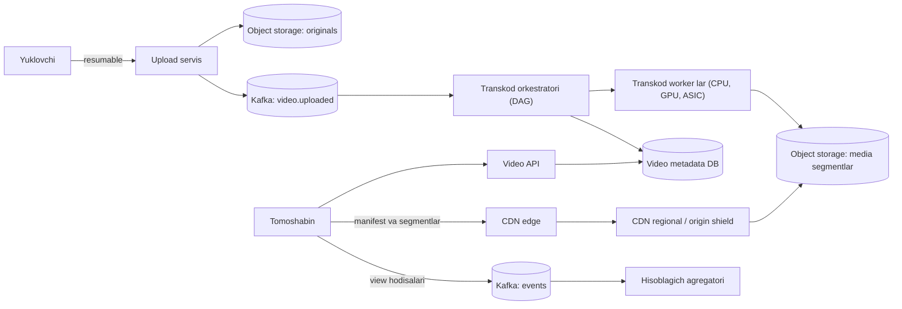
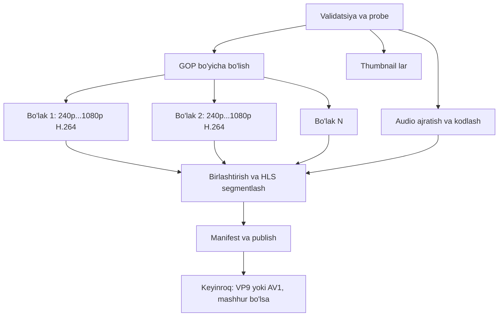

## Bu dars nima uchun kerak

Video platforma - boshqa case study lardan farqli ravishda **bayt og'ir** tizim: metadata kichik va oddiy, lekin har bir video gigabaytlab xom fayl, o'nlab transkod qilingan variantlar va har ko'rishda megabaytlab tarmoq trafigi degani. Bu yerda arxitekturani CPU yoki QPS emas, **saqlash, transkodlash hisoblash quvvati va egress (chiquvchi trafik) narxi** belgilaydi. Shu sabab YouTube kabi kompaniyalar o'z transkodlash chiplarini yasaydi, Netflix esa o'z serverlarini internet provayderlar ichiga qo'yadi.

Bu masala 84-darsdagi video ingest va HLS ni, 60-darsdagi object storage va katta fayl yuklashni, 25-darsdagi CDN ni, 58-darsdagi batch/DAG ishlov berishni, 23-24 darslardagi cache ni va 79-darsdagi xarajatni hisobga olgan dizaynni birlashtiradi.

Bu darsdan keyin siz:

- video platforma uchun saqlash, transkodlash va egress ni hisoblay olasiz va qaysi biri narxni belgilashini ko'rsata olasiz;
- katta fayllarni resumable yuklashni loyihalay olasiz;
- transkodlash pipeline ini (segmentlash, parallel kodlash, DAG) loyihalay olasiz;
- adaptive bitrate streaming (HLS) va CDN ierarxiyasini, mashhur va "uzun dum" kontent uchun turli strategiyalarni tushuntira olasiz;
- ko'rishlar hisoblagichi kabi yozishi og'ir metrikalarni loyihalay olasiz.

## 1-qadam: talablar

**Funksional talablar:**

- FR-1: foydalanuvchi video yuklaydi (bir necha GB gacha), aloqa uzilsa davom ettira oladi.
- FR-2: video turli sifatlarda (240p-2160p) transkod qilinadi va istalgan qurilmada ko'riladi.
- FR-3: tomosha adaptiv: tarmoq tezligiga qarab sifat avtomatik o'zgaradi.
- FR-4: metadata: sarlavha, tavsif, preview rasmlar (thumbnail), ko'rishlar soni, like.
- FR-5: video holati: yuklanmoqda, qayta ishlanmoqda, tayyor, xato.

**Ko'lamdan tashqari:** jonli efir (live streaming), tavsiyalar (89-dars), izohlar, monetizatsiya va reklama, mualliflik huquqini aniqlash (Content ID), qidiruv.

**Nofunksional talablar:**

- NFR-1: tomosha boshlanishi (time to first frame) p90 2 soniyadan kam.
- NFR-2: tomosha paytida qayta buferlash (rebuffering) vaqtning 1% idan kam.
- NFR-3: yuklangan video yo'qolmaydi (durability 11 nines darajasidagi object storage).
- NFR-4: 10 daqiqalik video yuklangandan keyin 10 daqiqa ichida tomosha uchun tayyor (kamida past sifatlarda).
- NFR-5: tomosha mavjudligi 99.95%; yuklash va transkodlash vaqtincha to'xtashi mumkin.
- NFR-6: egress narxi har ko'rish soatiga minimal - CDN kesh hit rate maksimal.
- NFR-7: ko'rishlar soni eventual, bir necha daqiqa kechikishi mumkin.

## 2-qadam: hisob-kitob

**Real orientir:** YouTube 2019 yilda har daqiqada 500 soatdan ortiq kontent yuklanayotganini e'lon qilgan (Tubefilter xabari). Bu sekundiga ~8.3 soat video.

Biz kichikroq, lekin jiddiy platformani loyihalaymiz. **Hisob uchun shartlar** (manba ko'rsatilmaganlari - masala sharti):

| Parametr | Qiymat | Manba |
|---|---|---|
| Yuklash | daqiqasiga 50 soat video (YouTube 2019 ning 10% i) | shart |
| Xom original | 1080p, 8 Mbit/s | shart |
| H.264 bitrate ladder | 416x234 0.145, 640x360 0.365, 960x540 2.0, 1280x720 3.0, 1920x1080 6.0 Mbit/s | Apple HLS Authoring Specification, 1.25-band jadvalidan 5 ta pog'ona |
| Ikkinchi kodek (HEVC, VP9 yoki AV1) to'plami | H.264 bitrate larining 75% i | shart; Apple jadvalida 1920x1080 uchun HEVC 4.5 va H.264 6.0 Mbit/s (75%) |
| Transkodlash narxi | H.264: 1 rendition uchun 1 core-soat har soat videoga; ikkinchi kodek 3 baravar qimmat | shart (o'z encoder sozlamangizda o'lchang) |
| Tomosha | kuniga 500 million ko'rish soati, o'rtacha bitrate 2.5 Mbit/s, cho'qqi ×2 | shart |
| CDN egress narxi | ochiq narx: 5 PB dan ortiq hajm uchun $0.020/GB; hisobda kelishilgan $0.01/GB | Amazon CloudFront pay-as-you-go narxlari (AQSh); $0.01 - shart |
| Saqlash narxi | issiq va sovuq aralash $0.01/GB-oy | shart |
| Metadata | o'rtacha video 10 daqiqa, yozuv 2 KB | shart |
| Ko'rish | o'rtacha bitta ko'rish 6 daqiqa | shart |

**Yuklash hajmi:** 50 soat/daq × 60 = 3 000 soat/soat = **72 000 soat video/kun**. Xom original 1 soat = 8 Mbit/s × 3 600 s = 28 800 Mbit = **3.6 GB**. Kuniga: 72 000 × 3.6 GB ≈ **260 TB/kun** xom (originallar).

**Transkodlangan variantlar:** H.264 ladder: 0.145 + 0.365 + 2.0 + 3.0 + 6.0 = 11.51 Mbit/s. Ikkinchi kodek: 11.51 × 0.75 ≈ 8.63 Mbit/s. Jami ≈ 20.1 Mbit/s barcha variantlar uchun. 1 soat → 20.1 × 3 600 / 8 ≈ 9 050 MB ≈ **9.05 GB**. Kuniga: 72 000 × 9.05 GB ≈ **650 TB/kun**.

**Jami saqlash:** 260 + 650 ≈ 910 TB/kun, yiliga 910 × 365 ≈ **330 PB**. Bu raqam darhol saqlash qatlamlari (tiering) va originallarni sovuq saqlashga ko'chirish masalasini ko'taradi (78-dars).

**Transkodlash hisoblashi:** shartga ko'ra H.264 ning 5 rendition i = 5 core-soat, ikkinchi kodek 5 × 3 = 15 core-soat, jami **20 core-soat** har soat video uchun. Kuniga: 72 000 × 20 = 1.44 million core-soat; 1.44M / 24 = **60 000 core** doimiy band. Bu juda qimmat va aynan shu sabab Google o'z Argos VCU chipini yasagan: Google ga ko'ra u avvalgi an'anaviy server tizimiga nisbatan hisoblash samaradorligini 20-33 baravargacha oshirgan (2021).

**Tomosha va egress:** shartdagi 500 million ko'rish soati yuklashdan 500M / 72 000 ≈ 7 000 baravar ko'p. 2.5 Mbit/s da 1 soat = 2.5 × 3 600 / 8 = 1 125 MB = 1.125 GB. Kuniga: 500M × 1.125 GB ≈ **560 PB/kun** egress. O'rtacha 560 PB / 86 400 s ≈ 6.5 TB/s ≈ **52 Tbit/s**, cho'qqi ×2 ≈ 100 Tbit/s.

**Narx sezgisi:** CloudFront ning ochiq narxida (5 PB dan ortiq hajm, AQSh) $0.020/GB: 560 million GB × $0.02 = kuniga $11.2 million. AWS hujjatiga ko'ra hajm bo'yicha majburiyat olgan mijozlarga alohida chegirmali narx beriladi; shartdagi $0.01/GB bilan: 560 million GB × $0.01 = **kuniga $5.6 million**, oyiga ~$168 million. Saqlash: 330 PB = 330 million GB × $0.01/GB-oy = **oyiga $3.3 million**. Xulosa: **egress saqlashdan ancha qimmat** va transkodlash ham katta. Bu raqamlar arxitektura qarorlarini belgilaydi:

1. CDN kesh hit rate ning har bir foizi - millionlab dollar.
2. Har bir video uchun barcha rendition va kodeklarni oldindan tayyorlash shart emas - kam ko'riladigan videolar uchun qimmat kodeklar (AV1) kerak emas.
3. Bunday masshtabda o'z CDN i va provayderlar ichidagi serverlar (Netflix Open Connect kabi) iqtisodiy jihatdan oqlanadi.

**Metadata:** 72 000 soat/kun × 6 (10 daqiqalik video) = kuniga 432 000 video. Yiliga 432 000 × 365 ≈ 158 million yozuv × 2 KB ≈ 320 GB. Metadata - kichik masala (sharded MySQL/PostgreSQL yetadi).

**Ko'rishlar hisoblagichi:** 500M soat × 10 (6 daqiqalik ko'rish) = 5 milliard ko'rish/kun; 5 × 10^9 / 86 400 ≈ **58 000 increment/s** o'rtacha, mashhur videolarda bitta kalitga sekundiga minglab - hot key (24-dars).

## 3-qadam: API

```
// Yuklash (resumable, tus protokoli uslubida)
POST   /v1/uploads   { filename, size, mime }  -> 201 Location: /v1/uploads/{uploadId}
HEAD   /v1/uploads/{uploadId}                  -> Upload-Offset: 524288000
PATCH  /v1/uploads/{uploadId}  Upload-Offset: 524288000, Content-Type: application/offset+octet-stream
                                               -> 204 Upload-Offset: 629145600
POST   /v1/videos { uploadId, title, description, visibility }  -> 202 { videoId, status: "processing" }

// Tomosha
GET /v1/videos/{videoId}                -> metadata + manifest URL (imzolangan)
GET https://cdn.../{videoId}/master.m3u8
GET https://cdn.../{videoId}/720p/seg_00042.m4s

// Hodisalar
POST /v1/videos/{videoId}/events  { type: "view_start" | "heartbeat" | "quality_change", ... }
```

**Resumable yuklash.** 3 GB faylni bitta HTTP so'rovda yuklash mobil tarmoqda deyarli muvaffaqiyatsiz. tus protokoli yechimi: `POST` bilan yuklash yaratiladi (`Upload-Length`), `HEAD` serverda qancha bayt saqlanganini (`Upload-Offset`) qaytaradi, `PATCH` shu offset dan davom ettiradi; offset mos kelmasa 409. Muqobil - S3 multipart upload va imzolangan URL lar bilan to'g'ridan-to'g'ri object storage ga (60-dars) - bunda bizning serverlarimiz bayt oqimidan butunlay ozod.

**Tomosha API si** faqat manifest URL ni beradi; baytlar to'g'ridan-to'g'ri CDN dan. URL imzolangan va muddatli (xususiy videolar uchun).

## 4-qadam: ma'lumot modeli

```
videos (sharded relational; video_id bo'yicha)
  video_id PK, channel_id, title, description, duration_s, status,
  visibility, created_at, published_at, original_key, ladder_version

renditions
  video_id, codec (h264|vp9|av1), height, bitrate, storage_key, segment_count, status
  PRIMARY KEY (video_id, codec, height)

transcode_jobs
  job_id, video_id, step, status, attempts, worker_id, lease_expires_at

view_counts (Redis/Cassandra hisoblagich + davriy flush)
  video_id -> approx_count

Object storage:
  originals/{video_id}/source.mp4           -- sovuq qatlam (bir necha kundan keyin)
  media/{video_id}/{codec}/{height}/init.mp4, seg_00001.m4s, ...
  media/{video_id}/master.m3u8
  thumbs/{video_id}/{n}.jpg
```

Thumbnail lar - alohida muammo: millionlab kichik fayl. YouTube ning 2008 yilgi arxitektura konspektiga ko'ra, kichik fayllar ko'pligi disk seek lari, inode va page cache bosimiga olib kelgan va ular thumbnail larni Google BigTable ga ko'chirgan - kichik fayllarni birga guruhlaydigan saqlashga. Bugun object storage + CDN bu muammoni asosan yopadi, lekin o'z saqlashingizda bu saboq hali ham to'g'ri.

## 5-qadam: yuqori darajadagi arxitektura



Uchta mustaqil yo'l:

1. **Yuklash yo'li** - bayt oqimi object storage ga, keyin hodisa navbatga. Upload servis tezda ozod bo'ladi.
2. **Qayta ishlash yo'li** - asinxron, minutlab davom etadigan DAG. Qayta urinish va idempotentlik muhim.
3. **Tomosha yo'li** - deyarli butunlay CDN da; bizning serverlarimiz faqat metadata va imzolangan URL beradi.

## 6-qadam: chuqur tahlil

Uchta eng xavfli va qimmat qism: (1) transkodlash pipeline i, (2) yetkazib berish: ABR, CDN va uzun dum, (3) ko'rishlar hisoblagichi.

### 6.1. Transkodlash pipeline i

**Nega parallel segmentlash.** 2 soatlik videoni bitta worker da ketma-ket kodlash - soatlar. NFR-4 (10 daqiqa) ni bajarish uchun video **GOP (keyframe) chegaralari bo'yicha bo'laklarga** bo'linadi (masalan, 10-30 soniyalik), har bo'lak alohida worker da parallel kodlanadi, keyin birlashtiriladi. Bu MapReduce shakli (58-dars): split → map (kodlash) → reduce (birlashtirish, manifest).

**DAG:**



**Ustuvorlik va bosqichli publish.** Avval past sifatlar (360p, 720p) tayyor bo'lishi bilan video "tayyor" deb e'lon qilinadi - foydalanuvchi kutmaydi. Yuqori sifatlar va qimmat kodeklar keyin qo'shiladi. Bu NFR-4 ni bajaradi va resursni tejaydi.

**Mashhurlikka qarab kodlash.** AV1 kabi samarali kodeklar bir xil sifatda kam bitrate beradi (egress tejaladi), lekin kodlash ancha qimmat. Trade-off: video kamdan-kam ko'rilsa, AV1 ga sarflangan hisoblash hech qachon o'zini oqlamaydi. Qoida: dastlab faqat H.264; video ko'rishlar chegarasidan (masalan, 1 000 ko'rish) oshsa, AV1/VP9 kodlash navbatga qo'yiladi. Netflix bu g'oyani yanada rivojlantirgan: Netflix Tech Blog ning 2015 yil dekabrdagi "Per-Title Encode Optimization" postiga ko'ra, ular 2010 yildan beri barcha kontent uchun ishlatilgan yagona "hamma uchun bir xil" bitrate ladder (masalan, 1080p uchun yuqori pog'ona 5 800 kbit/s) o'rniga har bir title ning murakkabligini tahlil qilib, ladder ni alohida tanlashga o'tgan: oddiy animatsiya (misolda BoJack Horseman) bir xil sifat uchun kamroq bit talab qiladi, murakkab harakatli sahnalar esa ko'proq.

**Ishonchlilik:** har qadam idempotent (natija `media/{video_id}/{codec}/{height}/...` deterministik kalitga yoziladi - qayta ishlash ustiga yozadi), worker lar lease bilan vazifa oladi (42-dars: visibility timeout), xato bo'lsa backoff bilan qayta urinish, N marta xatodan keyin DLQ (50-dars) va video "xato" holatiga. Buzilgan yoki zararli fayllar (codec bombs) uchun qat'iy resurs limitlari va sandbox.

**Hisoblash turlari:** CPU (moslashuvchan, qimmat), GPU (NVENC kabi apparat kodlovchilar - tez; sifat/bitrate nisbatini o'z kontentingizda dasturiy kodlovchi bilan solishtiring), ASIC (Argos kabi - eng samarali, faqat o'z chipingiz bo'lsa). Spot/preemptible instance lar transkodlash uchun ideal: vazifalar qisqa va qayta boshlanadi (79-dars).

### 6.2. Yetkazib berish: ABR, CDN va uzun dum

**Adaptive bitrate (ABR).** Video har bir sifatda 2-6 soniyalik segmentlarga bo'lingan; master manifest barcha variantlarni sanaydi. Pleyer tarmoq o'tkazuvchanligini va bufer holatini o'lchab, har keyingi segment uchun sifat tanlaydi. Apple ning "HLS Authoring Specification for Apple devices" hujjatiga ko'ra: target duration **6 soniya** bo'lishi kerak (SHOULD, 7.5-band), video segmentlar IDR kadr bilan boshlanishi shart (MUST, 7.4), keyframe (IDR) lar har **2 soniyada** bo'lishi kerak (SHOULD, 1.13) va videoning bir nechta bitrate variantlari majburiy (MUST, 9.9). 1.25-band esa namunaviy bitrate ladder jadvalini beradi (2-qadamdagi shartlar shundan olingan).

Segment davomiyligi trade-off i:

| Segment | Afzallik | Kamchilik |
|---|---|---|
| 2 s | Tez sifat almashinuvi, tez start | Ko'p so'rov, ko'p kichik obyekt, siqish samaradorligi pastroq |
| 6 s | Kam so'rov, CDN uchun yaxshi | Sifat sekinroq moslashadi |
| 10 s | Eng kam overhead | Start va almashinuv sekin |

**Time to first frame (NFR-1):** pleyer birinchi segmentni past sifatda boshlaydi (tez yuklanadi), keyin ko'tariladi. Manifest va birinchi segmentlar CDN da bo'lishi kerak.

**Mashhur va uzun dum.** Ko'rishlar taqsimoti juda notekis: kichik qism videolar trafikning asosiy qismini beradi, millionlab videolar esa kuniga bir necha marta ko'riladi. YouTube ning 2008 yilgi arxitekturasida mashhur videolar CDN ga ko'chirilgan (CDN ularni asosan RAM dan beradi), kamroq mashhurlari (kuniga 1-20 ga yaqin ko'rish) esa colocation dagi o'z serverlaridan berilgan - bunday kontent uchun keshlash deyarli foyda bermaydi.

**CDN ierarxiyasi (25-dars):** edge (foydalanuvchiga yaqin, kichik kesh) → regional/origin shield (katta kesh, edge miss larini yig'adi) → origin (object storage). Origin shield bitta segmentga ko'plab edge miss larini bitta origin so'roviga aylantiradi (request coalescing).

**Kesh hit rate iqtisodiyoti:** 560 PB/kun egress ning 95% i edge dan bo'lsa, origin dan 28 PB/kun; 90% bo'lsa - 56 PB/kun. 5 foiz farq - origin egress va regionlararo trafikning ikki baravari.

**Provayder ichida serverlar.** Netflix Open Connect: Netflix "Open Connect Appliance" larni malakali internet provayderlarga bepul beradi; ular provayder tarmog'i ichida o'rnatiladi va trafik BGP orqali ularga yo'naltiriladi - provayderning tranzit kanallaridan katta hajm yuki olinadi. Bu "CDN ni sotib olish" emas, "CDN ni provayder ichiga qurish" - eng katta masshtabda egress narxi va sifatni birga yaxshilaydi.

**Prefetch va proaktiv joylashtirish:** yangi mashhur kanal videosi yuklanganda, uni oldindan edge larga tarqatish (oqshom cho'qqisidan oldin, kechasi arzon trafikda).

### 6.3. Ko'rishlar hisoblagichi

Har ko'rishda `UPDATE videos SET views = views + 1` - mashhur videoda sekundiga minglab bitta qatorga yozish, row lock talashuvi (18-dars).

Yechim (hot key, 24-dars):

1. Pleyer hodisalari Kafka ga.
2. Stream agregator (45-dars) 10-60 soniyalik oynalarda video bo'yicha hisoblaydi va **bitta yozuv** bilan `views += N` qiladi.
3. Bot va takroriy ko'rishlarni filtrlash (bir xil foydalanuvchi, juda qisqa tomosha) agregator bosqichida - shuning uchun ko'rishlar soni kechikadi va ba'zan keyin tuzatiladi.
4. O'qish uchun keshdagi taxminiy qiymat.

Bu NFR-7 ga mos: eventual, lekin baza bitta video uchun sekundiga bir necha yozuv oladi.

## 7-qadam: nosozlik stsenariylari

| Stsenariy | Ta'sir | Himoya |
|---|---|---|
| Yuklash o'rtasida aloqa uzildi | Foydalanuvchi qaytadan boshlaydi | Resumable (tus yoki multipart), offset dan davom |
| Transkod worker o'ldi | Bo'lak qayta ishlanmaydi | Lease tugaydi, boshqa worker oladi; deterministik kalit - qayta yozish xavfsiz |
| Buzilgan yoki zararli video | Worker osilib qoladi | Timeout, resurs limiti, N urinishdan keyin DLQ va "xato" holati |
| Transkod navbati ortda qoldi | NFR-4 buziladi | Ustuvorlik (past sifat birinchi), autoscaling (76-dars), spot instance lar |
| CDN edge o'ldi | Shu hudud sekinlashadi | DNS/anycast boshqa edge ga (6, 25-darslar) |
| Viral video, origin ga to'lqin | Origin yiqiladi | Origin shield, request coalescing, oldindan isitish |
| Object storage region muammosi | Yangi segmentlar yetmaydi | Mashhur kontent CDN keshida yashaydi; originallar boshqa regionda nusxa |
| Metadata DB o'ldi | Video sahifasi ochilmaydi | Read replica, kesh; tomosha manifest URL lari keshda bo'lsa davom etadi |

## 8-qadam: evolyutsiya (10x)

10x: daqiqasiga 500 soat (YouTube 2019 darajasi), 330 PB × 10 ≈ 3.3 EB/yil saqlash; tomosha ham 10x bo'lsa 100 Tbit/s × 10 ≈ 1 Pbit/s cho'qqi egress.

1. **Birinchi sinadigan - narx:** egress va transkodlash. Bu masshtabda o'z CDN i, provayderlar bilan to'g'ridan-to'g'ri peering va provayder ichidagi kesh serverlar iqtisodiy zaruriyat; transkodlash uchun maxsus apparat (GPU yoki ASIC).
2. **Saqlash:** originallarni sovuq qatlamga; kam ko'riladigan videolar uchun faqat bir nechta rendition saqlash va kerak bo'lganda qayta transkod qilish (saqlash vs hisoblash trade-off).
3. **Metadata sharding:** YouTube MySQL ni avval master + read replica, keyin sharding bilan masshtablagan; shard marshrutlash logikasini ilovadan proxy ga chiqarish uchun 2010 yilda Vitess ni yaratgan. Vitess 2019 yilda CNCF da graduated loyiha bo'lgan.
4. **Global hisoblagichlar** - region bo'yicha lokal agregatsiya va global yig'ish.

## iQuariX kontekstida

Masala sharti (o'quv ssenariysi): iQuariX ning video kuzatuv moduli: mashinalardagi dashkamera va salon kameralari. YouTube dan keskin farqlari:

- **Yozish asosiy, o'qish kam.** Video asosan arxiv uchun; har klip o'rtacha 0-1 marta ko'riladi (hodisa tekshiruvi). Demak CDN va ABR ladder kerak emas - bitta sifat (masalan, 720p H.264/H.265), so'ralganda to'g'ridan-to'g'ri object storage dan imzolangan URL bilan.
- **Yuklash manbai - mobil tarmoqdagi qurilma.** Mobil trafik narxi - asosiy xarajat. Shuning uchun hamma narsani yuklash emas: qurilmada aylanma yozuv (loop recording), serverga faqat hodisa kliplari (keskin tormoz, to'qnashuv, haydovchi charchoq signali) yoki so'ralgan davr. Resumable yuklash majburiy (tunnel, aloqa uzilishi).
- **Hisob-kitob** (shartlar: 5 000 kamerali mashina, kuniga 20 ta 30 soniyalik klip, 1.5 Mbit/s): bitta klip 30 × 1.5 / 8 ≈ 5.6 MB; 5 000 × 20 × 5.6 MB ≈ 560 GB/kun; 90 kunlik retention ≈ 50 TB. Bu YouTube emas, lekin object storage lifecycle siyosati (30 kundan keyin sovuq qatlam, 90 kunda o'chirish) narxni bir necha baravar kamaytiradi.
- **Jonli ko'rish** (dispetcher kamerani real vaqtda ochadi) - RTSP dan WebRTC yoki LL-HLS ga, 84-darsdagi kabi; bu YouTube VOD pipeline idan butunlay alohida yo'l.
- **Transkodlash** asosan kerak emas, agar qurilma to'g'ri formatda yozsa - eng arzon transkod - umuman transkod qilmaslik.

## Ko'p uchraydigan xatolar

1. **Videoni ilova serverlari orqali yuklash.** Gigabaytlar API serverlarini band qiladi; to'g'ridan-to'g'ri object storage ga imzolangan URL bilan.
2. **Resumable yuklashsiz.** Mobil tarmoqda katta fayllar hech qachon yuklanmaydi.
3. **Barcha videolar uchun barcha kodek va sifatlarni darhol.** Uzun dum videolariga hisoblash isrof.
4. **Ketma-ket transkodlash.** Uzun videolar soatlab kutadi; GOP bo'yicha parallel kerak.
5. **Egress narxini hisoblamaslik.** Video platformada bu odatda eng katta xarajat.
6. **Origin shield siz CDN.** Viral video origin ga minglab parallel miss yuboradi.
7. **Ko'rishlarni har birini bazaga increment qilish.** Hot row va lock talashuvi.
8. **Millionlab kichik thumbnail fayllarni oddiy fayl tizimida saqlash.** Inode va seek muammolari.

## Xulosa

- Video platforma bayt og'ir: arxitekturani saqlash, transkodlash va ayniqsa egress narxi belgilaydi.
- Daqiqasiga 50 soat yuklash: ~910 TB/kun saqlash; kuniga 500 million ko'rish soati: ~560 PB/kun egress - egress saqlashdan ancha qimmat.
- Yuklash resumable va to'g'ridan-to'g'ri object storage ga; qayta ishlash - asinxron DAG.
- Transkodlash GOP bo'yicha parallel; past sifatlar birinchi; qimmat kodeklar faqat mashhur videolar uchun.
- ABR: 2-6 s segmentlar, bir nechta bitrate; CDN ierarxiyasi va origin shield; mashhur va uzun dum turli strategiya.
- Eng katta masshtabda o'z transkod chiplari (Argos) va provayder ichidagi kesh serverlar (Open Connect) iqtisodiy jihatdan oqlanadi.
- Ko'rishlar hisoblagichi - stream agregatsiya bilan hot key muammosini yechish.

## Amaliy topshiriq

iQuariX uchun **dashkamera hodisa kliplari platformasi**ni loyihalang (faraziy): 8 000 mashina, har birida 2 kamera; hodisa bo'lganda qurilma hodisadan 15 s oldin va 15 s keyingi klipni yuklaydi; dispetcher klipni brauzerda ko'radi; mijoz so'rasa ma'lum davr videosini qurilmadan "talab bo'yicha" yuklash.

1. **Talablar.** FR, NFR (klip qancha vaqtda ko'rinishi kerak, mobil trafik budjeti, retention).
2. **Hisob-kitob.** Kuniga hodisalar soni (taxminingizni asoslang), klip hajmi, kunlik va 90 kunlik saqlash, oylik mobil trafik va object storage narxi.
3. **Yuklash protokoli.** Resumable yuklash qanday ishlaydi (tus, multipart yoki o'z protokolingiz); aloqa uzilsa va qurilma o'chsa nima bo'ladi.
4. **Qayta ishlash.** Transkod kerakmi? Thumbnail, metadata (GPS, tezlik) bilan bog'lash, hodisa bilan bog'lash.
5. **Tomosha.** CDN kerakmi? Imzolangan URL, ruxsatlar (faqat o'z tenant i).
6. **Narxni optimallashtirish.** Lifecycle siyosati, sifat va bitrate tanlovi, talab bo'yicha yuklash cheklovlari.

Yaxshi javobda bo'lishi kerak bo'lgan narsalar:

- mobil trafik va saqlash narxi raqam bilan hisoblangan va asosiy xarajat aniqlangan;
- YouTube uslubidagi ABR va CDN ning bu holatda keraksizligi asoslangan;
- resumable yuklash va qurilmadagi bufer bilan durability;
- lifecycle (issiq, sovuq, o'chirish) siyosati;
- tenant izolyatsiyasi va imzolangan URL muddati.

Javobni pastdagi maydonga yozib, chatga yuboring.

## Manbalar

- [More Than 500 Hours Of Content Are Now Being Uploaded To YouTube Every Minute](https://www.tubefilter.com/2019/05/07/number-hours-video-uploaded-to-youtube-per-minute/), Tubefilter, 2019 - yuklash hajmi.
- [Google develops custom Argos video transcoding chips for YouTube](https://www.datacenterdynamics.com/en/news/google-develops-custom-argos-video-transcoding-chips-for-youtube-processing), DatacenterDynamics, 2021 - VCU va 20-33x samaradorlik.
- [YouTube Architecture](https://highscalability.com/youtube-architecture/), High Scalability, 12.03.2008 (Google Video dagi taqdimot konspekti) - mashhur kontent CDN da, uzun dum colo da, thumbnail lar BigTable da, MySQL sharding.
- Vitess. [History](https://vitess.io/docs/overview/history/) - YouTube da 2010 yilda yaratilgani, CNCF graduation.
- Netflix. [Open Connect](https://openconnect.netflix.com/en/) - provayder ichidagi appliance lar.
- Apple Developer. [HTTP Live Streaming (HLS) authoring specification for Apple devices](https://developer.apple.com/documentation/http-live-streaming/hls-authoring-specification-for-apple-devices) - 1.13 (IDR har 2 s), 1.25 (bitrate ladder jadvali), 7.4-7.6 (6 s target duration), 9.9 (bir nechta bitrate majburiy).
- [tus resumable upload protocol](https://tus.io/protocols/resumable-upload) - HEAD/PATCH, Upload-Offset.
- A. Aaron, Z. Li, M. Manohara, J. De Cock, D. Ronca. [Per-Title Encode Optimization](https://netflixtechblog.com/per-title-encode-optimization-7e99442b62a2), Netflix Technology Blog, 2015 - yagona ladder o'rniga title bo'yicha ladder.
- Amazon CloudFront. [Pay-as-you-go pricing](https://aws.amazon.com/cloudfront/pricing/pay-as-you-go/) - AQSh uchun egress narx pog'onalari, majburiyat bilan chegirmali narx.
